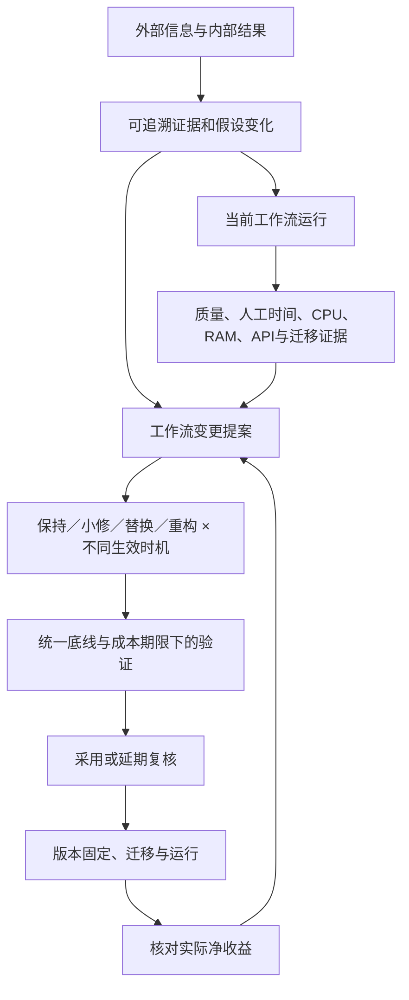

# Harness 开源深研与本机资源研究

> **公开整理版**：基于原稿《Harness 开源深研与本机资源研究》（源版本：2026-10-27）。本次删去私有项目实例、公司项目专属内容及原始个人语料，未重新验证实验。源稿状态：reference；源版本编号保留，公开编辑不代表实现完成或新验证结果；章节与条目沿用源编号，删节后可能不连续。

**日期：2026-10-27（洛杉矶）／2026-10-28（UTC）**
**研究基准：本机常驻，外部模型 API。** 本文是讨论与选型证据，不是已批准的开发方案。

本轮重点研究 Agno、Letta Code、Pydantic AI / Harness，并用 Microsoft Agent Framework 和 LiteLLM 补充状态迁移及成本治理方面的比较。此前十个项目的全景介绍保留在[《十个 Agent 仓库核查与 Harness 借鉴分析》](<ten-agent-repositories-harness-review.md>)中；本轮没有给十个项目编造统一性能排名。

阅读入口：[讨论稿 v0.2](<harness-discussion-v0.2.md>)。原始本地附件未收入公开集合。

## 1. 先给出判断

我们要建设的核心是：**根据新证据和实际运行结果，提出、验证并选择工作流的改变，决定何时迁移，然后复核改变是否值得。** 开源框架可以承载其中的执行、记忆、扩展、评估和恢复，仍需由我们定义目标、证据关系、候选比较、最低复核义务与重构决策。

建议先研究一个轻量的执行适配器，优先用 Pydantic AI 做可组合的验证；同时保留 Agno 作为带运营能力的对照，借鉴 Letta 的长期记忆和扩展生命周期。这个建议来自职责匹配和可控制性，不是从少量内存数字推导出的胜负。

本机受控测试说明，常驻框架本身可以在百 MiB 量级运行；任务历史、持久化策略、并发与额外服务会改变完整系统的成本。最直接测到的优化是缩短每轮携带的历史：同样 60 个合成任务，保留最近 4 个完整轮次使请求正文总字节数下降约 85.5%，两套框架的任务 CPU 时间下降约 70–77%。这不是 token 计费测量，也没有验证真实研究质量。

## 2. 证据与版本

采用三类证据，正文明确区分：

- **已读官方文档或源码**：证明某机制如何声明和实现；不据此声称完整业务效果已验证。
- **本机实测**：固定版本、工作负载和配置下的资源结果。
- **设计推断**：对我们项目的借鉴与优化假设，需在真实任务中验证。

| 对象 | 本轮版本／范围 | 实际核查 |
| --- | --- | --- |
| Agno | `agno[openai,sqlite,os]==3.1.11` | SDK 源码、AgentOS 入口、官方改进模板；SDK 任务及 AgentOS 空闲测试。 |
| Pydantic AI | `pydantic-ai-slim[openai]==2.63.0` | 工具与能力机制、持久化；SDK 任务实测。 |
| Pydantic AI Harness | `0.63.0` | 能力创建源码、StepPersistence；SQLite 记录路径实测。 |
| Letta Code | `@letta-ai/letta-code==0.34.26` | 当前 Node 包、MemFS、mods、App Server；受限配置下的空服务探测。 |
| Microsoft Agent Framework | 当前官方 checkpoint 文档 | 核查恢复与结构迁移边界；未做本机负载测试。 |
| LiteLLM | 当前官方部署／缓存文档，另查历史性能讨论 | 核查成本层及资源计量口径；未启动 Proxy 做本机负载测试。 |

安装版本与完整依赖锁定记录在本地历史复核附件中；公开集合不附该原始附件。Agno 与 Pydantic 两个环境解析到相同的 OpenAI SDK `3.40.0`、Pydantic `2.14.1`。Letta 使用符合包声明要求的 Node `24.22.1`；未改动全局 Node，也未使用本机默认的 x86 Python 测被测框架。[Agno 包元数据](https://pypi.org/project/agno/3.1.11/)，[Pydantic AI Slim](https://pypi.org/project/pydantic-ai-slim/2.63.0/)，[Harness 包](https://pypi.org/project/pydantic-ai-harness/0.63.0/)，[Letta Code 包](https://www.npmjs.com/package/@letta-ai/letta-code/v/0.34.26)

## 3. Agno：最值得借鉴的是改进提案与运行证据的连接

### 3.1 它实际提供什么

Agno 的 Agent 执行模型请求和工具，Team 负责协作，Workflow 表达执行结构；AgentOS 再提供服务入口、运行状态及可选运营功能。SDK 与 AgentOS 是不同部署层，不应将 SDK 对象创建开销当作整套服务占用。[Agno Agent 文档](https://docs.agno.com/agents/overview)，[Agno 仓库](https://github.com/agno-agi/agno)

尤其贴近本项目的是官方 `agentos-railway` 模板：`app/company.py` 把代码与产品上下文登记为来源，维护 Routine 查新版本和当前代码，提出有依据、说明验证方式的改进任务，并设置 `auto_accept=False`。这已不只是单轮工具调用，接近“新信息 → 改进候选 → 待决定任务”。但这里只验证了配置和源码，没有确认某个实例的定时任务实际执行过。[维护 Routine 源码](https://github.com/agno-agi/agentos-railway/blob/main/app/company.py)

模板的 `eval-and-improve` 区分修复已有失败与探索新情景，要求先复现、定位环境问题、修改后检查回归；历史会话可以生成任务，却不能自动变成标准答案。其用户模拟也不代表工具副作用被模拟，工具和数据库仍可能实际执行。[评估与改进流程](https://github.com/agno-agi/agentos-railway/blob/main/.agents/skills/eval-and-improve/SKILL.md)

### 3.2 对我们具体有什么用

可借鉴三个机制：把新资料变成有来源的 Backlog 提案；将运行记录转成可重复评价的任务；区分“值得调查”和“已满足采用条件”。我们需要在提案之上增加：最佳可行小修基线、未来使用期限、迁移成本、激活时机、最低跟踪要求，以及实际效果复核。

不能假设模板自带的原生 eval runner 能直接评估我们任意结构的整个工作流。被查看的模板评估说明对原生 Agent/Team 和其他目标有具体限制；完整流程可以另写外层评价器，统一对输入、证据时点、结果与成本做比较。[创建评估说明](https://github.com/agno-agi/agentos-railway/blob/main/.agents/skills/create-evals/SKILL.md)

### 3.3 资源上的关键发现

Agno 官方 `PerformanceEval` 的内存指标使用 `tracemalloc`，不包括进程 RSS、数据库服务或远程模型；其 warm-up、运行时间、内存测量会分别运行 callable。因此不能把“创建 Agent 只分配少量对象”解释为“常驻系统只占这些内存”，也不能直接拿带真实工具的 callable 反复测试而忽略副作用和调用费用。[官方性能测量口径](https://docs.agno.com/examples/evals/performance/overview)

本轮源码还确认，历史注入和历史持久化各有独立配置；启用历史时，`num_history_runs` 等机制可以限制输入范围。下面的全历史压力条件是研究夹具显式构造的，不是对 Agno 默认行为的描述。AgentOS 的调度、tracing、数据库、MCP 等也要按实际需要启用；本轮空服务测试没有加载整套生产依赖。

**取舍**：若首版需要较多运行管理与服务功能，Agno 有整合价值；若只是验证工作流改进的核心决策，先引入完整模板会增加与主问题无关的配置面。该取舍应通过同一真实任务的集成工作量来判断。

## 4. Pydantic AI / Harness：适合把可执行机制做成明确契约

### 4.1 可组合能力与工具生命周期

Pydantic AI 将工具、输入输出结构、依赖与能力生命周期放在可组合接口中。按步骤准备工具、延迟发现工具和按需能力，可以对应我们的“少量核心工具 + 当前任务工具 + 需要时发现”。这并不意味着工具一进入 schema 就拥有执行权限，授权仍是宿主的职责。[高级工具机制](https://pydantic.dev/docs/ai/tools-toolsets/tools-advanced/)，[能力概览](https://pydantic.dev/docs/ai/capabilities/overview/)

`CapabilityCreation` 的激活边界很清晰：本次 run 生成并验证 Python 能力，宿主在下一次 run 调用 `store.load_active()` 后传入。验证检查构造和静态接口，不运行需要真实上下文的所有异步钩子，也不证明业务有效。它执行宿主进程内的 Python，不能把“验证通过”理解成隔离执行或有益改进。[能力创建文档](https://pydantic.dev/docs/ai/harness/capability-creation/)

本轮安装源码进一步确认：加载的代码版本按内容生成模块身份，成功加载的旧版本可能继续留在 `sys.modules`，使旧运行仍能解释其类型。对长期反复生成新能力的系统，这是需要计量的常驻状态来源。可考虑按版本管理工作进程，在任务结束并确认状态已保存后回收；不能为了腾内存打断正常运行的任务。[能力加载源码目录](https://github.com/pydantic/pydantic-ai/tree/main/src/pydantic_ai_harness/pydantic_ai_harness/capability_creation/)

### 4.2 持久化不能只看“有存储”

存储策略会影响成本：快照默认可持续增长，可按 run 限制快照，并有消息去重存储机制；事件和外置媒体的保留仍需要宿主制定策略。限制每个 run 的快照数，不等于限制全部运行历史的总大小。本轮 SQLite 条件专门测量了记录步骤的额外 CPU 与磁盘开销。[StepPersistence](https://pydantic.dev/docs/ai/harness/step-persistence/)

### 4.3 评价机制的使用边界

工具正确性、参数正确性、请求数和轨迹检查适合定位问题。但如果新工作流改变了步骤顺序，要求与旧轨迹完全一致会把有效重构判为失败。我们的评价应保留必须遵守的约束，主要比较结果与完整成本；轨迹用于解释差异。[Agentic evaluators](https://pydantic.dev/docs/ai/evals/evaluators/agentic/)

**取舍**：适合先把 `Evidence → Proposal → Evaluation → Adoption` 做成明确的结构对象与可替换执行接口。它不会自动提供我们的业务决策模型。Harness 仍处于 0.x，版本升级需要锁定依赖并做契约与回放检查；动态能力与某些 durable 引擎的注册机制也有限制，不能假定任意组合均可运行。

## 5. Letta Code：长期记忆与修改运行方式值得独立借鉴

### 5.1 先区分当前架构

旧 `letta-ai/letta` 的主分支指向 Letta Code；旧 V1 API server 的历史保留在 archive 分支。当前 CLI 可以本地运行，App Server 为本地 agent 暴露服务，状态本地保存与模型本地推理是两个独立选择。因此，旧 Python/Postgres 服务的资源帖子不能直接说明当前 Node 本地模式的占用。[旧仓库说明](https://github.com/letta-ai/letta)，[Letta Code](https://github.com/letta-ai/letta-code)，[本地与自托管模式](https://docs.letta.com/self-hosting)

### 5.2 MemFS 带来的设计启发

MemFS 使用 Git 管理可编辑记忆：常用内容进入上下文，详细内容按需要读取；记忆整理可通过专门操作或 dreaming 完成。它适合长期背景、偏好和经验的演进，但模型可写的总结不能替代不可覆盖的原始证据与决策历史。[MemFS](https://docs.letta.com/concepts/memfs)，[记忆与 dreaming](https://docs.letta.com/configuration/memory)

我们可采用三种不同保留方式：原始证据和执行日志可追溯；当前信念可修订且保留来源；工作上下文有界并能按需取回。这样才能同时满足“不断学习”和“以后重建当时为什么这么判断”。

### 5.3 Mods 与工作流生成

Mods 可以注册工具、订阅调用或模型生命周期、加入权限规则和 provider，并在 reload 后生效。它们是与宿主同权限的代码；某些钩子只在本地 backend 可用。扩展需管理其清理函数、定时器和订阅，否则反复 reload 可能积累资源。这个机制适合借鉴，但我们的预算、暂停权限和证据时间约束不应由普通 mod 任意重写。[Mods](https://docs.letta.com/configuration/mods)

动态 workflows 能组织多阶段或并行子任务。它解决的是候选执行结构的生成与运行，尚不能替代对结构优劣、迁移成本和激活时机的比较。其示例中的默认并发或调用上限也不能直接作为我们这台 Mac 的容量设置。[动态 workflows](https://docs.letta.com/configuration/workflows)

### 5.4 本地运行遇到的具体边界

官方提供 `LETTA_LOCAL_BACKEND_DIR` 隔离 agent 状态。本轮包源码显示，部分全局 settings 仍直接使用 `~/.letta/settings.json`，并非所有路径都跟随该环境变量。测试通过文件系统约束阻止读取和改写用户全局 Letta 状态；服务成功监听，但产生 settings 写入被拒、采用默认配置的提示。因此后文 Letta 数字是 **受限配置下的空 App Server 探测**，不是正常配置、活跃 agent、MemFS、后台 dreaming 的完整资源基准。[App Server 启动方式](https://docs.letta.com/self-hosting/app-server/quickstart)

**取舍**：若项目的主要难点是长期连续使用与记忆积累，Letta 很有参考价值；我们仍要为证据不可变记录、流程版本、定量比较和受约束的扩展发布补充自己的规则。

## 6. 两个补充：恢复与成本

**Microsoft Agent Framework** 的检查点恢复需要保持原拓扑及执行器身份。它提醒我们：恢复 W1 的执行与把 W1 的状态迁移到 W2 是不同工程任务。重构提案必须把状态兼容、未完成副作用、回读验证与旧任务去向作为迁移成本。默认让旧任务固定版本完成，新任务使用新版本，是一个值得先验证的低复杂度方案。[官方 checkpoint 文档](https://learn.microsoft.com/en-us/agent-framework/workflows/checkpoints)

**LiteLLM** 可承担模型调用、路由、重试、成本记录与预算治理，作为可选基础设施。官方生产文档中的每 worker 容量建议是部署预留，不是实测空闲 RSS；历史性能讨论中的单 worker 约 500 MB 是特定旧版本背景，也不能套到今天的 SDK 或 Proxy 上。本轮没有测它的当前进程占用。[生产部署建议](https://docs.litellm.ai/docs/proxy/prod)，[历史性能路线讨论](https://github.com/BerriAI/litellm/discussions/15933)

多 worker 的本地缓存不天然共享，集中缓存又增加一个服务及其运维成本。先用单进程直接调用并完整记账，还是先放独立网关，取决于多供应商、多客户端和统一限流是否已成为需要；不能只因生态里有组件就全部常驻。[LiteLLM 缓存](https://docs.litellm.ai/docs/proxy/caching)

## 7. 本机测量方法

### 7.1 环境与统计口径

- Apple M1，8 核，16 GiB RAM，macOS 26.5；被测 Python 为 ARM64 CPython 3.12.14。
- 每个 Python 框架使用独立虚拟环境；测量脚本和依赖放在本任务目录，无全局安装。
- 各条件独立启动、重复 3 次；正式试验前进行了小规模接口预检。任务试验交替执行部分条件以减少顺序影响，没有清理 OS 文件缓存。因此启动数值属于当前缓存环境，不是严格冷启动。
- 外部观察器每 50 ms 采样子进程树 RSS。RSS 使用 MiB（2²⁰ 字节）；跨进程求和可能重复计算共享页，采样可能漏掉短峰值，不等于精确物理 footprint。
- 空闲 CPU 从进程树 CPU 时间差计算，单逻辑核满载为 100%；任务 CPU 时间取被测主进程的 `process_time()`，包含该进程线程，不含观察器与模拟 API 服务的 CPU。
- SDK 空闲观察 5 秒，基线 8 秒；服务就绪后观察 12 秒，去掉最初 2 秒算空闲值。短窗口“接近零”不代表长期零耗能，也不含周期任务。
- 机器不是专用跑分环境：开始时系统已有约 13.6 GiB 交换占用，后续约 13.5 GiB，`memory_pressure -Q` 的 free percentage 约 34–38%。未关闭用户应用、清缓存或修改已有任务。数字用于量级与同框架受控对照，不能当作跨机器排行榜。

### 7.2 任务定义

每个负载条件先热身 1 次，然后顺序完成 60 个任务。每个任务恰好包含两次模型 API 请求、一次 `lookup` 工具调用和一个固定最终回答；工具产生 32 KiB 合成文本。本地 HTTP stub 实现兼容 API，每次等待 5 ms，不调用真实模型。正式运行均断言 60 次工具执行，观察器记录 120 次请求。

两个历史条件分别为：显式携带所有历史轮次；只携带最近 4 个完整轮次。两者都以相同格式追加写入合成证据副本，未逐字归档工具返回中的标识头部，因此这里不验证生产级证据归档。历史裁剪按完整工具调用／结果轮次进行，不截断未完成调用。**这是测试夹具选择的条件，不是框架默认配置，也不是已经可用于真实研究的上下文算法。**

Pydantic SQLite 条件另启用 `StepPersistence` 和 `SqliteStepStore(max_snapshots_per_run=2)`；它增加持久化能力，因此不能把额外开销简单判为性能差。模拟服务返回的 usage 是固定占位数，未用于计算模型费用或 token 节省。

### 7.3 实测结果

以下空闲 RSS 为 3 次中位数，并同时列出范围；峰值列为 3 次中最大的 50 ms 采样值，包含启动。

| 条件 | 空闲 RSS 中位数（MiB） | 空闲 RSS 范围（MiB） | 观测峰值（MiB） | 空闲 CPU（单核基准） |
| --- | ---: | ---: | ---: | ---: |
| Python 夹具基线（含标准库） | 23.9 | 23.7–23.9 | 23.9 | <0.01% |
| Agno SDK + OpenAI 适配器 | 67.4 | 67.2–67.4 | 78.9 | <0.01% |
| Pydantic AI Slim + OpenAI 适配器 | 81.4 | 79.7–81.5 | 81.5 | <0.01% |
| Pydantic + SQLite 步骤记录 | 82.2 | 82.2–82.2 | 88.0 | <0.01% |
| Agno AgentOS 单 worker 空闲服务 | 107.8 | 107.1–107.8 | 132.6 | <0.01% |
| Letta 空 App Server（受限配置回退） | 225.1 | 180.0–240.9 | 265.8 | <0.01% |

任务 CPU 与墙钟时间均为 3 次中位数，覆盖 60 个任务；CPU 平均利用率用每次 CPU／墙钟的比值取中位数。墙钟包含本地模拟 API 等待，不代表真实供应商延迟。

| 条件 | 主进程 CPU 秒 | 墙钟秒 | 任务期平均 CPU（单核） | 请求正文合计（MiB） |
| --- | ---: | ---: | ---: | ---: |
| Agno，全历史 | 1.978 | 3.383 | 58.2% | 113.62 |
| Agno，最近 4 轮 | 0.464 | 1.644 | 28.6% | 16.44 |
| Pydantic，全历史 | 2.058 | 3.505 | 58.7% | 113.63 |
| Pydantic，最近 4 轮 | 0.619 | 1.811 | 34.1% | 16.45 |
| Pydantic，最近 4 轮 + SQLite | 1.905 | 3.320 | 57.4% | 16.45 |

Agno AgentOS 是单 worker、一个已配置 agent、无业务数据库，关闭 tracing、scheduler 和 telemetry；Letta 是无 agent 会话的空 App Server，关闭 cron 和 telemetry，且因全局 settings 隔离发生默认配置回退。它们与 SDK 所承担功能不同，单独列出。

服务探测在预定观察窗口后发送 SIGTERM 正常结束；Agno/uvicorn 最终退出码保留为 `-15`，Letta 为 `0`。这属于试验预定结束，不是运行中崩溃。没有结束或重启用户已有进程。

### 7.4 优化效果与不能推出的结论

- agno：请求正文字节减少 **85.5%**，主进程 CPU 时间减少 **76.6%**；采样峰值 RSS 的中位数由 87.1 MiB 变为 78.7 MiB。
- pydantic：请求正文字节减少 **85.5%**，主进程 CPU 时间减少 **69.9%**；采样峰值 RSS 的中位数由 89.2 MiB 变为 81.4 MiB。

这说明反复序列化、校验和发送已有长文本可以成为宿主 CPU 的一项成本。它不能证明“越短越好”：真实任务可能必须利用早期信息。下一步应比较“有界上下文 + 可回读原始证据 + 必要状态摘要”，同时测遗漏率、来源正确性和任务完成质量。

Pydantic 增加 SQLite 步骤记录后，60 任务 CPU 从约 0.62 秒增至约 1.91 秒；数据库主文件约 4.92 MiB，另有约 1.88 MiB 的合成证据副本。记录带来了恢复与审计信息，应优化重复写入和保留策略，不应直接删除这些能力来追求更低数字。该数据库大小是此工作负载结果，不是长期增长率预测。

## 8. 对我们项目的资源设计建议

| 机制 | 解决的问题 | 第一轮如何验证 |
| --- | --- | --- |
| 一个持久调度器，推理按事件启动 | 避免每个方向常驻一整套推理循环 | 空闲 CPU、漏事件、复核逾期率；先满足最低复核，再安排可选试验。 |
| 结构化当前状态 + 有界工作上下文 + 证据句柄 | 降低历史反复处理的开销 | 同任务的 CPU 秒、请求正文、证据漏检和结果质量。 |
| 轻重工作分开，控制并发 | 浏览器、解析、批量计算、索引挤占交互任务 | 峰值 RSS、排队时间、交互延迟与完成率的共同变化。 |
| 快照与事件分开管理 | 全历史快照重复写入、总存储无边界 | 恢复正确性不变时的写入字节、CPU 和数据库增长。 |
| 扩展版本固定，任务结束后回收旧执行环境 | 热加载长期保留旧代码、定时器和连接 | 多次加载／卸载后的空闲资源趋势和旧任务可恢复性。 |
| 采集去重、失败退避、事件合并 | 重复消息与高频轮询放大无效判断 | 有效信息到达延迟、重复调用率、最低监测义务完成率。 |
| 按必要性引入代理、图存储、向量库 | 多个独立服务增加常驻基线与恢复复杂度 | 新能力带来的收益是否覆盖 CPU、RAM、磁盘与维护成本。 |

“减少资源”与“完全暂停方向”需要分开。方向可以只保留持久状态、低频跟踪与周期复核，暂不实验；只有人的明确决定才能完全暂停已采纳方向。系统应显式报告最低义务超预算，而不是悄悄停止跟踪。

建议先不设“低于某个 MiB 就合格”的武断门槛。先测最小真实切片的空闲、活跃、峰值和增长斜率，再根据机器可用资源约定预算；对完整进程树及外部服务计账。只看模型费用同样不够，人工复核和维护时间通常也是候选比较的一部分。

## 9. 具体设计落点与下一步

可以先用 Pydantic AI 实验执行与记录契约，把它封装在可替换适配器后；借鉴 Agno 的提案／评估循环以及 Letta 的记忆与扩展版本管理。若真实切片显示 AgentOS 可显著减少运行管理工作，再与它做同任务、同能力的比较。已有 harness 的控制面与工具执行层也应作为适配候选，用同一真实切片检查可复用范围；本轮未重测它，不能据此断定需要替换。当前不需要同时部署三套框架。

下一轮最值得确定的是：第一条真实基线流程、首要目标及不可恶化指标、允许自动采用的改变范围。讨论稿 v0.2 已将这些问题与主循环、最低复核、重构判断、迁移和工具生命周期的流程图连接起来。

## 10. 复核材料

本地历史资源附件包含测量脚本、依赖清单与逐次结果，本公开集合不附该原始附件；本段仅说明原稿的证据范围。原讨论稿 v0.1 保持不变。本轮没有新建产品仓库、提交或部署应用。
