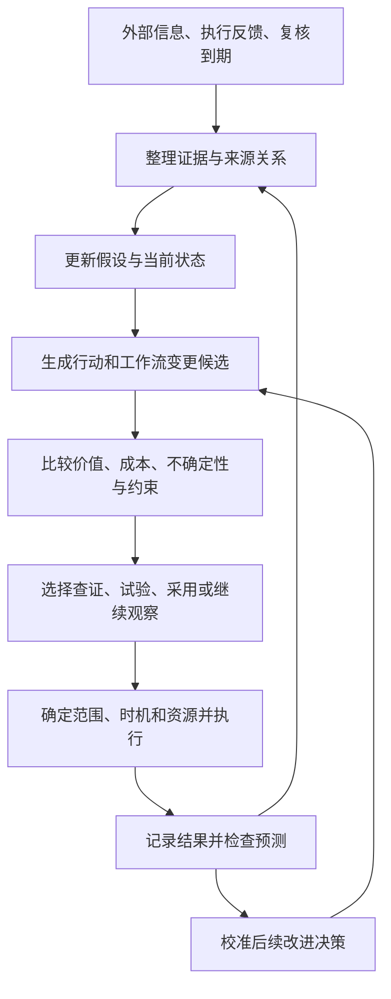

# 信息驱动的决策与工作流演化 Harness

> **公开整理版**：基于原稿《信息驱动的决策与工作流演化 Harness》（源版本：0.1）。本次删去私有项目实例、公司项目专属内容及原始个人语料，未重新验证实验。源稿状态：historical；源版本编号保留，公开编辑不代表实现完成或新验证结果；章节与条目沿用源编号，删节后可能不连续。

**讨论稿 v0.1｜整理日期：2026-10-27**

本文整理本轮讨论，供下一轮共同修订。它记录已经明确的需求、建议采用的建模与设计方向，以及尚未决定的问题；不代表已经冻结架构、选定技术栈或开始实现。文中的公式是用于组织判断的模型，示例数字不构成通用阈值。

## 1. 我们正在寻找什么

我们希望建立一个持续接收外部信息和内部执行反馈的 harness：它能够判断证据质量，更新对目标、假设和环境的认识，把变化转化为可讨论的行动、可检验的预测和量化指标，并据此改进策略及工作流。

**工作流本身必须是被持续评估和改进的对象。** 系统需要判断：新信息是否只需要改变当前行动，是否适合小修或替换模块，是否值得重构已有工作流，以及改变应该立即发生、在当前模块结束后发生，还是留到下一个项目。

因此，系统需要交付两类相互关联的结果：

- **面向当前任务的决策**：继续查证、提出建议、开展小规模试验、调整资源或行动。
- **面向工作方式的改进决策**：提出替代工作流，比较收益、成本和不确定性，安排验证与迁移，并检查改动是否真正有效。

信源管理、工具发现、工具调用、记忆和工作流执行，都是支撑这两类决策的组成部分。

第一版最有价值的验收问题是：

> 给定一个已有工作流和一项有意义的新发现，harness 能否形成一份有证据、可量化、包含验证方式与实施时机的改进决策，并在结果出现后修正自己的判断？

### 1.1 已经明确的需求与边界

| 主题 | 本轮讨论形成的要求 |
| --- | --- |
| 探索与利用 | 不成熟时偏向发现机会，成熟时偏向服务已有目标；两者都需要，不能用一种模式概括所有情况。 |
| 实时含义 | 事件驱动。外部新消息、实验完成、结果偏离、模块边界和复核到期，都可以触发判断。 |
| 建议与实验 | 既可以提出建议，也可以开展小规模试验；实验本身是一种决策动作。 |
| 变更范围 | 参数调整、小修、模块替换、流程重构和项目层面的重新规划，需要区别处理。 |
| 生效时机 | 立即、试验后、下一模块、下一项目，都应作为候选时机比较。 |
| 最小投入 | 每个已采纳方向都保留跟踪与周期复核；是否做实验另行判断。最低投入不等于必须持续做实验。 |
| 暂停权限 | 系统可以降低优先级和资源投入；完全暂停一个已采纳方向，只能由人决定。 |
| 领域边界 | 各领域独立管理目标、预算和评价标准；本稿不设计跨领域统一资源分配。 |
| 工具扩展 | 需要同时讨论会话过程中加载已有工具，以及工作结束后生成、验证和沉淀新能力。 |
| 当前工作阶段 | 先整理讨论稿，再继续对齐问题与实现方向。 |

### 1.2 本稿提出、仍待验证的设计建议

下文建议用“证据—假设—工作流—变更提案—验证结果”的关联记录承载核心循环，用带切换成本的序贯决策描述重要改变，以版本化流程和执行记录支持比较、迁移与回退。这些是讨论方案，不是已确认的技术选型。

## 2. 主循环与阶段变化

一个外部事件进入系统后，不必立刻改变行动。它可能只改变某个判断的可信程度，也可能触发一次实验，或者暴露现有工作流的结构性问题。

建议把主循环写成：

这里的“继续观察”有明确的跟踪方式、下次复核时间或触发条件。对已采纳方向，它不能变成没有期限的搁置。

建议把阶段变化落实到具体目标、假设或模块上。同一项目可以同时存在成熟的执行模块和需要探索的新方法，用一个全局“成熟度”切换全部任务会过于粗糙。环境或证据变化后，成熟模块也可能重新进入验证阶段。

早期主要减少“什么值得做、什么做得成”的不确定性；后期更多比较结果质量、可靠性、效率和维护成本。探索与利用的具体比例尚未确定，应依据预算、证据和潜在影响调整。

## 3. 从信息到可行动证据

### 3.1 分开评估可信性、适用性与行动价值

系统至少需要回答三个不同的问题：

1. **这条信息能支持什么主张？** 原始出处是什么，是否准确转述，是否存在撤回、修订或相反证据？
2. **这个主张适用于我们吗？** 对象、环境、时间、数据、前提与当前场景是否相近？
3. **据此改变是否值得？** 即使主张真实且适用，收益是否覆盖验证、切换和持续维护的成本？

例如，新论文可信，并不自动意味着其中的方法适合当前数据、当前工作流或当前项目阶段。

来源可靠性也不应被压成一个永久分数。某来源对某类事实可能准确，对另一类推断可能缺乏证据。更合适的记录粒度是“来源对这项主张提供了什么支持”。多个转述同一出处的报道，不能当作多份独立证据。

### 3.2 建议保留的证据字段

- 原始出处、可定位的内容片段、版本或快照，以及必要的内容标识。
- 主张及其适用条件，支持、反驳和无法判断的证据。
- 原始来源与转载、引用、推断之间的关系。
- 事件发生时间、公开时间、系统首次获知时间；必要时另记有效时间区间。
- 哪些目标、假设、流程和既有决策受到影响。
- 对结论的修订记录，以及修订前的判断。

来源追踪可以借用 provenance 模型组织“实体、活动、参与者”的关系，但来源记录本身不能保证事实为真。[W3C PROV 概览](https://www.w3.org/TR/prov-overview/)

### 3.3 置信度的使用边界

模型自行给出的“85% 可信”不能直接充当经过校准的概率。可以先记录证据等级、估计区间、分歧和关键未知项；在有可验证结果的任务中，再用历史预测与实际结果检查概率校准。

外部网页、论文和工具返回内容都作为证据处理。其中的指令不应获得修改目标、权限或执行政策的效力。

## 4. 本体、工作流与 harness 的分工

工作流适合表达已知的执行结构，包括步骤、条件分支、循环、输入输出和失败处理。它也可以参与探索，例如运行一个实验；其局限在于，预先固定的流程本身无法解释何时应该被换掉。

轻量本体或语义模型负责表达对象及其关系，使系统能够回答“这项新证据影响哪个假设，哪些工作依赖这个假设”。Harness 负责组织判断、生成候选、调用验证和执行机制，并根据结果改变后续决策。

建议先明确下列对象，而不预先要求部署图数据库：

| 对象 | 需要表达的内容 |
| --- | --- |
| 目标与方向 | 希望改善的结果、评价标准、约束、成熟程度、采纳状态和复核义务。 |
| 证据与主张 | 来源、时间、适用条件、支持和反驳关系。 |
| 假设与信念 | 当前为什么采用某种方法，哪些事实变化会推翻或削弱它。 |
| 策略与工作流版本 | 当前怎样行动，执行结构、适用范围、依赖和已验证条件是什么。 |
| 变更提案 | 为什么改变、有哪些候选、预计收益与成本、何时实施。 |
| 实验与结果 | 比较了什么、采用什么评价标准、观察到了什么、哪些结论仍不成立。 |
| 资源与运行状态 | 预算、正在执行的任务、最低跟踪投入、复核截止时间。 |
| 工具与能力版本 | 能力定义、执行入口、权限、适用条件和验证记录。 |

核心关系包括“支持／反驳”“依赖”“用于实现”“由某次执行产生”“替代”“使既有验证失效”。对象应有稳定标识和版本；声明的关系、推断的关系与已经验证的关系需要区别记录。

执行流程可能有循环，依赖关系和证据关系也未必构成同一个 DAG。语义关联、执行控制和历史记录可以相互引用，但不必挤进一种图模型。

## 5. 核心机制：如何改进已有工作流

### 5.1 先定位新信息改变了什么

新证据应沿下列路径进入工作流改进：

> 新证据 → 受影响的假设 → 依赖这些假设的环节 → 可行的修改方案 → 区分方案所需的验证。

可能的触发包括：

- 反复出现同类错误、人工纠正和返工。
- 成本、延迟、可靠性或结果质量明显偏离预期。
- 多个局部补丁在处理同一个更上层的问题。
- 数据、工具、环境或约束改变，使已有假设不再成立。
- 新方法打开原来无法实现的能力，即使当前流程没有明显故障。
- 项目进入新阶段，未来使用量或工作类型发生变化。

这些现象足以触发评估，但不能单独证明重构值得实施。错误也可能来自输入变化、工具故障或偶然波动，需要先定位问题。

### 5.2 对同一问题生成竞争方案

至少比较以下几类候选中实际可行的部分：

| 候选 | 典型变化 |
| --- | --- |
| 保持现状并跟踪 | 记录新证据、设置复核条件，暂时维持当前执行方式。 |
| 参数调整或小修 | 调整阈值、补一个检查、修改局部规则，基本保持现有接口和结构。 |
| 模块替换 | 替换一个处理环节，重新验证其接口与受影响的下游结果。 |
| 工作流重构 | 改变步骤之间的组织方式、状态模型、关键接口或多个依赖关系。 |
| 新项目或下一版本采用 | 保留当前执行安排，在更合适的边界采用新结构。 |

“改变什么”和“什么时候改变”是不同维度。模块替换也可以延期；重构也可以分阶段完成。小修可以在已约定的范围内直接应用，但仍需记录版本和后续效果。连续小修的累计影响，也需要周期性复核。

大改的规模应由实际影响衡量：涉及多少类任务、影响多大比例的运行、哪些接口和状态需要迁移、哪些验证结论失效、回退有多困难。修改文件数或新增步骤数只能提供很有限的信息。

### 5.3 用共同的未来期限比较净价值

设完整变更方案为：

\[
a=(W',\tau,m)
\]

其中，\(W'\) 是候选工作流，\(\tau\) 是开始切换的时机，\(m\) 是试运行与迁移安排。方案应包含过渡期间继续运行旧流程的行为。

在共同的未来评价期限 \(H\) 内，定义：

\[
Z_H(a)=B_H(a)-C_H(a)
\]

\[
\Delta V_H(a,a_0)
=\mathbb E\!\left[Z_H(a)-Z_H(a_0)\mid\mathcal I_t\right]
\]

- \(B_H\)：对目标产生的收益，包括结果质量和新增可用能力等。
- \(C_H\)：从现在开始的实现、验证、迁移、运行、维护及切换损失。
- \(\mathcal I_t\)：做决定时实际可得的信息。
- \(a_0\)：比较方案。评估重构时，应包含当前已知、可行的小修候选中最有竞争力的方案。

同一项收益或损失只计一次。历史投入不作为必须继续沿用旧方案的理由；未来因改变而产生的重做、迁移和培训成本应计入。

这些量往往不确定。提案除了期望值，还应报告区间、关键假设、悲观情形和敏感性。例如：未来使用次数减半、实现成本翻倍、效果只能维持一个阶段时，结论是否改变？

以上形式需要在同一领域内有可比较的价值尺度。质量、时间、金钱与风险无法合理换算时，先设定必须满足的底线，再比较可行方案；仍有取舍时保留多指标或 Pareto 候选，不强行制造一个总分。

### 5.4 回本点示例

以下数字仅用于说明方法。假设结果质量和可靠性相当，比较的是总人工耗时：

| 方案 | 每次同类任务耗时 | 实现、验证与迁移投入 |
| --- | ---: | ---: |
| 保持现状 | 20 分钟 | 0 |
| 小修 | 16 分钟 | 4 小时 |
| 重构 | 8 分钟 | 36 小时 |

重构相对小修多投入 32 小时，每次多节省 8 分钟，因此：

\[
N_{\text{回本}}=\frac{(36-4)\times60}{16-8}=240\text{ 次任务}
\]

如果当前项目只剩几十次同类任务，下一项目再采用可能更合理；如果未来使用量很大，且效果有证据支持，当前重构就更有理由。

这个计算依赖效果持续、任务具有可比性等假设。新增能力、失败风险或环境变化不能直接套入这个简单公式；它们需要单独建模或通过试验获得信息。

### 5.5 将“值得研究”与“值得全面迁移”设为不同判断

全面迁移承担的不可逆损失越大，所需证据应越强。证据不足时，可以优先做能改变决策的查证或试验，而不必在“完全不动”和“全面重构”之间二选一。

建议一次改进至少保留以下证据链：

1. **事前预测**：预计改善哪些结果、影响哪些任务、付出多少成本、可能恶化什么。
2. **比较设计**：采用哪些基线、任务集合、评价标准和观察期限。
3. **观察结果**：历史回放、留出任务、影子运行或限定范围试验的结果。
4. **采用条件**：什么证据支持迁移，什么情况继续验证或回退。
5. **事后复核**：实际收益、迁移成本和副作用是否符合预测。

历史回放可以验证一部分问题；由此得到的结论需要注明覆盖范围，不能直接等同于新环境下的实际效果。任务构成变化时，应分层比较，避免把“遇到更容易的任务”误认为流程改进。反复查看结果或尝试很多候选，也需要避免按最有利的一次结果挑选结论。

评价应同时包含总体结果、诊断指标、数据质量和不得恶化的指标。例如，工具调用数可以解释成本变化，但不能独立证明任务完成质量提高。[Microsoft Research：可信实验中的指标分类](https://www.microsoft.com/en-us/research/articles/patterns-of-trustworthy-experimentation-during-experiment-stage/)

安全策略改进研究提供了一个可借鉴的原则：以现有策略为基线，在证据不足的部分限制改变。相关理论保证依赖具体模型和采样假设，不能直接推广为整个 harness 的性能保证。[Safe Policy Improvement with Baseline Bootstrapping](https://proceedings.mlr.press/v97/laroche19a.html)

### 5.6 选择实施时机

需要比较“现在采用”“当前模块完成后采用”“下一项目采用”等完整方案：

- 现在采用能够更早获得收益，也可能造成中断、迁移和重新验证成本。
- 等到模块边界可能减少切换成本，同时放弃等待期间的改善收益。
- 等待还可能获得新证据，降低选错方案的概率。
- 当前流程已违反必要约束时，继续等待的损失可能很大，应先处理已知问题。

运行中的任务应记录并固定所用工作流、工具与评价版本。新版本何时对已有任务生效，需要显式安排。重构提案不能默认打断正常运行的长任务或丢弃已完成工作。

### 5.7 一份工作流变更提案应回答什么

| 字段 | 要回答的问题 |
| --- | --- |
| 触发与证据 | 为什么现在需要重新判断？依据在哪里？ |
| 影响映射 | 哪些假设、流程、任务和已有验证受到影响？ |
| 候选与基线 | 保持、小修、替换、重构等方案分别是什么？ |
| 价值与成本 | 在什么未来期限内比较？估计范围和关键假设是什么？ |
| 约束与未知 | 哪些底线必须满足，什么信息仍会改变结论？ |
| 验证安排 | 先做什么比较，如何避免只挑有利结果？ |
| 迁移安排 | 改动范围、实施时机、资源、回退方式是什么？ |
| 后续复核 | 何时检查实际效果，什么结果触发再次判断？ |

它是建议的核心输出对象。系统是否改善，也应由这些提案的实际效果来评价。

### 5.8 改进“做改进判断”的能力

后续应检查：实现与迁移成本是否系统性低估、效果能否从试验迁移到实际运行、哪些类型的改动容易失败、哪些证据能有效改变选择。

可以跟踪成本预测误差、效果预测的校准、试验与上线效果的偏差、回退率和重复返工等。单看“提出了多少建议”或“重构了多少次”不能证明系统在进步。

目标和评价标准也可能需要更新。建议将它们与方案分别版本化，明确变更原因，保证同一轮候选接受一致的比较，避免评价口径变化掩盖实际退步。

## 6. 数学语言：从梯度直觉到序贯决策

### 6.1 离散选择不要求存在梯度

“持续朝更好的方向调整”可以借用梯度下降的直觉，但当前问题中的许多选择是离散的：选择研究方向、替换模块、改变流程结构、决定何时迁移。比较这些候选不要求整个选择空间有梯度。

需要区分：

- **连续但不可微**：在满足相应条件时，可以使用次梯度或其他广义导数。
- **离散或混合选择**：常用组合优化、整数规划、约束求解，或直接比较有限候选。
- **效果未知、必须试验的选择**：可能采用贝叶斯优化、bandit 或实验设计。
- **行动改变后续信息与状态**：需要进一步用序贯决策描述。

经典凸次梯度有其适用条件；Clarke 等广义梯度也依赖局部 Lipschitz 等条件，不能因为“现实不连续”就自动适用。[Stanford：Subgradients](https://web.stanford.edu/class/ee364b/lectures/subgradients_notes.pdf)

工作流结构固定以后，其中某些连续参数可以采用梯度方法。结构之间的比较，可以通过候选生成与试验进行。两种层次可以并存。

### 6.2 建议的总描述

本问题可以先描述为：

> 在不完全信息下，对行动、信息获取、资源投入和工作流变更进行选择，并承担切换成本的序贯决策问题。

在事件时刻 \(k\)，可以用下列状态组织信息：

\[
S_k=(G_k,b_k,W_k,R_k,D_k,B_k)
\]

- \(G_k\)：目标、已采纳方向和候选机会。
- \(b_k\)：对重要假设、环境与候选效果的当前认识。
- \(W_k\)：当前策略与工作流版本。
- \(R_k\)：正在运行的任务、试验和复核状态。
- \(D_k\)：依赖关系、已有承诺和迁移限制。
- \(B_k\)：该领域的可用预算。

可选动作包括继续观察、查证、试验、调整行动、降低投入、改变工作流和安排迁移等。新信息和执行结果到来后，更新状态，再做下一次判断。

POMDP 的信念状态可以帮助描述“看不见真实环境、只能根据观测行动”的部分；持续时间不同的试验与任务，可以参考 SMDP／options 的描述。但第一版无需完整拟合一个大型 POMDP，新目标和新方法不断出现时，也不能假定所有状态与动作已经列举完毕。[Kaelbling、Littman、Cassandra：POMDP 综述](https://cs.brown.edu/research/pubs/techreports/reports/CS-96-08.html)，[Sutton、Precup、Singh：Options](https://www.sciencedirect.com/science/article/pii/S0004370299000521)

概率模型负责表达不确定性和根据证据更新认识；它不会自动消除组合搜索的困难，也不会保证现实中的最优解可计算或可识别。首版应追求在明确范围内做可检查的比较。

用概率论的语言，可以把随事件积累的信息表示为信息族 \(\mathcal F_k\)，要求第 \(k\) 次决策只依赖当时已知的信息，并对候选结果计算条件期望或风险。状态与动作可以是离散的，也可以在满足适当可测性条件的一般空间上定义，不要求它们具有可微结构。对于价值有定义的有限候选集合，选出最大值不需要梯度；候选集合无限或缺少紧致性等条件时，最优值是否能被某个方案达到，需要另行讨论，不能由“使用概率模型”保证。

### 6.3 用信息价值决定是否继续查证或试验

对于一次查证或试验 \(q\)，可以使用局部的信息价值近似：

\[
\operatorname{NetVOI}(q)=
\mathbb E_z\!\left[\max_d V(d\mid\mathcal I,z)\right]
-\max_d V(d\mid\mathcal I)
-C(q)
\]

这里比较的是：获得结果 \(z\) 后，预计能把决策改善多少，以及获取结果要付出多少成本。\(V\) 应在一致的未来期限内计算，并考虑执行和切换；试验占用时间造成的机会损失也应纳入评价。

它的作用是回答“接下来最值得减少哪一种不确定性”，而不是奖励无休止地搜集信息。例如，若实现成本无论如何都无法回收，继续精确估计微小效果可能没有意义；若一个便宜的试验可能改变是否重构的选择，它就更值得做。

这一公式适合作为局部近似。若完整的未来价值已经包含后续学习收益，就不能再重复叠加同一份信息价值。计算和评估本身也有成本。[Stuart Russell：Rational Metareasoning](https://people.eecs.berkeley.edu/~russell/research-bo.html)

### 6.4 最小投入应落实为复核义务

对每个已采纳且未被人暂停的方向，应保留：

- 最低跟踪安排，包括监测哪些来源或变化。
- 最长允许复核间隔。
- 上次实际完成的复核记录和下一次截止时间。
- 复核逾期或监测失效时的可见状态。

一个可检查的目标约束是：

\[
t-t_i^{\text{last completed review}}\leq\Delta_i
\]

其中 \(\Delta_i\) 是方向 \(i\) 允许的最长复核间隔。完成复核需要留下实质性结果；仅创建定时任务或让 agent 醒来，不能算完成。

“保持非零抽中概率”不足以保证这项要求，因为某方向仍可能长期没有获得资源。调度应先满足必要跟踪与到期复核，再分配可选研究和实验预算。实验投入可以为零。

新增方向被正式采纳时，也要检查最低投入是否可持续。如果已采纳方向的最低义务超过预算，系统应显式报告不可行，供人调整预算、复核安排或采纳范围；不能通过静默取消跟踪来维持表面运行。

停止一个具体失败试验、回退一个流程版本，与完全暂停其所属方向是不同动作。方向仍应保留规定的跟踪与复核。只有人的决定才能使已采纳方向进入完全暂停状态。

## 7. 工具设计：暴露、执行与新能力沉淀

### 7.1 先分开三个层次

| 层次 | 含义 |
| --- | --- |
| 能力注册 | 运行环境中存在什么工具、如何执行、版本与接口是什么。 |
| 模型可见 | 当前这一轮模型请求知道哪些工具及其调用方式。 |
| 执行权限 | 当前任务是否允许调用，参数、资源和副作用是否符合约束。 |

发现一个工具，或将它的 schema 加入上下文，不等于获得调用权限。仅在文本里写出一个工具说明，也不等于运行时已有可执行实现。

### 7.2 会话过程中加载已有工具

建议采用以下分配方式：

- 开始时暴露少量稳定能力，例如检索当前状态、查找能力、读取证据和提交结构化结果。
- 根据任务提前加载一组已知相关的领域工具。
- 需要低频能力时，通过工具目录检索，再加载相应定义。

工具目录很小时，可以直接提供全部定义；按需加载的价值需要通过实际上下文成本和调用准确性验证，不必预先复杂化。

工具集合通常在模型请求之间更新。模型先发现能力，harness 将执行入口与工具定义准备好，再在下一次模型请求中提供。不同供应商可能支持请求级工具列表、会话内工具更新消息或延迟加载机制，需要由适配层处理；不能假定所有协议都以同一种形式支持。

已有参考包括 Claude 的 tool search／延迟加载，以及 MCP 的工具发现与调用接口。这些机制解决的是能力暴露与协议问题，业务权限仍需由 harness 实施。[Claude Tool Search](https://platform.claude.com/docs/en/agents-and-tools/tool-use/tool-search-tool)，[MCP Tools](https://modelcontextprotocol.io/specification/2025-11-25/server/tools)

### 7.3 工具实际在哪里调用

实际执行发生在 harness 的运行循环中：

> 模型提出调用 → 记录调用意图 → 校验输入与执行政策 → 执行工具 → 校验和记录结果 → 将结果提供给后续判断。

运行时负责超时、预算、并发、重试、必要的幂等处理和错误表达。不同模型或子 agent 的调用，都应经过同样适用的执行边界。

工具调用可以出现在任务推进的多个位置，例如采集、查证、实验、评价和迁移。会话结尾可以做归档或提交候选能力，但不能把执行记录全部拖到结尾才生成：中间失败或中断时仍需要恢复和审计。

### 7.4 工作结束后生成或沉淀新能力

“会话末尾增加工具”的另一层含义，是把本次解决问题的方法变成以后可复用的能力。需要先分类：

- **规则或 skill**：主要改变任务说明、判断方法和使用约定。
- **工作流组合**：把已有能力组织成可复用的执行结构。
- **新工具**：确实需要新的可执行接口和实现。

不必把每次成功操作都包装成新工具。候选能力需要说明适用条件、预期收益、维护成本和验证方式，再根据影响程度进行隔离验证、历史回放或有限范围使用。验证通过后，形成版本并加入可发现的能力目录。

建议的生命周期为：

> 提议 → 验证 → 限定范围使用 → 评价实际效果 → 发布可复用版本 → 持续复核或撤回。

这一过程应复用工作流变更提案的评价机制。能力沉淀的价值在于改善后续任务，而不在于工具数量增加。

运行中的任务应保留可追溯的版本；新版本发布后，对已有任务的更新需要明确安排。生成能力也不能自行扩大执行权限，更不能绕过“只有人可以完全暂停方向”的规则。

## 8. 建议的职责划分与记录方式

以下是逻辑职责，第一版可以在一个进程和少量存储中实现，不意味着需要拆成多个服务：

| 职责 | 主要输出 |
| --- | --- |
| 事件接入与调度 | 外部事件、内部反馈、复核到期事件，以及去重和处理状态。 |
| 证据整理与状态更新 | 可追溯主张、假设变化、受影响对象。 |
| 候选生成与评估 | 行动候选、流程变更提案、成本估计和验证安排。 |
| 执行控制 | 预算与权限检查、版本固定、工具执行、试验与迁移状态。 |
| 结果评价与校准 | 预测和实际的差异、流程效果、后续判断修正。 |

模型适合帮助抽取、提出假设、生成方案和解释取舍。可程序检查的硬约束，例如预算上限、版本一致性、复核截止时间和暂停权限，应落实在运行时；无法程序判定的质量问题，需要可信的评价方法和必要的人参与。

记录应足以还原当时的决策条件：使用了什么信息、候选是什么、为什么选择、调用了什么、何时得到结果。事件历史、工作流和工具版本、评价标准与实验结果需要相互关联。

可以从结构化记录、追加事件日志和简单索引起步，再根据检索需求决定是否引入图数据库或更重的工作流引擎。摘要可用于阅读，原始证据和关键执行记录应保留可定位入口。

前序查看的《AI 编码 Harness 主干设计 · 调研与讨论稿 v0.1》和 deepseek-harness 源码，可提供控制面、工具执行及会话工具更新方面的复用线索。原讨论稿中“教训是否值得升级成标准”的收益与成本比较，也为本稿扩展到整个工作流提供了起点。这些是只读观察；本稿没有验证相关系统的完整运行行为，也没有决定最终以哪个项目为底座。

## 10. 分阶段实现方向与开源复用线索

### 10.1 建议的阶段顺序

这些阶段用于讨论优先级，尚未构成开发计划。

| 阶段 | 重点 | 可检查的产物 |
| --- | --- | --- |
| A：定义比较对象 | 选定已有工作流，明确目标、必要底线、未来期限和主要成本。 | 一份基线描述、评价约定与若干真实任务记录。 |
| B：跑通一次改进 | 从新证据出发，提出竞争方案并完成一次有限验证。 | 一份工作流变更提案及其验证结果。 |
| C：持续运行 | 接入事件、复核截止时间、最低投入、版本与恢复机制。 | 能持续跟踪方向，并暴露逾期、失败和证据变化。 |
| D：积累改进经验 | 对比预测与实际，校准成本和效果估计，沉淀有效能力。 | 可复用流程或工具，以及对其适用条件的证据。 |
| E：扩展领域 | 将相同核心机制用于其他领域，保留独立目标、预算和标准。 | 各领域可单独评价的运行实例。 |

阶段 B 应当尽早验证最核心的问题：系统是否能形成比直接采用新方法更可检查的改进决策。底层工具执行能力是必要支撑，但大规模工具目录、复杂调度和自动生成工具可以随需求增长。

### 10.2 前序开源调研的候选组件

下表归纳前序调研，不表示已经选型。具体集成前需要按选定版本复核接口、许可和运行依赖。

| 候选 | 可以承担的部分 | 需要额外设计的部分／引入条件 |
| --- | --- | --- |
| [Miniflux](https://github.com/miniflux/v2) | 订阅源聚合，并通过 webhook 输出新条目。 | 依赖轮询获取的源不等于上游即时推送；证据判断和流程改进仍由 harness 完成。源较多时再考虑引入。[Webhook 文档](https://miniflux.app/docs/webhooks.html) |
| [DBOS Python](https://github.com/dbos-inc/dbos-transact-py) | 持久化执行、恢复与调度。 | 若已有运行时缺少可靠调度，可作为候选；外部副作用仍需要相应的幂等与恢复设计。 |
| [Temporal](https://github.com/temporalio/temporal) | 长时间工作流、状态和异步交互。 | 执行可靠性之外的目标、证据和重构决策需要另建；复杂度足够高时再评估投入。 |
| [Graphiti](https://github.com/getzep/graphiti) | 时间相关实体与关系的组织和检索。 | 图结构不等于事实验证；先证明关系检索需求，再决定是否采用。 |
| [OR-Tools](https://github.com/google/or-tools) | 在明确的变量、目标与约束下选择或安排候选。 | 不负责估计真实收益、生成全部有意义的候选，也不自动解决不确定性。 |
| [Optuna](https://github.com/optuna/optuna) | 有评价函数的参数或条件搜索。 | 不承担目标管理、采纳方向的最低跟踪义务或流程迁移治理。 |

这些组件分别提供采集、执行、关系组织和优化能力。仍需由本项目明确的核心，是证据怎样改变假设、如何比较工作流版本，以及如何根据实际效果改进后续判断。

## 11. 下一轮需要继续讨论的问题

以下问题保留为讨论入口，本稿不代替用户作出决定：

1. **第一条基线工作流是什么？** 哪些输入、人工动作和结果可以稳定记录，哪些指标代表实际目标？
2. **如何表达价值和必要底线？** 首版是否先在质量、可靠性约束下比较时间与成本？出现无法换算的取舍时，怎样呈现并决定？
3. **比较期限如何设定？** 使用未来任务数、时间段，还是项目阶段？未来使用量很不确定时，采用什么情景？
4. **大改的自动化边界是什么？** 自动生成提案、执行限定试验、迁移流程分别允许到什么范围和预算？
5. **怎样决定证据已经足够？** 按不可逆损失、影响范围和验证成本，设置怎样的采用条件？
6. **评价标准怎样更新？** 目标或评价口径改变时，如何保留历史可解释性和候选之间的可比性？
7. **最小投入如何参数化？** 不同方向的跟踪内容、最大复核间隔，以及预算不足时的处理安排是什么？
8. **底座如何选择？** 复用已有 harness 哪些能力，缺少的持久化、事件和评价能力如何补充？

## 12. 本稿的结论状态

已明确的目标是：让新信息和执行反馈能够推动策略与工作流持续改进，并让小修、重构与实施时机的判断具备可检查的量化依据。

建议从一条真实工作流、一项新发现和一份完整变更提案开始，验证“证据—候选—比较—试验—迁移—复核”是否成立。数学模型、记录结构、工具机制和开源组件围绕这条主线逐步具体化。

当前产物是讨论稿。首个具体工作流、评价参数、自动迁移边界和技术底座仍待共同决定。
