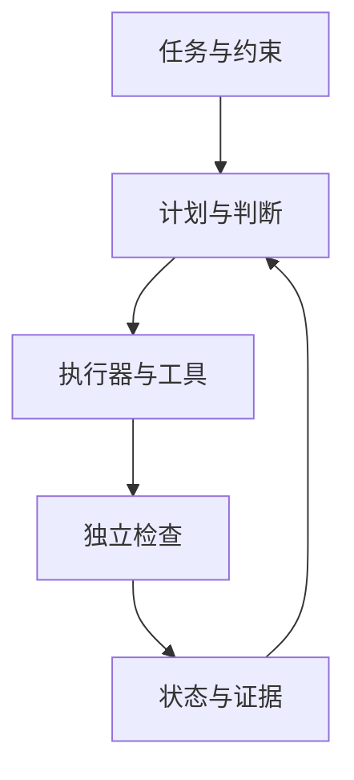
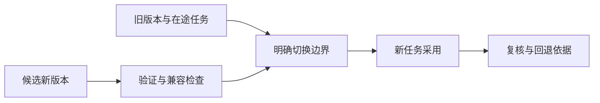

# 信息驱动的决策与工作流演化 Harness · 调研与讨论稿 v0.3

> **公开整理版**：基于原稿《信息驱动的决策与工作流演化 Harness · 调研与讨论稿 v0.3》（源版本：0.3）。本次删去私有项目实例、公司项目专属内容及原始个人语料，未重新验证实验。源稿状态：current；源版本编号保留，公开编辑不代表实现完成或新验证结果；章节与条目沿用源编号，删节后可能不连续。

**源稿日期：2026-10-27 · 公开删节版 · 讨论中**

基于历史讨论稿整理目标、数学讨论、十仓库研究与合成资源测量。公开版将六张原图替换为通用 Mermaid 示意，未附原网页和原始证据包。

## 1. 摘要与当前决定

我们要设计一个根据外界信息和实际运行结果，持续调整行动、策略及工作流的 harness。它的关键产物是一份可追溯、可比较、可验证的改变决定：为什么改，改哪里，预计值不值得，何时实施，以及后来是否真的有效。采集、记忆、工具调用和执行框架围绕这件事组织。

**本轮的主线：把工作流本身作为被改进的对象。** 面对新论文、新信息源、重复错误或新工具，既比较保持和小修，也比较模块替换、结构重构与下一项目采用。大型改变必须把未来收益、验证、迁移、运行和维护成本放在同一评价期限里。

| 状态 | 本轮结论 |
| --- | --- |
| 已明确 | 实时按事件驱动理解；每个已采纳方向保留跟踪与周期复核，实验可以不做；完全暂停只能由人决定。 |
| 已明确 | 各领域分别管理目标、预算与评价；运行基准是 Mac 本机常驻、外部模型 API。 |
| 已完成的研究 | 十个仓库的职责核查，Agno / Pydantic AI / Letta 的重点机制研究，以及固定配置下的本机资源测量。 |
| 当前倾向 | 以一条真实研究流程、一次新发现和一份完整变更提案验证核心闭环；执行底座保持可替换。 |
| 尚待决定 | 首条基线流程、主要结果指标、价值尺度与期限、自动试验及迁移边界、最终技术底座。 |

**与 Claude 旧稿的关系。** 旧稿围绕 AI 编码方法层展开，提出了事前预测、评价约束、记录、控制面与执行端分离。本轮将这条思路扩展到外部信息、策略调整和整个工作流的改变。旧稿以 Pi 为参考并讨论多执行端互通；本轮提到的 Pydantic AI 是小规模实验的适配候选，没有形成更换旧有底座的决定。

**资源研究的结论。** 受控测试显示，完整历史反复进入请求会增加宿主 CPU 与传输开销；保留最近 4 个完整轮次后，两套框架的请求正文字节减少约 85.5%，任务 CPU 时间减少约 70–77%。这一结果来自合成任务，尚未证明真实研究质量不下降，也不是 token 计费结论。版本、配置与测量边界完整保留在第 17 节。

本文将本轮讨论、图解、十仓库研究与实测结果整理为连续的新稿。标为“建议”“倾向”的内容供继续讨论，不作为已批准的产品实现方案。

## 2. 问题与目标

我们希望建立一个持续接收外部信息和内部执行反馈的 harness：它能够判断证据质量，更新对目标、假设和环境的认识，把变化转化为可讨论的行动、可检验的预测和量化指标，并据此改进策略及工作流。

**工作流本身必须是被持续评估和改进的对象。** 系统需要判断：新信息是否只需要改变当前行动，是否适合小修或替换模块，是否值得重构已有工作流，以及改变应该立即发生、在当前模块结束后发生，还是留到下一个项目。

因此，系统需要交付两类相互关联的结果：

- **面向当前任务的决策**：继续查证、提出建议、开展小规模试验、调整资源或行动。
- **面向工作方式的改进决策**：提出替代工作流，比较收益、成本和不确定性，安排验证与迁移，并检查改动是否真正有效。

信源管理、工具发现、工具调用、记忆和工作流执行，都是支撑这两类决策的组成部分。

第一版最有价值的验收问题是：

> 给定一个已有工作流和一项有意义的新发现，harness 能否形成一份有证据、可量化、包含验证方式与实施时机的改进决策，并在结果出现后修正自己的判断？

### 已经明确的需求与边界

| 主题 | 本轮讨论形成的要求 |
| --- | --- |
| 探索与利用 | 不成熟时偏向发现机会，成熟时偏向服务已有目标；两者都需要，不能用一种模式概括所有情况。 |
| 实时含义 | 事件驱动。外部新消息、实验完成、结果偏离、模块边界和复核到期，都可以触发判断。 |
| 建议与实验 | 既可以提出建议，也可以开展小规模试验；实验本身是一种决策动作。 |
| 变更范围 | 参数调整、小修、模块替换、流程重构和项目层面的重新规划，需要区别处理。 |
| 生效时机 | 立即、试验后、下一模块、下一项目，都应作为候选时机比较。 |
| 最小投入 | 每个已采纳方向都保留跟踪与周期复核；是否做实验另行判断。最低投入不等于必须持续做实验。 |
| 暂停权限 | 系统可以降低优先级和资源投入；完全暂停一个已采纳方向，只能由人决定。 |
| 领域边界 | 各领域独立管理目标、预算和评价标准；本稿不设计跨领域统一资源分配。 |
| 工具扩展 | 需要同时讨论会话过程中加载已有工具，以及工作结束后生成、验证和沉淀新能力。 |
| 运行基准 | 本机常驻，模型主要通过外部 API 调用；本轮完成受控资源研究，尚未开始产品开发。 |
| 当前工作阶段 | 先整理讨论稿，再继续对齐问题与实现方向。 |

### 本稿提出、仍待验证的设计建议

下文建议用“证据—假设—工作流—变更提案—验证结果”的关联记录承载核心循环，用带切换成本的序贯决策描述重要改变，以版本化流程和执行记录支持比较、迁移与回退。这些是讨论方案，不是已确认的技术选型。

## 3. 从信息到可行动证据

### 分开评估可信性、适用性与行动价值

系统至少需要回答三个不同的问题：

1. **这条信息能支持什么主张？** 原始出处是什么，是否准确转述，是否存在撤回、修订或相反证据？
2. **这个主张适用于我们吗？** 对象、环境、时间、数据、前提与当前场景是否相近？
3. **据此改变是否值得？** 即使主张真实且适用，收益是否覆盖验证、切换和持续维护的成本？

例如，新论文可信，并不自动意味着其中的方法适合当前数据、当前工作流或当前项目阶段。

来源可靠性也不应被压成一个永久分数。某来源对某类事实可能准确，对另一类推断可能缺乏证据。更合适的记录粒度是“来源对这项主张提供了什么支持”。多个转述同一出处的报道，不能当作多份独立证据。

### 建议保留的证据字段

- 原始出处、可定位的内容片段、版本或快照，以及必要的内容标识。
- 主张及其适用条件，支持、反驳和无法判断的证据。
- 原始来源与转载、引用、推断之间的关系。
- 事件发生时间、公开时间、系统首次获知时间；必要时另记有效时间区间。
- 哪些目标、假设、流程和既有决策受到影响。
- 对结论的修订记录，以及修订前的判断。

来源追踪可以借用 provenance 模型组织“实体、活动、参与者”的关系，但来源记录本身不能保证事实为真。[W3C PROV 概览](https://www.w3.org/TR/prov-overview/)

### 置信度的使用边界

模型自行给出的“85% 可信”不能直接充当经过校准的概率。可以先记录证据等级、估计区间、分歧和关键未知项；在有可验证结果的任务中，再用历史预测与实际结果检查概率校准。

外部网页、论文和工具返回内容都作为证据处理。其中的指令不应获得修改目标、权限或执行政策的效力。

## 4. 整体思考：两条闭环

建议将执行当前工作与改进工作方式分成两条闭环。它们可以在同一进程里运行，但必须有不同的产物和权限边界。一次新事件可以同时触发两条闭环。

**当前执行与工作方式改进（公开整理示意）**

本图按正文的通用职责重绘，不包含私有项目实例。

*图 1：两条闭环共用证据和运行记录；采用新版本后，还要复核实际收益。公开版以 Mermaid 展示重绘示意。*

**普通任务的产物**是判断、建议、研究结果或实验结果；**改进任务的产物**是版本化提案、比较证据、迁移计划与事后复核。生成新工具只是某份提案中的一个可能动作。

一个外部事件进入系统后，不必立刻改变行动。它可能只改变某个判断的可信程度，也可能触发一次实验，或者暴露现有工作流的结构性问题。

主循环由当前执行和工作方式改进两部分组成。

这里的“继续观察”有明确的跟踪方式、下次复核时间或触发条件。对已采纳方向，它不能变成没有期限的搁置。

建议把阶段变化落实到具体目标、假设或模块上。同一项目可以同时存在成熟的执行模块和需要探索的新方法，用一个全局“成熟度”切换全部任务会过于粗糙。环境或证据变化后，成熟模块也可能重新进入验证阶段。

早期主要减少“什么值得做、什么做得成”的不确定性；后期更多比较结果质量、可靠性、效率和维护成本。探索与利用的具体比例尚未确定，应依据预算、证据和潜在影响调整。

## 5. 本体、工作流与 harness 的分工

工作流适合表达已知的执行结构，包括步骤、条件分支、循环、输入输出和失败处理。它也可以参与探索，例如运行一个实验；其局限在于，预先固定的流程本身无法解释何时应该被换掉。

轻量本体或语义模型负责表达对象及其关系，使系统能够回答“这项新证据影响哪个假设，哪些工作依赖这个假设”。Harness 负责组织判断、生成候选、调用验证和执行机制，并根据结果改变后续决策。

建议先明确下列对象，而不预先要求部署图数据库：

| 对象 | 需要表达的内容 |
| --- | --- |
| 目标与方向 | 希望改善的结果、评价标准、约束、成熟程度、采纳状态和复核义务。 |
| 证据与主张 | 来源、时间、适用条件、支持和反驳关系。 |
| 假设与信念 | 当前为什么采用某种方法，哪些事实变化会推翻或削弱它。 |
| 策略与工作流版本 | 当前怎样行动，执行结构、适用范围、依赖和已验证条件是什么。 |
| 变更提案 | 为什么改变、有哪些候选、预计收益与成本、何时实施。 |
| 实验与结果 | 比较了什么、采用什么评价标准、观察到了什么、哪些结论仍不成立。 |
| 资源与运行状态 | 预算、正在执行的任务、最低跟踪投入、复核截止时间。 |
| 工具与能力版本 | 能力定义、执行入口、权限、适用条件和验证记录。 |

核心关系包括“支持／反驳”“依赖”“用于实现”“由某次执行产生”“替代”“使既有验证失效”。对象应有稳定标识和版本；声明的关系、推断的关系与已经验证的关系需要区别记录。

执行流程可能有循环，依赖关系和证据关系也未必构成同一个 DAG。语义关联、执行控制和历史记录可以相互引用，但不必挤进一种图模型。

## 6. 如何改进已有工作流

### 先定位新信息改变了什么

新证据应沿下列路径进入工作流改进：

> 新证据 → 受影响的假设 → 依赖这些假设的环节 → 可行的修改方案 → 区分方案所需的验证。

可能的触发包括：

- 反复出现同类错误、人工纠正和返工。
- 成本、延迟、可靠性或结果质量明显偏离预期。
- 多个局部补丁在处理同一个更上层的问题。
- 数据、工具、环境或约束改变，使已有假设不再成立。
- 新方法打开原来无法实现的能力，即使当前流程没有明显故障。
- 项目进入新阶段，未来使用量或工作类型发生变化。

这些现象足以触发评估，但不能单独证明重构值得实施。错误也可能来自输入变化、工具故障或偶然波动，需要先定位问题。

### 对同一问题生成竞争方案

至少比较以下几类候选中实际可行的部分：

| 候选 | 典型变化 |
| --- | --- |
| 保持现状并跟踪 | 记录新证据、设置复核条件，暂时维持当前执行方式。 |
| 参数调整或小修 | 调整阈值、补一个检查、修改局部规则，基本保持现有接口和结构。 |
| 模块替换 | 替换一个处理环节，重新验证其接口与受影响的下游结果。 |
| 工作流重构 | 改变步骤之间的组织方式、状态模型、关键接口或多个依赖关系。 |
| 新项目或下一版本采用 | 保留当前执行安排，在更合适的边界采用新结构。 |

“改变什么”和“什么时候改变”是不同维度。模块替换也可以延期；重构也可以分阶段完成。小修可以在已约定的范围内直接应用，但仍需记录版本和后续效果。连续小修的累计影响，也需要周期性复核。

大改的规模应由实际影响衡量：涉及多少类任务、影响多大比例的运行、哪些接口和状态需要迁移、哪些验证结论失效、回退有多困难。修改文件数或新增步骤数只能提供很有限的信息。

**改变方案与采用时机（公开整理示意）**

本图按正文的通用职责重绘，不包含私有项目实例。

*图 2：先形成可行候选，再展开实施时机。重构与最佳可行小修比较，证据不足时寻找能改变选择的试验。*

### 大型重构的影响量

不建议用“改了多少行”或“复杂度总分超过 70”自动决定重构。第一版先记录一组可计算、可解释的影响量：

| 量 | 可操作的定义 | 作用与限制 |
| --- | --- | --- |
| 任务暴露比例 | 评价期限内预计受到改变的任务数／总任务数，按任务类型分层 | 表明影响面；任务数不代表任务价值相同。 |
| 契约变化 | 改变输入输出、权限、数据时点或错误语义的接口清单及占比 | 判断必须重做哪些契约验证；不机械合成总分。 |
| 状态迁移覆盖率 | 已有状态中，通过迁移和回读验证的数量／需迁移数量 | 关键状态需要单独验收，不能让大量简单记录稀释严重缺陷。 |
| 验证失效范围 | 哪些历史评价仍适用，哪些需重跑，预计工作量多少 | 给验证成本提供可追踪依据。 |
| 切换与恢复代价 | 预计中断时间、资源峰值、双版本运行期、恢复时间、不可逆副作用 | 支持选择迁移时机。代码回滚不代表外部动作已撤销。 |

这些量决定验证和迁移需要多严密，不直接代表重构收益。是否采用仍以第 7 节的未来净价值比较为中心。

可用历史成对任务估计差异与区间；相关任务需要按事件、日期或其他适当单位分组。数据不足时，用成本区间和情景分析表达未知，不让模型凭空给出的概率替代统计证据。采纳门槛应由允许的损失和决策规模确定，尚未约定统一数值。

还需要抑制反复改结构造成的消耗：每次提案有评估预算、判定期限和下一次复核条件；已验证版本有观察窗口。窗口可以被重大新证据打断，但不能仅因 agent 换一种说法就重新启动整个比较。用于判断的目标和评价版本在同一轮比较中保持一致。

### 一份工作流变更提案应回答什么

| 字段 | 要回答的问题 |
| --- | --- |
| 触发与证据 | 为什么现在需要重新判断？依据在哪里？ |
| 影响映射 | 哪些假设、流程、任务和已有验证受到影响？ |
| 候选与基线 | 保持、小修、替换、重构等方案分别是什么？ |
| 价值与成本 | 在什么未来期限内比较？估计范围和关键假设是什么？ |
| 约束与未知 | 哪些底线必须满足，什么信息仍会改变结论？ |
| 验证安排 | 先做什么比较，如何避免只挑有利结果？ |
| 迁移安排 | 改动范围、实施时机、资源、回退方式是什么？ |
| 后续复核 | 何时检查实际效果，什么结果触发再次判断？ |

它是建议的核心输出对象。系统是否改善，也应由这些提案的实际效果来评价。

### 用共同的未来期限比较净价值

设完整变更方案为：

\[
a=(W',\tau,m)
\]

其中，\(W'\) 是候选工作流，\(\tau\) 是开始切换的时机，\(m\) 是试运行与迁移安排。方案应包含过渡期间继续运行旧流程的行为。

在共同的未来评价期限 \(H\) 内，定义：

\[
Z_H(a)=B_H(a)-C_H(a)
\]

\[
\Delta V_H(a,a_0)
=\mathbb E\!\left[Z_H(a)-Z_H(a_0)\mid\mathcal I_t\right]
\]

- \(B_H\)：对目标产生的收益，包括结果质量和新增可用能力等。
- \(C_H\)：从现在开始的实现、验证、迁移、运行、维护及切换损失。
- \(\mathcal I_t\)：做决定时实际可得的信息。
- \(a_0\)：比较方案。评估重构时，应包含当前已知、可行的小修候选中最有竞争力的方案。

同一项收益或损失只计一次。历史投入不作为必须继续沿用旧方案的理由；未来因改变而产生的重做、迁移和培训成本应计入。

这些量往往不确定。提案除了期望值，还应报告区间、关键假设、悲观情形和敏感性。例如：未来使用次数减半、实现成本翻倍、效果只能维持一个阶段时，结论是否改变？

以上形式需要在同一领域内有可比较的价值尺度。质量、时间、金钱与风险无法合理换算时，先设定必须满足的底线，再比较可行方案；仍有取舍时保留多指标或 Pareto 候选，不强行制造一个总分。

### 回本点示例

以下数字仅用于说明方法。假设结果质量和可靠性相当，比较的是总人工耗时：

| 方案 | 每次同类任务耗时 | 实现、验证与迁移投入 |
| --- | ---: | ---: |
| 保持现状 | 20 分钟 | 0 |
| 小修 | 16 分钟 | 4 小时 |
| 重构 | 8 分钟 | 36 小时 |

重构相对小修多投入 32 小时，每次多节省 8 分钟，因此：

\[
N_{\text{回本}}=\frac{(36-4)\times60}{16-8}=240\text{ 次任务}
\]

如果当前项目只剩几十次同类任务，下一项目再采用可能更合理；如果未来使用量很大，且效果有证据支持，当前重构就更有理由。

这个计算依赖效果持续、任务具有可比性等假设。新增能力、失败风险或环境变化不能直接套入这个简单公式；它们需要单独建模或通过试验获得信息。

### 值得研究与值得全面迁移，是两次判断

全面迁移承担的不可逆损失越大，所需证据应越强。证据不足时，可以优先做能改变决策的查证或试验，而不必在“完全不动”和“全面重构”之间二选一。

建议一次改进至少保留以下证据链：

1. **事前预测**：预计改善哪些结果、影响哪些任务、付出多少成本、可能恶化什么。
2. **比较设计**：采用哪些基线、任务集合、评价标准和观察期限。
3. **观察结果**：历史回放、留出任务、影子运行或限定范围试验的结果。
4. **采用条件**：什么证据支持迁移，什么情况继续验证或回退。
5. **事后复核**：实际收益、迁移成本和副作用是否符合预测。

历史回放可以验证一部分问题；由此得到的结论需要注明覆盖范围，不能直接等同于新环境下的实际效果。任务构成变化时，应分层比较，避免把“遇到更容易的任务”误认为流程改进。反复查看结果或尝试很多候选，也需要避免按最有利的一次结果挑选结论。

评价应同时包含总体结果、诊断指标、数据质量和不得恶化的指标。例如，工具调用数可以解释成本变化，但不能独立证明任务完成质量提高。[Microsoft Research：可信实验中的指标分类](https://www.microsoft.com/en-us/research/articles/patterns-of-trustworthy-experimentation-during-experiment-stage/)

安全策略改进研究提供了一个可借鉴的原则：以现有策略为基线，在证据不足的部分限制改变。相关理论保证依赖具体模型和采样假设，不能直接推广为整个 harness 的性能保证。[Safe Policy Improvement with Baseline Bootstrapping](https://proceedings.mlr.press/v97/laroche19a.html)

### 改进做判断的能力

后续应检查：实现与迁移成本是否系统性低估、效果能否从试验迁移到实际运行、哪些类型的改动容易失败、哪些证据能有效改变选择。

可以跟踪成本预测误差、效果预测的校准、试验与上线效果的偏差、回退率和重复返工等。单看“提出了多少建议”或“重构了多少次”不能证明系统在进步。

目标和评价标准也可能需要更新。建议将它们与方案分别版本化，明确变更原因，保证同一轮候选接受一致的比较，避免评价口径变化掩盖实际退步。

## 8. 数学语言：离散选择与序贯决策

### 离散选择不要求存在梯度

“持续朝更好的方向调整”可以借用梯度下降的直觉，但当前问题中的许多选择是离散的：选择研究方向、替换模块、改变流程结构、决定何时迁移。比较这些候选不要求整个选择空间有梯度。

需要区分：

- **连续但不可微**：在满足相应条件时，可以使用次梯度或其他广义导数。
- **离散或混合选择**：常用组合优化、整数规划、约束求解，或直接比较有限候选。
- **效果未知、必须试验的选择**：可能采用贝叶斯优化、bandit 或实验设计。
- **行动改变后续信息与状态**：需要进一步用序贯决策描述。

经典凸次梯度有其适用条件；Clarke 等广义梯度也依赖局部 Lipschitz 等条件，不能因为“现实不连续”就自动适用。[Stanford：Subgradients](https://web.stanford.edu/class/ee364b/lectures/subgradients_notes.pdf)

工作流结构固定以后，其中某些连续参数可以采用梯度方法。结构之间的比较，可以通过候选生成与试验进行。两种层次可以并存。

### 带切换成本的序贯决策

本问题可以先描述为：

> 在不完全信息下，对行动、信息获取、资源投入和工作流变更进行选择，并承担切换成本的序贯决策问题。

在事件时刻 \(k\)，可以用下列状态组织信息：

\[
S_k=(G_k,b_k,W_k,R_k,D_k,B_k)
\]

- \(G_k\)：目标、已采纳方向和候选机会。
- \(b_k\)：对重要假设、环境与候选效果的当前认识。
- \(W_k\)：当前策略与工作流版本。
- \(R_k\)：正在运行的任务、试验和复核状态。
- \(D_k\)：依赖关系、已有承诺和迁移限制。
- \(B_k\)：该领域的可用预算。

可选动作包括继续观察、查证、试验、调整行动、降低投入、改变工作流和安排迁移等。新信息和执行结果到来后，更新状态，再做下一次判断。

POMDP 的信念状态可以帮助描述“看不见真实环境、只能根据观测行动”的部分；持续时间不同的试验与任务，可以参考 SMDP／options 的描述。但第一版无需完整拟合一个大型 POMDP，新目标和新方法不断出现时，也不能假定所有状态与动作已经列举完毕。[Kaelbling、Littman、Cassandra：POMDP 综述](https://cs.brown.edu/research/pubs/techreports/reports/CS-96-08.html)，[Sutton、Precup、Singh：Options](https://www.sciencedirect.com/science/article/pii/S0004370299000521)

概率模型负责表达不确定性和根据证据更新认识；它不会自动消除组合搜索的困难，也不会保证现实中的最优解可计算或可识别。首版应追求在明确范围内做可检查的比较。

用概率论的语言，可以把随事件积累的信息表示为信息族 \(\mathcal F_k\)，要求第 \(k\) 次决策只依赖当时已知的信息，并对候选结果计算条件期望或风险。状态与动作可以是离散的，也可以在满足适当可测性条件的一般空间上定义，不要求它们具有可微结构。对于价值有定义的有限候选集合，选出最大值不需要梯度；候选集合无限或缺少紧致性等条件时，最优值是否能被某个方案达到，需要另行讨论，不能由“使用概率模型”保证。

### 用信息价值决定是否继续查证或试验

对于一次查证或试验 \(q\)，可以使用局部的信息价值近似：

\[
\operatorname{NetVOI}(q)=
\mathbb E_z\!\left[\max_d V(d\mid\mathcal I,z)\right]
-\max_d V(d\mid\mathcal I)
-C(q)
\]

这里比较的是：获得结果 \(z\) 后，预计能把决策改善多少，以及获取结果要付出多少成本。\(V\) 应在一致的未来期限内计算，并考虑执行和切换；试验占用时间造成的机会损失也应纳入评价。

它的作用是回答“接下来最值得减少哪一种不确定性”，而不是奖励无休止地搜集信息。例如，若实现成本无论如何都无法回收，继续精确估计微小效果可能没有意义；若一个便宜的试验可能改变是否重构的选择，它就更值得做。

这一公式适合作为局部近似。若完整的未来价值已经包含后续学习收益，就不能再重复叠加同一份信息价值。计算和评估本身也有成本。[Stuart Russell：Rational Metareasoning](https://people.eecs.berkeley.edu/~russell/research-bo.html)

## 9. 工具的暴露、执行与能力沉淀

### 先分开三个层次

| 层次 | 含义 |
| --- | --- |
| 能力注册 | 运行环境中存在什么工具、如何执行、版本与接口是什么。 |
| 模型可见 | 当前这一轮模型请求知道哪些工具及其调用方式。 |
| 执行权限 | 当前任务是否允许调用，参数、资源和副作用是否符合约束。 |

发现一个工具，或将它的 schema 加入上下文，不等于获得调用权限。仅在文本里写出一个工具说明，也不等于运行时已有可执行实现。

**工具发现与能力沉淀（公开整理示意）**

本图按正文的通用职责重绘，不包含私有项目实例。

*图 3：已有工具在请求之间按需加载；新能力经过验证和发布才进入目录。注册、可见和授权分别处理。*

### 会话过程中加载已有工具

建议采用以下分配方式：

- 开始时暴露少量稳定能力，例如检索当前状态、查找能力、读取证据和提交结构化结果。
- 根据任务提前加载一组已知相关的领域工具。
- 需要低频能力时，通过工具目录检索，再加载相应定义。

工具目录很小时，可以直接提供全部定义；按需加载的价值需要通过实际上下文成本和调用准确性验证，不必预先复杂化。

工具集合通常在模型请求之间更新。模型先发现能力，harness 将执行入口与工具定义准备好，再在下一次模型请求中提供。不同供应商可能支持请求级工具列表、会话内工具更新消息或延迟加载机制，需要由适配层处理；不能假定所有协议都以同一种形式支持。

已有参考包括 Claude 的 tool search／延迟加载，以及 MCP 的工具发现与调用接口。这些机制解决的是能力暴露与协议问题，业务权限仍需由 harness 实施。[Claude Tool Search](https://platform.claude.com/docs/en/agents-and-tools/tool-use/tool-search-tool)，[MCP Tools](https://modelcontextprotocol.io/specification/2025-11-25/server/tools)

### 工具实际在哪里调用

实际执行发生在 harness 的运行循环中：

> 模型提出调用 → 记录调用意图 → 校验输入与执行政策 → 执行工具 → 校验和记录结果 → 将结果提供给后续判断。

运行时负责超时、预算、并发、重试、必要的幂等处理和错误表达。不同模型或子 agent 的调用，都应经过同样适用的执行边界。

工具调用可以出现在任务推进的多个位置，例如采集、查证、实验、评价和迁移。会话结尾可以做归档或提交候选能力，但不能把执行记录全部拖到结尾才生成：中间失败或中断时仍需要恢复和审计。

### 工作结束后生成或沉淀新能力

“会话末尾增加工具”的另一层含义，是把本次解决问题的方法变成以后可复用的能力。需要先分类：

- **规则或 skill**：主要改变任务说明、判断方法和使用约定。
- **工作流组合**：把已有能力组织成可复用的执行结构。
- **新工具**：确实需要新的可执行接口和实现。

不必把每次成功操作都包装成新工具。候选能力需要说明适用条件、预期收益、维护成本和验证方式，再根据影响程度进行隔离验证、历史回放或有限范围使用。验证通过后，形成版本并加入可发现的能力目录。

建议的生命周期为：

> 提议 → 验证 → 限定范围使用 → 评价实际效果 → 发布可复用版本 → 持续复核或撤回。

这一过程应复用工作流变更提案的评价机制。能力沉淀的价值在于改善后续任务，而不在于工具数量增加。

运行中的任务应保留可追溯的版本；新版本发布后，对已有任务的更新需要明确安排。生成能力也不能自行扩大执行权限，更不能绕过“只有人可以完全暂停方向”的规则。

Pydantic AI 的 `CapabilityCreation` 展示了“本轮生成，下一轮由宿主加载”的明确边界；Letta mods 展示了 reload 和生命周期扩展。两者都会执行宿主进程内的代码，接口校验并不是运行隔离。我们的初版宜先允许提交候选和限定试验，硬约束位于候选不能自行修改的执行边界。对于资源与权限敏感的新实现，可以放到独立工作进程中验证。[Pydantic 能力创建](https://pydantic.dev/docs/ai/harness/capability-creation/)，[Letta mods](https://docs.letta.com/configuration/mods)

## 10. 主干架构与记录方式

以下是逻辑职责，第一版可以在一个进程和少量存储中实现，不意味着需要拆成多个服务：

| 职责 | 主要输出 |
| --- | --- |
| 事件接入与调度 | 外部事件、内部反馈、复核到期事件，以及去重和处理状态。 |
| 证据整理与状态更新 | 可追溯主张、假设变化、受影响对象。 |
| 候选生成与评估 | 行动候选、流程变更提案、成本估计和验证安排。 |
| 执行控制 | 预算与权限检查、版本固定、工具执行、试验与迁移状态。 |
| 结果评价与校准 | 预测和实际的差异、流程效果、后续判断修正。 |

模型适合帮助抽取、提出假设、生成方案和解释取舍。可程序检查的硬约束，例如预算上限、版本一致性、复核截止时间和暂停权限，应落实在运行时；无法程序判定的质量问题，需要可信的评价方法和必要的人参与。

记录应足以还原当时的决策条件：使用了什么信息、候选是什么、为什么选择、调用了什么、何时得到结果。事件历史、工作流和工具版本、评价标准与实验结果需要相互关联。

可以从结构化记录、追加事件日志和简单索引起步，再根据检索需求决定是否引入图数据库或更重的工作流引擎。摘要可用于阅读，原始证据和关键执行记录应保留可定位入口。

前序查看的《AI 编码 Harness 主干设计 · 调研与讨论稿 v0.1》和 deepseek-harness 源码，可提供控制面、工具执行及会话工具更新方面的复用线索。原讨论稿中“教训是否值得升级成标准”的收益与成本比较，也为本稿扩展到整个工作流提供了起点。这些是只读观察；本稿没有验证相关系统的完整运行行为，也没有决定最终以哪个项目为底座。

**任务与执行职责（公开整理示意）**

本图按正文的通用职责重绘，不包含私有项目实例。

*图 4：这是职责图。第一版可由一个调度进程、数据库与少量按需工作进程承载，各领域独立管理预算。*

这是职责图，不是微服务部署图。首版可以是一个调度进程、一个关系数据库、文件形式的原始证据，以及少量按需工作进程。跨领域可以复用代码和协议，各领域预算与目标保持独立。

## 11. 持续跟踪、最低投入与暂停权限

### 把最小投入落实为复核义务

对每个已采纳且未被人暂停的方向，应保留：

- 最低跟踪安排，包括监测哪些来源或变化。
- 最长允许复核间隔。
- 上次实际完成的复核记录和下一次截止时间。
- 复核逾期或监测失效时的可见状态。

一个可检查的目标约束是：

\[
t-t_i^{\text{last completed review}}\leq\Delta_i
\]

其中 \(\Delta_i\) 是方向 \(i\) 允许的最长复核间隔。完成复核需要留下实质性结果；仅创建定时任务或让 agent 醒来，不能算完成。

“保持非零抽中概率”不足以保证这项要求，因为某方向仍可能长期没有获得资源。调度应先满足必要跟踪与到期复核，再分配可选研究和实验预算。实验投入可以为零。

新增方向被正式采纳时，也要检查最低投入是否可持续。如果已采纳方向的最低义务超过预算，系统应显式报告不可行，供人调整预算、复核安排或采纳范围；不能通过静默取消跟踪来维持表面运行。

停止一个具体失败试验、回退一个流程版本，与完全暂停其所属方向是不同动作。方向仍应保留规定的跟踪与复核。只有人的决定才能使已采纳方向进入完全暂停状态。

### 常驻的是状态与调度职责，推理按事件发生

“每个已采纳方向持续跟踪”不要求“每个方向一直保留一个完整 agent 进程或不断调用模型”。建议将方向持久化为状态对象，为它安排来源更新检查、截止时间和实质复核任务；模型只在需要判断时运行。

操作系统休眠时，普通本地进程不能保证及时处理事件。因此需记录“事件发生／首次可获知／实际接收／完成判断”四种时间；唤醒后从持久化游标补齐并优先处理逾期复核。是否需要睡眠期间仍然可用、是否后来迁移到持续开机的机器，是部署要求，不能靠把状态叫作常驻来解决。

最低投入首先表现为服务义务，而不是固定 CPU 百分比。缓存淘汰、工作进程退出和实验停止都不等于暂停方向；系统仍需兑现跟踪与复核要求。

**持续跟踪与复核（公开整理示意）**

本图按正文的通用职责重绘，不包含私有项目实例。

*图 5：实验投入可以为零，跟踪与复核义务仍然存在。预算不足要显式呈现，不能用静默停跟踪来解决。*

## 12. 生效时机、迁移与恢复

### 选择实施时机

需要比较“现在采用”“当前模块完成后采用”“下一项目采用”等完整方案：

- 现在采用能够更早获得收益，也可能造成中断、迁移和重新验证成本。
- 等到模块边界可能减少切换成本，同时放弃等待期间的改善收益。
- 等待还可能获得新证据，降低选错方案的概率。
- 当前流程已违反必要约束时，继续等待的损失可能很大，应先处理已知问题。

运行中的任务应记录并固定所用工作流、工具与评价版本。新版本何时对已有任务生效，需要显式安排。重构提案不能默认打断正常运行的长任务或丢弃已完成工作。

### 恢复当前执行与迁移到新工作流是两回事

首版默认让正常运行的旧任务完成，在新任务或明确阶段边界启用新版本。确实需要迁移时，提案必须列出状态映射、未完成工具调用、幂等标识、外部副作用核查、资源双份占用和回退限制。运行记录写入 `workflow_version`、`tool_version`、`evaluation_version` 和 `policy_version`。

**工作流版本迁移（公开整理示意）**

本图按正文的通用职责重绘，不包含私有项目实例。

*图 6：优先让正常运行的旧任务完成；确需迁移时，验证状态映射、外部副作用和恢复路径。*

## 13. 十个仓库的职责与横向比较

本轮名单来自 B 站[《10 个开源 Agent 构建框架》](https://www.bilibili.com/opus/1264078436551360516)。文章用于确认名单，具体能力另查官方文档与源码。下面保留十个项目的逐项判断，Agno、Pydantic AI 与 Letta 的进一步研究放在紧接着的三节。

这些项目承担的职责不同，不能用一个资源数值排成统一榜单。本轮所读资料中，还未发现开箱即用的通用机制，完整比较保持、小修、重构的未来净价值、不确定性和实施时机，并同时满足我们的最低复核义务。

| 项目 | 当前主要职责 | 对我们最值得借鉴的内容 | 采用时需要明确的边界 |
| --- | --- | --- | --- |
| [Agno](https://github.com/agno-agi/agno) | Agent、团队、工作流、持久运行及改进平台 | 运行证据驱动的改进任务；场景探索、修复和回归评价 | 改进循环的存在不等于已有通用的重构价值模型；部分模板评测只支持 agent/team。 |
| [CrewAI](https://github.com/crewAIInc/crewAI) | 角色协作与事件驱动 Flows | 把有状态的确定流程和局部自治研究组合起来 | 角色划分不能替代证据质量和责任边界；增加 agent 需要证明价值。 |
| [Pydantic AI](https://github.com/pydantic/pydantic-ai) | 类型化 AI SDK、Harness、Evals 和 Graph | 结构化提案；结果与过程评价；动态工具和能力加载 | 类型正确不代表事实正确；按旧路径打分可能阻碍合理重构。 |
| [OpenAI Agents SDK](https://github.com/openai/openai-agents-python) | 轻量 agent 执行、工具、委派、会话和 tracing | 明确执行循环；区分委派任务与移交控制；统一运行记录 | SDK 的 guardrails 不能自动实现我们的方向治理和最低复核义务。 |
| [Semantic Kernel](https://github.com/microsoft/semantic-kernel)／[Microsoft Agent Framework](https://github.com/microsoft/agent-framework) | 应用集成、多 agent 与图式工作流 | checkpoint、恢复、稳定执行器身份、中间件和可观测性 | 恢复旧执行与迁移到新结构需要分别处理。 |
| [Qwen-Agent](https://github.com/QwenLM/Qwen-Agent) | Qwen 相关工具调用、RAG、代码解释器与 MCP | 模型协议适配；工具注册与具体执行的分层 | 当前默认分支更新较久；新模型和接口兼容性需要实际验证。 |
| [Letta](https://github.com/letta-ai/letta)／[Letta Code](https://github.com/letta-ai/letta-code) | 有状态 harness、长期记忆、动态工作流和 mods | Git 版本化记忆与技能；生成候选流程；按事件扩展运行机制 | 可修改自身并不能证明改动有效；硬约束不能被普通自修改过程绕过。 |
| [n8n](https://github.com/n8n-io/n8n) | 应用连接、触发器、可视化自动化与 AI 节点 | 外部事件接入、到期复核、稳定动作流程 | 许可有用途限制；完成一个流程不等于正确选择了这个流程。 |
| [LiteLLM](https://github.com/BerriAI/litellm) | 多模型网关、路由、成本与调用管理 | 按任务和实验记录模型成本、重试与回退 | API 成本只是总成本的一部分；回退换模型会影响实验可比性。 |
| [Oxylabs Web API MCP](https://github.com/oxylabs/web-api-mcp) | 商业网页 API 的 MCP 接入 | 搜索、读取、异步结果、长结果分块和采集失败表达 | MCP 服务可自托管，采集能力依赖厂商 API；获取内容不等于验证内容。 |

表中的借鉴建议是我们的设计推论；各项目的具体事实与来源在下面逐项说明。

### CrewAI：确定流程与局部自治

**核实到的能力。** Crews 用于角色协作，Flows 提供事件驱动的流程控制，并能组合单次 LLM 调用和 crew。官方同时区分开源框架与商业控制平台。[CrewAI README](https://github.com/crewAIInc/crewAI/blob/main/README.md)

**我们可以借鉴。** 将证据接收、状态更新、评价提交、版本发布等有明确约束的步骤放在可检查的流程里；把生成备选方案、寻找反证等需要探索的工作交给局部 agent。流程应显式携带当前证据、候选状态、预算与复核期限。

**需要补充。** 给 agent 起不同角色名称不会自动产生独立证据。多个 agent 读取同一转载源，也不能算交叉验证。角色数量和讨论轮次应由实际质量、成本和新增信息量评价。

**当前判断。** 值得借鉴组合方式；是否引入整个框架，需要证明它能补足现有 harness 的具体缺口。

### OpenAI Agents SDK：执行与委派语义

**核实到的能力。** SDK 提供 agents、函数/MCP 等工具、agents-as-tools、handoffs、guardrails、会话管理与 tracing；当前也包含长任务 sandbox agent 等入口。官方定位支持多个模型供应商。[OpenAI Agents SDK README](https://github.com/openai/openai-agents-python/blob/main/README.md)

**我们可以借鉴。** 让“把一项研究任务交给子 agent 并收回结果”与“把对话控制权交给另一个 agent”具有不同语义。对于我们的系统，核心决策记录应能够串起主循环、工具调用和委派结果，而不是只保存最后摘要。

**需要补充。** 通用 guardrails 是实现校验的接口，不会自动知道我们的业务规则。只有人可以完全暂停方向、必须按期复核、重要变更必须满足什么约束，都需要显式实现。模型和工具版本也要进入实验记录。

**当前判断。** 适合作为轻量执行循环和清晰接口的参考。是否替换现有执行底座，应与现有能力及迁移成本比较。

### Microsoft：恢复与结构迁移

**核实到的变化。** Semantic Kernel 当前 README 明确将 Microsoft Agent Framework 列为继任框架，并提供迁移入口。新框架提供图式编排、中间件、checkpoint、流式事件和可观测性等机制。[Semantic Kernel 迁移声明](https://github.com/microsoft/semantic-kernel/blob/main/README.md)，[Microsoft Agent Framework](https://github.com/microsoft/agent-framework)

官方 checkpoint 文档明确要求：恢复后的工作流要保留创建 checkpoint 时的拓扑与执行器身份；稳定 ID 是兼容恢复的重要条件。[Checkpoint 与恢复条件](https://learn.microsoft.com/en-us/agent-framework/workflows/checkpoints)

**我们可以借鉴。** 每次运行绑定工作流版本、执行器身份、输入和状态格式。在提出重构时，显式列出已有任务能否继续使用旧版本、哪些状态需要转换、哪些结果需要重新验证。

**需要补充。** “有 checkpoint”并不能直接推出“旧任务能在新架构上继续跑”。迁移兼容性检查和状态转换，本身就是重构成本与采用时机的一部分。这为讨论稿中的迁移成本提供了可落实的检查项。

**当前判断。** 执行状态、恢复和版本边界的高价值参考；无需为了学习这些机制先迁移整个项目。

### Qwen-Agent：模型协议适配

**核实到的能力。** 项目提供工具调用、RAG、代码解释器、MCP 及模型配置等示例，README 也介绍了 Qwen Chat 的使用背景。[Qwen-Agent README](https://github.com/QwenLM/Qwen-Agent/blob/main/README.md)

本次 GitHub API 核查显示，默认分支最新提交时间为 **2026-03-04**，最新公开发行版为 **v0.0.26，2025-05-29**。这支持文章对更新间隔的提醒，但不能据此断言项目已废弃或所有 issue 都无人处理。[该次提交](https://github.com/QwenLM/Qwen-Agent/commit/31a4d36d123688581a9e9744427272b33ce940e0)，[发行版](https://github.com/QwenLM/Qwen-Agent/releases/tag/v0.0.26)

**我们可以借鉴。** 区分模型的工具调用格式、模型返回内容的解析、工具 schema 和真实执行入口。供应商接口看起来兼容，并不意味着工具调用行为、上下文组织和模型能力完全相同。

**当前判断。** 在确实要接入 Qwen 或本地模型时深入验证。通用工作流改进层可以保持独立，避免绑在某个模型家族上。

### n8n：接入与稳定动作

**核实到的能力。** n8n 提供可视化自动化、应用集成、代码扩展和 AI 相关能力。[n8n README](https://github.com/n8n-io/n8n/blob/master/README.md)

其根许可对常规部分使用 Sustainable Use License，`.ee` 企业部分另有授权。因此不能把整个项目按 MIT／Apache 类许可理解；具体使用方式需与许可范围核对。[n8n 许可](https://github.com/n8n-io/n8n/blob/master/LICENSE.md)

**我们可以借鉴。** 将订阅源更新、webhook、复核到期和已成熟的归档动作接入主循环。对于稳定执行的流程，可以采用明确节点和失败分支，减少模型反复规划相同动作。

**需要补充。** “复核任务被触发”不等于“复核已经完成”。我们的最低投入要求还需要完成凭据、截止时间和逾期处理；负责决定是否改变工作流的逻辑也应单独可评价。

**当前判断。** 连接源和外部应用较多时有价值；首版连接很少时，简单适配器可能已经足够。

### LiteLLM：调用和成本记录

**核实到的能力。** LiteLLM 提供 SDK 和网关形式的模型接入、重试／回退、成本跟踪与调用管理。当前 README 也已有 MCP 接入和 harness 调用入口，因此它的表面能力比“转换模型 API 格式”更广。[LiteLLM README](https://github.com/BerriAI/litellm/blob/main/README.md)

根许可明确：`enterprise/` 目录采用其单独许可，其他符合根许可范围的内容采用 MIT。具体功能应查其所在目录。[LiteLLM 许可](https://github.com/BerriAI/litellm/blob/main/LICENSE)

**我们可以借鉴。** 为每个变更候选、实验和正式运行分配可关联的标识，记录模型、请求数、成本、延迟、重试和实际回退路径。把估计成本与实际成本持续对照，可逐渐校准重构提案中的运行成本。

**需要补充。** Token/API 支出只是一部分。人工审查、数据费用、返工、迁移与结果质量仍需另记；模型回退也要保留在记录里，否则效果变化可能被错误归因于工作流变更。

**当前判断。** 多模型或多实验并存时有较直接的复用价值；单一模型的小规模原型可以先保留可替换的计量接口。

### Oxylabs：采集与不完整结果

**核实到的能力。** 这是 Oxylabs 官方 Web API 的 MCP 服务，提供搜索、读取、异步结果查询和大结果分块等接口。README 还表达了内容过薄、可能需要 JS 渲染等状态，并提供调用限额。服务封装可自托管，实际网页获取依赖 Oxylabs API。[官方仓库与工具说明](https://github.com/oxylabs/web-api-mcp/blob/main/README.md)

**我们可以借鉴。** 数据工具应返回明确的完成、等待、失败和内容不足状态；大正文保留可追溯入口，模型按需读取。来源 URL、采集时间和内容版本应随结果进入证据记录。

**需要补充。** 采集失败、页面没有内容、事件没有发生，是不同结论。工具也不负责判断信源是否可靠或信息是否适用于当前决策。`readOnlyHint` 之类元数据不能代替运行时对真实执行与成本的判断。

**当前判断。** 适合作为网页采集适配器的设计参考。是否使用其付费服务，应依据我们实际遇到的采集缺口验证。

## 14. Agno 的设计路径

### 它实际提供什么

Agno 的 Agent 执行模型请求和工具，Team 负责协作，Workflow 表达执行结构；AgentOS 再提供服务入口、运行状态及可选运营功能。SDK 与 AgentOS 是不同部署层，不应将 SDK 对象创建开销当作整套服务占用。[Agno Agent 文档](https://docs.agno.com/agents/overview)，[Agno 仓库](https://github.com/agno-agi/agno)

尤其贴近本项目的是官方 `agentos-railway` 模板：`app/company.py` 把代码与产品上下文登记为来源，维护 Routine 查新版本和当前代码，提出有依据、说明验证方式的改进任务，并设置 `auto_accept=False`。这已不只是单轮工具调用，接近“新信息 → 改进候选 → 待决定任务”。但这里只验证了配置和源码，没有确认某个实例的定时任务实际执行过。[维护 Routine 源码](https://github.com/agno-agi/agentos-railway/blob/main/app/company.py)

模板的 `eval-and-improve` 区分修复已有失败与探索新情景，要求先复现、定位环境问题、修改后检查回归；历史会话可以生成任务，却不能自动变成标准答案。其用户模拟也不代表工具副作用被模拟，工具和数据库仍可能实际执行。[评估与改进流程](https://github.com/agno-agi/agentos-railway/blob/main/.agents/skills/eval-and-improve/SKILL.md)

### 对我们具体有什么用

可借鉴三个机制：把新资料变成有来源的 Backlog 提案；将运行记录转成可重复评价的任务；区分“值得调查”和“已满足采用条件”。我们需要在提案之上增加：最佳可行小修基线、未来使用期限、迁移成本、激活时机、最低跟踪要求，以及实际效果复核。

不能假设模板自带的原生 eval runner 能直接评估我们任意结构的整个工作流。被查看的模板评估说明对原生 Agent/Team 和其他目标有具体限制；完整流程可以另写外层评价器，统一对输入、证据时点、结果与成本做比较。[创建评估说明](https://github.com/agno-agi/agentos-railway/blob/main/.agents/skills/create-evals/SKILL.md)

### 资源上的关键发现

Agno 官方 `PerformanceEval` 的内存指标使用 `tracemalloc`，不包括进程 RSS、数据库服务或远程模型；其 warm-up、运行时间、内存测量会分别运行 callable。因此不能把“创建 Agent 只分配少量对象”解释为“常驻系统只占这些内存”，也不能直接拿带真实工具的 callable 反复测试而忽略副作用和调用费用。[官方性能测量口径](https://docs.agno.com/examples/evals/performance/overview)

本轮源码还确认，历史注入和历史持久化各有独立配置；启用历史时，`num_history_runs` 等机制可以限制输入范围。下面的全历史压力条件是研究夹具显式构造的，不是对 Agno 默认行为的描述。AgentOS 的调度、tracing、数据库、MCP 等也要按实际需要启用；本轮空服务测试没有加载整套生产依赖。

**取舍**：若首版需要较多运行管理与服务功能，Agno 有整合价值；若只是验证工作流改进的核心决策，先引入完整模板会增加与主问题无关的配置面。该取舍应通过同一真实任务的集成工作量来判断。

## 15. Pydantic AI / Harness 的设计路径

### 可组合能力与工具生命周期

Pydantic AI 将工具、输入输出结构、依赖与能力生命周期放在可组合接口中。按步骤准备工具、延迟发现工具和按需能力，可以对应我们的“少量核心工具 + 当前任务工具 + 需要时发现”。这并不意味着工具一进入 schema 就拥有执行权限，授权仍是宿主的职责。[高级工具机制](https://pydantic.dev/docs/ai/tools-toolsets/tools-advanced/)，[能力概览](https://pydantic.dev/docs/ai/capabilities/overview/)

`CapabilityCreation` 的激活边界很清晰：本次 run 生成并验证 Python 能力，宿主在下一次 run 调用 `store.load_active()` 后传入。验证检查构造和静态接口，不运行需要真实上下文的所有异步钩子，也不证明业务有效。它执行宿主进程内的 Python，不能把“验证通过”理解成隔离执行或有益改进。[能力创建文档](https://pydantic.dev/docs/ai/harness/capability-creation/)

本轮安装源码进一步确认：加载的代码版本按内容生成模块身份，成功加载的旧版本可能继续留在 `sys.modules`，使旧运行仍能解释其类型。对长期反复生成新能力的系统，这是需要计量的常驻状态来源。可考虑按版本管理工作进程，在任务结束并确认状态已保存后回收；不能为了腾内存打断正常运行的任务。[能力加载源码目录](https://github.com/pydantic/pydantic-ai/tree/main/src/pydantic_ai_harness/pydantic_ai_harness/capability_creation/)

### 持久化不能只看“有存储”

存储策略会影响成本：快照默认可持续增长，可按 run 限制快照，并有消息去重存储机制；事件和外置媒体的保留仍需要宿主制定策略。限制每个 run 的快照数，不等于限制全部运行历史的总大小。本轮 SQLite 条件专门测量了记录步骤的额外 CPU 与磁盘开销。[StepPersistence](https://pydantic.dev/docs/ai/harness/step-persistence/)

### 评价机制的使用边界

工具正确性、参数正确性、请求数和轨迹检查适合定位问题。但如果新工作流改变了步骤顺序，要求与旧轨迹完全一致会把有效重构判为失败。我们的评价应保留必须遵守的约束，主要比较结果与完整成本；轨迹用于解释差异。[Agentic evaluators](https://pydantic.dev/docs/ai/evals/evaluators/agentic/)

**取舍**：适合先把 `Evidence → Proposal → Evaluation → Adoption` 做成明确的结构对象与可替换执行接口。它不会自动提供我们的业务决策模型。Harness 仍处于 0.x，版本升级需要锁定依赖并做契约与回放检查；动态能力与某些 durable 引擎的注册机制也有限制，不能假定任意组合均可运行。

## 16. Letta Code 的设计路径

### 先区分当前架构

旧 `letta-ai/letta` 的主分支指向 Letta Code；旧 V1 API server 的历史保留在 archive 分支。当前 CLI 可以本地运行，App Server 为本地 agent 暴露服务，状态本地保存与模型本地推理是两个独立选择。因此，旧 Python/Postgres 服务的资源帖子不能直接说明当前 Node 本地模式的占用。[旧仓库说明](https://github.com/letta-ai/letta)，[Letta Code](https://github.com/letta-ai/letta-code)，[本地与自托管模式](https://docs.letta.com/self-hosting)

### MemFS 带来的设计启发

MemFS 使用 Git 管理可编辑记忆：常用内容进入上下文，详细内容按需要读取；记忆整理可通过专门操作或 dreaming 完成。它适合长期背景、偏好和经验的演进，但模型可写的总结不能替代不可覆盖的原始证据与决策历史。[MemFS](https://docs.letta.com/concepts/memfs)，[记忆与 dreaming](https://docs.letta.com/configuration/memory)

我们可采用三种不同保留方式：原始证据和执行日志可追溯；当前信念可修订且保留来源；工作上下文有界并能按需取回。这样才能同时满足“不断学习”和“以后重建当时为什么这么判断”。

### Mods 与工作流生成

Mods 可以注册工具、订阅调用或模型生命周期、加入权限规则和 provider，并在 reload 后生效。它们是与宿主同权限的代码；某些钩子只在本地 backend 可用。扩展需管理其清理函数、定时器和订阅，否则反复 reload 可能积累资源。这个机制适合借鉴，但我们的预算、暂停权限和证据时间约束不应由普通 mod 任意重写。[Mods](https://docs.letta.com/configuration/mods)

动态 workflows 能组织多阶段或并行子任务。它解决的是候选执行结构的生成与运行，尚不能替代对结构优劣、迁移成本和激活时机的比较。其示例中的默认并发或调用上限也不能直接作为我们这台 Mac 的容量设置。[动态 workflows](https://docs.letta.com/configuration/workflows)

### 本地运行遇到的具体边界

官方提供 `LETTA_LOCAL_BACKEND_DIR` 隔离 agent 状态。本轮包源码显示，部分全局 settings 仍直接使用 `~/.letta/settings.json`，并非所有路径都跟随该环境变量。测试通过文件系统约束阻止读取和改写用户全局 Letta 状态；服务成功监听，但产生 settings 写入被拒、采用默认配置的提示。因此后文 Letta 数字是 **受限配置下的空 App Server 探测**，不是正常配置、活跃 agent、MemFS、后台 dreaming 的完整资源基准。[App Server 启动方式](https://docs.letta.com/self-hosting/app-server/quickstart)

**取舍**：若项目的主要难点是长期连续使用与记忆积累，Letta 很有参考价值；我们仍要为证据不可变记录、流程版本、定量比较和受约束的扩展发布补充自己的规则。

## 17. 本机资源实测：内存、CPU 与记录成本

**本节是已完成的受控测量，数字没有因版式整理而重新测算。** 数据来自同一台 Mac、固定版本与明确工作负载。SDK、空服务与活跃任务按不同条件列出；它们没有实现相同的业务能力，不作为框架排名。

### 证据类型与版本

采用三类证据，正文明确区分：

- **已读官方文档或源码**：证明某机制如何声明和实现；不据此声称完整业务效果已验证。
- **本机实测**：固定版本、工作负载和配置下的资源结果。
- **设计推断**：对我们项目的借鉴与优化假设，需在真实任务中验证。

| 对象 | 本轮版本／范围 | 实际核查 |
| --- | --- | --- |
| Agno | `agno[openai,sqlite,os]==3.1.11` | SDK 源码、AgentOS 入口、官方改进模板；SDK 任务及 AgentOS 空闲测试。 |
| Pydantic AI | `pydantic-ai-slim[openai]==2.63.0` | 工具与能力机制、持久化；SDK 任务实测。 |
| Pydantic AI Harness | `0.63.0` | 能力创建源码、StepPersistence；SQLite 记录路径实测。 |
| Letta Code | `@letta-ai/letta-code==0.34.26` | 当前 Node 包、MemFS、mods、App Server；受限配置下的空服务探测。 |
| Microsoft Agent Framework | 当前官方 checkpoint 文档 | 核查恢复与结构迁移边界；未做本机负载测试。 |
| LiteLLM | 当前官方部署／缓存文档，另查历史性能讨论 | 核查成本层及资源计量口径；未启动 Proxy 做本机负载测试。 |

安装版本与完整依赖锁定记录在本地历史复核附件中；公开集合不附该原始附件。Agno 与 Pydantic 两个环境解析到相同的 OpenAI SDK `3.40.0`、Pydantic `2.14.1`。Letta 使用符合包声明要求的 Node `24.22.1`；未改动全局 Node，也未使用本机默认的 x86 Python 测被测框架。[Agno 包元数据](https://pypi.org/project/agno/3.1.11/)，[Pydantic AI Slim](https://pypi.org/project/pydantic-ai-slim/2.63.0/)，[Harness 包](https://pypi.org/project/pydantic-ai-harness/0.63.0/)，[Letta Code 包](https://www.npmjs.com/package/@letta-ai/letta-code/v/0.34.26)

### 环境与统计口径

- Apple M1，8 核，16 GiB RAM，macOS 26.5；被测 Python 为 ARM64 CPython 3.12.14。
- 每个 Python 框架使用独立虚拟环境；测量脚本和依赖放在本任务目录，无全局安装。
- 各条件独立启动、重复 3 次；正式试验前进行了小规模接口预检。任务试验交替执行部分条件以减少顺序影响，没有清理 OS 文件缓存。因此启动数值属于当前缓存环境，不是严格冷启动。
- 外部观察器每 50 ms 采样子进程树 RSS。RSS 使用 MiB（2²⁰ 字节）；跨进程求和可能重复计算共享页，采样可能漏掉短峰值，不等于精确物理 footprint。
- 空闲 CPU 从进程树 CPU 时间差计算，单逻辑核满载为 100%；任务 CPU 时间取被测主进程的 `process_time()`，包含该进程线程，不含观察器与模拟 API 服务的 CPU。
- SDK 空闲观察 5 秒，基线 8 秒；服务就绪后观察 12 秒，去掉最初 2 秒算空闲值。短窗口“接近零”不代表长期零耗能，也不含周期任务。
- 机器不是专用跑分环境：开始时系统已有约 13.6 GiB 交换占用，后续约 13.5 GiB，`memory_pressure -Q` 的 free percentage 约 34–38%。未关闭用户应用、清缓存或修改已有任务。数字用于量级与同框架受控对照，不能当作跨机器排行榜。

### 任务定义

每个负载条件先热身 1 次，然后顺序完成 60 个任务。每个任务恰好包含两次模型 API 请求、一次 `lookup` 工具调用和一个固定最终回答；工具产生 32 KiB 合成文本。本地 HTTP stub 实现兼容 API，每次等待 5 ms，不调用真实模型。正式运行均断言 60 次工具执行，观察器记录 120 次请求。

两个历史条件分别为：显式携带所有历史轮次；只携带最近 4 个完整轮次。两者都以相同格式追加写入合成证据副本，未逐字归档工具返回中的标识头部，因此这里不验证生产级证据归档。历史裁剪按完整工具调用／结果轮次进行，不截断未完成调用。**这是测试夹具选择的条件，不是框架默认配置，也不是已经可用于真实研究的上下文算法。**

Pydantic SQLite 条件另启用 `StepPersistence` 和 `SqliteStepStore(max_snapshots_per_run=2)`；它增加持久化能力，因此不能把额外开销简单判为性能差。模拟服务返回的 usage 是固定占位数，未用于计算模型费用或 token 节省。

### 实测结果

以下空闲 RSS 为 3 次中位数，并同时列出范围；峰值列为 3 次中最大的 50 ms 采样值，包含启动。

| 条件 | 空闲 RSS 中位数（MiB） | 空闲 RSS 范围（MiB） | 观测峰值（MiB） | 空闲 CPU（单核基准） |
| --- | ---: | ---: | ---: | ---: |
| Python 夹具基线（含标准库） | 23.9 | 23.7–23.9 | 23.9 | <0.01% |
| Agno SDK + OpenAI 适配器 | 67.4 | 67.2–67.4 | 78.9 | <0.01% |
| Pydantic AI Slim + OpenAI 适配器 | 81.4 | 79.7–81.5 | 81.5 | <0.01% |
| Pydantic + SQLite 步骤记录 | 82.2 | 82.2–82.2 | 88.0 | <0.01% |
| Agno AgentOS 单 worker 空闲服务 | 107.8 | 107.1–107.8 | 132.6 | <0.01% |
| Letta 空 App Server（受限配置回退） | 225.1 | 180.0–240.9 | 265.8 | <0.01% |

任务 CPU 与墙钟时间均为 3 次中位数，覆盖 60 个任务；CPU 平均利用率用每次 CPU／墙钟的比值取中位数。墙钟包含本地模拟 API 等待，不代表真实供应商延迟。

| 条件 | 主进程 CPU 秒 | 墙钟秒 | 任务期平均 CPU（单核） | 请求正文合计（MiB） |
| --- | ---: | ---: | ---: | ---: |
| Agno，全历史 | 1.978 | 3.383 | 58.2% | 113.62 |
| Agno，最近 4 轮 | 0.464 | 1.644 | 28.6% | 16.44 |
| Pydantic，全历史 | 2.058 | 3.505 | 58.7% | 113.63 |
| Pydantic，最近 4 轮 | 0.619 | 1.811 | 34.1% | 16.45 |
| Pydantic，最近 4 轮 + SQLite | 1.905 | 3.320 | 57.4% | 16.45 |

Agno AgentOS 是单 worker、一个已配置 agent、无业务数据库，关闭 tracing、scheduler 和 telemetry；Letta 是无 agent 会话的空 App Server，关闭 cron 和 telemetry，且因全局 settings 隔离发生默认配置回退。它们与 SDK 所承担功能不同，单独列出。

服务探测在预定观察窗口后发送 SIGTERM 正常结束；Agno/uvicorn 最终退出码保留为 `-15`，Letta 为 `0`。这属于试验预定结束，不是运行中崩溃。没有结束或重启用户已有进程。

### 优化效果与不能推出的结论

- agno：请求正文字节减少 **85.5%**，主进程 CPU 时间减少 **76.6%**；采样峰值 RSS 的中位数由 87.1 MiB 变为 78.7 MiB。
- pydantic：请求正文字节减少 **85.5%**，主进程 CPU 时间减少 **69.9%**；采样峰值 RSS 的中位数由 89.2 MiB 变为 81.4 MiB。

这说明反复序列化、校验和发送已有长文本可以成为宿主 CPU 的一项成本。它不能证明“越短越好”：真实任务可能必须利用早期信息。下一步应比较“有界上下文 + 可回读原始证据 + 必要状态摘要”，同时测遗漏率、来源正确性和任务完成质量。

Pydantic 增加 SQLite 步骤记录后，60 任务 CPU 从约 0.62 秒增至约 1.91 秒；数据库主文件约 4.92 MiB，另有约 1.88 MiB 的合成证据副本。记录带来了恢复与审计信息，应优化重复写入和保留策略，不应直接删除这些能力来追求更低数字。该数据库大小是此工作负载结果，不是长期增长率预测。

原始脚本、依赖锁定、逐次采样及结果仅留在本地历史附件；本公开版不附原始证据，也未重跑实验。

## 18. 资源模型与优化方向

对运行方案分别记录：

- 常驻资源：调度器、数据库、框架、索引与常驻连接。
- 活跃资源：并发任务、工具输出、历史上下文、工作进程和浏览器。
- 持久化资源：证据、事件、快照、索引和保留策略。
- 外部资源：模型调用、供应商限流、费用和不可由本机 RSS 衡量的计算。

可以用预算估算式组织容量规划：

\[
M_{\mathrm{budget}}\approx M_{\mathrm{resident}}+
\sum_{j\in\mathrm{active}}M_j+
M_{\mathrm{cache}}+M_{\mathrm{workers}}+M_{\mathrm{headroom}}.
\]

这不是精确的物理内存等式：进程间共享页、压缩和交换会影响观测。实际验收需同时记录进程树 RSS、系统内存压力、峰值和增长趋势。CPU 用 CPU 秒／任务与空闲 CPU 比例衡量，不能用总墙钟时长代替 CPU 消耗。

优先优化项是：有界工作上下文、原始证据按需读取、控制并发、减少无效轮询和重复快照、按需加载重型能力、将回放与批量索引放到独立任务。不要让“省资源”悄悄取消方向的复核义务。

### 可验证的优化方向

| 机制 | 解决的问题 | 第一轮如何验证 |
| --- | --- | --- |
| 一个持久调度器，推理按事件启动 | 避免每个方向常驻一整套推理循环 | 空闲 CPU、漏事件、复核逾期率；先满足最低复核，再安排可选试验。 |
| 结构化当前状态 + 有界工作上下文 + 证据句柄 | 降低历史反复处理的开销 | 同任务的 CPU 秒、请求正文、证据漏检和结果质量。 |
| 轻重工作分开，控制并发 | 浏览器、解析、批量计算、索引挤占交互任务 | 峰值 RSS、排队时间、交互延迟与完成率的共同变化。 |
| 快照与事件分开管理 | 全历史快照重复写入、总存储无边界 | 恢复正确性不变时的写入字节、CPU 和数据库增长。 |
| 扩展版本固定，任务结束后回收旧执行环境 | 热加载长期保留旧代码、定时器和连接 | 多次加载／卸载后的空闲资源趋势和旧任务可恢复性。 |
| 采集去重、失败退避、事件合并 | 重复消息与高频轮询放大无效判断 | 有效信息到达延迟、重复调用率、最低监测义务完成率。 |
| 按必要性引入代理、图存储、向量库 | 多个独立服务增加常驻基线与恢复复杂度 | 新能力带来的收益是否覆盖 CPU、RAM、磁盘与维护成本。 |

“减少资源”与“完全暂停方向”需要分开。方向可以只保留持久状态、低频跟踪与周期复核，暂不实验；只有人的明确决定才能完全暂停已采纳方向。系统应显式报告最低义务超预算，而不是悄悄停止跟踪。

建议先不设“低于某个 MiB 就合格”的武断门槛。先测最小真实切片的空闲、活跃、峰值和增长斜率，再根据机器可用资源约定预算；对完整进程树及外部服务计账。只看模型费用同样不够，人工复核和维护时间通常也是候选比较的一部分。

### 独立模型网关是否值得常驻

**LiteLLM** 可承担模型调用、路由、重试、成本记录与预算治理，作为可选基础设施。官方生产文档中的每 worker 容量建议是部署预留，不是实测空闲 RSS；历史性能讨论中的单 worker 约 500 MB 是特定旧版本背景，也不能套到今天的 SDK 或 Proxy 上。本轮没有测它的当前进程占用。[生产部署建议](https://docs.litellm.ai/docs/proxy/prod)，[历史性能路线讨论](https://github.com/BerriAI/litellm/discussions/15933)

多 worker 的本地缓存不天然共享，集中缓存又增加一个服务及其运维成本。先用单进程直接调用并完整记账，还是先放独立网关，取决于多供应商、多客户端和统一限流是否已成为需要；不能只因生态里有组件就全部常驻。[LiteLLM 缓存](https://docs.litellm.ai/docs/proxy/caching)

### 其他组件只在需要时引入

下表归纳前序调研，不表示已经选型。具体集成前需要按选定版本复核接口、许可和运行依赖。

| 候选 | 可以承担的部分 | 需要额外设计的部分／引入条件 |
| --- | --- | --- |
| [Miniflux](https://github.com/miniflux/v2) | 订阅源聚合，并通过 webhook 输出新条目。 | 依赖轮询获取的源不等于上游即时推送；证据判断和流程改进仍由 harness 完成。源较多时再考虑引入。[Webhook 文档](https://miniflux.app/docs/webhooks.html) |
| [DBOS Python](https://github.com/dbos-inc/dbos-transact-py) | 持久化执行、恢复与调度。 | 若已有运行时缺少可靠调度，可作为候选；外部副作用仍需要相应的幂等与恢复设计。 |
| [Temporal](https://github.com/temporalio/temporal) | 长时间工作流、状态和异步交互。 | 执行可靠性之外的目标、证据和重构决策需要另建；复杂度足够高时再评估投入。 |
| [Graphiti](https://github.com/getzep/graphiti) | 时间相关实体与关系的组织和检索。 | 图结构不等于事实验证；先证明关系检索需求，再决定是否采用。 |
| [OR-Tools](https://github.com/google/or-tools) | 在明确的变量、目标与约束下选择或安排候选。 | 不负责估计真实收益、生成全部有意义的候选，也不自动解决不确定性。 |
| [Optuna](https://github.com/optuna/optuna) | 有评价函数的参数或条件搜索。 | 不承担目标管理、采纳方向的最低跟踪义务或流程迁移治理。 |

这些组件分别提供采集、执行、关系组织和优化能力。仍需由本项目明确的核心，是证据怎样改变假设、如何比较工作流版本，以及如何根据实际效果改进后续判断。

## 20. 待拍板事项与推进顺序

下一轮先集中确定三件事：第一条实际使用的基线流程、主要改善指标与不得恶化的底线、自动试验和迁移的授权边界。其余参数围绕这三个答案逐步收敛。

| # | 需要决定什么 | 当前倾向或已经明确的要求 | 状态 |
| --- | --- | --- | --- |
| 1 | 核心目标 | 新证据与运行反馈能够改进策略及工作流；小修与重构需要量化依据 | 已明确 |
| 3 | 常驻基准 | 本机常驻，外部模型 API；睡眠期间的及时性另行讨论 | 已明确／部署边界待定 |
| 4 | 最低投入 | 所有已采纳方向保留跟踪与周期复核，实验另行判断；完全暂停由人决定 | 已明确 |
| 5 | 领域边界 | 各领域独立目标、预算和评价标准 | 已明确 |
| 6 | 第一条基线流程 | 倾向从事件接收、核查、主张与假设、研究建议、后续复核中选一条真实流程 | 待定 |
| 7 | 首要结果指标 | 减少错误、节省人工时间、改善预测或发现机会，先定主要目标及底线 | 待定 |
| 8 | 价值尺度与期限 | 能换算时比较净价值，否则保留多指标；未来任务数、时间或阶段的期限需明确 | 待定 |
| 9 | 自动化边界 | 分开约定自动小修、限定研究试验和结构迁移；生成能力不能自己扩大权限 | 待定 |
| 10 | 采用所需证据 | 根据潜在损失、影响面和验证成本设定，先用留出与影子验证 | 待定 |
| 11 | 评价如何改变 | 同一轮候选使用同一评价版本；目标变化要保留原因和历史可解释性 | 倾向 |
| 12 | 最小投入参数 | 为每个方向定义来源、最长复核间隔、实质完成凭据和预算不足处理 | 待定 |
| 13 | 执行底座 | 旧稿以 Pi 为参考并讨论多执行端；Pydantic AI 仅是本轮实验候选，Agno 为对照，Letta 为记忆与扩展参考 | 待验证，不改选 |
| 14 | 首轮迁移规则 | 旧任务固定版本完成，新任务或阶段边界激活；迁移需独立验证 | 倾向 |
| 15 | 资源验收 | 同时记录空闲、活跃、峰值与增长，不按单一 MiB 数值决胜 | 倾向 |

### 推进顺序

这些阶段用于讨论优先级，尚未构成开发计划。

| 阶段 | 重点 | 可检查的产物 |
| --- | --- | --- |
| A：定义比较对象 | 选定已有工作流，明确目标、必要底线、未来期限和主要成本。 | 一份基线描述、评价约定与若干真实任务记录。 |
| B：跑通一次改进 | 从新证据出发，提出竞争方案并完成一次有限验证。 | 一份工作流变更提案及其验证结果。 |
| C：持续运行 | 接入事件、复核截止时间、最低投入、版本与恢复机制。 | 能持续跟踪方向，并暴露逾期、失败和证据变化。 |
| D：积累改进经验 | 对比预测与实际，校准成本和效果估计，沉淀有效能力。 | 可复用流程或工具，以及对其适用条件的证据。 |
| E：扩展领域 | 将相同核心机制用于其他领域，保留独立目标、预算和标准。 | 各领域可单独评价的运行实例。 |

阶段 B 应当尽早验证最核心的问题：系统是否能形成比直接采用新方法更可检查的改进决策。底层工具执行能力是必要支撑，但大规模工具目录、复杂调度和自动生成工具可以随需求增长。

**下一份具体产物**应是一份有真实输入、基线、候选、评价与期限的实验约定。当前讨论稿提供设计和已有证据，尚未冻结产品架构或启动产品开发。

## 21. 参考来源与复核材料

来源链接保留在相应论述旁；本节提供集中入口。开源能力核查与资源测试的时间基准为 2026-10-27（洛杉矶）／2026-10-28（UTC）。本次为内容与版式整合，未将旧有研究日期更新为新的核查日期。

### 本轮材料与版本

- [本稿 Markdown 源文件](<harness-discussion-v0.3.md>)：这是公开删节后的 Markdown 正本；未附原网页。
- 原始脚本、固定依赖、日志、逐次结果和校验清单未收入本公开版。
- [讨论稿 v0.2](<harness-discussion-v0.2.md>)、[十仓库核查稿](<ten-agent-repositories-harness-review.md>)、[开源深研与资源原稿](<harness-deep-research-and-resources.md>)：以上链接也均指向公开整理版，保留源版本，便于阅读演变。
