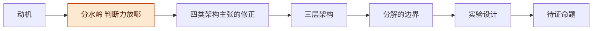
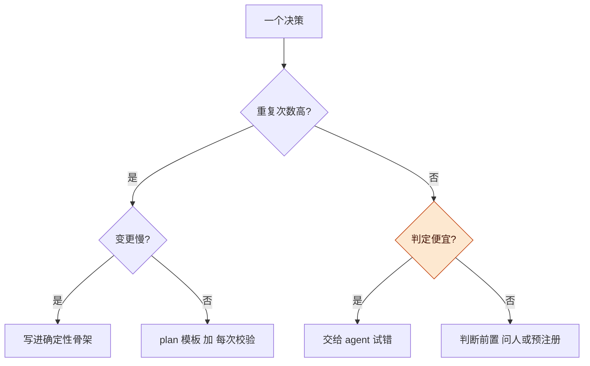
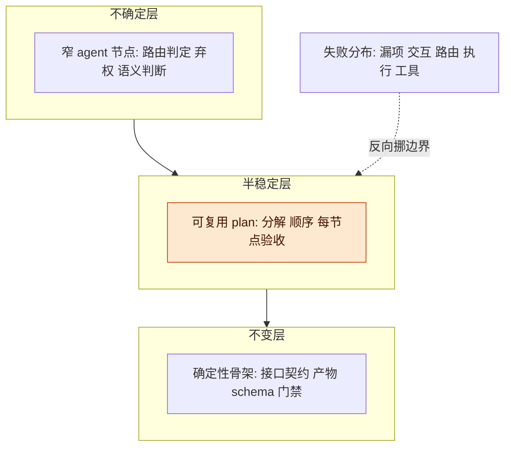
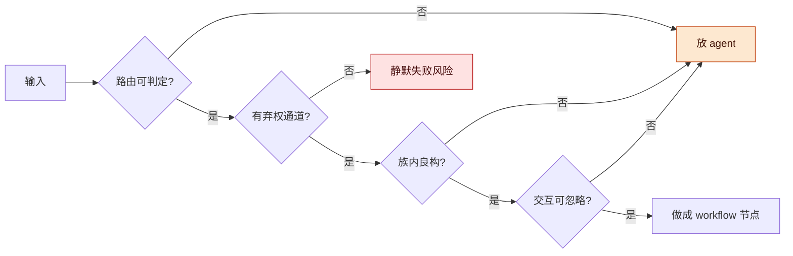
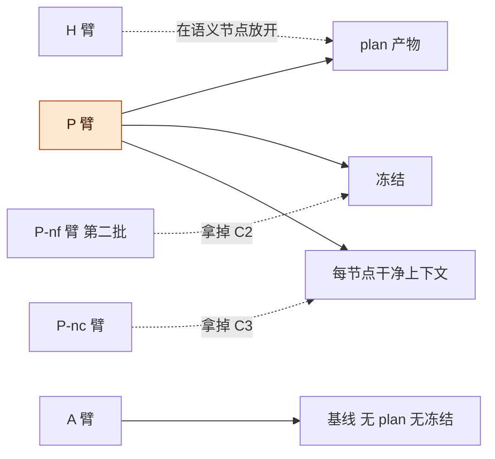

# Agent 与 Workflow 讨论稿 v0.1.0

> **公开整理版**：基于原稿《Agent 与 Workflow 讨论稿 v0.1.0》（源版本：0.1.0）。本次删去私有项目实例、公司项目专属内容及原始个人语料，未重新验证实验。源稿状态：historical；源版本编号保留，公开编辑不代表实现完成或新验证结果；章节与条目沿用源编号，删节后可能不连续。

2026-10-22 · Taishuo × DSH（lead）

## 版本与范围

本稿讨论一个架构立场：决定"下一步做什么"的**判断力放在哪一层**，比"用 agent 还是 workflow"这个标签更重要；据此给出三层架构、分解成立的四个前提，以及一个决定要不要为 plan 层做不可逆投入的四臂消融实验。

- 版本：v0.1.0 为首次整理。后续修改按补丁号递增（0.1.1、0.1.2…）。
- 主线：动机 → 分水岭 → 四类架构主张的修正 → 三层架构 → 分解的边界 → 实验设计 → 待证命题。
- 状态标记：文中的架构论断属于设计主张，未作为实验结果处理；benchmark 规模与评测前提引自官方 FAQ（2026-10-22 核实，链接见实验设计一节）；"提案"是本稿新增、尚未验证的部分，集中在三层架构、四个前提与实验协议。

**图 1　讨论主线 · 七节递进**

七节从左到右递进；高亮的"分水岭"是全稿换轴的地方，三层架构与实验都从它推出来。

## 动机

这套讨论现在必须落成判据，因为下一步为 plan 层做的投入不可逆。

- 本轮 H0 只做记录闭环与分类技能；plan 层（plan schema、节点身份、干净上下文装配器、分叉与选优）不在 H0 范围内，是记录闭环之外最大的一笔架构投入。设计稿见 `2026-10-19-Agent框架下一轮开发设计稿.md`。
- 架构讨论有两个比喻——"决策在编译期付还是运行时付"与"沙箱分叉"，但没有一条能被测量；按直觉投入，失败时也归不了因。
- 本稿只回答两件事：混合架构的边界在哪；怎么用一个实验决定要不要建它。

## 分水岭：判断力放在哪

真正的分水岭不是 agent 还是 workflow，而是"每一步由谁判定对错、判定一次多贵"；决策成本只是三个轴里的一个。

第一个轴是重复次数：同一个决策要重复付多少次。第二个是变更频率：这条流程多久失效一次。第三个是判定成本：这一步做错了，有没有便宜的办法当场发现。重复次数、变更频率和判定成本应同时评估；第三个轴尤其容易被忽略。

| 任务特征 | 决策放哪 | 理由 | 典型失败 |
| --- | --- | --- | --- |
| 重复多、变更慢、判定便宜 | 确定性骨架（代码、门禁） | 决策写死一次，每次运行零决策 | 契约过期，静默放过 |
| 重复多、变更快 | 可复用 plan 加每次校验 | 结构可缓存，结论必须重验 | 模板失配没被触发 |
| 重复少、判定便宜 | 纯 agent 试错 | 现场试一次的代价低于事前建模 | 方差大，上下文腐化 |
| 判定昂贵或无 ground truth | 把判断前置（问人、预注册、先出稿） | 错误无法当场发现，只能事前买确定性 | 返工，事后才知道错 |

**判定成本不只是"贵不贵"**：还看三件事——有没有 ground truth（测试、OOF、用户确认）、判定是否与生成方去相关、判定能不能批量。第三件决定并行探索是否划算：确定性检查与小样执行可以批量，读方案写评语不行。

**图 2　任务该放在哪一层 · 三个轴，菱形是分叉**

两条主路先按重复次数分，只有右支才用判定成本再分；高亮的判定节点是本稿补的第三个轴，也是"该问人还是该让 agent 试"的分界。

## 架构主张：哪些成立，哪些要改

这些主张中，路由与判定是两条关键边界；其余原则成立，但都要收紧成可操作条件。

| 编号 | 架构主张 | 本稿判定 | 修正 |
| --- | --- | --- | --- |
| R1 | 区别在于"下一步做什么"的决策在编译期付还是运行时付 | 成立，但只说了一半成本 | 补"改一次多贵"轴：workflow 改结构要改代码重跑，agent 下一轮就能改；"零不确定性"应拆成"零路由成本，节点仍会失败" |
| R2 | 把空间分解成直和、直积，每块一个 agent，整体仍是 workflow | 方向有价值，需给出可测契约 | 路由可判定才有价值；补四个洞：弃权通道、失败分布测边界、任务族内分解、每块配边界样本当路由契约 |
| R3 | harness 先生成 workflow，执行中改进；比直接 agent 更好定位、更负责 | 成立 | plan 资产不是文本，是 plan 加接口加校验器；修订必须带假设；触发从"失败"收紧到"预测被证伪"；节点身份锚在事件而非 plan 文本 |
| R4 | 独立沙箱并行改进，再引入外部审查最终结果 | 成立 | 评审的更强形态是执行代评审，级联为确定性检查、小样执行、窄 judge、人；分支点应在最不确定那层，不固定在分解层；"n 采样不等于 n 假设"同样约束修订与实验本身 |

**R2 的可操作含义**：直和、直积这个动作真正提供的不是"切分"，而是**路由的可测契约**——每个块配一组边界样本，路由对不对能测出来。测不出来的块，还没资格做成 workflow 节点。这一条把分解从直觉变成工程。

**R1 的"零决策成本"要拆开**：workflow 消掉的是路由与顺序的临场决策，不是节点会不会错。节点仍然会失败，只是失败的位置可定位。把这两件事混在一起，会得出"画得出图就不用管失败"的错误结论。

**R3 与 R4 共同缺的一步是"选择函数"**：分叉能生成候选，但读候选不是好的选择方式；候选 plan 应该在一两个实例上真跑一次来筛，这正是下面三层架构里判定级联的中间一级。

## 三层架构

把系统分成三层——确定性骨架管接口与判定，可复用 plan 管结构与顺序，窄 agent 节点管语义判断与弃权；自主性只放在第三层内部，且输出值域必须受限。

| 层 | 放什么 | 判据 | 失败模式 |
| --- | --- | --- | --- |
| 确定性骨架 | 接口契约、产物 schema、验收命令、门禁 | 可判定、可重复 | 契约太紧丢上下文；太松静默放过 |
| 可复用 plan | 任务族的分解、节点顺序、每节点验收 | 重复出现、结构稳定 | 过期（模板失配没被触发）；漂移（修订无假设） |
| 窄 agent 节点 | 路由判定、弃权、语义判断 | 路由需要语义、输入空间不可枚举 | 输出越界；假阳假阴；上下文腐化 |

**图 3　三层架构 · 自上而下：不确定、半稳定、确定性**

自上而下是不确定到确定；高亮的 plan 层是本稿主张的缓存层，左侧失败分布反向决定层与层之间的边界往哪挪。

**节点身份**：plan 只是模板，节点身份要锚在 artifact 与执行事件上。同一份 plan 文本被不同 executor 跑出来的步骤绑定可能不同；只有把身份绑到"哪个产物、哪条事件"，日志之间才能对齐，A/B 才有坐标。

**修订协议**：每次修订必须写三件事——改哪个节点、预期哪个症状消失、没消失说明什么。没有预测的修订只是同一先验的又一次采样；改三次不如改一次带假设的。触发条件用"预测被证伪"而不是"执行失败"：失败可能是执行噪声，意外才有信息量。这正好接记录系统的"预测、检查点、判定、意外"。

**判定级联**：确定性检查（测试、schema、约束）→ 小样执行（候选 plan 在一两个实例上真跑）→ 窄 judge（只判判不了的部分，问"找一个失败的具体输入"，不问"好不好"）→ 人（只处理不可逆与品味）。级联的意义是把贵的判定留给少数残差，而不是让 LLM judge 承担全部选择。

## 分解的边界

分解不是不可行，而是有四个可测前提；四个前提缺一个的位置，就是 agent 该待的地方。

| 前提 | 怎么算成立 | 不成立时的症状 |
| --- | --- | --- |
| 路由可判定 | 能写出边界样本集，判定不看语义 | 同类输入路由不同，路由节点输出不稳 |
| 有弃权通道 | 不属于任何块时系统能说"这里怪" | 静默失败：日志干净、链路完整、结论错 |
| 任务族内良构 | 同类任务共享产物类型与验收方式 | 每次都要改分解，模板复用率低 |
| 交互项可忽略 | 已显式处理，或能说明不影响结论 | 单独看都对，合起来错 |

**图 4　分解的四个前提与弃权通道 · 任一前提不成立就退回 agent**

从左到右是四道门，任一不成立就往回退；红色的"静默失败风险"是本稿认为最坏的失败模式——系统看起来跑完了，结论是错的。

**边界不靠证明，靠失败分布**：把失败分成五类——漏项、交互、路由错、执行错、工具错。漏项与交互占比在涨，说明分解碰到边界；执行错占大头，说明分解够用。这是 CEGIS 那条线在架构上的版本：沿失败边界扩，不追求一次证明完备。

**任务族内分解**：语义空间整体未必良构，但同一类任务的变体通常良构，因为它们共享产物类型与验收方式。所以分解的单位是任务族，不是全空间；跨族才交回 agent。这条直接决定 plan 复用只能在任务族上测，公共 benchmark 测不了。

## 实验设计

先跑一个能杀掉 plan 层的四臂消融，不做"agent vs workflow"的总比较；判断标准提前写死。

**已拍（2026-10-22）**：

| 项 | 结论 | 影响 |
| --- | --- | --- |
| 先验命题 | plan 层值不值得建 | 做成分消融（A、P、P-nc、H），不做架构标签的总比较 |
| 实验台 | 公开 benchmark，SWE-bench Verified 子集 | 有官方评测与 ground truth；分布不等于自用分布 |
| 本轮落点 | 只出稿，实验等人拍 | 下一步是预注册与冒烟，不先写实现 |

### 任务书

1. 冻结任务集：从 SWE-bench Verified 抽 40 条，按仓库、patch 大小、改动文件数分层采样；instance_id 清单入仓并做哈希锁定，跑之前不许看结果换题。
2. 冻结执行器：四臂共用同一个 runner、同一个模型、同一套工具与同一 token、步数、时间上限；臂间只允许控制层不同。
3. 实现四臂：A 为纯 agent 循环，不保留 plan 产物；P 为先出结构化 plan（3 到 7 个节点，每节点写输入、输出、验收），冻结后逐节点执行，每节点用干净上下文，只从 plan 与上游 artifact 装配；P-nc 与 P 相同但所有节点共享一条 trajectory；H 与 P 相同，但把需要语义判断与路由的节点交给 agent，其余节点确定性执行。
4. run 落盘：每 run 一个目录，含 plan、节点 artifact、事件日志、最终 patch、测试输出、token 与时间、运行前的预测与运行后的判定。
5. 官方评测：用 SWE-bench harness 在容器环境跑 resolve（FAIL_TO_PASS 与 PASS_TO_PASS）；每臂每实例用独立 run_id，避免缓存复用。
6. 盲评归因：从失败 run 抽 20 条，交独立审计者（换上下文与模型，不看臂标签）判"失败在哪层（计划、执行、工具、环境）；若当初有冻结 plan 加节点验收，能否拦住"；两人重叠 20% 算一致率。
7. 预注册：命题、臂、主次指标、停止线、look budget、采纳阈值写成文件，跑前提交。

这套落盘格式复用 H0 的记录 schema，意味着实验本身就是记录系统的第一个真实消费者。

### 对照组

| 组 | 做法 | 隔离的机制 | 期望 |
| --- | --- | --- | --- |
| A | 纯 agent 循环 | 基线 | 不预设 |
| P | plan 冻结加每节点干净上下文 | 组合效应 | 成功率升或成本降 |
| P-nc | plan 冻结，但共享一条 trajectory | 干净上下文 | 与 P 持平则收益不来自干净上下文 |
| H | P 骨架加语义节点用 agent | 节点级自主 | 不差于 P，差异应落在可枚举的节点类型上 |

**图 5　四臂消融 · 三个成分分别拿掉**

P 相对 A 只多了三个成分；三条虚线是三种对照：P-nc 拿掉干净上下文，P-nf 拿掉冻结，H 在语义节点放开自主。用来判断收益到底来自哪一样。

第二批扩展本轮不跑：P-nf 测"冻结"（预测被证伪才改，且修订必须带假设）、W0 测 plan 质量天花板（人写 plan，只做 10 个任务）；第三批才测分叉与执行代评审，前提是 P 层已被证明有效。

### 指标

| 对话里的主张 | 指标 | 主次 |
| --- | --- | --- |
| plan 层有效 | solve rate（官方 resolve 比例） | 主 |
| 更省 | 每个解决实例的 token 与时间成本；固定预算下的解决数 | 主 |
| 更稳 | 正式阶段每实例重复 3 次的解决一致性 | 次 |
| 更好调试 | 盲审归因准确率（定位到正确层） | 次 |
| 自主性的代价 | run 中途停下等人或问人的次数 | 次 |
| plan 的适用域 | P 臂中计划执行到一半需要改的比例（只记录不改） | 次 |

### 停止判据

- 冒烟（8 实例 × 4 臂）：若单 run 平均成本超过预算上限，缩到 20 条或换 Lite，不解读架构差异。
- pilot（40 实例 × 4 臂 × 1 次）：若 P 相对 A 的 solve rate 配对差小于 10 个百分点且成本不降，停，不建 plan 层，后续预算转门禁、记录、审查者。
- 若 P 与 P-nc 差小于 5 个百分点，干净上下文不是主因，不优先做上下文装配器。
- 若 H 与 P 差小于 5 个百分点且成本更高，先做纯 plan，不做混合。
- 若四臂 solve rate 都低于 15%，先调预算与任务子集，不解读架构。
- 若归因一致率低于 70%，先修审计协议，不引用归因结论。

以上阈值均为提案，跑前在预注册文件里锁定，跑完不许改。

### 局限与次序

次序是：预注册与冻结任务集 → 冒烟 → pilot → 若 P 有优势再跑正式 3 次与归因 → 第二批扩展。

## 风险与开放问题

最大的风险不是统计，是实验者同时是架构作者；所有纪律都围绕这一点设。

开放问题：

## 待证命题与下一步

最值得先验证的是 P1 与 P2：它们同时决定 plan 层建不建，以及建哪一部分。

| 编号 | 命题 / 猜想 | 已有依据 | 缺口 |
| --- | --- | --- | --- |
| P1 | 等预算下，P 比 A 的 solve rate 高 10 个百分点以上，或同 solve rate 成本低 30% 以上 | 四轮讨论的推理与长任务上下文腐化的经验 | 无实测 |
| P2 | P 的收益主要来自每节点干净上下文，而不是 plan 产物本身 | 上下文隔离与 plan 资产可能分别产生影响 | 无实测；靠 P 与 P-nc 的差分离 |
| P3 | 失败可归因性：plan 类臂的盲审定位准确率比 A 高 15 个百分点以上 | 对话里"节点有稳定身份就能定位" | 无实测；需盲审协议 |
| P4 | H 不差于 P，且优势集中在可枚举的节点类型上 | 分层立场，用户侧主张 | 需同预算对照与更长观察 |
| P5 | 无假设的修订会改坏正确的 plan，带预测的修订不会 | 对话里"震荡"与"n 采样不等于 n 假设" | 需在正确 plan 上注入失败，第二批才测 |

下一步：
