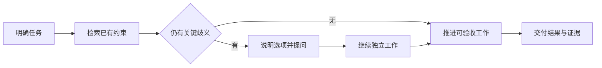

# Agent 主动性与提问边界讨论稿 v0.1.1

> **公开整理版**：基于原稿《从修正模式到前置提问：Agent 主动性与提问边界讨论稿 v0.1.1》（源版本：0.1.1）。本次删去私有项目实例、公司项目专属内容及原始个人语料，未重新验证实验。源稿状态：current；源版本编号保留，公开编辑不代表实现完成或新验证结果；章节与条目沿用源编号，删节后可能不连续。

## 公开范围

本稿保留一般交互原则与对照实验方法。原稿基于私人会话的统计、个体画像、原话和实验结果不在公开版中提供，因此本版不主张这些原则已获得普遍有效性证明。

## 行动与提问的分工

上下文已经给出答案时，先查已有资料并落实约束。只有答案会明显改变交付物、对象、范围或验收，而且无法从已有信息确定时，才提出简洁问题；等待期间可继续不依赖答案的工作。

| 需要对齐的边界 | 可以怎样确认 |
| --- | --- |
| 交付物与验收 | 本轮交付清单、设计稿还是可运行结果；做到哪一步算完成 |
| 对象与归属 | 指的是哪个项目、模块、资料或任务 |
| 方案取舍 | 并列说明选项、代价与推荐理由 |
| 顺序与粒度 | 先验证哪条关键路径，需要怎样分工 |
| 数据口径与环境 | 时间、机器、版本与预算是否已有约定 |
| 工作模式 | 本轮是在讨论、制作草稿，还是推进到验收 |

提问应帮助用户作出影响结果的决定。具体动作的授权仍按当前任务及用户指令判断；既有授权不应被同样的问题反复打断，缺少授权也不能因等待时间已过而视为批准。

从任务和已有约束开始，只有关键歧义进入提问分支；最终以实际交付及证据判断结果。

## 按当时可知信息构造评估

评估应冻结每个任务开始时可见的信息。后续纠正、最终答案和验收结果不能提前作为输入；否则会把后来才出现的要求当成模型本应知道的内容。

修正记录应区分：已有要求未遵守、任务中新增信息，以及本可提前澄清的关键歧义。三者对应不同改进方式，不能全部解释为需要更多提问。

## 三策略对照方法

| 组 | 做法 | 观察指标 |
| --- | --- | --- |
| A | 按当前可知信息直接执行 | 任务质量、约束遗漏、返工 |
| B | 先提出一个关键边界问题再执行 | 问题必要性、等待、质量变化 |
| C | 执行并显式列出必要假设 | 假设错误、纠正成本、任务质量 |

固定模型、工具、预算和验收规则，使用有公开授权或合成的任务，按当时信息配对比较。独立评价问题是否改变了结果，并同时计算用户时间与全部执行成本。本次仅公开方法，未运行新的对照。

## 风险与下一步

- 将所有任务默认转为提问可能增加无效等待；默认猜测也可能扩大返工。
- 数据集应涵盖确实需要澄清和无需澄清的任务，防止单一场景决定总体结论。
- 模型评分需要独立规则或人工抽查；不以执行模型自评作为唯一结果。
- 下一步是用可公开的任务集验证条件提问是否改善质量与用户负担，而非沿用私人样本的比例作为普遍阈值。
