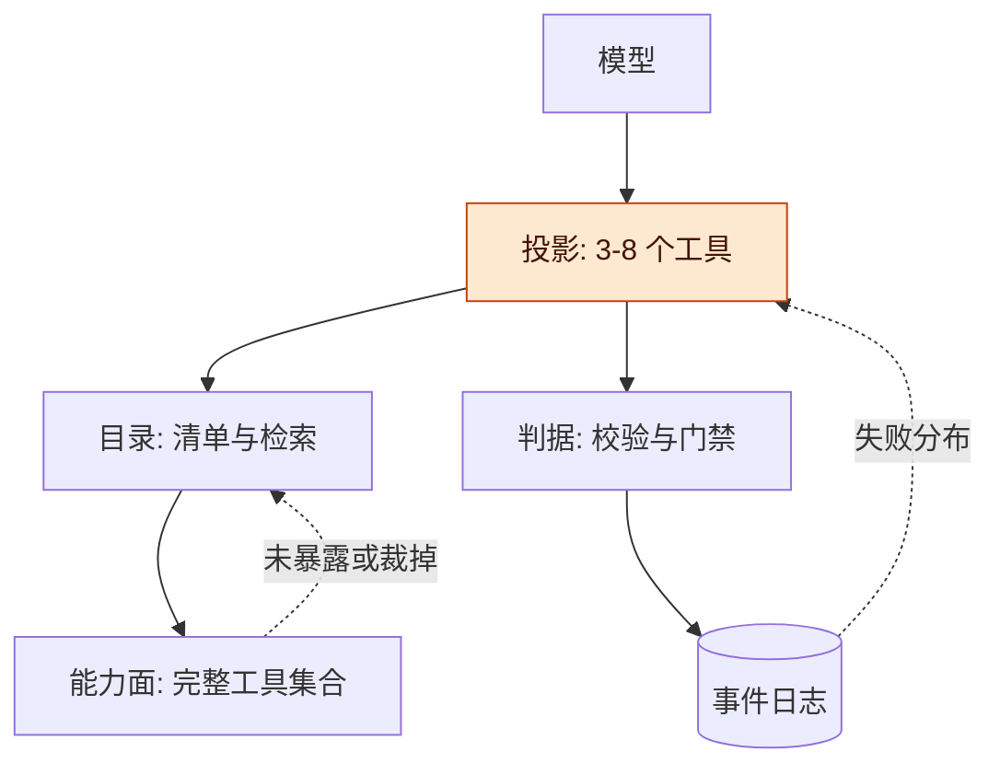
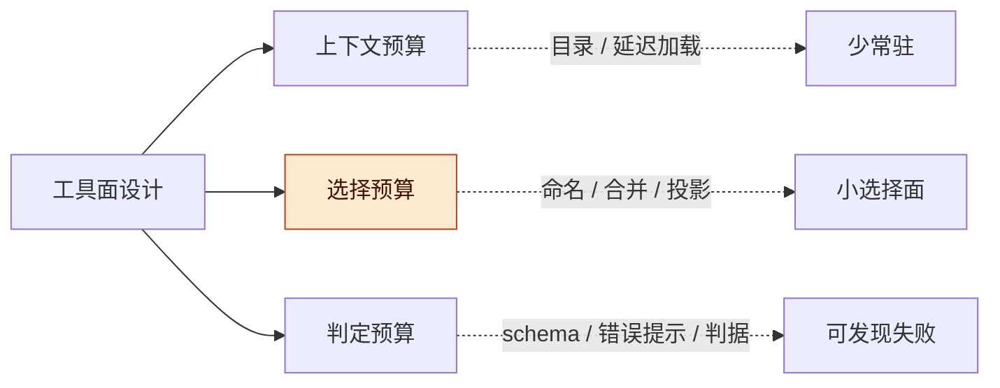
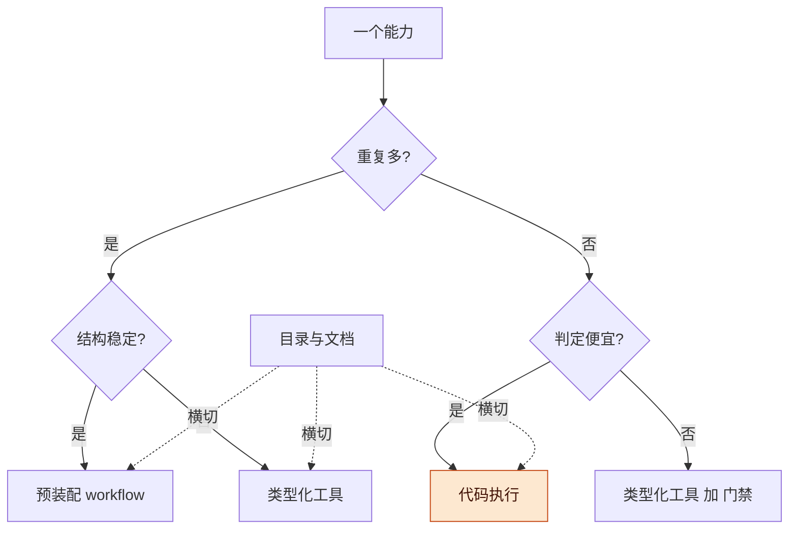
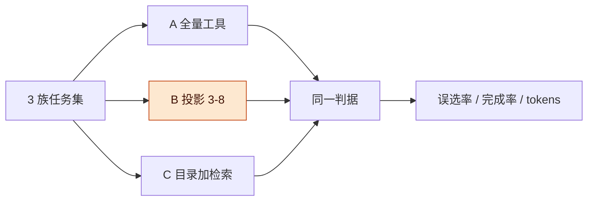

# Agent 工具面设计讨论稿 v0.1.0

> **公开整理版**：基于原稿《Agent 工具面设计讨论稿 v0.1.0》（源版本：0.1.0）。本次删去私有项目实例、公司项目专属内容及原始个人语料，未重新验证实验。源稿状态：current；源版本编号保留，公开编辑不代表实现完成或新验证结果；章节与条目沿用源编号，删节后可能不连续。

2026-10-22 · Taishuo × DSH（lead）

## 版本与范围

本稿讨论单会话里工具数量超过一个稳妥规模（一百上下）时，工具面该怎么设计；主张是能力面可以大、选择面必须小。

**图 1　讨论主线 · 九节递进**

九节从左到右递进；高亮的投影链是本稿主要提案，前面是依据，后面是验证与风险。

## 动机

人学大型软件的成本主项不是命令数量，而是概念模型、组合的正确性、失败的不可逆性；agent 侧对应同样三项，只是承载方式不同。

人的一侧：专业软件的核心操作其实不多，学习成本主要花在建立心智模型（图层、节点、约束、坐标系）、学会组合（顺序、参数耦合、上下文）、以及知道什么时候会弄坏东西。命令列表只是表层，人找功能是按“我想干什么”，不是背菜单。

agent 的一侧有三个差别。第一，每次会话从零开始，学不会跨会话迁移；学习只能落在工件上（文档、技能、workflow、判据），或者落进权重。第二，失败常常是静默的：选错工具往往不报错，只是结果差一点。第三，上下文就是工作记忆，工具定义本身要占位置，而且每次请求都占。

公开材料把量级对上了：Anthropic 内部见过工具定义占 134K tokens；Claude Code 文档说 50 个工具可占 10–20K tokens，一次载入超过 30–50 个后选择准确率下降；Pi 的四个工具加系统提示不到 1,000 tokens。三组数字指向同一件事：工具面的成本主要不在运行时，而在每次请求的上下文和每次选择的错误率。

所以问题不是工具多不多，而是三个预算被挤占的程度，以及这些代价放在哪一层。

## 总体架构

工具面分四层：能力面、目录、投影、判据；模型每次只看投影，能力面与目录留在系统侧。

| 层 | 放什么 | 对模型可见 | 失败模式 |
| --- | --- | --- | --- |
| 能力面 | 全部工具与服务，含未暴露的 | 否，只通过目录 | 不知道有什么 |
| 目录 | manifest、status、search、describe、文档 | 摘要与检索结果 | 找不到、过期 |
| 投影 | 每任务族 3 到 8 个工具加上游产物 | 是 | 漏工具、给错工具 |
| 判据 | 输出 schema、校验、门禁、失败归因 | 结果与错误 | 静默失败 |
| 记录 | 事件日志：调用、结果、失败、用量 | 否 | 无证据可归因 |

**图 2　总体架构 · 能力面到模型之间的三层收窄**

自上而下是模型到能力面；目录回答“有什么”，投影回答“这次给什么”，判据与日志回答“给错了怎么知道”，虚线是收缩回路。

这两个动作要分开看：目录让“大”可导航，投影让“选择”变小。很多系统只做了目录（把工具都列出来）或只做了投影（写死一组工具），缺一个就会在另一半上付代价。

## 三个预算

工具面的好坏由三个预算衡量：上下文、选择、判定；工具数量主要挤占前两个，第三个决定这个数量值不值得接受。

| 预算 | 量什么 | 随工具数怎么变 | 公开证据或设计判断 | 杠杆 |
| --- | --- | --- | --- | --- |
| 上下文 | 工具定义与结果的常驻 token | 近似线性 | Anthropic 官方文章报告过工具定义占 134K tokens 的案例 | 目录、延迟加载、代码执行、按任务族投影 |
| 选择 | 相似工具里的误选与参数错 | 需测，可能受相似度影响 | 一次载入超过 30–50 个后准确率下降；Tool Search 把 Opus 4 选择准确率从 49% 提到 74% | 合并同类、命名空间、负向说明、调用示例、投影 |
| 判定 | 验证输出正确性的成本 | 随任务和错误类型而变 | 尚无本稿统一实测；需独立评测 | 输出契约、确定性检查、错误归因 |

**图 3　三个预算与各自的杠杆 · 高亮的是工具数量最直接挤占的一项**

三个预算各自有解；高亮的选择预算是工具数量最直接挤占的一项，也是投影链主要针对的一项。

**推论**：判定便宜时，工具多可以接受；判定昂贵时，先把工具面收窄。这一判断与 Workflow 讨论稿的判定成本原则相接：判定成本影响结构，这里讨论的对象是工具面。

## 四种工具面形态

工具面有四种形态：代码执行、类型化工具、预装配 workflow、资源与文档；它们按重复次数、变更频率、判定成本分工，不是互相替代。

| 形态 | 长什么样 | 适合 | 代价 | 公开代表或通用形式 |
| --- | --- | --- | --- | --- |
| 代码执行 | 一个执行器加库、CLI、文件树 | 长尾、组合、未知任务 | 组合正确性靠约定，要沙箱 | Pi 的 4 个工具；Anthropic 的代码执行示例把 150K tokens 降到 2K |
| 类型化工具 | 类型化参数、结果与错误 | 高频、边界清晰的能力 | 接口维护及参数组合成本 | schema 与结构化工具接口 |
| 预装配 workflow | 固定骨架加受限判断节点 | 重复任务族、结构较稳定 | 流程失配与版本迁移 | 任务模板与工作流 |
| 资源与文档 | 数据与说明书按需读 | 发现、检索、教学 | 需要可靠目录与命名 | skills、status、MCP resources、README |

**图 4　四种形态与三轴选择 · 目录与文档横切三种主要形态**

先按重复次数分，再按结构稳定性或判定成本分；三种主要形态都被目录与文档横切，高亮的代码执行是长尾的默认形态。

## 五步投影链

从大能力面到小选择面有一条可操作的投影链：产物模型、目录、任务族装配、负向说明书、用失败分布收缩。

**图 5　五步投影链 · 从能力面到小选择面，再回到目录**

五步从左到右；第三步装配是本稿主张的核心动作，第五步把失败信息送回目录，形成收缩回路。

**为什么第一步是产物模型**：组合的前提是共享底座。文本流与文件让 Unix 的少量命令能组合；agent 侧对应的是 artifact 与事件日志。没有它们，工具之间只能靠自然语言转述，每次转述都是一次上下文开销与一次失真。

**一份工具面，三类读者**：代码读类型与产物契约，模型读“何时用 / 何时别用”，人读状态、原因与审计。同一个工具要同时被这三种读者读懂，所以描述不能只写参数；参数 schema 是给代码和模型共用的，使用说明与风险说明是给人看的。统一工具契约之后，三类读者才能读取同一份能力说明。

**投影的代价**：投影会漏工具，所以必须配弃权通道与逃生口；判据红时能退回 agent 或全量目录。这是投影和“写死工具集”的区别，也是下面风险一节的起点。

## 相关工作

公开材料在“工具定义吃上下文”与“按需发现能救”上已经给出可复现的数字；缺口在单会话工具多的系统性投影方法。

| 类别 | 代表（年份） | 核实到的内容 | 缺口 |
| --- | --- | --- | --- |
| 工具设计原则 | Anthropic [Writing effective tools for agents](https://www.anthropic.com/research/writing-tools-for-agents)（2025） | 工具应面向 agent，不要逐个包装 API 端点；把常用链路合并成工作流级工具；用命名空间划边界；返回高信号上下文并分页截断；错误信息要可行动；用 held-out 评测驱动改进 | 没给工具数量的通用公式；评测任务集要自建 |
| 代码执行 | Anthropic [Code execution with MCP](https://www.anthropic.com/engineering/code-execution-with-mcp)（2025） | 工具定义与中间结果都会挤占上下文；把 MCP 服务映射成文件树，按需读工具定义；文中示例 150,000 降到 2,000 tokens（98.7%）；中间结果可在执行环境里过滤；需要沙箱 | 简单任务反而多一层执行环境；沙箱与监控成本；小工具集不划算 |
| 工具检索 | Anthropic [Introducing advanced tool use](https://www.anthropic.com/engineering/advanced-tool-use)（2025） | 五个 MCP 服务 58 个工具约 55K tokens，内部见过 134K；Tool Search 只常驻约 500 tokens、按需载入 3 到 5 个，总计约 8.7K（省 85%）；Opus 4 选择准确率 49% 到 74%，Opus 4.5 从 79.5% 到 88.1% | 搜索多一次往返；少于 10 个工具不划算；检索质量依赖名称与描述 |
| 延迟加载 | Claude Code [Scale to many tools with tool search](https://code.claude.com/docs/en/agent-sdk/tool-search)（2025） | 50 个工具可占 10 到 20K tokens；一次载入超过 30 到 50 个后选择准确率下降；默认每次搜索载入至多 5 个；目录上限 10,000 个；少于 10 个直接全量更快 | 有模型与部署限制；压缩后要重新搜索 |
| 调用示例 | Anthropic 同上（Tool Use Examples，2025） | schema 表达不了使用约定（日期格式、ID 约定、可选参数组合）；加入示例后复杂参数处理准确率从 72% 到 90% | 示例增加定义 token；示例会随 API 变化过期 |
| 程序化调用 | Anthropic 同上（Programmatic Tool Calling，2025） | 多步调用写成代码，中间结果不进模型上下文；研究任务平均 43,588 降到 27,297 tokens（减 37%）；知识检索 25.6% 到 28.5%，GIA 从 46.5% 到 51.2% | 需要沙箱；调试与可观测路径变长 |
| 极简内核 | Mario Zechner [What I learned building an opinionated and minimal coding agent](https://mariozechner.at/posts/2025-11-30-pi-coding-agent/)（2025） | 4 个工具（read/write/edit/bash），系统提示加工具定义不到 1,000 tokens；拒绝 MCP 的理由是上下文开销（Playwright MCP 21 工具 13.7K tokens，Chrome DevTools MCP 26 工具 18K tokens，占 7% 到 9% 窗口）；改用 CLI 加 README 做渐进披露；Terminal-Bench 2.0 自报成绩不差 | 作者自报基准；少工具的语义与安全靠约定；作者团队后来接回 MCP 加 Codemode |
| 反转后的形态 | Earendil [You Said No MCP](https://earendil.com/posts/you-said-no-mcp/)（2026） | Pi 把 MCP 放进核心，理由是 MCP 与 Codemode 需要共同的工具载荷元数据；主张 MCP 应更像 OpenAPI 加智能工具发现，工具返回结构化数据；Codemode 是 harness 侧的 JavaScript 沙箱，用来编排工具调用 | 没给延迟加载的量化结果；仍承认 MCP 难组合 |

**核实后的修正**：本稿初读 Pi 2025-11-30 的“不接 MCP”当作其当前立场；核实后，作者团队在 2026-09-29 已把 MCP 接回来并加 Codemode。所以“极简内核”和“接 MCP”不矛盾：Pi 仍然是小内核，只是把发现与编排放进了 Codemode。

说明：本稿引用的 Anthropic 数字来自其官方文章，未独立复现；各模型应使用对应生产分词器分别测量。本次不公开原私人环境的工具统计。

## 小实验提案（未拍）

提案是用三个任务族、三组策略的对照实验，验证投影能否降低误选而不降低完成率；本稿未实施该实验。

**任务书**

采用可公开或合成任务，覆盖三类不同工具需求；分开开发集与保留评测集，固定模型、工具版本、预算和验收标准。

**对照组**

| 组 | 做法 | 隔离的机制 | 期望 |
| --- | --- | --- | --- |
| A | 全量工具集合 | 现状基线 | 上下文最贵，误选最多 |
| B | 任务族投影 3 到 8 个，加负向说明 | 投影 | 误选与 token 下降，完成率不降 |
| C | 目录加检索，按需载入 5 个 | 发现层 | token 接近 B，误选取决于检索质量 |

**指标与判据**

- 主指标：首次调用正确率与任务完成率；次指标：prompt tokens、工具往返数、恢复步数。
- 采纳线（提案，跑前锁定）：B 的首次调用正确率比 A 高 20 个百分点以上，prompt tokens 降 50% 以上，完成率下降不超过 5 个百分点。
- 反向判据：若 A 的首次调用正确率本来就高于 95%，该族不需要投影；若 B 的完成率下降超过 10 个百分点，说明投影漏了工具；若 C 明显优于 B，说明发现层比装配层更值得做。

**停止判据**

- 任一族 B 完成率下降超过 10 个百分点，停，先查投影缺了什么，不调参。
- 三臂在 A 上都没有可区分的失败，停，任务集太简单。
- 单条任务超过 5 分钟或模型挂死，先修跑批，不解读结果。
- test 与 dev 掉超过 15 个百分点，停，过拟合。

**图 6　小实验 · 三臂同任务同判据**

三臂同任务同判据，高亮的 B 是要验证的投影；A 是现状，C 是发现层路线。

以上阈值均为提案，跑前写进 prereg.md 锁定；不锁定就不算实验，只算演示。

## 风险与开放问题

主要风险都围绕一件事：投影把工具拿走之后，模型是弃权还是静默乱做。

- **投影漏工具**：agent 找不到需要的工具，会绕路或静默放弃。对策是弃权通道、逃生口、以及把失败按五类归因。
- **负向说明书腐化**：工具一改，说明书里的“别用我”就过期。对策是把说明书条目挂到工具版本上，变更时一起审。
- **评测过拟合**：用同一批任务调投影、再用同一批评分，等于自证。对策是 held-out 任务族与前瞻任务。
- **token 口径**：cl100k 只是代理分词器，和 DeepSeek 分词器有出入。对策是用生产分词器复量，并记录测量脚本。
- **权限与风险不对等**：按工具数量裁，不等于按风险裁。曝光级别要跟数据暴露和可逆性绑定，而不是跟调用频率绑定。
- **模型差异**：公开数字多来自 Claude，DeepSeek 与小模型对工具选择的敏感度未测；投影的比例可能不同。

开放问题：

- [ ] 完整工具集合里，常驻核心集是哪几个：按调用频率，还是按任务族？
- [ ] 任务族的最小工具子集怎么定：按调用序列聚类，还是按产物类型？
- [ ] 负向说明书由谁维护、何时失效、怎么测？
- [ ] 选择评测的 ground truth 怎么来：人工标注期望调用，还是只判完成？
- [ ] 工具合并的判据是什么：同产物、同判据，还是同失败模式？
- [ ] 小模型是否更需要投影，还是更需要少而正交的命令？

## 待证命题与下一步

| 编号 | 命题 / 猜想 | 已有依据 | 缺口 |
| --- | --- | --- | --- |
| P1 | 任务族投影能降低首次调用误选率 | Claude Code 文档称超过 30 到 50 个工具后准确率下降；Tool Search 的准确率提升数据 | 本稿未跑，B 组没有实测 |
| P3 | 投影不降低任务完成率 | 无直接依据，是本稿最关键的风险点 | 未测 |
| P4 | 负向说明书比参数说明更能降低误选 | Tool Use Examples 把参数处理从 72% 提到 90% | 没有对照实验 |
| P5 | 失败分布能指导工具合并与拆分 | 漏项、交互、路由、执行、工具五类失败的分析框架 | 需要事件日志把工具调用失败分类 |

下一步：使用可公开任务集固定实验协议，再决定是否实现投影与目录对照。
