# Harness 底座架构重评讨论稿 v0.1.5

> **公开整理版**：基于原稿《Harness 底座架构重评讨论稿 v0.1.5》（源版本：0.1.5）。本次删去私有项目实例、公司项目专属内容及原始个人语料，未重新验证实验。源稿状态：historical；源版本编号保留，公开编辑不代表实现完成或新验证结果；章节与条目沿用源编号，删节后可能不连续。

> 本稿是通用架构公开摘编：内部选型与评测材料未收入本版；保留公开资料讨论的框架机制、持续任务及资源设计。

2026-11-03 · Tai Shuo（原稿作者）／Codex（本版整理）

## 版本与范围

本版建议把底座重评扩展为持续任务系统的整体选型：保留六家机制证据，比较可组合架构，并以共享不可变基础、独立修改视图和按需执行控制多工作树、多沙箱的资源成本。

**署名与编排**：保留原稿作者署名；原稿由 Codex 根据架构讨论整理；本次只作公开删节。新增设计尚未落地，最后两节保留旧待办并追加新命题。

## 本版结论与证据边界

本版建议把选型目标扩展为“持久任务、可替换执行器、统一工作区视图和受预算约束的运行环境”，保留完整产品、可组合内核和持久工作流三条候选路线，通过同一组验证收敛。

**本版的阶段性倾向**：应用维护方保有任务、授权、事件、产物和环境生命周期的定义；底座提供模型循环、工具执行与必要的产品积木。任务身份、会话记录、执行进程、工作树和沙箱分别管理。共享不可变基础、每个任务保存私有改动，是环境层的核心提案。

| 材料 | 时间与范围 | 本版可以据此判断 | 本版没有完成的验证 |
| --- | --- | --- | --- |
| 一般架构讨论 | 2026-11-03 | 整理候选路线、模块优劣、接口边界与组合方案 | 方案尚未实现，不能按已有功能打分 |
| DeepSeek 官方 Super-agent 原型及设计文档 | 原稿查阅的公开版本 | 判断其任务、协调、执行与并发设计，识别可借鉴部分 | 不等于文章全量实现或生产能力验证 |
| 官方框架、内核与容器文档 | 2026-11-03 查阅 | 核对扩展候选定位、分层文件系统和共享缓存机制 | 没有做部署、吞吐、内存或隔离对照试验 |
| 2026-10-27 资源研究记录 | 历史本机合成试验 | 说明上下文重复处理成本及测量局限 | 不代表当前机器状态、多沙箱效果或真实模型质量 |

**证据标记**：“原稿继承”表示沿用旧稿中对公开机制的记录；“本轮文档核实”表示查阅了官方来源；“提案／推测”表示本次讨论提出的工程判断；“待验证”表示需要源码、运行或用户约束补齐。以下六家对照中的“当前”“最新”“唯一”等措辞均限定在原稿样本与时间窗口内。

**本版新增的硬条件**：任务状态能脱离执行进程存在；读取、搜索、修改与测试指向同一工作区版本；固定活跃并发时，历史会话和冷工作区增加不能导致无界常驻内存增长；长任务产生的子进程和预览服务必须计入资源账。

**原图处理**：下载稿的 13 张图只保留嵌入占位符，没有图源。本版根据对应文字和表格重绘机制示意，保留原结论的证据归属，不声称恢复了原图布局或重新核实了全部实现。

## 七层参考架构

把一个 harness 拆成七层来比：接入面、会话与事件、Agent 循环、上下文、工具与扩展、执行与隔离、模型适配与出口。六家在"有没有"上几乎都齐，差别集中在会话、隔离、接入三层的"做到多深"。

| 层 | 应用扩展关心什么 | 六家差别 |
| --- | --- | --- |
| 接入面 | 应用界面怎么驱动它：进程内、子进程还是网络；取消、审批、事件是否齐 | 大：协议成熟度从约 260 个方法到无取消不等 |
| 会话与事件 | 能否审计、重放、断点续跑、分支 | 大：SQLite 投影、仅追加日志、树形 JSONL 三种路线 |
| Agent 循环 | 输入排队、中途插话（steer）、重试、步数上限 | 中：形态不同，功能相近 |
| 上下文 | 自动压缩何时触发、压缩后保留什么 | 中：都有自动压缩，策略和可追溯性不同 |
| 工具与扩展 | 加业务工具要不要改核心；插件和宿主是否同进程 | 中：都能不改核心加工具，插件几乎都与宿主同权限 |
| 执行与隔离 | 模型生成的命令能碰到什么 | 最大：只有 Codex、DeepSeek Harness 内置 OS 级约束 |
| 模型适配与出口 | 域内模型能否接；默认有哪些外联、能否关 | 中：都能自定义端点，默认外联各不相同 |

**图 2　七层参考架构 · 原稿比较维度**

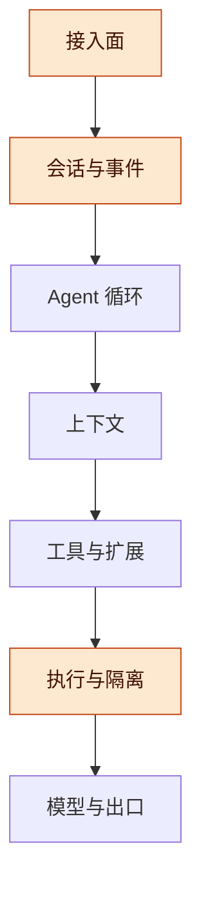

自上而下是产品到模型的七层；高亮处是本稿比较的接入、会话和隔离。

## 候选架构路线与适用边界

应先选择系统由谁掌握任务生命周期，再比较具体框架；完整产品、轻内核、显式图和持久工作流解决的是不同层次的问题，可以组合，但需要唯一的任务状态权威。

| 架构路线 | 代表或可用积木 | 优势 | 主要代价 | 适用条件 |
| --- | --- | --- | --- | --- |
| 完整 Coding 产品二开 | 既有六家中的 Codex、OpenCode、DeepSeek Harness；新增 OpenHands | 现成编辑、命令、交互和会话能力较多，能较快形成可用产品 | 上游耦合、默认生命周期和环境模型可能难改 | 首批交付以代码任务为主，团队接受适配或维护分叉 |
| 可组合内核与自有控制层 | Pi、Pydantic AI／Harness；按团队栈评估 Mastra | 可以自己定义任务、资源预算、工作区与工具契约 | 产品界面、可靠调度、环境管理和验收需要自己补 | 希望长期同时支撑 Coding 与 Work，并控制底座演进 |
| 显式图／状态机 | LangGraph、ADK、Microsoft Agent Framework 的工作流能力 | 分支、检查点、并行汇总和人工介入位置清楚 | 图和状态模式需要版本管理；开放探索不能全部预先画死 | 固定步骤与模型判断交替出现的业务流程 |
| 持久工作流包住 agent 活动 | Temporal、DBOS、Restate | 跨小时或跨天等待、失败恢复、定时与外部事件关联更清楚 | 新增运行与存储约束；外部动作仍需幂等和核对 | 跨进程、跨日恢复及外部写入可靠性是首要要求 |
| 事件收件箱／Actor 风格 | 自有任务收件箱、单任务顺序处理、按需激活 | 任务可以长期存在，执行资源按需分配，便于持续处理反馈 | 租约、过期执行者、消息重放与公平调度需要设计 | 大量逻辑任务、少量活跃执行，任务间相互独立较多 |
| 记忆与共享状态驱动 | 结构化任务状态、证据库、共享只读知识、可选记忆服务 | 多轮研究能回读依据，减少完整历史复制 | 记忆归属、过期、证据来源和更新冲突需要治理 | 长期研究与知识工作；不宜仅因需要记忆就引入整套服务 |

**图 3　架构路线的组合 · 一处掌握任务生命周期**

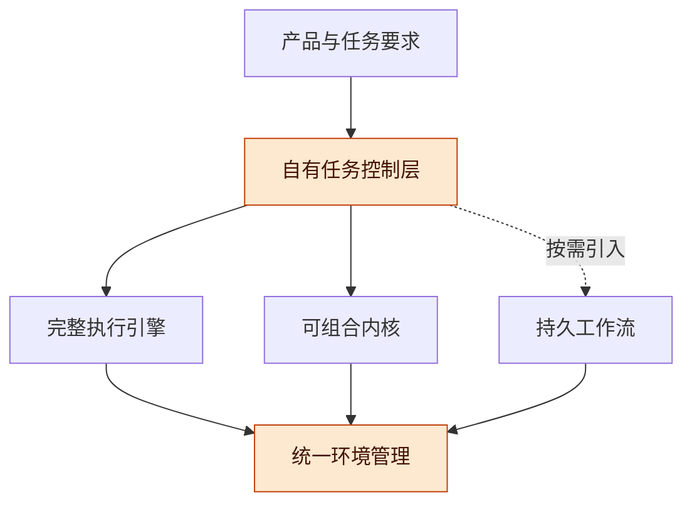

从任务要求向下选组件；三种执行路线可以并存，但任务状态和环境归属需要在控制层收口。

**取舍原则**：短任务优先简单调用，明确流程才用图，跨日恢复才评估持久执行的额外收益。不要让两个编排系统同时决定同一任务的重试、取消和完成。逻辑模块可先在一个进程中实现，不要求立即拆成微服务。

## 六家架构图

四项机制里差别最大的是子 agent 和沙箱：子 agent 从"核心不内置"到"统一 activation 加两种回传"跨度很大，沙箱只有 Codex 和 DeepSeek Harness 内置。工具调用六家都有把关，压缩都有自动触发，差别在细节。下面每家一张四行机制示意，依次展示工具、委派、压缩与执行。图依据下载稿文字重绘，源码位置继续保留在节末；高亮表示关键入口，警示色表示缺口，虚线表示外部或可选路径。

| Harness | 工具调用把关 | 子 agent 怎么返回 | 压缩触发 | 沙箱 |
| --- | --- | --- | --- | --- |
| Codex | 执行规则加审批策略，沙箱拒绝后重审才升级 | 独立线程并行；等待取最终消息，或完成后投到父邮箱 | 超过模型的自动压缩阈值 | 内置，文件与网络 |
| OpenCode | allow、ask、deny 规则，调用边流边执行 | 前台直接作工具结果；后台完成后作为消息投进父会话 | 窗口减缓冲、超长被拒、手动 | 无，留了 Environment 接入点 |
| Pi | beforeToolCall 钩子拦截，默认不审批 | 核心没有；示例扩展起独立 pi 进程 | 窗口减 16384 | 无 |
| Goose | 审批步骤加 PreToolUse 钩子链 | 只有前台，最终输出工具回传结构化结果 | 上下文 80%（不超 225k），工具对摘要默认关 | 无；CLI 可指定自备的 Docker 容器 |
| OpenWork | 沿用 OpenCode，外层加 Server 审批 | 沿用 OpenCode | 沿用 OpenCode | 本地无，只有云沙箱 |
| DeepSeek Harness | pre-execute 瀑布加一次性审批，调用先入日志 | 本地或外部执行，parent 或 caller 两种回传 | 压缩 seam，过程写进日志 | 内置，只管文件，不可用即拒绝 |

### Codex

**图 4　Codex 四项机制 · 依据原稿文字重绘**


四行分别读工具、委派、压缩和执行；被沙箱拒绝后是否重试取决于审批策略，不能默认绕过。

**原稿机制补充**：Codex 固定快照的图注区分了拒绝后的重审策略，并记录子任务结果可进入父邮箱；具体审批默认值仍按原稿版本理解，不能跨版本沿用。

### OpenCode

**图 5　OpenCode 四项机制 · 依据原稿文字重绘**

```mermaid
flowchart TB
  subgraph T[工具调用]
    direction LR
    A[调用输入] --> B[允许询问拒绝] --> C[执行与结果]
  end
  subgraph S[子 agent]
    direction LR
    D[委派子任务] --> E[前台或后台] --> F[工具结果或通知]
  end
  subgraph M[上下文]
    direction LR
    G[阈值或手动] --> H[近期与检查点] --> I[持久化消息]
  end
  subgraph X[执行环境]
    direction LR
    J[Environment] --> K[WorkspaceDriver] -. 自建 .-> L[外部隔离]
  end
  classDef hot fill:#fde8d0,stroke:#c2410c,color:#431407
  classDef gap fill:#fee2e2,stroke:#b91c1c,color:#450a0a
  class J,K hot
  class L gap
```

前三行保留原稿机制；第四行展示可接入外部隔离的候选位置，覆盖全部效果路径仍待验证。

**原稿机制补充**：OpenCode 的 ask 分支接收人工意见；后台完成通知先落 KV，原稿记录重启后可补发。该记录不等于所有任务和外部效果已通过恢复测试。

### Pi

**图 6　Pi 四项机制 · 子 agent 为示例扩展**


子 agent 行为来自示例扩展；文件日志和扩展钩子不构成 OS 级隔离。

### Goose

**图 7　Goose 四项机制 · 依据原稿文字重绘**


工具对摘要在原稿固定版本默认关闭；容器选项要求用户提供环境，不能等同默认内置沙箱。

### OpenWork

**图 8　OpenWork 四项机制 · 产品层沿用引擎**


虚线表示继承引擎或外部后端；OpenWork 应按产品层评估，本地域内隔离仍需补齐。

**原稿机制补充**：OpenWork 包含 Den 对 v2 引擎的权限翻译、服务端写入审批和任务恢复逻辑；本版未复核这些入口的完整运行行为。

### DeepSeek Harness

**图 9　DeepSeek Harness 四项机制 · 可替换服务与记录**


工具与压缩过程写入事件；文件约束无可用后端时拒绝执行，网络覆盖不能据此推定。

## 扩展候选与组件定位

既有六家之外值得加入的是不同类型的组件候选，而非把所有框架放进同一张“谁最好”的排名表；本节依据官方文档确认定位，尚未做固定版本源码审计或统一运行试验。

| 候选 | 本轮文档核实到的能力 | 在本方案中的位置 | 优势判断与待验证边界 |
| --- | --- | --- | --- |
| [OpenHands SDK](https://docs.openhands.dev/sdk/arch/overview) | Python／REST 接入，围绕 agent、conversation、tools、workspace 与远端执行组织 | Coding 执行后端、工作区接口参考 | 适合验证执行与环境分离；冷启动、后台服务开销及私有化覆盖待测 |
| [LangGraph／Deep Agents](https://www.langchain.com/oss-overview) | 分别提供持久图执行与较完整的规划、子任务、上下文、文件环境积木 | 流程编排或可组合 harness | 长任务状态与人工介入值得参考；上下文隔离不能直接等同 OS 隔离 |
| [Pydantic AI Harness](https://pydantic.dev/docs/ai/harness/) | 在类型化 agent 上组合工作区、工具、委派、上下文等能力 | Python 内核或完整执行器候选 | 能按能力拆装；本地工作区不是沙箱，挂接不同后端后要测完整效果路径 |
| [Pydantic AI 持久执行](https://pydantic.dev/docs/ai/capabilities/durable_execution/overview/) | 提供对多种持久执行后端的集成入口 | agent 与长任务运行系统的连接层 | 后端接入入口不等于本项目恢复语义已满足 |
| [Mastra](https://mastra.ai/docs) | TypeScript agent 框架，文档涵盖 workflow、memory、harness、工具与部署 | TypeScript 自有产品层与执行组合候选 | 技术栈统一有价值；完整状态导出、域内模型和资源基线待测 |
| [Google ADK](https://adk.dev/workflows/) | 多节点、多 agent 工作流与执行组织方式 | 固定流程和角色分工参考 | 适合显式分工；不因有编排能力就认定具备完整 Coding 产品 |
| [Microsoft Agent Framework](https://learn.microsoft.com/en-us/agent-framework/overview/agent-framework-overview) | agent、harness、显式工作流及集成入口 | 企业集成与工作流候选 | 可结合既有技术栈；运行、部署和模型适配成本需独立评估 |
| [Temporal](https://docs.temporal.io/workflow-execution) | 持久工作流执行与事件历史 | 跨日任务外层生命周期 | 适合等待、恢复和协调；agent 调用及外部动作的重试边界仍由应用定义 |
| [DBOS](https://docs.dbos.dev/) | 以库接入的持久执行、队列和调度 | 另一种长期任务实现路线 | 值得与现有数据库及部署方式比较；不能仅按“轻量”宣传推断 RAM |
| [Restate](https://docs.restate.dev/foundations/key-concepts) | 服务处理函数、执行日志、恢复和幂等请求入口 | 持久服务调用或任务处理 | 与工具服务的结合值得验证；外部系统不参与同一事务时仍可能出现结果未知 |

**补充位置**：Agno 与 Letta 保留为既有资源研究和记忆架构的参考对象；本版没有为它们补做同等级的新源码核对。OpenWork 继续按 OpenCode 上的产品层看待，不增加一个独立内核样本。

**不做的推断**：官网列出某项能力，不代表默认配置已满足租户隔离、低内存、域内交付或无重复外部动作。这些要落到固定版本与同一测试任务上。

## Agent 循环与上下文

循环层六家功能相近：都有输入排队、中途插话、重试和自动压缩。真正的差别在"一次模型请求能否从持久记录完整还原"，这决定了私有化交付后能不能审计和复现问题。

| Harness | 循环形态 | 插话与排队 | 自动压缩 | 可追溯性 |
| --- | --- | --- | --- | --- |
| Codex | Rust 核心的 thread/turn 循环 | `turn/steer`、`thread/queue/*` | 对 OpenAI 类 Provider 走服务端压缩，其他 Provider 走本地压缩，前后有 hook | rollout JSONL 加 SQLite 状态；私有化只会用到本地压缩路径 |
| OpenCode | `SessionRunner.drain` 步进循环，Effect 纤程 | SQLite 持久 inbox，输入分 queue 和 steer；手动压缩、迁移也作为 inbox 控制项排队 | 超过"窗口减缓冲"触发，保留约 15k 近期 token，检查点摘要增量更新（含 Work State、Next Move） | 事件写库后投影成消息表；压缩结果持久 |
| Pi | `agent-loop.ts` 约 950 行的单循环 | steer 在本轮后进入，follow-up 在整次运行后进入 | 上下文超过"窗口减 16384"触发，保留近 20k token；扩展可拦截或替换摘要 | 树形 JSONL，压缩只插入摘要条目，原条目保留 |
| Goose | 有序 Operation 列表组成的状态机，每轮执行第一个适用的步骤 | `ops_steer` 步骤 | `ops_compaction` 与工具对压缩两个步骤 | 行为只由持久会话决定，不依赖内存循环状态 |
| OpenWork | 不自带循环，复用 OpenCode 引擎（同时适配 V1、V2） | 同 OpenCode | 同 OpenCode | 同 OpenCode，另加自身 Server 状态 |
| DeepSeek Harness | 循环本身是一个 Cordis 插件；`agent/pre-step` 可改写或拒绝已领取的输入 | 单一 inbox，注入上下文等下一次获准请求 | 压缩是可替换 seam，start、summary、end 三个事件写进日志并充当锁 | 仅追加事件日志，约定"模型可见即已记录"，每次请求都能从日志重建 |

**含义**：私有化交付最常见的售后问题是"它为什么这么做"。DeepSeek Harness 的"模型可见即已记录"是六家里唯一把可复现写成架构约定的；OpenCode 和 Pi 能复原大部分，但辅助请求（标题、摘要）是否全部入库还要实测。这是推测，不是已证实：若维护方要做审计留存，这一层的改造量 OpenCode 会小于 Pi，因为 OpenCode 已经是事件写库再投影。

## 上下文、状态与恢复的边界

保存会话、重建模型请求、恢复任务和恢复操作系统进程是四种不同能力，不能因为有 JSONL、SQLite 或 checkpoint 就一并认定具备。

| 能力 | 必须保存或控制的内容 | 可以验证什么 | 仍不能保证什么 |
| --- | --- | --- | --- |
| 会话持久化 | 消息、工具调用与结果、产物引用 | 重启后能看到已有记录 | 外部动作是否重复、活跃进程是否仍在 |
| 请求重建 | 实际模型输入、系统指令、工具模式、配置与压缩边界 | 还原“当时发给模型什么” | 随机模型重新推理会得到相同输出 |
| 任务恢复 | 任务状态、步骤结果、租约、外部动作凭据、幂等键 | 从已确认的边界继续，先核对未知结果 | 任意工具都能安全自动重试 |
| 进程／环境恢复 | 文件、依赖、环境配置；必要时另含进程快照 | 重建可执行环境，或在支持的运行时恢复进程 | 任意浏览器、socket、数据库连接可透明迁移 |

**提案：三层上下文**。当前约束、计划与工作状态保留结构化摘要；当轮推理只装载需要的近期消息和证据片段；完整原始材料及大工具结果以稳定句柄持久化。摘要保留证据指针，不能成为无法核对的唯一事实源。

**图 10　上下文装配与持久证据 · 短视图可回读原文**

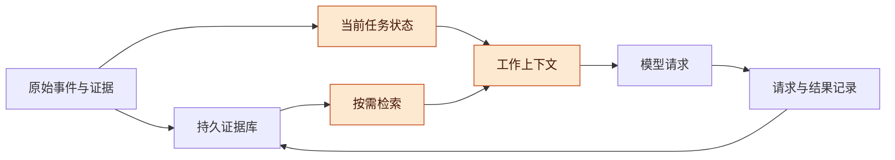

先保留原始材料与当前状态，再装配本轮视图；压缩只改变模型当轮看到的内容，不应静默删除必要证据。

**恢复契约**：外部请求发出后连接断开时，状态应允许标记为“结果未知”。系统先用动作凭据查询目标系统，不能直接把未知视为失败再执行。持久工作流可以协助记录与调度，但所有非事务外部效果都需要按其语义处理。

**容量契约**：事件与周期快照分开保存；缓存有大小和淘汰策略；冷任务不加载全部历史。保留策略必须覆盖申诉、审计与恢复需求，不能为了低内存丢掉任务义务。

## 工具、扩展与 Work

六家都能不改核心就加业务工具，但除 MCP 外的插件几乎都和宿主同进程、同 OS 权限，插件信任要由维护方自行管。Work 方面没有一家内置"编辑、渲染、验收"闭环；最接近的积木是 DeepSeek Harness 的交付物声明加 Office 转 PDF，以及 OpenWork 的 Work 产品层。

| Harness | 扩展机制 | 插件运行位置 | Work 相关积木 |
| --- | --- | --- | --- |
| OpenCode | `@opencode/plugin`（Effect 与 Promise 两套 API），按领域提供 hook 与 transform：agent、model、tool、permission、mcp、skill、session 等；GUI 插件另成一包 | 同进程；transform 失败时自动停用该插件 | Word、Excel、PowerPoint 只读预览 |
| Pi | TypeScript 扩展：注册工具、Provider、事件、渲染器、TUI | 同进程；加载前有项目信任关卡；SDK 不自动加载内置扩展 | 无内置 Office |
| Goose | MCP 优先；Rust GDK 的 Operation、ToolOperation | MCP 独立进程；内置平台扩展在进程内 | 无内置 Office |
| OpenWork | 技能、MCP、OpenCode 插件桥 | 同 OpenCode | MIT 范围内的 Work 桌面与 Web 产品层、附件面板；`ee/` 另有许可 |
| DeepSeek Harness | 一切皆 Cordis 插件，注册在卸载时自动撤销；能力按 seam 替换（fs、shell、sandbox 等） | 同进程；插件管理器装第三方插件 | `present` 工具把交付文件记进会话日志；`document/office-to-pdf` 用 LibreOffice 把 Office 转成 PDF |

**依据**：OpenCode `packages/plugin/src/effect/`；Pi `packages/coding-agent/docs/how-pi-works.md`；Goose `crates/goose-agent/README.md`；OpenWork `REUSE.toml`；DeepSeek Harness `docs/subsystems/deliverables.md`、`packages/document/README.md`。

## 工具调用的组合方案

工具层建议由类型化短调用、统一执行管线、按需工具服务、受控代码组合和异步长任务共同组成，各自解决不同问题。

| 方式 | 优势 | 适用部分 | 必须补齐的边界 |
| --- | --- | --- | --- |
| 类型化函数工具 | 输入输出清楚，容易单独验证 | 查询、确定性转换、短业务动作 | 参数校验不替代授权与幂等 |
| 统一执行管线 | 授权、审计、资源、超时和结果归属一致 | 所有会产生效果的工具入口 | shell、文件、MCP、LSP、PTY 不能绕开管线 |
| MCP 等工具服务协议 | 连接独立服务、复用外部工具 | 连接器、跨语言工具 | MCP 本身不提供 OS 沙箱；凭证与会话生命周期需管理 |
| CodeMode／程序化工具组合 | 一次确定性程序组织批量调用和数据处理 | 循环、过滤、汇总、减少逐步模型往返 | 动态代码需受限执行；子调用仍继承权限与资源预算 |
| 持久异步任务工具 | 返回任务句柄，结束后由事件通知 | 构建、测试、浏览器、长计算 | 任务身份、日志、结果回读、取消与后台资源归属 |

**图 11　统一工具执行管线 · 同步与异步共享约束**

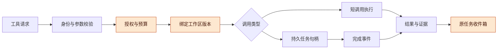

先确定身份、权限、预算与版本，再选择执行方式；长任务结束后回到原任务，不占着协调会话等待。

**服务复用**：只读搜索、文档转换等可评估共享服务；不能默认每个会话都起一个 MCP 服务。只有服务支持独立凭证、工作目录和请求状态时才能复用。带用户状态的服务按信任范围隔离，启动与空闲策略由资源管理器掌握。

**Work 闭环**：编辑器或生成工具只负责产出；渲染器负责展示真实结果；验收器检查内容、布局与可用性。三者保持独立接口，便于在不同 harness 上复用。

## 子 agent 的协作形态与生命周期

子 agent 应优先表示有边界的任务、上下文与权限，只有实际工作需要时才分配独立进程或沙箱；复杂协作应按任务特点选择，避免把所有工作都变成多角色对话。

| 协作形态 | 有优势的场景 | 主要成本或风险 | 本稿建议 |
| --- | --- | --- | --- |
| 子 agent 作为工具 | 有清楚输入和最终报告的独立子问题 | 父任务可能等待；信息被摘要压缩 | 默认委派形式，返回结论、证据与未完成项 |
| 并行分发与汇总 | 可独立研究、实现或检查的子任务 | 重复上下文、并发峰值、结果冲突 | 限制并发与总预算，明确汇总责任 |
| 异步收件箱 | 长任务、任务中途收到反馈、跨轮协作 | 顺序、重复消息、过期结果 | 持久化消息，绑定任务和执行轮次 |
| Handoff／控制权转交 | 接力式处理、不同权限角色接管 | 用户入口与责任容易丢失 | 明确谁拥有当前交互与最终交付 |
| 子图／状态机 | 可枚举的步骤、分支和复核 | 图版本迁移与状态复杂度 | 固定业务流程优先，开放探索嵌入 agent 节点 |
| 共享工作板 | 多任务共同维护证据和进度 | 写冲突、来源丢失、广播成本 | 共享事实记录，避免共享可随意改写的长聊天 |
| 生成—审阅循环 | 代码、文档或研究结论需独立复核 | 同模型相关错误、无限修订 | 有轮数、预算和退出条件，关键验收独立 |

**图 12　逻辑子任务与物理执行解耦 · 任务多于 worker**

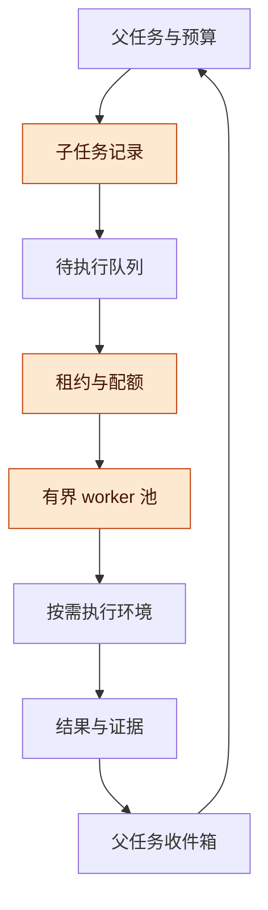

任务记录长期保留，worker 只在需要时持有执行租约；完成结果沿任务身份返回，不能仅依赖某个仍活着的父进程。

**生命周期契约**：权限不得因委派而扩大；子任务预算计入父任务总预算；取消父任务时分别处理未启动、执行中、不可中断及结果已生成的子任务。正常运行的长计算不能因为父模型本轮结束就被停止。任务采用、暂停和放弃由任务治理规则决定，不能用缓存淘汰代替。

## 会话、持久化与取消

持久化分三条路线：SQLite 事件投影（OpenCode、Goose）、仅追加日志（DeepSeek Harness、Codex 的 rollout）、树形 JSONL（Pi）。取消方面，Codex、OpenCode、Pi、Goose 都给宿主留了单轮中断入口；DeepSeek Harness 核心有取消，但 SDK 协议没有暴露，到 2026-11-02 最新版仍是如此。

| Harness | 存储 | 分支与恢复 | 宿主可用的取消 | 崩溃后续跑 |
| --- | --- | --- | --- | --- |
| Codex | rollout JSONL 加 SQLite 状态库 | `thread/fork`、`thread/archive`，可从 rollout 恢复 | app-server 的 `turn/interrupt` | 从 rollout 恢复线程 |
| OpenCode | SQLite（drizzle），事件写库后投影；进程内 SDK 默认内存库，要持久需显式给路径 | Forked 事件、revert、快照 | `POST /api/session/:id/interrupt`，只对本进程持有的执行有效；`resume=true` 可接着处理 steer | inbox 持久；重启时先清理遗留的压缩和工具调用 |
| Pi | 树形 JSONL，每条有 id 和 parent | 同一文件内分支，另可 fork、clone | SDK `abort()`；RPC `abort` 命令 | 主线靠会话文件恢复；实验包 `pi-durable` 承诺"先落盘后显示、中途崩溃可续" |
| Goose | SQLite（sqlx） | 状态机只依赖持久会话，按持久状态设计为可重入 | 状态机持有 CancellationToken；ACP 有取消 | 重载会话是继续入口；外部效果需核对 |
| DeepSeek Harness | 每会话一个目录的仅追加事件日志，分代管理格式 | 轮次边界 fork | 核心 `Agent.cancel(cause, {keepInbox})`；SDK 的 JSON-RPC 没有 cancel 与 session-close，只能结束 runtime 进程 | 日志可重放；遗留压缩锁可检测 |

## 持续任务与 Super-agent 演进方向

参考 Super-agent，本稿倾向把未来演进方向确定为事件驱动的持续任务系统：状态长期保存，协调与执行分工，计算和环境按需分配；这是工程推测，不是行业结论或已经完成的实现。

**来源与限制**：对应文章为《Super-agent 设计探索：迈向更自主的 Agent 系统》。[文章入口](https://zhuanlan.zhihu.com/p/2099987320443237060)在原稿调研时访问受限；实现判断依据 [DeepSeek 官方原型说明](https://github.com/deepseek-ai/dsh-superagent-prototype)、[设计原则](https://github.com/deepseek-ai/dsh-superagent-prototype/blob/main/docs/000-philosophy.md)、[执行机制](https://github.com/deepseek-ai/dsh-superagent-prototype/blob/main/docs/003-execution.md)和[架构文档](https://github.com/deepseek-ai/dsh-superagent-prototype/blob/main/docs/007-architecture.md)。官方明确它是研究原型，公开实现与内部版本、文章完整设计存在差异。

| 趋势判断 | 对本项目的具体含义 | 需要保留的替换边界 |
| --- | --- | --- |
| 从会话中心转向任务中心 | 任务跨对话、入口和时间继续；聊天是交互投影 | 任务状态不能依赖单个会话是否打开 |
| 协调与执行分离 | 协调者处理归属、优先级和用户响应，执行者做具体工作 | 不让构建或浏览器等待阻塞用户入口 |
| 程序规则与模型判断协同 | 去重、已知订阅、权限、配额由程序处理；语义判断才调用模型 | 路由策略和模型可以分别更换 |
| 事件驱动与有边界的主动工作 | 反馈、CI、定时事件唤醒任务；授权与收益门槛先检查 | 事件源、行动政策与执行器分开 |
| 计算、状态与环境分离 | 冷任务仅保留状态，有工作才租用执行资源 | 会话、进程、文件环境不能绑定终生 |
| 按需上下文与证据回读 | 小摘要带稳定来源句柄；需要时读取原文 | 检索、压缩、记忆服务可替换 |
| 独立健康与进度检查 | 区分进程存活、任务进展、结果验证和需人决策 | 看护器的诊断与干预权限要明确 |

**图 13　持续任务系统 · 协调、状态、算力与环境分离**

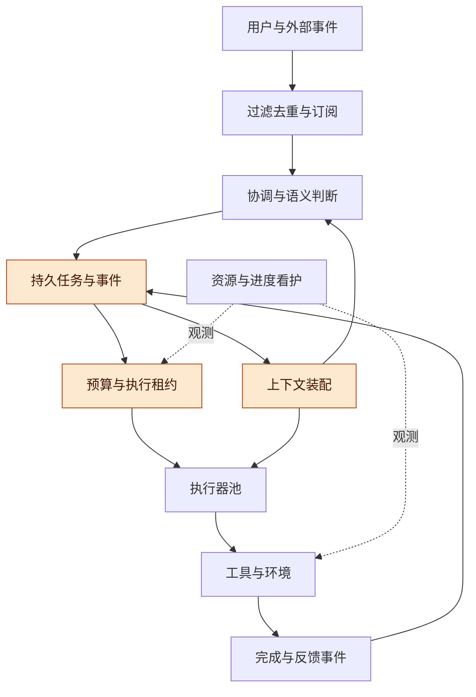

上方接收事件，中间保存任务，下方按预算执行；看护器观察资源与进度，不能用进程存活替代结果验收。

**原型给出的启发**：官方文档把任务记录、协调会话、执行会话、效果队列与 outbox 分开，并限制 worker 槽位；原则上由直接请求或已写明的规则授权工作。可以借鉴这种职责拆分，不必照搬其具体运行策略。

**需要补强的点**：某些交给用户审阅的后台服务可继续运行却不再占 worker 槽位，因此“模型并发数”与“机器资源占用”必须两套计账。原型的目录约定也不构成安全边界；其后台任务时限与停止策略不能直接用于本项目的下载、训练或长计算。

**扩展约束**：协调层可以先按用户或项目设定顺序处理边界，避免一个全局模型承担所有事件。分片以后，跨项目共享状态与一致性仍需明确设计。更换协调模型、增减子 agent 或引入持久工作流，不应改变任务身份与产物归属。

## 执行隔离与数据出口

隔离是六家差别最大的一层：只有 Codex 和 DeepSeek Harness 内置 OS 级约束，而且 Codex 同时管文件和网络，DeepSeek Harness 只管文件。OpenCode、Pi 官方明确不做沙箱，Goose 源码里也没有 OS 级约束（CLI 只能把扩展放进用户自备的 Docker 容器），OpenWork 只对接云端沙箱。默认外联六家都有，多数有开关，但没有一家默认就是"零外联"。

**图 14　隔离现状与补齐路径 · 原稿固定快照**

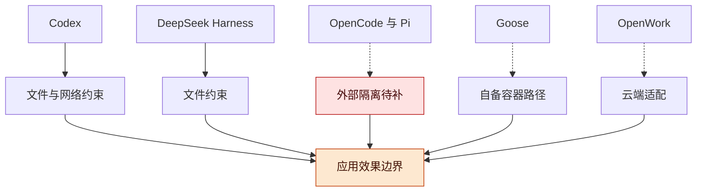

各家提供的边界深度不同；维护方仍需验证全部效果路径及域内出口，不能只看审批入口。

**隔离**：

| Harness | 内置 OS 约束 | 覆盖范围 | 官方立场与补充 |
| --- | --- | --- | --- |
| Codex | macOS Seatbelt；Linux bubblewrap 加 seccomp（保留旧 Landlock 实现）；Windows 独立 sandbox crate | 文件与网络（Seatbelt 有网络策略，Linux 用 seccomp） | 隔离是执行策略的一部分，三平台都有实现 |
| DeepSeek Harness | Linux 先 bubblewrap 再 Landlock；macOS Seatbelt；Windows ACL 受限令牌 | 只管文件效果；网络和进程可见性不在 SandboxMode 定义内 | 后端如实报告 full 或 partial；无可用 runner 时拒绝执行，不裸跑。SAFETY 写明开发者预览、未经安全审计 |
| OpenCode | 无 | — | SECURITY.md 写明不做沙箱，权限系统只是 UX，要隔离请用 Docker 或 VM |
| Pi | 无 | — | `docs/security.md`：工具以 Pi 进程的 OS 权限运行，建议放进容器或 VM |
| Goose | 源码未见 | — | 四种审批模式，文档写明默认 Autonomous；`security/egress_inspector.rs` 用正则从命令里提取外联地址，属于提示，不是拦截 |
| OpenWork | 本地无 | `packages/sandbox` 只有 Daytona、Freestyle 两个云端适配 | 云端沙箱本身就是出域，私有化要自建或另换 |

**默认外联**：

| Harness | 源码中可见的默认外联 | 关闭方式 |
| --- | --- | --- |
| Codex | analytics 事件发往 chatgpt.com 后端；指标导出默认 statsig；服务端压缩只在 OpenAI 类 Provider 上启用 | `analytics.enabled = false`，`otel.metrics_exporter = none` |
| OpenCode | 拉取 models.dev 模型目录（内置快照兜底）；CLI 自动更新 | `OPENCODE_DISABLE_MODELS_FETCH`、`OPENCODE_DISABLE_AUTOUPDATE` |
| Pi | 交互模式向 pi.dev 报告安装；每 4 小时从 pi.dev 刷新模型目录 | `PI_OFFLINE=1` 或 `--offline`；`PI_TELEMETRY=0` |
| Goose | PostHog 遥测，用户明确同意前不发送 | `GOOSE_TELEMETRY_OFF=1` |
| OpenWork | 首次运行下载固定版本 OpenCode 引擎；启动时检查更新；EE 的 Den 云端接口；桌面版异常上报 | `OPENWORK_NO_UPDATE_CHECK=1`；预置引擎 |
| DeepSeek Harness | OTel 发往 deepseeksvc.com，默认 FEEDBACK_ONLY（用户提交反馈后才上传会话日志）；桌面开启产品埋点时另发事件 | `DSH_TELEMETRY_DISABLED` 设任意非空值；或用 `DSH_TELEMETRY_OTLP_URL` 改指域内 |

**含义**：选 OpenCode 等于选了"隔离完全自建"。这不是否决理由，但应该写进成本：维护方要么整机放进容器或 VM，要么在 shell 和子进程这一层自己接 bubblewrap、Landlock、Seatbelt，参考对象就是 Codex 和 DeepSeek Harness 的实现。外联清单只是源码可见部分，依赖包里的外联还要在断网环境实测。

## 共享基础与沙箱私有改动

本稿建议把“不可变公共基础＋任务私有修改＋完整版本视图”列为核心环境方案，它能够减少重复存储，并在适合的部署方式下共享部分文件缓存；总 RAM 收益仍需实测。

**用户设想的正式表述**：大多数相同的代码、依赖和工具链由公共内容服务或只读文件层管理；每个沙箱保存自己的文件修改、环境差异和运行状态；模型通过受控工具获取内容，不能直接改动公共基础；执行器使用基础与私有修改合成的完整视图。

**版本模型**：一个工作区视图由仓库身份、基础提交或快照、私有修改版本和环境版本共同确定。基础版本不可变，改动包括新增、替换、删除、重命名和权限等必要元数据；运行期的临时目录、构建输出、测试数据库和凭证另有私有归属。

| 内容 | 共享或私有 | 约束 |
| --- | --- | --- |
| 源码基础快照 | 同版本共享 | 固定提交或内容摘要，不能指向正在变化的主目录 |
| 依赖包和工具链文件 | 可共享只读内容 | 依赖锁文件、平台、ABI 和工具链版本进入身份 |
| 文件修改与删除记录 | 每个工作区私有 | A 的覆盖与删除不改变 B 的视图 |
| 环境配置与依赖变更 | 每个工作区私有，完成后可生成新基础 | 不能让多个任务共同写一个依赖安装目录 |
| 构建与分析缓存 | 满足正确缓存键时共享 | 内容、依赖、配置、工具版本与权限范围均需匹配 |
| 临时目录、测试数据、凭证 | 私有或明确命名空间隔离 | 缓存命中不得绕过访问控制 |
| 运行中的进程状态 | 默认独立 | 共享源码不等于共享堆、模块状态或数据库连接 |

**图 15　公共基础与私有视图 · A 和 B 相互独立**

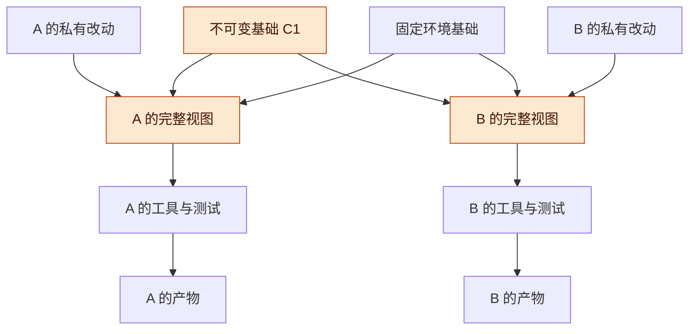

两条执行线共用只读基础，各自叠加修改；视图、测试和产物始终归属于同一个任务版本。

**现成机制与边界**：[Linux OverlayFS](https://docs.kernel.org/filesystems/overlayfs.html)提供只读底层与可写上层合并，覆盖读取与删除标记可实现上述文件语义。常规首次写入存在 copy-up，通常复制文件到上层；不能把它当作 Git 行级补丁存储。大文件少量修改、批量 chmod、安装脚本都可能放大私有层，需要纳入试验。

**固定基础**：主分支从 C1 更新到 C2 时，已有任务继续使用 C1 加自己的修改。任务显式重基后才形成新的视图与验收结果。不要绕过挂载视图改写底层；内核文档明确不允许在 overlay 使用期间修改底层文件系统。[OverlayFS 底层变更约束](https://docs.kernel.org/filesystems/overlayfs.html#changes-to-underlying-filesystems)

**完整调用关系**：A 修改 `utils.py`，而未改动的 `handler.py` 调用了它，A 的测试必须调用 A 版本的 `utils.py`。不能让共享进程长期加载基础模块，再把少量修改文件放在另一边便认定测试成立。一次构建或运行必须绑定完整且固定的工作区视图。

**与 Git 的分工**：Git 管理提交、分支和合并；工作区服务或分层文件系统管理执行时可见内容。Git worktree 共享仓库数据，但本身不会共享各语言服务的私有内存，也不提供 OS 隔离。[Git worktree 文档](https://git-scm.com/docs/git-worktree)

## 工具代理、统一视图与并发路由

建议组合“模型侧受控工具访问”和“执行侧按需文件系统视图”，由服务端绑定请求身份与版本；正确返回路由和正确版本视图必须同时成立。

| 方案 | 内容如何提供 | 优势 | 代价与适用条件 |
| --- | --- | --- | --- |
| 共享文件系统视图 | 公共只读层与私有层呈现成正常目录 | 编译器、解释器、测试工具兼容性较好 | 需处理文件语义与隔离；公共内容对有文件权限的进程可见 |
| 纯工具代理 | 只提供读取、搜索、符号查询、修改、测试等工具 | 能控制模型读取范围、集中索引，适合只读研究 | 普通构建工具不会调用模型工具；测试需另有受控执行入口 |
| 工具代理与文件视图组合 | 模型使用工具，执行器按同一视图运行程序 | 兼顾访问控制、按需内容与真实验证 | 工具、文件、索引、缓存与执行必须共享版本契约 |

**操作黑盒的边界**：若要求只是“不能修改公共内容”，只读挂载即可参与实现；若连基础目录也不能暴露，就由工具服务返回授权片段，测试工具委托受控执行器运行。只要给同一执行环境任意 shell 和完整文件读取权限，就不能同时声称该进程只能通过特定读取 API 访问内容。

**按需文件**：FUSE 可把用户态服务的数据呈现为正常文件系统接口；按访问需求获取仓库内容已有工程实践。其收益主要是减少提前检出和重复 I/O，网络往返、元数据操作、缓存与兼容性仍需测量。[FUSE 文档](https://docs.kernel.org/filesystems/fuse/fuse.html)、[Meta 的 Buck2 与虚拟文件系统实践](https://engineering.fb.com/2023/04/06/open-source/buck2-open-source-large-scale-build-system/)

| 服务端绑定信息 | 作用 | 错误处理 |
| --- | --- | --- |
| 用户／项目与工作区身份 | 确认授权范围和改动归属 | 不能仅信任调用参数自称的身份 |
| 基础快照与私有修改版本 | 固定读、搜、测的内容 | 不把“当前 main”作为隐式可变输入 |
| 环境摘要与工具版本 | 固定依赖、配置和执行方式 | 不复用环境不匹配的结果 |
| 请求 ID 与异步任务 ID | 将响应、日志、产物路由回原请求 | 重试保留关联，取消只影响所属任务 |
| 执行轮次与租约代次 | 识别已过期的执行者 | 旧 worker 不得覆盖新轮次状态 |
| 预期修改版本或内容 hash | 防止并发补丁覆盖新内容 | 不匹配时返回冲突，重新读取后再处理 |

**图 16　并发请求与版本绑定 · 迟到结果仍有归属**

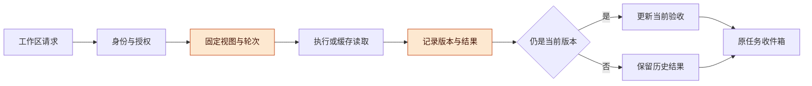

请求先固定视图；旧版本的结果可以返回和展示，但不能据此宣称新版本已经验证。

**必须验证的例子**：A 在私有修改第 7 版启动测试，随后编辑到第 8 版。测试结果即使正确返回 A，也只能证明第 7 版。完整构建可从冻结的视图执行，后续编辑产生新版本，避免运行期间读到混合内容。

**搜索一致性**：公共索引与私有增量合并时，已修改文件的旧命中和已删除文件必须遮蔽。类型或依赖分析要连带失效受影响的未改文件，不能只按单文件路径缓存。内容寻址可减少重复计算，但访问控制仍要单独执行。

**路由实现**：文件系统挂载方案的普通读取由内核按进程视图处理，无须每次读取都经过模型协调者；工具服务、远程调用和异步任务使用显式协议。共享服务不得依赖一个全局“当前工作区”变量处理并发。

**基础保留与回收**：被活跃或可恢复任务引用的基础版本必须保留；回收按引用和保留政策进行。未提交修改、必要的忽略文件与产物先形成可恢复记录，不把自动清理当作任务放弃。

## 多工作树、多沙箱的资源管理

资源设计应让主要开销随活跃执行与重工具数量增长，而不是随历史会话、逻辑 agent 或冷工作树数量增长；共享文件层与按需运行必须配合。

| 资源 | 共享基础能改善什么 | 仍然独立的部分 | 本稿提案 |
| --- | --- | --- | --- |
| 源码、依赖、工具链文件 | 减少重复磁盘与准备 I/O | 私有覆盖、构建输出 | 按内容与版本共享只读基础 |
| 文件页缓存 | 同内核、同底层文件可共享 | 私有写入及不同文件对象 | 对真实部署测缓存收益，不从镜像大小推算 RAM |
| 搜索与符号索引 | 共享基础索引有机会省 RAM 与 CPU | 私有增量及受依赖影响的分析 | 公共基础索引加版本化增量，验证失效正确性 |
| LSP、文件监听、开发服务器 | 按需启动可减少常驻副本 | 分支相关状态、运行堆 | 缩小监听范围，限制并发，支持工作区隔离后再复用 |
| MCP、转换与检索服务 | 在同信任范围内共享可减少服务副本 | 凭证、连接与会话状态 | 有界服务池，明确空闲关闭与状态保留 |
| 解释器、浏览器、测试进程 | 可通过复用适当服务和限制并发降低总量 | 私有堆、模块缓存、页面与业务状态 | 按重量分组调度，不按 agent 个数粗略计账 |
| 模型上下文 | 按需装配减少重复处理 | 每次请求内容、推理缓存 | 区分 API 请求成本、本机 RAM 与本地推理显存 |
| 虚拟机 | 合理部署可减少重复固定开销 | 每台 VM 的内核和运行状态 | 按信任要求比较容器与 VM；不能默认跨 VM 共享内存 |

**事实与边界**：OverlayFS 支持同一文件的页缓存共享，但进程私有堆不会因此合并。“代码 90% 相同”不能推出“RAM 节省 90%”；该比例只是概念示例，不是实测。把服务移到远端还需同时计算远端资源，避免只转移本机开销。[Docker OverlayFS 文档](https://docs.docker.com/engine/storage/drivers/overlayfs-driver/)

**环境状态**：冷环境只保留任务、文件和恢复配置；预热池保留少量可复用基础；活跃环境持有运行进程。进程冻结不等于内存释放，安全持久化后结束不再需要的进程才可能释放其执行内存。Docker 的容器 pause 与 Desktop 在空闲时停止 Linux VM 是不同机制。[Docker pause](https://docs.docker.com/reference/cli/docker/container/pause/)、[Resource Saver](https://docs.docker.com/desktop/use-desktop/resource-saver/)

**图 17　环境生命周期 · 保留任务，按需分配算力**

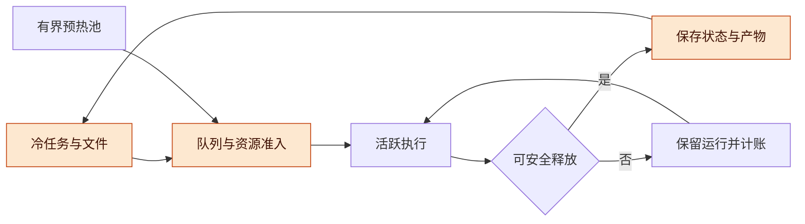

任务可长期保留而不占执行进程；存在正常运行的长任务时保留环境，通过限制新任务进入控制压力。

**调度维度**：分别限制模型并发、CPU 密集任务、浏览器、构建、I/O、进程数及内存预算；子 agent 和其子进程计入父任务预算。用户交互优先级要有实际资源余量，不能只额外增加一个逻辑槽位。cgroup 等硬限制是约束与兜底，不是降低工作本身内存需求的算法。

**工作树策略**：工作树长期保留不必伴随 LSP、预览、数据库和浏览器长期常驻。依赖内容存储可共享，但可写安装目录与构建输出分开。语言服务只有正确处理分支、版本、未保存编辑与权限后才能跨工作区复用。

**长期义务与长任务**：已采纳方向的监测、周期复核和待办仍要保留。正常运行的下载、训练、计算不因内存优化被中断；优先限制新任务、释放已空闲服务，等待任务结束或可靠检查点。系统无法满足最低义务时明确报告，不能静默停止。

**测量口径**：Linux 结合 PSS、私有页、共享页、容器组及宿主机指标；macOS 看宿主物理占用、压力和交换趋势。PSS 按共享比例分摊页面，简单 RSS 求和会重复计算共享页。VM 宿主占用与客体内部进程只作分层归因，不再次相加当总量。[Linux /proc 内存统计](https://www.kernel.org/doc/html/latest/filesystems/proc.html)

## 既有资源实测及本版解释

2026-10-27 的合成试验支持“减少重复处理历史文本”，但尚不能证明共享沙箱能省多少内存，也不能把请求正文字节下降当成 RAM 或模型费用下降。

**记录来源**：`<原环境路径已省略>` 第 7—8 节；本版回读原记录，没有重跑。完整试验过程继续留在该研究记录，本节仅保留选型所需结果与局限。

**环境与负载**：当时为 Apple M1、8 核、16 GiB、macOS 26.5、ARM64 CPython 3.12.14。每种条件重复 3 次，50 ms 采样进程树 RSS；每组顺序完成 60 个任务、120 次模拟请求，每任务一个 32 KiB 工具结果。使用本地 HTTP stub，不调用真实模型。机器当时已有约 13.5 GiB 交换占用，不能当作干净跑分环境，也不代表当前状态。

| 条件 | 空闲 RSS 中位数（MiB） | 解释 |
| --- | ---: | --- |
| Python 夹具基线 | 23.9 | 含标准库 |
| Agno SDK 与模型适配器 | 67.4 | 该试验最小配置 |
| Pydantic AI Slim 与模型适配器 | 81.4 | 该试验最小配置 |
| Pydantic 与 SQLite 步骤记录 | 82.2 | 增加持久化能力，不能直接判作无效开销 |
| Agno AgentOS 单 worker | 107.8 | 空闲服务，关闭部分可选功能 |
| Letta 空 App Server | 225.1 | 受限配置且有回退；不与 SDK 作同功能排名 |

| 从全历史改为最近 4 个完整轮次 | 请求正文字节 | 主进程 CPU 时间 | 采样峰值 RSS 中位数 |
| --- | --- | --- | --- |
| Agno | 减少 85.5% | 减少 76.6% | 87.1 → 78.7 MiB |
| Pydantic | 减少 85.5% | 减少 69.9% | 89.2 → 81.4 MiB |

**局限**：未覆盖真实模型质量、浏览器与 MCP 子进程、并发饱和、多沙箱、长时间运行、完整索引与故障恢复。RSS 可能重复统计共享页，采样可能漏掉短峰值。模拟 usage 是占位数，未用于费用计算。截取最近四轮是试验夹具条件，不是生产上下文策略。

**本版含义**：框架空闲几十 MiB 的差异需要记录，但优先验证重复服务与重进程的实际占用。保留恢复能力再优化重复写入，不能为更低数字移除证据或任务状态。

## 接入面与协议

| Harness | 进程内 | 子进程协议 | 网络服务 | 控制面 |
| --- | --- | --- | --- | --- |
| Codex | 无（TS SDK 实际是启动 CLI 子进程） | app-server JSON-RPC，协议文件里约 260 个方法与通知名 | 另有 transport、daemon 两个 crate，本稿未展开 | 最全：`turn/start`、`turn/steer`、`turn/interrupt`、`thread/fork`、`thread/resume`、队列、审批 |
| OpenCode | `@opencode/sdk` 把 Server 路由嵌进内存，不监听端口 | 无 | `@opencode/client` 走 HTTP 加 SSE；协议由 Effect HttpApi 定义并生成 OpenAPI | 齐：提交、中断、事件流、权限；Server 默认无鉴权，设 `OPENCODE_SERVER_PASSWORD` 才启用 Basic Auth |
| Pi | `createAgentSession` 直接拿到会话、工具、模型 | RPC 模式：stdin 收 JSONL 命令，stdout 出事件 | 无，要应用维护方自建 | 齐：prompt、steer、follow_up、abort |
| Goose | Rust GDK 自组状态机 | ACP（含 cancel 与 close session） | goose serve：HTTP 加 WebSocket 上的 ACP（v0.1.2 核对） | Rust 内齐；Python、Kotlin 绑定主要覆盖 Provider |
| OpenWork | 无 | 无 | `openwork-server`，令牌鉴权，内嵌 OpenCode 引擎 | 继承 OpenCode，另加工作区与附件接口 |
| DeepSeek Harness | 无（官方不支持任意插件直挂当 SDK） | TS、Python SDK 启动 `dsh --profile sdk`，stdio JSON-RPC；支持审批请求与用户提问 | Web 应用走内部 Remote API | 缺 cancel 与 session-close |

**图 18　三种接入形态 · 原稿固定快照**

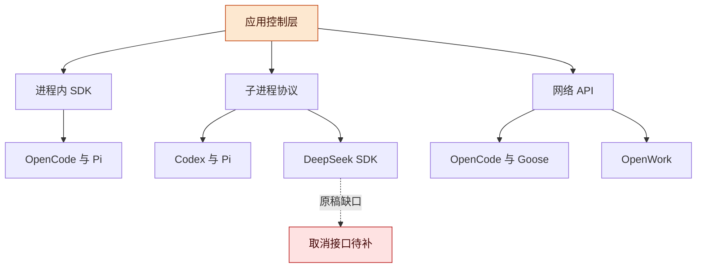

先选择调用形态，再检查事件、审批、取消和归属；协议方法多不代表所有路径已验证。

**依据**：Codex `codex-rs/app-server-protocol/src/protocol/common.rs`；OpenCode `packages/sdk/README.md`、`packages/client/README.md`、`SECURITY.md`；Pi `packages/coding-agent/docs/sdk.md`、`rpc.md`；Goose `crates/goose/src/acp/server.rs`；OpenWork `apps/server/README.md`；DeepSeek Harness `docs/architecture.md`、`packages/sdk/protocol/README.md`。

## 插件生态与改造自由度

改造自由度 DeepSeek Harness 明显更高：约 100 个 `ctx` 服务都能按插件或 profile 补丁替换，包括 Agent 循环、会话持久化、压缩、沙箱，不用 fork。OpenCode 的正式插件面是约 19 个领域的 hook 与 transform，再往下的循环、压缩、存储只能靠 SDK 宿主的 Layer 覆盖或改核心。生态上两边都年轻：OpenCode 现有社区插件多为 V1，在 V2 不能直接运行；DeepSeek Harness 2026-08-13 才开放预览，插件数量涨得快，但质量参差、契约未稳。

**插件生态**：

| 项 | OpenCode | DeepSeek Harness |
| --- | --- | --- |
| 插件形态 | 服务端插件导出 `id` 加 `setup(ctx)`，有 Effect 与 Promise 两套 API；GUI 插件另成一包 | Cordis 插件，可贡献服务、类型化事件和卸载即撤销的副作用；Web 客户端也由插件组成 |
| 安装与分发 | 配置里 `plugins` 写 npm 包名或本地路径；官方插件目前只给 Git URL | `dsh plugin --profile <名> add <npm 或 Git>`，按 profile 安装；可配多个插件市场索引 URL，默认关闭 |
| 社区规模 | [官网生态页](https://opencode.ai/docs/ecosystem)列 31 个插件；[awesome-opencode](https://github.com/KochC/awesome-opencode) 约 68 个；两处都没标 V1 或 V2 | [awesome-deepseek-harness](https://github.com/awesome-deepseekharness/awesome-deepseek-harness/wiki) 约 133 个；[有文章](https://www.besthub.dev/articles/deepseek-harness-plugin-guide-install-community-plugins-build-custom-ones-bc9d5701d2de)称预览一周内 GitHub `dsh-plugin` 话题出现上千个，质量参差 |
| 版本兼容 | 官方迁移文档写明 V1 插件在 V2 不能运行，必须移植 | 官方与 awesome 列表都提示插件契约还会变 |
| 外部生态兼容 | 有读取 Claude Code 技能等资源的开关（`OPENCODE_DISABLE_CLAUDE_CODE` 一组） | Claude Code 模组兼容桥，基准 Claude Code 2.1.287，附逐项差异表；MCP；技能 |
| 私有化相关 | 私有 npm 源即可 | 私有 npm 源，加自建插件市场索引 |

**改造自由度**（按七层看"不 fork 能改到哪"）：

| 层 | OpenCode 怎么改 | DeepSeek Harness 怎么改 |
| --- | --- | --- |
| 接入面 | GUI 插件；用 client 或 SDK 自建界面 | 客户端插件；`ctx.webServer` 注册路由；替换 SDK 服务插件 |
| 会话存储 | 宿主层 Layer 覆盖，或改核心 | `ctx.sessionPersistence` seam，实现 create、open、stat、list、export |
| Agent 循环 | 插件只能 transform agent、model、tool 和会话收发帧；换循环要改核心 | `ctx.agentLoop` 本身是插件，可整体替换；`agent/*` 事件可拦截 |
| 上下文压缩 | 可配开关、阈值和压缩用的模型；换策略要 Layer 覆盖或改核心 | `ctx.compaction` seam |
| 工具与技能 | tool、skill、mcp 领域插件 | `ctx.tools`、`ctx.skills` |
| 执行与隔离 | shell 的 `create.before` 钩子；SDK 宿主的 `workspaceProviders` | `ctx.sandbox`、`ctx.subprocess`、`ctx.fs`、`ctx.shell` 四个 seam |
| 模型适配 | provider、model、aisdk 领域插件 | `ctx.llm` 适配器注册 |
| 组装方式 | 代码里组装插件；宿主的 `EmbedOptions.overrides` 可替换 Layer 节点，源码注释称它是"非默认运行时 profile 的宿主钩子" | profile 叠 bundle，再叠 `cordis.patch.yml`，按 id 替换任意条目；`--dump-config` 可看整棵树 |

**图 20　改造入口对照 · 正式扩展与深层覆盖**

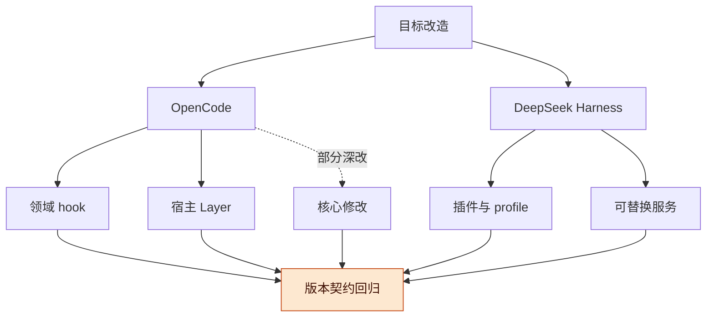

两边的入口深度不同，但都需要固定版本、记录改动并在升级时回归；可替换不等于契约稳定。

**依据**：OpenCode `packages/plugin/src/effect/`、`packages/plugins/README.md`、`services/www/src/docs/content/build/plugins/migrate-v1.mdx`、`packages/sdk/src/internal/host.ts`；DeepSeek Harness `docs/architecture.md`、`docs/capability-seams.md`、`docs/subsystems/claude-code-mods.md`、`packages/boot/plugin-market/README.md`。社区数字来自上面链接的页面，预览日期见 [Composio 的插件介绍](https://composio.dev/blog/best-deepseek-harness-plugins)；未逐个核对插件可用性。

**含义**：自由度高也意味着升级时会破的面多。DeepSeek Harness 每个可替换点都是 0.2.x 阶段的契约；OpenCode 的深层替换走的是没有承诺稳定的内部接口。两边的共同做法是：应用改动尽量落在插件和宿主层，改核心的地方单独列清单，每次跟上游时逐条回归。

## 选型还需考虑什么

**图 21　选型决策流程 · 能力与持续成本一起验证**


先排除不符合部署约束的路线，再验证能力、资源和维护代价；未通过时回到组合方案调整。

| 考量 | 为什么影响选型 | 当前证据 | 怎么补 |
| --- | --- | --- | --- |
| 断网与域内运行 | 任何一个默认外联关不掉，就过不了部署验收 | 只核对了源码可见的外联 | 断网环境逐家启动，抓实际连接 |
| 许可与品牌 | OpenWork 的 `ee/` 已是先例；对方名称和 Logo 不能沿用 | 只做了根许可初筛 | 生成依赖许可清单，法务过一遍 |
| 产品形态与多用户 | 决定接入层用哪家；本稿未验证六家完整多租户治理 | 本稿只看了单实例接口 | 先定形态，再定多实例路由、配额、隔离由谁做 |
| 上游治理 | 维护方、发布节奏、破坏性变更政策，决定 fork 后的跟进代价 | 只看了两周提交量 | 看半年发布记录和 CHANGELOG 里的破坏性变更 |
| 供应链与安全 | 依赖数量、安装脚本、vendored 组件、二进制来源，交付后都是维护方的责任 | 未做 | 每家生成 SBOM，审一遍安装脚本 |
| 可观测与升级 | 部署环境出问题要能查；会话格式升级要能迁移 | 只知道入口（OTel、迁移脚本） | 做一次从旧版本升级的演练 |
| 团队技术栈 | TypeScript 与 Rust、Effect 与 Cordis 的学习和招聘成本不同 | 未盘点 | 盘点现有成员技能，估培训周期 |
| 退出策略 | 底座以后可能要换；应用控制层和底座之间需要一层适配接口 | 无 | 先写接口草案：会话、事件、取消、工具注册、审批 |

这是推测：前三行任何一行不过都会直接淘汰候选，所以应当最先做，且成本最低；退出策略一行不影响选谁，但决定选错之后能不能换。

## 候选组合与阶段性倾向

在新增持续任务和共享沙箱目标后，本稿倾向先固定应用控制层与环境层契约，再用少量执行后端做对照；尚未批准某一家成为最终底座。

| 组合路线 | 组成 | 最有优势的地方 | 关键代价／进入条件 |
| --- | --- | --- | --- |
| A：先交付 Coding 产品 | 自有任务控制层＋OpenCode／Codex／OpenHands 等完整执行器＋独立环境管理 | 利用成熟交互和工具闭环，较快形成产品切片 | 证明现有引擎能接受统一工作区视图、取消与资源计账，不因内部进程绕开约束 |
| B：自有通用工作内核 | 自有控制层＋Pi／Pydantic AI／Mastra 等可组合能力＋统一工具与环境 | Coding、Work、研究任务可以共用任务与产物模型，环境形态自由 | 要自行承担产品、可靠调度和集成测试；低内存必须包含补齐组件后再测 |
| C：可靠长期后台工作 | 明确的工作流生命周期＋可替换 agent 活动＋事件与产物存储＋环境租约 | 跨日等待、重启恢复、多入口反馈和长任务归属 | 只选一处生命周期权威；持久工作流基础设施要有业务收益支撑 |

**DeepSeek 的位置**：DeepSeek Harness 的 seam 与 Super-agent 的任务分工是重要参考，可作为 A 或 B 的执行／组合候选。是否进入主线取决于固定版本的取消、效果路径、资源、升级与隔离验证，不能仅因设计理念接近就直接选定。

**图 22　应用层与可替换后端 · 三条路线共用边界**

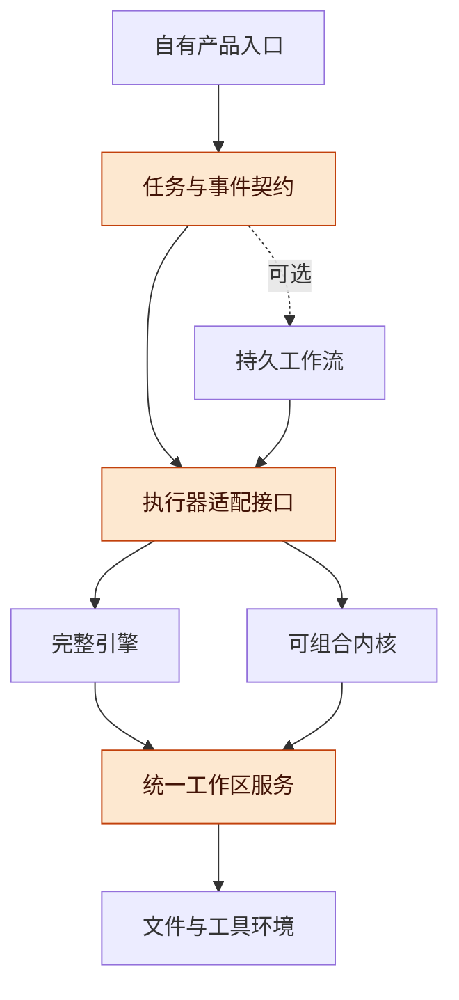

共同契约位于中间，候选执行后端可以替换；产品不依赖某家会话 ID 作为唯一任务身份。

**最小契约草案**：任务与会话关联；事件收件箱；执行启动、插话、取消和状态；工具与审批；工作区视图；产物引用；外部动作记录；资源使用与租约。当前仅是讨论范围，不是已确定的 API 定义。

**选择顺序**：先核对目标平台、域内模型和必要隔离，再选最小产品切片；用相同任务比较一条完整引擎路线和一条可组合路线。只有跨日恢复的需求收益成立时，再加入持久工作流对照，避免同时堆叠多个调度系统。

## 验证方案与验收口径

第一轮验证应优先排除视图串版本、外部动作重复和资源无界增长，再比较完成质量、延迟与成本；以下是待执行任务书，不是已完成的测试结果。

**任务书**：

1. 固定候选版本、模型、平台、工具链和隔离方式，记录依赖与环境摘要；取得目标机器实际可用预算后再设置资源门槛。
2. 做工作区视图最小切片：固定基础、A／B 私有改动、读取／搜索／修改／测试与产物归属；先验证确定性操作，再接模型。
3. 做执行适配切片：同一任务可以交给不同候选执行器，统一记录事件、取消、效果、工具子进程和环境资源。
4. 做恢复切片：等待用户、进程中断、服务重启、网络断开、结果未知与迟到响应；试验故障只作用于专门测试环境，不处理用户既有长任务。
5. 做资源对照：相同语义与活跃并发下比较独立完整环境、共享文件层、共享文件层加工具服务三组；同时测冷／热启动与持续运行。
6. 接入少量真实 Coding 和 Work 任务，验证结果质量、证据完整性和渲染验收，防止只优化合成指标。

| 对照组 | 做法 | 控制变量与解释 |
| --- | --- | --- |
| R0 | 每任务独立工作目录与独立工具进程 | 作为真实基线；若本来已经共享镜像层，必须如实记录 |
| R1 | 公共不可变文件层＋独立修改与独立工具进程 | 隔离出文件共享的收益，不假定解释器堆共享 |
| R2 | R1＋可安全共享的索引和工具服务 | 检验服务复用额外收益；服务端开销计入总账 |
| R3 | R2＋冷任务与有界执行池 | 固定同时活跃数量，考察历史任务增加的边际开销 |

| 编号 | 场景 | 必须满足的行为 | 观察指标 |
| --- | --- | --- | --- |
| V1 | A、B 同时修改同名文件 | 各自只读到所属改动，公共基础不变 | 串读、串写、覆盖冲突 |
| V2 | 删除、重命名、符号链接与元数据变更 | 文件工具、搜索和执行看到同一语义 | 隐藏旧命中、路径与权限边界 |
| V3 | 未修改模块调用已修改模块 | 构建和运行采用所属工作区完整依赖 | 实际加载版本、结果来源 |
| V4 | 第 7 版测试时编辑到第 8 版 | 旧结果保留但不标记新版本通过 | 结果版本、过期写入拒绝 |
| V5 | 基础 C1 更新为 C2 | 旧任务固定 C1，显式重基才变化 | 可重复性、冲突与重新验证 |
| V6 | 并发调用、重试、取消与服务重启 | 响应、日志、产物回到原任务；无跨任务取消 | 幂等、丢失、重复、租约代次 |
| V7 | 私有修改影响公共索引依赖 | 搜索与分析失效正确 | 旧结果泄漏、依赖遗漏 |
| V8 | 工具在外部完成但响应丢失 | 先核对结果，不能盲目重复外部动作 | 动作凭据、重复效果 |
| V9 | 固定活跃并发，增加冷任务与工作树 | 常驻资源有界，无全历史重新装载 | 基线增长斜率、索引与缓存大小 |
| V10 | 浏览器、构建、测试同时进入 | 准入和排队维持交互余量 | 峰值内存、压力、排队与交互延迟 |
| V11 | 多批任务结束后空闲 | 私有进程、监听器、旧插件和租约正确释放 | 空闲基线漂移、残留进程 |
| V12 | 等待用户后恢复 | 文件、状态、证据与未完成义务完整 | 恢复正确性、冷启动代价 |
| V13 | 缩短上下文并使用证据回读 | 约束与来源不丢失，真实任务质量不降到门槛以下 | 完成率、遗漏、引用正确性、token 与 CPU |
| V14 | 连续运行与版本升级 | 存储增长受控、旧状态可迁移，进行中的工作有明确处理 | 24—72 小时趋势、迁移与回退记录 |

**图 23　验证推进顺序 · 正确性先于性能结论**

```mermaid
flowchart LR
  A[固定版本与预算] --> B[确定性视图测试]
  B --> C[执行与恢复测试]
  C --> D[资源对照]
  D --> E[真实模型任务]
  E --> F[长期与升级演练]
  B -. 发现错误 .-> G[修复后复验]
  C -. 发现错误 .-> G
  G --> B
  classDef hot fill:#fde8d0,stroke:#c2410c,color:#431407
  class B,C hot
```

先确认读写和恢复正确，再解释资源收益；前置错误未解决时不进入性能排名。

**停止判据**：出现跨工作区读写、基础快照被改变、旧结果覆盖新状态、未授权权限扩大或未知外部动作被重复执行时，停止扩大该试验分支并保留证据。若环境不支持目标隔离、恢复无法保证，或资源节约依赖漏做必要工作，该组合不能进入下一阶段。不要为了继续跑分中断用户正常运行的任务。

**资源与质量口径**：同时给出宿主总占用、进程分摊、私有页、可回收缓存、交换与压力、CPU 秒、I/O、存储实际分配、模型用量、交互延迟、排队时间和完成质量。测量预热与冷启动时明确缓存条件，不承诺未经实测的百分比。部署 RAM、模型显存、磁盘和 API 费用分别报告。

## 本版修正与来源索引

本版把原稿的静态机制证据与新的架构提案分开，并收紧成熟度、恢复、升级成本和节省比例的解释，避免把有入口或有文件记录写成已通过生产验证。

**核实后的修正与解释更新**：

| 来源组 | 来源与用途 | 证据归属 |
| --- | --- | --- |
| S2 | 2026-11-03 关于候选架构、模块优势、Super-agent、资源与共享沙箱的讨论 | 本版提案与推测，不是实现或测试结果 |
| S3 | `harness-deep-research-and-resources.md`（2026-10-27），路径见资源实测一节 | 历史合成试验；完整过程保留在原记录 |
| S4 | DeepSeek 官方原型 README、000、003、007 文档，链接见持续任务一节 | 公开研究原型的职责和执行设计 |
| S5 | 新增候选官方文档，逐项链接见扩展候选表 | 定位与公开接口，不等于代码审计 |
| S6 | Linux OverlayFS、FUSE、/proc，Git worktree，Docker OverlayFS／pause／Resource Saver | 共享文件与内存统计的技术依据 |

**继承材料的外部统计**：原稿社区插件数量、预览日期、提交数、接口数量等仅作历史背景，未在本版刷新。社区文章不是本版技术结论的新增依据。拟进入 PoC 的候选必须重新固定版本、核对原始源码并记录差异。

**交付边界**：本版只整理 Markdown 正本与可阅读 HTML，不改业务代码、不启动沙箱实验、不安装候选底座、不发布仓库。文档结构和图形渲染检查仅验证交付物，不代表架构方案已经通过运行验收。

## 风险与开放问题

当前最关键的风险是证据等级混淆、执行路径覆盖不足、共享视图串版本和资源账不完整；产品与部署边界仍需在 PoC 前确认。

- **共享视图风险**：工具、索引、测试或缓存使用不同版本，可能产生看似通过但验证错对象的结果；所有入口绑定同一快照与私有修改版本。
- **资源误判风险**：worker 槽位空闲但预览、子进程或 VM 仍占内存；按完整资源归属计账，并测宿主总量。
- **服务复用风险**：凭证、可写状态或语义缓存被错误共用；先限定信任范围、状态隔离与缓存身份，再评估收益。
- **协调层风险**：所有事件都交给一个模型，容易出现拥塞、费用和上下文膨胀；先用规则和订阅处理已知事件，模型只处理必要判断。
- **恢复与干预风险**：把未知结果当失败重试，或为节省内存停止正常长任务；恢复先核对，资源压力优先限制新任务进入。

开放问题：

## 待证命题与下一步

本版优先验证共享视图与资源计账的正确性，再进行完整引擎和可组合内核的对照；原 P1—P8 中适合公开的条目保留为历史待证命题，删节后编号不连续，新增命题不因文档整理而视为完成。

| 编号 | 命题 / 猜想 | 已有依据 | 缺口 |
| --- | --- | --- | --- |
| P3 | 关闭两项开关并配置域内 Provider 后，OpenCode 在断网环境可完成一道 Coding 题 | 源码可见外联均有开关 | 依赖包外联与辅助请求未实测 |
| P6 | 以 DeepSeek Harness 为主时，替换 `dsh-sdk-jsonrpc-server` 插件即可补上 SDK 取消，不改核心 | 核心有 `Agent.cancel`；SDK 服务本身是插件 | 未写原型 |
| P7 | OpenCode 的 WorkspaceDriver 能覆盖全部执行与文件效果，包括 MCP、LSP、PTY | shell 与文件操作经 Environment 统一的 spawner 和 files | 未核对 MCP、LSP、PTY 是否都走 Environment |
| P8 | DeepSeek Harness 在 0.2.x 内插件契约的破坏性变更少到可按月跟进 | 官方与社区都提示契约会变；两周 2321 个提交 | 未统计各 rc 之间的破坏性变更 |
| P9 | 任务、会话、worker 与环境分离后，固定活跃并发时冷任务数量增加的 RAM 增长可控 | 持久状态与按需执行的设计；历史资源讨论 | 未实现及测量增长斜率 |
| P10 | 公共不可变文件层能降低重复存储，并在同内核部署下降低部分缓存占用 | OverlayFS 的分层与页缓存机制 | 目标部署、copy-up 和总 RAM 收益待测 |
| P11 | 统一视图能保证读取、搜索、修改、构建与运行的版本一致 | 固定基础与私有覆盖模型 | 删除、重命名、依赖、并发修改及真实工具兼容待测 |
| P12 | 工作区、修改版本、环境、请求与租约绑定能避免串路由和旧结果覆盖 | 本版并发协议提案 | 崩溃、重试、取消、迟到结果与过期执行者试验 |
| P13 | 模型工具代理与执行文件视图组合能保持真实任务兼容性 | FUSE 与按需文件实践，分层文件机制 | 各 harness 的接入成本与绕行路径待核对 |
| P14 | 公共索引和工具服务复用可降低完整系统内存，且不损害隔离和版本正确性 | 服务共享的工程推测 | 私有增量失效、凭证隔离与总资源对照 |
| P15 | 子 agent 按逻辑任务调度可减少常驻副本，同时保持完成质量 | 本版生命周期与预算提案 | 委派损耗、排队和质量对照 |
| P16 | 持久工作流对跨日工作带来的恢复收益大于运行与维护成本 | 官方持久执行能力与本项目需求候选 | 是否首版必需、效果幂等、实际恢复演练 |
| P17 | 有界上下文加证据回读能降低 CPU 与请求成本，同时保留必要约束和来源 | 历史合成试验仅支持资源方向 | 真实模型的质量、遗漏和来源正确性未测 |
| P18 | 在相同工作区与任务契约下，完整引擎和可组合内核可以替换 | 本版适配边界提案 | 事件、工具、取消、产物与资源契约的最小实现 |

下一步：
