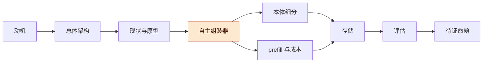
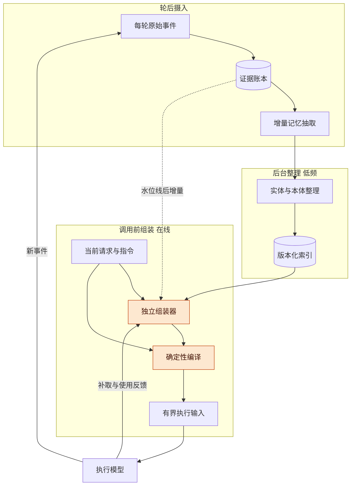
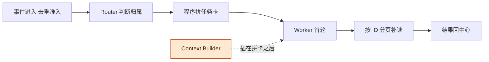
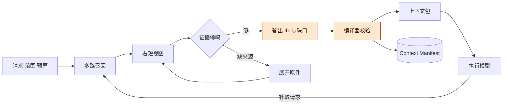
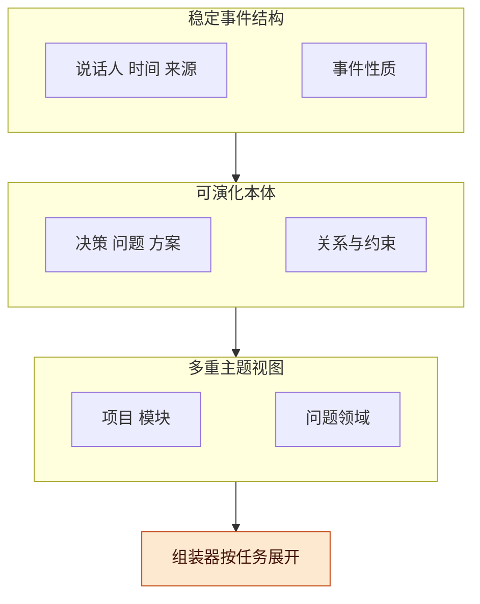
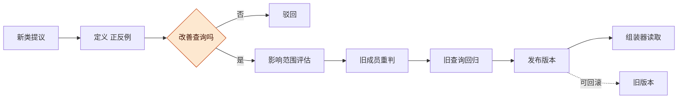
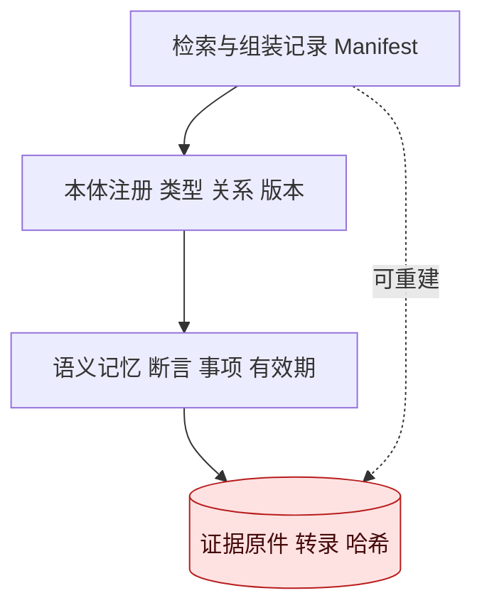

# Record 智能记忆与自主上下文组装讨论稿 v0.1.2

> 公开整理版 · 整理日期：2026-11-06 · 源版本：0.1.2。
> 保留个人通用研究、方法和公开来源；已省略公司案例、项目专属实现、个人身份与会话材料。
> 本次仅整理文本，未重新运行原实验、复测宿主兼容性或更新外部资料；历史结论仍受原研究范围限制。


## 版本与范围

本稿讨论把 Record 从“按固定类别记账”升级为“为每次任务准备执行上下文”的记忆系统：每轮之后保存证据并增量抽取，后台整理本体，新任务开始前由一个独立模型自主选材、再由程序编译成执行模型的实际输入；能否降低首轮 prefill，取决于我们能否控制执行模型最终收到的消息。

- 版本：v0.1.2，按 Cowork 讨论稿固定版式重整 Codex 稿，补齐总体架构等 8 张图、相关工作表、评估任务书、风险清单和待证命题表，观点沿用 Codex 稿；v0.1.1 即 Codex 中标为 v0.2 的版本，主线改为“独立模型执行前自主组装上下文”，并加入 prefill 与缓存分析；v0.1.0 为 Codex 首次整理（原题《Record 智能记录与本体演化》），聚焦每轮钩子、小模型记录和 Auto Ontology 细分。后续修改按补丁号递增（0.1.1、0.1.2…）。
- 主线：动机 → 总体架构 → 现状 → DeepSeek 原型 → 自主组装器 → 本体细分 → prefill 与成本 → 存储 → 相关工作 → 评估 → 风险 → 待证命题。
- 状态标记：文中“已核实”有源码或文献链接；“提案”是本讨论提出、尚未实现或验证的设计；“推测”单独注明。本轮只做了调研和静态源码分析，没有部署候选系统，也没有跑任何性能实验。

**图 1　讨论主线 · 12 节递进**



从左到右递进；高亮的自主组装器是本稿最主要的新提案，本体细分和成本分析是它的两条支撑线。

## 动机

固定类别记录能够保存原件，但仍需主动为新任务准备上下文；我们真正要的是让另一个模型从记忆里找依据、处理冲突、组织材料，让执行模型第一轮就带着必要背景行动。

**讨论来由**：本轮在 Codex 中分两步提出目标。第一步是三件事：读 DeepSeek Harness 发布的 Super-agent 文章、回看 Record 原始设计、查 Auto Ontology，设想“每轮挂钩子、用小模型记录、按自动生成的本体分门别类”，并关心本体能否继续拆细和数据怎么存。范围澄清时确定 Auto Ontology 同时覆盖 NVIDIA 的同名项目和一般的自动本体学习。第二步把目标抬高：上下文最终由另一个模型自主组装，从而减小执行模型第一轮 prefill，并让任务完成得更准。

由此得出三个要解决的问题：

- 固定类别不能随经验增长，检索主要靠文本匹配，语义理解层没有接通。
- 记录只服务“事后回看”，没有面向“下一次任务需要什么”的读侧控制。
- 执行模型每次读全量历史，首轮输入长、噪声多，而且旧结论和新纠正混在一起。

**一个不能退让的边界**：未写在可见材料中的决策理由，任何记录模型都不能恢复成当时事实。小模型可以写“这可能与降低成本有关”，不能写成“用户已决定采用本地模型”。自动化越多，越要守住这条线。

## 总体架构

系统按三个时间点分工：轮后摄入回答“刚才发生了什么”，后台整理回答“哪些经验可以共同组织”，调用前组装回答“当前任务必须知道什么”；只有第三条进入用户等待路径。

**图 2　总体架构 · 3 条路径、1 个反馈环**



自上而下是三条路径；高亮的“独立组装器 + 确定性编译”是新增部分，虚线表示组装器要直接读尚未整理完的最近事件，避免漏掉最新纠正。

**角色可复用模型服务**：摄入、整理、组装是三种职责，不等于三个常驻进程，可以共用一个小模型服务。原型阶段把摄入和整理做成可续跑短任务，只让组装进入在线路径。小模型也不应每次读全部历史，否则只是把长输入问题搬了个地方。

**时序问题**：上一轮抽取还没完成，下一条请求已经到达。组装器检查记忆处理水位线，把水位线之后的原始事件和用户纠正作为增量覆盖；无法安全覆盖时有限等待或明确标记未完成，但不等本体重建。

## DeepSeek Super-agent 原型的上下文流

DeepSeek 原型是“模型判断路由、程序拼任务卡、Worker 自己按需补读”，没有由独立记忆模型提前综合背景；文章里的 prefill 讨论针对的是合并积压事件、摊薄 Router 开销，不能当作“前置模型缩短 Worker 首轮上下文”的证据。

文章是 2026-10-31 的《Super-agent 设计探索：迈向更自主的 Agent 系统》，读的是署名全文转载第 1 至 9 节，源码固定在官方提交 `6337fc8`。文章把长期记忆列为开放问题。[ChainCatcher 全文](https://www.chaincatcher.com/article/2300676)、[UIED 转载](https://www.uied.cn/posts/922127)、[官方原型](https://github.com/deepseek-ai/dsh-superagent-prototype/commit/6337fc823ce20251c8de8085948165c81aaa701e)

**图 4　原型上下文流与新增插入点 · 高亮为本稿新增**



上排是原型实际路径；高亮的 Context Builder 是我们沿这个方向新增的角色，它提前承担 Worker 自己补读的一部分工作。

| 环节 | 原型实际做法 | 对我们设计的意义 |
| --- | --- | --- |
| 事件进入 | 去重、检查来源，已订阅事件直达任务，其余再评估（[intake.ts](https://github.com/deepseek-ai/dsh-superagent-prototype/blob/6337fc823ce20251c8de8085948165c81aaa701e/src/core/intake.ts#L19)） | 能预先确定归属的内容不必每次全局判断 |
| Router 判断 | 看事件卡、关联任务和线程窗口；提示词明确禁止它改写成实现计划（[dispatch.md](https://github.com/deepseek-ai/dsh-superagent-prototype/blob/6337fc823ce20251c8de8085948165c81aaa701e/prompts/dispatch.md#L36)） | 负责组织与准入，不替执行者做技术调查 |
| Worker 首轮输入 | 任务身份、assignment、源事件和短预览，预览按字符截断（[dsh.ts](https://github.com/deepseek-ai/dsh-superagent-prototype/blob/6337fc823ce20251c8de8085948165c81aaa701e/src/executor/dsh.ts#L449)） | 初始上下文受控，但截断不是语义选材 |
| 执行中补读 | 按关联 ID、分页和权限读原件（[resources.ts](https://github.com/deepseek-ai/dsh-superagent-prototype/blob/6337fc823ce20251c8de8085948165c81aaa701e/src/app/resources.ts#L210)） | 引用可达性和读取边界可以直接借鉴 |
| 结果返回 | 过程留在任务内，结果和需协调的变化回中心（[notices.ts](https://github.com/deepseek-ai/dsh-superagent-prototype/blob/6337fc823ce20251c8de8085948165c81aaa701e/src/app/notices.ts#L108)） | 中心上下文不被流水淹没 |

**可以继承**：稳定 ID、短入口加续读、固定顺序且记版本的系统提示词组装（[prompts.ts](https://github.com/deepseek-ai/dsh-superagent-prototype/blob/6337fc823ce20251c8de8085948165c81aaa701e/src/app/prompts.ts#L98)）、按任务归属限制读取范围、可靠投递和事务后执行队列。

**需要新增**：面向当前目标的证据需求分析、跨历史选材、冲突与缺口呈现，以及最终输入的编译记录。

**三个容易混的“准备”**：原型的 `TextCache` 是分页文本缓存，不是模型 KV cache；提前整理背景、提前尝试工作、预热计算状态是三回事；轮结束时后台工作可能还在跑，轮末可以摄入增量，不代表事项已完成。

## 自主组装器：先选证据再编译

组装器只输出“证据 ID、采用的视图、关键限定条件和缺口”，由确定性编译器检查并封装成实际输入；不让模型自由写一份无来源总摘要。这是“模型负责选择、程序负责边界与可重现”的分工。

**图 5　组装器内部流程 · 1 个补取环**



从左到右是召回、筛选、输出、编译；展开原件的内环要设次数上限，执行模型的补取请求回到召回，并记入 Manifest 作为漏选反馈。

**召回**：词法、向量与关系路径并用；模型先看候选短视图，再决定哪些展开原件、哪些已足够、哪些还缺来源。

**编译器的职责**：检查 ID 是否存在、来源范围、版本和失效状态；保留适用指令与用户当前原话；按实际 tokenizer 计预算。机械检查只保证引用与格式，不能证明事实正确或证据充分，这要靠独立验收和执行反馈。

| 上下文包内容 | 作用 | 保留原则 |
| --- | --- | --- |
| 当前请求与适用指令 | 确定要做什么和行为边界 | 直接保留权威原文，不能只留组装器改写 |
| 当前任务状态 | 已有产物、未闭合事项、环境与版本 | 标时间和来源，陈旧状态标待核 |
| 必要证据与有效决定 | 支持下一步动作 | 带出处与适用范围，保留否定、条件和例外 |
| 冲突与不确定 | 防止把推测当前提 | 提议、已确认、已执行、失败、已撤销分开 |
| 延后展开的材料 | 控制首包体积 | 保留可读句柄，省略不能让来源不可达 |
| 组装清单 | 解释选择、支持重放 | 记录候选、保留与舍弃、版本、预算、缺口 |

**Context Manifest 的边界**：要分清模型的选择理由、系统的过滤规则和用户的实际授权，相关性判断不产生新权限；外部材料里的指令只能作为被引用内容，不能覆盖当前控制指令。

**例子**：用户说“继续处理上次验证失败”。首包不能只写“上次验证未通过”，要辨明是哪个检出、当时是缺依赖还是被测物出错、哪些检查没做完、哪些改动已存在、当时与现在的操作边界。确认不了的列为待核项，引导执行者先检查，而不是把旧故障的解法直接套到新环境。

**允许补取与空包**：首包不需要预测所有后续步骤。没有相关记忆时返回空包是合法结果。预算不足、资料冲突或关键证据缺失时，选择补查、保守扩大上下文或交回调查，不能为保持短输入而补造事实。组装超时可以退回已验证的基础包，不能静默传入半截或过期的综合结论。

**摄入队列的工程问题**：重复 hook、乱序、取消、晚到结果，以及记录代理自己的输出触发自身循环，都要处理。

## 本体如何服务选材与细分

本体在这里首先是语义索引，用来从当前任务定位适用约束、有效决定、相关实体和失败经验；“更细”有四种不同含义，每次细分都要说明它如何改善选材，类别更多或树更深本身不算成功。

**图 6　三套结构与四种“更细” · 分层**



自下而上看：事件结构稳定不变，本体可演化，主题视图允许一条记忆挂在多个主题下；组装器只按任务展开需要的关系，不把所有相邻节点灌给执行模型。

| “更细”的含义 | 改变什么 | 主要影响 |
| --- | --- | --- |
| 一轮拆成多个有出处的记忆单元 | 记录粒度 | 记录表达 |
| 一个单元属于多个主题 | 归类方式 | 记录表达 |
| 主题细分为子主题 | 层级深度 | 索引与结构 |
| 新增对象类型、关系或约束 | 本体本身 | 索引、结构与校验 |

**关系不能混用**：`is-a` 表示类型包含，`part-of` 表示组成，主题归属服务分类视图，`depends-on` 表示依赖。校验要检查每种关系允许连接的对象类型，并拒绝子类型层级中的环；这是待实现的数据契约。

**NVIDIA Auto Ontology 的边界**：核对版本 `9810138`（2026-10-28）。它把企业数据库元数据整理成业务语义层，经 MCP、CLI、API 访问，存储用 PostgreSQL。抽取规则强烈偏好“一张表对应一个业务 Term”，只有特定连接表才拆成两个。它解释的是数据库业务概念，不是把连续会话分解成任意深度的主题树；源码里的 `IS_A`、`PART_OF` 常量和迁移版本，不能证明会话本体的递归拆分、成员迁移和回滚已经实现。[README](https://github.com/NVIDIA/auto-ontology/blob/98101384ed92d0ccbe208d189871091c65b3ba38/README.md)、[Term 抽取](https://github.com/NVIDIA/auto-ontology/blob/98101384ed92d0ccbe208d189871091c65b3ba38/auto_ontology/semantic/term_extractor.py#L32)、[建模边界](https://github.com/NVIDIA/auto-ontology/blob/98101384ed92d0ccbe208d189871091c65b3ba38/skills/nvidia-ontology-management/references/modeling.md)

**用法判断**：若首要范围是本机任务记忆，轻量模块更容易做出可比较原型；若将来连接多个业务数据库，可以把 Record 抽取结果整理成表，再用 NVIDIA 语义层统一查询，但文本抽取、证据状态和本体版本仍由 Record 管。

**图 7　类别演化与版本发布 · 后台完成、在线只读冻结版本**



从左到右是一次拆类或合类的完整流程；高亮的判断点是“是否改善实际查询”，不满足就驳回，不能只因名称更整齐就拆。

**拆合规则**：类别 ID 与名称分开；改名只调显示和别名；合类保留旧 ID 映射；拆类保留父类、子类定义和旧成员重判结果，信息不足的旧记录留在父类或待核状态。旧查询仍应覆盖新子类，旧版本能重现当时分类。一条纠正通常只是更新某个断言的状态，不代表要改本体。

**例子**：“排障”下的“依赖缺失”和“采集缺口”可以成为候选子类，前提是定义和证据能区分，并能帮组装器为下一步选到不同材料。

## Prefill、缓存与总成本

输入变短只是中间指标；用户等待是否改善，要看执行器节省的输入处理时间能否覆盖组装、排队和传输的新增开销，同时还要算上可能失去的前缀缓存。

**降负的先决条件**：若宿主仍发送全部旧历史，插件只在后面追加记忆，输入只会更长。可行路径有两条：真正的消息构造或历史替换接口；或启动只带必要规则、任务与上下文包的新 Worker，后者要计入失去原会话前缀缓存的代价。当前宿主是否具备这些能力需要实测，不能由“有 before-step hook”推定。

**图 8　用户等待时间分解 · B 为现行方案、M 为组装方案**


从左到右是一次请求的临界路径；高亮的 P 是组装方案想省下的部分，警示色的 A 是它新增的开销，最终看的是右端“首个正确动作”。

改善条件（只是分解，不是速度预测）：

```text
P_B − P_M > (A_M − A_B) + (Q_M − Q_B) + (F_M − F_B)
```

`A` 含检索、组装模型自身的输入处理与生成、编译和必要传输；有并行时按真实临界路径计。服务不暴露分段计时，就报告 TTFT、端到端延迟和 cached token，不能把 TTFT 全称为 prefill。

**缓存要分开记**：全部输入 `N`、已缓存 `K`、未缓存 `N−K`，包括系统规则与工具定义。新方案 `N` 更小，也可能因重写早部内容而失去大量 `K`。vLLM 的 Automatic Prefix Caching 复用相同前缀的 KV，只省输入处理，不省生成。[vLLM APC](https://docs.vllm.ai/en/stable/features/automatic_prefix_caching/)、[SGLang RadixAttention](https://arxiv.org/pdf/2312.07104)

| 条件 | 需要检验什么 |
| --- | --- |
| 冷 KV，模型和索引已就绪 | 主模型节省能否覆盖组装开销 |
| 稳定前缀已缓存 | 动态部分真正少了多少未缓存输入 |
| 同任务前缀热缓存 | 组装重排是否破坏已有复用 |
| 规则或记忆早部更新 | 缓存失效与事实更新是否都正确 |
| 典型并发或共用设备 | 均值改善是否伴随尾延迟或吞吐退化 |

**布局建议（提案）**：稳定规则和工具约定放在确定顺序的前缀，带版本的任务证据放动态部分，减少无意义的排序漂移；但不能为了命中缓存保留过期事实。

**成本口径**：覆盖检索、组装、执行、后台写回、索引维护和重试，比较每个成功任务的总成本。小模型若每次读全部历史、反复补查或与执行器争用同一设备，总等待可能反而增加。准确性与长度也不单调，Lost in the Middle 提示位置和干扰会影响表现，但推不出越短越好。[长上下文位置研究](https://arxiv.org/html/2307.03172v3)

## 存储分层

存储分四层：证据原件保证可回放，语义记忆保存断言与状态，本体注册管版本，检索与组装记录支持审计；本机起步用 SQLite 即可，不必一开始上专用图数据库。

**图 9　存储四层 · 上层可由下层重建**



自上而下依赖越来越稳定；警示色的证据层是当前已暴露过膨胀问题的一层，上层索引与视图都应能从它重建。

| 层 | 保存什么 | 建议起点 |
| --- | --- | --- |
| 证据原件 | 原始转录、事件、附件、哈希、来源坐标 | 延续本机账本，改进增量保存与对象去重 |
| 语义记忆与任务 | 断言、实体、事项状态、出处、有效期、处理队列 | 本机先评估 SQLite；多机多人并发再评估 PostgreSQL |
| 本体注册 | 类型与关系定义、别名、版本、迁移映射 | 版本化定义加事务记录，需要互操作再考虑 RDF/OWL 加 SHACL |
| 检索与组装记录 | 索引、候选、最终选择、缺口、输入包、使用反馈 | 可重建检索视图，加可审计的 Context Manifest |

**几条存储约束**：SQLite WAL 只有一个写者，且要求访问进程在同一主机，不能把库文件放网络共享目录充当多机服务。[SQLite WAL](https://www.sqlite.org/wal.html#concurrency) PostgreSQL `jsonb` 不保留原始空白、键顺序与重复键，逐字复核仍要存原始字节和哈希。[JSON 类型](https://www.postgresql.org/docs/current/datatype-json.html) 抽取器、模型、提示词、本体和组装策略各自记版本；被撤销、删除或人工修正的内容不能在重处理时无声复活。

**三阶段分开记**：检索命中、被选入、被正确使用是三件事。材料进入请求只证明已注入，是否被正确使用要看引用、动作和独立验收。舍弃理由也要留，以便区分召回不足、选择错误、压缩丢了限定词，还是执行模型没用好。

## 相关工作

这一节核实了论文页面和固定提交的源码路径，区分了“代码可读”“可部署”“本地有效”三个层次；没有在本地运行任何一个系统。

| 类别 | 代表（年份） | 核实到的内容 | 缺口 |
| --- | --- | --- | --- |
| 独立模型管记忆 | [MemAgent](https://arxiv.org/html/2609.32521v1)（2026） | 独立 Qwen3.5-4B 控制器：任务前看多个 provider 预览选来源，执行中决定注入，完成后选写入处；训练是探索、按结果筛样本后 SFT；[代码](https://github.com/WalkerWorldPeace/MemAgent/blob/7121cfe991c329748cd610515a3419cabc875ba6/EvolveLab/memory_agent/memory_agent.py#L102)可读 | 开始阶段主要选一个提供者，不做多来源综合与权限检查；不是首轮 prefill 压缩实验；未找到随库路由权重 |
| 首步接入 | [MemOS 本地插件](https://github.com/MemTensor/MemOS/blob/64388b50e2a15528bcdf032e65a1ac792bcf63ee/apps/memos-local-plugin/adapters/deepseek-harness/bridge.ts#L194)（2026） | DSH `agent/pre-step` 首步检索，融合去重后可选 LLM 精筛，返回保留下标与充分性信号，生成有预算的 `InjectionPacket` | 返回 `decision.messages` 加一条召回消息，不裁剪历史；默认辅助模型复用宿主模型 |
| 小入口按需展开 | [Letta MemFS](https://docs.letta.com/concepts/memfs)（2026） | 小根文件进入上下文，执行者按需打开子目录，后台 dreaming 整理 | 仍由执行者自己读，不是另一模型预编首包 |
| 外置原件探查 | [RLM](https://arxiv.org/html/2512.24601v1)（2025） | 强根模型在环境中探查长材料并调用子模型，[实现](https://github.com/alexzhang13/rlm/tree/d04208afbad29ca675ab13478c40ee8bebc84bfe)公开 | 效果不能归给便宜的前置模型 |
| 学习记忆管理 | [Memory-R1](https://arxiv.org/html/2508.19828v4#S3)（2025）、[AgeMem](https://arxiv.org/html/2601.01885v1#S3)（2026） | 前者学写入、回答代理自己蒸馏候选；后者同一任务模型学记忆与上下文动作 | Memory-R1 代码待发布；AgeMem 未找到作者实现；都不是独立首步组装器 |
| 记忆组织 | [A-MEM](https://arxiv.org/html/2502.12110v6)（2025）、[Mem0](https://arxiv.org/html/2504.19413v1)（2025） | A-MEM 生成标签与关联并回写旧记忆；Mem0 论文做增改删，当前库转向只追加 | 标签与关联不等于类型约束 |
| 时间与证据 | [Graphiti / Zep](https://github.com/getzep/graphiti/blob/16bf514380de4e44884aed6779bece220e6fe470/graphiti_core/edges.py#L263)（2025） | episodes 保存原始输入，事实带系统时间与有效时间，冲突可失效旧事实 | 数据库不替我们判断事实是否有效 |
| 自动本体学习 | [LLMs4OL](https://arxiv.org/abs/2307.16648)（2023）、[OntoLearner](https://arxiv.org/html/2607.01977v1#S3)（2026）、[AutoSchemaKG](https://arxiv.org/html/2505.23628v1)（2025） | 术语归类、上下位发现、非层级关系分开评估；AutoSchemaKG 从实例归纳概念 | 批量诱导 schema 不含在线版本发布、迁移和回滚 |
| 抽取与校验 | [OntoGPT/SPIRES](https://github.com/monarch-initiative/ontogpt)、[DeepOnto](https://krr-oxford.github.io/DeepOnto/)、[SHACL](https://www.w3.org/TR/shacl/) | SPIRES 沿给定 LinkML schema 递归抽取；DeepOnto 做对齐与推断；SHACL 校验 RDF 约束 | SPIRES 不自动发明子类；形式一致不等于事实正确 |
| 图的收益 | [Does Memory Need Graphs](https://arxiv.org/html/2601.01280v3)（2026） | 受控比较显示实体描述、原始会话回取和抽取配置都影响结果，简单相似度连边可能引入噪声 | 结论来自公开基准，需在本项目任务上复测 |
| 评测 | [LongMemEval](https://arxiv.org/abs/2410.10813)（ICLR 2025） | 五类能力：信息抽取、多会话推理、时间推理、知识更新、无答案拒答 | 测的是历史问答，不是新任务起步 |

**核实后的修正**：

- v0.1.0 曾把 NVIDIA Auto Ontology 当作待确认的同名候选；按范围澄清，改为同时覆盖 NVIDIA 产品与一般自动本体学习，两条线分开讨论。
- v0.1.0 的推进建议是“先做历史追问、再做主动供给”；v0.1.1 改为直接验证执行前组装，历史问答只做诊断。
- v0.1.1 在 Codex 中标为 v0.2，跳过了补丁号；本版按小步规则重排为 v0.1.0 → v0.1.1 → v0.1.2，内容不受影响。
- MemOS 首步接入最初容易被读成“能降 prefill”，核对源码后确认它只追加召回消息，不移除原有历史。

**仍未核实**：B 站精确原页（官方空间访问受限，公众号入口遇环境验证，用的是署名转载）；文章内所有配图；MemAgent 是否有可部署路由权重；AgeMem 的作者实现；当前宿主是否提供历史替换接口。

说明：认知科学部分只读了作者摘要、可读首页和相关段落，没有通读原文。Baddeley 的 episodic buffer 提示“长期保存”与“当前激活”分开，Tulving 与 Thomson 的编码特异性提示摄入时要保留任务目的、版本、说话人、有效时间等线索，McClelland 等的互补学习系统提示“快速保存新纠正、缓慢整合结构”。这些只是设计类比，不能用来证明 AI 性能，也不能把工作记忆容量换算成 token 数。[Baddeley 2000](https://pubmed.ncbi.nlm.nih.gov/11058819/)、[Tulving 1973](https://doi.org/10.1037/h0020071)、[McClelland 1995](https://web.stanford.edu/~jlmcc/papers/McCMcNaughtonOReilly95.pdf)

## 评估设计

主实验直接跑“用户任务到来、组装、执行模型首步、完成任务”这条链，历史问答只做诊断；用五组对照把“独立组装”和“本体”的贡献拆开。

**任务书**：

1. 选一条能观察最终输入的执行路径，核实能否替换历史或使用精简 Worker，确认系统指令、工具定义与项目规则怎样保留。
2. 从真实工作里截出一批小型配对任务，每个任务截断在真实起点，只允许使用当时已有的记忆。
3. 搭出调用前检索、独立选材、编译、执行和反馈闭环，轮后摄入同时提供增量。
4. 记录每组的总输入、cached token、组装开销、首个正确动作和最终验收结果。
5. 人工整理必要证据包，用于区分“证据没给到”和“给到了不会用”。

| 组 | 做法 |
| --- | --- |
| B0 现行上下文 | 保持当前历史、交接方式和缓存行为，用于端到端净收益比较，不为等长而截断 |
| B1 廉价检索 | 规则过滤加词法或向量检索，回答“额外选择模型是否必要” |
| M1 独立组装 | 用事件与元数据按任务选材、查冲突和缺口 |
| M2 加固定本体 | 使用冻结版本的实体、关系和层级 |
| M3 加本体演化 | 由历史材料形成演化版本，任务前冻结，检验泛化与兼容 |

B1、M1、M2、M3 用相同上下文预算上限做机制消融，不向较短方案填无关内容。任务覆盖继续未完成工作、在已有约束下开展新工作、相似表象但根因不同、旧决定被替代、资料冲突、没有相关记忆六类。冷 KV、稳定前缀热缓存、早部更新分开比较，方法之间用一致的预热流程或独立缓存范围。

| 维度 | 首批观察的结果 |
| --- | --- |
| 起步质量 | 首个正确动作、已知约束违背、是否要用户重述已有信息 |
| 证据完整与可信 | 必要来源覆盖、限定词保留、冲突标注、过期事实与推测误用 |
| 输入与计算 | 总输入、cached token、未缓存输入、prefill 与执行器 TTFT |
| 用户体验 | 首个有效输出、首个正确动作、完整任务延迟及尾部 |
| 成功成本 | 所有模型和检索开销、补读、重试、回退，每个成功任务总成本 |
| 演化兼容 | 旧来源可达、旧版本可重现、迁移后旧任务不退化 |

**负向场景**：提议误作批准、失败误作成功、同名不同项目、旧版本冒充当前、用户否定被漏掉、重复与乱序事件、工具输出里的指令干扰、没有证据时编造结论。

**停止判据**：

- M1 在首个正确动作和约束违背上不优于 B1，就先停独立组装，回头查召回与选材。
- M2 不优于 M1，本体不进入在线调用路径，只留作后台整理。
- 组装开销在冷 KV 条件下已经超过执行器节省，且准确率没有提升，就停掉以降 prefill 为目标的路线，只保留准确性方向。
- 任何组出现“首轮更短却漏掉禁止条件”的系统性问题，先修编译器校验再继续。

## 风险与开放问题

最大的风险不在模型选得准不准，而在宿主能否让我们控制最终输入；其次是小模型把推测写成事实、组装开销吃掉节省。

- **宿主只能追加**：若宿主不提供历史替换，组装器只能追加记忆，输入反而变长。对策是先实测宿主接口，必要时用精简 Worker，并明确这条路线只测准确性、不宣称降 prefill。
- **推测被写成事实**：小模型补全了用户没说过的理由。对策是用户决定必须锚到用户事件，推测单独标注，编译器拒收无来源断言。
- **漏掉最近纠正**：组装器只读已整理的本体，错过上一轮刚说的否定。对策是读水位线之后的原始事件做增量覆盖。
- **组装开销反超**：组装模型读得太多、补查太频繁或与执行器争设备。对策是给组装设等待预算和退路，按临界路径计时。
- **缓存损失**：重排或重写前缀导致已有 KV 失效。对策是稳定前缀加动态证据的布局，并把 cached token 列为必测量。
- **本体越拆越碎**：类别变多、检索变散。对策是每次拆类都要证明改善查询，否则驳回；保留版本和回滚。
- **权限借道摘要外泄**：组装器能看的范围比执行者大。对策是按任务归属限制可读范围，Manifest 记录授权来源。

开放问题：

- [ ] 执行宿主与模型入口选哪一个，它是否支持历史替换？
- [ ] 采用原会话历史替换，还是新起精简 Worker？
- [ ] 组装器允许读取的项目范围怎么定？
- [ ] 独立模型部署在哪里，在线等待预算多少？
- [ ] 证据不足时默认退路是补查、扩大上下文还是交回调查？
- [ ] 哪些本体变化可以自动生效，哪些需要人工确认？
- [ ] Codex 会话的身份、轮次和事件格式怎样接入 Record？

## 待证命题与下一步

五个命题里最先能验证的是 P1，因为它决定降 prefill 是否有实现条件；最先能做的是查清宿主接口，再搭 B0、B1、M1 三组的最小闭环。

| 编号 | 命题 / 猜想 | 已有依据 | 缺口 |
| --- | --- | --- | --- |
| P1 | 至少一个现有宿主能让我们控制执行模型的最终输入 | DeepSeek 原型的 Worker 首条输入由程序拼装 | 尚未在本机宿主实测 |
| P2 | 独立组装器在首个正确动作上优于廉价检索 | MemAgent 显示小模型选来源有收益 | 无本项目任务对照 |
| P3 | 组装带来的 prefill 节省能覆盖组装开销 | 等待时间分解公式 | 无任何计时数据 |
| P4 | 固定本体能在 M1 之上提供额外选材能力 | 本体可跨字面相似找前置条件 | UnifiedMem 提示图可能引入噪声 |
| P5 | 本体自动拆合能泛化且不破坏旧查询 | 拆合与版本映射规则已设计 | 未实现，未测迁移 |

下一步：

- [x] 读完 DeepSeek 文章与原型、Record 原始设计、NVIDIA Auto Ontology 和相关论文
- [x] 按 Cowork 讨论稿版式整理成本稿
- [ ] 实测 DSH、Claude Code、Codex 三个宿主能否替换历史或启动精简 Worker
- [ ] 为 Codex 会话补齐 Record 的身份与轮次映射
- [ ] 从真实工作截出第一批配对任务，覆盖六类场景
- [ ] 搭 B0、B1、M1 最小闭环并记录 Manifest
- [ ] 视 M1 结果决定是否进入 M2 固定本体
