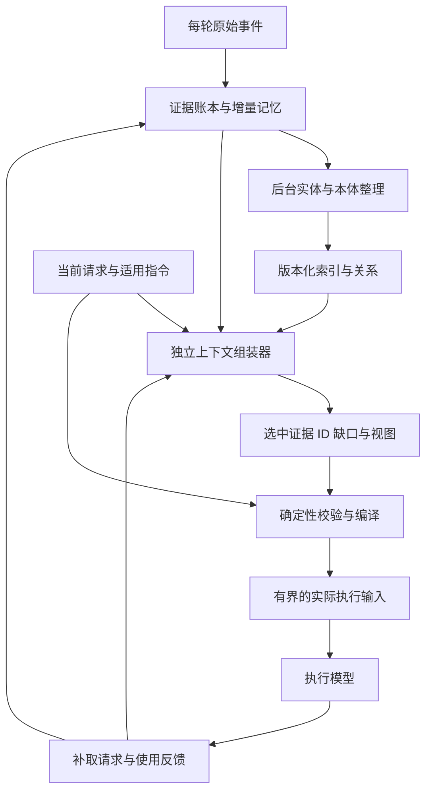

# Record 智能记忆与自主上下文组装讨论稿

> 公开整理版 · 整理日期：2026-11-06 · 源版本：0.2；后续统一编号为0.1.1。
> 保留个人通用研究、方法和公开来源；已省略公司案例、项目专属实现、个人身份与会话材料。
> 本次仅整理文本，未重新运行原实验、复测宿主兼容性或更新外部资料；历史结论仍受原研究范围限制。


讨论稿 v0.2 · 2026-10-31 · 供方案讨论，尚未进入实现。

## 摘要与当前建议

**目标是让一个独立模型在执行模型开始处理任务之前，自主从记忆中选出并组织本次需要的上下文，使执行模型第一轮就更准确地行动，并减少不必要的输入处理。** Record 的记录、分类、本体与存储都服务于这个目标。我们要建设的是持续更新的记忆系统，加上面向当前任务的上下文组装器；历史问答和恢复现场可以用于诊断，但不是第一版产品的主要验收目标。

建议把工作分成三个时间点：每轮之后可靠保存证据并抽取增量记忆；后台较低频地整理实体、关系和本体；新任务到来时，由独立模型决定读什么、保留什么及还缺什么，再由确定性程序编成执行模型的实际输入。执行过程中允许补取证据，并把漏选、误选与实际使用反馈给记忆系统。本体可以继续细分，但不应在每次任务开始时重建全部历史。

**首轮减负有一个先决条件：我们必须能控制执行模型最终收到的消息。** 若宿主仍发送全部旧历史，插件只在后面增加记忆，输入只会更长。可行路径是使用真正的消息构造或历史替换接口，或者启动只携带必要规则、任务与上下文包的新 Worker；后一条还需计入失去原会话前缀缓存的代价。当前宿主是否具备这些能力，仍需实测核对，不能由“有 before-step hook”直接推定。

本次同时研究 NVIDIA Auto Ontology 产品和一般自动本体学习。它们帮助组织、定位和解释记忆；是否值得进入在线组装路径，要看对首个正确动作、任务成功率和总成本的实际贡献。第一轮原型应直接验证执行前组装，用小范围稳定概念起步，再逐步加入自动本体演化，而不等本体系统完整后才开始测首轮效果。

## DeepSeek 的设计深入到哪一步

### 文章的目标与 prefill 讨论

《Super-agent 设计探索：迈向更自主的 Agent 系统》把全局协调、事件路由、并发执行、按需展开上下文和进度监督组合起来，减少人手动维护多个任务会话的负担。其组织原则值得继承：系统安排什么信息何时到达哪个执行上下文，并用稳定身份保留续读路径。文章仍把长期记忆列为开放问题。[文章署名全文](https://www.chaincatcher.com/article/2300676)

文章中与 prefill 有关的讨论主要针对合并积压事件、摊薄 Router 的路由开销；它没有验证“另一个模型预先缩短 Worker 首轮上下文”的收益。因此，下面的 Context Builder 是我们沿这一方向新增的角色，不能当成原文已经提供的功能或性能结论。[文章实验与开放问题](https://www.uied.cn/posts/922127)

### 官方原型的上下文实际怎样流动

源码核对固定在官方提交 `6337fc823ce20251c8de8085948165c81aaa701e`。公开原型采用模型判断路由、程序拼任务卡、Worker 继续按需读取的组合，并非由一个独立记忆模型提前综合所有背景。[官方原型版本](https://github.com/deepseek-ai/dsh-superagent-prototype/commit/6337fc823ce20251c8de8085948165c81aaa701e)

| 环节 | 原型实际做法 | 对我们设计的意义 |
|---|---|---|
| 事件进入 | 去重并检查来源，已订阅的事件可直达相应任务，其他事件再评估 | 能预先确定归属的内容，不必每次重做全局判断 |
| Router 判断 | 看事件卡、关联任务和必要线程窗口，决定接收、分派或忽略 | 负责组织与准入，不替执行者开展技术调查 |
| Worker 启动 | 程序提供任务身份、assignment、源事件及短预览，长内容留读取入口 | 初始上下文受控，但省掉的内容可能要由 Worker 稍后补读 |
| 执行中读取 | 按关联 ID、分页和权限读取原件，补充背景并选择方法 | 引用可达性和读取边界可以直接借鉴 |
| 结果返回 | 普通过程信息留在任务中，结果与需要协调的变化再返回中心 | 减少中心上下文被流水淹没 |

这些路径分别可在[入站处理](https://github.com/deepseek-ai/dsh-superagent-prototype/blob/6337fc823ce20251c8de8085948165c81aaa701e/src/core/intake.ts#L19)、[准入评估](https://github.com/deepseek-ai/dsh-superagent-prototype/blob/6337fc823ce20251c8de8085948165c81aaa701e/src/app/assessment.ts#L138)、[首条 Worker 输入](https://github.com/deepseek-ai/dsh-superagent-prototype/blob/6337fc823ce20251c8de8085948165c81aaa701e/src/executor/dsh.ts#L449)、[资源读取](https://github.com/deepseek-ai/dsh-superagent-prototype/blob/6337fc823ce20251c8de8085948165c81aaa701e/src/app/resources.ts#L210)和[结果封装](https://github.com/deepseek-ai/dsh-superagent-prototype/blob/6337fc823ce20251c8de8085948165c81aaa701e/src/app/notices.ts#L108)中定位。

Router 的提示词明确限制它改写成实现计划或替 Worker 设计方案。任务卡的预览也由字符截断生成，属于确定性有界展示，不是按语义判断“这些就是完成任务所需的全部材料”。Worker 仍负责自己读取背景、判断范围和选择方法。我们希望新增的组装器，正是提前承担其中一部分寻找和整理背景的工作，同时不替执行者决定未经授权的新任务。[Router 职责](https://github.com/deepseek-ai/dsh-superagent-prototype/blob/6337fc823ce20251c8de8085948165c81aaa701e/prompts/dispatch.md#L36)、[预览实现](https://github.com/deepseek-ai/dsh-superagent-prototype/blob/6337fc823ce20251c8de8085948165c81aaa701e/src/executor/dsh.ts#L112)、[Worker 职责](https://github.com/deepseek-ai/dsh-superagent-prototype/blob/6337fc823ce20251c8de8085948165c81aaa701e/prompts/worker.md#L1)

原型还有两条重要边界。系统提示词由固定顺序的规则、角色、指南、环境和 Policy 组装，并记录版本；任务卡并不等于整个请求。Worker 读取范围也受到任务归属约束，不能因为组装器能看更多历史，就把其他范围的内容通过摘要带给它。最终输入应保留适用指令，并逐项检查材料可读性。[提示词组装](https://github.com/deepseek-ai/dsh-superagent-prototype/blob/6337fc823ce20251c8de8085948165c81aaa701e/src/app/prompts.ts#L98)、[资源权限](https://github.com/deepseek-ai/dsh-superagent-prototype/blob/6337fc823ce20251c8de8085948165c81aaa701e/src/app/resources.ts#L93)

### 可以继承的机制与需要新增的职责

可以继承稳定 ID、短入口与续读、版本化提示词、可靠投递，以及事务后执行队列。需要新增的是面向当前目标的证据需求分析、跨历史选材、冲突与缺口呈现，以及最终输入的编译记录。两者可以组合：模型负责选择，程序负责边界和可重现封装。[原型持久化与队列](https://github.com/deepseek-ai/dsh-superagent-prototype/blob/6337fc823ce20251c8de8085948165c81aaa701e/docs/007-architecture.md)

还要区分几种容易混淆的“准备”：原型的应用层 `TextCache` 是分页文本缓存，不是模型 KV cache；提前整理背景、提前尝试工作与预热模型计算状态也不同。轮结束时后台工作仍可能继续，所以轮末可用于摄入增量，却不能自动表示事项已经完成。[文本缓存](https://github.com/deepseek-ai/dsh-superagent-prototype/blob/6337fc823ce20251c8de8085948165c81aaa701e/src/app/cache.ts)、[执行与恢复](https://github.com/deepseek-ai/dsh-superagent-prototype/blob/6337fc823ce20251c8de8085948165c81aaa701e/docs/003-execution.md)

## 自主组装器如何把记忆变成本次执行输入

### 三条路径分别承担摄入 整理与调用

轮后摄入面向“刚才发生了什么”。原始事件先落盘，随后规则和小模型抽取事实、决定、约束、失败条件与来源；未闭合事项保留状态。后台整理面向“哪些经验可以共同组织”，进行别名归并、概念归纳和本体变更。调用前组装面向“当前任务必须知道什么”，只读取明确版本的索引和必要证据，再叠加尚未进入慢速整理的新纠正。三条路径分开，既减少在线等待，也避免新用户指令被后台延迟挡住。



摄入、整理和组装这三个记忆侧角色可以复用一个模型服务，也可以分别配置；职责分开不等于必须新增三个常驻进程。原型阶段应优先复用现有调度，把摄入与整理做成可续跑短任务，只有调用前组装进入用户等待路径。小模型也不应每次读全部历史，否则只是把长输入问题转移了一次。

上一轮的异步抽取可能还没完成，下一条请求就已经到达。组装器因此应检查记忆处理水位线，把水位线之后、宿主已经接受的最近原始事件和用户纠正作为增量覆盖；无法安全覆盖时，再有限等待或明确标记未完成。这里不需要等待本体重建，却必须避免漏掉最近一次否定或改口。MemOS 的异步摄入也说明了这一时序边界。[适配器一致性与限制](https://github.com/MemTensor/MemOS/blob/64388b50e2a15528bcdf032e65a1ac792bcf63ee/apps/memos-local-plugin/adapters/deepseek-harness/README.md)

### 先选证据 再编译上下文

组装器先看到用户当前请求、项目与环境范围、已有事项状态、可检索记忆目录以及预算。它据此判断必须覆盖的内容，例如当前代码基线、已确认要求、有效决定、相关失败经验和尚未解决的冲突。检索可同时使用词法、向量与关系路径；模型先看候选短视图，再决定哪些需要展开原件、哪些已足够、哪些还缺来源。

建议让模型主要输出**证据 ID、要采用的视图、关键限定条件和缺口**，而不是自由生成一份无来源总摘要。编译器负责检查 ID 是否存在、来源范围、版本和失效状态，保留适用指令与用户当前原话，并按实际 tokenizer 计量预算。机械检查能保证引用与格式，不能自动证明业务事实正确或证据已经充分；这些结论仍需通过独立验收和执行反馈检验。

| 上下文包内容 | 作用 | 保留原则 |
|---|---|---|
| 当前请求与适用指令 | 确定要做什么及行为边界 | 直接保留权威内容，不能只保留组装器改写 |
| 当前任务状态 | 指明已有产物、未闭合事项、环境与版本 | 标注时间和来源，陈旧状态需检查或明确待核 |
| 必要证据与有效决定 | 支持下一步动作 | 带出处与适用范围，保留否定、条件和例外 |
| 冲突与不确定 | 避免把推测当作确定前提 | 提议、已确认、已执行、失败和已撤销分开 |
| 延后展开的材料 | 控制首包体积并允许深入 | 保留可读取句柄，不能因省略而让来源不可达 |
| 组装清单 | 解释本次选择并支持重放 | 记录候选、保留与舍弃、版本、预算和缺口 |

组装清单可以称为 Context Manifest。它不仅帮助调试，还能回答“执行模型为什么看到了这条旧结论”。与最终输入一起保存时，必须分清模型选择的理由、系统实施的过滤规则，以及用户实际授权；相关性判断不会产生新的权限。外部材料中的指令也只能作为被引用内容，不能覆盖当前的控制指令。

例如用户要求“继续处理上次验证失败”，组装器不能只发送“上次验证未通过”。它需要辨明是哪一个检出、当时缺依赖还是被测物出错、哪些检查未完成、哪些改动已存在，以及当时与现在的操作边界。若这些条件尚不能确认，首包应列出待核项，引导执行者先检查，而不是把旧故障的解决动作直接套到新环境。

### 证据不足时允许补取

自主组装不要求首包预测所有后续步骤。执行模型可以请求某个决定的原话、某项经验的适用条件或某份产物的当前状态；组装器据此补取，并记录首包遗漏在哪里。对于没有相关记忆的任务，返回空记忆包并允许现查也是合法结果。预算不足、资料冲突或关键证据缺失时，应选择补查、保守扩大上下文或明确交回调查，不能为了保持短输入补造事实。

同一任务的后续轮次可优先增量更新相关证据，避免无必要地重写和重排整包；是否这样做仍取决于宿主消息控制能力与缓存收益。

摄入队列必须处理重复 hook、乱序、取消与晚到结果，并避免记录代理的输出触发自身循环。调用路径则要有明确的等待边界和可解释退路：组装超时可以使用已经验证的基础包，不能静默传入半截或过期的综合结论。具体预算和退路需结合宿主实测确定。

**未写在可见材料中的决策理由，任何记录模型都不能恢复成当时事实。** 执行者当场留下的理由、用户原话和观察者事后推测必须区分。小模型可以说“这可能与降低成本有关”，不能据此生成“用户已经决定采用本地模型”。保留这一边界，才可能自动化更多记录而不降低可信度。

## 哪些论文和开源实现最接近独立组装

### MemAgent 已分出小模型选择记忆来源

2026 年的 **MemAgent: Learning to Manage Heterogeneous Memory Providers for LLM Agents** 与目标最接近。它让独立的 Qwen3.5-4B 控制器服务任务模型：任务开始前看多种记忆提供者的预览并选来源，执行中决定是否注入短期记忆，任务完成后选择保存位置。官方代码确有 provider 探查、独立模型加载和训练入口；训练路径是探索、按结果筛选样本后进行 SFT，不应笼统写成每轮在线强化学习。[论文](https://arxiv.org/html/2609.32521v1)、[独立模型与运行代码](https://github.com/WalkerWorldPeace/MemAgent/blob/7121cfe991c329748cd610515a3419cabc875ba6/EvolveLab/memory_agent/memory_agent.py#L102)、[官方训练与阶段说明](https://github.com/WalkerWorldPeace/MemAgent/blob/7121cfe991c329748cd610515a3419cabc875ba6/README.md)

它证明了“另一个较小模型管理执行模型记忆选择”已有具体研究和代码路径，但其开始阶段主要选择一个提供者，并不等于替我们完成多来源事实综合、权限和版本检查。Record 任务可能同时需要用户要求、分支状态与失败经验，因此可借鉴先看预览再展开的方式，同时研究多来源和空结果。该论文报告的是多步任务实验，不是主执行器首轮 prefill 压缩实验；本轮也未定位到随库可直接部署的路由权重，不能当成现成服务安装即用。[来源探查与决策](https://github.com/WalkerWorldPeace/MemAgent/blob/7121cfe991c329748cd610515a3419cabc875ba6/EvolveLab/providers/memory_agent_provider.py#L360)

### MemOS 给出首步接入和确定性封装的工程样例

MemOS 当前本地插件已经提供 DSH 的 `agent/pre-step` 接口：在一轮的首步检索候选，经过融合、去重和可选 LLM 精筛，生成有预算的 `InjectionPacket`。精筛模型返回保留的候选下标及充分性信号，并允许有效空集合。这与“模型选择、程序封装”的分工相近，但检索路径仍主要由规则安排，模型自报充分也不构成证据齐备证明。[首步逻辑](https://github.com/MemTensor/MemOS/blob/64388b50e2a15528bcdf032e65a1ac792bcf63ee/apps/memos-local-plugin/adapters/deepseek-harness/bridge.ts#L194)、[精筛器](https://github.com/MemTensor/MemOS/blob/64388b50e2a15528bcdf032e65a1ac792bcf63ee/apps/memos-local-plugin/core/retrieval/llm-filter.ts#L99)、[检索与封装](https://github.com/MemTensor/MemOS/blob/64388b50e2a15528bcdf032e65a1ac792bcf63ee/apps/memos-local-plugin/core/retrieval/retrieve.ts#L416)

它的边界非常关键：返回值保留 `decision.messages` 并追加一条召回消息，所查插件没有裁剪或替换历史；这里的 `decision.messages` 是宿主在该阶段接受的消息，也不能直接等同于完整会话历史。若宿主还会另行发送历史，追加记忆无法实现首轮输入减少。此外，默认辅助模型配置可复用宿主模型，并不会自动变成便宜的小模型。故它适合借鉴接入时机和封装机制，首轮减负与模型分工仍需我们另外实现。[消息追加返回](https://github.com/MemTensor/MemOS/blob/64388b50e2a15528bcdf032e65a1ac792bcf63ee/apps/memos-local-plugin/adapters/deepseek-harness/bridge.ts#L269)、[适配器模型配置与限制](https://github.com/MemTensor/MemOS/blob/64388b50e2a15528bcdf032e65a1ac792bcf63ee/apps/memos-local-plugin/adapters/deepseek-harness/README.md)

### 其他工作补足整理 按需展开与学习信号

| 研究或实现 | 实际控制方式 | 对本项目的用途与限制 |
|---|---|---|
| [Letta MemFS](https://docs.letta.com/concepts/memfs) 与 [dreaming](https://docs.letta.com/configuration/memory) | 小根文件进入上下文，执行者按需打开子目录，后台代理整理记忆 | 借鉴小入口与持续整理；默认仍由执行者读材料，不是另一个模型预编完整首包 |
| [RLM 论文](https://arxiv.org/html/2512.24601v1)与[公开实现](https://github.com/alexzhang13/rlm/tree/d04208afbad29ca675ab13478c40ee8bebc84bfe) | 强根模型在环境中探查长材料，并调用子模型 | 借鉴外置原件与按需阅读；不能将强根模型的效果直接归给便宜前置模型 |
| [Memory-R1](https://arxiv.org/html/2508.19828v4#S3) | 记忆管理器学习写入，回答代理自己蒸馏检索候选 | 借鉴任务结果反馈；官方库仍标[代码待发布](https://github.com/yansikuan/memory-r1/blob/9c413a2413c4fee160ec05445856c1529d63ac7a/README.md)，不作为直接接入基础 |
| [AgeMem](https://arxiv.org/html/2601.01885v1#S3) | 同一任务模型学习记忆与上下文管理动作 | 借鉴成本与任务收益联合反馈；不等于独立首步组装器，本轮未定位作者实现入口 |

这些工作支持将写入、整理和调用前选择分开研究，也提醒我们区分代码可读、可部署与本地有效。第一版先形成可观察的选择轨迹和错误类型，再讨论微调或强化学习；否则训练会把不清楚的检索、事实和执行错误混成一个奖励。

## 认知科学提供职责划分 而非性能保证

### 工作记忆是当前任务的整合状态

Baddeley 的 episodic buffer 提出容量有限的临时整合机制，把长期记忆与不同来源的信息绑定；后续原作者综述继续强调执行控制、目标和当前激活内容之间的关系。对我们的启发是把长期保存与当前激活分开：上下文包应围绕本次动作组织目标、依据、条件和未解决问题，不能只是永久总摘要的缩小版。[Baddeley 2000](https://pubmed.ncbi.nlm.nih.gov/11058819/)、[原作者后续综述](https://pmc.ncbi.nlm.nih.gov/articles/PMC11783980/)

这并不要求机械复制一个“中央大脑”。规则检索、模型选择、编译校验与执行者反馈可以共同承担控制职责。真正需要检验的是独立组装是否比廉价检索更有效；人类工作记忆容量不能换算成固定 token 数，也不能替我们决定模型参数量。

### 提取线索取决于任务与编码方式

Tulving 与 Thomson 的编码特异性研究说明，人类提取效果与存储时的信息和提取时的线索共同有关。对应到 Record，摄入时除主题词，还应保留任务目的、项目版本、说话人、失败条件、有效时间和出处。同一段材料对排障、发布与架构设计的价值不同；组装器必须先理解当前目标，不能只按词语相似程度取回旧记录。[原论文与 DOI](https://doi.org/10.1037/h0020071)

这个映射提示我们保留未来可能有用的检索线索，而不是预先知道所有未来问题。它不能证明本体一定优于向量检索；关系路径究竟提供额外线索还是额外噪声，仍要由任务对照决定。

### 快速保存经验与缓慢整合结构可以互补

互补学习系统理论讨论了快速保存个别经验、缓慢交错整合共同结构及干扰问题。这里可借鉴的工程分工是：新纠正快速进入事件与断言层，概念和关系较慢形成候选版本，当前任务按需激活相关证据。慢速整理不应阻止新指令立即生效。[McClelland 等 1995](https://web.stanford.edu/~jlmcc/papers/McCMcNaughtonOReilly95.pdf)

以上是设计类比。数据库版本迁移不等于神经学习，外部记忆更新也不等于修改模型权重；认知理论提供了可讨论的职责边界，没有替这个 AI 架构完成效果验证。

## 本体如何帮助组装器找到当前动作的依据

### 稳定对象与可演化主题分别表达

本体在这里首先是一种语义索引：从当前任务定位适用约束、有效决定、相关实体、失败经验及其证据。它可以帮助跨过字面相似性，例如找出某项操作的前置条件或已经取代旧决定的新决定。组装器应按任务选择展开的关系，不能把所有相邻节点都灌给执行模型。

建议保留三套相互关联的结构。稳定的事件结构保存说话人、时间、来源和事件性质；可演化本体描述“决策、问题、方案、验证结果”等对象及其关系；主题视图则按项目、模块、问题领域进行多重归类。主题可以有层级，但同一条记忆不必只挂在一棵树的一个叶子上。例如存储决策可以同时涉及可靠性和成本，关系图再表达它依赖哪些约束、由哪些证据支持。

关系也要分别定义：`is-a` 表示类型包含，`part-of` 表示组成，主题归属服务于分类视图，`depends-on` 表示依赖，不能因语义相近而互换。拟议的校验应检查每种关系允许连接的对象类型，并拒绝子类型层级中的环；这些约束属于待实现的数据契约。

“更细”有四种不同含义：把一轮拆成多个有出处的记忆单元；让一个单元属于多个主题；把主题细分为子主题；新增对象类型、关系或约束。前两者主要改变记录表达，后两者影响索引和结构。每种变化都应说明如何改善当前任务选材，不能只以类别更多或树更深为成功标准。

### NVIDIA Auto Ontology 与自动本体学习各自承担什么

本轮核对的 NVIDIA Auto Ontology 版本是 `98101384ed92d0ccbe208d189871091c65b3ba38`，提交日期为 2026-10-28。它将企业数据库元数据组织成业务语义层，支持通过 MCP、CLI 和 API 访问，目录和语义层使用 PostgreSQL。其输入重点是物理表、列与业务概念之间的映射。[官方 README](https://github.com/NVIDIA/auto-ontology/blob/98101384ed92d0ccbe208d189871091c65b3ba38/README.md)

实际抽取规则强烈偏好一张表对应一个业务 Term，只有特定连接表才考虑拆成两个；它还要求列有明确归属。这种拆分是在解释数据库业务概念，不等于将连续会话自动分解成任意深度的主题树。[Term 抽取实现](https://github.com/NVIDIA/auto-ontology/blob/98101384ed92d0ccbe208d189871091c65b3ba38/auto_ontology/semantic/term_extractor.py#L32)

已读源码中的 `IS_A`、`PART_OF` 常量和数据库迁移版本，不能证明会话本体的递归拆分、历史成员迁移和回滚已经实现。官方建模说明也限定了直接结构修改的能力。因此可探索先把 Record 抽取结果整理成表，再利用 NVIDIA 语义层统一查询；但文本抽取、证据状态和本体版本仍需由 Record 管理。若首要范围是本机任务记忆，轻量模块更容易形成可比较原型；若将来连接多个业务数据库，完整语义查询层更值得评估。[语义结构](https://github.com/NVIDIA/auto-ontology/blob/98101384ed92d0ccbe208d189871091c65b3ba38/auto_ontology/dal/schema.py#L452)、[官方建模边界](https://github.com/NVIDIA/auto-ontology/blob/98101384ed92d0ccbe208d189871091c65b3ba38/skills/nvidia-ontology-management/references/modeling.md)

一般自动本体学习比生成标签更广。LLMs4OL 将术语归类、上下位层级发现和非层级关系分开评估，OntoLearner 提供相关学习与评估管线；这些任务可以用来拆解“自动生成”的具体要求。AutoSchemaKG 则从文本实例进一步归纳概念，适合研究新类型的候选来源。批量诱导出 schema，尚不能替代在线系统的版本发布、迁移和回滚。[LLMs4OL](https://arxiv.org/abs/2307.16648)、[OntoLearner](https://arxiv.org/html/2607.01977v1#S3)、[AutoSchemaKG](https://arxiv.org/html/2505.23628v1)

OntoGPT/SPIRES 的递归是沿用户给定的 LinkML schema 抽取并对齐词汇，不是自动发明任意子类；A-MEM 的标签和关联主要帮助组织记忆，也不能直接充当类型约束。DeepOnto 可提供本体对齐、上下位推断与逻辑处理，SHACL 可检查 RDF 数据约束。抽取器、概念诱导器和校验器承担不同职责，形式一致也不等于事实正确或粒度有用。[OntoGPT](https://github.com/monarch-initiative/ontogpt)、[A-MEM](https://arxiv.org/html/2502.12110v6)、[DeepOnto](https://krr-oxford.github.io/DeepOnto/)、[SHACL](https://www.w3.org/TR/shacl/)

### 细分与合并应该改善选材并保留历史

每次新类提议应给出定义、正例、反例、与相邻类的差别，以及它会改善的实际查询。类别数量多、向量距离大或名称看起来更整齐，都不足以单独证明该拆类。需要细化到什么深度，也应由问题可区分程度和检索收益决定；可以有多层结构，不必预先规定所有领域相同深度。

类别 ID 与名称应分开。改名主要调整显示和别名；合类保留旧 ID 的映射；拆类保留父类、子类定义和旧成员的重新判定结果。变更要能展示影响范围，验证旧查询是否退化，并允许恢复旧版本。新增类型与新增事实也应分开：一条纠正记录通常是在更新某个断言的状态，不代表必须修改整个本体。

例如“排障”中的依赖缺失与采集缺口，可以成为不同候选子类，前提是定义和证据能区分，并帮助组装器为下一步选到不同材料。旧记录不强行下放：信息不足时留在父类或待核状态。旧查询仍应能覆盖新子类，旧版本也能重现当时分类。类型变化在后台完成后发布明确版本，在线组装读取该版本，不在用户等待时重算整棵本体。

图的收益需要单独测。UnifiedMem 的受控比较表明，实体描述、原始会话回取和抽取配置都会影响结果，简单相似度连边可能引入噪声。若本体没有改善组装器的候选质量，它仍可用于后台整理，不必强制进入每次调用。[Does Memory Need Graphs](https://arxiv.org/html/2601.01280v3)

## Prefill 缓存与总成本必须分别计算

### 输入变短只是一个中间指标

Prefill 是执行服务处理输入的阶段；TTFT 是请求发给执行器后至首 token 返回的时间，两者不能混称。用户还要等待检索、组装和校验，因此应同时测用户端首个有效输出、首个正确动作以及完整任务耗时。组装器先发一句“正在处理”不能算执行任务已经更快起步。

一次新任务的第一轮也可能命中稳定系统或项目的前缀缓存。vLLM 的 Automatic Prefix Caching 复用相同前缀的 KV，主要节省输入处理，不减少新 token 的生成工作。实际收益还依赖缓存是否被逐出、共享前缀位置与运行时调度。[vLLM APC](https://docs.vllm.ai/en/stable/features/automatic_prefix_caching/)、[缓存设计](https://docs.vllm.ai/en/stable/design/prefix_caching/)

要同时记录全部输入 `N`、已缓存输入 `K` 和未缓存部分 `N−K`，其中包括系统规则与工具定义，不能只计算任务包正文。即使新方案的 `N` 更小，也可能因重写早部内容而失去大量 `K`；不能假设处理时间只与 `N−K` 成正比。新 Worker 的上下文更干净，但可能失去旧会话缓存，必须把这个代价与减少无关输入的收益一起量。

### 端到端收益要覆盖新增组装开销

用 `B` 表示现有方案、`M` 表示独立组装方案。若 `P` 是执行器实际输入处理时间，`A` 是执行器请求发出前的临界路径，`Q` 是排队，`F` 是其余首个有效 token 送达开销，则用户等待时间改善需要满足：

```text
P_B − P_M > (A_M − A_B) + (Q_M − Q_B) + (F_M − F_B)
```

这里 `A` 包括检索、组装模型自身的输入处理与生成、编译及必要传输；有并行时按真实临界路径计量。公式只是分解条件，不是速度预测。若服务不暴露分段计时，应报告可观察的 TTFT、端到端延迟和 cached token，而不能把 TTFT 全称为 prefill。

成本也要覆盖检索、组装、执行、后台写回、索引维护及重试，最终比较每个成功任务的总成本。较小模型若每次读全部历史、反复补查或与执行器争用同一设备，仍可能使总等待增加。提前抽取与索引可能减少在线准备，但后台费用和被废弃的预计算不能从成本账里消失。

### 稳定前缀与任务证据需要共同设计

可以把稳定规则和工具约定放在确定顺序的前缀，把带版本的任务证据作为动态部分；减少无意义排序漂移。但不能为了缓存命中保留过期事实，也不能为了把每条相关材料移到最前面，忽略前缀变化造成的成本。SGLang 的 RadixAttention 展示了前缀复用与调度的联系；具体收益仍受请求顺序与容量影响。[SGLang 原论文](https://arxiv.org/pdf/2312.07104)

| 条件 | 需要检验什么 |
|---|---|
| 冷 KV 且模型和索引已就绪 | 主模型节省是否覆盖组装开销 |
| 稳定前缀已缓存 | 动态部分真正减少多少未缓存输入 |
| 同任务前缀热缓存 | 组装重排是否破坏已有复用 |
| 规则或记忆早部更新 | 缓存失效与事实更新是否都正确 |
| 典型并发或共用设备 | 首轮均值改善是否伴随尾延迟或吞吐退化 |

冷模型、冷 KV 和冷检索索引是不同条件。chunked prefill 的调度也会影响 TTFT 与后续 token 延迟，不能只用空闲机器上的单请求代表实际体验。[vLLM 调度与调优](https://docs.vllm.ai/en/stable/configuration/optimization/)

准确性与长度也不单调。Lost in the Middle 的实验提示信息位置和干扰会影响其测试模型表现，但不能推出越短越好。我们应测的是在减少无关内容后，必要证据和限定条件是否仍齐备，以及执行器是否正确使用。[长上下文位置研究](https://arxiv.org/html/2307.03172v3)

## 存储同时支持证据回放与组装选择审计

| 层 | 保存什么 | 建议起点 |
|---|---|---|
| 证据原件 | 原始转录、事件、附件、哈希和来源坐标 | 延续本机账本，改进增量保存与对象去重 |
| 语义记忆与任务 | 断言、实体、事项状态、出处、有效期、处理队列 | 本机先评估 SQLite；多机多人并发时评估 PostgreSQL |
| 本体注册 | 类型与关系定义、别名、版本及迁移映射 | 版本化定义与事务记录，按需增加标准语义工具 |
| 检索与组装记录 | 索引、候选、最终选择、缺口、输入包和使用反馈 | 可重建检索视图，加可审计的 Context Manifest |

本体并不要求一开始就部署专用图数据库。关系表可以表达实体、边和出处，也容易与任务队列形成事务边界。SQLite WAL 适合本机读写并存，但仍只有一个写者，并要求访问进程位于同一主机；不应把数据库文件放到网络共享目录来充当多机服务。若明确需要多机摄入、多人权限和更多并发写，再选择 PostgreSQL 等服务化存储。[SQLite WAL 官方说明](https://www.sqlite.org/wal.html#concurrency)

结构化结果不代替逐字原件。PostgreSQL `jsonb` 不保留原始空白、键顺序与重复键，因此需要逐字复核时仍应保存原始字节或文本及哈希。Graphiti 的来源 episodes 与事实有效时间字段可为记忆契约提供参考，但所用数据库不替我们决定事实是否有效。[JSON 类型说明](https://www.postgresql.org/docs/current/datatype-json.html)、[Graphiti 时间与来源](https://github.com/getzep/graphiti/blob/16bf514380de4e44884aed6779bece220e6fe470/graphiti_core/edges.py#L263)

抽取器、模型、提示词、本体和组装策略应各自记录版本。上下文候选缓存还要关联项目与工作树状态、证据版本、任务目标和可读范围；变化时需要失效或重新核查。缓存了某项事实，只表示有一个可复用表示，并不表示它仍然正确。被撤销、删除或人工修正的内容，也不能在重处理时无声复活。

检索命中、被选入和被正确使用是三件事，建议延续现有检索回执思想，分别记录这三个阶段。材料进入请求，只能证明已经注入；是否被正确理解和使用，还需要可观察的引用、动作及独立任务验收，不能由注入日志推断。组装器舍弃材料的理由也值得保留：后续执行如果因此漏掉关键约束，就能定位是召回不足、选择错误、压缩丢了限定词，还是执行模型使用失败。

## 评估从真实任务的第一步开始

### 把独立组装与本体贡献拆开

第一轮实验应直接运行“用户任务到来—组装—执行模型首步—完成任务”链路。历史问答可以检查来源与时间语义，但不能替代这个主实验。固定执行模型、工具权限和验收规则，比较下列方法，并记录每种方法自己的准备与维护开销。

| 方法 | 改变什么 | 回答的问题 |
|---|---|---|
| B0 现行上下文 | 保持当前可重现的历史与交接方式 | 相比今天是否有净收益 |
| B1 廉价检索 | 规则过滤加词法或向量检索 | 额外选择模型是否必要 |
| M1 独立组装 | 用事件与元数据按任务选材、检查冲突和缺口 | 模型控制本身有无收益 |
| M2 加固定本体 | 使用冻结版本的实体、关系和层级 | 本体是否提供额外选择能力 |
| M3 加本体演化 | 由历史材料形成演化版本，任务前冻结 | 自动细分是否能泛化并保持兼容 |

B0 保留实际既有输入与缓存行为，用于端到端净收益比较；机制消融则对 B1、M1、M2、M3 使用相同的上下文预算上限。不能为了等长而截断 B0，也不向较短方案填无关内容。另测预算变化下的任务质量、延迟和成本，并记录实际用量。人工必要证据包可作为诊断参考，帮助分辨“证据没给到”和“给到了仍不会用”。若 M2 不优于 M1，不应把本体强制加入每次调用。

### 按任务开始时刻冻结可见历史

任务应覆盖继续未完成工作、在已有约束下开展新工作、相似表象但根因不同、旧决定被替代、资料冲突和没有相关记忆等情况。每个任务都截断在真实起点，只允许使用那时已有的记忆；后来产生的修复、结论和验收结果不能提前进入本体或上下文包。按会话与时间留出任务，才能检验演化是否泛化。

冷 KV、稳定前缀热缓存和早部更新等条件分别比较，注明索引冷热、并发与设备共享方式。方法之间需要一致的预热流程或独立缓存范围，避免前一个实验悄悄替后一个预热。固定随机性与缓存条件的配对任务结果，比只报平均 token 数更能说明差异。

### 成功意味着依据充分且实际动作更好

| 维度 | 首批应观察的结果 |
|---|---|
| 起步质量 | 首个正确动作、已知约束违背、是否反复要求用户重述已有信息 |
| 证据完整与可信 | 必要来源覆盖、限定词保留、冲突标注、过期事实和推测误用 |
| 输入与计算 | 总输入、cached token、未缓存输入、可观测的 prefill 与执行器 TTFT |
| 用户体验 | 用户端首个有效输出、首个正确动作、完整任务延迟及尾部情况 |
| 成功成本 | 所有模型和检索开销、补读、重试、回退、每个成功任务的总成本 |
| 演化兼容 | 旧来源可达、旧版本可重现、迁移后旧任务不退化 |

必要证据和行为验收应来自原件、独立规则或人工核对，不能由组装器给自己打一个“充分”分就通过。首轮更短却漏掉禁止条件，或首 token 更快却先做错事，都不构成目标达成。更合理的判断是看质量、总成本和等待时间之间的实际取舍，并为关键约束设不能被平均收益掩盖的检查。

负向场景必须包括提议误作批准、失败误作成功、同名不同项目、旧版本冒充当前、用户否定被漏掉、重复和乱序事件、工具输出中的指令干扰，以及没有证据时仍编造结论。完整诊断路径是：必要来源是否在库、是否被检索、是否被选入、限定条件是否保留、执行模型是否正确使用、最终动作是否通过。这样才能知道应改本体、检索、组装还是执行。

第一轮先用小型配对任务集排除明显无效路径，再扩展到真实工作负载；样本量、延迟目标、预算和容忍度应随测量确定并按仓库规则登记。本轮没有运行这些实验，也不报告任何预期加速百分比。

## 第一版原型与下一轮需要决定的边界

首先选一个能够观察最终输入的执行路径，核实能否替换历史，或使用精简 Worker，并确认系统指令、工具定义与项目规则如何保留。这一步决定首轮减负是否具备实现条件。若只能追加，仍可测准确性增益，但必须明确它没有实现历史输入压缩。

随后用现有证据和一个小的稳定对象集合，直接搭出调用前检索、独立选材、编译、执行和反馈闭环；轮后摄入同时给它提供增量。先比较 B0、B1 和 M1，确认额外模型到底减少了哪类错误、节省了哪段工作。再用固定本体测试关系是否有用，最后研究自动拆合类。这个顺序让首版就服务自主上下文组装，也给本体演化留下真实需求和反馈。

下一轮优先需要讨论的是执行宿主与模型入口、第一批真实任务、组装器允许读取的项目范围，以及采用原会话历史替换还是新 Worker。之后再确定独立模型部署位置、在线等待预算、证据不足时的退路及哪些本体变化可以自动生效。具体模型和数据库组合应在这些边界清楚后选择。

核心待验证假设是：独立组装器能够把执行前的寻找、筛选和冲突检查做得足够好，使执行模型带着必要依据直接行动；其收益足以覆盖新增准备成本和可能的缓存损失。自动本体的价值，则在于持续改善这种任务相关选择，而不是让知识结构无限变复杂。

## 材料范围与核查说明

DeepSeek 材料为 2026-10-31 的《Super-agent 设计探索：迈向更自主的 Agent 系统》。已完整阅读署名转载第 1 至 9 节及致谢，并深入核对固定提交的官方上下文主路径。[ChainCatcher](https://www.chaincatcher.com/article/2300676)与[UIED](https://www.uied.cn/posts/922127)提供可读正文；[公众号入口](https://mp.weixin.qq.com/s/zoS7GlReWPhfCjENGxXCdg)遇环境验证，[Bilibili 官方空间](https://space.bilibili.com/3747571004608077)访问受限，精确 B 站篇目版本未独立核实。未把转载称作 B 站原页，也未逐张核验图内所有内容。

认知科学材料按实际读取范围使用：Baddeley 2000 和 Tulving 1973 主要依据作者摘要、可读首页及书目信息；后续工作记忆综述依据相关全文段落；互补学习系统论文核读了框架与快慢学习相关部分。未宣称通读所有认知科学原文，也未用这些理论证明 AI 性能。
