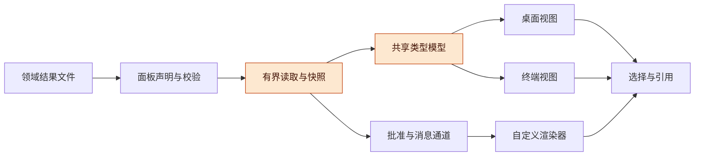
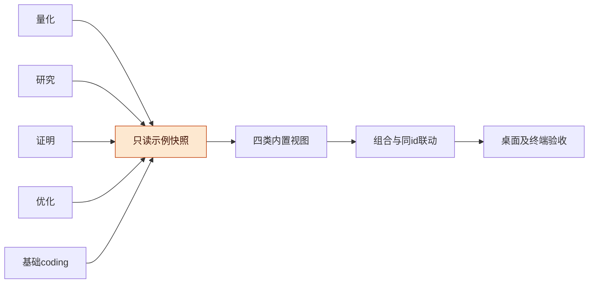
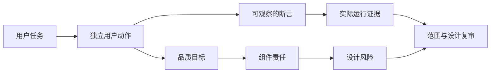
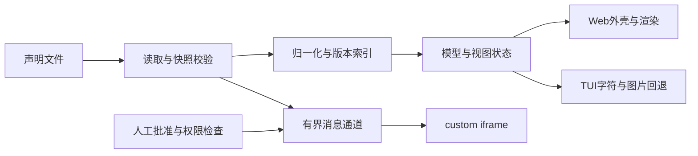
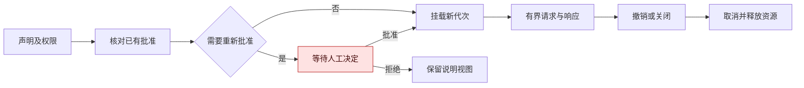
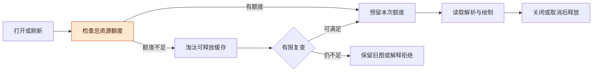
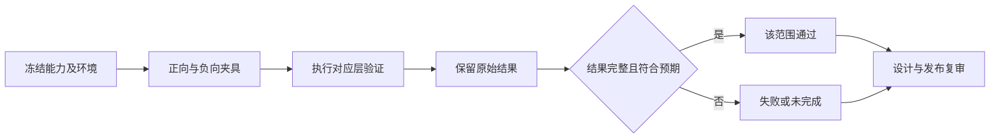
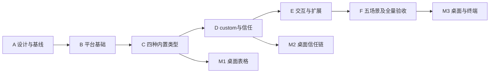
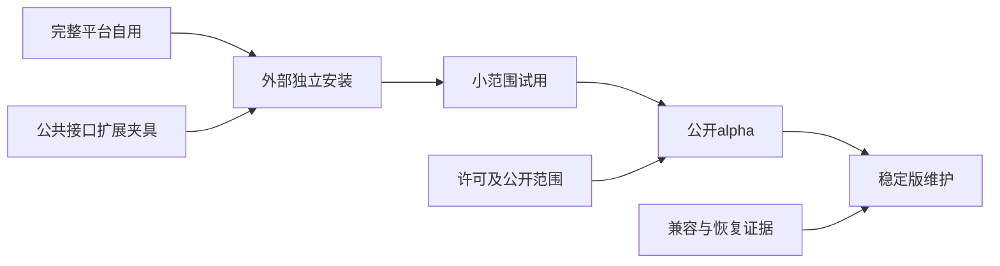

# DSH 通用面板平台整体设计讨论稿 v0.1.0

> 公开整理版；源版本：0.1.0；源提交：5d2e1156cc418704334255eb413358c5fe9a42d1；整理日期：2026-11-06。历史版本，未重新运行或复测。内部实例、个人原话与私有来源未公开。

当前主稿为 [v0.1.2](<../overall-discussion.md>)。此处保留历史讨论，后续决定以当前主稿为准。

2026-11-02 · Codex

## 版本与范围

完整通用面板平台与五类示范继续作为首批目标；本版将交接包中的实现边界细化为可核对的读取、资源、终端和验收规则，再据此冻结契约与任务卡。

- 版本：v0.1.0，首次按统一讨论稿格式编号；核对Claude交接zip，细化快照、资源准入、跨端适配与五类场景，补充架构图及待证命题；此前未编号稿的统一整理及场景增补分别见`fbdda75`、`9e8975c`。后续修改按补丁号递增，既有文件路径保持稳定。
- 主线：用户任务与五类场景 → ACC品质责任 → 数据和执行边界 → 资源与验收 → 实施与开源演进。
- 状态标记：【已确定】来自当前范围决定；【已核对】指文件比较或源文件检查；【设计提案】需冻结到契约后实施；【待验证】尚无对应产品运行证据。设计风险不等于测试状态。

实现依据仍为Claude的交接基线`943ae2dd944592459c5d828dc63c1a67e93fc652`（原始来源未附）。本轮核对的仓库主分支为`9e8975c`，交接压缩包与该交接基线逐文件一致，不能把压缩包写成一次新的产品提交。日期采用America/Los_Angeles；后续修订由Git历史记录。

本文合并平台实现建议、ACC设计分析、开源演进方案及开源研究索引，是当前讨论的统一入口。仓库目前有交接包、画板导出和探针，尚未实现产品；本文中的组件路径、协议修订、资源预算和验收设计均不等于已经落地。

## 阅读导航

先读范围、五类场景和本版核对结论，再按需要查看架构、契约、资源及实施设计。

- [目标、范围与讨论规则](#scope)
- [用户任务和界面原则](#journeys)
- [首批五类示范场景](#scenarios)
- [ACC品质与组件](#acc)
- [架构、数据与状态](#architecture)
- [契约修订与信任](#contracts)
- [快照、初始化与终端适配细化](#contract-details)
- [内存与CPU设计](#resources)
- [增减功能的依据](#tradeoffs)
- [验证方法与现有证据](#verification)
- [任务卡与实施时间](#delivery)
- [个人使用到公开开源](#opensource)
- [阶段A冻结清单](#decisions)
- [附录A：47项能力与风险](#capabilities)
- [附录B：34项开源研究索引](#research)
- [风险与开放问题](#open-risks)
- [待证命题与下一步](#next-evidence)

## 1. 目标、范围与讨论规则

目标是让用户或模型用一份 `.panel.json` 描述数据与展示方式，在 DSH 桌面和终端中获得可理解、可交互、资源有界的面板。先供个人日常使用，再逐步成为别人可以安装、扩展和维护的开源系统。

**图 1　总体架构 · 通用平台承接领域产物**

从左到右，领域项目提供只读产物，平台处理有界读取和通用展示；代码执行经过独立的批准与消息通道。

| 状态 | 当前内容 |
|---|---|
| 已确定的方向 | 先完整实现通用面板平台 P-01–P-15，再接工作台；首批示范覆盖量化、研究、证明、优化、基础coding；内存、CPU、视觉和功能共同验收；ACC从设计阶段开始用于范围取舍。 |
| 沿用的交接边界 | 独立DSH插件；四种内置类型、custom、第三方注册、compose和TUI；只读用户数据；使用宿主React与原生present；零新增运行时依赖，开发依赖边界以交接包为准。 |
| 本稿提出的设计 | 稳定身份、快照、背压、生命周期、权限扩大规则、版本与迁移、公共接口边界和验收顺序。需要同步到正式契约和任务卡后实施。 |
| 尚未取得的证据 | 完整产品行为、真实桌面及TUI验收、可信内存基线、完整解析与渲染负载、升级和外部安装结果。 |

完整首版包括 `table`、`timeline`、`graph`、`space` 四种内置类型；`compose` 组合子面板，`custom` 运行经批准的网页渲染器，第三方插件可注册类型。图表、文档、媒体、实时四族暂通过扩展提供，八族分类不代表首版有八套内置实现。

本期不加入插件市场、多租户、云同步、在线底图服务、IFC／DWG解析或数据写回。运行条及项目业务留给后续工作台适配；上限样例保留在P-14，不能把演示样例理解为新增通用3D内核。

原始交接的[契约](<../../handoff/panels/CONTRACT.md>)、[任务卡](<../../handoff/panels/BOARD.md>)和[画板](<../../handoff/panels/design/README.md>)继续保留。发现不一致时先在本稿登记取舍，再同步契约、卡片依赖及允许文件，之后写实现；讨论稿不会静默覆盖执行契约。画板里的市场与运行条文案依当前任务范围解释。

个人项目分工沿用：Claude提供设计并对照画板审阅，Codex负责方案细化与实现，项目维护者决定范围并完成真实桌面／终端验收。模型审阅、静态检查和产品行为验证分别记录。

借鉴Core经验，采用四条通用原则：接口存在与界面可用分别判断；文档随实际代码版本；测试结果必须绑定环境与能力；升级程序与恢复持久状态分别验证。本稿仅保留这些通用经验，不携带其他项目的内部材料。

## 2. 用户任务和界面原则

用户应在桌面和终端识别同一份数据、同一个实体及同一种结果状态；视觉表现随载体调整，核心任务保持一致。

| 用户任务 | 预期路径与可辨认结果 |
|---|---|
| 查看数据 | 用户或模型准备面板声明及引用文件，通过文件预览或原生present进入面板；外壳显示当前数据状态与范围。 |
| 探索内容 | 在内置类型中排序、筛选、定位或测量；选中始终关联稳定实体，检查器呈现相应字段。 |
| 文件更新 | 变化通知触发有界重读；读取失败时保留可辨认的旧画面并标为stale，恢复后只接受最新结果。 |
| 与模型协作 | 模型查询写法、校验配置、读取本会话选中或点亮要素；用户引用选中内容时，现有草稿和引用胶囊受到保护。 |
| 使用custom | 外壳先说明渲染器身份和权限；人工批准后运行，撤销立即卸载并取消关联活动。 |
| 使用终端 | 一个入口发现并切换面板，以字符、图片或摘要表达相同数据语义；custom不在终端执行HTML。 |
| 安装与维护 | 在明确宿主版本和profile中安装指定制品，能查版本、排障、升级、恢复与卸载。 |

统一外壳包含标题、工具条、检查器和状态反馈；颜色使用设计变量，随宿主明暗主题切换。窄栏、右栏、宽视图使用同一数据版本，尺寸变化只调整视图，不重新读取整份数据。美观通过一致的层次、间距、信息密度和反馈体现；静止画面不需要持续动画。

| 状态 | 给用户的含义 |
|---|---|
| loading | 正在首次读取，说明当前阶段。 |
| empty | 数据已校验但没有要素，明确来源。 |
| error | 当前没有可用画面，说明问题与可定位的配置位置。 |
| stale | 本次更新失败，仍显示上一版本；明确旧版本与失败原因。 |
| ready | 当前声明和数据版本正常呈现；容量截断另行明示。 |

桌面与TUI保持数据身份、选择和状态语义一致，各自采用适合的交互方式；不承诺终端复刻浏览器画面。中文、emoji、组合字符、窄终端和键盘导航都进入验证设计。

### 2.1 首批五类示范场景

2026-11-02确定：以现有量化工作目录中的工作方式为参考，将**量化、研究、证明、优化、基础coding**全部纳入首批示范。它们既是日常使用的样板，也是检查平台是否足够通用的验收材料。当前只细化设计，示例文件、数据适配器和场景测试尚未实现。

每个场景交付可独立打开的示例包：面板声明、可分享的合成数据、操作说明、预期结果和失败变体。平台负责展示、选择、引用和状态；实验计算、证明检查、优化搜索、代码执行及Git操作由原项目或宿主负责。真实项目接入时，由使用者主动导出必要的只读快照；首版示范不依赖扫描整个量化仓库或启动后台任务。

| 场景编号 | 用户要完成的事 | 首批示例题材 | 默认面板组合 | TUI主要表达 |
|---|---|---|---|---|
| SC-QUANT 量化 | 比较候选、基线与不同检验窗口，解释保留或拒绝的原因 | 合成资产上的因子／预测实验复盘，包含成功、失败和未到期评价 | 实验表格＋实验时间线；收益或误差曲线作为可选custom | 实验列表、窗口与指标摘要、判定理由和选中项字段 |
| SC-RESEARCH 研究 | 从问题追到假设、来源、证据、分歧及下一步 | 一个有竞争解释、相互冲突证据和未解决问题的小型研究专题 | 主张表格＋证据关系图＋研究事件时间线 | 问题／主张列表、依赖邻接列表、来源定位和证据摘要 |
| SC-PROOF 证明 | 检查命题的假设、引理依赖、证明缺口和反例 | 小型数学命题依赖图；分别给出推导稿、有限检查记录和反例 | 命题表格＋引理关系图；检查记录使用表格或时间线 | 命题及假设摘要、依赖列表、检查方式与未解决项 |
| SC-OPTIMIZE 优化 | 在约束下比较质量、耗时和内存，判断改动是否值得保留 | 同一任务的参数／算法候选和资源对照，保留失败、超时与不可比试验 | 试验表格＋二维参数点图＋试验时间线；收敛曲线作为可选custom | 候选排序、约束满足情况、基线差异、资源及测量范围 |
| SC-CODING 基础coding | 从任务定位改动和检查结果，确认问题是否修复 | 一个小型合成代码项目的修复前后快照，包含失败测试、修复和未运行检查 | 检查结果表格＋检查时间线；任务／文件／检查关系图 | 任务与文件列表、诊断位置、检查结果与提交版本 |

**图 2　示范场景共享结构 · 五类任务共用展示能力**

五条领域路径先汇入可复现快照，再通过同一组平台能力验收；领域算法和任务执行保留在来源项目中。

这里的“优化”先按参数、算法和程序资源优化设计，覆盖数值效果与工程成本；具体首个优化题目留到场景卡确定。研究与证明共享证据结构，但保留各自口径：资料支持一个观点，不等于该数学命题已经证明。基础coding首先服务阅读改动和核验结果，编辑、diff浏览和运行继续复用宿主入口。

### 2.2 每个场景的首条操作路径

**量化：比较一次实验。** 打开实验表，按检验窗口筛选，选择一条实验，与同口径基线比较，再引用该实验及判定理由。表格和时间线以同一个`run_id`联动；检查器列出数据版本、观测时点、信息可用时点、窗口、指标定义、费用假设和判定来源。尚未到期或缺失的指标显示原因，不能按零排序。切换窗口不覆盖旧实验，工程检查通过也不能替代预测或策略有效性的证据。

**研究：检查一项主张的依据。** 在主张表选择`claim_id`，关系图点亮相同主张，用户展开邻域查看支持、反对、依赖和未决问题，再检查来源定位与摘录。关系种类由示例明确提供，平台不自动推断“支持”。文献正文复用宿主文件预览；缺少安全定位入口时呈现相对路径和位置文本。某条来源缺失时保留其引用和缺失状态，不能删除反对证据后把画面显示为一致结论。

**证明：定位一个尚未闭合的依赖。** 选择命题，查看明确列出的假设、所需引理及各自版本；展开依赖后，检查缺口或反例的范围。证据分别标注为推导稿、有限枚举／数值检查、人工或模型审阅、形式工具检查，并附实际执行状态和适用范围；这些是不同证据类型，不是一条自动晋级的“已证明”进度条。生产者声明依赖已变更而尚未复核时，面板必须展示该状态；逻辑影响的判断由研究者或专用工具提供。图上的路径只表示声明的依赖，不能充当证明。

**优化：比较一次改进的得失。** 在候选表按可行性和目标筛选，选择`trial_id`，二维图点亮同一试验，再查看参数、约束、基线、重复次数、测量环境、质量、墙钟时间、CPU时间和峰值内存。二维坐标必须注明对应参数、变换及单位；投影只展示选定维度，不能暗示完整高维搜索空间。不可比环境、缺少测量或超时分别呈现；差异小于既定噪声／判定范围时显示“证据不足”，不自动授予“更优”。最优候选和接受结论由生产者给出，平台不执行搜索或代替统计判断。

**基础coding：核对一次修复。** 打开任务快照，选择一条`check_id`，关联时间线与关系图中的同名检查节点，查看所属文件、诊断位置、执行命令摘要、代码版本、运行环境和原始结果定位。文件节点使用自己的id；检查到文件的关系通过显式边表达，不将同一个检查误当成文件。未运行、执行失败、测试断言失败、通过和环境不完整分别显示；代码版本已经变化时，旧通过结果保留其版本。用户可引用诊断交给宿主继续工作，面板本身不执行命令、提交或安装依赖。

五类场景沿用同一外壳和视觉规则：主区域先呈现任务对象，辅助区域呈现关系或过程，检查器解释当前选择；状态同时提供文字与色彩，窄视图允许收起辅助区域。桌面和TUI使用相同实体id及快照，TUI通过列表、摘要和键盘完成核心检查。终端不执行custom，未具备图片能力时仍可读到相同版本的基础指标与限制；对话引用按宿主实际能力提供，不能依赖当前TUI不支持的`sendToChat`。

### 2.3 示例的数据约定与平台边界

以下字段是**示例数据及说明文件的草案**，不是已经增加到`PanelSpec`的顶层字段，也不是五种新的内置类型。适配器把各项目的结果投影为现有表格、节点／边、时间项或二维要素。先用样例验证哪些字段真正共用，再修订公共契约，避免提前做成通用研究数据库。

| 约定 | 示例需表达的内容 | 使用边界 |
|---|---|---|
| 身份 | 场景、实体类型、稳定`entity_id`及其领域id；关系引用明确的端点 | 主张、实验、试验、文件和检查不得因标签相同而混用身份；排序不改变实体id。 |
| 版本 | 示例格式版本、`dataset_revision`、源产物版本、生成时间和代码版本（适用时） | 示例声明的业务版本与Data层快照标识分开；时间戳不能替代内容身份。 |
| 来源与证据 | 相对文件位置、记录id或段落／行位置、证据类型、产生者、检查方法及结果范围 | 不默认抓取外链或加载整篇文档；不存在或无权限时显示可定位的缺失信息。 |
| 业务状态 | 结果值、执行状态、判定理由、缺失原因和是否需要复核 | `ready`只代表面板呈现正常；不能变成“研究成立”“证明完成”或“优化成功”。 |
| 比较口径 | 单位、时区、窗口、目标方向、基线、约束、环境及适用范围 | 原始值与展示格式分开；不同口径不直接排名，空值不转换为零。 |
| 规模与覆盖 | 原始记录数、实际展示数、采样／过滤／截断原因和完整产物位置 | 只展示摘要时明确范围；被截断的日志或证据不能冒充全部材料。 |

领域字段按需出现：量化增加数据可用时点、分割窗口、费用和评价口径；研究增加问题、假设、竞争解释和证据关系；证明增加假设、命题／引理版本、检查类型和结论范围；优化增加目标、参数、约束和成本；coding增加文件／代码版本、诊断位置和检查结果。平台解释展示所需的结构，领域有效性由生产者和使用者判断。

`compose`第一版仍只把选中项点亮到目标面板的**同id要素**。场景要联动时先导出同实体的两个视图；一对多关系留在关系图或检查器，不擅自扩充为跨表查询、业务关联引擎或自动执行动作。表格的显式id映射仍须按第4.1节修订契约；当前按行号补id的交接写法不足以保证刷新和排序后的这些场景。

共享结果应从一次导出的完整业务快照生成，相关文件标明相同`dataset_revision`；示例先使用版本固定的文件，刷新用例再替换声明入口。发布不完整或版本混杂时必须可识别，生产者的“导出完成”声明不能替代Data层的读取一致性。具体多文件校验与切换规则在阶段A冻结，不在示例里私加一套运行时存储。

资源设计从示例开始遵守第6节：打开哪个场景才读取哪个场景；只读声明文件，不自动递归读取源码、行情、论文或日志全集；纯文本摘要和有界视图满足核心路径后，用户再选择custom。隐藏面板停止主动绘制／轮询，组合面板共享总额度。优化示例中的耗时和内存是合成业务记录，**不能充当本平台真实性能测量结果**。

### 2.4 示例包、来源与细化顺序

计划在`samples/scenarios/`下设置`quant/`、`research/`、`proof/`、`optimize/`、`coding/`五个目录，每个包含`README.md`、入口`*.panel.json`、`data/`、`expected/`及`variants/`。这是待实施的目录约定，当前没有创建这些样例。公共外部扩展夹具继续独立验证注册接口；不能用五个内置类型组合代替第三方接入验收。

`README.md`说明用户问题、打开方式、操作路径和TUI回退；`data/`使用可复现的合成记录；`expected/`列明每步可观察结果、判断口径与来源；`variants/`保存空数据、损坏引用、旧版本、失败检查等反例。声明路径均相对示例目录，样例不依赖作者机器、凭据或量化工作树。初次下载只需要小数据；较大规模夹具按已登记参数在本地生成，不把大文件放进默认安装包。

设计取材已只读核对量化仓库的`research/README.md`、`research/hypotheses/README.md`、研究线设计入口、因子发现模块说明、检查目录及独立研究工作树的`docs/studies/ph-complexity/README.md`。借用的是“假设—产物—证据—判定—修正”的工作结构；已有文件中的研究结论和历史通过记录没有迁入示例，也不据此声称场景实现或重新验证。真实数据适配与公开合成样例分别维护，公开材料不要求读者取得私人仓库。

细化建议先完成量化与coding的场景卡，用它们核对表格、时间、来源、版本和结果状态；随后将研究与证明的证据关系、依赖和复核状态细化，最后固定优化的比较口径和资源测量表达。这个顺序只用于尽早暴露公共契约问题，五类均属于首批示范。每张卡交付“用户问题、字段与映射、画面布局、操作路径、失败变体、ACC关联、验收记录”，再同步任务卡后实施。

### 2.5 五张场景卡的首版数据切片

先为每类场景规定一条核心记录及其关联证据，便于确定画面和验收；字段是领域示例的建议，不全部提升为公共平台字段。

| 场景 | 一条主记录与必要信息 | 关联产物 | 第一组负向变体 |
|---|---|---|---|
| SC-QUANT | 一行一个`run_id`：候选、数据版本、信息可用时点、检验窗口、基线、固定指标列、单位／费用、执行状态、判定理由 | 同id实验时间项、指标解释和结果来源定位 | 相同候选但窗口不同；未到期指标；失败实验；生产者标记数据时点不合格；刷新后旧引用。 |
| SC-RESEARCH | 一行一个`claim_id`：所属问题、主张文字、假设／竞争解释、研究状态及修订版本 | 来源条目、支持／反对／依赖边、事件记录 | 反对证据仍存在；来源文件缺失；引用定位失效；主张更新而旧证据尚未复核。 |
| SC-PROOF | 一行一个命题`claim_id`：假设集合、结论、引理引用及版本、缺口说明 | 证据条目分别列`kind`、执行状态、工具／审阅者、输入版本、范围、产物位置 | 只有有限枚举；反例适用范围不同；依赖版本变化；形式工具未运行；被裁剪的依赖图。 |
| SC-OPTIMIZE | 一行一个`trial_id`：参数、目标方向、约束、基线、输入／环境版本、质量与资源指标、比较资格及原因 | 同id二维要素、试验时间项、独立测量记录 | 不可行候选、超时、缺内存测量、不同环境、差异证据不足。 |
| SC-CODING | 一行一次检查执行，`check_id`唯一：任务、代码版本、检查名称、命令摘要、状态、诊断位置和产物 | 文件节点、任务／检查关系边、同id执行时间项 | 同一检查在两个代码版本的不同结果；未运行；断言失败；环境错误；原始输出缺失。 |

量化首版采用固定指标列，避免同一实验的多条指标记录共用一个行id；若以后改成长表，指标记录要有自己的id，`run_id`只是关联字段。coding同一检查名称的多次执行也不能共享行id。领域里的“同一个逻辑对象”与本次快照中的“同一条记录”分别命名，跨视图联动只使用事先明确的实体身份。

场景卡的画面草图应分别给出窄栏、宽视图和终端核心路径，标明哪些信息始终可见、哪些在检查器展开；按现有主题变量表达，避免每类示范形成一套配色和工具条。先交付能解释结果与失败的内置视图，再为确有价值的曲线安排custom路径，所有可选路径单独计工作量和验收证据。

## 3. ACC品质目标与组件责任

ACC在设计时回答三件事：用户能发起什么动作（Capability）、动作应具备什么品质（Attribute）、由哪些组件负责（Component）。用户价值和成本在第7节另行判断；实际执行结果在质量记录中维护，不写进风险列。

**图 3　ACC与验收的关系 · 设计责任与运行证据分开**

上路定义品质与责任，下路获取运行证据；二者共同支持复审，测试通过不会自动把设计风险改成绿色。

### 3.1 六项品质目标

| Attribute | 简写 | 一句话定义 | 设计时具体检查 |
|---|---|---|---|
| Efficient（资源节制） | E | 在声明的负载范围内约束内存与计算，工作量随实际数据变化和可见内容增长，资源随生命周期回收。 | 总缓存、解析峰值、在途字节、后台活动、计算取消及组合额度；分别测宿主与插件增量。 |
| Usable（清晰易用） | U | 在桌面与终端各自的能力范围内，提供一致、清楚且可操作的视觉层次、状态反馈与导航。 | Claude 画板、明暗主题、窄宽布局、信息密度、选择反馈和终端键盘；回退方式明确，不把同一画面作为跨端要求。 |
| Reliable（结果可靠） | R | 在读取、交互、刷新和版本切换中保持正确的数据身份，并以明确状态处理失败和恢复。 | 文件快照、实体 id、单位与时区、过期结果、stale 标识、损坏状态恢复；不以画面流畅代替结果正确。 |
| Controllable（边界可控） | C | 文件访问、会话状态和代码执行遵守明确的身份、权限与人工授权边界。 | 只读原件、工作区与profile边界、权限扩大、撤销、草稿保护；宿主插件与custom分别说明，不能承诺任意恶意代码的硬隔离。 |
| Extensible（可扩展） | X | 面板内容和类型可通过有版本的公开格式或注册接口扩展，通用平台不依赖具体工作台业务。 | 内置、custom、第三方类型和compose使用一致的公共语义；真实外部示例无需导入内部模块。 |
| Maintainable（可维护） | M | 单个维护者和外部使用者能够依据明确版本、配置和证据复现安装、定位问题及恢复升级。 | 干净构建、支持矩阵、有界诊断、发布范围、持久格式、回退；不依赖作者的目录和隐式环境。 |

这些是设计目标，当前没有宣称相应品质已达标。内存、CPU、交互延迟等具体预算在阶段 A 固定负载后确定；现有容量上限只是输入条件。E的硬约束适用于平台控制的读取、队列、缓存和内置计算，第三方宿主插件须遵守合作式契约，不能把它解释为平台能强制限制任意第三方代码。属性出现取舍时，将双方影响写清，不能用单一总分抵消权限、数据正确性或明确的资源上限。

### 3.2 十二个逻辑组件

以下模块共同组成一个插件，不代表十二个部署服务。所有代码位置均为计划路径，不能据此宣布实现或正式文档检查通过。DSH、Cordis、React及dsh-TUI是外部依赖，Host只承接适配。

| Component | 职责与边界 | 计划代码位置 | 现有任务依据 |
|---|---|---|---|
| Host | 宿主接线、可选服务和作用域；不承载业务状态副本 | `index.js`、`client/app.js` | [P-01](<../../handoff/panels/tasks/P-01-skeleton.md>) |
| Spec | 面板格式、结构与语义校验及类型描述 | `shared/spec.js`、`schema/panel.schema.json` | [P-02](<../../handoff/panels/tasks/P-02-spec.md>) |
| Data | 声明文件读取、路径检查、快照、解析及取消 | `server/data.js`、`server/paths.js`、`shared/parse.js`、`client/data.js` | [P-03](<../../handoff/panels/tasks/P-03-data.md>) |
| Shell | 外壳、主题、状态和视图生命周期；不重复保留整份数据 | `shared/panel-state.js`、`client/shell.js`、`client/states.js`、`client/theme.js` | [P-04](<../../handoff/panels/tasks/P-04-shell.md>) |
| Builtins | 表格、时序、关系、二维空间的纯模型及渲染；各类型为子模块 | `shared/families/`、`client/families/`、`client/canvas.js` | [P-05](<../../handoff/panels/tasks/P-05-table.md>)、[P-06](<../../handoff/panels/tasks/P-06-timeline.md>)、[P-07](<../../handoff/panels/tasks/P-07-graph.md>)、[P-08](<../../handoff/panels/tasks/P-08-space.md>) |
| Frame | custom页面组装、消息通道及挂载生命周期 | `client/sandbox.js`、`shared/frame-doc.js`及P-09列明的桥接文件 | [P-09](<../../handoff/panels/tasks/P-09-sandbox.md>) |
| Trust | 批准、撤销及实际持久化的信任记录 | `server/trust.js`、`client/run-gate.js` | [P-10](<../../handoff/panels/tasks/P-10-trust.md>) |
| Interaction | 工具、选择、点亮及对话引用 | `server/tools.js`、`server/selection.js`、`client/quote.js` | [P-11](<../../handoff/panels/tasks/P-11-model.md>) |
| TUI | 一个终端入口、发现、导航、字符和图片回退 | `server/tui.js`、`shared/lines.js` | [P-12](<../../handoff/panels/tasks/P-12-tui.md>) |
| Registry | Node／Web类型注册与能力一致性；第三方代码信任由宿主管理 | `server/registry.js`、`client/registry.js` | [P-13](<../../handoff/panels/tasks/P-13-types.md>) |
| Compose | 子面板组装、联动及总资源协调；不另建业务数据层 | `client/compose.js` | [P-13](<../../handoff/panels/tasks/P-13-types.md>) |
| Delivery | 构建、制品清单、配置、版本身份及升级恢复支撑 | `scripts/build.mjs`、`scripts/release.mjs`、`config/hyperparams.yaml` | [P-01](<../../handoff/panels/tasks/P-01-skeleton.md>)、[P-15](<../../handoff/panels/tasks/P-15-integration.md>) |

共享资源额度、取消和失效规则由这些模块承担；辅助文件是否拆分由契约修订决定，不为了组件图额外创建运行时层。[附录A](#capabilities)逐项记录能力、品质责任、设计风险和任务卡。

## 4. 架构、数据所有权与状态

平台只持有展示所需的数据和交互状态；业务事实归来源项目，执行与会话权限归宿主。

| 边界 | 持有的事实与职责 |
|---|---|
| DSH／Cordis | 会话、模型执行、宿主权限、原生交付及插件生命周期。 |
| dsh-panels | 面板声明、声明过的数据读取、类型模型、小型交互状态、渲染及custom批准。用户数据原件仍由来源持有。 |
| 工作台及其他消费者 | 项目与任务业务、工作树及业务生命周期；通过面板格式或公共扩展接口使用平台。 |

**图 4　数据通路 · 共享语义而非跨进程共享堆**

从声明到视图的每一步都绑定数据版本；custom只通过受控通道取得声明的数据，不能借共享模型绕过权限。

共享的是纯函数和数据语义，Node与浏览器不共享堆内存。避免两边长期保留多份完整数据；TUI按需取得元数据、摘要和可见窗口。解析、索引、筛选和布局按输入版本失效，滚动、hover、选中只改变必要视图。

### 4.1 身份与版本

建议将调用身份、工作区、面板路径、数据版本和挂载代次分开。调用身份来自宿主，不能相信客户端自己声明的session。显式实体id优先；缺省行号只在同一数据快照内稳定，不能用排序后的显示行号当实体身份。

读取协议需要不透明的快照标识与期望版本，不能仅依靠mtime和大小证明内容相同。每个异步任务绑定输入版本及取消信号；旧请求、旧布局和旧iframe消息不能覆盖当前状态。文件持续变化时有限重试后转为stale，避免无限重读。

PanelSpec、frame消息和注册接口各有清楚的公共版本边界；包版本单独管理，内部函数不自动成为公共API。未知协议主版本、必需能力和安全权限明确拒绝；未知可选展示字段可提示。第三方类型id需要命名空间与所有者规则，拒绝覆盖内置类型。

### 4.2 状态与生命周期

| 状态／资源 | 所有者与保存方式 | 失效或释放时机 |
|---|---|---|
| 面板声明与数据原件 | 用户工作区文件；平台只读 | 文件新版本替代读取快照，不静默改写原件。 |
| 解析数据与索引 | 当前活动数据版本；受总预算约束 | 来源变化、取消、面板关闭或缓存淘汰。 |
| 选择、点亮和视图 | 按会话及面板隔离的内存状态；LRU有界 | 身份无法对应、重启、注销或淘汰；不新增跨重启视图持久化。 |
| custom的save状态 | 有界的内存恢复快照 | 新挂载核对版本与代次；不能借此继承授权。 |
| 批准记录 | 实际落盘的trust格式，单独版本化 | 权限扩大、迁移不兼容或身份变化时重新判断；撤销立即生效。 |
| 订阅、请求、Worker、画布资源 | 创建模块及宿主effect持有 | 隐藏停止主动工作，关闭／卸载取消与释放；恢复可见时只处理最新版本。 |

批准键应包含实际profile／用户边界、真实工作区、渲染器身份及权限范围。多个profile不共享批准；如果不同进程共写一份记录，需要协调写入，原子rename本身不能避免丢更新。格式升级失败保留原件，降级到未知授权格式时重新批准。复制面板或工作区不复制执行授权。

后续工作台成为公共接口的真实消费者：会话地图可投影为graph，运行时间线可投影为timeline，实时内容仍保留自身生命周期。平台不导入工作台业务，也不另建一套会话运行时。

## 5. 开工前的契约修订与执行信任

本节是对原交接契约的修订提案，尚未直接改变接口。先按ACC确定范围，再同步[CONTRACT.md](<../../handoff/panels/CONTRACT.md>)和各卡的允许文件。

| 关联卡 | 现在的缺口 | 建议规则 |
|---|---|---|
| P-02/P-03：外部数据 | `data` 可为多文件，但 CSV 如何提供 columns、多个 DataRef 如何映射、内联与外部字段怎样合并尚不完整 | 定义归一化后的 Dataset；DataRef 的 id 唯一，文件与类型输入显式对应；明确字段冲突、编码、CSV 表头／多行字段、空值与类型推断规则。binary 不进入内置 JSON 解析。 |
| P-02/P-05/P-11/P-13：身份 | 行号／数组下标只保证同一数据版本内稳定，重排或刷新后未必指向同一对象 | 明确 `encoding` 的映射方向及身份字段；显式 id 优先，缺省 id 绑定来源行与数据版本。选择、点亮带 session、panel、dataVersion；刷新后无法对应的选择明确失效。 |
| P-02：校验尺子 | 契约要求 ajv 与手写 validate 对全部样例判定一致，同时包含图边引用和起止比较 | 拆成结构校验与语义校验；schema 对照结构结果，跨字段约束用独立预期夹具／参考实现核对。若使用 Ajv 扩展，写明扩展与生成逻辑，不能把同一段校验重复执行称作独立验证。 |
| P-03：一致读取 | 版本只用 `mtimeMs-size`，缺少期望版本入参、重读上限与读取期间的文件身份约定 | 明确快照 token／expectedVersion、文件身份核对、offset/length 非负整数、EOF 及并发上限。持续变化时有限重试后进入 stale，防止一直从头读取；替换、同大小改写和符号链接变化加入夹具。 |
| P-03/P-09：路径权限 | `permissions.read` 与“renderer 及其同目录资源”的允许范围没有完全对齐 | 分开声明数据文件、渲染器静态资源和运行时 need 权限；规范化到工作区内的真实路径。每条服务端读取重新确认权限，不能让“同目录”成为任意读文件的入口。 |
| P-04/P-11：刷新 | `refresh.everyMs`、可见时点亮轮询与“不开常驻定时器”需要统一解释 | 数据变化优先通知；可见定时刷新只由一个协调器持有，设最小间隔和退避、合并相同请求。隐藏后停止主动读取和绘制，保留轻量失效标记，恢复时只取最新版本。 |
| P-05/P-07：重计算 | 虚拟 DOM 和每帧布局预算约束了部分绘制，没有约束解析、排序、筛选、布局总时长与取消 | 增加计算取消、输入版本、工作量和时间上限；排序保存行索引，避免复制整表对象；重任务用经验证的 Worker 或分段处理，过期结果不得覆盖新版。布局只在结构变化时重算。 |
| P-06/P-08：领域语义 | 数字时间单位、时区、线／面坐标形状、图片定位和异常地理坐标未完整定义 | 明确时间单位与时区、轨道分组；给出 points/lines/polygons/image 的规范样例和非法样例。测距与显示投影分别定义；对经度跨界、极点和无效坐标有确定行为。 |
| P-09：消息通道 | 单条大小与每秒条数已有限制，但缺总在途字节、响应关联及背压 | 每次挂载带 generation、requestId／seq；接收端处理完再发 credit/ACK，限制队列总字节和并行 need，关闭或换版本立即取消；旧 iframe／旧请求结果全部失效。`transfer` 后明确 buffer 所有权。 |
| P-09/P-10：信任 | 默认按路径持续批准，内容变更不重问；扩大 read 权限和相对路径键的含义尚未明确 | 当前默认可以作为“信任此工作区该渲染器路径”的模式，但界面应准确说明持续授权。键规范化为工作区真实根＋根内渲染器路径；网络或读取能力扩大须重新批准，撤销立即卸载并取消读取。内容哈希批准作为更严格选项留待讨论。 |
| P-11：工具与引用 | 选中／点亮接口、状态键与草稿追加的完整请求响应还未列全 | 工具身份来自宿主调用上下文；跨会话拒绝。记录 panelPath、数据版本与稳定 id；草稿非空继续用复制回退，不假设存在安全追加 API。限制选择状态总量及文本大小。 |
| P-12：终端成本 | 同一份数据可能被理解为 Node 也全量解析；中文双宽没有覆盖组合字符等情况 | TUI 默认读元数据、摘要和可见窗口，custom 不执行 HTML；扫描按目录身份去重、有界并可取消。复用宿主文本处理能力，补中英文混排、emoji、组合字符和 40/80/120 列测试。 |
| P-13：注册与组合 | Node／Web 各自注册，缺少类型能力如何对齐；compose 的相对路径与互相点亮未定义 | 用可序列化的类型描述对齐 id/schemaVersion/family/capabilities，组件分别注册。明确子面板基准目录、计数与总预算；选择转发去重，避免互相点亮形成循环。 |

JSON Schema 可独立核对结构规则；跨字段比较若采用 Ajv 的 `$data`，需要显式启用扩展，并不自动解决图边引用等任意业务约束。[Ajv 官方说明](https://ajv.js.org/guide/combining-schemas.html#data-reference)。上述“分两层校验”是针对 现有契约第 3 节（原文引用，未随公开文档附带） 和 [P-02](<../../handoff/panels/tasks/P-02-spec.md>) 的设计建议。

### 5.1 两类代码执行边界

custom通过受限iframe、文件代理、消息校验和人工批准运行；第三方注册插件直接运行于宿主，遵守宿主的安装与信任模型。平台不能用普通JavaScript接口强制限制任意宿主插件的CPU、内存或文件访问。

当前交接默认按渲染器路径持续批准，内容变化不重问。本稿建议保留此模式作为明确的工作区信任选择，同时将读取和联网权限扩大纳入重新批准；按内容哈希批准作为更严格候选，需比较模型频繁改文件时的操作成本。模型没有批准接口。

CSP与sandbox是具体约束，不构成运行任意恶意代码的完整隔离。文件代理每次读取重新核对真实路径、声明范围和会话身份；消息同时校验来源、代次、大小和并发额度。撤销后拆除iframe、取消读取并拒绝旧消息；不能只改按钮状态。

**图 5　custom生命周期 · 批准、挂载与撤销相连**

沿箭头检查批准和资源是否绑定同一挂载代次；撤销后的旧请求不能通过重新挂载恢复权限。

### 5.2 公共接口与恢复约定

先公开最小而完整的PanelSpec、frame协议、类型注册与模型工具边界；实验期明确变更和迁移方式。视图仍只在内存，真正持久化的批准记录才需要格式迁移。暂不新增通用状态数据库、永久视图历史或一键导入导出系统。

迁移用户文件默认生成副本；安装、清理缓存、撤销授权、卸载插件及删除用户原件分别处理。原P-15指定的版本号应按实际成熟度讨论，预发布标签不能代替验收。公共API与版本语义参考[SemVer](https://semver.org/)。

### 5.3 读取、身份与初始化的可执行约定

读取应先绑定声明与权限，再取得数据版本，最后把就绪的数据提交给视图。下面是待冻结的协议语义；字段名用于讨论，不表示原`CONTRACT.md`已经接受新接口。

| 对象 | 建议的最小语义 | 失败或失效时的结果 |
|---|---|---|
| 面板声明 | `specRevision`绑定本次解析的声明内容、数据引用及权限范围；会话身份由宿主调用上下文核定 | 声明变化使相关请求和挂载代次失效；不能让客户端自报`sessionId`成为权限依据。 |
| 数据引用 | 数据源id唯一，路径相对声明位置；角色到字段的映射方向明确，例如身份角色指向来源的`run_id` | 引用冲突、缺少必需字段和同一数据集内重复实体id在入模前报错；不能后到覆盖先到。 |
| 读取会话 | `snapshotId`绑定实际来源身份和版本，分块请求带期望版本；所有偏移、长度及累计字节均有界 | 版本冲突返回`changed`，取消同代请求；有限重试后保留旧画面为stale，无旧画面则error。 |
| 选择与点亮 | 持有会话、面板、数据版本、实体类型及id；缺省索引包含原始来源位置和版本，不用显示行号 | 排序不换实体；跨版本无法确认对应关系时清除选择并说明，不把旧索引解释成新对象。 |
| iframe初始化 | 先发送必要的展示配置、能力及数据描述；较大的内联数据也走有界数据通道，不在`init.spec`里再复制一份 | 初始消息超过预算就拒绝挂载或给出修改建议；不能把上行有限制误当成下行也有界。 |
| 挂载与请求 | `generation`区分挂载，`requestId/seq`关联请求及分块；credit按实际未消费字节扣还，transfer后所有权明确 | 重复、乱序、不匹配或旧代消息不更新状态；错误、撤销、超时和关闭都回收本次额度。 |

**原始文件与可校验快照**：`mtimeMs-size`只能提供变化线索；打开的文件句柄可继续指向被替换前的文件，但不能阻止原地写入。补一个token或读完后自行算哈希，也不能证明任意并发写入下取得了某个完整业务版本。强一致结果需要可说明的来源写入协议和完整性依据。

**首批示例采用的提案**：生产者先输出一个版本目录中的全部文件，再生成列明每个文件大小、内容摘要及`dataset_revision`的清单，最后发布引用该清单的入口；已发布版本中的文件不再原地改写。平台按清单核对各文件并绑定同一业务版本，完全就绪后才提交关联视图。清单本身不是读取权限，每条路径仍须通过工作区和声明边界。该提案只规定交付产物，不新增后台数据库或自动实验服务。

**普通可变文件的限制**：没有生产者提供的固定版本与完整性依据时，只能声明读取期间的变化检查范围，不能承诺跨文件事务快照。变化被检测到时有限重试；严格要求同一业务版本的关联场景，必须先转换成上述可校验导出，再进入完整场景验收。是否为普通单文件提供较弱的一致性模式、如何在状态条标明，仍需在阶段A裁定，不能静默降低R的要求。

**组合的切换单位**：来自同一业务快照并通过`links`关联的子面板，应以关联组共同切换版本。某个新子视图未就绪时，不将“新实验表＋旧关系图”呈现为同一版本；保留上一组并说明更新问题。没有共享版本或联动关系的子面板继续独立显示错误。关联组的声明形状、缓存引用和内存成本在P-03/P-13共同冻结，不把所有组合一律做成事务系统。

### 5.4 校验、截断和结果口径

校验和视图限制都要保留数据含义，不能以“没崩溃”代替结果正确。

| 情况 | 设计规则 | 对应验证 |
|---|---|---|
| 结构和语义 | JSON Schema/Ajv只对照结构层；边端点、时间比较、id唯一等语义有独立预期及负向输入 | 给结构合法但语义错误的夹具，确认结构层通过、语义层拒绝；不要求两层对所有输入得到相同结论。 |
| 数字、空值与类型 | 缺失、未到期、NaN、无穷值与合法零值分别处理；列类型推断是可解释的建议，不能把后续异常静默改成零 | 数值列混入后续字符串或缺失标记时有明确结果；排序和筛选沿用声明的空值及类型策略。 |
| 表格读取范围 | 标明已读取、已筛选、可见及原始总量；原始总量未知时就写未知 | 完整排序目标只有在声明范围已读取并完成计算时成立；前缀预览必须标成局部排序，不能声称全量最优。 |
| 图裁剪 | 先验证完整输入中可核对的边端点，再生成视图子图；被裁掉节点对应的边不制造虚假校验错误 | “当前载入子图未找到路径”不能变成“全图不存在依赖”；显示裁剪范围及节点／边计数。 |
| 时间与坐标 | 数字时间要有单位，日期要明确时区；二维参数坐标注明变换、单位和距离含义 | 同一时间跨端显示可核对；不同单位参数轴不把屏幕距离解释成物理距离或优化收益。 |
| 业务结果与外壳状态 | 数据中的失败实验、反例和失败测试可正常显示在ready面板；解析或读取失败才改变外壳状态 | 故意提供一个失败测试记录，确认面板不误报加载失败，也不把记录改为通过。 |

CSV/TSV应增量解码并处理跨块字符、引号及多行字段；必须同时限制单字段、单行和解析后的总量。JSON/GeoJSON维持明确输入上限，解析前计入源字节、解码字符串和对象分配的峰值。改变格式能减少部分开销，但不能仅凭换成CSV就宣布百万行或宽表内存达标。

### 5.5 TUI宿主适配的已核对边界

本轮只读检查了已安装的`@deepseek-harness-tui/dsh-tui@0.16.1`类型声明；以下是接口依据，不是本轮真实终端验收结果。

| 接口事实 | 平台设计的落点 | 原交接需澄清的写法 |
|---|---|---|
| `open`为主动打开动作，每插件每5秒至多一次 | 由明确用户动作或已有交互入口触发；后台变化用badge提示 | 第10节“open每5秒一次”应改成限速说明，不能实现成周期自动打开。 |
| `visible`、`focused`来自面板props，`onKey`只在聚焦时投递 | 用可见性控制加载／绘制，用聚焦控制键盘处理，销毁时撤销监听 | 不把“未聚焦”当作“不可见”，也不在后台抢键盘。 |
| `subscribe`尚不提供opened/closed/focused/blurred等完整视图事件 | 生命周期优先使用props与宿主挂载／卸载；不能等待不存在的事件来释放资源 | 接口存在不等于所有事件都已实现。 |
| `compact`声明可校验，但该版本没有挂载相应渲染槽 | 首版核心路径使用正式面板入口和明示的字符／图片回退 | 不将compact视图写成已支持能力。 |
| `sendToChat`当前返回false | 选中服务仍可供模型读取；终端提示实际可用的引用方式，不宣称自动发送成功 | 不以桌面草稿API替代终端的权限和支持判定。 |
| 注册要求`apiVersion`匹配，失败可能返回`undefined` | 注册结果必须检查；缺服务／拒绝注册时保留明确诊断，插件其余部分可用 | 不能只以“注册函数调用过”判定终端入口已就绪。 |

来源定位：该安装包`lib/types/dsh-adapter/panels.d.ts`第14–20、117–148、163、177–179及229行；文件SHA-256为`0b49e2641e665624d972f918905eb50e9d8a5a635cc9d944da4a855c78bdae05`。实现前记录实际运行包版本并复核；这些限制不外推到未来版本。`useAnimationTime(null)`用于静止视图，文件发现与数据刷新仍应合并到有界、可取消的活动调度中。

## 6. 内存、CPU与交互质量

资源预算必须在读取和计算开始前参与准入，不能等画面完成后再靠回收解决峰值。建议在P-01开始建立预算表，P-03和P-05给出首组真实数据，贯穿以后每类面板：

**图 6　资源准入与释放 · 超限时先停止扩张**

先预留再工作，关闭或取消后归还额度；额度仍不足时给出明确结果，不能无限排队或继续读入。

| 对象 | 必须约束的内容 | 验收关注点 |
|---|---|---|
| 数据与解析 | 活跃数据总字节、解析后容量、最大字段／行长度、同时解析数、超限行为 | 百万行要分别测数值、长字符串、中文与宽表；解析和排序时输入仍可响应、可取消 |
| 传输 | 在途请求、队列字节、单面板与全局额度 | 慢渲染器不把缓冲区堆满；没有可用额度时生产端停止继续读 |
| 缓存与 stale | 数据、索引、渲染缓存、上一版各自及总预算 | 保留旧画面的同时加载新版会产生双份峰值，必须计入；释放后资源回到稳定平台 |
| 图与空间 | 节点及边数、坐标／索引、布局迭代、命中测试、纹理与像素面积 | 5000 节点不能忽略边数；布局结束后不继续消耗计算，图层隐藏后不参与命中 |
| iframe | 可见活动数、后台保留期限、保存状态字节、Worker／WebGL 资源 | `visible:false` 是协作协议，不能强制任意脚本停算；长期隐藏通过卸载回收。4 个是准入上限，不是必须常驻的数量 |
| 交互和视觉 | 输入到画面反馈、长任务、帧耗时、主题／缩放切换、滚动锚点 | 美观通过统一主题、布局和必要反馈保持；不以删除功能或静默截断来取得好看的指标 |

资源数值应在第一阶段固定负载后确定并登记配置；当前不编造 MB 或 CPU 达标值。保留百万行、5000 要素和上限样例的完整目标，但给它们明确的读入方式、计算范围、测试数据形态和测量条件。

测量分四组：宿主基线、插件加载但关闭面板、一个正常面板、按支持上限组合使用。区分 Node、浏览器／Electron renderer 与 GPU 相关资源，分别看总占用和新增开销；记录中位数、峰值、输入尾延迟、重绘数、订阅／Worker／文件句柄数。反复开关和重载测试需固定序列，单次 RSS 没降或单次负增量都不能直接下结论。

### 6.1 容量上限与资源预算分开

交接中的主要容量为：spec 8 MiB、直接读取32 MiB、分块8 MiB、单数据文件2 GiB、内置JSON 64 MiB、表格100万行、其他内置类型5000要素、compose最多4个子面板、同时活动iframe最多4个。完整参数以[契约第13节](<../../handoff/panels/CONTRACT.md#13-超参>)为准，首次修订同步配置及各卡。

这些数字不证明某个组合在某台机器上资源合格。还需预算全局活动数据、解析峰值、旧版与新版重叠、在途队列、布局计算、纹理和保留状态。4个iframe是准入上限，不是必须常驻4个。

超限行为按类型明确为拒绝、明确截断、取消计算或暂停加载，不能静默丢数据，也不能假设缩小DOM就减少了完整数据内存。第三方协作式限制与平台能直接执行的额度分别说明。

### 6.2 默认加载策略和超限行为

先让大开销发生在用户打开和明确操作之后，并让每一步都能够停止。以下策略维持既定功能目标，具体预算数值由阶段A负载定义和B/C测量确定。

| 路径 | 默认策略 | 超限或取消时 |
|---|---|---|
| 启动与发现 | 只注册入口、读取有界声明元数据；不因发现五个场景而解析五套数据 | 达扫描限额就说明列表不完整；用户切换目录后取消旧扫描。 |
| JSON与CSV表格 | JSON先按限额准入；CSV增量解析，数值列和行索引分开存储，避免同时保留整份字符串、行对象及排序副本 | 拒绝无法预算的输入，或进入明确标注范围的预览；不能把局部预览算作百万行全量排序验收。 |
| 排序、过滤与图布局 | 重用同数据版本的索引；改变输入就取消旧计算；布局有总体迭代／时间上限及确定性结束条件 | 旧结果丢弃，保留可解释的上次视图；标明取消或计算未完成，不永久占用后台计算。 |
| 二维图层与图片 | 按可见图层准备绘制资源，像素面积、纹理和命中索引分别计入预算 | 释放隐藏图层的可重建资源，说明被拒绝的图层；不先解码整张巨图再检查预算。 |
| custom数据通道 | 初始化只发必要描述；按credit读取并转发，限制单次、单帧及全局在途字节 | 慢消费者耗尽额度时生产者停止继续读；超时／撤销时终止请求并清空队列。 |
| TUI及隐藏视图 | TUI优先窗口／摘要；可见时才做主动刷新，隐藏保留轻量失效信息，按保留策略回收资源 | 恢复时只处理最新版本；不能通过隐藏多个面板保留多套全量解析副本。 |

**预算核算**：需要测量的是实际同时存活的源缓冲、解码／解析工作区、列或对象数据、索引、旧／新版本重叠、消息队列及绘图资源。共享同一份对象只计一次，跨Node、renderer或iframe实际复制的对象分别计入；峰值不能简单用文件大小替代。数值上限进入同一配置源，bytes/count/time等单位明确，不在卡片和实现中各写一份默认值。

**刷新与旧画面**：保留旧结果并不意味着无限保留两套数据。刷新前先预估重叠成本，优先淘汰可重建缓存；仍无额度就保留旧画面并说明本次未加载，而不是继续申请内存。只有成功提交新版后，才释放不再引用的旧版数据及索引；跨子面板的引用由Compose/Data共同管理。

**扩展边界**：平台可以限制自己代理的读取、队列和挂载数量，不能凭JavaScript对象上的预算字段约束任意第三方宿主插件。`visible:false`也不能强制恶意custom停算。合作式渲染器应停算，超期隐藏可卸载；真实宿主中卸载后的Worker／GPU资源与内存回落必须测量，不能把发送一条消息当作释放已完成。

### 6.3 资源与场景的联合实验设计

资源实验使用真实测量结果，五类场景中的合成成本记录只测试展示口径。

**任务书**：

1. 阶段A固定宿主／TUI版本、机器、数据形态、操作序列和计量口径；将所有可调采样节拍、运行时长与阈值统一登记。
2. 在P-01/P-03记录从打开、读取、解析、计算、可见、隐藏到关闭的资源阶段，覆盖失败／取消路径；测量程序避免自身把全部结果常驻内存。
3. P-05分别测数值列、长文本、中文、宽表和排序；P-07同时改变节点及边密度；P-09加入慢消费者与重复请求；P-13测共享源及不同源的组合。
4. P-14保留四个上限样例，再用五类真实操作路径检查联合开销；P-15绑定实际制品在干净环境和真实桌面／终端完成验收。

| 对照组 | 做法 | 用来分清什么 |
|---|---|---|
| 宿主基线 | 相同宿主与窗口，未加载本插件；另对照已加载但没有打开面板 | 宿主本身与插件常驻成本。 |
| 单面板 | 相同夹具、相同操作，分别走桌面及TUI可支持路径 | 读取／解析／交互成本；不把跨端画面差异直接当作效率提升。 |
| 组合与刷新 | 共享源和不同源分别组合，加入旧／新版本重叠和慢消费者 | 去重是否生效、总额度是否覆盖组合峰值。 |
| 隐藏与关闭 | 重复固定的打开、隐藏、恢复、关闭序列 | 隐藏停算、监听撤销、队列归零和资源平台是否稳定。 |

**停止判据**：达到已登记的内存、在途字节、计算时长或交互延迟门槛，就停止该负载并记录原因；出现跨版本混合、越权读取、无法取消或卸载后持续增长则判失败。环境无法测量目标指标时记未完成，不用帧率替代内存；先修量尺再下资源结论。这里给出实验设计，本轮没有运行这些负载。

## 7. 用ACC增减功能

ACC 提供关系与品质约束；价值和成本另行判断。每条候选先写清“谁在什么场景完成什么动作、不做会怎样、当前有没有可接受的替代”，再填写：

| 评审项 | 需要回答的问题 |
|---|---|
| 用户价值 | 哪条真实任务受益；是在补缺口，还是已有能力的另一种展示；证据是用户需求、实际使用还是推测？ |
| ACC变化 | 新增或改变哪个Capability；会改善或损害哪些Attribute；哪些Component需要承担新职责？ |
| 增量成本 | 不使用该功能时的常驻开销、使用时的峰值与后台活动；新增依赖、接口承诺、测试面和个人维护负担是多少？未知值明确写未知。 |
| 方案比较 | 核心内置、custom、第三方注册或宿主已有能力，哪一种能完成相同用户任务？扩展自身也要算运行与维护成本。 |
| 范围决定 | 保留核心、作为扩展、延后观察或删除重复项；写理由、适用条件和重新考虑的触发证据。 |
| 同步影响 | 哪些契约、任务卡、画板、验收设计、文档和估算需要同步；已有文件与外部使用者如何迁移？ |

先检查明确边界：不越权、不破坏用户原件和草稿、结果含义准确、核心与扩展有可执行的资源约束。不能用“好看”“高分”抵消这些条件。再比较任务价值与增量负担；资料不足时先做最小探针或让功能留在候选区，不用臆造数值排出精确优先级。

**红色能力可能必须保留**，例如撤销授权与有界读取，应提前处理风险；**绿色能力也可能不值得做**，如果它没有明确用户任务。减少某项品质要求不能作为让风险表变绿的捷径。对已确定的P-01–P-15提出删减时，先记录具体取舍，再更新共同范围；当前不会由模型自行删卡。

### 7.1 当前范围取舍

以下均为设计建议；“保留”沿用既定范围，“暂不新增”不代表删掉原有能力。

| 候选 | ACC影响与主要代价 | 当前建议 | 以后何时重评 |
|---|---|---|---|
| 五类领域示范 | 复用现有Capability检验U／R／E／X，增加示例数据、说明与验收维护成本 | 纳入首批；业务判断由产物生产者提供，场景通过公开格式和接口表达 | 多个场景出现同一个展示或交互缺口时，才讨论新增通用能力 |
| 百万行表格 | Browse Table Window／Sort Table Rows；E与R受宽表、长字符串及排序峰值影响 | 保留目标，先明确数据形态、索引、取消与总预算；不能只用DOM数量证明低内存 | 明确负载下仍无法同时满足交互和预算时，比较实现方案并公开取舍 |
| 两种图布局 | Switch Graph Layout；E与U存在计算量和位置稳定性的取舍 | 保留P-07两种布局，前置密集边、环和终止条件探针；不引入永久布局循环 | 实测后若成本仍不可接受，再讨论调整算法或能力范围 |
| 自定义渲染器 | Run Custom Renderer；X收益大，C／E风险高 | 保留核心扩展通道，连同批准、撤销、协议和释放一起设计 | 桌面能力或威胁边界不符合契约时，先修订支持范围 |
| 第三方类型注册 | Register Panel Type；让外部扩展复用平台，但增加版本维护责任 | 保留，真实外部夹具只用公共接口；不要通过增加注册入口数量代替验证 | 外部接入发现缺失语义时，再精化接口 |
| 3D／BIM／在线地图的专用内置类型 | 会扩张Builtins、依赖及长期维护，普通用户也可能承担负担 | 继续通过custom／独立扩展提供；P-14的既定上限样例保留 | 多个实际任务重复遇到同一瓶颈，且内置方案有可验证的整体收益 |
| 图表／文档／媒体／实时四族专用内置实现 | X允许先扩展；内置会增加四套实现与支持面 | 维持任务包边界，暂不新增四套专用内置实现 | 自用和外部反馈形成明确高频任务及维护意愿 |
| 隐藏面板持续动画与主动预热 | 主要影响E；首屏收益未知，持续增加后台成本 | 暂不新增；保留轻量失效信息，恢复可见后按需处理 | 固定场景证明收益，且有明确额度与取消规则 |
| 多租户、云同步、插件市场 | 会改变C／M及部署形态；当前本地个人任务没有对应缺口 | 后续独立候选，不并入当前平台 | 实际协作、分发或托管需求出现，再重新定义ACC及架构 |
| 一键导入导出、永久视图历史 | M可能受益，但增加持久格式和维护成本 | 先落实可读文件格式及实际授权状态迁移；视图仍在内存 | 手工分享与恢复成为明确痛点时，再补用户动作 |

这张表用于讨论取舍，不是用ACC重新包装既有结论。收到新的使用证据后允许改变建议，并记录改变的是用户价值判断、品质要求还是实现成本。

## 8. 验证方法与已有证据

现有材料支持交接基线及部分网页宿主能力的判断；正式能力、性能和真实桌面／终端结果仍须独立取证。

**图 7　证据形成过程 · 文档检查不能替代产品验收**

结论只覆盖实际运行的能力与环境；缺少结果、发生失败和通过各自保留，不靠汇总数量抹平差异。
### 8.1 当前证据边界

本轮核对结果如下，均属于文件或接口来源检查。

| 材料 | 核对结果 | 能支持与不能支持的结论 |
|---|---|---|
| `dsh-panels-handoff.zip` | 132216字节，49个文件；zip注释为`943ae2dd944592459c5d828dc63c1a67e93fc652`，逐文件Git blob身份与该提交一致，无缺失文件 | 是原交接基线的完整副本；不包含比本轮读取的`9e8975c`更新的实现。 |
| 仓库主分支 | 本轮开始时Git远端与GitHub提交接口均为`9e8975c`，只有main分支；原交接之后的变化为讨论稿及导航文档 | 本轮应在现有统一稿上细化，不用zip覆盖后来加入的五类场景。 |
| TUI 0.16.1安装包 | 只读核对类型声明中的注册、限速、可见性、按键与未实现接口，具体定位见第5.5节 | 可约束适配设计；不能据此声称实际终端已经显示或释放资源正确。 |

压缩包SHA-256为`6dce4c5d536c42375f7b3a7aa2cce58fc942b34485cc053fc1a2a452ccb848a6`。读取仅用于比较，没有执行包内脚本、覆盖原件或重跑宿主探针。

**核实后的修正**：原交接的“open每5秒一次”应解释为主动打开限速；原交接中相同帧率推导“宿主没有额外开销”的表述仍不成立；`mtimeMs-size`加变化重试也不足以证明任意原地并发写入下不混版本。前两项分别由已安装接口声明及现有探针证据边界定位，读取一致性的具体支持条件在第5.3节列为待冻结设计。

原[探针说明](<../../handoff/panels/PROBE.md>)记录M1、16GB、无头Chrome及DSH网页模式；没有在真实桌面窗口中完成验证。前轮只读核对的TUI安装版为0.16.1，源码、安装包与探针版本需要分别记录。正式支持范围以实际执行的环境为准。

- 网页模式已保存预览注册、右栏打开、文件读取和iframe能力结果，可作为实现起点；不等于完整产品已可用。
- 百万点在两种环境同达60帧，只能说明当次没有观察到帧率差异，不能推出CPU、内存或延迟没有开销。单次RSS负增量也不能证明节省内存。
- 512 MiB探针逐块读取、累计并丢弃字节，没有完成产品解析、索引、渲染和生命周期；吞吐不能直接转为可用容量承诺。
- 已保存self-navigation结果包含第二次load但requests为空，不能据此宣称完整网络外发路径已验证。正式取证使用可控本地接收端。

来源为本仓网页结果（原文引用，未随公开文档附带）、边界结果（原文引用，未随公开文档附带）、读取脚本（原文引用，未随公开文档附带）和边界脚本（原文引用，未随公开文档附带）；本轮文档整理没有重新运行这些探针。

### 8.2 探针进入测试框架

已改善的部分应保留：`run-card.sh` 不再用 verify 通过掩盖 Codex 的异常退出；`count-tests.mjs` 检查目标测试存在、数量、skip 和 todo，能防止只跑旧测试。调度脚本（原文引用，未随公开文档附带）、计数工具（原文引用，未随公开文档附带）

当前探针用于记录能力，迁入 P-01/P-09 的验收框架时还要补：

1. **显式行为断言。** `probe/run.mjs` 会保存 caps、帧率等值，但多数期望没有断言；有输出或退出码为 0 不等于能力通过。缺结果、超时、能力缺失必须区分失败和不完整。
2. **错误退出。** `escape-check.mjs` 捕获错误写进结果后仍 `process.exit(0)`；正式 e2e 要把错误转为非零，且负向变异必须自证变红。
3. **可靠取证。** `result-escape.json` 的 selfNav 记录有第二次 load，但 requests 为空；不要把这项记录写成已验证完整网络外发路径。正式测试用本地可控接收端和适当的浏览器目标监听记录请求，不向外部服务发送项目数据。
4. **可复现与清理。** 不以固定 CDP 端口或 PID 取模保证唯一；分配并验证本次进程的端口，失败也执行清理，只处理本次创建的临时目录和子进程。
5. **数据与原始结果。** 固定夹具、随机种子、尺寸和测试序列；保留宿主、Chrome／Electron、TUI 版本，区分网页／桌面／终端。设计稿中的额外上限数字若缺原始记录，留作待复测目标。

依据：探针结束条件（原文引用，未随公开文档附带）、逃逸探针结束条件（原文引用，未随公开文档附带）、已保存结果（原文引用，未随公开文档附带）。本轮只读审阅这些脚本，没有重跑高负载、联网或沙箱探针。

### 8.3 从能力到验收

每张卡引用稳定的Capability名称，并列出对应Attribute及负责Component。常规结果、失败边界、资源和恢复按实际入口选择单元、集成、真实宿主或人工验证；不要求所有能力都重复跑一套无关的浏览器／模型场景。

| Capability | Attribute与组件 | 预先设计的可观察结果 |
|---|---|---|
| Sort Table Rows | E→Builtins；R→Builtins/Interaction | 宽表及长字符串负载有峰值记录；排序可取消；排序前后的同一实体保持同一身份。 |
| Refresh Panel Data | R→Data/Shell | 并发改写不拼接两个版本；旧请求不覆盖新结果；显示旧画面时明确stale。 |
| Quote Panel Selection | C→Host/Interaction | 非空草稿及引用胶囊保留；无安全追加能力时明确复制回退。 |
| Open Terminal Panel | U→TUI；E→TUI/Data | 声明支持的终端宽度下内容可辨，custom回退明确，静止不持续绘制。 |
| Revoke Renderer Grant | C→Trust/Frame/Data | 撤销后卸载页面、取消关联读取，旧消息失效；不会因恢复缓存自动放行。 |
| Compose Panel Views | E→Compose/Data/Frame | 多个子面板使用总额度，慢消费者不能无限堆队列；单项通过不替代组合验证。 |
| Install Plugin Package | M→Delivery/Host | 在隔离环境按文档安装实际制品，不依赖个人路径或真实凭据。 |

质量记录保留能力、属性、实际组件、断言、提交／制品／环境、原始结果和结论。未运行、环境缺失、断言失败分别记录；测试数量、模型审阅和静态链接检查不能替代产品验收。设计风险仍保留在ACC，风险红色的能力不能靠无测试放行，其他颜色也不是免测理由。

可复现框架使用合成夹具、固定种子与序列、独立profile和临时端口；配置不从个人环境隐式继承真实凭据。清理只处理本次创建的目录和进程，不能影响其他正常任务。

### 8.4 五类场景如何验收

> 公开整理时略去非公开项目实例或个人会话来源。

| 场景 | 重点Capability | 品质与责任组件 | 正向结果与必须暴露的失败 |
|---|---|---|---|
| SC-QUANT | Filter Table Rows；Sort Table Rows；Navigate Timeline Range；Quote Panel Selection | R/U→Data/Builtins/Interaction | 相同窗口和基线下定位正确实验，引用带版本与口径；未到期、缺失指标和生产者标明不可比的实验不得冒充有效零值或同口径结果。 |
| SC-RESEARCH | Expand Graph Neighborhood；Inspect Element Fields；Link Panel Selections | R/U/X→Builtins/Compose/Interaction | 主张表与图按同id点亮，支持和反对关系均可检查；断开的来源引用和相互冲突的证据仍有明确状态。 |
| SC-PROOF | Trace Graph Path；Inspect Element Fields；Refresh Panel Data | R/U→Data/Shell/Builtins | 可追到所声明的假设／引理及证据范围；有限检查、模型审阅、未复核依赖和未解决缺口均保留原含义，不显示为形式证明通过。 |
| SC-OPTIMIZE | Navigate Space View；Select Panel Element；Compose Panel Views | E/R/U→Builtins/Compose/Data | 表与二维图对应同一试验，轴、单位、约束和资源比较口径明确；超时、测量缺失及生产者标明不可比的候选有可见原因。 |
| SC-CODING | Inspect Panel Error；Inspect Element Fields；Quote Panel Selection | R/C/U→Shell/Host/Interaction | 诊断保留文件／代码版本和定位，引用不覆盖草稿；业务检查失败在正常面板内展示，损坏面板输入才触发外壳error，未运行不能显示通过。 |

每个示例还走共同路径：从入口打开，完成核心选择与检查，在桌面及TUI确认同一实体和版本，模拟刷新失败后识别stale，再关闭检查资源释放。custom曲线是额外路径，必须经过批准、撤销及终端回退；未运行的扩展路径单独记未验证，不能凭内置视图通过代签。状态、关系和比较结论均只表示输入产物声明的含义，场景测试不证明某个真实因子有效、定理正确或优化全局最优。

场景记录分别保留数据版本、操作序列、预期与实际结果、宿主环境和原始证据；示例中“通过”的虚构测试记录与本次平台测试结果分栏。针对错误映射、缺失引用、跨版本结果及状态混淆预设负向变体，并确认相应断言确实变红。P-14继续使用原定四个上限样例及组合负载，五个小型业务示范不能替代性能上限测试。资源基线与性能结论仍来自真实测量。

## 9. 任务卡、依赖与实施时间

先冻结契约修订与五类场景，再沿单一实施线完成十五张卡；里程碑用于暴露兼容与资源问题，不缩小完整交付范围。

**图 8　实施顺序 · 先冻结，再逐阶段验收**

主线按依赖推进，M1在P-05后尽早执行，M2连同P-10核对完整批准链，M3覆盖五类场景与平台能力。
### 9.1 十五张卡的细化

| 卡 | 细化后的实施重点 |
|---|---|
| P-01 | 骨架与测试框架；最早加入资源采样、安装版本记录、TUI最小挂载／释放探针和桌面兼容检查准备；配置测试读取冻结后的完整参数表 |
| P-02 | 结构／语义两层校验，冻结数据归一化、身份和 encoding 示例；用五类场景核对字段映射，把第三方类型上下文留出明确入口 |
| P-03 | 有界数据读取、可校验导出及快照支持条件、取消／背压、CSV解析与资源峰值；与P-13明确关联组的版本切换 |
| P-04 | 统一状态、主题和可见性生命周期；建议将通用 Canvas／命中测试支撑放到此阶段供 P-06–P-08 共用 |
| P-05 | 完整表格能力与百万行目标；排序、筛选、身份和内存同时验收，M1 看真实桌面 |
| P-06 | 时序模型、明确时间单位、分组布局与事件驱动绘制；运行条业务接线仍归后续工作台 |
| P-07 | 确定性分层与可取消力导向、边数与计算预算；参考算法而不直接加入禁用的图依赖 |
| P-08 | 明确二维几何与图层格式、测距口径、图片边界与空间索引 |
| P-09/P-10 | 连续完成 custom 通道与批准。P-09 的直接运行只限隔离测试夹具；面向正常使用的 custom 入口必须有 P-10 闸门 |
| P-11 | 依赖 P-10 的批准状态，再完成工具、选择、点亮与对话引用；保留草稿不被覆盖的用例 |
| P-12 | 最小宿主适配前移，按已核接口区分open限速、visible、focused和未实现事件；四种类型和回退完成后整体验收，选中服务依赖P-11 |
| P-13 | 注册能力在 Node／Web 对齐，compose 共用预算；包含 custom 时依赖 P-10，复用选中服务时依赖 P-11 |
| P-14 | 资源测量方法前移，完成五类场景示例包；另保留四个上限样例和完整组合压力测试，分别记录业务可用性及资源证据 |
| P-15 | 全接口、升级／卸载、打包、干净检出、真实桌面与 TUI 验收；五类场景按8.4节走真实入口，发布脚本仍默认生成而不安装 |

还需同步调整几处工程约定：

- P-06 创建 `client/canvas.js`，P-07／P-08 虽需复用它，当前都只依赖 P-04。应将公共能力前移到 P-04，或显式增加依赖与允许文件，避免只靠编号顺序恰好成立。
- P-13 的 compose 可包含 custom，但当前依赖图未编码 P-10。P-11 同样依赖 P-09 而非批准卡；重排时应一并补齐。
- P-01 要求配置名集合与契约第 13 节完全一致，后续卡又引入帧预算、选择状态容量等新数值。开工前统一参数表及任务卡允许文件；例如 P-07 的 8ms 和 P-14 的 0.85、开关次数等测量参数需要有明确归属，不能写两份。
- 新 Worker、数据索引或协议帮助文件会超出当前卡的白名单，应在改卡时列出，再实施。保持原本“先改契约／任务卡，再写代码”的流程。

### 9.2 个人项目排期

“有效推进日”包含实现、验证与反馈，不等于模型连续运行时长，也不是固定自然日承诺。范围为完整平台；工作台适配和首次公开发布另列。

| 阶段 | 有效推进日 | 阶段出口 |
|---|---|---|
| A 设计、契约与基线 | 2–3 | 确认ACC关系与范围取舍，修订契约和卡片；固定宿主版本及负载，尽早验证TUI最小入口。 |
| B 平台基础 | 4–5 | P-01–P-04：骨架、校验、读取、外壳；建立真实宿主测试与资源基线。 |
| C 四种内置类型 | 7–10 | P-05–P-08：完整交互及规模目标；P-05后M1走真实桌面，其余类型逐项核对。 |
| D custom与信任 | 5–6 | P-09/P-10：通道、批准、撤销；M2核对真实桌面能力和权限边界。 |
| E 交互与扩展 | 5–6 | P-11–P-13：工具、引用、完整TUI、第三方类型及compose。 |
| F 全量验收 | 4–6 | P-14/P-15：上限样例、组合资源、长时运行、干净安装及M3真实桌面与终端。 |
| 开源预留增量 | 2–4 | 公共接口说明、持久格式迁移夹具、独立扩展示例和发布清单；分摊A/B/E/F并去重。 |
| 返工缓冲 | 6–8 | 宿主兼容、性能整改与评审返工。 |

基础工作27–36日，新增预留2–4日，缓冲6–8日，**平台原范围参考合计35–48个有效推进日**。每周推进五天约7–10周，仍需按个人投入和真实验收安排换算日历。该区间形成于五类示范细化之前；不能宣称新增五套完整示例及场景验收已经全部包含。阶段A按下表拆清共享与新增工作后更新总估算，P-05及P-09/P-10后复估，不把未知工作直接藏入返工缓冲。

ACC整理计入阶段A，不机械增加文档工期；只有实际能力、接口或支持范围变化时重估。开源源码阅读也应围绕当前问题并入设计和验证，不能与既有基线准备重复计时。

建议将M2与完整批准链路连续安排。原看板把M2放在P-09后，实施前需与P-10依赖一起修订；阶段检查用于早发现问题，不改变最终完整交付目标。

### 9.3 五类示范并入实施顺序

| 阶段 | 场景工作与依赖 | 出口及估算处理 |
|---|---|---|
| A | 五类均写场景卡；先细化量化和coding，随后研究、证明、优化；冻结首条路径、数据口径及稳定id映射 | 产出五张可审阅卡、共用字段表、示例目录约定、画面草图和负向变体清单；据实际新增夹具、适配与验收工作重估。 |
| B/C | 随P-02–P-08建立小型合成数据和内置视图；表格、时间、关系、二维坐标各有真实用户路径 | 同类基础夹具与类型单测复用；每个领域独有的口径和失败样例单列，不能重复计价也不能漏算。 |
| D/E | 接入可选custom曲线、批准、引用、TUI和compose；以同id联动验证公开契约 | 核心路径有内置或文本表达，custom有明确回退；五个业务场景不取代独立第三方类型示例。 |
| F | P-14汇集完整五类示例，P-15在真实桌面及TUI逐项验收；单独运行原四个上限样例 | 先区分文档、数据与适配器编制、宿主操作和性能测试的增量，再给更新后的个人排期。 |

完整平台及首批五类示范共同构成自用交付目标。真实量化仓库的持续同步、实验调度、交易、证明引擎、优化器及IDE服务不计入这批示例；未来需要时作为消费者／宿主集成单独设计。同步原任务卡时要扩展P-14/P-15的允许文件、依赖与验收入口，再实施相应文件；本稿没有直接改写原执行卡的完成判据。

## 10. 从个人使用到公开开源

第一版预留八项：公共接口版本、宿主适配、执行信任、实际持久格式迁移、资源生命周期、可复现安装、发布范围、只依赖公共接口的扩展示例。前文已把它们落实到组件、契约和任务卡，不再另起一套平台工程。

**图 9　开源演进 · 每一步以使用证据进入下一步**

自用、外部安装和公开维护逐步衔接；接口夹具、许可和兼容证据分别支撑对应阶段，不以仓库公开代替就绪。

| 阶段 | 进入下一阶段需要的证据 |
|---|---|
| 完整平台自用 | 15卡范围及五类首批示范完成，桌面／TUI、custom、第三方注册与组合有实际结果；资源、升级及恢复按支持范围验收。 |
| 小范围试用 | 未参与实现的人按候选公开文档安装、操作、升级与卸载，不依赖作者目录、凭据或手工补丁。 |
| 公开alpha | 公开接口标明实验状态；许可和发布范围已明确；示例可复现，存在报告问题、撤销和恢复的方法。 |
| 稳定版 | 旧文件与状态兼容、外部扩展、真实宿主和资源回归有证据；公共API及弃用政策明确。 |

公开前补齐短而可执行的安装／升级指南、扩展示例、已知限制、CHANGELOG、CONTRIBUTING、问题模板、漏洞报告方式和维护范围。个人维护者明确能承担的支持范围，不预先承诺企业SLA。诊断默认本地、有界，不默认上传项目文件或遥测。

源码公开范围和安装包范围分开核对：公开源码应可构建并含测试及适当样例；安装包只带运行内容、必要元数据、许可证和使用入口，排除交接、探针原始记录及个人配置。核对实际tarball，不能只看忽略规则；npm对README和LICENSE等有固定纳入行为。[npm说明](https://docs.npmjs.com/cli/v11/configuring-npm/package-json/#files)

许可证在首次公开前明确，引用或复制上游代码时立即记录来源、版本和许可；当前仓库没有许可证文件。公开仓库与授予开源许可是不同决定。[GitHub说明](https://docs.github.com/en/repositories/managing-your-repositorys-settings-and-features/customizing-your-repository/licensing-a-repository)

将来公开时还应核对计划公开的历史、分支、标签及附件，不能只检查当前工作目录。文档、源码和制品绑定同一版本，分别记录构建、提交、推送、发布与安装验证；不维护两套长期分叉的产品实现。

个人仓库里的讨论稿提交不改变仓库可见性，不等于发布软件或宣布开源就绪。首次公开发布、小范围试用及目标平台补测在自用结果明确后单独估算。

## 11. 阶段A冻结清单

下一批产物应把快照、身份、资源和宿主边界写成能独立核对的规则，再同步到原交接契约和任务卡。

| 议题 | 当前建议／仍需确定的内容 | 落实位置 |
|---|---|---|
| 首批示范细化 | 五类范围已确定；按第2.5节记录切片形成具体夹具、画面草图、预期结果与失败变体，再估新增工作量。 | 第2.1–2.5节、第8.4节、P-02/P-14/P-15 |
| 百万行与大文件处理 | 按格式、字段形态与组合负载确定解析、索引、取消和峰值预算；不只限定行数。 | P-03/P-05/P-14 |
| 持续授权 | 工作区路径信任的界面说明、profile隔离、读取权限扩大及更严格哈希模式的取舍。 | P-09/P-10 |
| 快照与消息协议 | 数据版本、重试上限、请求关联、代次、总在途字节和背压参数的准确形状。 | P-02/P-03/P-09 |
| 跨端注册 | Node／Web共同类型描述、缺能力回退、命名空间、版本不匹配及注销语义。 | P-12/P-13 |
| 布局与领域语义 | 图边规模及终止条件、时区与单位、二维几何和测量口径。 | P-06/P-07/P-08 |
| 支持与发布 | 初始宿主／系统矩阵、包版本策略、许可证、公开源码与制品清单。 | P-01/P-15及公开阶段 |

下一步以五类场景卡检验通用设计，形成可审阅的契约与任务卡修订：数据身份／快照、公共接口、权限与状态、资源参数表、依赖图和验收设计。每一项引用本稿Capability名称，说明外部行为、负责组件、错误与超限结果，再进入代码实现。

| 冻结产物 | 必须能单独核对的结果 | 同步范围 |
|---|---|---|
| 身份与校验样例 | 角色映射、稳定id、重复id、空值、类型及结构／语义两层预期 | 契约第2/3节，P-02/P-05/P-11，schema及夹具允许文件。 |
| 读取与版本规则 | 不可变导出清单、普通可变文件支持范围、期望版本、变化冲突、重试及关联组切换 | 契约第4节，P-03/P-13；需要的新协议、索引或帮助文件先列入白名单。 |
| 初始化与信任协议 | 精简init、有界下行、credit/ACK、旧代失效、授权扩大和撤销 | 契约第7节，P-09/P-10；P-11/P-13显式依赖批准。 |
| 资源参数表 | 所有上限的单位、归属、默认值依据、超限结果及测量方法 | 契约第12/13节、配置源和相关卡；不承诺尚未测出的MB或CPU达标数字。 |
| 跨端能力表 | 桌面／TUI的真实支持、回退和未知项；注册失败及注销结果 | 契约第9–11节，P-01/P-12/P-13，支持版本矩阵。 |
| 场景与平台验收映射 | 五类首条路径、负向变体、真实入口和四个上限样例分别列证据 | P-14/P-15允许文件、verify入口、验收文档；测试数量地板随实际新增测试重估，不用复制测试凑数。 |
| 实施依赖与估算 | 公共Canvas前移、批准依赖、选中服务依赖、M2位置及示例增量 | BOARD与P-04/P-06–P-15；保留单写者执行线，更新排期再进入实现。 |

新增议题使用“用户任务—ACC变化—收益和成本—候选方案—范围决定—验收条件—重评触发”格式；未决定的内容留在设计讨论中，不用默认值冒充已确定范围，也不在质量报告里伪造通过。

## 附录A：能力、品质责任与设计风险

名称是稳定引用键，一行一项可辨认动作。表中47项是当前范围的分解，不是新增工作量或完成数量。E/U/R/C/X/M对应第3节；责任列直接列出实际参与某项品质的组件。

频次是特定失败在预期负载和依赖下发生的设计估计，不是使用次数或已经测出的失败率：Rarely 为罕见且容易恢复，Seldom 为低复杂度或低频条件下仍可能失败，Occasionally 为已有可想到的复杂失败条件，Often 为持续或高频复杂协作带来较多失败条件。

影响：Minimal 为轻微，Some 为有可用绕行，Considerable 为阻断场景或产生重要错误结果，Maximal 为敏感信息外泄、不可接受的数据损失或授权破坏。每项下面均写了判断理由，后续随设计或使用条件变化复核；一次测试通过不会自动降低设计风险。

| 频次／影响 | Minimal | Some | Considerable | Maximal |
|---|---|---|---|---|
| Rarely | 绿 | 绿 | 黄 | 黄 |
| Seldom | 绿 | 黄 | 黄 | 红 |
| Occasionally | 黄 | 黄 | 红 | 红 |
| Often | 黄 | 红 | 红 | 红 |

### 定义、读取与诊断

| Capability 与单一动作 | 品质责任（属性→组件） | 频次 | 影响 | 风险与理由 | 任务卡 |
|---|---|---|---|---|---|
| **Define Panel**：编写一份声明文件；复用编辑器或模型写文件，不新增面板编辑器 | X→Spec；R→Spec | Seldom | Some | 黄：格式歧义通常可改文件恢复 | [P-02](<../../handoff/panels/tasks/P-02-spec.md>) |
| **Inspect Panel Schema**：查询面板写法与类型结构 | X→Spec/Registry；U→Interaction | Seldom | Some | 黄：说明与注册类型不一致会误导配置 | [P-02](<../../handoff/panels/tasks/P-02-spec.md>)、[P-11](<../../handoff/panels/tasks/P-11-model.md>)、[P-13](<../../handoff/panels/tasks/P-13-types.md>) |
| **Validate Panel**：取得结构和语义校验结果 | R→Spec；C→Spec/Data；U→Interaction | Occasionally | Considerable | 红：误接受配置会把错误带入读取和展示 | [P-02](<../../handoff/panels/tasks/P-02-spec.md>)、[P-11](<../../handoff/panels/tasks/P-11-model.md>) |
| **Open Panel**：打开已声明面板并辨认加载结果 | E→Data/Shell；U→Shell；R→Data/Shell；C→Host/Data | Occasionally | Considerable | 红：宿主、文件与类型任一缺失都可能阻断打开 | [P-01](<../../handoff/panels/tasks/P-01-skeleton.md>)、[P-03](<../../handoff/panels/tasks/P-03-data.md>)、[P-04](<../../handoff/panels/tasks/P-04-shell.md>) |
| **Close Panel View**：关闭面板并结束关联读取与渲染 | E→Host/Data/Shell/Frame；R→Shell；C→Frame | Occasionally | Considerable | 红：未取消的请求和后台活动可能持续占资源 | [P-03](<../../handoff/panels/tasks/P-03-data.md>)、[P-04](<../../handoff/panels/tasks/P-04-shell.md>)、[P-09](<../../handoff/panels/tasks/P-09-sandbox.md>) |
| **Read Declared Data**：通过受控接口读取当前声明允许的文件片段 | E→Data；R→Data；C→Host/Data | Occasionally | Maximal | 红：路径逃逸或跨会话读取可能泄露数据 | [P-03](<../../handoff/panels/tasks/P-03-data.md>) |
| **Refresh Panel Data**：让文件变化反映到面板；失败时标明旧版本 | E→Data/Shell；R→Data/Shell；U→Shell | Often | Considerable | 红：并发改写与过期结果可能混淆数据版本 | [P-03](<../../handoff/panels/tasks/P-03-data.md>)、[P-04](<../../handoff/panels/tasks/P-04-shell.md>) |
| **Inspect Panel Error**：定位当前错误及对应配置位置 | U→Shell；R→Spec/Shell；M→Host/Shell | Seldom | Some | 黄：定位错误增加排障成本但可查原文件 | [P-04](<../../handoff/panels/tasks/P-04-shell.md>) |
| **Inspect Plugin Health**：查看插件版本、构建身份和实际能力边界 | M→Host/Delivery；R→Host | Seldom | Some | 黄：ready被误解为全功能验收会误导使用者 | [P-01](<../../handoff/panels/tasks/P-01-skeleton.md>)、[P-15](<../../handoff/panels/tasks/P-15-integration.md>) |

### 内置类型

| Capability 与单一动作 | 品质责任（属性→组件） | 频次 | 影响 | 风险与理由 | 任务卡 |
|---|---|---|---|---|---|
| **Browse Table Window**：浏览当前可见的表格行窗口 | E→Data/Builtins；U→Builtins/Shell；R→Builtins | Often | Considerable | 红：宽表与长字符串可能造成峰值内存和卡顿 | [P-05](<../../handoff/panels/tasks/P-05-table.md>) |
| **Sort Table Rows**：按列排序并保持实体身份 | E→Builtins；R→Builtins/Interaction；U→Builtins | Occasionally | Considerable | 红：索引重排可能让选中指向另一行 | [P-05](<../../handoff/panels/tasks/P-05-table.md>) |
| **Filter Table Rows**：按筛选条件得到对应行集 | E→Builtins；R→Builtins；U→Builtins | Occasionally | Considerable | 红：类型推断或条件语义错误会产生错误结果 | [P-05](<../../handoff/panels/tasks/P-05-table.md>) |
| **Freeze Table Columns**：固定需要持续查看的列 | U→Builtins；E→Builtins | Seldom | Some | 黄：布局错误可取消固定后绕行 | [P-05](<../../handoff/panels/tasks/P-05-table.md>) |
| **Navigate Timeline Range**：调整当前可见时间范围 | E→Builtins；R→Builtins；U→Builtins | Occasionally | Considerable | 红：时间单位与时区错误会扭曲事件位置 | [P-06](<../../handoff/panels/tasks/P-06-timeline.md>) |
| **Toggle Timeline Group**：改变一个时序分组的展开状态 | E→Builtins；U→Builtins；R→Builtins | Seldom | Some | 黄：折叠状态错误可重新展开核对 | [P-06](<../../handoff/panels/tasks/P-06-timeline.md>) |
| **Search Graph Nodes**：定位符合条件的图节点 | E→Builtins；R→Builtins；U→Builtins | Seldom | Some | 黄：匹配遗漏可通过原数据核查 | [P-07](<../../handoff/panels/tasks/P-07-graph.md>) |
| **Switch Graph Layout**：切换图的布局方法 | E→Builtins；R→Builtins；U→Builtins | Often | Considerable | 红：密集边与持续迭代可能阻塞交互 | [P-07](<../../handoff/panels/tasks/P-07-graph.md>) |
| **Expand Graph Neighborhood**：展开目标节点的相邻关系 | E→Builtins；R→Builtins；U→Builtins | Occasionally | Considerable | 红：高连接度和环可能造成结果或计算失控 | [P-07](<../../handoff/panels/tasks/P-07-graph.md>) |
| **Trace Graph Path**：取得指定节点间的最短路径 | E→Builtins；R→Builtins；U→Builtins | Occasionally | Considerable | 红：方向与不可达语义错误会误导关系判断 | [P-07](<../../handoff/panels/tasks/P-07-graph.md>) |
| **Filter Graph Groups**：显示所选分组的图要素 | E→Builtins；R→Builtins；U→Builtins | Seldom | Some | 黄：过滤失配可清除条件后核对 | [P-07](<../../handoff/panels/tasks/P-07-graph.md>) |
| **Navigate Graph View**：调整图的可见空间窗口 | E→Builtins；U→Builtins；R→Builtins | Occasionally | Some | 黄：缩放和命中不一致会干扰定位 | [P-07](<../../handoff/panels/tasks/P-07-graph.md>) |
| **Navigate Space View**：调整二维内容的可见空间窗口 | E→Builtins；R→Builtins；U→Builtins | Occasionally | Considerable | 红：坐标转换错误会使对象位置失真 | [P-08](<../../handoff/panels/tasks/P-08-space.md>) |
| **Toggle Space Layer**：改变指定空间图层的可见状态 | E→Builtins；R→Builtins；U→Builtins | Seldom | Some | 黄：隐藏层继续参与命中会造成困扰 | [P-08](<../../handoff/panels/tasks/P-08-space.md>) |
| **Select Space Region**：选择二维区域内的要素 | E→Builtins；R→Builtins/Interaction；U→Builtins | Occasionally | Considerable | 红：坐标和选择身份失配会引用错误要素 | [P-08](<../../handoff/panels/tasks/P-08-space.md>) |
| **Measure Spatial Distance**：取得指定两点的距离及单位 | R→Builtins；U→Builtins | Occasionally | Considerable | 红：坐标体系或单位错误会产生错误测量 | [P-08](<../../handoff/panels/tasks/P-08-space.md>) |

### 选择与对话

| Capability 与单一动作 | 品质责任（属性→组件） | 频次 | 影响 | 风险与理由 | 任务卡 |
|---|---|---|---|---|---|
| **Select Panel Element**：设置面板内当前选中实体 | R→Builtins/Interaction；C→Interaction；U→Shell/TUI | Occasionally | Considerable | 红：刷新与排序后的身份变化可能串选 | [P-05](<../../handoff/panels/tasks/P-05-table.md>)、[P-06](<../../handoff/panels/tasks/P-06-timeline.md>)、[P-07](<../../handoff/panels/tasks/P-07-graph.md>)、[P-08](<../../handoff/panels/tasks/P-08-space.md>)、[P-11](<../../handoff/panels/tasks/P-11-model.md>)、[P-12](<../../handoff/panels/tasks/P-12-tui.md>) |
| **Inspect Element Fields**：查看所选实体的字段与身份 | U→Shell/TUI；R→Interaction/Builtins；C→Interaction | Seldom | Some | 黄：展示旧字段会使读者误解当前选中 | [P-04](<../../handoff/panels/tasks/P-04-shell.md>)、[P-11](<../../handoff/panels/tasks/P-11-model.md>)、[P-12](<../../handoff/panels/tasks/P-12-tui.md>) |
| **Quote Panel Selection**：将选中引用送入对话或明确复制回退 | C→Host/Interaction；R→Interaction；U→Shell | Occasionally | Maximal | 红：错误调用可能覆盖用户草稿或引用胶囊 | [P-11](<../../handoff/panels/tasks/P-11-model.md>) |
| **Emphasize Panel Elements**：按会话与面板身份点亮指定要素 | E→Interaction/Shell/TUI；R→Interaction；C→Interaction | Occasionally | Considerable | 红：跨版本或跨面板点亮会误导关注对象 | [P-11](<../../handoff/panels/tasks/P-11-model.md>)、[P-12](<../../handoff/panels/tasks/P-12-tui.md>) |
| **Read Panel Selection**：向模型返回本会话的选中内容 | C→Host/Interaction；R→Interaction；E→Interaction | Occasionally | Maximal | 红：跨会话串读可能泄露内容 | [P-11](<../../handoff/panels/tasks/P-11-model.md>) |

### custom、扩展与组合

| Capability 与单一动作 | 品质责任（属性→组件） | 频次 | 影响 | 风险与理由 | 任务卡 |
|---|---|---|---|---|---|
| **Approve Renderer Execution**：批准一个明确身份及权限范围的渲染器 | C→Trust/Frame；R→Trust；U→Shell | Occasionally | Maximal | 红：错误批准范围可能放行不应读取的数据 | [P-10](<../../handoff/panels/tasks/P-10-trust.md>) |
| **Revoke Renderer Grant**：撤销渲染器授权并终止关联活动 | C→Trust/Frame/Data；R→Trust/Frame；E→Frame | Occasionally | Maximal | 红：撤销后仍能读取或执行会破坏信任边界 | [P-10](<../../handoff/panels/tasks/P-10-trust.md>) |
| **Run Custom Renderer**：运行已批准的自定义页面 | E→Frame/Data；C→Trust/Frame；R→Frame；X→Frame | Often | Maximal | 红：不可信脚本可能耗尽资源或尝试外发 | [P-09](<../../handoff/panels/tasks/P-09-sandbox.md>)、[P-10](<../../handoff/panels/tasks/P-10-trust.md>) |
| **Request Renderer Bytes**：经消息协议请求声明允许的数据片段 | E→Frame/Data；C→Trust/Data/Frame；R→Frame/Data | Occasionally | Maximal | 红：消息伪造、路径放宽或队列失控影响数据与宿主 | [P-03](<../../handoff/panels/tasks/P-03-data.md>)、[P-09](<../../handoff/panels/tasks/P-09-sandbox.md>)、[P-10](<../../handoff/panels/tasks/P-10-trust.md>) |
| **Save Renderer Snapshot**：保存有界的内存恢复状态 | E→Frame/Shell；R→Frame；C→Frame | Occasionally | Some | 黄：旧挂载状态混入新挂载会恢复错误画面 | [P-09](<../../handoff/panels/tasks/P-09-sandbox.md>) |
| **Register Panel Type**：通过公共接口注册第三方类型 | X→Registry/Spec；R→Registry/Host；C→Registry | Occasionally | Considerable | 红：两侧能力或版本不匹配会使类型不可用 | [P-13](<../../handoff/panels/tasks/P-13-types.md>) |
| **Remove Panel Type**：注销第三方类型并说明缺失影响 | X→Registry；R→Registry/Shell；E→Registry/Frame | Occasionally | Considerable | 红：遗留注册和资源会产生失效面板或泄漏 | [P-13](<../../handoff/panels/tasks/P-13-types.md>) |
| **Compose Panel Views**：用一个声明组合多个子面板 | X→Compose/Registry；E→Compose/Data/Frame；R→Compose；C→Trust | Often | Considerable | 红：单面板合格仍可能因组合并发超过总预算 | [P-13](<../../handoff/panels/tasks/P-13-types.md>) |
| **Link Panel Selections**：将来源选择映射到目标面板的点亮 | R→Compose/Interaction；E→Compose；U→Compose/Shell | Occasionally | Considerable | 红：身份不一致和循环转发会产生错误联动 | [P-11](<../../handoff/panels/tasks/P-11-model.md>)、[P-13](<../../handoff/panels/tasks/P-13-types.md>) |

### 终端入口

| Capability 与单一动作 | 品质责任（属性→组件） | 频次 | 影响 | 风险与理由 | 任务卡 |
|---|---|---|---|---|---|
| **List Terminal Panels**：列出工作区内可发现的面板 | E→TUI/Data；C→Data；R→TUI；U→TUI | Occasionally | Some | 黄：扫描过多或遗漏导致卡顿与发现困难 | [P-12](<../../handoff/panels/tasks/P-12-tui.md>) |
| **Open Terminal Panel**：在终端呈现字符或图片回退内容 | E→TUI/Data；U→TUI；R→TUI/Builtins；C→TUI | Occasionally | Considerable | 红：宽度、版本差异或误执行custom会破坏使用边界 | [P-12](<../../handoff/panels/tasks/P-12-tui.md>) |
| **Switch Terminal Panel**：切换当前终端面板 | E→TUI；R→TUI/Interaction；U→TUI | Seldom | Some | 黄：残留状态可能让当前选择与画面不同步 | [P-12](<../../handoff/panels/tasks/P-12-tui.md>) |

### 安装与维护

| Capability 与单一动作 | 品质责任（属性→组件） | 频次 | 影响 | 风险与理由 | 任务卡 |
|---|---|---|---|---|---|
| **Build Plugin Package**：生成有明确身份和内容范围的安装包 | M→Delivery；R→Delivery | Occasionally | Considerable | 红：构建遗漏或混入内部文件会破坏可复现交付 | [P-01](<../../handoff/panels/tasks/P-01-skeleton.md>)、[P-15](<../../handoff/panels/tasks/P-15-integration.md>) |
| **Install Plugin Package**：将指定制品安装到明确的宿主profile | M→Delivery/Host；C→Delivery/Host；R→Host | Occasionally | Considerable | 红：默认路径或缺服务可能导致插件不激活 | [P-15](<../../handoff/panels/tasks/P-15-integration.md>) |
| **Upgrade Plugin Version**：切换到新版并处理实际持久格式 | M→Delivery/Trust；R→Delivery/Trust；C→Trust | Occasionally | Maximal | 红：不兼容迁移可能丢失原件或扩大授权 | [P-15](<../../handoff/panels/tasks/P-15-integration.md>) |
| **Restore Plugin Version**：按已验证方法恢复旧版及对应状态 | M→Delivery/Trust；R→Delivery/Trust；C→Trust | Occasionally | Maximal | 红：只退程序未恢复状态可能继续错误授权 | [P-15](<../../handoff/panels/tasks/P-15-integration.md>) |
| **Remove Installed Plugin**：移除插件并清理其活动资源 | M→Delivery/Host；E→Host/Data/Frame/TUI；R→Delivery | Occasionally | Considerable | 红：监听和进程残留会持续耗资源；误删会影响原件 | [P-15](<../../handoff/panels/tasks/P-15-integration.md>) |

## 附录B：开源项目研究索引

首轮由用户指定的GPT-6.1 Terra于2026-11-01调研，主会话核对重点来源并按当前平台范围整理。覆盖34个代表项目，不代表穷尽全部开源项目；多数仅核对元数据、README或目录，尚未逐项审读实现或做同负载测试。下面许可证为该轮记录，任何实际复制或引入都要重新核对具体包和固定版本。

当前优先读DSH、Cordis和安装版dsh-TUI的接入及清理机制，再研究TanStack Virtual的视口机制和Dagre的布局思路。Pi、Vibe Kanban和OpenCode留作更大架构与后续工作台对照。研究源码不等于引入依赖，首版仍遵守零新增运行时依赖边界。

| 序号 | 项目／首轮许可记录 | 当前用途 |
|---|---|---|
| 01 | [DeepSeek Harness](https://github.com/deepseek-ai/deepseek-harness) · MIT | 基础：宿主会话、权限、交付与版本兼容。 |
| 02 | [Cordis](https://github.com/cordiverse/cordis) · MIT | 基础：服务注入、订阅所有者及卸载清理。 |
| 03 | [dsh-TUI](https://github.com/ccch1mneyyy/dsh-TUI) · MIT | 基础：安装版面板接口、共享时钟及终端生命周期。 |
| 04 | [Pi](https://github.com/earendil-works/pi) · MIT | 后续架构对照：agent核心、界面与扩展分层。 |
| 05 | [Vibe Kanban](https://github.com/BloopAI/vibe-kanban) · Apache-2.0 | 后续工作台对照：任务、workspace与worktree身份。 |
| 06 | [OpenCode](https://github.com/anomalyco/opencode) · MIT | 后续架构对照：会话、事件与客户端边界。 |
| 07 | [Zed](https://github.com/zed-industries/zed) · 主要 GPL-3.0-or-later，部分 Apache-2.0 | 对照：工作区和视图生命周期；跨语言及逐目录许可另评估。 |
| 08 | [Zellij](https://github.com/zellij-org/zellij) · MIT | 对照：终端pane、焦点与插件生命周期。 |
| 09 | [Ink](https://github.com/vadimdemedes/ink) · MIT | 对照：React终端渲染；先核对宿主，避免重复运行时。 |
| 10 | [Bubble Tea](https://github.com/charmbracelet/bubbletea) · MIT | 暂缓：消息驱动模型；Go桥接与替换成本另算。 |
| 11 | [Ratatui](https://github.com/ratatui/ratatui) · MIT | 暂缓：终端视口与布局；Rust不能直接作为Node插件组件。 |
| 12 | [XState](https://github.com/statelyai/xstate) · MIT | 对照：状态迁移；先确定事件语义，暂不增加运行时。 |
| 13 | [Zustand](https://github.com/pmndrs/zustand) · MIT | 对照：选择性订阅及引用稳定性。 |
| 14 | [Nano Stores](https://github.com/nanostores/nanostores) · MIT | 对照：小状态、订阅及卸载机制。 |
| 15 | [node-lru-cache](https://github.com/isaacs/node-lru-cache) · BlueOak-1.0.0 | 对照：条目、字节和总缓存额度。 |
| 16 | [better-sqlite3](https://github.com/WiseLibs/better-sqlite3) · MIT | 暂缓：实际查询或写放大超标后比较事务存储，考虑原生分发。 |
| 17 | [Chokidar](https://github.com/paulmillr/chokidar) · MIT | 对照：文件通知；优先复用宿主，有界监听。 |
| 18 | [simple-git](https://github.com/steveukx/git-js) · MIT | 后续工作台对照：Git子进程和错误处理。 |
| 19 | [ripgrep](https://github.com/BurntSushi/ripgrep) · Unlicense／MIT | 暂缓：有界搜索与忽略规则，二进制分发另评估。 |
| 20 | [diff2html](https://github.com/rtfpessoa/diff2html) · MIT | 后续工作台对照：差异视图与解析截断。 |
| 21 | [TanStack Virtual](https://github.com/TanStack/virtual) · MIT | 优先研究：可见窗口、动态行高、测量缓存及滚动锚点。 |
| 22 | [React Flow／xyflow](https://github.com/xyflow/xyflow) · MIT 开源核心 | 对照：节点选择与视口交互；不直接引入Web组件。 |
| 23 | [Dagre](https://github.com/dagrejs/dagre) · MIT | 优先研究：分层、环处理及确定性布局；P-07不引入该依赖。 |
| 24 | [elkjs](https://github.com/kieler/elkjs) · EPL-2.0 | 暂缓：复杂布局；先证明需求，再评估许可与计算成本。 |
| 25 | [Dockview](https://github.com/dockview/dockview) · 核心 MIT | 对照：布局序列化和焦点；Enterprise单独许可。 |
| 26 | [react-resizable-panels](https://github.com/bvaughn/react-resizable-panels) · MIT | 对照：尺寸约束和键盘操作；优先复用宿主布局。 |
| 27 | [Frappe Gantt](https://github.com/frappe/gantt) · MIT | 对照：时间轴与任务条交互；业务运行条仍在工作台。 |
| 28 | [Streamdown](https://github.com/vercel/streamdown) · 根许可证 Apache-2.0 | 后续对照：流式Markdown与局部更新；当前无专用内置类型。 |
| 29 | [markdown-it](https://github.com/markdown-it/markdown-it) · MIT | 后续对照：解析规则与插件接口；不预设增量解析。 |
| 30 | [uPlot](https://github.com/leeoniya/uPlot) · MIT | 扩展候选：时间序列图表，按需求及资源证据选择。 |
| 31 | [Apache ECharts](https://github.com/apache/echarts) · Apache-2.0 | 扩展候选：复杂图表；先限定功能和加载范围。 |
| 32 | [Croner](https://github.com/Hexagon/croner) · MIT | 后续候选：cron与时区，不替代任务恢复和持久化。 |
| 33 | [MiniSearch](https://github.com/lucaong/minisearch) · MIT | 后续候选：本地全文索引；不等于记忆与权限系统。 |
| 34 | [MemLab](https://github.com/facebook/memlab) · MIT | 开发期候选：按具体泄漏问题引入，不替代资源基线。 |

Vibe Kanban的首轮维护核对依据为其[官方公告](https://www.vibekanban.com/blog/shutdown)：公司及远程服务变化不能直接解释为本地开源项目无人维护。Dockview的核心与Enterprise许可必须按具体包区分，参考[许可证说明](https://github.com/dockview/dockview/blob/master/LICENCE.md)。Pi及OpenCode使用表中的当前仓库入口，阅读时固定实际commit。

每次深入研究只需产出“解决哪个ACC能力或品质问题、借鉴哪个机制、接入与维护代价、还缺什么证据”。star数量、项目自述和未归档状态不能证明兼容性或低资源消耗；没有当前问题的候选暂不继续深挖。

## 风险与开放问题

目前最大的风险集中在一致性保证、组合资源峰值和真实宿主支持；解决这些问题应早于大规模编写渲染器。

- **版本与写入协议**：普通文件的变化检测不足以建立强一致多文件快照；必须先确定来源责任、完整性清单和关联组切换，避免以token名称掩盖缺口。
- **资源与功能同时达标**：百万行、宽表、密图和多iframe组合的峰值尚未测量；保持完整功能目标，并用可观察的超限与取消行为约束实现。
- **扩展执行边界**：CSP、人工批准和合作式生命周期各有适用范围；它们不能替代任意恶意代码的进程级资源隔离。
- **宿主支持差异**：网页探针、桌面窗口和TUI类型声明是不同证据；接口存在、注册成功和用户完成操作分别验收。
- **单人维护成本**：五类示范、第三方类型及四个上限样例都有维护成本；共享夹具可以复用，独有语义与实际验收不能省略。

开放问题：

- [ ] 冻结普通可变文件是否提供较弱一致性模式，以及它与严格关联场景的界面区分。
- [ ] 冻结数据引用、完整性清单与关联组的具体格式、兼容策略和切换失败结果。
- [ ] 根据固定负载确定内存、CPU、队列、解析与交互预算，并补齐所有参数归属。
- [ ] 完成真实桌面和终端支持核对，确认可用的文件定位、对话引用及资源释放路径。
- [ ] 确定五类场景的具体小题目和可选custom曲线范围，更新有效推进日估算。
- [ ] 首次公开前明确许可证、分发内容、支持矩阵及可承担的维护范围。

## 待证命题与下一步

以下是工程假设及其证据缺口；本轮完成的是来源核对与设计细化，还没有把这些假设验证为产品事实。

| 编号 | 命题 / 猜想 | 已有依据 | 缺口 |
|---|---|---|---|
| H1 | 现有47项通用能力可以覆盖五类场景的首条用户路径，不必增加五套领域引擎 | 场景、字段切片与能力映射已经列出 | 五套真实可打开的合成夹具、界面草图及桌面／TUI操作记录。 |
| H2 | 版本固定导出、完整性校验和关联组切换可以满足首批场景的数据一致性需求 | 已明确来源责任、变化冲突及旧版保留规则 | 协议冻结，原地改写、替换、不完整发布和跨版本消息的负向验证。 |
| H3 | 按需加载、索引复用、credit及总额度能同时满足功能目标和资源要求 | 已分解读取、解析、队列、绘图及旧／新重叠成本 | 固定负载下的真实峰值、尾延迟、取消和关闭后回落结果。 |
| H4 | 当前TUI公开面板接口足以完成四种内置类型及五类示范的核心检查路径 | 已核对0.16.1的类型声明和明确限制 | 实际注册、按键、40/80/120列、可见性及终端回退验收。 |
| H5 | 外部使用者能够只靠发布制品和公共接口安装、扩展、升级及恢复 | 已列外部夹具、持久授权格式和交付边界 | 干净构建／安装、第三方扩展、升级失败恢复及独立试用记录。 |

下一步：

- [x] 核对交接压缩包与原提交的49个文件，确认其版本及完整性。
- [x] 核对已安装TUI的接口边界，纠正打开限速及未实现能力的解读。
- [x] 在统一稿中补齐五类记录切片、快照支持条件、资源策略与阶段A冻结清单。
- [ ] 先将阶段A冻结清单转成契约与任务卡修订，列清允许文件和依赖；保留未决项及裁定依据。
- [ ] 完成五类小型合成夹具与画面草图，据实际新增工作量更新排期。
- [ ] 完成早期真实宿主接入和资源测量，再按P-01–P-15实施与验收。
