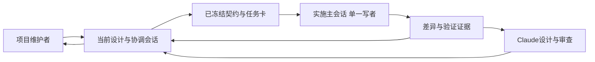
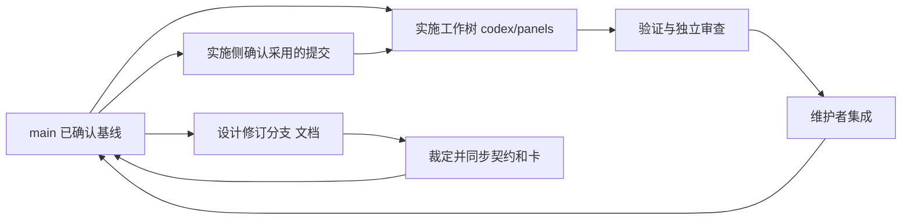
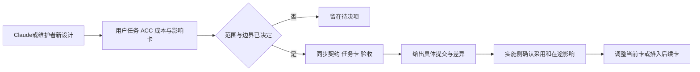
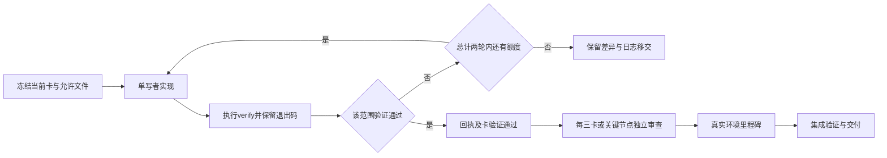

# DSH面板平台设计与实施协作讨论稿 v0.1.0

> 公开整理版；源版本：0.1.0；整理日期：2026-11-06。保留原稿历史阶段，未重新运行或复测。内部项目实例、个人原话与私有地址不作为公开附件。


2026-11-03 · Codex

## 版本与范围

建议采用“当前会话负责设计与裁定、新主会话负责实施、Claude定期独立审查”的协作方式；代码先保留一条写入线，以仓库提交和验证证据衔接两边。

- 版本：v0.1.0，首次整理双方职责、开工冻结单、设计变更、任务回执和会话接续规则。后续修改按补丁号递增。
- 主线：确认输入 → 冻结契约 → 单线逐卡实现 → 对照设计审查 → 真实环境验收与集成。
- 状态标记：【已核对】指本轮文件／Git检查；【沿用】指现有任务包规则；【建议】指待开线采用的安排；【待完成】指尚无实际产物或证据。

【已核对】本次`dsh-panels-handoff-6369a62.zip`有54个文件，与提交`6369a6290a61a663b35996a5e600d9d42ca325f9`完全一致。来源与校验值见[主稿第8.1节](<../../design/overall-discussion.md#verification>)。本仓仍是设计与交接材料；本轮没有创建新实施会话、工作树或自动调度任务。

本文的“两边”同时覆盖设计／实施两个工作面，以及Claude／Codex之间的交接。产品内容以[整体设计讨论稿v0.1.2](<../../design/overall-discussion.md>)、[契约](<CONTRACT.md>)和[当前任务卡](<BOARD.md>)衔接，本文不另建一套产品架构。阶段A尚未完成，本次输入提交不是正式开工冻结提交。

<a id="roles"></a>

## 1. 协作架构与会话职责

保留当前会话承接设计历史，另开实施主会话承接代码与验证；两边依靠短交接单协作，后续换会话也能从仓库继续。

**图 1　总体架构 · 维护者裁定，设计和实现各有落点**



从左到右确定要做什么并实施；证据回到设计与审查侧，维护者只需处理范围、取舍及真实体验判断。

| 角色 | 负责什么 | 交付物与边界 |
|---|---|---|
| 维护者 | 目标、功能取舍、资源与体验接受标准、真实桌面／终端验收 | 沿用现有提交与合并责任；已经确认的决定直接复用，只有新的实质边界再问。 |
| 当前设计与协调会话 | 主稿、ACC取舍、契约一致性、实施依赖、排期复估 | 给出冻结单和变更结论；不同时进入正在执行的工作树改代码。 |
| 实施主会话（Codex） | 按卡实现，包括前端；本地验证、证据整理、问题回传 | 一次一张卡，遵守允许文件；负责实施状态入口，不自行扩大范围。 |
| Claude | 画板及交互设计、阶段性独立审查 | 设计改动给出明确提交／文件；实施期间只读执行线，对照截图与实际证据写意见。 |
| 按需研究执行者 | 某个清楚、可独立回答的接口或算法问题 | 返回来源、版本、建议和未验证项；研究不直接写入执行线。既有Terra研究用途可以沿用，不按模型名称推定其工具权限。 |

**调度尺度**：实施主会话可以自己完成当前卡。确有独立研究或审查任务、且分派已获授权时，再交给其他执行者；初期不按“前端／后端”拆成并发写入线，因为15张卡反复触及注册、状态及构建脚本。只有允许文件与依赖确实能分离时才另列工作树和集成顺序。

**会话寿命**：一个实施主会话推进若干相邻卡，在里程碑或上下文已难核对时交接。不要机械地每张卡新开会话，也不依赖一个会话无限记住全部历史。跨产品没有自动共享的聊天上下文，Claude和Codex都要读实际提交。

<a id="baseline"></a>

## 2. 共同基线与写入边界

每次派卡都记录完整提交和当前差异；同一工作树始终只有一个写者，实施方不会因为main出现新文档就自动改动正在做的契约。

**图 2　版本衔接 · 设计更新和实现更新分别审阅后进入基线**



设计变更先形成可审阅提交，实施侧按影响采用；代码集成保留验证和审查结果，不用复制整个目录来同步。

| 材料 | 权威内容 | 维护约定 |
|---|---|---|
| 主稿 | 用户目标、ACC关系、设计理由和待决问题 | 设计侧维护；“设计提案”不能自动变成当卡要求。 |
| `CONTRACT.md`及任务卡 | 已冻结的数据、接口、允许文件、依赖和verify | 设计侧提出成组修订；实施侧确认采用版本。契约改了，卡与验收必须一起核对。 |
| `BOARD.md` | 卡状态、顺序和里程碑索引 | 开线后由实施主会话统一更新；设计侧通过变更单提出依赖调整。 |
| `design/` | 画板、主题及视觉参照 | Claude提供；只落实契约已纳入的范围。整屏运行图仍留给后续工作台。 |
| 实施状态与审查记录 | 当前基线、实际HEAD、工作区差异、证据及接续信息 | 建议开线时建立`docs/implementation/STATUS.md`和`docs/implementation/reviews/`，先加入相关卡允许文件；BOARD只放摘要和链接。当前尚未创建。 |
| `.handoff-logs/` | 本次执行的原始日志及失败输出 | 本地保留；需换机器的必要证据先检查内容再提交到审查记录目录，不提交凭据或真实私有数据。 |

**优先关系**：维护者最新明确决定优先；若影响接口，先落成同步修订，再执行。没有新裁定时，以冻结的契约与卡为准，主稿解释理由，画板提供视觉参照。材料冲突时停住受影响的部分，写出冲突位置；不任选一份继续，也不把全部独立工作都推倒。

**工作树**：【沿用】实施分支建议`codex/panels`，目录`${PROJECTS_ROOT}/dsh-panels-work`。本轮只核对到主仓一个工作树，这些是计划位置。开线先检查已有分支／工作树，适用就复用；新建时指向冻结单的完整SHA。代码开工后，设计修订在单独分支或工作树准备，main作为已确认的集成基线。

**权限**：【沿用】卡执行者不提交、不推送、不合并、不改Git配置，不读凭据，不碰真实DSH配置／安装，测试使用隔离目录和`DSH_HOME`；原文见[PROMPT](<PROMPT.md>)。现有BOARD把提交、合并和真实环境验收交给维护者。本轮设计文档的推送授权不自动改变这些代码执行权限；以后若明确授权调整，在冻结单登记一次，避免逐卡重复确认。

<a id="freeze"></a>

## 3. 阶段A完成后再进入代码实施

开工入口是“执行材料一致且验证方法可运行”，本轮新增协作文档只把这个入口写清；未测出的产品性能仍保留为后续验收目标。

| 当前材料 | 状态 | 开线前处理 |
|---|---|---|
| 终端框图基本范围、状态／进度、着色片段、三项默认值、P-12地板24 | 已进入`6369a62`契约和卡片 | 保留；按[主稿第7.3节](<../../design/overall-discussion.md#tui-box-graph>)补清实际视口、连线、隐藏节点、选择和显示列边界。 |
| 快照、数据身份、总额度、背压和权限扩大 | 主稿提案 | 同步契约、错误行为、配置归属和相关卡。 |
| 公共Canvas、批准及选中依赖、M2位置 | 主稿提出调整，原卡尚未整体同步 | 更新依赖图与允许文件，避免只凭卡号顺序碰巧可用。 |
| 五类示范及开源预留 | 方向已确定，具体夹具与验收尚未齐备 | 列场景卡和增量；更新P-14/P-15及估算，不把新增工作默认塞入旧35–48日范围。 |
| 执行环境与验证 | 有原探针和脚本，未完成产品验证 | 固定宿主／TUI版本，核对命令和预期退出码；明确各卡缺测试的预期失败与缺运行环境的区别。 |

**冻结单最少字段**：输入来源、冻结完整SHA、主稿／契约版本、实施分支和工作树、当前卡及依赖证据、允许文件、实际验证环境、待决项及阻塞范围、审查者、提交／合并责任。源码提交还要记录实际HEAD和未提交差异，不能只报文档版本号。

尚未有测量结果的预算先冻结负载、计量口径、测量卡及决定时点；涉及准入安全和接口语义的缺口应先解决。阶段A是否完成由这份清单和材料一致性判断，不以文档数量判断。

<a id="changes"></a>

## 4. 新设计如何交给实施侧

设计更新必须给出行为变化和影响卡，实施方确认采用的提交后再实现；在途工作保留，受影响的部分按裁定调整。

**图 3　变更过程 · 每次变更落到契约、卡片与证据**



先判断改变了什么，再指定执行版本；只有画板变化、尚未决定的想法留在设计侧。

**设计交接单**：变更编号／来源提交、用户动作与前后行为、ACC能力及属性／组件、常驻和峰值成本、依赖与维护成本、备选方案及决定理由、受影响卡和允许文件、正向／负向／资源预期、兼容处理、未决项。小修改可以是一段带字段的说明，不强制新建长文。

**本次框图示例**：输入为`6369a62`，影响P-02/P-07/P-12及契约第2/3/10/13节；只落实中央关系图，整屏运行条留在后续工作台。当前已同步基本画法和地板，视口、走线歧义、隐藏节点与校验层次列在阶段A。图的可读性是目标，CPU和内存增量仍须测量。

**在途处理**：实施方回报开始HEAD、已有差异、哪些工作可保留、哪些需要重做；无需重做的已验证工作保留。不在运行中重置工作区，不打断正常长任务来换方案。每张卡开始和结束都核对是否有待采用的设计变更。卡内新增边界先查已记决定，只有确实缺少决定才提问。

<a id="execution"></a>

## 5. 一张任务卡怎样完成

执行者自报、脚本验证、独立审查和真实体验是不同证据；卡通过后可以继续下一张，但最终交付还要满足里程碑与集成要求。

**图 4　执行与验证 · 失败保留证据，通过仍需阶段审查**



从卡的允许范围出发，验证失败先保留差异和日志；阶段审查与真实验收补齐后，才形成相应范围的完成结论。

1. 实施主会话核对冻结单、依赖、工作区和允许文件。若主会话直接写实现，其自测如实记为自测；若派出卡执行者，主会话或调度脚本另行运行verify。
2. 按卡验证实际行为、负向边界和变异；记录命令、退出码、环境、执行代码版本与原始结果。测试存在和数量地板只防漏跑，不能证明产品完整。
3. 【沿用】`run-card.sh`最多两轮，Codex异常退出即使verify为0也不算通过。失败留在`.handoff-logs/`并保留工作区；按代码、量尺或环境问题分清原因，再由协调侧明确接手者，不无限重试或降低门槛。
4. 主会话核对实际diff和回执，更新状态；同一工作树不同时启动多套会修改产物的完整验证。合并后另做与合并范围相关的集成验证。

**状态记录**：使用“未开始／实施中／卡验证通过／待审查／受阻／完成”，同时单列审查和集成状态。缺环境记“验证未完成”，断言失败记“失败”；卡验证通过不代表已审查或已合入main。“完成”仅在该卡适用的验证、审查及集成要求满足后登记，平台完成还包括M1–M3、五类场景和资源验收。

<a id="handoff-templates"></a>

## 6. 两边交换的最小内容

派卡单说明做什么、按什么版本做；回执说明实际改了什么、验证覆盖哪里，两者都能让接手者脱离聊天历史继续。

**派卡单模板**：

```text
任务：P-xx；本次只完成这一张卡
基线：冻结完整SHA；主稿版本；本次开始HEAD和已有差异
位置：仓库、工作树、分支；唯一写者
依赖：卡号、通过记录、尚未满足的条件
允许文件：逐项引用卡片；新增状态／证据路径先列入允许范围
行为：用户操作、正常结果、错误／取消／资源边界
验证：实际命令、环境、预期结果、需要留下的证据
决定：沿用哪些已确认选择；哪些问题阻塞本卡
权限：原样附PROMPT硬规则；本次明确授权的例外另列
交回：按PROMPT回执，附diff、退出码与证据路径；不能只写“完成”
```

如果使用项目记录系统，派卡单同时携带实际记录id和判断写入方法；接手者不得猜记录id或把推测写成事实。本仓未接入此机制时，判断写入卡回执与审查记录即可。

**实施回执模板**（与[PROMPT](<PROMPT.md>)保持一致）：

```text
卡：<编号>
基线：<冻结完整SHA；开始HEAD；结束HEAD及未提交差异>
改了：<文件列表和行为变化>
验证：<实际命令、环境、退出码、结果>
证据：<日志／截图／资源原始结果路径；未提交文件需交接>
变异：<新增几个，几个被杀；未运行如实写>
偏差：<契约／任务卡差异、原因、待裁定事项；无则写无>
没量到：<真实桌面、TUI、性能或其他尚缺证据的部分>
```

**接续状态**：换实施会话前保存当前卡、冻结提交、实际HEAD、未提交文件、在跑进程／任务、最近验证结果、待采用的设计提交、下一条操作。新会话先读状态并核对磁盘，不默认重跑、清空或重新生成全部产物。提交号相同但有未提交差异时，不能视作同一执行状态。

<a id="reviews"></a>

## 7. 审查、里程碑与首次开工

沿用每三张卡一次Claude独立审查，并把真实桌面和终端检查放到明确里程碑；设计会话持续负责解释取舍，实施会话持续负责可重现证据。

| 节点 | 要核对什么 | 当前约束 |
|---|---|---|
| 每三张卡后 | 契约、代码diff、行为测试、资源生命周期；界面卡对照画板和截图 | 审查者需实际拿到提交及证据。不同上下文的同模型复核不能写成“不同模型独立审查”；没有Claude结果就记待审查。 |
| M1：P-05后 | 桌面打开、表格操作、文件刷新及资源基线 | 沿用原看板；真实安装与验收由维护者操作或按其明确授权执行。 |
| M2：custom与信任 | 桌面WebGL2／Worker／WASM、网络及导航边界、批准和撤销 | 原BOARD在P-09后；主稿建议连同P-10完成完整链路，待阶段A统一位置。 |
| M3：P-15后 | 完整平台、TUI、五类示范、四个上限样例、安装／升级／卸载 | 绑定实际代码、制品与环境。原探针、静态检查和模型意见不能替代这些结果。 |
| 集成与版本发布 | 合入范围、集成验证、文档与制品版本、已知限制 | 沿用维护者集成责任；源码提交、远端推送、制品发布和真实安装分别记录。 |

审查中的问题写清级别、触发条件、对应能力和证据位置；修复回执逐项回应。权限扩大、读取一致性或明显资源失控等影响当前正确性的发现及时反馈，不等凑满三张卡。

**建议的新实施会话首条消息**：

```text
在dsh-panels推进通用面板平台，先读取COLLABORATION、整体设计稿、
CONTRACT、BOARD、PROMPT以及当前任务卡。核对冻结单的完整SHA、
实际工作树和未提交差异。若阶段A尚未完成，先完成其契约与卡片同步，
交回待决项；不要自行把6369a62认作最终冻结版本。
开工范围和边界确认后，从当前未完成且依赖满足的卡开始，每次一张，
保持单写者，按回执交付；沿用已确认决定与权限。通过的实际验证和
未完成的真实桌面／TUI／资源验收分开记录。不要扩成工作台调度系统。
```

本模板用于后续用户创建或明确委派的实施会话。本轮只是形成协作文档，未启用自动跨会话发消息、监控或模型调用；后续需要这些能力时，先核对对应执行端权限与证据获取方式。

## 风险与开放问题

主要风险是两边采用不同契约、多个写者触碰公共文件，以及把局部验证写成整体完成；上述冻结单、单写者和分层证据用于控制这些风险。

- **版本漂移**：新zip、画板或main提交不等于正在实现的版本，必须明确采用提交与在途影响。
- **协作负担**：个人项目不宜为了调度另做一套平台；先复用BOARD、任务卡、现有脚本和短状态记录。
- **独立性不足**：同模型复核、静态读代码和真实运行各有范围，审查抬头与证据必须如实标注。
- **证据丢失**：本地日志不会随Git自动转移，接续前交接必要原始材料与未提交差异。

开放问题：

- [ ] 完成阶段A并形成实际冻结提交，统一契约、依赖、参数与验收。
- [ ] 开线时登记实际工作树、验证环境、实施／审查接手者及集成权限。
- [ ] 确定框图第7.3节边界和五类示例的新增工作量，更新个人排期。

## 待证命题与下一步

这套协作方式需要用首批任务卡检验；文档完整不证明返工减少或交付效率已经提高。

| 编号 | 命题 / 猜想 | 已有依据 | 缺口 |
|---|---|---|---|
| C1 | 单一实施写者与独立设计／审查能控制初期协作成本 | 多张卡共同修改注册和脚本，原BOARD已采用单线 | 首批卡的冲突、返工原因和等待记录。 |
| C2 | 冻结单与回执足以支持换会话接续 | 已列提交、差异、依赖、证据及在途任务字段 | 一次真实接续，验证接手者能定位下一步且不重做已完成工作。 |
| C3 | ACC变更记录能使新增视觉能力的资源代价可讨论 | 框图已拆分行为收益、状态／选择边界和待测成本 | 框图与邻接树的可用性、CPU、内存和释放对照证据。 |

下一步：

- [x] 核对`6369a62`交接包并更新主稿，区分已同步内容和阶段A缺口。
- [x] 写出职责、工作树、变更、派卡和回执约定，接入仓库导航与执行提示。
- [ ] 完成阶段A的契约／任务卡修订与范围裁定，发布可追溯的冻结单。
- [ ] 在后续实施开工时创建或复用实施会话和工作树，建立状态入口并核对验证环境。
- [ ] 完成首批卡与独立审查，用实际问题修订协作方式，不预先宣称效率收益。
