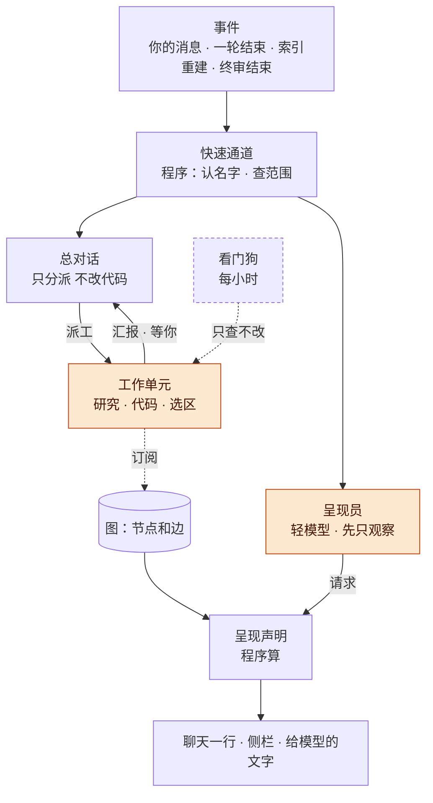
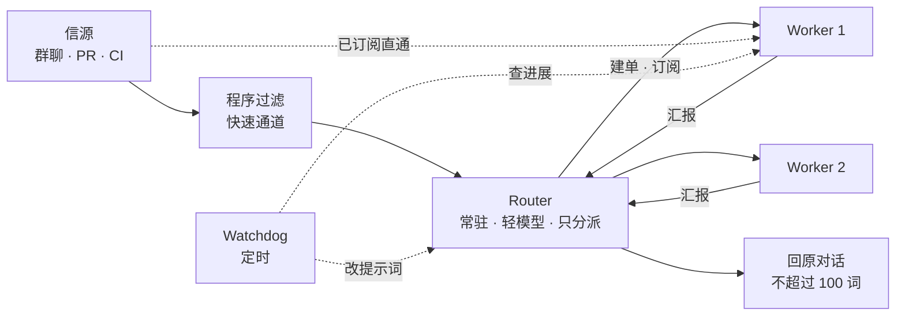
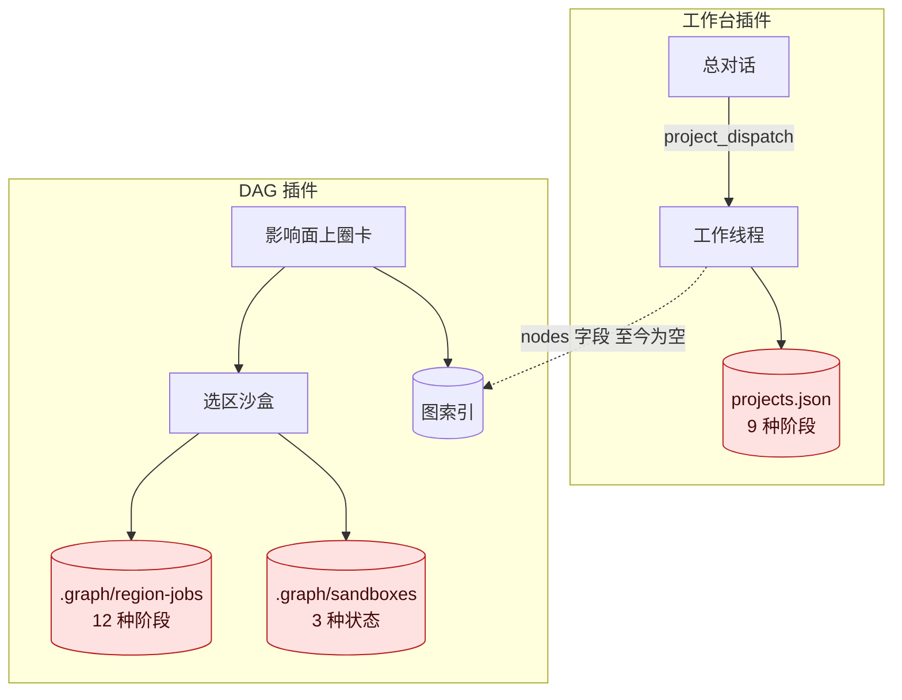
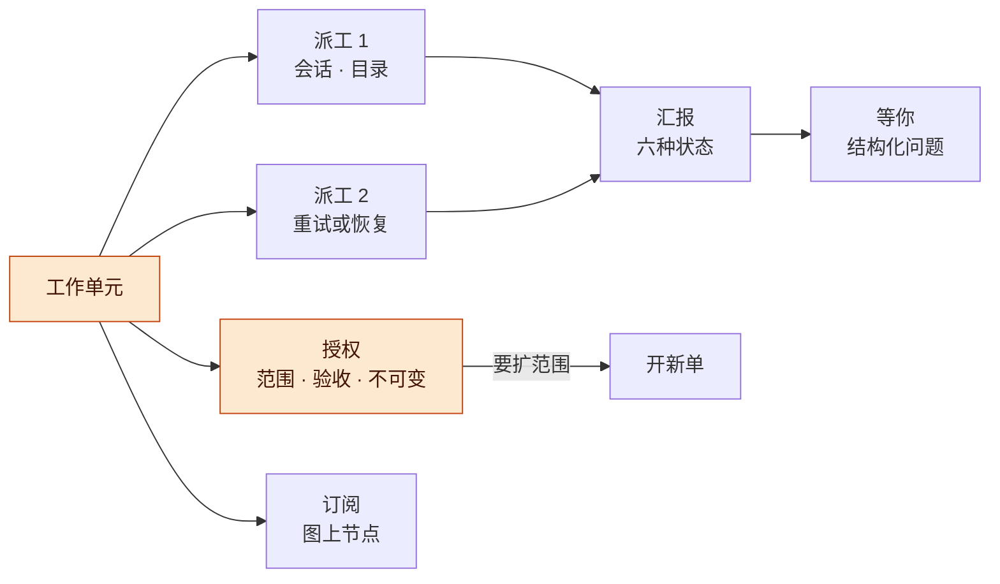
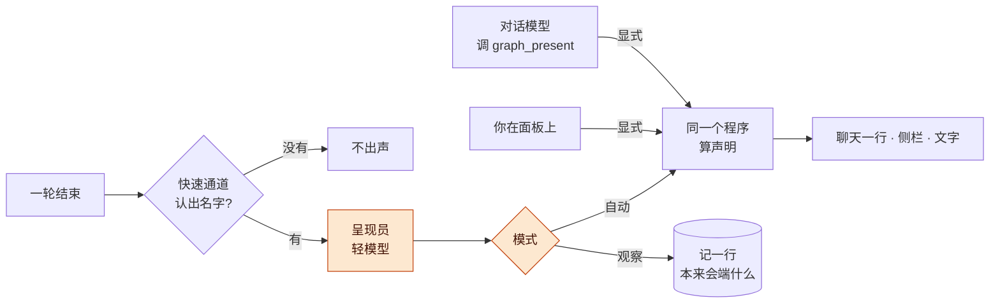

# DAG借鉴Super-agent架构讨论稿 v0.1.0

> 公开整理版；源版本：0.1.0；整理日期：2026-11-06。保留原稿历史阶段，未重新运行或复测。内部项目实例、个人原话与私有地址不作为公开附件。

2026-11-01 · Claude（参考 super agent 文章调整 DAG 架构）

## 版本与范围

Super-agent 的文章和开源原型里，最值得 DAG 借的是三样：把「一件工作」和「跑它的会话」分开的领域模型，「人的注意力最贵」的出声纪律，以及「把上下文当缓存」的读法。落到议题上：D4 建议合成一套，工作台当工作单元的唯一写方，选区沙盒变成「范围是选区、验收是终审」的一种工作单元；D1 的字段不改，补两处做法：请求除了模型显式调工具，再加一个先只记账的后台呈现员；给模型的文字改成内联加续读指针。

> 公开整理时略去非公开项目实例或个人会话来源；通用设计仍见本节其他内容。

**图 1　讨论主线 · 先看别人怎么做，再对照自己，最后改 D4 和 D1**

从左往右读；高亮的两块是本稿要你拍板的部分，领域模型初稿把两边收成一张概念表，交接那块是拍板之后的施工顺序。

## 总体架构：借鉴之后的 DAG

借鉴之后 DAG 分五层：事件进来先过程序的快速通道；「要不要开工」由总对话判断，「要不要端图」由呈现员判断；干活的是工作单元；图和声明只由程序算；外面再挂一个定时的看门狗。真正新的只有两块：工作单元（工作台线程和选区沙盒合成一种东西）和呈现员。

**图 2　总体架构 · 5 层，2 块新东西**

从上往下读：左路是「干活」，总对话派工、工作单元汇报；右路是「给你看」，呈现员写请求、程序算声明；两路在图上相遇，工作单元订阅它碰的节点；虚线框的看门狗放到最后做。

| 层 | 由谁 | 对应 Super-agent | DAG 里现在在哪 |
| --- | --- | --- | --- |
| 事件 | 你的消息、一轮结束、索引重建、终审结束 | Trigger | 散在各处：轮尾条每轮触发、面板每 30 秒问一次索引新旧、沙盒按 `region_sandbox_poll_ms` 轮询 |
| 快速通道 | 程序：认名字、查范围、按规则挡 | 两级过滤的程序层 | `chat/lookup`（只认完整唯一命中）、沙盒的写入前检查 |
| 判断 | 总对话决定开不开工；呈现员决定端不端图 | Router，两级过滤的模型层 | 总对话已有（工作台）；呈现员没有，`show.py` 的模型版默认关 |
| 执行 | 工作单元：研究、代码、选区 | Worker | 工作台线程和选区沙盒，两套 |
| 图与声明 | 程序 | 原型里没有，这是 DAG 自己的 | `impact_tree.build_view`、D1 的 8 字段草案 |
| 看门狗 | 一条定时任务 | Watchdog | 没有 |

派工仍归工作台的总对话，DAG 不另起一个 Router。DAG 在这张图里的角色是三件事：给工作单元提供「选区」这种范围和终审，把工作单元画到图上，以及决定什么时候端图给你看。

## Super-agent 讲了什么

文章讲五块：双层、事件驱动、全双工、存算分离、看门狗；原型把其中「双层加事件驱动」落成了一套很严的领域模型。对 DAG 有用的大多在原型的规矩里，不在文章的部署形态里。

| 类别 | 代表（年份） | 核实到的内容 | 缺口 |
| --- | --- | --- | --- |
| 文章 | 《Super-agent 设计探索：迈向更自主的 Agent 系统》（DeepSeek Harness 团队，2026-10-31，公众号） | 经 [21 财经](https://m.21jingji.com/article/20261031/herald/5f1bcfc0b4ebce9dabfc4583df9dbbf5.html)、[智东西（网易号）](https://www.163.com/dy/article/LAK152S2051180F7.html)、[新浪科技](https://finance.sina.com.cn/tech/csj/2026-11-01/doc-inixepty4335109.shtml) 三家转述：五个模块、实验数字、四个开放问题 | 没看到原文；三家转述互相一致，但措辞可能有出入 |
| 开源原型 | [dsh-superagent-prototype](https://github.com/deepseek-ai/dsh-superagent-prototype)（DeepSeek，2026-10-31，MIT） | 9 篇设计文档 000–008、提示词、预设；面向一个 GitHub 仓库的主动编码 agent，打包成 DSH bundle | README 自己说和文章里的内部版本不完全一样，文章里有些设计是未来方向、原型没做；我没跑它 |

**图 3　Super-agent 的结构 · 双层加看门狗**

从左往右：事件先被程序筛一遍，剩下的交给 Router；Router 建单派给 Worker，之后同一线索的事件绕过 Router 直通 Worker；Worker 只向 Router 汇报，由 Router 对外说话；Watchdog 在系统外面定时查。

> 公开整理时略去非公开项目实例或个人会话来源；通用设计仍见本节其他内容。

**实验**（文章自称合成负载、不是正式结论）：每种方案约 300 条消息、约 20 个工作请求、各跑 5 次。Super-agent 的完成时间 p50 是 12.4 分钟、p95 是 15.7 分钟。对 DAG 最有用的是对照组：一个带 Subagent 工具的单 Session，在中性提示下 5 次都没调用 Subagent，p95 是 29.5 分钟；改成「优先委派」后，模型仍会因为觉得任务「很小」自己干，形成长尾。

**原型的九条硬规矩**（原型已核实，后面反复用到）：

1. 工单自己定义状态，不跟着 DSH 会话走。原型「被拒绝的概念」表里明写了这一条。
2. 授权（Mandate）不可变；范围变宽就开一张新单。
3. 每种状态只有一个写方：Trigger、Thread、Decision、Ticket、Assignment 只由 Engine 写。
4. 阶段表从上往下读，第一条命中的算数；各档互斥、全覆盖；「等人」的几档排在最前。
5. 数字等于它链到的列表长度；健康状态不占地方。
6. 推断出来的活默认只观察（off / observe / auto 三档，observe 是默认），只记「本来会接」。
7. 「等人」只从结构化字段来，不从汇报正文里猜。
8. 并发有上限，另外给「人的消息」多留一个槽，新活挤不掉人正在追问的那张单。
9. 先存再做：外部动作先记一笔再执行，失败按退避重试；重启时正在跑的派工带一段恢复说明重起，说明要求先查目录和 git 记录，再做任何外部动作。

## DAG 现在的结构

DAG 这边已经有半个 Super-agent：工作台就是 Router 加 Worker 的雏形，选区沙盒是一种更严的 Worker。但「一件工作」有三套状态机、三个存放处；图和工作之间唯一的一根线，是工作台派工时可带的 `nodes` 字段，到现在一次也没用上。

**图 4　现状 · 一件工作，三套状态**

上下两块是两个插件；警示色的三个存放处记的是同一类东西（一件工作走到哪了），彼此不知道对方；虚线是工作台已经留好、却没人用的那根线。

| 对照 | 工作台线程 | 选区沙盒 | Super-agent 原型 |
| --- | --- | --- | --- |
| 谁派 | 总对话调 `project_dispatch` | 你在影响面上圈卡、写任务 | 主 Session 调 `orchestrator_route` |
| 在哪干 | 研究：宿主只读预设；代码：独立 git worktree，workspace-write 预设，核对写入根 | `git clone --shared` 副本；新会话 cwd 在副本，审批 never，只放读和受检的 edit/write | 每单一个目录，准备命令通常是 `git worktree` |
| 状态存哪 | `~/.dsh/project-workbench/projects.json` | Node 半边 `<项目>/.graph/region-jobs/`，Python 半边 `<项目>/.graph/sandboxes/<id>.json` | 一个 SQLite，只有 Store 打开它 |
| 阶段 | 9 种：排队中、准备中、进行中、等待你、待验收、已验收、已停止、失败、待恢复 | 任务 12 种：creating、starting、model、ready、stopped、verifying、reviewed、merging、merged、closed、failed、interrupted；登记 3 种：open、merged、dropped | 开着的 7 档加结束结局 |
| 怎么汇报 | `project_report`：review、waiting_user、failed 三选一，加摘要 | 没有汇报工具；模型停了，面板看差异和终审 | `orchestrator_report` 六种状态，加结构化问题 |
| 验收 | 你点「验收通过」，不提交也不合并 | 机器终审：基线树和候选树各跑一遍；通过后你选审阅分支或应用 | 按团队写的交付要求，默认人合并 |
| 并发 | `maxParallel` 3 | 我没在 `region.js` 里找到上限 | 上限加 1 个留给人 |
| 断了怎么办 | 标「待恢复」，你点了才接着跑 | 标 interrupted：「副本保留，请查看后重新终审」 | 正在跑的带恢复说明重起 |
| 和图的关系 | 派工可带 `nodes`（「这件工作涉及的 DAG 节点」）；桌面上 3 条线程全是空 | 选区本身就是一组节点 | 无 |

> 公开整理时略去非公开项目实例或个人会话来源；通用设计仍见本节其他内容。

## 借鉴清单：借什么、不借什么

建议借 9 条，其中 6 条直接改 D1、D4 的做法；不借 5 条，因为它们解决的是团队、多信源、云端常驻的问题，DAG 现在是一个人、一台桌面。

| 编号 | Super-agent 的做法 | 搬到 DAG 是什么 | 落到 | 先后 |
| --- | --- | --- | --- | --- |
| B1 | 工单和会话分开：Ticket 管「一件工作」，Assignment 管「这一次谁在跑」，一张单可以有好几次 | 工作单元加派工；重试、恢复都是新派工，同一目录、同一分支 | D4 | 先 |
| B2 | 授权不可变，范围变宽就开新单 | 选区就是授权范围；模型要碰范围外，停下发一个结构化问题，你同意就开新单 | D4 | 先 |
| B3 | 每种状态一个写方 | 工作台是工作单元的唯一写方；DAG 只提供「选区」范围和终审两种服务，再把单画到图上 | D4 | 先 |
| B4 | 阶段表首条命中，等人的排前；数字等于列表长度 | 两边合成一张阶段表；侧栏头只显示「等你 N」 | D4、D8 | 先 |
| B5 | 显式和推断两档强度；推断的默认只观察 | 后台呈现员先只记「本来会端什么」，一周后你看记录再决定要不要放开 | D1 | 先 |
| B6 | 上下文当缓存：内联、溢出、沿 id 逐跳读 | 给模型的文字分「内联」和「续读指针」；页上每个 id 都能用 `graph_node` 读 | D1 | 先 |
| B7 | 订阅和扇出；关联只加上下文，不路由 | 工作单元订阅它碰的节点；两张单碰同一个节点就互相提醒；import 和调用边只当上下文 | D4、D5 | 次 |
| B8 | 外部看门狗，原型最简版是每小时检查一次 | 定时查卡住的单、过期的索引、没人管的副本；只报告 | D4 | 后 |
| B9 | 少概念：业务需求变成已有概念的属性；写一张「被拒绝的概念」表 | 给 DAG 一张概念表，「场景」「沙盒」不单列成概念 | 全部 | 先 |

| 不借 | 为什么 | 什么时候再看 |
| --- | --- | --- |
| 多信源（飞书、GitHub 通知）、准入表、团队名单、策略版本 | 一个人用，没有「谁可以派活」的问题 | 公开发布或多人开发时；意图书里提过以后不同人看到的东西权限不一样 |
| 云端常驻和 BYOM | 桌面 DSH 跑在你的 Mac 上，代码和未提交改动本来就在本机 | D6 跨项目，或想让云端线程看同一张图时 |
| Router 批处理 | 事件一分钟几条，摊不出收益（文章的收益出现在每分钟约 40 条时） | 不再看 |
| 全双工 `start()` / `stop()` | 宿主的功能，文章说已实现、未默认开；DAG 的终审本来就在会话外面跑 | DSH 默认打开之后，沙盒会话自然能用上 |
| 自动合并 | 合回由你选；终审通过也只给两个按钮 | 不再看 |

## 对 D4 的含义：一套工作单元

建议合，但合在「领域模型和状态」这一层，不合插件：工作台线程和选区沙盒是同一种工作单元，差别只在授权范围和验收方式。状态只由工作台写；DAG 插件不再自己记沙盒任务，改成给工作台提供「选区」这种范围和终审，再把所有工作单元画到图上。（提案）

**图 5　工作单元 · 一张单、一份授权、多次派工**

从左往右：一张单只有一份授权，派工可以有好几次；汇报决定阶段，「等你」只从汇报的结构化字段来；授权要放宽时不改旧单，另开一张。

**概念**（提案）：

| 概念 | 代码名 | 字段 | 规矩 |
| --- | --- | --- | --- |
| 工作单元 | `unit` | id、标题、授权、派工列表、汇报、订阅、结局 | 只由工作台建；状态从派工和汇报推出来，不跟着 DSH 会话 |
| 授权 | `mandate` | `scope.kind`（read / repo / region / attached）、`scope.files`、`scope.functions`、`scope.tests`、`accept`（human / verdict）、`base`（起点提交）、`by`、`at` | 不可变；要放宽就开新单 |
| 派工 | `assignment` | 会话 id、目录、准备方式（worktree / 副本加基线）、开始、结束、结束原因 | 一张单可以有好几次；重试和恢复都是新派工，同一目录、同一分支 |
| 汇报 | `report` | `progress`、`waiting`、`ready`、`blocked`、`failed`、`dropped` 之一，加摘要和证据 | 只有派工的最后一次汇报能从执行一侧结束这张单 |
| 等你 | `attention` | 一个具体问题和几个选项 | 只从结构化字段来，不从汇报正文里猜 |
| 订阅 | `subscription` | 单和图节点的多对多关系 | 见下文「订阅与冲突」 |

**今天的东西合并后是什么**：

| 今天 | 合并后的 `scope.kind` | `accept` | 准备方式 | 会话预设 |
| --- | --- | --- | --- | --- |
| 工作台研究线程 | read | human | 不用准备，直接在源目录 | 宿主只读预设 |
| 工作台代码线程 | repo | human | `git worktree` | workspace-write，核对写入根 |
| 选区沙盒 | region | verdict | `git clone --shared` 副本加基线测试 | 只放读和受检的 edit/write，审批 never |
| 工作台「加入已有会话」 | attached | human | 不准备，沿用原会话目录 | 沿用原会话 |

**阶段表**（提案；从上往下读，第一条命中的算数，各档互斥）：

| 阶段 | 条件 | 显示 |
| --- | --- | --- |
| 等你 · 回答 | 有一个等你回答的问题 | 等你回答 |
| 等你 · 验收 | 最近汇报是 ready，`accept` 是 human | 待验收 |
| 等你 · 合回 | 最近汇报是 ready，`accept` 是 verdict，终审通过 | 待合回 |
| 等你 · 受阻 | 最近汇报是 blocked 或 failed，或终审没过，而且之后你没说过话 | 受阻 · 失败 · 终审没过 |
| 等你 · 恢复 | 派工因宿主重启中断，中断时正在干活 | 待恢复 |
| 终审中 | 最近汇报是 ready，`accept` 是 verdict，终审在跑 | 终审中 |
| 排队 | 没有派工，或派工还没开始 | 排队中 |
| 空闲 | 最近汇报是 waiting，或派工已结束 | 等消息 |
| 进行中 | 其余 | 进行中 |

结束的单只有结局，不进阶段表：已验收、已合回（审阅分支或应用）、你停了、无需处理、转新单、放弃（副本保留）。前五档就是侧栏头「等你 N」里的 N。

**插件分工**（提案）：

| 谁 | 管什么 | 不管什么 |
| --- | --- | --- |
| 工作台 | 唯一写工作单元；派工、并发槽、阶段、恢复；总对话 | 不懂图，不懂函数范围 |
| DAG 插件 | 注册一种范围 `region`：预览范围和测试、准备副本加基线、每次写入前的范围检查、终审；把工作单元画到图上 | 不再自己记任务，不派工 |

原型里信源插件就是这么接的：信源插件注入主插件提供的 `orchestrator` 服务，只拿到一个窄接口 `SourceHost`；主插件维护一张「信源种类」注册表（原型已核实，`docs/007-architecture.md` 的 Sources 一节）。照搬过来，工作台提供一个窄服务，DAG 插件往里注册 `region` 这种范围种类。这是推测：两个独立发布的 DSH 插件之间这样注入，在我们的桌面版上没试过；原型的几个插件在同一个 bundle 里。

**几条规矩**（提案）：

- **状态不跟会话**：今天工作台「加入已有会话」按会话在不在跑来定阶段，沙盒的 Node 半边和 Python 半边各记一份。合并后都从派工和汇报推出来。
- **范围不放宽**：选区单的模型想改范围外的东西，今天会被写入前检查挡回去。合并后挡回去的同时让它发一个「等你」：「要把 X 加进范围吗」。你同意就开一张新单，新授权的起点是旧单的候选树，旧单以「转新单」结束。
- **并发槽统一**：研究、代码、选区共用一个上限，沿用工作台的 3；另留 1 个槽给「你在某张单里说话」，新开的活挤不掉你正在追问的那张。
- **重试和恢复是新派工**：同一目录、同一分支。恢复说明照原型写：「先看目录和 git 记录，再做任何外部动作」。默认仍然要你点一下才恢复，沿用工作台和沙盒今天的选择；原型是自动重起。
- **先存再做**：派工、合回这类外部动作先记一笔再执行，失败按退避重试。这是实现写法上的要求，你看到的东西不变。

**订阅与冲突**（B7，提案）：每张单订阅它碰的节点。选区单订阅选区；代码单订阅派工时的 `nodes`，加每次汇报里改过的文件。两张开着的单订阅了同一个节点，两边各收到一条上下文：「另一张单也在动 X」，图上这个节点挂两张单的标。import 和调用边只加上下文：你范围里调用的函数被另一张单改了，你收到一条提醒，但那张单的消息不会因此路由到你这里。这张「节点和单」的订阅表，也就是 D5「谁在动哪块」的数据，不用另起一张执行图。

**看门狗**（B8，后做）：照原型的最简版，在你平时用的 desktop profile 里建一条每小时的定时任务，读工作台和 DAG 的 health，没事就不出声。查四件事：进行中却很久没有新汇报的单；跑超时的终审；比原件旧的索引；`~/.dsh/dag-sandboxes/` 里没有对应开着的单的副本。那里现在有 10-27 留下的两份副本，我没核对它们还有没有对应的任务。看门狗只报告，不重启、不删东西。

## 对 D1 的含义：请求从哪来、给模型的文字怎么写

D1 的 8 个字段不用改，要改两处做法：请求除了「模型显式调工具」，再加一个后台呈现员，它先只记账、不弹卡；给模型的文字从「6 KB 一整块」改成「内联加续读指针」，页上每个 id 都能用 `graph_node` 读下去。另外，D1 的 Q1 有了更硬的依据。

**图 6　两条请求路 · 显式照常，推断先观察**

上面两条是显式请求，任何模式下都照常算；下面一条是推断：快速通道认不出名字就到此为止，认出了才调轻模型，观察模式下只记一行。

**为什么不能只靠模型调工具**：D1 v0.1.0 建议模型通过新工具 `graph_present` 交请求。文章里的对照组正好说明这条路靠不住：可选工具不一定被调用，带 Subagent 工具的单 Session 在中性提示下 5 次都没调。DAG 自己也有同样的证据：轮尾条之所以存在，就是因为模型常常不调图工具，插件只好从正文里猜种子。所以 `graph_present` 保留，作为显式的那条路；另加一个呈现员，作为推断的那条路。

**呈现员**（提案）：

> 公开整理时略去非公开项目实例或个人会话来源；通用设计仍见本节其他内容。

今天轮尾条「取第一个代码名当种子」的做法并进呈现员的快速通道；没有呈现员时退回它，记成 `ask.by: rule`。

**给模型的文字：内联加续读**（提案）：

| 部分 | 内联（直接写在工具结果里） | 续读（只给指针） |
| --- | --- | --- |
| 抬头 | 一句，带数 | 无 |
| 画出来的卡 | 每张写 id 和一句为什么 | `graph_node` 读这个 id：它连着谁、具体哪几行 |
| 没画的 | 按原因分开的计数，加前 5 个 id | 声明的 `hidden`，从第 6 个往后翻页 |
| 你的改动 | 最近 3 条 | 声明的 `edits` |
| 话的校验 | 每条一个状态 | 声明的 `claims` |

四条规矩，前三条照原型：

1. 页上出现的每个 id 都能读；读不了的东西（比如构建哈希）不上页。
2. 被截断的地方写明原来多长、怎么续读。
3. 一页文字默认 4000 字、上限 8000；列表默认 20 条、上限 50。这是原型的数，DAG 先照用；聊天小图仍守 3 KB。
4. 每个数都等于它链到的列表长度。按这条，`graph_impact` 的老字段 `affected_upstream_total`（一跳、含文档和测试，算出 19）要删，只留和声明一致的数（3 跳 29）。

> 公开整理时略去非公开项目实例或个人会话来源；通用设计仍见本节其他内容。

**D1 Q1 的新依据**：原型的输出规矩是聊天低打扰；它的执行器连「向人展示」的工具都被拿掉了（`present`、`ask_user_question`）。照这个思路，AI 端来的图只进聊天那一行，不换你面板上正在看的那张，和 D1 的建议、和 C-145 都一致。D1 的 Q2 不受本稿影响。

## 出声纪律：DAG 什么时候打扰你

> 公开整理时略去非公开项目实例或个人会话来源；通用设计仍见本节其他内容。

**给 D8 一把新尺子**：观察期的 `.graph/presenter.jsonl` 可以算两个数：呈现员本来会弹几次；其中你每周翻一遍、觉得该弹的有几次。这比「看得懂」多了一个能每周看的数。

## DAG 的领域模型初稿

照原型 001 的写法，DAG 只需要 13 个概念；「场景」「沙盒」「轮尾条」都不单列成概念，它们是某个概念的属性或某个出口。另列 7 个被拒绝的概念，免得以后又长出来。（提案）

> 公开整理时略去非公开项目实例或个人会话来源；通用设计仍见本节其他内容。

| 被拒绝的概念 | 为什么 |
| --- | --- |
| 「场景」作为一个概念 | 场景是请求里的 `lens` 加一个出口：① 影响面是一种 lens，④ 聊天里看是一个出口。名字留给界面用 |
| 「沙盒任务」作为单独一种东西 | 它是 `scope.kind` 为 region 的工作单元 |
| 单的状态跟着 DSH 会话 | 一张单会重试、恢复、换会话；原型也明确拒绝 |
| AI 直接换你面板上的图 | C-145；AI 端来的图只进聊天 |
| 关联边路由事件 | 边很多，路由会把不相干的消息送进单里；边只做上下文 |
| 从汇报正文里猜「等你」 | 要结构化字段；原型同样拒绝 |
| 终审通过就自动合回 | 合回由你选；原型默认也不让 agent 自己合并 |

## 给 Codex 的交接

本稿全是提案，要等你回答 Q1 到 Q3 再动。动的时候按「先统一数、再合状态、再加呈现员」的顺序，每一步都有 Codex 自己能验的尺子；改到界面的那几步，交付时附一张走查单给你看。

任务书（拍板后执行）：

1. **删老字段**：`graph_impact` 去掉 `affected_upstream_total` 和 `affected_upstream`，只回和声明一致的数（与 D1 的第一步相同）。验：同一个种子，面板抬头、聊天小图、工具结果文字里的数一致。
2. **内联加续读**：工具结果按上文的表分成内联和续读；`graph_node` 能读声明的 `hidden`、`edits`、`claims`。验：抽 20 个工具结果，页上每个 id 都能读通，没有读不了的 id；被截断处都有长度和续读方式。
3. **工作单元模型**：工作台加 `mandate`、`assignment`、`report` 三段，阶段由阶段表推出；先只迁研究和代码线程，界面不变。验：阶段表每一行一个测试，证明互斥、全覆盖。
4. **沙盒迁进工作单元**：DAG 插件向工作台注册 `region` 范围种类（预览、准备、写入前检查、终审）；`.graph/region-jobs/` 和 `.graph/sandboxes/` 里的旧记录只读保留，不迁不删。验：沙盒现有的真 DSH 检查仍然全过；面板「最近任务」改从工作台读。
5. **订阅与冲突**：单和节点的订阅表；两张单重叠时互相提醒；图上节点挂单的标。验：建两张选区重叠的单，两边都收到提醒。
6. **呈现员观察模式**：每轮结束记一行到 `.graph/presenter.jsonl`，界面不变。验：跑一周，记录能回答下文的 P3。
7. **看门狗**：desktop profile 里一条每小时的定时任务，只报告。验：人为留一个孤儿副本，下一小时收到一条提醒，再下一小时不重复。

| 步 | 依赖 | 改不改你看到的东西 |
| --- | --- | --- |
| 1、2 | 无 | 改：数变一致，模型读到的文字变了 |
| 3 | 无 | 不改 |
| 4、5 | 3 | 改：沙盒列表、图上的单标 |
| 6 | 无；可以最早做 | 不改 |
| 7 | 3 | 改：每小时可能多一条提醒 |

## 风险与开放问题

最大的风险是「借了形态、没借问题」：Super-agent 解决的是团队注意力和云端常驻，照搬 Router 和多信源会给一个人的桌面加一堆用不上的概念；其次是两个插件合状态以后互相绑死。

- **借形态不借问题**：照搬会多出一层用不上的东西。对策：只借规矩，不加概念；不借的 5 条写明了什么时候再看。
- **两个插件的边界**：合状态意味着 DAG 依赖工作台。对策：DAG 对工作台是可选依赖，没装工作台时选区单退回今天的独立模式，只是不进统一列表。这是推测，没在桌面版上试过两个插件互相注入。
- **呈现员变成噪音**：后台模型每轮都跑，可能多一个打扰源，也多花 token。对策：快速通道先挡；默认观察；用轻模型；出声门槛靠数据定。
- **观察期会改掉已装的行为**：最新一轮自动嵌整图已经装在桌面上，按本稿观察期要关。对策：作为 Q2 问你；你不回就保留现状，只加观察记录。
- **迁移丢记录**：工作台和沙盒各有已存的记录。对策：旧记录只读保留，不迁移、不删除；目前只有验收夹具的 3 条线程和 10-27 的两份副本。
- **文章细节以转述为准**：我没打开公众号原文。对策：凡是标「文章」的数字都来自转述；标「原型已核实」的规矩是我读过的。你有原文链接的话，我对一遍。

开放问题（每条都写了我的建议，你只要说「同意」或改哪条）：

- [ ] Q1 D4 合不合？建议合在领域模型和状态这一层：工作台是唯一写方，选区沙盒是一种范围。另一个选择是保持两套，只共享阶段表和「等你」列表。
- [ ] Q2 聊天里最新一轮自动嵌整图，要不要在呈现员观察期先关掉、改成一行小条？建议关。你不回就保留现状。
- [ ] Q3 呈现员要不要做？建议做，先观察一周，只记账。
- [ ] Q4 统一并发上限用几？建议沿用 3，另加 1 个留给你。
- [ ] Q5 宿主重启后要不要自动恢复？建议仍然你点；原型是自动带恢复说明重起。
- [ ] Q6 看门狗放哪个 profile？建议你平时用的 desktop，一条每小时的定时任务。
- [ ] D1 的 Q1、Q2 仍然在等你；本稿给 Q1 加了一条依据，不改建议。

## 待证命题与下一步

最快能有结论的是 P1 和 P3：P1 拿两边现有的阶段逐条对一遍就能验，P3 只要呈现员观察一周。

| 编号 | 命题 / 猜想 | 已有依据 | 缺口 |
| --- | --- | --- | --- |
| P1 | 工作台线程和选区沙盒的所有阶段都能落进同一张阶段表，不丢信息 | 两边 9 种和 12 种阶段都能在本稿的阶段表里找到对应行 | 没逐条核对边角，比如「终审没过但你想接着改」 |
| P2 | 两个插件能用「一方提供窄服务、一方注册范围种类」接起来 | 原型的信源插件就是这么接的 | 原型是同一个 bundle；我们是两个独立发布的插件 |
| P3 | 呈现员挑的种子比「第一个代码名」准，而且大多数轮次不必出声 | D1 例二：规则版挑的 7 个全不相关，给对种子图就对 | 没有数据，要观察期 |
| P4 | 订阅重叠提醒能在两张单冲突前发现冲突 | 文章：多个 Worker 收到同一事件，能自己发现冲突 | 并行沙盒从没验证过 |
| P5 | 内联加续读能让模型少说错数 | 原型的读法；D1 发现二：同一次结果里有 19 和 29 两个数 | 没有对比实验 |

下一步：

- [ ] 你回答 Q1 到 Q3，其余按建议走。
- [ ] 我出 v0.1.1：把你的回答写成结论，阶段表和概念表定稿。
- [ ] D1 的交接稿 `10-呈现声明.md` 并入本稿「对 D1 的含义」那几条。
- [ ] Codex 按「给 Codex 的交接」的顺序做，改到界面的步骤附走查单。
