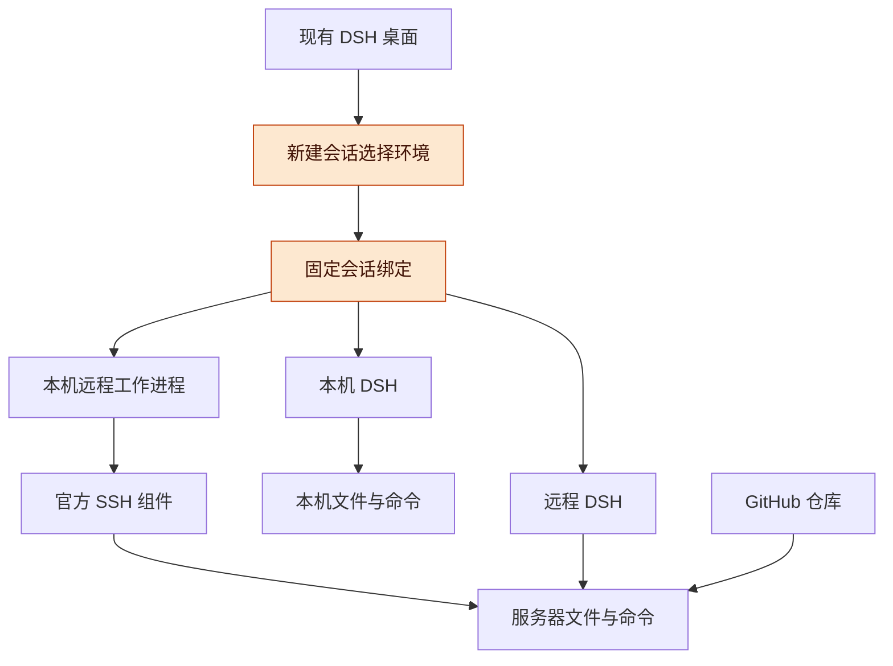
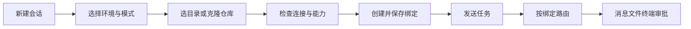
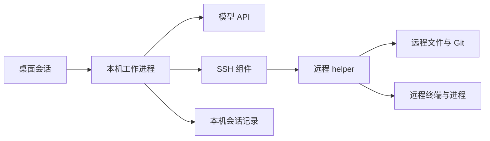
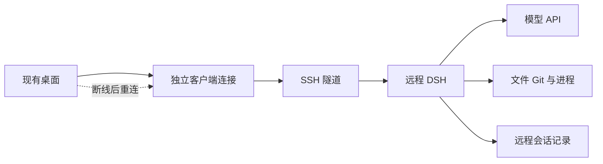
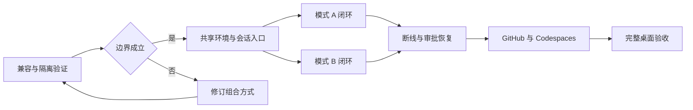

# DSH 远程工作区与双运行模式讨论稿 v0.1.0

> 公开整理版；源版本：0.1.0；整理日期：2026-11-06。保留原稿历史阶段，未重新运行或复测。内部项目实例、个人原话与私有地址不作为公开附件。


2026-11-03 · TaiShuo / Codex 协作整理

## 版本与范围

DSH 应在每次新建会话时选择运行环境，并在同一个桌面中同时保留本机会话、SSH 远程操作会话和远程 DSH 会话。两种远程模式共用环境、项目、连接和会话入口，执行与断线语义分别实现。

- 版本：v0.1.0，首次整理双模式方案、按会话选择环境的交互、HTML 前端草图、实施阶段和验收标准。后续修改按补丁号递增。
- 主线：已确认需求 → 总体架构 → 源码依据 → 会话与工作区 → 双模式执行 → 前端草图 → GitHub 接入 → 实施与验收。
- 状态标记：**已确认**指本次用户明确选择；**已核实**指已读源码或官方文档；**提案**指本稿的设计；**待验证**指尚未通过真实环境验证。所有前端数据均为演示数据。

本稿交付设计和评审原型。本轮未改动 DSH 或项目工作台的实现，未安装远程组件，未启动远程任务，也未创建收费云资源。

## 已确认需求与总体架构

产品入口按会话选择环境，选择一次后由系统把该会话的消息、文件、终端、审批和任务状态路由到固定目标。

| 项目 | 状态 | 约定 |
| --- | --- | --- |
| 保留现有 DSH 桌面体验 | 已确认 | 在原桌面交互内完成新建、交谈、文件查看和任务管理 |
| 两种远程方式都做 | 已确认 | A 为本机 Agent 操作远端；B 为远程 DSH 运行 Agent |
| 何时选择环境 | 已确认 | 每个会话开始时选择，按用户提出的交互方式设计 |
| 会话进行中改环境 | 提案 | 创建后保持绑定；需要换环境时新建会话，迁移历史另行设计 |
| 同侧栏列出不同环境的会话 | 提案 | 会话带简短环境标识，支持筛选；切换会话不切断其他连接 |
| 首个真实验证目标 | 已确认 | 先接一台已有 SSH 服务器，随后接 Codespaces；具体机器待选择 |
| 本机关闭后的行为 | 提案 | A 不承诺 Agent 继续；B 在远程服务正常时继续，遇到审批等待用户 |

**图 1　总体架构 · 一个桌面、三种会话入口**



从桌面向下读，三种会话共用入口；A 与 B 的差别是 Agent 运行的位置，不是代码来自哪个 GitHub 仓库。

## 已核实依据与复用边界

现有组件已经提供 SSH 执行和多客户端连接的基础，主要缺口在会话身份、桌面多连接组合、远程工作区和插件适配。

| 类别 | 代表与来源 | 核实到的内容 | 缺口 |
| --- | --- | --- | --- |
| SSH 执行 | [官方 SSH 子系统](https://github.com/deepseek-ai/deepseek-harness/blob/master/docs/subsystems/ssh.md) | 文件、进程、终端和沙箱可以位于远端；Harness、模型通信和会话存储留在本机 | 文档明确指出工作区界面需要单独适配 |
| SSH 生命周期 | [官方 SSH 组件](https://github.com/deepseek-ai/deepseek-harness/blob/master/packages/ssh/ssh/README.md) | Linux/macOS 端点、OpenSSH 配置、helper 校验；失联会触发受管资源清理 | 不提供自动部署、透明重连或有歧义动作的重放 |
| 多客户端连接 | [官方 Connection 文档](https://github.com/deepseek-ai/deepseek-harness/blob/master/packages/client/connection/README.md) | 自定义 carrier 和独立 Context 可让多个客户端树在同一 realm 使用不同连接 | 不能据此认定现有所有 UI、缓存和插件已经支持多后端 |
| 桌面壳 | [官方桌面说明](https://github.com/deepseek-ai/deepseek-harness/blob/master/apps/desktop/README.md) | Electron 包装共享 Web UI，负责本机 Host 启动、认证、HTTP 和 WebSocket 连接 | 远程 Host 的生命周期、凭据与插件加载需要接入 |
| 工作区注册 | [Workspace 说明](https://github.com/deepseek-ai/deepseek-harness/blob/master/packages/workspace/workspace/README.md) | 工作区以规范化目录区分，会话与目录关系持久化 | 跨机器的相同路径不能继续仅靠路径字符串判定身份 |
| 项目工作台 | 本地 `dsh-project-workbench` 源码 | `server/worktrees.js` 直接使用本机 Git 和文件系统；`server/native.js` 使用当前 Host 的会话和工作区服务 | A 需要改造文件/Git 调用；B 需要按所属 Host 加载和调用插件 |

**证据版本**：本地 DSH 检出为 `687f282e8625c6b8d11ff58211a90524be2e4317`，提交日期 2026-10-17；工作台检出为 `1c093d9e6d8e984c838da530100edccf4f941c73`。本稿同时参考本次读取的上游文档；本地检出、上游默认分支和实际安装的桌面版本可能不同。实施前必须锁定三者的兼容基线。

**本轮判断的修正**：先前只把桌面多后端视为待调查扩展点；进一步查到上游连接层已明确支持多个独立客户端树。因此优先验证复用这一能力，不先另造通信协议。当前已安装桌面是否包含同一能力仍待核实。

## 会话、环境和目录的身份设计

每个会话必须同时记录“谁运行 Agent”和“在哪里操作文件”，所有 UI 和命令都从这个绑定获取目标。

| 对象 | 提案字段 | 用途 |
| --- | --- | --- |
| 环境 | `environmentId`、类型、SSH 别名或 Codespace 标识、显示名称 | 确定文件与进程所在的环境；显示名和隧道端口变化不改变身份 |
| DSH 运行实例 | `runtimeId`、运行位置、连接方式、版本与能力 | 确定会话、模型调用、审批和任务的归属 |
| 连接代次 | `connectionGeneration`、后端启动标识 | 重连后废弃旧订阅和旧响应；与持久身份分开 |
| 工作区 | `runtimeId`、`environmentId`、`workspaceId`、规范路径、Git 信息 | 防止不同机器的同名路径混用 |
| 会话引用 | `runtimeId`、`sessionId` | UI 缓存、侧栏、标签和通知的联合键 |
| 会话执行绑定 | 模式、环境、运行实例、工作区、权限配置版本 | 创建时持久化；服务端校验，不能由模型临时改写 |

**图 2　新建会话流程 · 创建后绑定固定**



从左到右完成一次选择，之后切换侧栏会话只改变正在查看的绑定，不修改已经运行的任务。

**创建原子性**：生成创建请求 ID，先验证环境，再由对应 Host 创建会话并返回身份。网络超时后查询该请求是否完成；未核实结果前不重复创建。草稿中的目录选择失败不产生半个可运行会话。

**连接隔离**：每个运行实例拥有自己的客户端 Context、传输、凭据和订阅。共享侧栏只聚合带运行实例标识的摘要；文件面板、终端、审批弹层和通知点击都必须携带会话引用。插件资源及缓存也按实例和版本隔离。

**能力检查**：新会话创建前检查所需的文件读写、Git、终端、沙箱、模型访问和插件能力。缺失项在界面说明，并阻止依赖这些能力的动作。首版不允许自动落回本机执行。

## 模式 A：本机 Agent 操作远程工作区

A 优先复用官方 SSH provider，并为不同执行环境隔离本机运行配置，避免一次环境选择改变其他会话的文件系统。

**图 3　模式 A · 会话在本机，文件与命令在远端**



从左到右看，模型调用与会话记录留在本机，执行工具通过同一远程环境访问文件和进程。

**隔离提案**：首轮验证比较两种方式：会话级 provider 作用域，或每个远程环境一个可复用的本机 DSH 工作进程。优先选能证明文件、进程、权限和存储隔离的方案；若会话级作用域不足，使用独立工作进程。不是每个会话都启动一个后端，也不替换整个桌面的全局 provider。

| 工作项 | 具体内容 | 完成依据 |
| --- | --- | --- |
| 远程环境接入 | 读取指定 SSH 别名、检查连接与 helper 版本 | 环境身份与握手结果可追踪 |
| 工作区能力 | 远程目录浏览、规范路径、文件读写、搜索、差异、Git 和工作树 | 同一环境的文件树、工具输出和 Git 结果一致 |
| 插件适配 | 工作台把文件和 Git 操作委托给执行环境接口；插件自身配置和会话存储仍归本机运行实例 | 不将所有 `node:fs` 调用机械改成远程操作 |
| 子任务 | 原生子任务继承会话绑定；外部 Codex/Claude 等组件单独核对运行位置 | 不支持远程的组件明确不可用，不偷偷在本机跑 |
| 失联行为 | 停止新动作，显示连接和执行结果的不确定性，恢复后核对记录 | 不重放可能已执行的修改或命令 |

官方 helper 的断连清理与“永久后台任务”不是同一种语义。A 的首版不承诺本机关闭后 Agent 或受管命令继续；需要可靠后台运行时使用 B，或后续单独设计独立任务托管能力。[SSH 生命周期依据](https://github.com/deepseek-ai/deepseek-harness/blob/master/packages/ssh/ssh/README.md)

## 模式 B：桌面连接远程 DSH

B 让远端 DSH 拥有会话和任务，本机桌面负责交互；关闭一个标签或切换到其他会话，不应终止远端工作。

**图 4　模式 B · 后端与会话记录常驻远端**



从左到右看，SSH 隧道传输界面请求和事件，远程 DSH 自己管理 Agent；图中重连是设计目标，需用真实任务验证。

**复用与新增**：复用现有 Remote RPC、事件流和会话 API；新增桌面运行实例注册、认证 carrier、按会话选择客户端 Context、跨实例会话摘要以及环境目录浏览。HTTP、WebSocket、文件上传下载和插件资源必须使用同一个实例身份。

**前端组合验证**：先验证同一 renderer 中多个独立客户端树能否正确加载插件和缓存。若 UI 存在无法局部隔离的全局状态，再评估每个远程实例使用受隔离的嵌入视图，同时由桌面壳统一侧栏。两者都保留“新会话选择环境”的交互；P0 阶段应形成明确选择，不让两个实现长期并存。

**远端部署**：锁定 DSH、插件和 helper 版本，使用独立运行目录与会话存储。依照现有规则，长任务用 `screen -dmS` 启动并验证；本轮不执行部署。桌面不传输整个本机配置目录，B 的模型凭据在远端受保护地配置，或使用另行设计的授权方式。连接重试不触发重新安装或重新启动正在运行的服务。

**连接与任务分开**：断线意味着桌面暂时无法观察，不代表远程任务停止或仍在运行。显示“连接中断，任务状态待核实”；重新认证后读取任务快照和事件进度。请求 ID 用于查询已受理的提交，不能把“重连”实现为“再发一次任务”。

**审批与本机能力**：需要用户审批的步骤保留在远端等待，重连后回到正确会话。依赖本机浏览器、桌面控制或本机文件的工具，首版不自动转发；工具运行位置作为能力声明，缺失时明确告知。无人值守不等于自动批准所有操作。

## 前端草图与 HTML 评审原型

前端把环境选择放在新会话的输入区附近，侧栏和会话顶部保留环境标识；运行方式的说明只在选择与异常处理时展开。

| 区域 | 需要展示的内容 | 交互约定 |
| --- | --- | --- |
| 新会话 | 环境选择、项目目录或 GitHub 仓库、开始按钮 | 发出首条消息前完成环境与模式选择 |
| 环境选择面板 | 本机、服务器列表、SSH 操作或远程 DSH、可用状态 | 一台服务器可以提供两种模式，名称解释 Agent 在哪里运行 |
| 侧栏 | 会话名称、简短环境标识、任务状态或最后已知状态 | 不通过颜色单独区分；切换会话不改变其他任务 |
| 会话顶部 | 环境、运行方式、工作区、连接状态 | 已开始的会话不能原地改环境；“在其他环境新建”另开会话 |
| 文件和终端 | 当前会话对应环境的文件和进程 | 不提供含糊的本机同名路径兜底 |
| 断线与审批 | 失联原因、最后更新时间、重连入口或待审批操作 | 不显示未经核实的“仍在运行”，重连不重复执行 |

**原型阅读方式**：下方 HTML 块是前端草图的正本；由同一块生成独立 HTML 文件，并嵌入讨论稿 HTML 阅读版。按钮只改变演示数据，未实现 GitHub 登录、SSH、模型调用或文件写入。示例服务器 `dev-linux`、仓库 `example/private-repo` 和所有会话均为虚构。

**界面草图 · 可切换本机、A、B 和异常状态**

<!-- FRONTEND_PROTOTYPE_START -->
```html
<!doctype html>
<html lang="zh-CN">
<head>
<meta charset="utf-8">
<meta name="viewport" content="width=device-width, initial-scale=1">
<title>DSH 远程会话 · 前端评审原型</title>
<style>
:root{color-scheme:light;--bg:#f8f9fc;--panel:#fff;--ink:#202430;--muted:#687080;--line:#e5e8ef;--blue:#5267df;--soft:#eef1ff;--warn:#8d5b11}
*{box-sizing:border-box}body{margin:0;background:var(--bg);color:var(--ink);font:14px/1.55 -apple-system,BlinkMacSystemFont,"PingFang SC","Microsoft YaHei",sans-serif}button,input,select,textarea{font:inherit}button{cursor:pointer}button:focus-visible,input:focus-visible,select:focus-visible,textarea:focus-visible{outline:3px solid #9fafff;outline-offset:2px}button:disabled{cursor:not-allowed;opacity:.5}.shell{min-height:780px;display:grid;grid-template-columns:244px minmax(0,1fr)}.sidebar{background:#f0f2f7;border-right:1px solid var(--line);padding:24px 16px}.brand{font-size:18px;font-weight:720;letter-spacing:-.4px;margin-bottom:24px}.brand small{display:block;font-size:11px;font-weight:500;letter-spacing:1px;color:var(--muted);margin-top:4px}.primary{border:0;border-radius:10px;background:var(--blue);color:white;padding:10px 16px;font-weight:600}.new{width:100%;text-align:left;margin-bottom:24px}.label{font-size:11px;color:var(--muted);letter-spacing:1px;text-transform:uppercase}.sessions{display:grid;gap:6px;margin-top:10px}.session{text-align:left;border:1px solid transparent;background:none;padding:12px 10px;border-radius:10px;color:var(--ink);width:100%}.session.active{background:white;border-color:var(--line)}.session-title{display:block;font-weight:600}.session-meta{display:block;font-size:11px;color:var(--muted);margin-top:5px}.sidebar-note{margin-top:36px;font-size:12px;color:var(--muted)}.main{min-width:0;display:flex;flex-direction:column}.topbar{min-height:64px;padding:16px 26px;border-bottom:1px solid var(--line);display:flex;gap:12px;align-items:center;justify-content:space-between;background:var(--panel)}.badge{display:inline-flex;align-items:center;gap:6px;background:var(--soft);border:1px solid #dce2ff;color:#4b5bb0;border-radius:6px;padding:3px 8px;font-size:11px;white-space:nowrap}.draft-badge{background:#f3f4f7;border-color:var(--line);color:var(--muted)}.content{width:100%;max-width:1000px;margin:auto;padding:34px 38px}.eyebrow{font-size:11px;letter-spacing:1.5px;color:var(--blue);font-weight:650}h1{font-size:28px;line-height:1.25;margin:8px 0 10px;letter-spacing:-.6px}h2{font-size:15px;margin:0}.muted{color:var(--muted)}.lead{margin:0 0 26px}.chooser{background:var(--panel);border:1px solid var(--line);border-radius:16px;padding:22px;box-shadow:0 5px 24px #22283c04}.section-head{display:flex;align-items:center;justify-content:space-between;gap:12px;margin-bottom:15px}.cards{display:grid;grid-template-columns:repeat(3,minmax(0,1fr));gap:10px}.mode-card{text-align:left;border:1px solid var(--line);border-radius:12px;background:white;padding:16px;min-height:138px;color:var(--ink)}.mode-card.active{border:2px solid var(--blue);background:#f7f8ff;padding:15px}.mode-card strong{display:block;font-size:14px;margin:8px 0 5px}.mode-card small{display:block;color:var(--muted);font-size:12px;line-height:1.55}.mode-mark{font-size:11px;color:var(--blue);font-weight:650}.fields{display:grid;grid-template-columns:1fr 1.5fr;gap:16px;margin-top:20px}.field{display:block;font-size:12px;color:var(--muted)}.field select,.field input{display:block;width:100%;margin-top:7px;padding:10px 11px;background:white;color:var(--ink);border:1px solid #d9dfea;border-radius:8px;min-width:0}.field select:disabled{background:#f6f7fa}.tabs{display:flex;gap:8px;margin:19px 0 10px}.tab,.quiet{border:1px solid var(--line);border-radius:7px;background:white;color:var(--muted);padding:6px 10px;font-size:12px}.tab[aria-pressed=true]{background:var(--soft);border-color:#cdd6ff;color:#4354b4}.repo{display:none;margin-top:12px}.repo.visible{display:block}.help{font-size:12px;line-height:1.7;color:var(--muted);padding:12px 14px;background:#f7f8fb;border-radius:8px;margin:16px 0 0}.composer{margin-top:18px;background:white;border:1px solid var(--line);border-radius:14px;padding:16px}.composer textarea{width:100%;border:0;resize:vertical;min-height:74px;color:var(--ink);outline-offset:4px}.composer-footer{display:flex;justify-content:space-between;align-items:center;gap:16px}.footnote{font-size:11px;color:var(--muted)}.demo-toolbar{margin-top:24px;border-top:1px solid var(--line);padding-top:16px;display:flex;flex-wrap:wrap;gap:8px;align-items:center}.demo-toolbar span{font-size:11px;color:var(--muted);margin-right:8px}.notice{padding:13px 15px;border-radius:10px;background:#fff7e9;border:1px solid #f0dfbc;margin-bottom:20px;color:var(--warn);font-size:12px}.notice button{margin-left:8px}.thread-header{display:flex;align-items:start;justify-content:space-between;gap:12px;margin-bottom:24px}.thread-header h1{font-size:24px}.thread-location{font-size:12px;color:var(--muted);overflow-wrap:anywhere}.message{padding:16px 18px;border:1px solid var(--line);border-radius:12px;margin:14px 0;background:white}.message.user{background:var(--soft);border:0;margin-left:56px}.message .who{font-size:11px;font-weight:650;color:var(--muted);margin-bottom:7px}.message p{margin:0}.detail-grid{display:grid;grid-template-columns:1fr 1fr;gap:12px}.detail{border:1px solid var(--line);border-radius:10px;background:white;padding:14px}.detail strong{font-size:12px}.detail code{display:block;background:#f5f6fa;border-radius:5px;padding:8px;margin-top:10px;font:11px/1.6 ui-monospace,monospace;white-space:pre-wrap;overflow-wrap:anywhere}.approval{border:1px solid #d8dff9;background:#f4f6ff;border-radius:10px;padding:16px;margin:16px 0}.approval p{font-size:12px}.approval .quiet{margin-right:8px}.toast{margin-top:12px;color:#3e5c96;font-size:12px;min-height:18px}[hidden]{display:none!important}
@media(max-width:1000px){.shell{grid-template-columns:204px minmax(0,1fr)}.sidebar{padding:20px 12px}.content{padding:26px 22px}.cards{grid-template-columns:1fr}.mode-card{min-height:0;padding:12px 14px}.mode-card.active{padding:11px 13px}.mode-card strong{margin:2px 0}.mode-card small{font-size:11px}.fields{grid-template-columns:1fr}}
@media(max-width:620px){.shell{display:block}.sidebar{border-right:0;border-bottom:1px solid var(--line);padding:14px}.brand{margin-bottom:10px}.brand small,.sidebar-note{display:none}.new{width:auto;margin:0}.sessions{grid-template-columns:repeat(3,minmax(0,1fr));gap:4px}.sidebar>.label{margin-top:12px}.session{padding:9px 6px}.session-title{font-size:11px}.session-meta{font-size:10px}.content{padding:24px 16px}.topbar{padding:12px 16px}.detail-grid{grid-template-columns:1fr}.thread-header{display:block}.message.user{margin-left:20px}.composer-footer{align-items:flex-start}.composer-footer .footnote{max-width:60%}}
</style>
</head>
<body>
<div class="shell">
  <aside class="sidebar" aria-label="会话列表">
    <div class="brand">DeepSeek Harness<small>REMOTE WORKSPACES / CONCEPT</small></div>
    <button class="primary new" id="new-session">＋ 新建会话</button>
    <div class="label">最近会话 · 演示数据</div>
    <div class="sessions" id="session-list"></div>
    <p class="sidebar-note">每个会话拥有自己的环境。<br>切换查看，不改变运行位置。</p>
  </aside>
  <main class="main">
    <header class="topbar"><span id="top-title">新建会话</span><span class="badge draft-badge">设计原型 · 未连接服务器</span></header>
    <div class="content">
      <section id="new-view" aria-labelledby="new-title">
        <div class="eyebrow">START A SESSION</div><h1 id="new-title">这次在哪里工作？</h1>
        <p class="lead muted">选择环境和项目，然后像平时一样开始对话。</p>
        <div class="chooser">
          <div class="section-head"><h2>运行方式</h2><span class="footnote">仅影响这次新会话</span></div>
          <div class="cards" aria-label="选择运行方式">
            <button class="mode-card" data-mode="local" aria-pressed="false"><span class="mode-mark">LOCAL</span><strong>本机</strong><small>Agent、文件和命令<br>都在这台电脑上。</small></button>
            <button class="mode-card" data-mode="ssh" aria-pressed="false"><span class="mode-mark">MODE A · SSH</span><strong>本机 Agent · 远程目录</strong><small>在本机对话与调度，<br>使用服务器上的文件和工具。</small></button>
            <button class="mode-card active" data-mode="remote" aria-pressed="true"><span class="mode-mark">MODE B · REMOTE DSH</span><strong>远程 Agent · 远程目录</strong><small>Agent 在服务器上工作，<br>本机只负责交互和查看。</small></button>
          </div>
          <div class="fields">
            <label class="field">执行环境<select id="environment"><option value="local" hidden>这台电脑</option><option value="ssh" selected>dev-linux · SSH 服务器</option><option value="codespaces">Codespaces · 演示环境</option></select></label>
            <label class="field">工作目录<input id="directory" value="/workspaces/demo-project" aria-describedby="mode-help"></label>
          </div>
          <div class="tabs" aria-label="项目来源"><button class="tab" data-source="existing" aria-pressed="true">已有目录</button><button class="tab" data-source="github" aria-pressed="false">从 GitHub 克隆</button></div>
          <label class="field repo" id="repo-field">GitHub 仓库<input id="repository" value="example/private-repo" placeholder="owner/repository"></label>
          <p class="help" id="mode-help"></p>
        </div>
        <div class="composer"><label class="field" for="prompt">任务</label><textarea id="prompt" placeholder="描述这次要完成的任务…">查看项目结构，整理下一步修改计划。</textarea><div class="composer-footer"><span class="footnote">原型仅模拟创建会话。<br>不会克隆代码或执行命令。</span><button class="primary" id="start">开始会话（演示）</button></div></div>
      </section>
      <section id="thread-view" hidden aria-labelledby="thread-title">
        <div class="thread-header"><div><div class="eyebrow">SESSION WORKSPACE</div><h1 id="thread-title"></h1><div class="thread-location" id="thread-location"></div></div><span class="badge" id="thread-badge"></span></div>
        <div class="notice" id="connection-notice" hidden role="status"><span id="notice-copy"></span><button class="quiet" id="reconnect">重新连接（演示）</button></div>
        <div class="message user"><div class="who">你 · 演示消息</div><p id="user-prompt"></p></div>
        <div class="message"><div class="who">DSH · 演示响应</div><p id="agent-copy"></p></div>
        <div class="detail-grid"><div class="detail"><strong id="file-label"></strong><code>demo-project/
  src/
  tests/
  README.md</code></div><div class="detail"><strong id="terminal-label"></strong><code id="terminal-copy"></code></div></div>
        <div class="approval" id="approval" hidden><h2>需要你确认 · 演示审批</h2><p id="approval-copy"></p><button class="primary" id="approve">批准本次（演示）</button> <button class="quiet" id="deny">拒绝（演示）</button></div>
        <div class="composer"><label class="field" for="followup">继续对话</label><textarea id="followup" placeholder="继续描述任务…"></textarea><div class="composer-footer"><span class="footnote" id="thread-footnote">这个会话的运行环境已经固定。</span><button class="primary" id="send">发送（演示）</button></div></div>
      </section>
      <div class="demo-toolbar"><span>评审场景</span><button class="quiet" id="demo-local">本机会话</button><button class="quiet" id="demo-ssh">模式 A 会话</button><button class="quiet" id="demo-remote">模式 B 会话</button><button class="quiet" id="demo-offline">模拟断线</button><button class="quiet" id="demo-approval">模拟待审批</button></div>
      <div class="toast" id="toast" role="status" aria-live="polite"></div>
    </div>
  </main>
</div>
<script>
const $=id=>document.getElementById(id);
const labels={local:'本机',ssh:'本机 Agent · SSH',remote:'远程 DSH'};
const descriptions={local:'Agent、文件和命令都在本机。退出应用后，Agent 不继续工作。',ssh:'Agent 留在本机，文件、Git 和命令在选定服务器。本机休眠或断线后，Agent 无法继续推进；受管进程的状态需要重新核实。',remote:'Agent 和会话记录留在远端。本机离线时，只要远程服务正常且没有等待审批，任务可以继续。重连后读取实际状态。'};
let mode='remote',source='existing',current=null;
const sessions=[{id:'demo-1',title:'梳理前端布局',mode:'local',env:'这台电脑',path:'/demo/local-project',status:'已完成',prompt:'梳理前端布局，整理可改进的地方。'},{id:'demo-2',title:'验证项目测试',mode:'ssh',env:'dev-linux',path:'/workspaces/demo-tests',status:'已完成',prompt:'在远程环境验证项目测试。'},{id:'demo-3',title:'整理接口文档',mode:'remote',env:'dev-linux',path:'/workspaces/demo-api',status:'处理中',prompt:'根据项目代码整理接口文档。'}];
function notify(message){$('toast').textContent=message;}
function sidebar(){const container=$('session-list');container.replaceChildren();sessions.forEach(s=>{const b=document.createElement('button');b.className='session'+(s.id===current?.id?' active':'');b.setAttribute('aria-current',s.id===current?.id?'true':'false');const title=document.createElement('span');title.className='session-title';title.textContent=s.title;const meta=document.createElement('span');meta.className='session-meta';meta.textContent=s.env+' · '+labels[s.mode]+' · '+s.status;b.append(title,meta);b.onclick=()=>openSession(s);container.append(b);});}
function setMode(value){const selector=$('environment');if(value==='local')selector.value='local';else if(selector.value==='local')selector.value='ssh';mode=value;selector.querySelector('option[value="local"]').hidden=mode!=='local';document.querySelectorAll('[data-mode]').forEach(b=>{b.classList.toggle('active',b.dataset.mode===mode);b.setAttribute('aria-pressed',String(b.dataset.mode===mode));});selector.disabled=mode==='local';$('directory').value=mode==='local'?'/demo/local-project':'/workspaces/demo-project';$('mode-help').textContent=descriptions[mode]+(selector.value==='codespaces'&&mode!=='local'?' Codespaces 还受到环境停止和计费规则约束。':'');}
function saveDraft(){if(current)current.draft=$('followup').value;}
function newSession(){saveDraft();current=null;$('new-view').hidden=false;$('thread-view').hidden=true;$('top-title').textContent='新建会话';notify('');sidebar();}
function openSession(s){saveDraft();current=s;$('followup').value=s.draft||'';$('new-view').hidden=true;$('thread-view').hidden=false;$('top-title').textContent=s.title;$('thread-title').textContent=s.title;$('thread-location').textContent=s.env+' / '+s.path;$('thread-badge').textContent=labels[s.mode];$('user-prompt').textContent=s.prompt;$('file-label').textContent='文件 · '+s.env;$('terminal-label').textContent='终端 · '+s.env;$('terminal-copy').textContent='示例工作目录：'+s.path+'\n命令目标：'+s.env+'\n此处没有真实终端连接。';$('agent-copy').textContent=s.status==='连接中断'?'连接中断，当前任务状态待核实。':s.status==='待审批'?'等待你确认当前会话的操作。':'这是该会话的演示视图。文件、终端和审批都随会话绑定到 '+s.env+'，不会影响其他会话。';$('connection-notice').hidden=s.status!=='连接中断';$('notice-copy').textContent=s.mode==='remote'?'与远程 DSH 的连接中断。任务状态待核实，重新连接不会重复提交任务。':s.mode==='ssh'?'SSH 连接中断。Agent 已停止发出新动作，受管命令的结果待核实。':'本机服务连接中断。任务状态待核实。';$('approval').hidden=s.status!=='待审批';$('approval-copy').textContent='会话「'+s.title+'」请求在 '+s.env+' / '+s.path+' 内安装测试依赖。原型不会执行此操作。';$('send').disabled=s.status==='连接中断';$('followup').disabled=s.status==='连接中断';$('thread-footnote').textContent=s.status==='连接中断'?'离线时保留草稿，重新连接后由你发送。':'这个会话的运行环境已经固定。';sidebar();notify('');}
document.querySelectorAll('[data-mode]').forEach(b=>b.onclick=()=>setMode(b.dataset.mode));
document.querySelectorAll('[data-source]').forEach(b=>b.onclick=()=>{source=b.dataset.source;document.querySelectorAll('[data-source]').forEach(t=>t.setAttribute('aria-pressed',String(t.dataset.source===source)));$('repo-field').classList.toggle('visible',source==='github');});
$('environment').onchange=()=>setMode(mode);$('new-session').onclick=newSession;
$('start').onclick=()=>{if(!$('directory').value.trim()||!$('prompt').value.trim()||(source==='github'&&!$('repository').value.trim())){notify('请填写目录、任务，以及所选的仓库。');return;}const s={id:'demo-created-'+(sessions.length+1),title:'新任务 · '+labels[mode],mode,env:mode==='local'?'这台电脑':$('environment').value==='codespaces'?'Codespaces 示例':'dev-linux',path:$('directory').value.trim(),status:'处理中',prompt:$('prompt').value.trim()};sessions.unshift(s);openSession(s);notify('已创建演示会话；未建立任何真实连接。');};
$('demo-local').onclick=()=>openSession(sessions.find(s=>s.id==='demo-1'));$('demo-ssh').onclick=()=>openSession(sessions.find(s=>s.id==='demo-2'));$('demo-remote').onclick=()=>openSession(sessions.find(s=>s.id==='demo-3'));
$('demo-offline').onclick=()=>{const s=current||sessions.find(s=>s.id==='demo-3');s.previousStatus=s.status==='连接中断'?s.previousStatus:s.status;s.status='连接中断';openSession(s);};
$('reconnect').onclick=()=>{if(!current)return;current.status=current.previousStatus||'处理中';openSession(current);notify('演示：重新读取状态，没有重新提交任务。');};
$('demo-approval').onclick=()=>{const s=current||sessions.find(s=>s.id==='demo-3');if(s.status==='连接中断'){notify('请先模拟重连，再查看待审批场景。');return;}s.status='待审批';openSession(s);};
$('approve').onclick=()=>{if(!current)return;current.status='处理中';openSession(current);notify('演示：只批准当前会话的本次操作，没有执行真实命令。');};
$('deny').onclick=()=>{if(!current)return;current.status='等待输入';openSession(current);notify('演示：拒绝当前操作，保留会话。');};
$('send').onclick=()=>{if(!$('followup').value.trim()){notify('请输入演示消息。');return;}notify('演示消息仅发送到当前会话「'+current.title+'」，实际未调用后端。');$('followup').value='';};
setMode('remote');sidebar();
</script>
</body>
</html>
```
<!-- FRONTEND_PROTOTYPE_END -->

**原型覆盖与限制**：可检查环境选择、GitHub 来源切换、会话创建、侧栏切换、断线后禁止发送、重连不重复创建，以及审批归属。原型不代表这些能力已经在 DSH 实现。UI 选择的是环境与模式，底层的 Context、provider、请求 ID 等细节不出现在普通任务流程中。

**本版检查记录**：讨论稿结构自检为 0 个错误；浏览器已验证三种入口、GitHub 来源切换、模拟创建、断线禁用发送、会话草稿隔离、重连恢复待审批，以及批准只影响当前演示会话。阅读版的 5 张架构图和 1 个内嵌原型已渲染。上述检查仅针对本地草图，未进行 DSH 后端、SSH、Codespaces 或真实模型验收；原型数据只保存在页面内存，刷新会重置。

## GitHub 与 Codespaces 接入

GitHub 仓库作为代码来源，SSH 服务器和 Codespaces 作为执行环境，两者分别建模，避免把仓库 URL 当成可执行目录。

| 路线 | 首版动作 | 扩展动作 | 约束 |
| --- | --- | --- | --- |
| SSH 服务器＋GitHub | 选已登记服务器与目录；可在该环境克隆指定仓库 | 分支选择、工作树、提交与推送、PR | 目录里有未提交内容时先显示差异，不重置已有工作 |
| Codespaces＋模式 B | 选择已有 Codespace，建立连接，检查远程 DSH | 创建与启动环境、保存环境模板 | SSH 和端口连接只是基础，DSH 兼容性需实际验证 |
| Codespaces＋模式 A | 验证 SSH provider 所需的连接复用、Unix socket 转发与 helper | 能力验证通过后显示为可选模式 | 不因 `gh codespace ssh` 能连就宣称完整兼容 |
| 仅 GitHub 文件读写 | 可作为未来轻量审阅工具 | 通过 API 读文件、产生提交 | 不等同于完整开发环境，无法替代运行测试的机器 |

GitHub CLI 提供 Codespaces 的 SSH 连接，官方文档同时描述环境的自动停止和存储持久化边界。[CLI 文档](https://cli.github.com/manual/gh_codespace_ssh)、[生命周期](https://docs.github.com/en/codespaces/about-codespaces/understanding-the-codespace-lifecycle)

**凭据与数据**：连接服务器的 SSH 凭据、访问 GitHub 的凭据和 B 的模型凭据分开管理，界面只保存引用。默认不自动转发本机 SSH agent，不整体复制本机配置。代码通过 GitHub 管理，大于 100 MB 的数据按现有规则走 HuggingFace，隐私内容使用私有存储。工作区里的未提交内容保存在实际执行环境中，不把重连当作上传或备份成功。

**费用呈现**：连接已有 SSH 机器不等于免费，但不必自动新增云资源；Codespaces 的计算与存储费用单独展示。创建或启动收费环境前显示操作范围，不能把用户选择仓库直接解释为创建新机器。[Codespaces 计费说明](https://docs.github.com/en/billing/concepts/product-billing/github-codespaces)

## 实施阶段与改动范围

先打通“一个桌面内两个独立后端”的最小验证，再建立共享会话入口，随后分别实现 A 与 B，最后补齐异常恢复、GitHub 和 Codespaces。

**图 5　实施依赖 · 按通过条件推进**



从左到右按依赖推进，A 和 B 可以在接口稳定后分别开发；图中的分支是工程分工，不代表本轮已经安排多代理或并行实施。

| 阶段 | 具体交付 | 进入下一阶段的条件 | 工作量判断 |
| --- | --- | --- | --- |
| P0：兼容与隔离 | 实际安装版本清单；两个 Context 同窗实验；A provider 作用域实验；插件加载实验 | 本机、A、B 身份模型明确；选定多前端与 A 隔离方式 | 中；决定后续排期 |
| P1：共享入口 | 环境注册、能力状态、联合身份、新建会话选择器、侧栏环境标识 | 两个环境的同名目录和会话 ID 不串；创建超时可查询 | 中到高 |
| P2A：A 闭环 | 一个 SSH 环境完成读文件、改文件、Git 差异、测试、终端和工作树 | 所有结果来自同一执行环境；子任务绑定可核实 | 高；远程路径假设较多 |
| P2B：B 闭环 | 远程 DSH 连接、会话消息、文件与终端、插件能力加载 | 两个后端的会话可在同一桌面交替查看与发送 | 中到高；前端隔离待验证 |
| P3：生命周期 | 区分连接/Agent/进程状态；请求去重；审批恢复；事件补齐 | 断网、桌面退出、重连不会重复任务或批准错会话 | 高；需要真实故障场景 |
| P4：仓库与云环境 | GitHub 克隆与分支；已有 Codespace 接入；能力检查与费用说明 | 在目标环境完成工作流；A/B 兼容性分别记录 | 中；受环境限制影响 |
| P5：交付与维护 | 兼容矩阵、功能开关、插件清单、升级与回退说明、验收记录 | 本机功能回归通过，远程数据保留，关闭功能不删工作区 | 中 |

**建议顺序**：P0 → P1 → P2B 的最小消息闭环 → P2A 的最小执行闭环 → 补齐两者文件/Git/终端 → P3 → P4 → P5。先验证多后端消息隔离可以较早暴露“每会话选择环境”的主要风险；不把完成整套 A 作为开始 B 的前提。

**源码位置**：共享桌面连接预计涉及 `apps/desktop`、`packages/client/connection`、`packages/api/gateway` 和相关客户端启动装配；会话入口涉及 `packages/client/ui-workspace` 与 workspace/session API；A 涉及 `packages/ssh`、工作区文件和 Git 能力；工作台涉及 `server/native.js`、`server/worktrees.js`、项目存储和客户端会话引用。以上是候选改动范围，不是已批准的逐文件任务单。

**工作台适配原则**：优先抽出执行环境接口，区分插件自己的本机元数据与项目文件。项目、工作线程和工作树必须记录环境归属；首版同一项目的工作线程继承该项目环境，跨机器派发作为后续独立能力，不能因为侧栏支持多环境就默认允许。

## 验收标准与失败处理

验收要证明所有操作去了正确的机器，并在断线后保留真实状态；仅能列目录或成功建立 SSH 连接不算完成。

| 编号 | 场景 | 必须观察到的结果 |
| --- | --- | --- |
| V01 | 同一桌面同时有本机、A、B 会话 | 交替发送、查看文件与终端时，目标、日志和审批均一致 |
| V02 | 两台机器目录同名、后端会话 ID 相同 | 缓存、标签、搜索、通知均按联合身份区分 |
| V03 | 远程文件修改与 Git 差异 | 文件内容、哈希、Git 差异与执行命令所在机器一致 |
| V04 | A 连接丢失 | 停止新动作；显示受管命令结果待核实，不自动重放修改 |
| V05 | B 运行时退出桌面再打开 | 正在执行的任务不因界面退出被重新提交；重连读取同一任务记录 |
| V06 | B 在无人连接时需要审批 | 操作保持待审批；重连后批准只作用于原会话与原操作 |
| V07 | 任务提交已受理但响应丢失 | 通过请求 ID 查询；只有一条任务，不产生重复改动 |
| V08 | 远程 DSH 重启、Codespace 停止 | 区分进程终止和界面失联；检查日志与断点后决定如何恢复 |
| V09 | 文件预览、上传、下载和插件 UI | 均按当前会话所属实例访问，文件位置和凭据不混用 |
| V10 | 能力或版本不兼容 | 显示明确原因；不悄悄关闭权限检查或切回本机执行 |
| V11 | 子任务、工作树和外部子代理 | 继承正确环境；无法支持的组合明确禁用并解释 |
| V12 | 两种模式访问同一仓库 | 写操作使用独立工作树或显式协调；不自动同时修改同一工作目录 |

**三类状态**：连接状态记录“连接中、已连接、失联”；Agent 状态记录“运行、等待审批、完成、失败或未知”；独立进程状态记录其实际执行结果。失联时可保留最后已知状态及时间，但不得显示为刚刚确认的状态。

**停止与恢复边界**：切换会话、关闭标签和断开 UI 连接不等于停止 B；明确点击“停止任务”才发送停止动作。服务器程序崩溃先检查可补救的日志和断点，按用户规则修复并继续；无法补救时才提出重跑。不得为了重连而杀掉已有服务或任务。

## 成本与排期原则

两种模式共用会话入口和连接身份可以减少重复开发，但 A 的远程文件语义与 B 的远程任务生命周期需要分别完成，不能合并成一次“远程连接成功”的验收。

| 成本 | A | B | 共用部分 |
| --- | --- | --- | --- |
| 本机资源 | 本机 DSH、会话和可能的环境工作进程 | 桌面、连接和有限缓存 | UI、连接池、摘要缓存 |
| 远程资源 | helper、项目依赖和执行进程 | 完整 DSH、插件、会话记录和执行进程 | 项目副本、Git、测试依赖 |
| 工程重点 | 文件路径、工具执行、工作树和权限的一致性 | 多客户端装配、凭据隔离、断线与审批恢复 | 环境注册、会话绑定、入口与状态展示 |
| 持续维护 | helper 与本机 runtime 的兼容 | 桌面、远程 DSH 与插件的兼容 | 版本协商、诊断、回归测试 |
| 使用费用 | 服务器使用量和模型调用 | 服务器常驻及可能更多持续模型调用 | Codespaces 计算与存储需单独核算 |

**排期提案**：先按阶段与通过条件管理，不在 P0 之前承诺总工期。P0 必须回答多个客户端树是否隔离、A 能否按会话注入 provider、已安装版本差异多大、工作台哪些服务只能访问本机。取得结果后给出 P1–P5 的人日区间和关键路径；不把两种模式分别开发的工期简单相加，也不假设并行就能减半。

**首版边界**：先覆盖 macOS 桌面与一台 Linux SSH 环境，保留已有本机工作流；Codespaces 纳入后续验证阶段。Windows 远程端点、会话实时跨机器迁移、跨机器多 Agent 派发和统一远程桌面控制不作为首版承诺。若用户另选首个验证环境，则调整阶段次序，不更改每会话选择的产品目标。

## 风险与开放问题

主要风险是路径、连接和权限在不同环境间混用；首版应优先证明这些边界，而不是先扩展服务器数量。

- **多连接基础不等于完整多后端 UI**：前端全局变量、插件模块注册和资源缓存仍可能冲突，需要 P0 的实际组合验证。
- **老版本与上游差异**：本地源码与安装包可能不同；先记录版本再定实现范围，避免直接把最新文档当成本机能力。
- **本机工具与远程工具混用**：浏览器、桌面控制、文件选择和外部子代理需要标注执行位置；默认继承不了的能力不得静默启用。
- **远端失联后任务状态不明**：B 的设计目标是保持任务运行，但任何界面都不能在无法观察时保证任务仍在执行。
- **同仓库多写者**：A/B 可指向同一服务器，但并发修改应隔离工作树并核对基线；已有未提交内容不能丢失。
- **云环境生命周期**：Codespaces 停止会影响进程；仅把桌面关闭不能等价为无限时长运行。
- **桌面升级影响适配**：连接与工作区扩展尽量沿官方接口实现，必要核心改动单独记录并保持范围可审查。

开放问题：

- [ ] 已确认先 SSH、后 Codespaces；首个验证使用哪台服务器、哪个隔离目录和测试项目？
- [ ] 允许对 DSH 桌面做小范围源码改造，还是优先坚持插件形式？P0 先给出实际可行边界。
- [ ] 首版需要携带哪些现有插件：项目工作台、DAG、浏览器或其他？每项分别核对环境依赖。
- [ ] B 的模型凭据采用远端独立配置，还是未来建设统一凭据授权服务？首版建议独立配置。
- [ ] 新会话是否记住上一次选择？建议记住项目偏好，但每次发送前始终显示实际环境。

## 待证命题与下一步

下一步先确认本稿的产品交互，再用最小验证收紧实现边界；原型通过不代表远程执行已经验收。

| 编号 | 命题 / 猜想 | 已有依据 | 缺口 |
| --- | --- | --- | --- |
| P1 | 一个桌面可通过多客户端树承载独立 DSH 后端 | Connection 官方文档支持独立 Context 和 carrier | 完整 UI、插件加载与缓存隔离实测 |
| P2 | A 可复用官方 SSH 组件实现完整远程工作区 | 已有远程文件、进程和沙箱接口 | 工作区界面、Git 和工作台路径适配 |
| P3 | B 在本机退出后可继续任务并恢复查看 | 后端与客户端可分离，会话存在远端 | 提交、断线、审批与事件恢复的端到端验证 |
| P4 | GitHub 与执行环境解耦可同时覆盖 SSH 和 Codespaces | GitHub 提供代码仓库，Codespaces 提供 SSH 接入 | helper 转发能力、环境生命周期及版本兼容 |
| P5 | 一套会话绑定可覆盖三种入口并避免串机器 | 本稿的联合身份与固定绑定设计 | 原生会话、插件、文件、通知和子任务的全链验证 |

下一步：

- [x] 确认保留 DSH 桌面，并把两种远程模式同时纳入方案。
- [x] 确认环境选择发生在每个会话开始时。
- [x] 确认先接已有 SSH 服务器，随后接 Codespaces。
- [x] 核对官方 SSH、客户端连接和桌面边界，并阅读工作台相关实现。
- [x] 编写带 HTML 草图的讨论稿，生成可评审的前端原型。
- [x] 完成讨论稿结构检查、架构图渲染检查及本地原型交互检查。
- [ ] 根据用户对草图的反馈更新为 v0.1.1，保留本版决策依据。
- [ ] 确认验证环境、安装版本和允许的插件/桌面改造范围。
- [ ] 在实施授权明确后执行 P0，记录可复用接口与实际失败点。
- [ ] 根据 P0 结果提交具体改动范围、任务拆分与工期，再开始实现。
