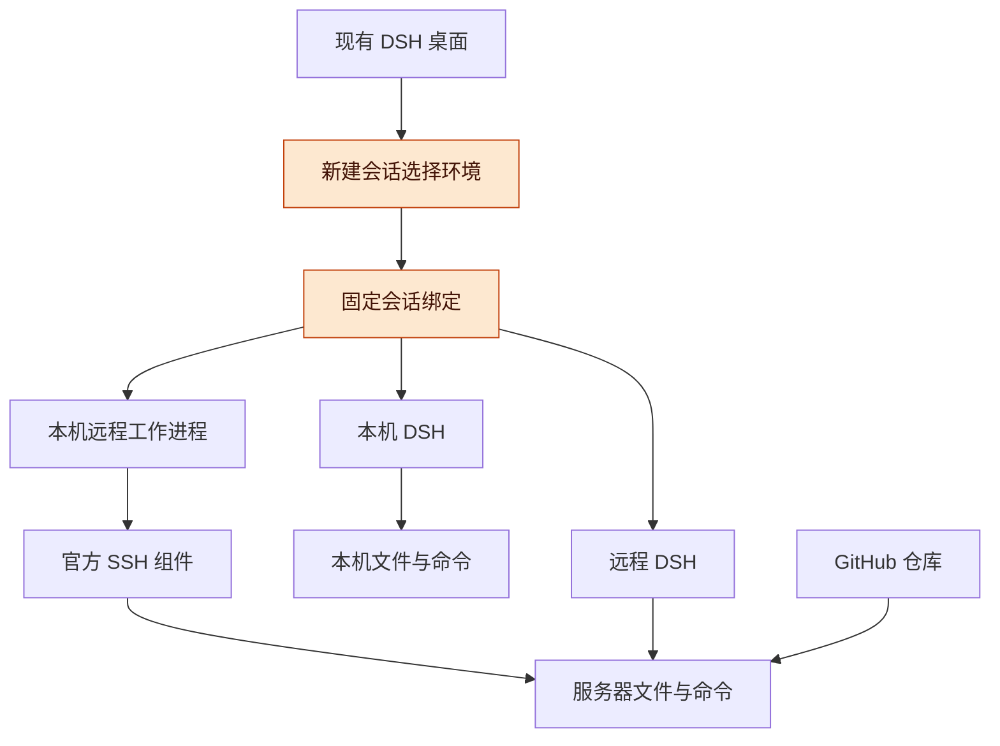
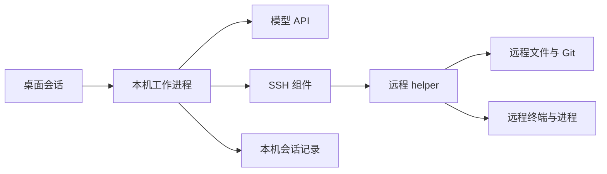
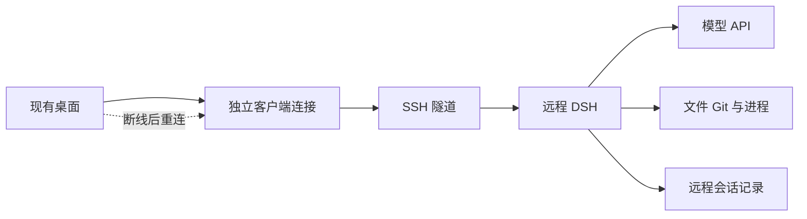
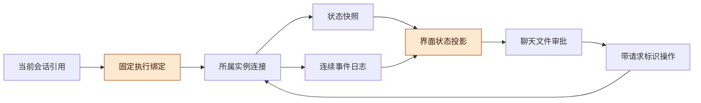
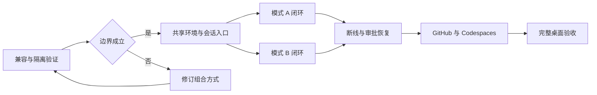

# DSH 远程工作区与双运行模式讨论稿 v0.1.1

> 公开整理版；源版本：0.1.1；整理日期：2026-11-06。保留原稿历史阶段，未重新运行或复测。内部项目实例、个人原话与私有地址不作为公开附件。

2026-11-04 · TaiShuo / Codex 协作整理

## 版本与范围

DSH 应在每次新建会话时选择运行环境，并在同一个桌面中同时保留本机会话、SSH 远程操作会话和远程 DSH 会话。两种远程模式共用环境、项目、连接和会话入口，执行与断线语义分别实现。

- 版本：v0.1.1，接收 Claude 设计交接包，核对原会话与六张状态截图，补充原型行为修正、rc.5 升级后的插件兼容检查、首批任务与验收；v0.1.0，首次整理双模式方案、按会话选择环境的交互、HTML 前端草图、实施阶段和验收标准。后续修改按补丁号递增。
- 主线：已确认需求 → 总体架构 → 源码依据 → 会话与工作区 → 双模式执行 → 设计交接与行为修正 → GitHub 接入 → 首批实施与验收。
- 状态标记：**已确认**指已从上一会话核对的用户明确选择；**已核实**指本轮读取的文件、截图与本地源码，或单独注明的上一版证据；**提案**指本稿的设计；**待验证**指尚未通过真实环境验证。所有前端数据均为演示数据。

本稿接续上一会话最后的“Claude 设计稿回来后更新方案、整理实现任务”。本轮交付设计核对与实施提案，原型和服务器数据均为演示；尚未改动 DSH 或项目工作台实现、连接测试服务器或安装远程组件。

## 已确认需求与总体架构

产品入口按会话选择环境，选择一次后由系统把该会话的消息、文件、终端、审批和任务状态路由到固定目标。

| 项目 | 状态 | 约定 |
| --- | --- | --- |
| 保留现有 DSH 桌面体验 | 已确认 | 在原桌面交互内完成新建、交谈、文件查看和任务管理 |
| 两种远程方式都做 | 已确认 | A 为本机 Agent 操作远端；B 为远程 DSH 运行 Agent |
| 何时选择环境 | 已确认 | 每个会话开始时选择，按用户提出的交互方式设计 |
| 会话进行中改环境 | 提案 | 创建后保持绑定；需要换环境时新建会话，迁移历史另行设计 |
| 同侧栏列出不同环境的会话 | 提案 | 会话带简短环境标识，支持筛选；切换会话不切断其他连接 |
| 首个真实验证目标 | 已确认 | 先接一台已有 SSH 服务器，随后接 Codespaces；具体机器待选择 |
| 本机关闭后的行为 | 提案 | A 不承诺 Agent 继续；B 在远程服务正常时继续，遇到审批等待用户 |

**图 1　总体架构 · 一个桌面、三种会话入口**

从桌面向下读，三种会话共用入口；A 与 B 的差别是 Agent 运行的位置，不是代码来自哪个 GitHub 仓库。

## 已核实依据与复用边界

现有组件已经提供 SSH 执行和多客户端连接的基础，主要缺口在会话身份、桌面多连接组合、远程工作区和插件适配。

| 类别 | 代表与来源 | 核实到的内容 | 缺口 |
| --- | --- | --- | --- |
| SSH 执行 | [官方 SSH 子系统](https://github.com/deepseek-ai/deepseek-harness/blob/master/docs/subsystems/ssh.md) | 文件、进程、终端和沙箱可以位于远端；Harness、模型通信和会话存储留在本机 | 文档明确指出工作区界面需要单独适配 |
| SSH 生命周期 | [官方 SSH 组件](https://github.com/deepseek-ai/deepseek-harness/blob/master/packages/ssh/ssh/README.md) | Linux/macOS 端点、OpenSSH 配置、helper 校验；失联会触发受管资源清理 | 不提供自动部署、透明重连或有歧义动作的重放 |
| 多客户端连接 | [官方 Connection 文档](https://github.com/deepseek-ai/deepseek-harness/blob/master/packages/client/connection/README.md) | 自定义 carrier 和独立 Context 可让多个客户端树在同一 realm 使用不同连接 | 不能据此认定现有所有 UI、缓存和插件已经支持多后端 |
| 桌面壳 | [官方桌面说明](https://github.com/deepseek-ai/deepseek-harness/blob/master/apps/desktop/README.md) | Electron 包装共享 Web UI，负责本机 Host 启动、认证、HTTP 和 WebSocket 连接 | 远程 Host 的生命周期、凭据与插件加载需要接入 |
| 工作区注册 | [Workspace 说明](https://github.com/deepseek-ai/deepseek-harness/blob/master/packages/workspace/workspace/README.md) | 工作区以规范化目录区分，会话与目录关系持久化 | 跨机器的相同路径不能继续仅靠路径字符串判定身份 |
| 项目工作台 | 本地 `dsh-project-workbench` 源码 | `server/worktrees.js` 直接使用本机 Git 和文件系统；`server/native.js` 使用当前 Host 的会话和工作区服务 | A 需要改造文件/Git 调用；B 需要按所属 Host 加载和调用插件 |

**证据版本**：本地 DSH 检出为 `687f282e8625c6b8d11ff58211a90524be2e4317`，提交日期 2026-10-17；工作台检出为 `1c093d9e6d8e984c838da530100edccf4f941c73`。两者均已在本轮重新核对。v0.1.0 同时参考当时读取的上游文档；本地检出、上游默认分支和实际安装的桌面版本可能不同。实施前必须锁定三者的兼容基线。

**v0.1.0 的核实修正**：先前只把桌面多后端视为待调查扩展点；进一步查到上游连接层已明确支持多个独立客户端树。因此优先验证复用这一能力，不先另造通信协议。当前已安装桌面是否包含同一能力仍待核实。

**v0.1.1 本轮核实**：最初读取安装包时为 rc.3；用户随后更新到 rc.5，本轮已用 `Info.plist` 与内置 CLI `--version` 双重确认当前为 **0.2.1-rc.5**。本地源码仍为上表的 `687f282e…`（rc.2）。后续实施以 rc.5 为兼容目标，不能直接把旧检出的接口当作 rc.5 的完整依据。

**已有插件的本机兼容检查**：工作台的实际发布快照 `16aa0cd4d2c4` 与当前源码相同；DAG 实际发布快照为 `20261027-c053761-13b497b`，后台构建号 `3ec06b9f`，与工作区源码不同，已按发布版测试。工作台的真实会话创建/加入、DAG 的页面/图读取/热更新、workspace-activity 的客户端资源加载在隔离 rc.5 Host 上通过。Chrome 自动化契约检查通过，现有原生宿主已重新连上 rc.5。**两个子代理仍固定为 rc.3，被 rc.5 兼容性检查拒绝加载**；主 profile 的官方 `plugin list` 和隔离 Host 均确认这一点。完整结果、升级候选与未测项见 [rc.5 插件兼容测试记录](<DSH-rc.5-插件兼容测试记录-2026-11-04.md>)。这些是本机兼容结果，尚不代表远程环境或多 Host 组合通过。

**可直接继续调查的接口**：本地 `packages/client/connection/README.md` 与 `src/client/index.ts:222` 明确每次 `installConnection` 安装 Context 自有服务；`packages/api/session-controller/README.md:34` 说明 prompt 使用 `requestId` 避免重复入队，`:54` 说明 `SessionEventStream`、`RemoteJournalStream` 与 `SessionControlStream` 的恢复机制。优先复用这些接口，创建请求的去重能力仍需单独核实，不能由 prompt 去重推导出来。

**证据范围**：本轮对本地固定提交与文件进行核对；上表在线链接及下文 Codespaces 生命周期、费用资料继承 v0.1.0 的调查，本轮未重新联网核对。正式接入 Codespaces 前刷新官方资料。

## 会话、环境和目录的身份设计

每个会话必须同时记录“谁运行 Agent”和“在哪里操作文件”，所有 UI 和命令都从这个绑定获取目标。

| 对象 | 提案字段 | 用途 |
| --- | --- | --- |
| 环境 | `environmentId`、类型、SSH 别名或 Codespace 标识、显示名称 | 确定文件与进程所在的环境；显示名和隧道端口变化不改变身份 |
| DSH 运行实例 | `runtimeId`、运行位置、连接方式、版本与能力 | 确定会话、模型调用、审批和任务的归属 |
| 连接代次 | `connectionGeneration`、后端启动标识 | 重连后废弃旧订阅和旧响应；与持久身份分开 |
| 工作区 | `runtimeId`、`environmentId`、`workspaceId`、规范路径、Git 信息 | 防止不同机器的同名路径混用 |
| 会话引用 | `runtimeId`、`sessionId` | UI 缓存、侧栏、标签和通知的联合键 |
| 会话执行绑定 | 模式、环境、运行实例、工作区、权限配置版本 | 创建时持久化；服务端校验，不能由模型临时改写 |

**图 2　新建会话流程 · 创建后绑定固定**

从左到右完成一次选择，之后切换侧栏会话只改变正在查看的绑定，不修改已经运行的任务。

**创建原子性**：生成创建请求 ID，先验证环境，再由对应 Host 创建会话并返回身份。网络超时后查询该请求是否完成；未核实结果前不重复创建。草稿中的目录选择失败不产生半个可运行会话。

**连接隔离**：每个运行实例拥有自己的客户端 Context、传输、凭据和订阅。共享侧栏只聚合带运行实例标识的摘要；文件面板、终端、审批弹层和通知点击都必须携带会话引用。插件资源及缓存也按实例和版本隔离。

**能力检查**：新会话创建前检查所需的文件读写、Git、终端、沙箱、模型访问和插件能力。缺失项在界面说明，并阻止依赖这些能力的动作。首版不允许自动落回本机执行。

## 模式 A：本机 Agent 操作远程工作区

A 优先复用官方 SSH provider，并为不同执行环境隔离本机运行配置，避免一次环境选择改变其他会话的文件系统。

**图 3　模式 A · 会话在本机，文件与命令在远端**

从左到右看，模型调用与会话记录留在本机，执行工具通过同一远程环境访问文件和进程。

**隔离提案**：首轮验证比较两种方式：会话级 provider 作用域，或每个远程环境一个可复用的本机 DSH 工作进程。优先选能证明文件、进程、权限和存储隔离的方案；若会话级作用域不足，使用独立工作进程。不是每个会话都启动一个后端，也不替换整个桌面的全局 provider。

| 工作项 | 具体内容 | 完成依据 |
| --- | --- | --- |
| 远程环境接入 | 读取指定 SSH 别名、检查连接与 helper 版本 | 环境身份与握手结果可追踪 |
| 工作区能力 | 远程目录浏览、规范路径、文件读写、搜索、差异、Git 和工作树 | 同一环境的文件树、工具输出和 Git 结果一致 |
| 插件适配 | 工作台把文件和 Git 操作委托给执行环境接口；插件自身配置和会话存储仍归本机运行实例 | 不将所有 `node:fs` 调用机械改成远程操作 |
| 子任务 | 原生子任务继承会话绑定；外部 Codex/Claude 等组件单独核对运行位置 | 不支持远程的组件明确不可用，不偷偷在本机跑 |
| 失联行为 | 停止新动作，显示连接和执行结果的不确定性，恢复后核对记录 | 不重放可能已执行的修改或命令 |

官方 helper 的断连清理与“永久后台任务”不是同一种语义。A 的首版不承诺本机关闭后 Agent 或受管命令继续；需要可靠后台运行时使用 B，或后续单独设计独立任务托管能力。[SSH 生命周期依据](https://github.com/deepseek-ai/deepseek-harness/blob/master/packages/ssh/ssh/README.md)

## 模式 B：桌面连接远程 DSH

B 让远端 DSH 拥有会话和任务，本机桌面负责交互；关闭一个标签或切换到其他会话，不应终止远端工作。

**图 4　模式 B · 后端与会话记录常驻远端**

从左到右看，SSH 隧道传输界面请求和事件，远程 DSH 自己管理 Agent；图中重连是设计目标，需用真实任务验证。

**复用与新增**：复用现有 Remote RPC、事件流和会话 API；新增桌面运行实例注册、认证 carrier、按会话选择客户端 Context、跨实例会话摘要以及环境目录浏览。HTTP、WebSocket、文件上传下载和插件资源必须使用同一个实例身份。

**前端组合验证**：先验证同一 renderer 中多个独立客户端树能否正确加载插件和缓存。若 UI 存在无法局部隔离的全局状态，再评估每个远程实例使用受隔离的嵌入视图，同时由桌面壳统一侧栏。两者都保留“新会话选择环境”的交互；P0 阶段应形成明确选择，不让两个实现长期并存。

**远端部署**：锁定 DSH、插件和 helper 版本，使用独立运行目录与会话存储。依照现有规则，长任务用 `screen -dmS` 启动并验证；本轮不执行部署。桌面不传输整个本机配置目录，B 的模型凭据在远端受保护地配置，或使用另行设计的授权方式。连接重试不触发重新安装或重新启动正在运行的服务。

**连接与任务分开**：断线意味着桌面暂时无法观察，不代表远程任务停止或仍在运行。显示“连接中断，任务状态待核实”；重新认证后读取任务快照和事件进度。请求 ID 用于查询已受理的提交，不能把“重连”实现为“再发一次任务”。

**审批与本机能力**：需要用户审批的步骤保留在远端等待，重连后回到正确会话。依赖本机浏览器、桌面控制或本机文件的工具，首版不自动转发；工具运行位置作为能力声明，缺失时明确告知。无人值守不等于自动批准所有操作。

## 前端设计接收与评审

新交接包覆盖了已确定的主要交互，可作为前端视觉与信息布局的实现依据；产品运行语义仍以真实 DSH 状态与本稿的会话绑定为准。

> 公开整理时略去非公开项目实例或个人会话来源；通用设计仍见本节其他内容。

**包的完整性**：Downloads 中 `harness-remote-ui.zip` 与 `harness-remote-ui_1.zip` 均为 1,501,561 字节，SHA-256 均为 `3befa37e8713ca9818bc06d09645097b613149c154c428e1186db12fb5678ba5`。压缩包有 20 个成员，其中 16 个文件；已解压文件逐一与 zip 内容匹配。设计原件保存在本任务的 inputs/harness-remote-ui（原文引用，未随公开文档附带），没有修改原交接包。

| 界面名 | 对应旧方案 | Agent 位置 | 文件与命令位置 | 生命周期文案 |
| --- | --- | --- | --- | --- |
| 本机 | 本机会话 | 本机 | 本机 | 依赖本机运行；恢复能力按实际状态说明 |
| 远程目录 | A | 本机 | 所选 SSH 服务器 | 本机需要开启并联网；失联后停止发出新操作，核对已有操作结果 |
| 远程托管 | B | 服务器上的 DSH | 所选服务器 | 远程服务正常时可继续；失联时只能显示最后已知状态 |

**视觉结论**：保留环境摘要默认收起、三种方式卡、机器可用原因、工具执行位置、文件/差异/终端的机器标签、断线保留草稿、跨会话审批提示。浅色布局与颜色加文字、图标的区分方式可沿用。包内新侧栏按状态分组；是否替换现有 DSH 的项目/会话导航尚未决定，首批建议先把环境控件接入现有导航与会话视图，再评审整体侧栏改版。

| 设计状态 | 包内截图 | 本轮核对 | 实施时补齐 |
| --- | --- | --- | --- |
| 新会话收起 | new.png（原文引用，未随公开文档附带） | 摘要能显示 Agent 和文件位置 | 无可用环境、目录失效、输入草稿恢复 |
| 环境选择展开 | new-open.png（原文引用，未随公开文档附带） | 三种方式、不可用机器原因、Codespaces 占位 | 选择有效性、目录浏览、远程认证与克隆结果归属 |
| 远程会话工作中 | session.png（原文引用，未随公开文档附带） | 顶栏、工具卡与文件面板都有位置标识 | 每项读取同一持久绑定，切换后旧响应不可覆盖新面板 |
| 环境管理 | env.png（原文引用，未随公开文档附带） | 能展示检查、支持模式与安装入口 | 安装进度/失败、版本协商、完整编辑语义 |
| 断线 | offline.png（原文引用，未随公开文档附带） | 明确状态未知、显示最后同步、保留可编辑草稿 | 重连失败、日志缺口、仍待审批、远端重启 |
| 审批 | approval.png（原文引用，未随公开文档附带） | 会话、机器、目录、命令、原因与影响可定位 | 重复响应、过期请求、断线时禁用、权限规则范围 |

**设计截图 · 以下均为包内演示数据**

（原图未随公开稿附带）

（原图未随公开稿附带）

（原图未随公开稿附带）

（原图未随公开稿附带）

（原图未随公开稿附带）

（原图未随公开稿附带）

**原型入口**：独立 HTML 原型（原文引用，未随公开文档附带）、交接说明（原文引用，未随公开文档附带）、设计源码（原文引用，未随公开文档附带）。`start=session/new/new-open/env/offline/approval` 用于选择演示初始状态。本版阅读视图只展示静态截图与说明，不自动执行该原型；不复用其极简模板运行时。

**本版检查记录**：已完成 zip 与解压目录一致性核对、六张截图逐张阅读、交接说明及 `Component` 的静态审阅。浏览器策略拒绝本地 `file://` 页面，未完成本版原型点击测试。v0.1.0 的交互通过记录仅属于旧草图，不能转用于新包。SSH、远程 DSH、GitHub 克隆及模型调用尚未实测。

## 原型到产品的行为修正

原型足以表达界面，但它的计时器、内存状态和简化数据模型需要在接入真实后端时替换；以下是源码核对得到的具体缺口，不是已复现的浏览器故障。

| 编号 | 已核实的现状与来源 | 产品实现要求 |
| --- | --- | --- |
| R01 会话身份与草稿 | HANDOFF §6 仅以 `sessionId` 保存草稿；Main:844 为内存对象 | 延续本稿 `(runtimeId, sessionId)` 联合身份，草稿持久化，窗口重开后按原会话恢复；认证信息使用引用 |
| R02 状态与重连 | HANDOFF §8 要求按服务器状态恢复；Main:953–967 固定设为 done，标记工具完成并追加虚构步骤 | 将连接状态、Agent 状态和操作结果分别保存；按 Host 快照与连续事件恢复，可能回到运行、审批、完成、失败；时间仅用于展示，恢复使用实际序列/游标 |
| R03 克隆回调归属 | Main:886–898 捕获原机器和目标，完成时直接写 `z.ne.dir`；选择器仍可改机器 | 克隆请求绑定机器、目标与操作 ID；切换选择后完成通知仍归原机器，只有当前选择仍匹配才自动选中；查询已有结果，不因超时重复 clone |
| R04 创建时能力检查 | Main:875–883 在无匹配机器时保留旧选择；Main:908–937 未验证模式/机器/目录组合，空任务会替换为演示任务 | 无可用机器时阻止提交并说明原因；Host 创建时重新校验能力、规范路径、写权限和输入；选择失效不自动回落本机，也不替用户发送默认任务 |
| R05 安装与版本 | Main:1013–1019 在计时器后标成已安装；HANDOFF 使用虚构 `harness-agent 0.9.x` | 托管现有 DSH 支持的 profile、插件与会话存储，验证真实版本和能力；安装是独立操作，支持进度与错误；重连不重装、不重启已有任务 |
| R06 审批授权 | Main:849、1258 的 remember 是界面全局布尔值；decide 不消费它；批准后立即生成成功结果 | 审批以运行实例、会话、请求 ID 和有效代次定位；批准是提交决定，执行结果另等 Host 返回；“同类”规则未定义前首批禁用该复选框，后续接现有权限机制并显示规则范围 |
| R07 环境编辑与凭据 | Main:1023–1035 编辑仅改显示名，新增机器直接构造能力；Main:1174 假定已登录 GitHub 账号可供所选机器使用 | 编辑名称与修改连接目标分开；已运行会话保留原端点绑定或配置版本；SSH 可达、Git 可用、仓库授权、DSH 健康分别检查，本机登录不自动等于远端授权 |
| R08 退出与恢复承诺 | HANDOFF §3 将本机关机概括成暂停；本地桌面 Host 有 shutdown 流程，SSH provider 失联会清理受管资源 | 文案不承诺自动续跑；区分休眠、退出、断网、远端服务退出。远程目录不声称失联期间 Agent 持续执行；远程托管也要以重连后的证据报告结果 |

**图 5　界面与真实状态 · 展示值由会话绑定导出**

从会话引用找到唯一运行实例，再把快照与日志投影到界面；请求始终返回同一实例，重连不产生第二次业务操作。

**建议默认值**：首批保留手动重连入口；底层恢复机制按既有 Connection 策略复用，不在 UI 额外复制重试循环。拒绝审批后显示已拒绝，由 Agent 实际后续决定是否完成。日志保存周期和重试参数使用部署配置，完成 P0 后再定具体值。

## GitHub 与 Codespaces 接入

GitHub 仓库作为代码来源，SSH 服务器和 Codespaces 作为执行环境，两者分别建模，避免把仓库 URL 当成可执行目录。

| 路线 | 首版动作 | 扩展动作 | 约束 |
| --- | --- | --- | --- |
| SSH 服务器＋GitHub | 选已登记服务器与目录；可在该环境克隆指定仓库 | 分支选择、工作树、提交与推送、PR | 目录里有未提交内容时先显示差异，不重置已有工作 |
| Codespaces＋模式 B | 选择已有 Codespace，建立连接，检查远程 DSH | 创建与启动环境、保存环境模板 | SSH 和端口连接只是基础，DSH 兼容性需实际验证 |
| Codespaces＋模式 A | 验证 SSH provider 所需的连接复用、Unix socket 转发与 helper | 能力验证通过后显示为可选模式 | 不因 `gh codespace ssh` 能连就宣称完整兼容 |
| 仅 GitHub 文件读写 | 可作为未来轻量审阅工具 | 通过 API 读文件、产生提交 | 不等同于完整开发环境，无法替代运行测试的机器 |

GitHub CLI 提供 Codespaces 的 SSH 连接，官方文档同时描述环境的自动停止和存储持久化边界。[CLI 文档](https://cli.github.com/manual/gh_codespace_ssh)、[生命周期](https://docs.github.com/en/codespaces/about-codespaces/understanding-the-codespace-lifecycle)

**凭据与数据**：连接服务器的 SSH 凭据、访问 GitHub 的凭据和 B 的模型凭据分开管理，界面只保存引用。默认不自动转发本机 SSH agent，不整体复制本机配置。代码通过 GitHub 管理，大于 100 MB 的数据按现有规则走 HuggingFace，隐私内容使用私有存储。工作区里的未提交内容保存在实际执行环境中，不把重连当作上传或备份成功。

**费用呈现**：连接已有 SSH 机器不等于免费，但不必自动新增云资源；Codespaces 的计算与存储费用单独展示。创建或启动收费环境前显示操作范围，不能把用户选择仓库直接解释为创建新机器。[Codespaces 计费说明](https://docs.github.com/en/billing/concepts/product-billing/github-codespaces)

## 实施阶段与改动范围

先打通“一个桌面内两个独立后端”的最小验证，再建立共享会话入口，随后分别实现 A 与 B，最后补齐异常恢复、GitHub 和 Codespaces。

**图 6　实施依赖 · 按通过条件推进**

从左到右按依赖推进，A 和 B 可以在接口稳定后分别开发；图中的分支是工程分工，不代表本轮已经安排多代理或并行实施。

| 阶段 | 具体交付 | 进入下一阶段的条件 | 工作量判断 |
| --- | --- | --- | --- |
| P0：兼容与隔离 | 实际安装版本清单；两个 Context 同窗实验；A provider 作用域实验；插件加载实验 | 本机、A、B 身份模型明确；选定多前端与 A 隔离方式 | 中；决定后续排期 |
| P1：共享入口 | 环境注册、能力状态、联合身份、新建会话选择器、侧栏环境标识 | 两个环境的同名目录和会话 ID 不串；创建超时可查询 | 中到高 |
| P2A：A 闭环 | 一个 SSH 环境完成读文件、改文件、Git 差异、测试、终端和工作树 | 所有结果来自同一执行环境；子任务绑定可核实 | 高；远程路径假设较多 |
| P2B：B 闭环 | 远程 DSH 连接、会话消息、文件与终端、插件能力加载 | 两个后端的会话可在同一桌面交替查看与发送 | 中到高；前端隔离待验证 |
| P3：生命周期 | 区分连接/Agent/进程状态；请求去重；审批恢复；事件补齐 | 断网、桌面退出、重连不会重复任务或批准错会话 | 高；需要真实故障场景 |
| P4：仓库与云环境 | GitHub 克隆与分支；已有 Codespace 接入；能力检查与费用说明 | 在目标环境完成工作流；A/B 兼容性分别记录 | 中；受环境限制影响 |
| P5：交付与维护 | 兼容矩阵、功能开关、插件清单、升级与回退说明、验收记录 | 本机功能回归通过，远程数据保留，关闭功能不删工作区 | 中 |

**建议顺序**：P0 → P1 → P2B 的最小消息闭环 → P2A 的最小执行闭环 → 补齐两者文件/Git/终端 → P3 → P4 → P5。先验证多后端消息隔离可以较早暴露“每会话选择环境”的主要风险；不把完成整套 A 作为开始 B 的前提。

**源码位置**：共享桌面连接预计涉及 `apps/desktop`、`packages/client/connection`、`packages/api/gateway` 和相关客户端启动装配；会话入口涉及 `packages/client/ui-workspace` 与 workspace/session API；A 涉及 `packages/ssh`、工作区文件和 Git 能力；工作台涉及 `server/native.js`、`server/worktrees.js`、项目存储和客户端会话引用。以上是候选改动范围，不是已批准的逐文件任务单。

**工作台适配原则**：优先抽出执行环境接口，区分插件自己的本机元数据与项目文件。项目、工作线程和工作树必须记录环境归属；首版同一项目的工作线程继承该项目环境，跨机器派发作为后续独立能力，不能因为侧栏支持多环境就默认允许。

## 首批实施任务与交付判据

首批实施先解决版本基线与会话路由，再把设计控件接到真实状态；在两种模式共用的身份模型稳定之前，不以完成全部 mock 页面作为产品进度。

| 任务 | 输入与候选代码范围 | 交付物 | 完成判据 |
| --- | --- | --- | --- |
| T01 锁定基线 | 已安装 rc.5、本地 rc.2、实测插件兼容表与子代理版本阻断 | 确定实施分支、对应版本与插件兼容表 | 能从隔离检出构建指定版本；不混用未验证版本的 Host/Client |
| T02 多实例验证 | `packages/client/connection`、API Gateway、桌面启动装配 | 两个独立客户端 Context 的最小消息与状态实验 | 两后端同 sessionId 不串消息、订阅、凭据或通知；退出一个不终止另一个 |
| T03 环境与会话绑定 | workspace/session API、新建会话入口 | 环境注册、能力检查、固定绑定、持久草稿 | 不兼容或失效的环境不能创建会话；草稿与面板按联合身份保存 |
| T04 接入设计控件 | 现有桌面技术栈与组件库 | 环境摘要/选择器、环境条、标识、异常提示、管理抽屉 | 演示源与真实后端适配可区分；六个设计状态有对应组件，未接通入口明确不可用 |
| T05 远程托管最小闭环 | 远端 DSH、SSH 隧道、SessionEventStream、文件/终端 API | 一个远程会话可发送、查看进展、断开后恢复 | 对同一任务重连；不重复 prompt；审批和文件始终来自该 Host |
| T06 远程目录最小闭环 | 本机隔离 runtime、官方 SSH providers、工作区与 Git | 一个隔离 SSH 项目的读写/差异/测试/终端 | 路径在同一远端解释；本地其他会话正常；中断动作结果显式待核对 |
| T07 仓库与故障场景 | 两模式已成立、指定测试仓与目录 | GitHub clone、异常/审批/草稿/重启验证记录 | V13–V22 的负向场景有实际结果，再进入 Codespaces 阶段 |

**首个实施提交建议**：T01 的兼容基线和 T02 的隔离实验，附选定方案与失败证据。之后 T03/T04 接真实状态，T05/T06 分别打通。界面骨架可先按设计制作，但不能据此报告“已经支持远程”。

**仍需在实施前确定的范围**：具体测试服务器与隔离目录；采用只做插件还是允许小范围桌面源码改动；首批随远程运行的插件清单。此前只确认了“已有 SSH 服务器”，没有确认这项功能可安装到任何一台现有服务器。建议先用专门的空测试项目，验证后再引入真实业务仓。

## 验收标准与失败处理

验收要证明所有操作去了正确的机器，并在断线后保留真实状态；仅能列目录或成功建立 SSH 连接不算完成。

| 编号 | 场景 | 必须观察到的结果 |
| --- | --- | --- |
| V01 | 同一桌面同时有本机、A、B 会话 | 交替发送、查看文件与终端时，目标、日志和审批均一致 |
| V02 | 两台机器目录同名、后端会话 ID 相同 | 缓存、标签、搜索、通知均按联合身份区分 |
| V03 | 远程文件修改与 Git 差异 | 文件内容、哈希、Git 差异与执行命令所在机器一致 |
| V04 | A 连接丢失 | 停止新动作；显示受管命令结果待核实，不自动重放修改 |
| V05 | B 运行时退出桌面再打开 | 正在执行的任务不因界面退出被重新提交；重连读取同一任务记录 |
| V06 | B 在无人连接时需要审批 | 操作保持待审批；重连后批准只作用于原会话与原操作 |
| V07 | 任务提交已受理但响应丢失 | 通过请求 ID 查询；只有一条任务，不产生重复改动 |
| V08 | 远程 DSH 重启、Codespace 停止 | 区分进程终止和界面失联；检查日志与断点后决定如何恢复 |
| V09 | 文件预览、上传、下载和插件 UI | 均按当前会话所属实例访问，文件位置和凭据不混用 |
| V10 | 能力或版本不兼容 | 显示明确原因；不悄悄关闭权限检查或切回本机执行 |
| V11 | 子任务、工作树和外部子代理 | 继承正确环境；无法支持的组合明确禁用并解释 |
| V12 | 两种模式访问同一仓库 | 写操作使用独立工作树或显式协调；不自动同时修改同一工作目录 |
| V13 | 在机器 A 克隆时切换到 B | 完成消息归 A；B 的目录和后续会话不被旧回调覆盖 |
| V14 | 选好环境后失联或能力失效 | Host 拒绝创建/发送并说明原因；不回落本机或替换用户任务 |
| V15 | 待审批时断线，再重连 | 审批保持原请求身份，响应只生效一次；连接恢复不直接变成完成 |
| V16 | 创建、prompt 或审批回执丢失 | 分别核实各接口去重/查询能力；通过记录确定结果，不直接重放 |
| V17 | 同名会话分别输入草稿后重启桌面 | 本机与两远端的草稿均按联合身份恢复，不串写 |
| V18 | 编辑一个已有会话使用的服务器地址 | 不静默将旧会话改指新主机；名称变化与执行绑定分开 |
| V19 | 本机已登录 GitHub、远端未授权 | 克隆报出目标环境的真实认证缺口；没有虚构成功或自动转移凭据 |
| V20 | 安装失败、版本不兼容或服务未启动 | 环境不能仅因版本字符串存在就显示托管可用；保留进度与失败原因 |
| V21 | 日志缺口、事件重复、旧连接迟到响应 | 使用连续游标与代次校验；不漏步骤、不重复显示、不覆盖新会话面板 |
| V22 | 1440×900 与较窄窗口、键盘操作 | 环境选择底部、审批按钮、抽屉表单可达；焦点返回正确，已有导航可用 |

**三类状态**：连接状态记录“连接中、已连接、失联”；Agent 状态记录“运行、等待审批、完成、失败或未知”；独立进程状态记录其实际执行结果。失联时可保留最后已知状态及时间，但不得显示为刚刚确认的状态。

**停止与恢复边界**：切换会话、关闭标签和断开 UI 连接不等于停止 B；明确点击“停止任务”才发送停止动作。服务器程序崩溃先检查可补救的日志和断点，按用户规则修复并继续；无法补救时才提出重跑。不得为了重连而杀掉已有服务或任务。

## 成本与排期原则

两种模式共用会话入口和连接身份可以减少重复开发，但 A 的远程文件语义与 B 的远程任务生命周期需要分别完成，不能合并成一次“远程连接成功”的验收。

| 成本 | A | B | 共用部分 |
| --- | --- | --- | --- |
| 本机资源 | 本机 DSH、会话和可能的环境工作进程 | 桌面、连接和有限缓存 | UI、连接池、摘要缓存 |
| 远程资源 | helper、项目依赖和执行进程 | 完整 DSH、插件、会话记录和执行进程 | 项目副本、Git、测试依赖 |
| 工程重点 | 文件路径、工具执行、工作树和权限的一致性 | 多客户端装配、凭据隔离、断线与审批恢复 | 环境注册、会话绑定、入口与状态展示 |
| 持续维护 | helper 与本机 runtime 的兼容 | 桌面、远程 DSH 与插件的兼容 | 版本协商、诊断、回归测试 |
| 使用费用 | 服务器使用量和模型调用 | 服务器常驻及可能更多持续模型调用 | Codespaces 计算与存储需单独核算 |

**排期提案**：先按阶段与通过条件管理，不在 P0 之前承诺总工期。P0 必须回答多个客户端树是否隔离、A 能否按会话注入 provider、已安装版本差异多大、工作台哪些服务只能访问本机。取得结果后给出 P1–P5 的人日区间和关键路径；不把两种模式分别开发的工期简单相加，也不假设并行就能减半。

**首版边界**：先覆盖 macOS 桌面与一台 Linux SSH 环境，保留已有本机工作流；Codespaces 纳入后续验证阶段。Windows 远程端点、会话实时跨机器迁移、跨机器多 Agent 派发和统一远程桌面控制不作为首版承诺。若用户另选首个验证环境，则调整阶段次序，不更改每会话选择的产品目标。

## 风险与开放问题

主要风险是路径、连接和权限在不同环境间混用；首版应优先证明这些边界，而不是先扩展服务器数量。

- **多连接基础不等于完整多后端 UI**：前端全局变量、插件模块注册和资源缓存仍可能冲突，需要 P0 的实际组合验证。
- **老版本与上游差异**：本地源码与安装包可能不同；先记录版本再定实现范围，避免直接把最新文档当成本机能力。
- **本机工具与远程工具混用**：浏览器、桌面控制、文件选择和外部子代理需要标注执行位置；默认继承不了的能力不得静默启用。
- **远端失联后任务状态不明**：B 的设计目标是保持任务运行，但任何界面都不能在无法观察时保证任务仍在执行。
- **同仓库多写者**：A/B 可指向同一服务器，但并发修改应隔离工作树并核对基线；已有未提交内容不能丢失。
- **云环境生命周期**：Codespaces 停止会影响进程；仅把桌面关闭不能等价为无限时长运行。
- **桌面升级影响适配**：连接与工作区扩展尽量沿官方接口实现，必要核心改动单独记录并保持范围可审查。

开放问题：

- [ ] 已确认先 SSH、后 Codespaces；首个验证使用哪台服务器、哪个隔离目录和测试项目？
- [ ] 允许对 DSH 桌面做小范围源码改造，还是优先坚持插件形式？P0 先给出实际可行边界。
- [ ] 首版需要携带哪些现有插件：项目工作台、DAG、浏览器或其他？每项分别核对环境依赖。
- [ ] B 的模型凭据采用远端独立配置，还是未来建设统一凭据授权服务？首版建议独立配置。
- [x] 设计包采用记住上次环境且默认收起选择器；本轮已接收为视觉行为依据，提交前仍需重新校验。
- [ ] 新侧栏的状态分组是否替换现有项目导航？建议先保留现有导航，接入环境标识与异常入口。
- [ ] “同类命令不再询问”的具体规则与可撤销范围？未定前首批禁用。
- [ ] 远端日志保留及日志缺口的恢复策略？在实际 Session 日志和部署约束下确定。

## 待证命题与下一步

下一步先处理两项子代理的版本兼容，再按 T01/T02 核实多实例隔离，随后把新设计接入真实会话；本版完成的是材料接收与方案续写，远程执行仍待验证。

| 编号 | 命题 / 猜想 | 已有依据 | 缺口 |
| --- | --- | --- | --- |
| P1 | 一个桌面可通过多客户端树承载独立 DSH 后端 | Connection 官方文档支持独立 Context 和 carrier | 完整 UI、插件加载与缓存隔离实测 |
| P2 | A 可复用官方 SSH 组件实现完整远程工作区 | 已有远程文件、进程和沙箱接口 | 工作区界面、Git 和工作台路径适配 |
| P3 | B 在本机退出后可继续任务并恢复查看 | 后端与客户端可分离，会话存在远端 | 提交、断线、审批与事件恢复的端到端验证 |
| P4 | GitHub 与执行环境解耦可同时覆盖 SSH 和 Codespaces | GitHub 提供代码仓库，Codespaces 提供 SSH 接入 | helper 转发能力、环境生命周期及版本兼容 |
| P5 | 一套会话绑定可覆盖三种入口并避免串机器 | 本稿的联合身份与固定绑定设计 | 原生会话、插件、文件、通知和子任务的全链验证 |

下一步：

- [x] 确认保留 DSH 桌面，并把两种远程模式同时纳入方案。
- [x] 确认环境选择发生在每个会话开始时。
- [x] 确认先接已有 SSH 服务器，随后接 Codespaces。
- [x] 核对官方 SSH、客户端连接和桌面边界，并阅读工作台相关实现。
- [x] 编写带 HTML 草图的讨论稿，生成可评审的前端原型。
- [x] v0.1.0 完成旧草图结构、架构图与交互检查；仅代表上一版结果。
- [x] 接收 harness-remote-ui 设计包并更新为 v0.1.1，保留旧版与原设计。
- [x] 核对两个 zip 一致、解压内容一致、六张截图及原型状态逻辑。
- [x] 核对升级后 rc.5 与本地源码 rc.2 的差异，找到现有会话恢复接口。
- [x] 在隔离 rc.5 Host 测试已有插件，确认两个 rc.3 子代理被版本闸门阻止加载。
- [ ] 补做本版浏览器交互、键盘与窗口尺寸验证；本轮 file:// 打开被浏览器策略拒绝。
- [ ] 确认验证环境、安装版本和允许的插件/桌面改造范围。
- [ ] 在实施授权明确后执行 P0，记录可复用接口与实际失败点。
- [ ] 根据 P0 结果提交具体改动范围、任务拆分与工期，再开始实现。
