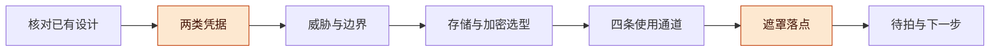
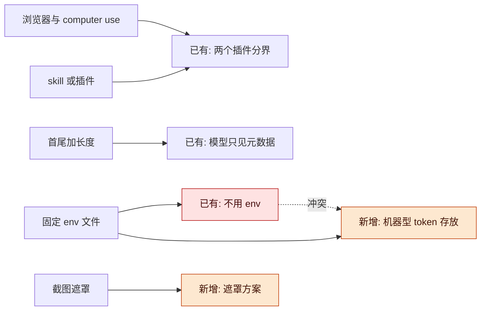
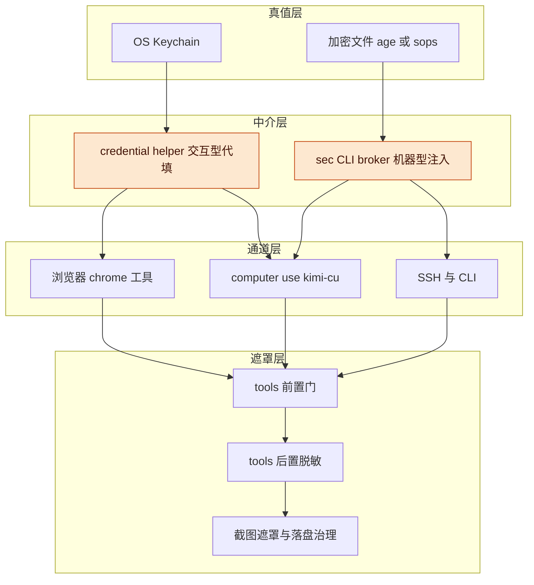
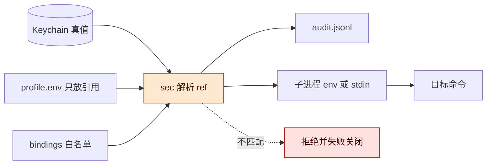
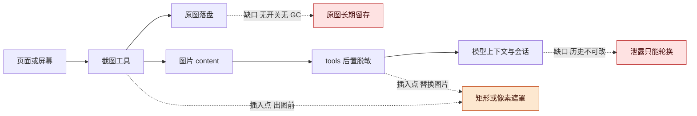

# 跨通道凭据与截图遮罩讨论稿 v0.1.5

> **公开整理版**：基于原稿《跨通道凭据与截图遮罩讨论稿 v0.1.5》（源版本：0.1.5）。本次删去私有项目实例、公司项目专属内容及原始个人语料，未重新验证实验。源稿状态：current；源版本编号保留，公开编辑不代表实现完成或新验证结果；章节与条目沿用源编号，删节后可能不连续。

2026-11-05 · Taishuo × DSH（lead）

## 版本与范围

这次要补的不是一套新密码管理器，而是已有浏览器密码设计之外的三块空白：机器型 token 的固定存放（含 env 形态）、SSH/computer use 两个通道、以及跨工具的截图与输出遮罩；env 加密不是安全边界，最多只挡“文件被拷走/误传”这一面。

- 版本：v0.1.5，补浏览器侧录入：DSH 右栏新增「凭据」tab 与弹窗表单（client bundle + owner-only `/api/dsh-chrome/secrets/*` 两条 exact Fetch 路由），值只走一次同源请求写进 Keychain；新增 `test/secrets-api.mjs`（8 checks）并扩展 `test/client-bundle.mjs`；待插件重载后在真实会话里点验。v0.1.4，记录 MVP 落地：`dsh-chrome` 分支 `feat/cross-channel-secrets`（commit `29f16d6`）实现 `sec` CLI、Keychain 存储、引用式 env、命令白名单、audit、`pre/post-execute` 钩子、`secret-hygiene` skill 与 `docs/SECRETS.md`；新增测试全过，仓库测试仅 `test/headless.mjs` 因本机 Chrome 156 的时序断言失败（该文件自述 environment-sensitive，本轮未改其路径）；待插件重载、真实 Keychain 录入与存量迁移。v0.1.3，记录第二轮拍板：跨通道部分（机器型 token 与遮罩）并入 `dsh-chrome`，不再新立插件；备份本轮不做（`sec export` 推迟）；其余按本稿默认（与 DSH `.credentials.yaml` 互不相干、长度不给模型、存量迁移等最小链路验证后执行）。v0.1.2，新增「机器型 token 的存储设计」专节并拍板：Keychain 逐条真值 + 引用式 env、解锁按 ref 分级、使用端命令白名单并禁解释器；v0.1.1，记录首轮拍板：首要威胁选“误进模型上下文/转录/截图”；两类凭据分开处理；截图遮罩只做“不产生 + 浏览器矩形遮”，computer use 只做策略；第一个交付物是 `pre/post-execute` 最小插件加 skill；机器型 token 的存储设计留待下一轮专节讨论。v0.1.0 为首次整理。后续修改按补丁号递增（0.1.1、0.1.2…）。
- 主线：核对已有设计 → 两类凭据 → 威胁与边界 → 存储与加密选型 → 四条使用通道 → 遮罩落点 → 待拍。
- 状态标记：【实测】是 2026-11-05 在本机读代码/跑命令核对到的；【已有设计】是 `dsh-chrome` 仓里已经写死的结论；【提案】是本稿新提、尚未验证的。

**图 1　讨论主线 · 七段递进**

七段从左到右；高亮的“两类凭据”和“遮罩落点”是本稿的两个新提案，其余三段是核对与选型。

## 动机与已有设计

已有设计已经覆盖部分需求，本稿新增讨论是“机器型 token 怎么存”和“截图遮罩怎么做”两块。

原稿引用的配套设计为：`dsh-chrome` 的密码/凭据管理设计稿（最后更新 2026-10-19，v0.2.15），其中给出了以下边界：

- 不变量第 3 条：静态存储只用 OS 凭据库，“没有明文 fallback 文件，没有 `.env`，没有配置文件，没有命令行参数，没有环境变量”（§3.1）。
- 不变量第 7 条：不给模型 `get`/`list`/`reveal`；模型只能说“把某站点的已保存凭据填进当前页面”，helper 内部取密并填充，只回 `{filled:true}`（§3.1、§3.4）。
- 明确不做像素级脱敏，代之以“填充期间暂停 screencast/自动截图”；文档写明“不做‘截图永远安全’的承诺”（§3.7、§7.1）。
- P1 安全基础 MVP 已落地：`src/credentials.js`（opaque `cred_<32hex>`、macOS Keychain 只读适配器、`fill()` 接口），`test/credentials.mjs` 13 项已接入 `npm test`；但**没有工具接线、没有真实填充**（§附、§7.2）。
- 另外 `docs/COMPUTER-USE-PLUGIN.md` 已经把 computer use 划给未来的独立插件 `dsh-computer-use`，并写明“OS 凭据注入是 password helper 的独立边界”。

所以这次讨论的定位是“补它的盲区”，不是另起一套。逐点对照：

| 需求设想 | 已有设计怎么说 | 本稿判断 |
| --- | --- | --- |
| 内网访问用 computer use 或浏览器插件 | 浏览器归 `dsh-chrome`，OS 级归独立 `dsh-computer-use`；两边不能互相替代 | 按目标分工；两条通道共用同一凭据层 |
| 一个 skill 或插件管密码/token | helper 架构已定：模型只拿引用与回执 | skill 管“怎么用”，插件/CLI 管“强制”；只做 skill 等于靠自觉 |
| 固定地方如 env 文件存 | 明确“没有 `.env`”，交互型凭据只进 OS 凭据库 | 交互型不适用 env；机器型 token 可以要一个引用式 env 层 |
| 首尾几位或总长度显示 | 模型只看 `origin`/`username`/`label`/`filled` 这类元数据 | 首尾+长度是给人核对的显示，不是给模型的接口 |
| 截图时对相应位置遮罩 | 明确不做像素脱敏，只做“填充期间暂停截图” | 截图遮罩需要单列方案与成本；先做“不产生”，再做“事后遮” |
| env 文件用什么加密 | 已有设计不用 env | 只对机器型 token 选型；见“存储与加密选型”一节 |

**图 2　六点设想与已有结论的映射 · 两点冲突、两点新增**

左边是这次的六点设想，中间是已有结论、右边是本稿新增；红色“不用 env”与机器型 token 的存放需求正面冲突，是这次最需要拍的一条。

现状里还有三件事必须一起算进来，它们都是【实测】：

## 两类凭据与判定问题

结论：先按“谁执行、要不要人在场、目标是否固定”把凭据分成交互型与机器型；两类混在一个 env 里，会把最严的一类拉低到最松的一类的保护水平。

判定只需要四个问题：

1. 使用时人在不在场（需要人点确认、输 OTP、按指纹吗）。
2. 凭据的“用”是否绑定固定目标（精确 origin / 固定 host / 固定命令）。
3. agent 需要“看”它，还是只需要“用”它。
4. 它能被轮换吗，轮换周期多长。

| 维度 | 交互型凭据 | 机器型凭据 |
| --- | --- | --- |
| 例子 | 网站密码、VPN 密码、堡垒机密码、OTP seed、SSH passphrase | 应用维护方 API token、registry token、CI secret、CLI 用的环境变量 |
| 存储 | OS Keychain（唯一入口）；helper 持有访问能力 | 引用式 env + Keychain，或加密文件（age/sops） |
| 使用接口 | helper 代填/代签名，模型只见 `{filled:true}` 回执 | broker 注入子进程环境 / netrc / 网关代加 header |
| 模型可见 | 只有 ref 与元数据 | ref + 可选的长度/指纹；“读值”必须单独授权并留痕 |
| 人在场 | 是（硬确认或 OS 原生提示） | 否（按策略自动，越界才确认） |
| 失败行为 | 拒绝，回人工路径 | 报错，绝不回退明文 |
| 主要风险 | 钓鱼 origin、截图/肩窥、prompt injection 借代填外发 | 子进程 `env` 泄漏、argv/日志泄漏、被注入指令外发 |

两个推论：

- “首尾几位+长度”只属于交互型的人机核对，不属于模型的默认视图；对机器型 token，模型只需要 ref、用途、目标绑定、最近轮换时间。
- 交互型凭据一旦进了 env，就同时失去了 helper、精确 origin 绑定和人在场这三层保护。所以“一个 env 放全部”是这次要明确否掉的方案。

首轮拍板：两类分开处理——交互型凭据进 Keychain/helper，机器型 token 进引用式 env。代价是要维护两套使用接口，但避免了把交互型凭据拉低到机器型的保护水平。

## 威胁模型：加密与遮罩各自挡什么

| 威胁 | 加密 env 能挡吗 | OS 凭据库 + helper 能挡吗 | 真正的对策 |
| --- | --- | --- | --- |
| 明文进模型上下文或会话转录 | 不能，agent 能解 | 能（若不给模型读值入口） | helper/broker 代操作 + `tools/post-execute` 脱敏 + 不让值进工具参数 |
| 截图/录屏带走密码 | 不能 | 不能 | 不产生（不显示/不截图）+ 矩形遮 + 像素兜底 |
| 磁盘或备份被拷走 | 能 | 能 | FileVault + 加密文件 + 0600 |
| 误提交/误传 | 能（密文可提交但要防密钥） | 能 | 仓外存放 + gitleaks + `.gitignore` |
| prompt injection 借 agent 外发 | 不能 | 部分（目标绑定+无 get/reveal） | 精确目标绑定 + 硬确认 + 失败关闭 |
| 同机其他进程（同 UID） | 不能 | 不能 | 不承诺；只能靠独立 OS 账户或独立机器 |

关键一条是 DSH 官方 README 自己写的：凭据库「Only your OS user can read the file… agent tool processes run as that same user, so this store cannot isolate secrets from the agent」，并称可达性「That is discretion, not a boundary」。同 UID 下，任何“agent 能自动用”的凭据对 agent 就等于明文；加密只影响“agent 要不要多走一步解密”。

因此本稿把边界收缩成三条可执行的不变量：

- 明文不进入模型可见面（tool args/results、截图、render）。
- 交互型凭据的使用必须绑定精确目标且人在场；机器型凭据的使用必须绑定命令/目标白名单。
- 任何异常都失败关闭，不回退到明文输入。

## 总体架构

结论：整体分四层——真值层、中介层、通道层、遮罩层；前两层决定“agent 能不能拿到”，后两层决定“拿到了会不会漏出去”。

**图 3　总体架构 · 四层、四条通道、三个遮罩落点**

自上而下是“存 → 取 → 用 → 遮”；高亮的中介层是本稿主张的核心：模型只拿引用和回执，真值只在 helper/broker 进程里。

落点能不能接上，取决于 DSH 现有扩展点。本机用 cordis inspect 核对到的事实：

| 落点 | 现有能力 | 能做什么 | 缺口 |
| --- | --- | --- | --- |
| `tools/pre-execute`（waterfall） | 有 | 允许/拒绝/取消/要求确认；可拦“裸 secret 参数” | 不知道哪些值是 secret，需要与 broker 共享引用表 |
| `tools/post-execute`（waterfall） | 有 | `PostToolDecision` 可 `accept` 替换 `content`（含图片块）或 `block` | 只改渲染内容；canonical `value` 仍对程序化调用方可见；已写会话事件改不了 |
| `tools.register` | 有 | 可注册新工具（如 `secret_describe`/`secret_use`） | 新工具本身也要被脱敏规则覆盖 |
| `approval` 服务 | 有 | 硬确认（chrome 的 `hardConfirmAsk` 是现成范例） | 子代理会话需 fail closed |
| `tools/post-execute` 顺序 | 【实测】`tools/pre-execute → guards → tools/execute → tools/post-execute → finalizeContent → tools/result` | 改写发生在最终渲染之前 | 会话 append 在管线之后，写的是渲染内容；但历史事件无 API 可改 |
| 图片附件 | `attachments.saveImage/readImage` | 模型看到的图来自这里 | 工具体内先落盘；无 GC |

## 存储与加密选型

结论：交互型只放 OS Keychain（沿已有设计）；机器型默认走“Keychain 真值 + env 只放引用”，需要跨机或团队共享时再上 age/sops 加密文件；不自研加密，不维护明文总 env。

| 方案 | 适合 | 密钥/密文在哪 | 用而不显 | 代价 | 判断 |
| --- | --- | --- | --- | --- | --- |
| macOS Keychain + 引用式 env | 个人本机、机器型 token | OS 加密；env 里只有 `secret://...` | `sec run` 注入子进程 | 无团队共享、无审计；同 UID 可读 | 默认推荐 |
| age + sops | 需要进私有仓、跨机迁移、团队共享 | 密文文件可入 git；主密钥放 Keychain 或单独口令 | `sops exec-env` 注入子进程 | 解密后进程内明文；无审计；轮换靠 git | 备选，用于共享/迁移 |
| dotenvx | “就想要一个加密 `.env`” | `.env` 里是密文；私钥在 `.env.keys` 分文件 | `dotenvx run -- cmd` | 私钥文件本身就是密钥；无审计 | 轻量备选 |
| 1Password CLI | 团队共享、审计、轮换要求高 | 1P 服务端/本地缓存 | `op run`/`op inject` | 依赖订阅与在线；`op read` 必须对 agent 禁用 | 有订阅再考虑 |
| 明文 env + 0600 + FileVault | 临时过渡 | 明文文件 | 无 | 对 agent 无保护；`env` 一读就带走 | 只作过渡，需登记 |
| 自研 AES 脚本 | 不建议 | 自己管 KDF/nonce/轮换 | 难做对 | 密码学细节多，失败代价高 | 不做 |

env 的正确形态（【提案】）：

- 一个 profile 一个引用文件，例如 `~/.dsh/secrets/example.env`，内容只写 `EXAMPLE_TOKEN=secret://example/api-token`，**不写真值**。
- 使用一律经过 `sec run --profile company -- <command>`：解密/取值的动作发生在 broker 进程，只注入目标子进程；agent 自己的 shell 环境里没有真值。
- 禁止 agent 直接读引用文件以外的任何密钥文件；`env`/`printenv`/`ps`/`/proc/<pid>/environ` 一类输出纳入脱敏规则。
- 每个 ref 记录 owner、用途、目标绑定、轮换时间；`sec show --masked <ref>` 输出 `<前4位>…<后4位> (len=64)`，仅人可看。
- 加密文件的密钥不能落在同一台机器的明文文件里；要么 Keychain，要么每次人工输入。否则“加密”只防误传，不防本机。

加密方式的选择标准（按重要性排序）：能不能离线用、主密钥放哪、agent 能不能自己解开、团队共享与轮换、有没有审计。不要按“算法听起来更强”选。

**首轮已定**：机器型 token 走 Keychain 逐条 + 引用式 env，解锁按 ref 分级，使用端做命令白名单并禁解释器；细节见下一节「机器型 token 的存储设计」。仍开放的只有团队共享载体（1Password / age 收件人）与备份频率。

说明：age 的加密套件细节（X25519 密钥协商 + ChaCha20-Poly1305，口令模式用 scrypt）是凭记忆写的，没有逐条核对，引用前需要查证。

## 机器型 token 的存储设计

结论：真值放 Keychain 逐条，`~/.dsh/secrets/<profile>.env` 只放引用；`sec` 解析 ref、校验白名单、把值注入目标子进程并写审计；解锁按 ref 分级，默认自动、高价值每次确认。这三条在 2026-11-05 拍板。

**图 4　机器型 token 的存储与使用流 · Keychain 逐条、env 只有引用、使用端白名单**

左边三个输入汇到 `sec`，校验通过后值只交给目标子进程；右侧审计与拒绝路径说明每次使用都留痕、越界即失败。

**命名与文件**

| 对象 | 位置 / 格式 | 说明 |
| --- | --- | --- |
| Keychain 条目 | service `com.example.harness.secrets`，account `<profile>/<name>` | 与浏览器交互型凭据分开 service，避免权限模型混在一起 |
| 引用 | `secret://<profile>/<name>` | 写进 env、配置、skill 示例；不含值 |
| 引用式 env | `~/.dsh/secrets/<profile>.env`（0600，目录 0700） | 只写 `NAME=secret://...` 与注释；不写真值 |
| 绑定表 | `~/.dsh/secrets/bindings.yaml`（0600） | 每个 ref：`allow_commands`、`deny_shell`、`unattended` |
| 审计 | `~/.dsh/secrets/audit.jsonl`（0600） | `ts`/`session`/`ref`/`action`/`target`/`result`/`reason`；不记值 |

**`sec` 子命令（最小集）**

| 命令 | 作用 | 给谁用 |
| --- | --- | --- |
| `sec init --profile 
` | 建目录、空 env、空绑定表 | 人 |
| `sec add <ref> --stdin` | 从 stdin 读值写入 Keychain，不进 argv 与 shell history | 人 |
| `sec ls --profile 
` | 列 ref 与元数据，无值 | 人 |
| `sec describe <ref>` | 返回 configured、轮换时间、绑定摘要、unattended | agent |
| `sec show --masked <ref>` | 前 4 位…后 4 位加长度，仅人且需确认 | 人 |
| `sec run --profile 
 -- <cmd...>` | 白名单校验、取真值注入子进程、写审计 | agent / 脚本 |
| `sec rotate <ref> --stdin` | 更新 Keychain 真值，记录轮换时间 | 人 |
| `sec export --profile 
` | 推迟（本轮不做）：age 加密导出备份 | 人 |

**注入与白名单**

- 默认注入子进程环境变量；只存在于子进程，不写 shell rc，不 export 到父 shell。
- 高价值 ref 可改为 stdin 或 0600 临时文件，命令结束即删，避免 `env` 与 `ps` 读到。
- `sec run` 只看得到传给它的命令参数：`allow_commands` 按 basename 精确匹配；`sh`/`bash`/`zsh`/`env`/`printenv`/`xargs` 等解释器一律拒绝；拒绝即 `SECRET_BINDING_DENIED` 并写审计。
- 已知上限：外层 shell 的重定向（`> file`）发生在 `sec` 之外，`sec` 无法检查输出去哪；所以“禁止把 token 写到文件”只能靠命令白名单本身（只允许可信工具），不能靠参数检查。

**解锁分级**

- `unattended: true`（默认）：登录态直接读 Keychain，无弹窗；适合可轮换、价值较低的 token。
- `unattended: false`：读取前要确认；MVP 用 DSH approval 或终端确认，后续可接 LocalAuthentication（Touch ID）。
- 拒绝或超时一律失败关闭，返回 `SECRET_CONFIRM_REQUIRED` / `SECRET_CONFIRM_TIMEOUT`，不回退明文。

**存量迁移**（等拍板后动）

1. `sec init --profile personal`；把 `<原凭据配置>` 里的三个变量逐个 `sec add`（从 stdin 读，避免进 shell history）。
2. 把该文件改成只放引用，或删除；`<原凭据配置>` 去重。
3. shell rc 只导出 `SEC_PROFILE=personal`，不 export 真值。
4. 用哨兵值跑一遍 `sec run` 与 `sec ls`，确认值不出现在 audit、history、进程参数里。

**与已有设计的边界**：交互型凭据仍走 `dsh-chrome` 的 helper 设计（native helper 加 `{filled:true}` 回执），`sec` 只服务机器型 token；两者共用 OS 但分 service。`~/.dsh/.credentials.yaml` 是 DSH 自己的模型凭据库，本文不动它，只在文档里说明它不是安全边界。2026-11-06 拍板：跨通道部分并入 `dsh-chrome`——`sec` CLI、Keychain 存储、`pre/post-execute` 钩子、skill 都放该仓，复用它的工具注册与测试设施，不再新立 `dsh-secrets` 插件。

**失败模式**：`SECRET_STORE_LOCKED`、`SECRET_NOT_FOUND`、`SECRET_BINDING_DENIED`、`SECRET_CONFIRM_REQUIRED`、`SECRET_CONFIRM_TIMEOUT`；全部失败关闭，不回退明文。

## 使用通道：SSH、浏览器、computer use

结论：四个通道的第一选择都是“复用已认证会话”，而不是把凭据交给 agent；只有续登或无会话时才落到 broker 代输入或人工路径。

| 通道 | 现状能力 | 首选（零凭据接触） | 次选（broker 代操作） | 脱敏落点 |
| --- | --- | --- | --- | --- |
| 浏览器 `chrome_*` | 站点策略 allow/ask/block、操作审计、capture 不采 header、snapshot 对密码/支付字段打码 | 复用用户已登录的 Chrome；headless 用可见登录窗口人工登录 | `credential fill`（已有设计，未接线） | snapshot 打码已有；截图无遮罩，需新增 |
| computer use | OS 级鼠标键盘、应用截图；截图无遮罩；不在 DSH provider hook 内 | 人先登录 VPN/客户端并保持会话；agent 只做后续操作 | 代输入风险高，只对低价值目标开放 | 只能靠 `tools/post-execute` 兜底，或窗口排除/OCR |
| SSH | `ssh`/`ssh-agent` 通道；`authorized_keys` 支持 `restrict,command=` | `ssh-agent` 持钥 + `ControlMaster` 复用已认证连接 + `ProxyJump` 收窄 | 不推荐用密码型登录；`sshpass` 会进 argv/env | 输出脱敏；命令不回显明文 |
| CLI/HTTP | `curl --netrc`、代理注入、`sec run` | 由 broker 把凭据注入子进程或由本地代理代加 header | 网关代注入（sentinel 占位） | 禁止 secret 进 argv；输出过 redactor |

两条补充判断：

- computer use 是风险最高的一条：它截图覆盖整个屏幕，终端、配置页、Keychain Access 窗口都可能入画；现有 kimi-cu 是 MCP 接入，不在 `browserUse`/`computerUse` provider 注册表里，也就没有 provider 内的拦截点。所以这条通道要靠“不打开敏感窗口”的策略加 `tools/post-execute` 兜底，不能靠通道自身。
- SSH 侧真正省事的是会话复用：人先建立 `ControlMaster` 连接，agent 复用 socket，不需要任何凭据材料；堡垒机密码型登录同理，先由人建好连接。`authorized_keys` 的 `restrict,command=` 已用本机 `man sshd` 核对，能把“能连”收窄成“只能做一件事”。

## 遮罩与脱敏的落点

结论：遮罩要分“进模型前”和“落盘前”两条线；在现有 DSH 里唯一能改模型可见内容的是 `tools/post-execute`，但它改不了已写入的历史，也改不了工具体内已经落盘的图；所以“不产生”永远优先于“事后遮”。

**图 5　截图与输出遮罩的数据流 · 三个可插入点、两个已知缺口**

从左到右是“截 → 存 → 送模型”；高亮的遮罩是本稿新增，两个红色缺口说明为什么“先不产生”比“事后遮”更可靠。

三层策略，成本从低到高：

1. **不产生（已有设计的方向）**：填充/查看凭据期间暂停 screencast 与自动截图；computer use 期间不打开含密钥的窗口（终端历史、配置页、Keychain Access）；shell 里不 `cat` 密钥、不 echo 密码；登录类操作走可见窗口由人完成。
2. **结构化遮（浏览器可行，需新代码）**：浏览器侧已经有敏感字段识别（snapshot 对 `type=password`/支付/OTP/secret 字段返回 `••••`，扩展的 `sensitiveInputInfo` 与 `maskedValue` 在页面脚本层），但截图是 CDP 像素、不经过 DOM，所以要把“敏感字段矩形”单独取出来，在截图前于页面插入遮罩层，或出图后按矩形涂黑。要处理滚动、缩放、iframe、截图与遮罩的时序。原生 app 没有 DOM，这一层不适用。
3. **像素/语义兜底（computer use 唯一可选，但不可靠）**：已知 secret 值精确匹配（broker 提供“当前可能出现的值”，只在内存里比对）、OCR 找模式、模板匹配。漏检一帧就等于没做，误报会遮错内容；只作为兜底，不承诺“截图永远安全”。

首轮拍板：不做全链路像素遮罩；先做“不产生 + 浏览器矩形遮”，computer use 只做策略（不打开敏感窗口、事后兜底），像素遮罩列为后续可选。

文本侧可以复用已有能力：`dsh-chrome` 的 `src/headless-redact.js` 已有 Bearer/sk-/JWT/AKIA/key=value 正则，纯函数、无依赖，可挂到 `tools/post-execute` 处理文本块；缺口是“已知值精确匹配”还没有，需要新加一层（从 broker 拿引用表做字符串替换，而不是把值写进规则文件）。

“首尾+长度”的定位：

- `sec show --masked` 给人：`<前4位>…<后4位> (len=64)`，用于核对“这是哪个 token、有没有换过”。
- 模型默认只见 ref、用途、目标绑定、轮换时间；要不要把长度给模型是【待拍】项（长度本身是元数据，能泄露 token 类型）。
- 交互型凭据不给模型任何形式的回显，连首尾都不给。

落盘治理必须单独列：dsh-chrome 的截图没有持久化开关（配置里只有 `screenshotFormat`），host 每次截图都写盘；attachments 是内容寻址、永不自动删除、没有 GC。这两个目录现在合计约 109MB 原图，只能手工清。提案：截图默认不落原图或落盘即遮、按天清理、会话结束清理；会话转录无法改写，所以一旦明文进过历史，只能按“凭据已暴露”处理——轮换，而不是删一个文件。

## 相关工作

结论：现有做法分两族——“让动作发生在凭据之外”和“网关代注入”；截图脱敏没有可靠的通用方案；本机已有两条可直接抄的参照。

| 类别 | 代表 | 核实到的内容 | 缺口 |
| --- | --- | --- | --- |
| 加密 env 文件 | sops + age | 文件级加密（YAML/JSON/ENV），多收件人，密文可入 git；`exec-env` 注入子进程 | 只加密文件；解密后进程内明文；无审计 |
| 加密 env 文件 | dotenvx | 值加密成 `encrypted:`，私钥在 `.env.keys` 分文件；`run` 只给子进程 | 私钥文件本身是密钥；无审计 |
| 团队凭据服务 | 1Password CLI | `op run`/`op inject` 注入；服务端权限/审计/轮换；另有面向 CI 的 credential broker（public preview） | 依赖订阅与在线；`op read` 会把明文打到 stdout，必须对 agent 禁用 |
| 动态凭据 | HashiCorp Vault | 动态短期凭据、租约、审计、响应包装 | 运维重；agent 拿到 Vault token 仍可读 |
| OS 凭据库 | macOS Keychain | 系统加密、可加 ACL/分区列表 | 同 UID 进程基本都能读；无审计；不是边界 |
| 用而不显（SSH） | ssh-agent + `authorized_keys restrict,command=` | 私钥不出 agent；服务端把密钥限制成“只能做一件事” | 要改服务端；不适合任意 shell |
| 用而不显（网关） | Claude Code sandbox `credentials` | 沙箱内命令只见 per-session sentinel，代理在发往白名单域名的请求里替换真值（需 TLS 终止 + `injectHosts`）；另有 Keychain 存储、`apiKeyHelper`、子进程环境清理 | 只覆盖 HTTP(S)、需域名白名单、只对沙箱 Bash 生效 |
| 浏览器自动填充 | Chromium 密码管理器 | 可“点一下填充”，agent 不必知道值 | 填入后值进 DOM，页面脚本可读；有报告称无手势激活可被静默收割（修复状态未核实） |
| 截图矩形遮罩 | Playwright screenshot `mask` | 按 locator 在截图里盖色块 | 只对受控浏览器、只对 DOM；canvas/iframe/原生弹窗不管 |
| 截图窗口排除 | ScreenCaptureKit | 截图时排除指定 app/窗口 | 只对自家截图有效；被排除处变黑；需屏幕录制权限 |
| 截图 OCR 脱敏 | Presidio image redactor 等 | OCR 找敏感模式再涂黑 | 识别率决定一切；中文/等宽/低对比易漏；漏一帧即漏 |
| 事故参照 | 公开报道的 agent 凭据外泄 | 共同教训：agent 能读到的凭据迟早会被注入的指令读走；最小权限 + 外发确认 | 二手报道，具体影响面未核实 |

**核实后的修正**：

- 本稿动笔前以为要新建一个密钥服务；核对后实际是 `dsh-chrome` 已有 669 行设计稿 + P1 Keychain MVP，本文改为补充与对齐。
- 一度以为 `tools/post-execute` 能把已写进会话的明文一起清掉；核对后实际是它只改渲染内容，会话 append 在管线之后，历史事件没有 API 可改写，canonical `value` 仍对程序化调用方可用。

**仍未核实**：kimi-cu 内部是否写临时截图；可用的 UI slot 名称；Codex CLI 的凭据处理细节；`op run` 的离线行为；Playwright mask 的精确适用范围；Chromium autofill 问题的修复状态；未找到可信的 `gocredact` 仓库（只找到 hackathon 项目）。

说明：age 的加密套件、Keychain ACL 的具体行为是凭记忆写的，没有逐条联网核对，引用前需要查证。

## 风险与开放问题

- **遮罩漏检**：computer use 截图没有可靠通用遮罩，OCR/已知值匹配都会漏；对策是把它定位成兜底，主防线是“不显示、不截图”。
- **原图与附件长期留存**：截图无开关、attachments 无 GC、会话转录不可改；对策是落盘治理 + 泄露即轮换，而不是删文件。
- **同 UID 无边界**：agent 能读的你也读得到；加密只防误传；要真隔离只能独立账户或独立机器。
- **prompt injection 借代填外发**：代填/代输入必须精确绑定 origin 或目标，且每次硬确认；不提供 `get`/`reveal`。
- **无人值守与人工确认的矛盾**：交互型凭据要人在场，自动任务会卡住；需要明确哪些任务允许无人值守，哪些必须人看着。
- **加密文件与 agent 自动用的矛盾**：agent 能自动解开就约等于明文；要么接受“只防误传”，要么上硬件/人工 presence。
- **跨 harness 不一致**：CLI + skill 可以跨 Claude/Codex/DSH 用，但 hook 强制只在 DSH 里有；在别的 harness 里只剩约定。
- **kimi-cu 在 hook 之外**：computer use 截图不经 DSH provider，通用脱敏只能事后兜底。

开放问题：

- [x] 两类凭据是否分开：分开（首轮拍板）。
- [x] 截图像素遮罩做到哪一层：先“不产生 + 矩形遮”，像素兜底列为后续可选（首轮拍板）。
- [x] 第一个交付物：`pre/post-execute` 最小插件加 skill（首轮拍板）。
- [x] 机器型 token 的真值载体与解锁策略：Keychain 逐条 + 引用式 env，按 ref 分级（v0.1.2 拍板）。
- [x] ref 的目标绑定与命名：`secret://<profile>/<name>`，命令白名单并禁解释器（v0.1.2 拍板）。
- [x] 与 DSH `.credentials.yaml` 的关系：互不相干，按默认（v0.1.3）。
- [x] 跨通道部分落在哪：并入 `dsh-chrome`，不再新立插件（v0.1.3 拍板）。
- [x] 长度、轮换时间要不要给模型：长度不给，ref/绑定/轮换时间给，按默认（v0.1.3）。
- [x] 备份：本轮不做，`sec export` 推迟（v0.1.3）。
- [x] 存量明文迁移时点：最小链路验证后执行，保留回滚，按默认（v0.1.3）。

## 待证命题与下一步

结论：最可能出结论的是 P1 和 P2（都能用本机实测快速验证）；最先能做的是把“两类凭据”写成分类表并把 pre/post-execute 的骨架搭起来。

v0.1.4：MVP 已落在 `dsh-chrome` 的 `feat/cross-channel-secrets` 分支（commit `29f16d6`），验证记录见 `docs/SECRETS.md` §12。v0.1.5：浏览器侧录入已补（commit `6150082`）——DSH 右栏「凭据」tab 里点「添加 token」弹窗填写，提交经 owner-only `/api/dsh-chrome/secrets/store` 写 Keychain；剩余步骤是插件重载、真实会话点验、真实 Keychain 录入与存量迁移。

| 编号 | 命题 / 猜想 | 已有依据 | 缺口 |
| --- | --- | --- | --- |
| P1 | `tools/post-execute` 能在图片进入模型前替换 content，且不影响正常运行 | 事件契约明确可替换 `ContentBlock[]` | 未实测重编码、附件重存、程序化调用方是否仍拿到原值 |
| P2 | 浏览器矩形遮罩能覆盖密码/支付/OTP 字段，且滚动缩放后不错位 | snapshot 已有敏感字段识别 | 未实测截图时序、iframe、眼睛切换 |
| P3 | “会话复用 + ref 化”能把 agent 直接触达凭据的频次压到很低 | SSH ControlMaster、浏览器登录态复用可行 | 未统计真实工作流里的频次 |
| P4 | 机器型 token 用 Keychain 引用 + `sec run` 足够，不需要加密 env | macOS Keychain 与 `security` CLI 提供实现入口 | 未做团队共享/跨机迁移的对照 |
| P5 | computer use 的“不显示 + 窗口排除”比像素遮罩更划算 | 已有设计选择暂停截图而非像素遮罩 | 未测原生 app 场景的漏检与误伤 |

下一步：

- [x] 机器型 token 存储设计（v0.1.2）。
- [x] 跨通道落点：并入 `dsh-chrome`，不新立插件（v0.1.3 拍板）。
- [x] 在 `dsh-chrome` 新分支实现 `src/secrets-store.js`、`src/secrets-cli.js`、`bin/sec.mjs`、`src/secrets-hooks.js`、`secret-hygiene` skill、`docs/SECRETS.md` 与三组哨兵测试（commit `29f16d6`）。
- [x] 跑通相关测试并用临时 `DSH_HOME` 做端到端哨兵验证；新增测试已接进 `npm test` 链。
- [x] 浏览器侧录入：右栏「凭据」tab + 弹窗表单 + `/api/dsh-chrome/secrets/*` 路由（commit `6150082`；`secrets-api` 8 checks，`client-bundle` 扩展通过）。
- [ ] 重载插件后在真实会话里点一遍「凭据」tab（列表、弹窗、保存、刷新、主题样式）。
- [ ] 用哨兵值做截图遮罩 spike：浏览器页面 + 已知字段矩形 + 出图前后对比。
- [ ] SSH 侧试点 `ControlMaster` + `authorized_keys restrict,command=`。
- [ ] 最小链路验证后迁存量明文（`<原凭据配置>` 等），保留回滚。
