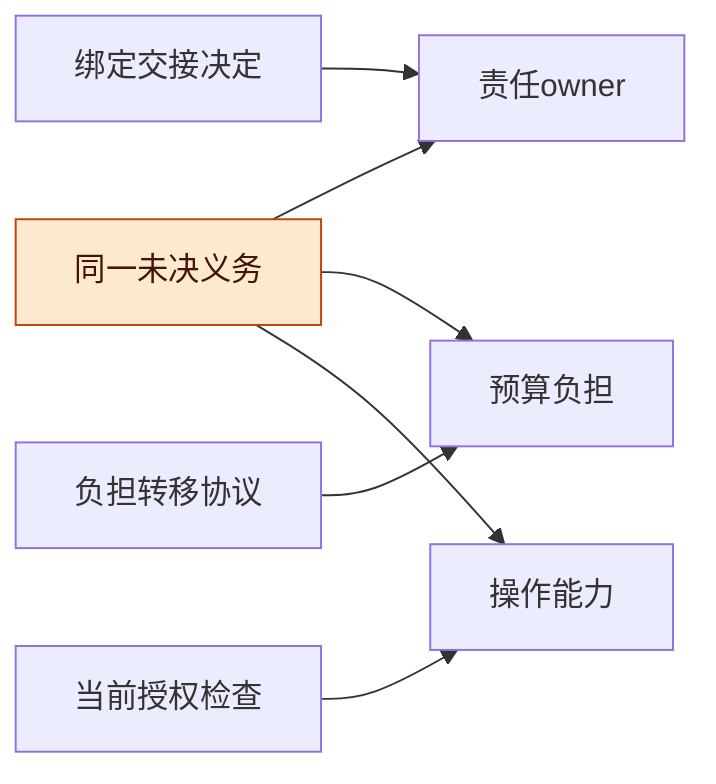
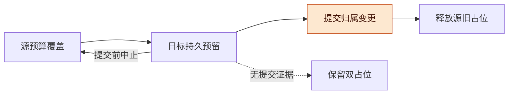
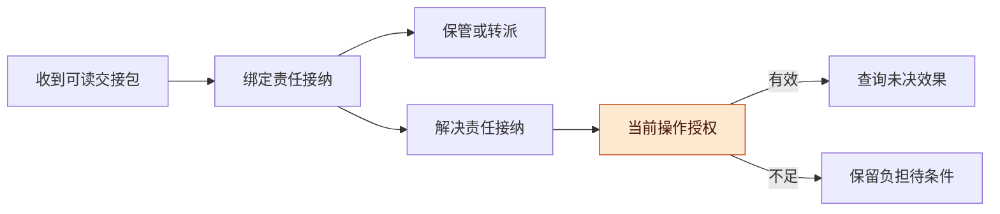

# 责任接管与负担连续性讨论稿 v0.1.0

2026-11-08 · Codex（形式审查线，研究提案）

## 版本与范围

责任被接纳不会使未决效果及费用负担消失；接管能否执行、负担归属哪个预算、什么时候可以释放预留，必须分别判断。

- 版本：v0.1.0，首次给出接管类型、预算连续性方案、三个错误变体和有限模型。后续修改按补丁号递增。
- 主线：责任与负担分离 → 同预算换 owner → 跨预算保守转移 → 能力检查 → 有限证据与精化缺口。
- 状态标记：**既有结果**指 P13 与 C08 已列明的条件；**本稿提案**尚未接入产品；**有限检查**仅涵盖明确的小域，不是新增 Lean 证明或独立审查通过。

输入身份见 [inputs.json](inputs.json)。本稿只衔接冻结的 [统一模型](inputs/FORMAL_MODEL.md)、[C08](inputs/C08.md) 和 [预算证明源码](inputs/BudgetSafety.lean)，没有新增外部文献或重新解释其一般证明范围。程序不导入产品、联网或调用模型 API。

## 总体架构：责任、预算和能力各有自己的身份

一次交接应保持 obligation 身份连续，并分别变更责任归属、预算归属及可执行能力；消息 ACK 只证明协议所赋予它的那一件事。

| 对象 | 本稿字段/含义 | 不能替代 |
| --- | --- | --- |
| 未决义务 | obligationId、actionId、generation、effectState、evidenceWatermark | 新任务 ID 不能抹掉旧动作消费或迟到效果 |
| 责任归属 | owner、ownerEpoch、acceptanceKind、nextTrigger；owner 是当前保管/协调责任者 | owner 不是付款账户，也不自动拥有工具权限 |
| 预算归属 | budgetId、budgetPolicyVersion、U、claim(obligationId, boundVersion) | 更换预算标签不能改变已经发生的账单事实 |
| 负担上界 | r 覆盖已发生未结算消费及所有仍可能发生的未来消费 | 不能只覆盖剩余未来消费，也不能只取均值 |
| 接管决定 | handoffId、scopeDigest、watermark、recipient、acceptanceKind | 消息送达 ACK 不等于任何责任被接纳 |
| 权限证据 | Grant 的颁发者、主体、操作、资源、代际、有效期、政策版本 | 阅读交接包不等于可查询或结算未决动作 |
| 转移协议 | transferId、source/destination budgetId、boundVersion、phase、持久提交证据 | destination 收到请求不等于已经锁住预算 |

**图 1　接管账本 · 三类状态分别变化**

从同一义务向右看三类归属；任何一条变化都不能代替另外两条。

**成本前提**：unknown 期间真实消费可以继续增长，只要始终在可信 r 内。例如假设 r=2，已花未报从 0 增到 2 时，预留仍保持 2；不能随消费发生先把 r 减掉。若后台保活、动态工具生成或价格变化使真实负担可能突破 r，必须先增加预留并重新准入，或使用确实能执行的消费约束。无法给有限上界时，本稿不能给有限硬预算保证。控制器暂停或 owner 改名不会限制远端费用。

## 同预算换 owner 与跨预算转移

同预算换 owner 只更新责任记录，保留原 obligationId、budgetId 与负担；跨预算转移则需要独立的授权和连续覆盖协议。

对预算 j，令 `E_j = U_j + Σ claims_j ≤ B_j`。同一义务在跨预算准备期可同时占用两个 claim，这是保守占位，不是实际消费发生了两次。对仍未结算义务 o 指定唯一的有效预算归属 `α(o)`，并要求 `claim_(α(o),o) ≥ trueUnsettledBound(o)`。从而预算 j 的已结算及真实未结算消费不超过 E_j。模型的直接检查使用世界中的隐藏消费/可能消费上界，而非仅检查账本是否自洽。

**预算不是供应商账户**：本稿 budgetId 是明确允许重归属的内部政策额度。只有政策授权把该义务的全部未结算负担重新归属时，才能改变 α；这可能包括已经发生但尚未结算的费用。已结算 U 不转移。若某账单或费用归属不可变，或者“未结算”身份不能可靠确定，就保持原 budgetId，仅换 owner；不能借接管绕过原预算限制。未决费用由新主体代处理，并不要求归入新预算。

| 步骤 | 最小保障 | 失败/重启后的保守状态 |
| --- | --- | --- |
| 同预算接管 | 原子校验绑定与 ownerEpoch，记新 owner/接管类型；claim 不变 | 原义务和原预算占位继续存在 |
| PrepareDestination | 目标预算检查容量并持久锁定覆盖同一 obligation/boundVersion 的 claim | 源 claim 仍在；目标容量不足可停在原状态 |
| CommitTransfer | 权威转移记录原子切换 α，必须验证目标 claim 有效且不能自行过期/撤销 | 两边 claim 暂时共存；只有一个有效负担归属 |
| ReleaseSource | 源端据同一 transferId 的不可回退提交事实释放过时 claim | 无法确认提交就继续保守占用，不释放 |
| AbortBeforeCommit | 确认仍未提交，释放目标准备占位，保留源 | 提交后不能按超时自行 abort |

**图 2　跨预算保守转移 · 先覆盖后释放**

从左到右没有无覆盖间隙；双占位可能降低利用率，换取故障时不凭猜测释放。

**原子性边界**：本模型把 CommitTransfer 当作一个权威状态内的原子转移，并把准备/提交事实视为持久。多个真实账本需要共同协调记录或等价协议，使提交与目标预留取消不能竞态；本稿没有证明跨服务事务。若无法提供这一条件，就采用“保持源预算，仅换 owner”的较小方案。不得把 TTL 到期或消息 ACK 当成提交/解除证据。

**更新纪律**：模型在准备、提交待释放期间冻结该义务的结算，允许远端消费继续在固定 r 内增长。真实实现可选择冻结这一窄窗口，或给部分结算、boundVersion 变化和迟到账单定义更细协议；不能让源按旧上界释放、目标按另一版本占位。保守等待并不保证进展，C08 的可用性与期限条件仍另需落实。

## 接管能力：保管、转派与可执行解决

接管决定描述接收了什么责任；实际操作仍需按当前 q 和 Grant 检查，历史上的“可解决接纳”不构成永久权限。

| 类型 | 接纳的义务 | 不能据此声称 |
| --- | --- | --- |
| custody，保管 | 保留包、未决项和下一触发，维护可追踪责任 | 有权查询源系统、费用已经解决 |
| forward，转派 | 保管并负责寻找/通知合格接收方，记录下一交接结果 | 下一级已接管，或当前主体有执行能力 |
| resolve，可执行解决接纳 | 对指定动作/资源/操作具有接管能力，并接纳继续查询或处理的责任 | 操作必成功、unknown 已解决、权限永久有效 |

**接纳检查提案**：绑定 handoffId、goal/spec、义务 ID/代际、水位、费用上界及其来源、下一动作/期限；核对接收身份、授权范围、容量与时间余量。按每项下一操作建立 `q=(consumer, operation, recipients, resourceScope)` 并检查其 Grant，不把 `q_read` 当成 `q_reconcile`。接纳类型不足以履行最终目标时，明确保管/转派状态及尚缺的能力，不从界面显示“最终交接完成”。具体目标是否接受 custody 作为交接终点须由任务契约选择。

**图 3　能力与执行 · 历史决定和当前权限分开**

包可读和责任被接纳在左侧；真正执行前仍须经过右侧当前权限检查。

**最小披露**：获授权的派生摘要可足以交接，不要求接收者读取全部祖先原文。若下一操作确实需要特定凭据或原件，才将该能力列为缺项。接纳后撤权不抹去历史决定，但阻止不再获准的当前操作；责任和原预算负担仍保留。对 unknown 作权威终态判断还需要真实效果证据，Grant 只授权查询，不证明查询结果。

## 有限证据：三个错误变体与一个保守方案

小模型实际找到了三类缺口；同预算连续保留与跨预算先覆盖后释放的方案在列明的小域内没有不变量违例。

模型使用两个主体、两个容量各为 2 的预算、一个旧义务，其未知总未结算上界为 2，及各预算可准入并立即结算的单位新工作（数字均为假设）。旧消费在控制器 crash 期间仍可增长；全部 ledger 字段跨模型 crash 保留。源程序 [check_handoff.py](check_handoff.py) 以 BFS 穷举，无 fairness、期限或真实 crash 保证。

| 配置 | 状态 / 显式边 | 实际结果 |
| --- | --- | --- |
| conservative-same | 720 / 1989 | 全部直接不变量通过；只换 owner，保留预算 |
| conservative-cross | 1008 / 2760 | 全部直接不变量通过；允许双占位、提交和提交前中止 |
| ack-releases | 1260 / 3555 | 2 步失去覆盖；3 步准入超出真实负担容量；5 步实际成本超过 A 的 2 |
| release-first | 1260 / 3600 | 3 步产生无覆盖窗口；4 步准入超额；6 步实际成本超额 |
| ack-is-capability | 828 / 2268 | 3 步完成未获授权的终态查询；不是费用反例 |

**反例 1**：`Offer → AcceptCustody` 错把 ACK 当释放，原 r 被清零；随后准入一单位新工作。若旧动作已花 2 未报，则同一 A 预算真实消费达 3。最短实际消费轨迹含两次旧消费，共 5 步。claim 被清空时，即便费用尚未发生，也已丢失必要的未来负担覆盖。

**反例 2**：`Offer → AcceptCustody → ReleaseSourceBeforeDestination` 产生空窗；新预算可能根本没有足够容量。此时 crash 或消息丢失不是必需条件，错误已成立。模型另有目标预算已花 1 的保守见证：目标无法再预留 2，源预算持续保留 2，义务仍由接收者保管。

**反例 3**：`Offer → AcceptResolve → ObserveAuthoritativeTerminal`，接收者没有 resolve Grant，错误变体仅凭 ACK 放行。此例针对操作权限；即使终态内容恰好为真，也不能据此证明该操作获授权。保守方案会阻止这一操作。

**直接不变量与交叉检查**：[verify_handoff.py](verify_handoff.py) 使用独立编写的直接账目计算式和 DFS，检查全部可达状态、回放失败轨迹，并给出四条可满足见证：跨预算转移中 crash 期间旧消费增长后成功结算；解决接纳后撤权阻止操作但保留负担；目标容量不足仍保留源 claim；转派接纳不授予解决能力。它共享转移生成器，且由同一本研究线编写，**不是不同模型独立审查**。状态数匹配本身不作为正确性依据。

总计 5 配置、5076 状态、14172 边；见 [results.json](results.json)、[execution_receipt.json](execution_receipt.json)、[verification_receipt.json](verification_receipt.json)。BFS 的最短轨迹长度按本图事件数计，不是物理时间。终态观察在模型中是假设具备权威语义的原子动作；没有通过布尔 Grant “证明”现实世界已经终止。

## 风险与开放问题

本方案的主要风险是把费用归属变更、持久预留或操作能力当成不需实现的字段；它们恰恰是精化时必须取证的条件。

- **上界失真**：unknown 中消费仍可增长；无可信有限上界时，有限额度保证不成立。
- **错误重归属**：不可转移的旧账不能归入新预算来逃避原限制；已结算费用从不因本协议改名。
- **提交竞态**：目标准备占位若可独立超时释放，源可能依据陈旧提交条件释放，破坏连续覆盖。
- **持久性与并发**：模型 crash 保留全部状态，未验证磁盘/掉电。单一管理 owner 在模型中排除旧 owner 再发管理命令；现实需要入口 epoch/CAS 等机制，旧外部效果仍可能继续。
- **范围缺失**：模型没有多义务组合、部分结算、多个接管竞争者、迟到/重放证书、真实 Grant 链和资源作用域；绑定字段在正文提出，不表示程序已覆盖。

开放问题：

- [ ] 实际 budgetId 是可重归属的政策额度，还是必须保持的成本中心/付款约束？
- [ ] 准备期冻结结算能否接受，若不能，如何对账并同步 boundVersion？
- [ ] 哪类目标允许 custody/forward 作为有效交接终点，谁负责下一触发和容量保障？

## 待证命题与下一步

下一步应先由另一研究线审查模型和前提，再选择最小适配契约；本稿不增加主线已证明命题数或现成功能。

| 编号 | 条件命题 / 提案 | 本轮依据 | 未完成部分 |
| --- | --- | --- | --- |
| HC1 | 同预算换 owner 不改负担，可保留 P13 费用覆盖 | 直接不变量、720 状态有限检查 | 实际义务身份、认证 owner CAS 与上界来源 |
| HC2 | 先目标覆盖、再归属提交、后源释放可保持无空窗 | 1008 状态有限检查与逐转移说明 | 多账本协调、持久证据及并发结算精化；无一般机器证明 |
| HC3 | 接纳类型与当前 Grant 分离可阻止模型中的 ACK 越权 | 错误变体及撤权/转派见证 | 真实授权链、资源作用域与工具入口 |

下一步：

- [x] 固定输入并完成 5 个有限配置、直接不变量和可满足见证。
- [ ] 由不同研究线审查，重点挑战转移归属、准备占位释放竞态与成本上界。
- [ ] 若进入实施，先选择同 budgetId 换 owner 的适配层切片；不把跨预算协议作为默认必需功能。
