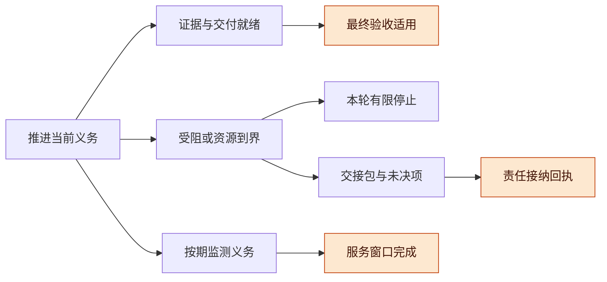
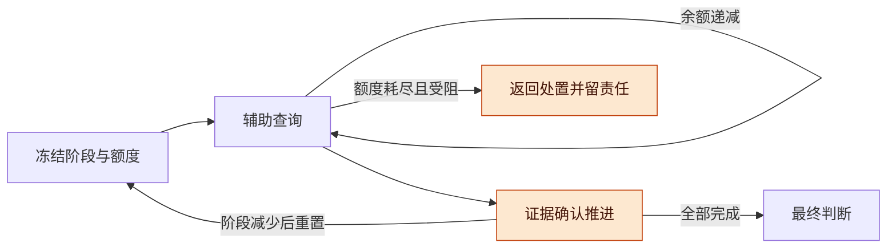

# 自主推进与终止条件讨论稿 v0.1.0

2026-11-08 · Codex（中国机制研究线，独立条件研究）

## 版本与范围

预算安全只限制合法轨迹能花多少，不保证轨迹结束、任务做对或按时交接。持续推进需要另外约定义务边界、可用且有效的动作、调度条件、时间上界和接收责任；这些条件不能靠模型重复声明“继续工作”补齐。

- 版本：v0.1.0 首次区分四种终点，给出条件推导、最小反例和标准库有限图检查；后续按补丁号递增。
- 主线：终点 → 固定义务与有限控制 → 公平性与有效推进 → 期限和交接 → 与既有实施片衔接。
- 状态标记：**已有结果**指原预算证明及本轮读取的规格；**本文条件推导**不等于新的 Lean 一般证明；**有限检查**仅覆盖列明的小图；产品实施均为 **NOT_RUN**。C08 编号独立于 P1–P15、既有模型和 W-07 验收计数。

输入身份见 [inputs.json](inputs.json)：固定 9 份当前研究文件的 SHA，不把工作树 base 提交当作未提交文稿版本。外部形式基础只选读 Lamport 原著相关段落，范围见 [sources.json](sources.json)。程序没有导入产品代码、调用模型或执行外部动作。

下列论证给出一组可审查的充分条件，不宣称它们是所有系统的唯一必要条件。反例说明删去相应条件后一般保证可能失败；其他调度、恢复或责任协议可以提供不同的充分条件。

## 总体架构：四种终点不能合并

有限停止、验收成功、服务窗口完成和交接被接收是四个可以重叠但互不替代的判断；工作契约必须先选清楚自己要求哪几项。

| 终点 | 本稿要求的证据 | 不能从中推出 |
| --- | --- | --- |
| 有限停止 `Stopped` | 当前控制轮在有限步骤后返回接受、拒绝、受阻、超时或等待等明确处置；恢复要有新的触发与归属 | 远端进程已停止、效果已解决、目标已实现 |
| 最终验收成功 `AcceptedFinal(G_v,q)` | 冻结阶段表已走完；最终定义和证据的验收适用；契约要求的交付及消费 q 条件已满足 | 所有消费者永久可用，或未来纠错不会撤回依据 |
| 服务窗口完成 `WindowComplete(W)` | 窗口内被准入的检查/响应义务按规定时点履行，并完成约定收口 | 已永久结束该方向；仅记录漏检不能补成覆盖 |
| 到期交接已接收 `HandoffReceived(H)` | 合格接收方对绑定版本、义务、未决效果和水位的交接作出可核对的责任接纳 | 仅上传文件、收到消息、队列 ACK 或发送方退出就算接管 |

这里的有限停止是控制轮结束，不是擅自 kill 正常运行的任务。等待可以如实返回“仍待外部条件”，同时保留责任和下一触发；它不能被计入最终交付成功。

**图 1　同一任务的不同终点 · 每个箭头都有独立条件**

从当前工作向右分别核对目标、停止、接管和窗口；图中不存在“本轮停止直接等于验收”的箭头。

**与已有结论的关系**：预算 [Lean 定义](../budget-proof/BudgetSafety.lean)的 `Run` 是有限归纳构造，`finite_run_budget_safety` 对每个有限合法前缀给出费用界。无穷多个安全前缀仍可能组成不结束的行为。现有三份 TLA 规格均没有 fairness；本稿不回头给它们补上未经实现的调度保证。[原规格与定位](inputs.json)

## 有限义务与控制步骤：先排除无效循环

本稿这条有界控制轮停止论证，需要把“有限待办”加强为有限的义务闭包，并限制不解除义务的辅助回路。

**固定边界**：从某个切点起，绑定 `goalVersion`、相关任务规格、验收条件和消费语境 q；允许未来出现的检查、修复及收尾义务也在有限集合 `O*` 中，或有预先计入的有限生成额度。每时刻队列长度有限并不够：始终只有一个 `o_n`，完成后立即生成 `o_(n+1)`，队列永远不空。无限扩展探索应按窗口建模，不能套用一次性交付的终止结论。

**C08-L1：有界控制轮停止条件。** 给每项义务冻结有限检查阶段与失败处置；令自然数 `ρ` 是仍需履行的阶段数量，含最终判断。一次被证据确认的阶段推进降低 `ρ`；辅助查询、格式修复、候选比较每阶段最多 K 步，余额为 `a`。仅在真正推进后重置 `a=K`，其他辅助步令 `a` 减一。余额用尽必须推进，或如实返回受阻/拒绝等终态，不能靠重命名计划刷新额度。

此时运行态的 `R=(K+1)ρ+a` 每次转移严格减少，终态取 0，因而最多执行初始 R 步。前提还包括每个被调用步骤最终返回；工具永久挂起并不由这个离散计数排除。超时包装可以使控制轮返回 unknown，但不能顺便宣称底层效果停止或释放未结算负担。

这个条件对应真正的生成、验证、修复额度和失败出口，不是把“最终成功”写进合法转移。程序的两项义务各有两个阶段，加一次最终判断，K=2；保守计数界为 17，穷举得到最长原始路径为 15 步。允许最终拒绝后，仍全部有限停止，却有 5 步到拒绝端点的轨迹。开放创作、反复变化的需求和没有有限验证步骤的研究，不自动具备这样的 `ρ`。

**图 2　辅助额度与义务阶段 · 重置必须有依据**

辅助查询只能消耗额度；真正减少义务后才开启下一阶段，失败出口保留尚未解决的责任。

**预算为何不足**：同一查询若在模型中记为零成本，`E≤B` 可以保持不变而查询无限重复；这不宣称真实查询免费。即便每次费用都大于零，没有统一正下界时，也可能出现总和有界的费用序列。固定自然数计价下的正费用可限制收费步骤数，仍不保证等待结束或验收成功。

**必要监测不是无用查询**：同样得到“没有变化”，若履行了新的到期检查义务，它就是窗口进展；没有新到期项、没有新增区分信息、也不履行已有检查责任的重复查询，不能反复记作完成量。义务 ID、规定时点和证据范围应先固定。

## 公平性与成功：有机会、被执行、做对仍是三件事

公平性可以排除某些饥饿轨迹，但不能创造可用资源、正确产物或人的同意，也不能给出完成期限。

弱公平要求一直可执行的动作不能永远被略过；强公平还约束反复有机会执行的动作。两者都是活性前提，实时上界需要另外规定；时间也不能靠停在原值来“满足截止条件”。这里只采用原著选读段落的这些区别。[Lamport，§8.4、§8.6、§9.2、§9.4](https://lamport.azurewebsites.net/tla/book-21-07-04.pdf)

**C08-L2：有条件到达验收就绪。** 在某时刻 T 之后，相关版本和支持稳定；有限阶段秩 `ρ` 不因其他动作增加；每个 `ρ>0` 的可达状态都有一个合法的、能真正降低 `ρ` 的推进动作，且推进动作族持续可用；该动作族满足弱公平，则最终 `ρ=0`。论证是：若永远不为零，自然数非增秩最后只能停在某个正值；公平性要求真正推进，必使秩再减，矛盾。

这里有四项独立工程义务：阶段完成的证据可信、所有推进结果确实消除相应阶段、执行权限及资源持续足够、调度不能用辅助动作冒充推进。不能仅把任意 `Attempt` 命名为 Progress。模型中的失败/成功两个分支都可选，且尝试被公平执行时，仍有永远选择失败分支的轨迹。调度公平不是成功结果公平。

到达验收就绪之后，仍须有权主体按绑定规则给出决定。只有再假设所需检查成立且该主体会接受符合条件的结果，才得到 `AcceptedFinal`；若主体可拒绝或一直不回应，只能保留待决，不能把人的同意当作调度器可以强制的动作。

| 弱化的前提 | 最小反例形状 | 缺少的现实条件 |
| --- | --- | --- |
| 只要求“任意工作”公平 | `heartbeat0→heartbeat1→heartbeat0`，义务一直未完成 | 对实际义务的推进保障；有限单调秩下推进动作族公平可足够，不必机械要求每个辅助动作公平 |
| 可执行窗口间歇出现，只给弱公平 | `available→unavailable→available`，总不执行 | 持续可用窗口，或可落实的强公平/排队保障；强公平不覆盖永不开放的窗口 |
| 目标持续改版 | 改版→产出→再次改版，验收持续失效 | 最终稳定版本，或预先冻结的有限阶段表 |
| 成功分支存在且公平地尝试 | 失败→失败，始终没走成功分支 | 成果正确性和外部响应条件，或有限失败处置；不能靠 fairness 偷渡 |
| unknown 无权威查询或可靠终态 | `pollUnknown→pollUnknown` | 能解决效果的能力，或有效接管责任；强公平对从未可用的 Resolve 为空条件 |

目标可以合理改变；只是此时应结束旧版本的保证区间，并明确新义务与成本，而非声称同一个“最终完成”命题仍无条件成立。版本奇偶模型只压缩状态展示；反例对应不断增长的新版本号，绝不授权复用旧版本身份。

## 期限、服务窗口与交接：最终会发生仍可能太晚

截止时完成需要有时间上界的联合可行计划；仅加公平性不能限制任意长的有限延迟。

**C08-L3：有条件按时交接。** 设截止 D，最迟开始收尾时点不晚于 `D−(L_detect+L_pack+L_receive+ε)`，分别覆盖检测/调度、整理及可靠保存、接收方处理，以及时钟误差余量。还须有真实推进的时间、可返回的步骤、可用收尾权限与费用预留、接收方容量和绑定责任的接纳规则。若这些界成立且期间没有超出契约的新义务，接纳回执才能在 D 前形成。仅保留预算中的 `R_remaining` 不能证明这些时间与服务条件。

程序用假设数字 D=3、开始收尾最晚为 1，整理和接收各占 1 时间单位。保守图内按时接收；只去掉接收延迟上界，3 步即可错过截止。另一个图中所有公平行为最终都会接收，但 `Tick→Tick→Tick` 已经到期未交接，之后仍可公平完成。这是截止失败，不是公平性失败。

**图 3　交接与期限 · unknown 随责任交接保留**

交接成功后 unknown 仍可存在，由明确接收者继续对账；没有接纳回执时，不能把责任从账本上删除。

**交接包最低绑定**：交接 ID、goal/spec 版本、义务快照与水位、未决动作身份及代际、费用负担、下一步/到期点、接收方及授权范围。接收确认必须针对这些内容并可可靠保存。水位之后的迟到观察需要尾部转交规则，旧 ACK 不覆盖新增责任。发送方可按期限停止本轮新增工作，但在接管未证实时须保留“责任仍未转交”；不得伪报已被接收，更不能凭取消信号清掉 unknown。

**C08-L4：有限服务窗口。** 对固定窗口 W，先限制准入的检查/响应数量及成本，确认全部到期时段联合可调度，再给每项义务规定可观察的时点、允许延迟和失败处置。满足所有已准入的窗口义务，才叫 WindowComplete。程序的两次到期检查都可能观察到“未变”；漏一次后再关闭窗口，只得到 Stopped，不能得到 WindowComplete。无限期服务需要后续预算、权限和容量续约，有限预算不能承诺无期限持续服务。

## 可复核反例与现有工作的接口

本轮辅助程序穷举 21 个小图配置，覆盖 16 个问题家族，共 162 个可达状态、239 条显式边；这些是不同配置计数之和，不是单个真实系统的状态覆盖率。

| 家族 | 覆盖转移或界限 | 结果及削弱条件 |
| --- | --- | --- |
| M01–M06 | 零成本查询；背景切换；可用窗口；WF/SF；永久 unknown | 1 或 2 步循环；给真实 Deliver 公平可排除对应循环，强公平也不能制造 Resolve |
| M07 | 两个版本奇偶槽、产出、接受 | 固定版本可结束；改版反例是 3 步闭环，可提升为不复用身份的递增版本序列 |
| M08–M09 | 两义务×两阶段，辅助额度 0–2，接受/拒绝 | 有界控制图最长 15 步；取消额度递减出现 1 步循环；有限拒绝仍非成功 |
| M10–M13 | 提供包、责任接纳、本地停止；时钟 0–4 | 把 Offer 当接管在 1 步失败；本地停止但未接收在 2 步出现；公平不保证 D=3；去掉接收界限错过期限 |
| M14–M16 | 两个服务时段；单元素滚动队列；尝试成功/失败 | 关闭不补漏检；队列有限不等于闭包有限；尝试公平不等于结果成功 |

程序用事件标签图搜索前缀加可重复闭环，并在有限积状态中找最短反例。终止失败状态的 `Halt` 是分析用补环，不代表程序仍在忙等。没有反例只说明该有限图在所列 fairness 下满足目标；不是无界系统证明，也不是 TLC 或产品测试。[程序](check_progress.py)、[完整轨迹](TRACES.md)、[机器结果](results.json)、[回执](execution_receipt.json)

**与 work-improvement 的关系**：现有 WorkDecision 已有停止条件、下一复核触发和已花生成成本。本稿建议后续增加可核对的 obligation ID/版本、辅助额度的重置依据、受阻原因、下一可用触发与收尾余量；不把“新写一份计划”算作阶段推进，也不要求有意义监测必须改变下一动作。[既有策略稿](../../mechanisms/work-improvement/自主推进与工作方式改进讨论稿-v0.1.0.md)

**与 W-07 的关系**：I01 仍只做可信 history 入口和正确投影，不增加调度器、外部发送、预算执法或持久交接。其场景驱动器仍须冻结全部纠正/备注/交接阶段，第一次接受不能提前结束整场验收。本稿的活性、期限及责任协议留作后续契约选择，不能据此提前打勾 I03–I07。[现有实施任务书](../../west/implementation-taskbook/可信入口与Coding交付实施任务书讨论稿-v0.1.0.md)

## 风险与开放问题

最大的风险是把证明所需的外部好条件藏在“可执行”“公平”或“进展”几个词里，从而把条件性结论误报为自主交付保证。

- **秩作弊**：模型自行重拆任务、修改判据或重置额度可以制造表面下降；阶段身份及计数规则需要冻结，合法扩展另外记账。
- **虚构成功环境**：对返回成功、人工接受或权威查询加 fairness，不能代替这些能力的实现与授权证据。
- **时间冻结**：模型若靠禁止 Tick 来避免超时，未必有真实可实现的调度方案；本稿有界图的耗时条件是显式环境假设。
- **交接丢尾**：包落盘后仍可能有迟到观察；接纳必须绑定水位及尾部责任，不把旧回执扩张到新义务。

开放问题：

- [ ] 哪些真实任务族可以冻结有限阶段和可靠检查，哪些只能按窗口评价？
- [ ] 哪些阻塞会持续解除，哪些只是间歇可用，实际调度保证能达到什么程度？
- [ ] 收尾通道的权限、延迟、可靠存储和责任接收者由谁提供并验收？

## 待证命题与下一步

下一步应挑一个已授权的小任务验证前提能否映射到实际操作，再考虑把条件命题并入统一模型；本专题不增加主模型已证明命题数。

| 编号 | 命题 / 猜想 | 已有依据 | 缺口 |
| --- | --- | --- | --- |
| C08-L1 | 冻结阶段、有限辅助额度和返回保证可给控制轮停止界 | 本文秩推导；M08/M09 完整有限图 | 实际阶段、超时封装和失败处置精化；未作新 Lean 证明 |
| C08-L2 | 稳定版本下真实推进动作持续可用且公平，可到验收就绪 | 本文反证论证；公平性反例集 | 真实有效推进、证据稳定、权限与执行保证；接受决定另需条件 |
| C08-L3 | 联合时间/权限/费用可行并获责任接纳，可按期交接 | 有界图与延迟 mutant | 真实时钟、接收服务、存储及尾部观察协议 |
| C08-L4 | 有限准入与逐项及时覆盖可完成服务窗口 | 两时段有限模型 | 真实负载和联合调度可行性；无无限服务保证 |

下一步：

- [x] 完成独立条件稿、状态图程序、最短反例和回执；未改旧研究目录或产品。
- [ ] 独立审读公平闭环搜索及条件论证，尤其核对动作公平与结果成功的区别。
- [ ] 在未来实施片中选一个可度量前提取证；若前提不成立，保留受阻/超时/未接管状态，不降格伪装成成功。
