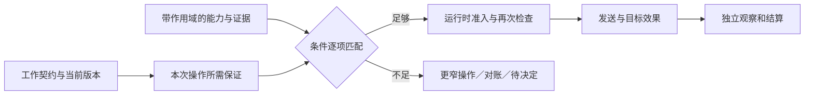
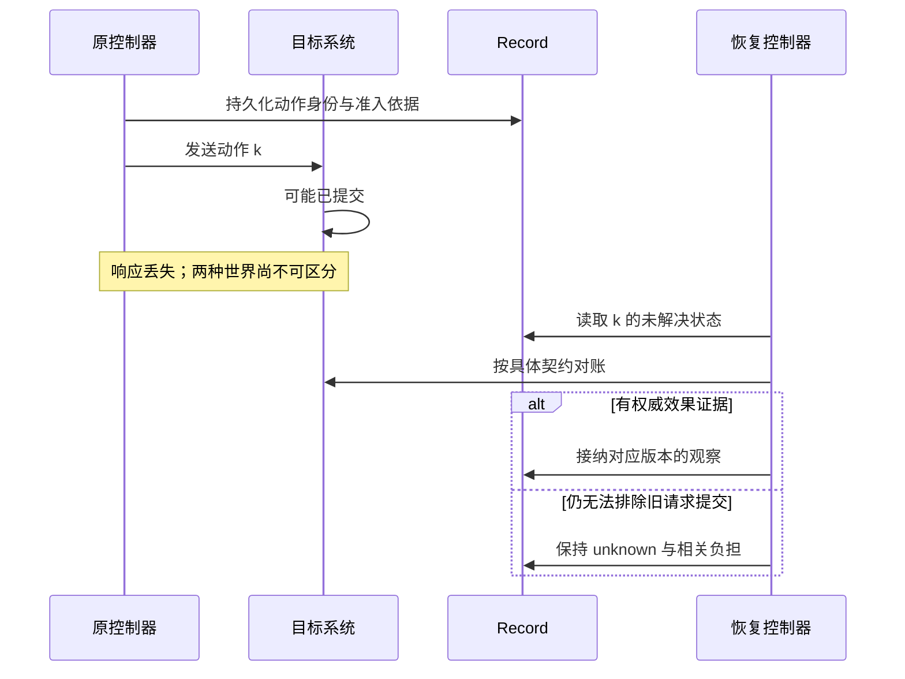
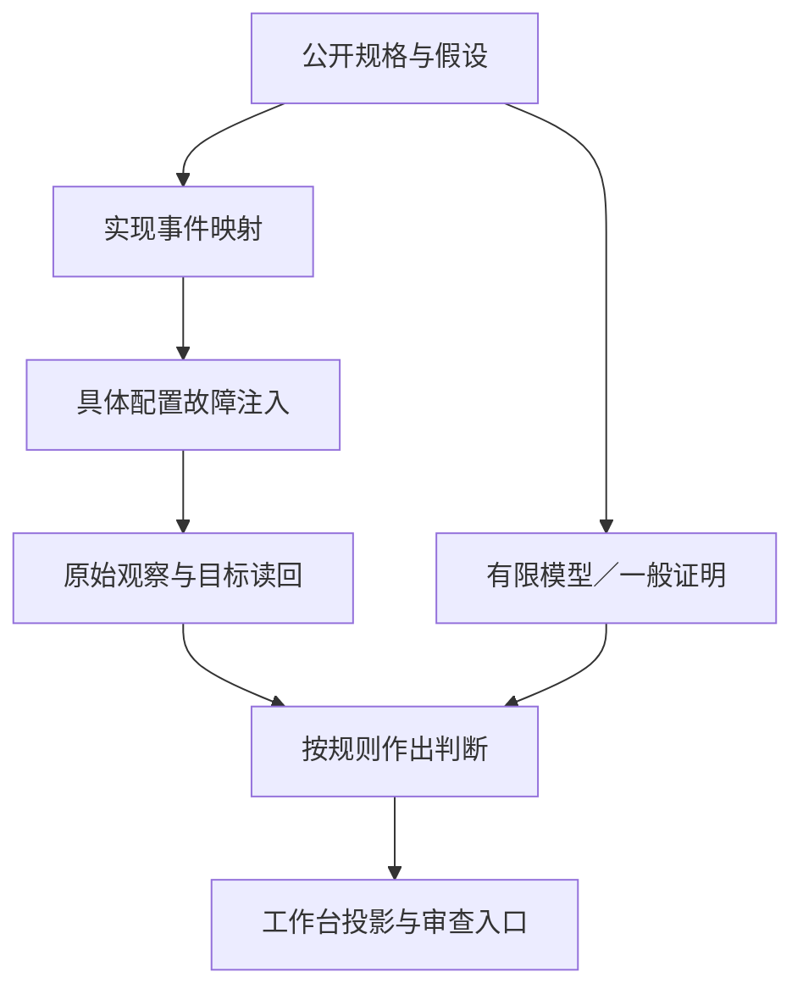

# 适配契约与贯穿场景讨论稿 v0.1.0

2026-11-07 · 个人 Harness 研究，Codex 整理与核查

## 版本与范围

这套工程最先可以提供给其他作者的东西，是一组能解释失败的工作契约和可复查场景。 工作台、Record、DAG、远程执行分别实现其中一部分；通过相同场景，才能知道换宿主后哪些含义保持，哪些能力缺失。

- 版本：v0.1.0，七小时研究中的适配契约初稿。
- 主线：能力匹配 → 效果契约 → 恢复 → 行为场景 → 贯穿演示 → 实现映射。
- 状态标记：条件模型已核；真实适配器场景待验证；接口为提案。

本稿为研究提案。已有 Python 有限模型与 TLA+ 检查另附原始结果；本稿的真实适配器场景尚未运行，没有修改 DSH、Codex、Claude、Qwen 或现有 Record 产品。下文的接口名称是讨论词汇，不是已冻结的 SDK。

| 项目 | 本稿采用的边界 |
| --- | --- |
| 输入基线 | 工作台与 Record Draft PR 的 7264be1；通用形式模型 P1–P15 |
| 可运行证据 | 有限抽象模型、反例轨迹；具体计数以各模型收据为准 |
| 待验证对象 | 命令到真实存储、工具、目标效果及工作台投影的映射 |
| 公开材料 | 个人通用 Harness 设计、公开源码和合成场景 |
| 暂不冻结 | 外部 JSON schema、数据库、进程拓扑、第二宿主选型 |

## 总体架构：能力声明落实到一次操作

能力声明至少限定主体、目标、操作、版本与配置，调度器按任务要求逐项匹配。 一个宿主支持幂等调用，不意味着它所有工具都幂等；一种存储的写入围栏，也不自动约束浏览器或远端服务器。

设任务要求的保证为 R，适配器在作用域 σ 下已有证据的保证为 C(σ)。只有 R 中每个条件都被 C(σ) 满足，才可采用该执行路径。这里的“满足”需要检查条件、期限和对象匹配，不能只做能力名称的字符串包含。

| 声明项 | 必须说明 | 不足时的可用做法 |
| --- | --- | --- |
| 持久提交 | 哪些事件/收据原子提交，何时向调用者确认 | 暂态进度明确标注，故障后重新核实 |
| 目标幂等 | 业务键命名空间、参数一致性、并发行为、保留期限、实际覆盖的效果 | unknown 后保留占位；改为权威对账或人工决定 |
| 目标 fencing | token 的权威来源、单调范围、目标校验点、哪些写入受限 | 只承诺本地准入或存储写入围栏 |
| 取消和终止 | 取消信号、函数结束、进程及子进程结束、外部效果解决分别可证到哪里 | 分层显示，未证实部分保持未解决 |
| 授权 | 准入时有效还是提交时有效；最终参数与资源如何绑定 | 提案模式、等待授权或采用更窄操作 |
| 上下文 | 当前策略独立传入、实际材料 manifest、义务缺口、访问范围 | 显示未覆盖项，不标为完整上下文 |
| 费用 | 后验计量、阈值准入、未结算负担上界或目标强制配额 | 采用软预算并说明范围，不许诺硬上限 |
| 读回 | 哪个目标是权威、查询范围、陈旧性和未找到的含义 | 未找到仅作观察，不自动当作未生效 |

“尚未核实”“明确不支持”“在该配置下通过”是三个不同结果。没有某项能力不等于宿主不合格；要求那项能力的任务才不能选择该路径。

**图 1　能力匹配 · 先检查作用域再准入**

读图：声明匹配只决定路径可选，真实发送仍需检查当时的授权、版本、冲突和资源。

## 2. 一份幂等契约需要覆盖什么

稳定业务身份、目标原子去重和足够长的去重保留期必须同时成立，才能使用相应的重复效果保证。 相同参数不必是相同业务意图；同一业务意图也不能在每次尝试时换新键。

| 条款 | 应明确的规则 | 最小反例 |
| --- | --- | --- |
| 身份与范围 | 谁分配 businessIntentId；目标/租户/操作如何命名空间化 | 两个独立的相同金额动作被错误合并 |
| 参数绑定 | 同键不同参数拒绝或明确处理，最终有效参数在绑定范围内 | 审批后包装器换目标，同键却执行新动作 |
| 原子效果 | 去重记录与被覆盖的效果是否在同一目标事务中 | 先写效果再写去重，中间崩溃后再次执行 |
| 并发重复 | 同键并发由目标收敛为一个效果，结果如何读回 | 两次先查“无记录”后各执行一次 |
| 保留期限 | 多长时间内允许自动重试；到期后如何处理旧未决请求 | 去重条目已过期，恢复器仍把旧键视为安全 |
| 效果覆盖 | 一次工具内部哪些子操作被去重，哪些另有身份 | 主记录去重了，通知或后台任务重复 |

TLA+ 样例固定为一个不可变业务意图、至多三条请求、两个目标代际，目标去重集合不丢失。它检查的是该模型内的条件性性质，不包含去重过期、多个租户、参数碰撞或恶意目标。上述条款是把抽象条件落实到真实适配器时必须补齐的内容。

fencing 解决另一个问题：目标在提交时拒绝已经安装的较新代际之前的请求。同代际的重复请求仍可能重复生效；稳定幂等键也不保证旧执行者不会以新业务键发起其他效果。两者应分别声明，分别核查。

## 3. 取消后的恢复要保留哪些事实

恢复流程应先保留仍可能发生作用的请求，再依据具体证据减少未知范围。 本地调用结束、远端进程结束、业务效果解决是三个独立观察。

**图 2　恢复分支 · 响应丢失后先对账**

读图：恢复器首先续接业务身份和证据。是否重发，取决于目标契约能否覆盖重复与迟到提交。

可复用的公开实现并不少。Temporal 区分 ABANDON、TRY_CANCEL 和等待活动结束，后者可能等待很久；DSH 的合规工具包装路径区分派发前取消与已进入工具体后的取消；Letta 允许超过宽限期、忽略取消的工具继续运行并处理迟到结果。这些设计各自有使用前提，适配器应保留这些区别。[Temporal 固定源码](https://github.com/temporalio/sdk-typescript/blob/615a684ac41a22c881df11157775e326843f7b04/packages/common/src/activity-options.ts)、[Letta 固定源码](https://github.com/letta-ai/letta-code/blob/9176d8c0b16f408e9240422a98379a423e2176c3/src/agent/approval-execution.ts)

DBOS 在工具函数返回后记录结果，取消时可不记录并允许恢复重跑；Pi durable 对恢复重跑要求保存时与当前策略都标为 safe。它们提供了明确机制，也把目标效果的幂等或对账责任留给应用。[DBOS 固定源码](https://github.com/dbos-inc/dbos-transact-py/blob/236142bd7a99ff77d04becf5f405a60d6f330591/dbos/_core.py)、[Pi 固定源码](https://github.com/earendil-works/pi/blob/6e2222a8dda06e3d69fad46d630f152f5873567a/packages/durable/src/harness/tool.ts)

## 4. 同一组行为场景怎样用于不同宿主

场景按所声称的保证选择，失败判断必须来自可观察事实。 不具备硬预算能力的宿主应返回 unsupported，不能用“没有超支样本”换取通过；支持软预算的宿主仍可完成其他场景。

| ID | 扰动 | 应观察的行为 | 所需能力/当前证据 |
| --- | --- | --- | --- |
| C01 | 验收后修改相关任务规格 | 旧验收保留历史，新规格不继承旧通过 | 版本绑定；已有有限模型 |
| C02 | 验收后添加无关备注 | 若规则确实未读该备注，验收保持适用 | 声明完整读取集合；已有有限模型 |
| C03 | 撤回 AND/OR 的一个来源 | 只重算受影响判断，保留仍成立的替代支持 | 有限无环支持；已有有限模型 |
| C04 | 提交相互自支持的验收依赖 | 首版拒绝循环；未来递归版须另定最小不动点等语义 | 循环反例已找到，首版实现待验 |
| C05 | A 证实完成、B 预留后撤回 A 证据 | 保留 A unknown 与 B reserved；B 发送点重检冲突 | 同一权威准入边界；已有有限模型 |
| C06 | 发送后断连，再请求取消 | 不凭取消 ACK 把效果改成未应用 | 有限模型与 TLA+ 反例；真实目标待验 |
| C07 | 目标安装新代际，旧请求迟到 | 声称目标 fencing 的路径拒绝旧代际提交 | 目标端检查；TLA+ 条件模型 |
| C08 | 同一意图重复发送、每次换新尝试 | 声称幂等的路径复用业务键；同键参数变化不静默执行 | 目标原子去重与参数绑定；待验 |
| C09 | 效果已提交，但响应/结果日志丢失 | unknown 或有来源的对账状态；不声称世界效果必已被账本知晓 | TLA+ 反例；真实故障注入待验 |
| C10 | 授权后包装器修改最终参数 | 最终动作仍在有效授权范围，或拒绝执行 | 服务端认证与最终参数检查；待验 |
| C11 | 恢复旧会话，历史含过期授权 | 当前可信策略独立提供；旧材料不能授权新写入 | 认证边界；上下文评价仅测误导风险 |
| C12 | 已花费用延迟上报 | 不释放仍需覆盖的未结算负担 | 真实上界/配额；有限预算模型 |
| C13 | 墙钟跨越权限或证据期限 | 显式适用性输入变更，相关判断重判 | 时钟语义；模型只抽象有效/失效 |
| C14 | 原始产物被删除或访问权撤回 | 区分历史完成、当前可用和当前验收 | 结果读回与访问策略；待验 |
| C15 | 日志存储失败或仅暂态可见 | 不把暂态进度称为持久接纳；恢复后可解释收据 | 指定存储事务与崩溃注入；待验 |
| C16 | 旧尝试迟到返回，后继已存在 | 保存迟到证据的身份；不覆盖后继当前权威状态 | 版本/代际比较与独立证据通道；待验 |

每条场景的轨迹应记录输入规格、版本、配置、扰动点、原始观察、预期谓词和实际差异。抽象模型通过与真实适配器通过分别记录，不能让同一个 pass 字段混合二者。

## 5. 最小演示应该贯穿一个真实目标

首个演示只需一个公开或合成 Coding 任务，但必须跨过需求、执行、证据与验收四个边界。 不需要先做复杂的自主记忆系统，也不要求同时接五个宿主。

| 阶段 | 示例输入 | 工作台应该显示 | 核查依据 |
| --- | --- | --- | --- |
| 定义 v1 | 生成带单位的统计表，交付 CSV | 目标、约束、允许本地改动 | 固定任务规格 |
| 尝试 a1 | 代码 s1 与测试 t1 | a1 的结果及证据只对应 v1/s1 | 提交 SHA、测试产物 |
| 定义 v2 | 用户改列定义和单位 | v1 保留；指出哪些证据需要重做 | 规格差异与有类型依赖 |
| 尝试 a2 | 复用无关检查，重做受影响检查 | 复用依据明确，不全部清零 | 输入版本和判据 |
| 交付动作 | 在显式允许的演示目标上提交动作 k | 准入、发送与效果分别呈现 | 最终参数、目标与业务身份 |
| 故障恢复 | 故意丢失响应；恢复器只对账 | 未知效果未被重复执行或误判失败 | 目标权威读回 |
| 验收 | 人检查当前版本产物 | 完成、可取、验收各有依据 | 当前绑定向量与决定 |

这里的例子是待实施脚本，不表示本轮已经创建演示仓库或执行外部动作。真实故障注入应先选无破坏性的目标；若选择 GitHub PR 合并，要保持现有 Record 只验证普通精确 SHA 合并的边界，异步队列另建契约。

一次演示同时生成三份材料：用户可理解的工作台过程、开发者可复跑的轨迹、审查者可定位的证据表。可以分别展示插件，又让读者看到它们共同完成了什么。

## 6. 从抽象事件到真实实现的精化表

实现验证首先找清楚每个抽象事件对应哪一个持久化或目标提交点。 如果找不到这个点，不能只用同名日志证明模型已经落地。

| 抽象事件 | 实现必须指出 | 观察到失败时如何报告 |
| --- | --- | --- |
| Reserve | 哪个事务同时检查条件并建立占位 | 未接纳／已接纳但回执丢失／无法判定 |
| DispatchIntent | 最后一次动态检查及其绑定版本；出站身份 | 不把意图入库当目标已收到 |
| TargetCommit | 目标端效果提交、去重与 fencing 的真实范围 | 无法原子覆盖的子效果分开 |
| ObservationAccepted | 来源认证、原始数据、解释器规则与接纳事件 | 原始记录存在但业务证明不足 |
| WitnessWithdrawn | 谁撤回什么理由，影响哪些派生谓词 | 保留历史声明和仍可使用的独立证据 |
| CostSettled | 消费增量与相应负担释放的原子关系 | 已花未报不释放，超估可在证据充分时释放 |
| AcceptanceGiven | 有权主体、规则版本、对象和相关输入版本 | 旧决定存在，但当前可能不再适用 |

**图 3　证据链 · 从规格到实现观察**

读图：模型帮助检查规则；真实观察帮助检查实现。两者结合仍须说明适用配置与未覆盖路径。

## 风险与开放问题

契约最容易失败在作用域被悄悄扩大、观察被当作真相，以及测试工具与被测规则共用同一个错误解释。 文档应把这些风险放在读者能找到的位置。

- 同一名字在宿主中含义不同：run completed 可能只表示模型循环结束，不能直接映射为业务目标已验收。
- 只在内核中加 fencing：旧执行者也许不能写当前数据库，却仍可调用外部目标。必须标出被隔离的资源。
- 回执存在但材料丢失：持久日志中保存一个 URL，并不保证产物一直可读或历史一直可重放。
- 测试检查器同源：两种算法共享语义解释器，只能证明算法层一致。应加入独立语义真值表、手工小反例或其他表达的交叉核查。
- 模型和例子过窄：两动作、两代际的检查不会自动覆盖任意并发、动态参数和多租户范围。
- 过早统一：首个真实场景尚未打通时，不先承诺所有宿主共享完整 schema 或所有目标使用同一验收强度。

- [ ] 为首个适配器明确作用域、观察来源与尚未支持的保证。

## 待证命题与下一步

下一步应先做一条具体适配路径的证据闭环，再冻结公共协议。 H01–H03 提供可解释状态、持久化与真实效果读回；其他组件据此渐进增加。

| 命题/问题 | 现有支持 | 还需要什么 |
| --- | --- | --- |
| 正确读取集合上的无关更新不改变判断 | P4 条件性推导与有限验收模型 | 业务规则读取集合完整性的审查 |
| 有限无环依赖局部重算与全量一致 | P5 归纳论证 | 实现的依赖提取与重算顺序核查 |
| 准入重检阻止当时已知未解冲突 | P7 与两动作有限模型 | 真实事务边界、并发写者与认证 |
| 目标幂等与 fencing 不能相互替代 | TLA+ 有限反例 | 具体目标的参数、期限及子效果契约 |
| 未结算负担必须继续占预算 | P13 条件性推导及有限反例 | 成本上界、费用源覆盖和真实结算 |
| 记忆能否减少返工与人工审查 | 已有研究提供任务内经验，不足以替我们下结论 | 冻结任务域、简单基线与完整成本对照 |

建议首先冻结 C01/C02/C05/C06/C09/C15 的一组小轨迹，映射到一个宿主和一个目标。能够稳定解释它们后，再以第二宿主检验哪些字段确实通用。尚未运行的场景、尚未建立的权限和目标保证，继续显示为待验证。

- [ ] 把首组场景映射到一个宿主和一个无破坏性目标，逐项保存可复核证据。
