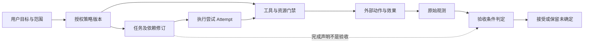
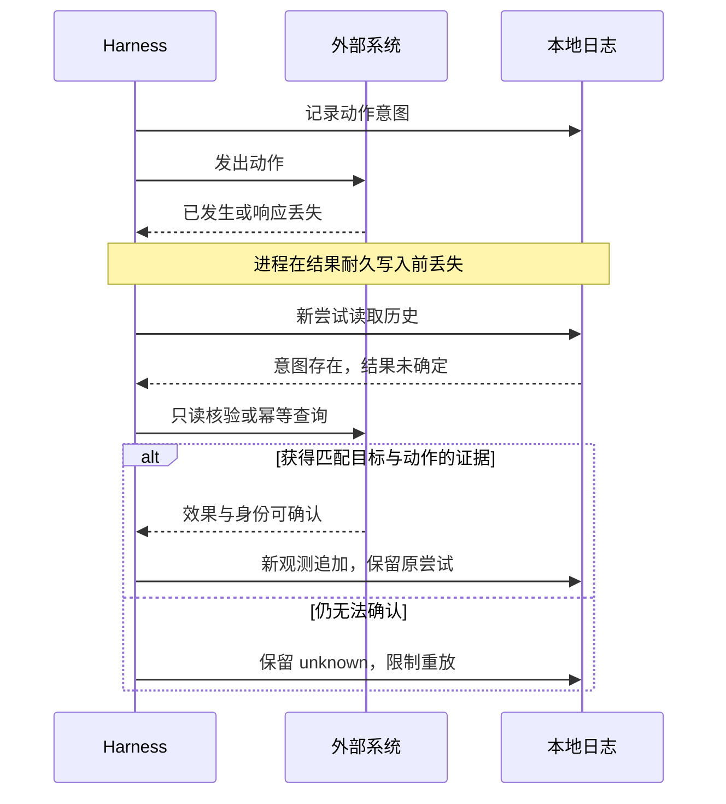
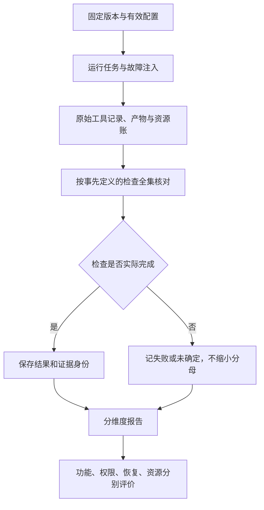

# 中国 Harness 机制核查讨论稿 v0.1.0

2026-11-08 · China 研究线 · 第一轮公开来源核查

## 版本与范围

可复用的材料已经具体到事件、租约、证据分类和恢复边界；本轮没有找到理由，把“更多代理、更长记忆、任务 DAG”本身作为我们的独特成果。真正值得收敛的是跨宿主一致的事实和验收契约。

- 版本：v0.1.0，后续修改按补丁号递增。
- 状态标记：原文已核；源码已读；测试定义未运行；员工观点；本文推断；未核实。下文按对应材料明确注明。

| 项目 | 内容 |
| --- | --- |
| 版本 | v0.1.0，首次研究稿 |
| 核查时间 | 2026-11-08 UTC；网页是访问时快照，仓库结论固定提交 |
| 主线 | DeepSeek Harness / SuperAgent 原型、Qwen Code / Qwen-Agent、腾讯 CodeBuddy / tRPC-Agent-Go |
| 验证资源补样本 | Tencent WorkBuddy Bench，与编码及文件交付直接相关 |
| 证据状态 | 已读原始文档与选定源码；测试定义已读、未运行；没有安装或操作这些产品 |
| 归属规则 | 官方契约、公开实现、员工原始观点、本文推断分别标明 |
| 来源册 | [sources.json](sources.json)，每条含 URL、归属、日期、主张、限制；CN 前缀为本线来源 ID |
| 适用边界 | 通用公开工程研究；没有使用公司或量化项目内部实现、原始对话、身份材料与凭据 |

后文的“文档写明”不等于本轮运行验证；“本轮未查到”不等于产品没有该能力。源文件上的版本、产品稳定版和托管服务部署版本是三个不同对象。主分支的固定提交只能作为源码核查坐标。

## 产品与开源关系：先确定比较的是哪一层

这六个对象分属交互式 Harness、研究原型、应用框架和图执行框架，不能按一列功能勾选得出谁完整替代谁。

| 对象 | 当前核实的产品/开源边界 | 固定代码快照 | 本轮不外推的内容 |
| --- | --- | --- | --- |
| DeepSeek Harness | DeepSeek 官方开源开发预览；Cordis 插件组合；MIT | `fcc0ad462172522aaf5c93a7b2e01f6b9f0b0159`，2026-11-04 | SAFETY 明示实验性且未安全审计，权限配置不等于安全保证 |
| DSH SuperAgent prototype | 仓库自述研究原型，明确不是 DeepSeek 正式产品；公开实现与内部实现和文章有差异 | `8c32a9dc5d72c033816c6a8110b37f40cf94fba4`，2026-10-31 | 文章中的未来方向、性能数字、内部架构不能直接记到公开代码账上 |
| Qwen Code | 通义实验室的编码 Harness；本轮读主分支代码、用户文档和测试定义 | `cbc6164c267db226b8227da0cf96b0e186026ef9`，2026-11-08；package.json 0.27.0 | 0.27.0 是该开发快照版本，未验证为最新稳定发布 |
| Qwen-Agent | 阿里 Qwen 团队的 Apache-2.0 工具调用/应用框架；README 自述用于 Qwen Chat 后端 | `31a4d36d123688581a9e9744427272b33ce940e0`，2026-03-04 | 不能将公开框架等同于托管 Qwen Chat 的全部实现 |
| CodeBuddy | 腾讯官方 IDE、编辑器插件和 CodeBuddy Code CLI；官方发行页列 CLI 2.179.3 | 本轮未核实完整 CLI 可读源码；滚动文档另计 | 开放 SDK、文档、基准适配器不证明 CLI 全部开源 |
| tRPC-Agent-Go | 腾讯官方材料确认的开源 Go Agent 框架；包含 GraphAgent、多代理、记忆和工具集成 | `d44ef706c98e6fd77d4252d7ea7d6252901ac8bc`，2026-11-06 | 不据此推定 CodeBuddy 内部使用它或二者共享恢复协议 |

主要依据：[DSH 官方入口](https://www.deepseek.com/en/harness/)、[DSH 安全边界](https://github.com/deepseek-ai/deepseek-harness/blob/fcc0ad462172522aaf5c93a7b2e01f6b9f0b0159/SAFETY.md)、[SuperAgent README](https://github.com/deepseek-ai/dsh-superagent-prototype/blob/8c32a9dc5d72c033816c6a8110b37f40cf94fba4/README.md)、[Qwen-Agent README](https://github.com/QwenLM/Qwen-Agent/blob/31a4d36d123688581a9e9744427272b33ce940e0/README.md)、[CodeBuddy 官方产品页](https://cloud.tencent.com/product/acc)、[CodeBuddy 发行页](https://www.codebuddy.cn/docs/cli/release-notes/v2.179.3)、[腾讯 tRPC 接入说明](https://cloud.tencent.com/document/product/248/125043)。源码版本见 CN-QC-01。

## 任务与权限的总体架构：状态变化、图约束和执行授权分别判断

现有实现已经提供任务修订、依赖、授权和委派，但这些约束各自覆盖不同对象。我们应给每种约束写明受保护对象和执行位置。

| 对象 | 可查机制 | 明确限制或本轮缺口 | 对我们的直接启发 |
| --- | --- | --- | --- |
| DSH Team | 任务全量快照、revision CAS；claim 检查依赖，complete 由 owner/lead 授权；blockedBy 拒绝环 | writeScopes 是建议性前缀，不是文件锁；complete 分支没有独立产物验收条件 | Task 状态和 Acceptance 分开；声明写范围不能授予或排他占有资源 |
| SuperAgent | Trigger、Policy、Mandate、Ticket、Assignment 分离；Subscription 携带上下文 | 订阅不授予执行权；策略变化对运行中的 Ticket 是通知，不能假定立即撤销外部动作 | 授权须有版本和作用对象；执行中的撤销需要另外定义中断/效果语义 |
| Qwen Code Team | 实验性团队；只读 worker，另可选一个绑定 leader worktree 的写者；leader 保留合并权 | 与普通前台委派不同；不据此推定通用跨机团队恢复 | 角色权限必须落到实际工具门禁，而不是只放在角色提示词 |
| CodeBuddy Team | 成员各有上下文、共享任务依赖和消息；详细文档列权限优先级 | 委派模式只限制领导；成员默认可用完整工具但仍经其权限模式；实验团队不能由 resume/rewind 恢复成员 | “父代理受限”不能推出子代理同样受限；权限继承与例外要可检查 |
| tRPC Graph | 顺序、并行、条件和循环执行；节点重试与状态 delta | 节点失败不提交 delta，不代表撤销该节点已发出的外部请求 | Task DAG、执行图和副作用因果图需要独立标识，循环展开为 attempt |

DSH 的关键源码是 [task-board.ts 的授权迁移](https://github.com/deepseek-ai/deepseek-harness/blob/fcc0ad462172522aaf5c93a7b2e01f6b9f0b0159/packages/team/agent-team/src/task-board.ts#L117) 与 [task-graph.ts](https://github.com/deepseek-ai/deepseek-harness/blob/fcc0ad462172522aaf5c93a7b2e01f6b9f0b0159/packages/team/agent-team/src/task-graph.ts)。其他对应 CN-SA-02/03、CN-QC-05、[CodeBuddy Teams](https://www.codebuddy.cn/docs/cli/agent-teams)、CN-TR-02。

下图是本文建议的契约分层，不是某一厂商的现成架构。图上的每条箭头都需要可识别的版本和记录，不能只靠自然语言“继续”。

**图 1　任务、授权与验收 · 本文建议的契约分层**

权限方面还需避免把“允许执行”与“隔离执行”混为一层。DSH 的工具流水线将预处理、单调拒绝 guard、执行、结果定稿分开；缺失审批会拒绝。Qwen 的 Linux sandbox 另有操作员配置、bwrap 与有限 Landlock fallback；其继承文件描述符、宿主模型通信等边界需要单列。SuperAgent 原型则直接以操作员 OS 用户执行命令，Ticket 目录本身不提供安全沙箱。[DSH 流水线](https://github.com/deepseek-ai/deepseek-harness/blob/fcc0ad462172522aaf5c93a7b2e01f6b9f0b0159/docs/tool-execution-pipeline.md)、[Qwen sandbox](https://github.com/QwenLM/qwen-code/blob/cbc6164c267db226b8227da0cf96b0e186026ef9/docs/users/features/sandbox.md)、[原型执行文档](https://github.com/deepseek-ai/dsh-superagent-prototype/blob/8c32a9dc5d72c033816c6a8110b37f40cf94fba4/docs/003-execution.md)。

## 记录与上下文：来源标签有用，但标签不让内容自动变真

事件日志、模型输入、长期记忆和验收证据已经在这些实现中被不同程度地区分；我们的差异应是跨宿主保持这些区分，并说明每条记录能证明什么。

| 层 | 可查实现 | 不能据此推出 |
| --- | --- | --- |
| 耐久事实日志 | DSH Session 日志、纯投影生成模型消息；结算后的 assistant attempt 流才成为 durable 记录 | 硬崩溃前尚未结算的流完整保留；外部效果与日志原子一致 |
| 可用上下文 | Qwen-Agent Memory 处理输入文档和受 token 预算约束的检索；FnCallAgent 组合调用者提供的消息与工具返回 | 该 Memory 模块自动具有任务日志、授权事实或崩溃恢复语义 |
| 自动记忆 | Qwen 的索引/主题文件、可选 structured recall；CodeBuddy 静态规则和 Typed Memory 区分 | 摘要完整、没有过期、没有污染、记忆内容可以授予新权限 |
| 证据来源 | Qwen Goal 将运行时记账、聚合脚本输出、原始工具返回和真实用户输入分型 | 原始工具返回一定诚实、目标正确、未截断、未过期或因果有效 |
| 完成判断 | Qwen 和 CodeBuddy 均有基于受限 transcript 的模型判定路径 | 二次模型评估等于独立读取外部系统，或判定永不出错 |

[DSH Session 文档](https://github.com/deepseek-ai/deepseek-harness/blob/fcc0ad462172522aaf5c93a7b2e01f6b9f0b0159/docs/subsystems/session.md)、[Qwen-Agent Memory](https://github.com/QwenLM/Qwen-Agent/blob/31a4d36d123688581a9e9744427272b33ce940e0/qwen_agent/memory/memory.py#L32)、[Qwen memory](https://github.com/QwenLM/qwen-code/blob/cbc6164c267db226b8227da0cf96b0e186026ef9/docs/users/features/memory.md)、[CodeBuddy memory](https://www.codebuddy.cn/docs/cli/memory)。

Qwen 的 `goal-tool-result-provenance.ts` 值得直接借鉴。它把 `get_goal/update_goal` 归为自身记账，把 `exec/agent/advisor/workflow` 的聚合返回归为 `execution_output`，而通过单独记录的嵌套工具结果才进入原始观测类别。这样可以阻止一个脚本把“测试通过”打印出来，再用这行文字证明真实测试通过。[源码](https://github.com/QwenLM/qwen-code/blob/cbc6164c267db226b8227da0cf96b0e186026ef9/packages/core/src/goals/goal-tool-result-provenance.ts)。

**本文判断：该 stamp 是宿主记录路径和执行类别的来源证据，不是外部事实真实性证明。** 还要检验工具适配器、目标身份、观测时刻、请求参数、输出完整性及接受条件。即使条目被命名为 `external_fact`，恶意工具的返回、读取错环境或已经过期的状态仍可能误导。工具日志与模型解释不能互相替代。

Qwen verifier 本身只做无工具的 side query，输入有严格大小上限，过长记录会截断。它要求证据不足时拒绝完成，但判断最终仍由模型做出；温度零和 JSON schema 约束格式，不证明语义正确。[verifier.ts](https://github.com/QwenLM/qwen-code/blob/cbc6164c267db226b8227da0cf96b0e186026ef9/packages/core/src/goals/goal-verifier.ts#L36)。CodeBuddy Goal 的“连续三轮同一阻塞”也被文档说明为 prompt 要求，不能记作运行时维护的计数器。[Goal 文档](https://www.codebuddy.cn/docs/cli/goal)。

另一个细节是记忆写保护并非各执行入口等价：Qwen 的自动提取和 forked Dream worker 对 pinned 文件有工具门禁，文档却说明可见的主代理 `/dream` 没有同一确定性门禁。这说明“功能名相同”不足以确认权限路径相同。对应 CN-QC-06。

## 长期执行与恢复：恢复可继续使用的资源，不代表恢复了未知事实

最强的公开反例来自已明确写出不保证什么的恢复文档；我们应把恢复后的 unknown 保留下来，避免以新 attempt 覆盖历史不确定性。

| 场景 | 原始来源支持的行为 | 需要保留的不确定性 |
| --- | --- | --- |
| Qwen 会话写者消失 | 核对 host、boot、PID namespace 和 process-start identity；可验证同域才考虑回收；外域或缺失身份保守封锁 | 无法证明旧写者死亡时，不能凭时间到期抢占；不同部署模式另有 certified takeover 条件 |
| Qwen Hosted Shell 生产者丢失 | 原主机 operator recovery 先 fence，再提交同一份不可变证明，最后回收准确 holder 的 Workspace lease | lease 释放不完成、不重试、不认证原 Shell；逃逸后代是否全部停止仍依赖操作员陈述 |
| SuperAgent 主机重启 | 旧 Assignment 结束，保持 Ticket 工作上下文，新 Assignment 先检查目录/git/远端状态 | “同目录继续”不等于每个外部动作恰好执行一次 |
| SuperAgent 外发消息 | receipt 与 effect 入队原子；实际 source send 之后再 settle receipt | send 成功、settle 前崩溃存在不确定窗口；需 source 幂等或读回来缩小 |
| tRPC 图检查点 | checkpoint 包含 lineage/namespace/parent/pending 状态；明确 resume 加载失败报错 | 初始和 loop 保存失败有仅记录日志继续的路径，不能称所有执行步都有 durable commit |
| CodeBuddy rewind | 可恢复对话和被编辑工具覆盖的文件 | Bash、其他进程和外部服务变化不属于完整回滚 |
| CodeBuddy 定时任务 | session 与 durable 区分；durable 专属会话、跨进程占位、daemon 接手 | 防止重复启动一个调度实例，不等于其外部效果 exactly-once；错过的触发不补跑 |

关键原文：[Qwen operator recovery](https://github.com/QwenLM/qwen-code/blob/cbc6164c267db226b8227da0cf96b0e186026ef9/docs/users/hosted-workspace-recovery.md)、[writer lease 身份判断](https://github.com/QwenLM/qwen-code/blob/cbc6164c267db226b8227da0cf96b0e186026ef9/packages/core/src/services/session-writer-lease.ts#L591)、[SuperAgent outbox 发送与结算](https://github.com/deepseek-ai/dsh-superagent-prototype/blob/8c32a9dc5d72c033816c6a8110b37f40cf94fba4/src/app/outbox.ts#L39)、[tRPC loop checkpoint](https://github.com/trpc-group/trpc-agent-go/blob/d44ef706c98e6fd77d4252d7ea7d6252901ac8bc/graph/executor.go#L1576)、[CodeBuddy checkpoint](https://www.codebuddy.cn/docs/cli/checkpointing)、[CodeBuddy schedule](https://www.codebuddy.cn/docs/cli/scheduled-tasks)。

下图是从 Qwen 文档和 outbox 顺序抽象出的恢复反例；它不是对真实故障的复现报告。

**图 2　动作效果与耐久记录之间的空窗 · 恢复必须保留未知**

tRPC 的反例有源码和测试定义双重依据：初始与 loop 保存失败仅写 Debug 日志；测试名称和断言允许保存错误后消费完整运行流，而显式 resume 读取错误要求无 Done 成功事件。[保存错误测试](https://github.com/trpc-group/trpc-agent-go/blob/d44ef706c98e6fd77d4252d7ea7d6252901ac8bc/graph/executor_checkpoint_test.go#L181)。这是项目选择的容错语义，不能擅自称为缺陷；但它与“持久提交之后才允许继续”的协议不同。本轮未执行这些测试。

## 验证与资源：把可复现配置和完整失败分母纳入证据

现有基准最值得借用的是配置固定和验收失败处理，而不是榜单分数。我们仍需单独评价崩溃恢复、授权变化、证据过期和资源回收。

Tencent WorkBuddy Bench 提供四类任务、Docker 环境、测试与运行记录，基于 Harbor；它只是公开评测框架，不能反推 CodeBuddy CLI 本体开源。其不同子集使用不同评分工具，因此论文不提供整个套件的一维总平均。[仓库](https://github.com/Tencent/workbuddy-bench/blob/625b2233093ae4f23e76be28c1f341d41cc70373/README.md)、[论文 v1](https://arxiv.org/abs/2607.20911v1)。

两个工程点直接适用：

1. **版本决定工具和配置。** CodeBuddy 基准适配器按 CLI 版本选择 deny-list、配置和上下文压缩参数；缺少显式映射会失败。记录脱敏后的有效配置，比只写“用 CodeBuddy 跑了”更可复核。[配置契约](https://github.com/Tencent/workbuddy-bench/blob/625b2233093ae4f23e76be28c1f341d41cc70373/configs/harnesses/codebuddy-code/CONFIG.md)。
2. **未执行检查不能缩小分母。** 固定提交含对特定脚本验证器的增强：分母取声明检查数，提前异常而未运行的检查按失败补齐，防止“第一个检查通过后程序崩溃”得到虚高分。[源码](https://github.com/Tencent/workbuddy-bench/blob/625b2233093ae4f23e76be28c1f341d41cc70373/src/workbuddy_bench/judge/runners/rule/script_verifier_resilience.py#L1)。

Qwen 的历史 Harness 评测固定模型、任务与重复次数，可作为分离模型和 Harness 变量的例子，但其中版本不是本轮 0.27.0；它也不能替代资源隔离、租约回收和外部效果的验收。[评测说明](https://github.com/QwenLM/qwen-code/blob/cbc6164c267db226b8227da0cf96b0e186026ef9/docs/evaluation.md)。

对我们的资源记录建议是本文推断：每个 Attempt 记录请求的预算、实际执行环境身份、占用起止、工具输入输出大小、超时和取消结果；另记“工作区可重用”与“原动作效果已确认”。不要用 token 预算或父进程退出替代资源和副作用核验。

**图 3　验证资源与结果形成链路 · 未执行检查保留在分母中**

读图时关注“检查全集”节点：运行提前结束只会产生缺失检查，不能通过删除这些检查改善结果。

## 员工原始观点：身份可核实，观点仍须保留时间和个人边界

三家都能找到原始人的表达，但它们说明的是动机、观察或设计意向，不能替代当前产品契约。

| 人与身份依据 | 原始公开内容 | 合理用于本研究的部分 | 不采用的外推 |
| --- | --- | --- | --- |
| Tianyi Cui / tianyicui；GitHub 公开 DeepSeek 归属，论文列 DeepSeek-AI | 2026-08-30 DSH discussion #5120，询问插件作者从 0.1.1 升级 0.1.2 的 skill，考虑官方整理并致谢社区 | 插件协议持续变动使迁移工具和兼容测试成为真实作者需求 | 不能据此说官方迁移 skill 已交付或未来无破坏变更 |
| Shaojin Wen / wenshao；个人页自述 Alibaba、Aliyun DataWorks Tech Leader | 2026-03-02 Qwen Code #2036，报告长会话内存占用和 resume/切模型慢 | 长期任务不仅需要逻辑记录，也需要有界表示、恢复性能和资源诊断 | 不称其 Qwen Code 团队发言人；不把旧问题作为当前故障。维护者 6 月 26 日说明改进并关闭 |
| 汪晟杰；腾讯官方活动列 CodeBuddy 首席产品经理/产品专家 | InfoQ 2025-09-10 原始问答，谈压缩+外部存储、CDE 异步、协作节拍和高风险人工介入 | 产品设计动机与场景选择；提示词规则与执行控制需继续拆分 | 不引用未提供可复现实验的生产力数字；访谈中的人工 checkpoint 不等于当前文件 rewind checkpoint |

原文及身份分别为：[DSH discussion](https://github.com/deepseek-ai/deepseek-harness/discussions/5120)、[Tianyi profile](https://github.com/tianyicui)、[Cordis 论文](https://arxiv.org/abs/2608.25512v1)；[Qwen issue](https://github.com/QwenLM/qwen-code/issues/2036)、[wenshao profile](https://github.com/wenshao)；[汪晟杰完整访谈](https://www.infoq.cn/article/soadsraioyt8ckqhijx5)、[腾讯官方讲师归属](https://developer.cloud.tencent.com/salon/salon-2433)。

Cordis 论文另外提供“受中介的效果”及局部逆操作的研究脉络。其形式结论依赖模型假设，不能直接推成外部邮件、付款或远程部署可撤销。本轮只核过作者、摘要与相关架构表述，没有独立验算 92 页证明。SuperAgent 架构文章的原始微信页本轮无法访问，未用转载补写内部性能或作者事实。

## 风险与开放问题

目前最大的误判风险是把某个层的成功提升为整个系统成功；第一版已经记录了可直接推翻这类提升的反例。

| 容易写错的主张 | 现有反例或限定 | 当前证据状态 |
| --- | --- | --- |
| DAG 无环且所有任务 completed，所以用户目标已验收 | DSH complete 是合法状态迁移；advisory writeScopes 不管文件冲突 | 源码及文档已核，未运行 |
| 有原始工具 stamp，所以外部事实为真 | stamp 标识记录路径，工具输出可错误、过期或读取错目标 | 源码已核；真实性边界为本文推断 |
| memory 保存了结论，所以可以跨任务照用 | 记忆索引受预算，摘要和类型不证明新鲜度；不同入口保护不同 | 官方文档已核 |
| checkpoint 配置成功，所以每一步可恢复 | tRPC 保存错误存在继续运行路径；CodeBuddy rewind 不覆盖所有副作用 | 源码/测试定义及产品文档已核 |
| 子代理继承父限制，所以委派安全 | CodeBuddy 委派模式的限制只约束领导自身 | 官方文档已核 |
| 释放租约后安全重放旧命令 | Qwen Workspace recovery 明确保留原动作未知状态 | 官方文档及写者代码已核 |
| 模型 verifier 是独立验收器 | Qwen/CodeBuddy verifier 不独立调用真实工具；输出约束仅保证形式 | 文档及 Qwen 源码已核 |
| 开源框架或基准等于商业产品全源码 | Qwen-Agent、tRPC-Agent-Go 和 WorkBuddy Bench 各有独立边界 | 归属已核；CodeBuddy CLI 完整开源状态未核实 |

未完成项包括：完整 adapter 的跨宿主调用一致性、SuperAgent 每个 source 的幂等能力、Qwen managed runtime 全链路、CodeBuddy hook 超时的最终门禁行为、动态文档与特定发行版的精确对应。本轮选定代码并非穷举安全审计。公开个人身份仅支持对应公开页面/时期的归属。

- [ ] 关键引用由总线重新打开原文核对，尤其是恢复和权限例外。
- [ ] 对未知副作用、旧授权、证据过期和迟到结果补齐跨宿主反例。

## 待证命题与下一步

我们可以将已有能力视为基线，把研究投入到“跨层不错误升级状态”的可检查性质；以下是工程建议，不是已证明或已实现的成果。

| 编号 | 命题 | 前提与状态域 | 已有依据 | 缺口 |
| --- | --- | --- | --- | --- |
| P1 | 来源不升级 | 可信宿主绑定原始结果的 Goal/Attempt/Action/目标身份；聚合不覆盖原记录 | Qwen provenance 已有 | 子代理/脚本打印伪造通过结果时仍要求原始观测；补跨宿主一致性、过期和撤销语义 |
| P2 | 未知不清除 | 外部发送与本地提交非原子；缺结果写为 unknown，新 attempt 不覆盖旧 attempt | Qwen recovery 明确 | send 后崩溃不自动重放；只读核验失败仍 unknown；抽为插件契约 |
| P3 | 完成不授予资源 | Task 状态、资源租约、Acceptance 相互独立 | DSH Task 与 Qwen lease 各自已有 | completed 后仍有写者时资源不可给第二写者；统一身份关联 |
| P4 | 重放有授权版本 | Policy/目标/工具参数与 Attempt 固定；变化产生新判定 | SuperAgent mandate/policy 已有 | 旧授权撤销后排队动作到达须拒绝或重批；明确运行时撤销和迟到动作 |
| P5 | 验收分母不退化 | 检查全集在执行前固定，删检查需新版本决策 | WorkBuddy Bench 有具体修复 | 第一项成功后验证器异常不能算全部成功；推广到证据缺失/不可用 |
| P6 | 资源恢复条件显式 | 环境身份和可能写者集合可观察；不可观察部分标明假设 | Qwen 有具体操作员恢复边界 | 父进程退出但子孙存活时仍封锁；不宣称软件能证明任意逃逸进程已停止 |

推荐给总线的最小输出，是一份 **Action/Effect/Observation/Acceptance 契约与反例集**：每个插件写清来源类型、授权版本、执行环境、可重试条件、效果核验、恢复条件和观测盲区。随后再决定哪些性质由确定性内核强制，哪些保留模型建议，哪些需要人工见证。不要先写一个“大而全”的抽象再宣称覆盖所有宿主。

第一轮交接时请复开这些关键原文：CN-SA-01（产品边界）、CN-DS-07（complete 与 CAS）、CN-QC-04（lease 恢复边界）、CN-QC-09（provenance 能力与限制）、CN-TR-04/05（检查点失败继续）、CN-TX-03（团队恢复与权限例外）、CN-PE-TX-01/02（个人观点及身份）。JSON 格式通过和文件存在仅是材料完备，不等于这轮研究已验收。

- [ ] 总线确定 P1–P6 中哪些进入本轮统一模型，哪些仅作为后续工程候选。
- [ ] 为选定性质列出可信宿主、可信适配器和环境可观察性的明确假设。
- [ ] 先做最小跨宿主对照与故障反例，再决定产品切片。

