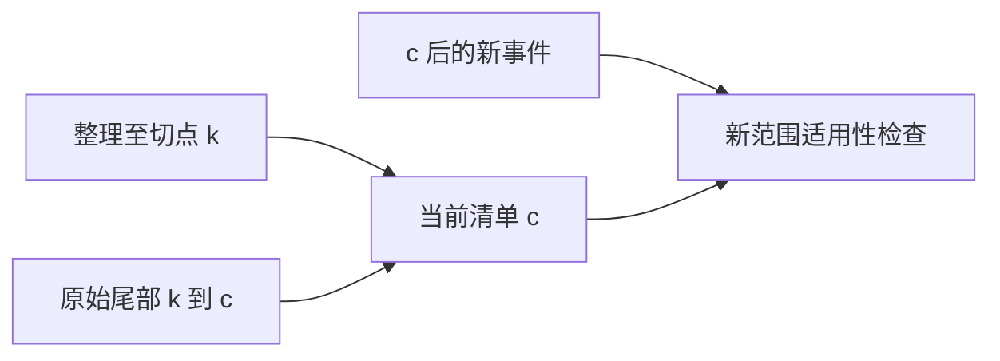

# 有限声明域覆盖契约讨论稿 v0.1.0

2026-11-08 · Codex（mechanisms 研究线）

## 版本与范围

coverage 只回答“指定有限范围是否按约定处理”，不回答事实真假、任务成功或行动获准。

- 版本：v0.1.0，承接 W11、W04/context、原 Record 与 M09；后续按补丁号递增。
- 主线：冻结分母 → 固定切点 → 核对收据 → 判断适用性 → 按权限发布。
- 状态标记：本稿为纸面提案；反例为构造、NOT_RUN。未实现或测量产品 coverage，未新增论文或模型实验。

## 总体架构

先确定声明域，再检查处理记录；不得从“搜到了什么”倒推“本来需要什么”。

**图 1　覆盖计算 · 分母先固定**

从左到右保留同一范围；覆盖没有直达任务完成的箭头。

CoverageSpec 的 target 必须明确是来源摄入、上下文义务还是评估检查；它们不能互换。域可由任务指定清单，或由受信目录在固定快照枚举。来源选择是否足够仍是工作契约判断，不证明世界上没有遗漏。空域须显式获契约允许；无搜索结果不能自动生成空义务。

## 可核字段与纸面条件

complete 应是校验输出，不接受调用者传入的 complete flag；收据可信性仍是必须落实的边界。

| 对象 | 最少可核字段 |
| --- | --- |
| CoverageSpec | specId/revision、target、命题与 q、必需义务 ID、有限来源域、允许处理方式、政策与改域规则 |
| 域及快照 | 目录身份/版本、明确成员或可验证枚举、内容版本/摘要、每个 history/incarnation/cut、枚举终点依据 |
| 处理收据 | obligationId、精确输入/范围、方法版本、输出引用、执行/评估者、核验依据；不只写“读过” |
| 缺项 | 未列全、拒绝访问、丢区间、解析失败、未处理或收据不可验证；受控保留原范围 |
| 覆盖报告 | spec/snapshot/receipt 引用、逐条件结果、导出的缺项、评估者及政策、适用输入；不是永久许可 |

分页末页不证明快照完整；需目录契约保证固定成员与一致枚举。跨源切点各自固定，不自动构成全局一致快照；若要求因果闭合，缺前驱便是缺项。

**纸面充分条件**：声明域及枚举边界已核，快照身份匹配，且每个必需义务都有符合该 target/政策的收据，没有必需缺项，则可输出该范围的 complete。结论只是逐项满足这些处理条件；来源没有说谎、语义解释正确仍需独立依据。明确域内有未处理项为 partial；域边界或收据真伪未明为 unknown，保留已知缺项。

“检查得出失败”或“发现冲突”可以完成检查义务；不会因此变成正支持。扫描索引不等于材料进入实际请求，实际输入字节包含材料不等于模型正确使用。要求原文注入的义务，不能用“有链接”或普通摘要充数；允许权威评估的义务则按限定评估收据判断。

## 尾部、并发与旧报告适用性

旧快照的覆盖报告保留历史；能否用于当前操作，要按其实际依赖重新判断。

**图 2　后台水位与调用切点 · 尾部不能省略**

清单需同时解释已整理前缀和未整理尾部；新事件不能被旧水位吸收。

例如后台处理至 k，调用冻结切点 c：需要可核前缀处理记录和区间 (k,c] 的连续原始事件及处理收据；只把尾部文件附上不保证其义务已处理。丢区间、history/incarnation 不同、解析错误均保留 gap。

新来源进入目录新版本后，旧域的报告不能直接代表新域；若本次契约仍要求旧固定域，可继续标明该旧范围。新反证、约束或政策影响当前义务时重评；已证明无关的备注不强制全量失效。依赖不能确认时保守复核。事件发生、可获知、有效时间与接收序号分列；固定切点不声称覆盖读取后变化的世界。

## 权威摘要与披露范围

接收者可以使用获准发布的限定评估，不必读取所有祖先；但评估者可读不等于有权公开。

**图 3　限定摘要 · 评估与发布分别授权**

右侧消费的是获授权的评估内容，不是假装原件已对消费者开放。

限定收据绑定评估者、域/切点、检查政策、输出版本及可信核验引用；发布另绑定 recipients、permittedUses、转换版本和失效依赖。政策允许该收据替代相应检查时，可满足评估覆盖；它不满足要求原文字节的上下文覆盖。

不可访问来源不能从内部域删去。向外只返回获准的状态与下一步，不默认披露隐藏来源 ID、数量、标题、冲突或敏感摘要；连缺项存在性也须按披露政策处理。必要时只说明无法提供该请求所需判定。摘要撤权/失效按发布依赖重判，不统一要求所有消费者可读原文，也不证明模型遗忘或无侧信道泄露。

## 三个反例

三个反例检验分母、切点与发布权；均未运行。

| 编号 | 错误组合 | 应保留 |
| --- | --- | --- |
| CVX01 | 必需域有 a、b；b 拒绝访问后过滤掉，按 a/a 宣称完整 | b 的内部 gap；原域 partial，不能静默改分母 |
| CVX02 | 索引停在 10；尾部 11 是新禁止条件，却用旧索引宣布当前覆盖完整 | 旧报告只属旧切点；当前须补尾部。新目录版本同理 |
| CVX03 | 评估者读过受限材料，把完整结论和隐藏来源名直接发给无权限接收者 | 单独核发布许可；获准最小摘要可供限定消费，不能冒充原文覆盖 |

W04 的必要证据召回要求先声明证据集合，缺 trace 记 unknown。重新核读的 [LoCoMo 源码](https://github.com/snap-research/locomo/blob/3eb6f2c585f5e1699204e3c3bdf7adc5c28cb376/task_eval/evaluation.py#L228-L237)在缺 trace 的分支也可填 1；这是评分默认值，不能当覆盖测量。[A2A 规范](https://github.com/a2aproject/A2A/blob/3303592588e388e62e0f69f701af531d2f4e3991/docs/specification.md#L747-L764)明确 history 可遗漏。因此取回任务快照不提供完整事件域。

## 风险与开放问题

可核字段只能约束声明，可信采集、域的选择和摘要忠实性不能由字段数量替代。

- **域缩小作弊**：改域须形成获准新版本，旧缺项不被追溯抹除。
- **可信前提伪装**：真实身份、枚举终点、输入捕获及评估权限须由具体宿主提供，不能再填 verified=true。
- [ ] 首片能提供哪种固定目录/日志范围收据？无法证明枚举终点时保持 unknown。
- [ ] 哪些义务允许限定评估替代原件，哪些要求原文进入实际输入？

## 待证命题与下一步

下一步只选有限域核对输入与收据，不把纸面条件升级为产品保证。

| 编号 | 命题 | 已有依据 | 缺口 |
| --- | --- | --- | --- |
| CP1 | 逐义务收据可阻止静默删分母 | 有限集合条件 | 真实枚举、认证与采集精化 |
| CP2 | 前缀加尾部可覆盖声明切点 | 连续范围及版本条件 | 并发捕获、处理正确性与宿主验收 |

- [x] 固定既有来源、纸面契约与三个构造反例。
- [ ] 独立审查摘要披露与切点条件；获授权后才实现具体采集器。

