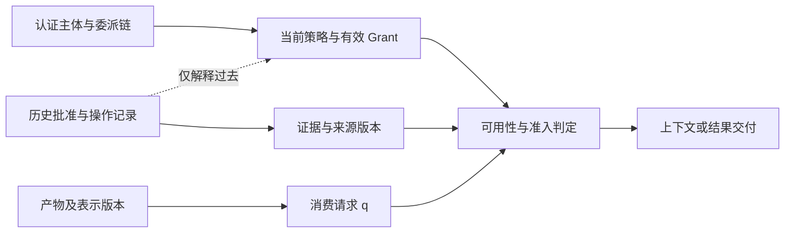
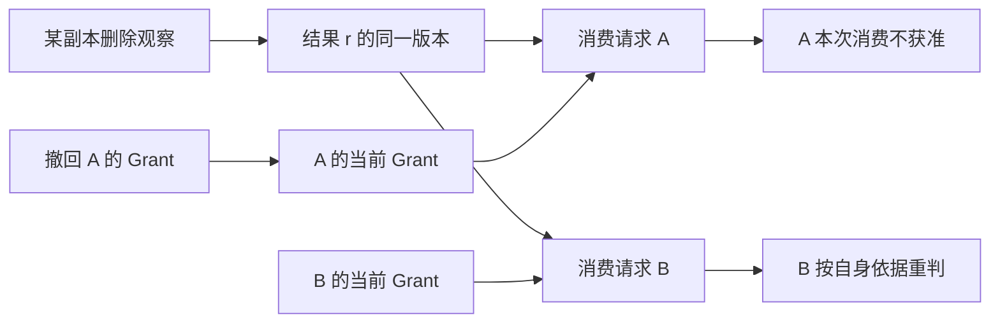

# 主体权限与结果可见性讨论稿 v0.1.0

2026-11-08 · Codex west 第四轮（UTC）

## 版本与范围

本稿为统一 Harness 的 FORMAL_MODEL、ARCHITECTURE 与 C14 提供局部修订提案；下列新契约尚未实现、测试或形式证明。

- 版本：v0.1.0；后续修改递增补丁号。
- 范围：五组原始规范/官方技术来源；固定版本源码只作静态核查，动态文档标访问时点。
- 主线：主体与授权来源 → 数据和工具作用域 → 审批及委派 → 按消费者判定结果可用性。
- 状态标记：已读所引相关正文；未调用模型 API、运行产品、扫描安全问题或研究攻击载荷。
- 原三轮保留。本轮仅新增 authority-scope 文档；来源、定位和局限见 sources.json，整合入口见 review-packet.md。

## 一、先给结论

`Usable(t,n)` 应显式携带消费主体和用途。一个主体失去访问权，不能直接使共享产物对所有主体不可用；一个读取失败也不能直接证明产物已经删除。即使原始材料的一个存储副本被删除，已有独立发布的派生结果、其他副本和历史完成证据也必须分别判断。

建议保留现有四谓词框架，但将可用性改为 `Usable_L(t,q,n)`，其中 q 是一次明确消费请求。产物生命周期、证据可信性、当前主体授权、派生结果发布范围是四类独立输入。审批与模型上下文同样分开：历史里存在批准记录，不表示当前动作仍获准；子代理或工具输出中的批准文字不产生授权。

权限的范围不等于工具列表。子代理可见哪些工具、可代表谁执行什么动作、可将结果交给谁，是三个问题。严格衰减应该比较可委派授权，而非比较父子代理的工具名称集合。

## 二、总体架构：三个平面共享引用，不共享权威

同一来源可以进入证据链，却不因此进入授权链。

**图 1　主体、历史与数据 · 三个平面各自给出依据**

虚线只表示历史可解释策略如何变化；它不允许以自然语言历史恢复授权。真正的授权输入来自认证和策略通道。

| 概念 | 建议字段 | 必须避免的混同 |
| --- | --- | --- |
| Principal | `(identityAuthority, subject)`；执行者 actor 与代表对象 onBehalfOf 分列 | agent 名称、模型生成 actor 字符串、相同昵称不等于认证身份 |
| Grant issuer | grantId、issuer、subject、resource/operation scope、delegable scope、有效期与撤回依据 | 身份颁发方不必等于授权颁发方；有身份不等于有权 |
| Credential audience | 凭据被哪个资源服务接受 | 不等于内容接收人，也不等于所有下游 API 都可复用凭据 |
| Data recipients | 结果或本次上下文允许到达的主体/通道集合 | 不等于 MCP 的 user/assistant 展示注解 |
| Provenance / authority class | 来源、转换、输入版本；内容是否具有授权权威另列 | 真来源、可信传输、正确事实，都不自动产生授权 |
| Policy observation | authority、epoch/version、观察时点、适用范围、有效性规则 | 历史中的策略快照不自动变成本次执行最新策略 |

## 三、五组原始证据与限定条件

以下只列可支持本提案的窄事实，不把规范要求写成所有产品已经正确实现。

| 来源组 | 已核机制 | 可采纳的设计含义 | 不可推出 |
| --- | --- | --- | --- |
| S01 MCP 2026-07-28 授权安全规范，固定提交 94f4ebc | 服务须验证 token 确为自身签发；上游 API 使用另一个 token；不得直接透传入站 token。[规范](https://github.com/modelcontextprotocol/modelcontextprotocol/blob/94f4ebc8ecb3764584bc30d5139d57c03692b734/docs/specification/2026-07-28/basic/authorization/security-considerations.mdx) | 授权按目标服务和操作解释；转发不是权限自动继承 | MCP 已替应用定义业务 ACL、派生数据发布政策或即时撤回一致性 |
| S02 MCP 同版 schema | `Annotations.audience` 类型为 user/assistant 角色列表；`ToolAnnotations` 是提示，不保证行为真实性。[schema](https://github.com/modelcontextprotocol/modelcontextprotocol/blob/94f4ebc8ecb3764584bc30d5139d57c03692b734/schema/2026-07-28/schema.ts) | 内容展示目标、工具声明与安全授权使用不同类型 | 声明 read-only 就足以强制无副作用；audience 注解就是主体 ACL |
| S03 OpenAI Agents Python，固定提交 27c75c5 | 服务端须认证/授权审批者、保管快照。函数工具持久决策绑定 agent；shell/patch 持久决策可跨共享审批状态的 agent，文档要求不同权限用逐次批准。[HITL](https://github.com/openai/openai-agents-python/blob/27c75c5f9c5fd957d28c04fb7e9eeacaad4630a9/docs/human_in_the_loop.md) | 审批者、执行者、工具/执行环境和批准寿命要分别绑定 | context override 可清除旧批准；序列化状态自带主体认证；所有类型的持久批准都严格 agent 隔离 |
| S04 Claude Agent SDK 权限及输入文档，访问 2026-11-08 | 权限流程中 hooks、deny/ask、模式、allow 在 callback 前可决策；callback 可允许并替换输入。[权限](https://code.claude.com/docs/en/agent-sdk/permissions)、[用户输入](https://code.claude.com/docs/en/agent-sdk/user-input) | 适配器声明真正生效的检查点；审批绑定最终输入或经批准的变换规则 | 只注册 canUseTool 就审查每次调用；文档里的回调例子已证明目标端 TOCTOU 安全 |
| S05 Claude Code 子代理文档，访问 2026-11-08 | 子代理可配置父会话没有的 MCP 服务，仍受管理限制；模式有继承与例外；输出报告中的批准主张不携带用户权威。[子代理](https://code.claude.com/docs/en/sub-agents) | 工具面不等于授权集合；结果内容不能代替授权事件 | 所有子代理都是严格能力衰减；输出扫描证明信息不泄露；动态文档等于固定实现的运行证明 |

S03 的源码比“per-call 按 call ID”这句概述更细：`_tool_invocation.py:165–231` 把参数等语义字段纳入调用指纹，`run_context.py:596–604` 拒绝同 ID 的不同调用，`run_state.py:1110–1180` 分离展示副本并比较身份。这是已有保护，不能制造一个“SDK 不绑定参数”的缺口。此静态核查不等于对全部工具和扩展回调的证明；我们的额外字段是应用契约。[调用指纹](https://github.com/openai/openai-agents-python/blob/27c75c5f9c5fd957d28c04fb7e9eeacaad4630a9/src/agents/_tool_invocation.py#L165)、[调用状态](https://github.com/openai/openai-agents-python/blob/27c75c5f9c5fd957d28c04fb7e9eeacaad4630a9/src/agents/run_context.py#L596)、[审批副本](https://github.com/openai/openai-agents-python/blob/27c75c5f9c5fd957d28c04fb7e9eeacaad4630a9/src/agents/run_state.py#L1110)

## 四、结果可用性：消费请求是自由变量

本节都是我们的设计提案。令 `r` 是不可变结果版本；`q=(consumer, operation, taskPurpose, recipients, representationRequirement)`。`taskPurpose` 只使用明确枚举或可检验的任务绑定，不让模型自由写一句用途就取得新权限。读原文、送模型、展示摘要、导出和重新验证可以是不同 operation。

建议定义：

`Usable_L(t,q,n) = ∃ r,m . Binds(t,r,n) ∧ AvailableRepresentation_L(r,m,q,n) ∧ Fit_L(r,m,q,n) ∧ Permit_L(q,r,m,n) ∧ ReleaseAllowed_L(r,m,q,n)`。

其中 `m` 是可用表示/存储副本；`Fit` 检查本次任务要求的版本、格式、新鲜度等；`Permit` 检查消费主体当前可用授权；`ReleaseAllowed` 检查向 recipients 交付的规则及必要派生发布决定。若本任务不涉及发布，该项是显式定义的恒真条件，不凭空增加审批。各项都以被接纳观察及其规则为依据，不等于外部世界当前真值。

这个布尔谓词只有满足全部正向依据时才为真；UI/拒绝理由仍区分 denied、missing、stale、unknown，不能把 unknown 显示成已证实删除。世界谓词相应写 `Usable_W(t,q,τ)`，保留现有“账本判断不蕴含此刻世界可用”的边界。

**图 2　共享结果 · 撤权只改变依赖它的消费判断**

副本删除可能影响 A 与 B 的可取得性；A 的 Grant 撤回只影响读取该 Grant 或其派生链的判断。共享组策略变化则可能同时影响两人，不能预设必然局部。

建议的局部不干扰命题是：固定解释器与 qB，若撤回事件只改变 qA 的授权事实，且 qB 的完整读取依赖没有变化，那么 qB 的判定不变。这依赖完整的策略输入声明，不是无条件的“不同用户永远互不影响”。

**必须分开四种情况：**

| 事件 | 可以改变 | 不能直接推出 |
| --- | --- | --- |
| A 的某个 Grant 被撤回 | A 及依赖该 Grant 的委派链、相应缓存/消费/待发送动作 | 产物消失；B 的独立 Grant 失效；完成事实为假 |
| 某位置的副本删除 | 该副本的可取得性 | 所有副本/派生结果消失；证据错误；历史操作未发生 |
| 权威结果登记明确撤销整项发布 | 规则指定的所有消费者发布许可 | 物理副本已从每处清除；读过的模型已遗忘 |
| 证据被反驳或撤回 | Supported 与依赖它的适用判断 | 对象不存在；所有其他替代证据失效 |

一个 403 或 404 只能按适配器的响应语义记作本次观察；若目标隐藏对象存在性，不能将它升格成全局删除事件。

## 五、委派、历史与派生结果

委派只传递已获允许的能力；历史和派生内容保留来源，却不自行创造能力。

### 5.1 可委派授权衰减，不要求工具名称衰减

令 `Delegable(g)` 为上级 Grant 明确允许继续委派的范围；无该字段或无相应授权时不能自行推断可委派。子 Grant 的有效范围至多为 `Requested ∩ Delegable(parentGrant) ∩ CurrentPolicy(child,task)`，并绑定父 Grant 身份、有效期和撤回规则。继续委派的范围同样不能扩大。

这里不强制上级自己必须有执行每项能力的权利：某主体可能有管理/委派权限却没有直接读数据的权限。不能把 `CanDelegate` 与 `CanExecute` 混成一个集合。来自独立权威的新授权是新的 Grant，记录其来源；它不是从父委派链凭空产生的权限。

Agent 可见工具列表只是候选动作的界面。真正的准入仍检查 actor、onBehalfOf、Grant 链和具体资源/操作。新工具出现不自动使旧批准匹配；只有同名工具也不表示相同执行器或凭据范围。

### 5.2 当前策略和历史资料必须走不同输入通道

ContextManifest 记录消费者、接收范围、材料版本和策略依据；历史批准、旧 ACL 和工具输出都可以作为证据材料，却不能向当前 Grant 集合写入权利。确定性重放使用当时记录的策略观察；实际 Dispatch 使用契约要求的当前策略检查，两者不要隐式混用墙钟或外部 API。

失去访问权后，重新编译上下文需排除不再允许发送的材料；已有会话/KV/摘要是否含该材料，要按会话隔离与输出路径处理。不能证明模型“取消看见”。标签可支持阻止交付和追踪来源，但 taint 标签本身不是语义无泄露证明。

### 5.3 派生结果可以有独立发布契约，但摘要不自动降级

一个消费者无权查看原始输入，不必永远无权使用经明确授权发布的汇总结果；反之，生成者有读权限，也不必有向别人发布的权利。建议对主动跨范围发布的派生结果记录 `releaseDecision=(issuer, outputVersion, sourceRefs, transformVersion, recipients, permittedUses, validityDependencies)`。

默认没有 releaseDecision 的摘要继承输入所需的披露限制；模型重写、去名字或压缩不能自行扩大接收范围。若有获授权的转换/发布流程，其结果可按独立契约判断，无需强制每个消费者读取全部祖先。原材料撤权或删除是否使已发布汇总失效，由 releaseDecision 的依赖规则决定；不能统一规定所有派生结果永久可用或全部作废。

即使结果可以使用，也可能无法重新审计其原始证据。`canConsumeResult`、`canReadEvidence`、`canRevalidate` 应分别展示。验收者后来失去角色，也不自动抹掉其当时有效的验收；是否让旧决定停止适用，需 Acceptance policy 明确规定。

## 六、审批要绑定最终动作并经过发送点复查

本提案将单次 Approval 与持续 Grant 分开。审批者身份由认证通道给出，其权利必须允许批准该动作；审批对象是服务端保存的候选，不接受客户端替换的参数或运行快照。

**图 3　审批流水 · 变更后不能继续借用旧决定**

审批是逻辑动作的许可，不是外部效果完成的证明。发送后的撤权、取消或断连仍按现有 unknown/对账契约处理。

建议单次绑定最少涵盖：`actionId, revision, actor, onBehalfOf, toolContractVersion, executorScope, targetResource, effectiveArgumentsDigest, outputRecipients, taskSpecVersion, applicableGrantRefs, policyDependencies, expiry`。工具 schema 没有声明但会影响效果的当前目录、环境或凭据作用域，应纳入 executorScope/依赖；不把密钥内容写入账本。

若审批服务本身获授权把参数收窄，可记录并执行最终版本；若它声称代表人批准，必须展示最终版本，或能证明变换落在该人事先批准的具体约束内。不能将“看起来更安全”的任意改写无条件复用为同一个人批准。参数、目标、接收方或执行身份的实质变化都创建新 revision 并重判；不要求只因 JSON 键顺序变化重复询问。

Grant 撤回与 Dispatch 的一致性继续沿用 FORMAL §5 三种语义。若只有缓存策略，只能声称按最近接纳快照有效；要求执行点立即撤回生效，需要目标检查或共同排序协议。权限复查也不将已发送动作变成已回滚。

## 风险与开放问题

作用域参数可以先固定，派生发布和撤回的一致性则需要按具体目标明确选择。

- [ ] 是否将 `Usable(t,q,n)` 全面替换旧名，还是保留只用于预设消费者的简写？简写必须公开绑定的 q。
- [ ] 哪些 operation 必须有派生发布决定，哪些已经被上级明确共享策略覆盖？避免每次正常阅读都新增人工审批。
- [ ] 第一版能否完整声明策略依赖？未能做到时可采用较粗的 policy epoch 失效缓存，但不能声称最小局部重算。
- [ ] 哪些工具能执行点查最新授权？哪些只能保证准入时或缓存时有效？按工具目标声明，不能全局打一个“安全”标签。
- [ ] 派生结果失效政策、验收者角色失效政策，以及已读模型状态隔离边界尚待业务决定；本稿未提供不可遗忘数据的通用解决方案。

## 待证命题与下一步

先补类型与反例，再决定是否增加服务。当前最值得验证的是按主体与用途重判是否能同时避免错误共享与过度全局作废。

| 编号 | 命题 | 已有依据 | 缺口 |
| --- | --- | --- | --- |
| A1 | 分离产物生命周期和消费者授权可以正确区分 C14a/C14b | 两主体独立 Grant 的逻辑反例；MCP 目标范围授权 | 未实施的状态模型与适配测试 |
| A2 | 最终动作绑定能阻止旧批准被用于修改后的调用 | OpenAI 指纹实现；Claude 可修改输入接口 | 应用新增字段、改写顺序、版本迁移尚未验证 |
| A3 | 可委派范围衰减可与子代理专用工具并存 | 当前子代理文档区分专用 MCP 与管理约束 | Grant 代数、撤回传播和目标端能力尚未实现 |
| A4 | 独立 releaseDecision 能允许合法汇总消费，同时保留来源审计差异 | 本稿按操作区分的提案 | 哪些转换获授权、是否保留副本及失效规则未定 |

- [ ] root 重新打开 review-packet 中五组关键入口，确认规范事实与本提案分层。
- [ ] 将 amendments.md 的局部修改合并后，先执行 contract-cases.md 中的双主体、审批修订、委派撤回和派生发布对照。
- [ ] 测试结果必须分别报告授权判断、实际数据交付与外部效果；未运行前不得标为产品保证。
