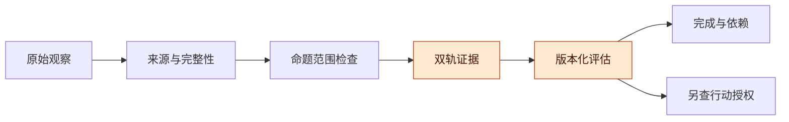
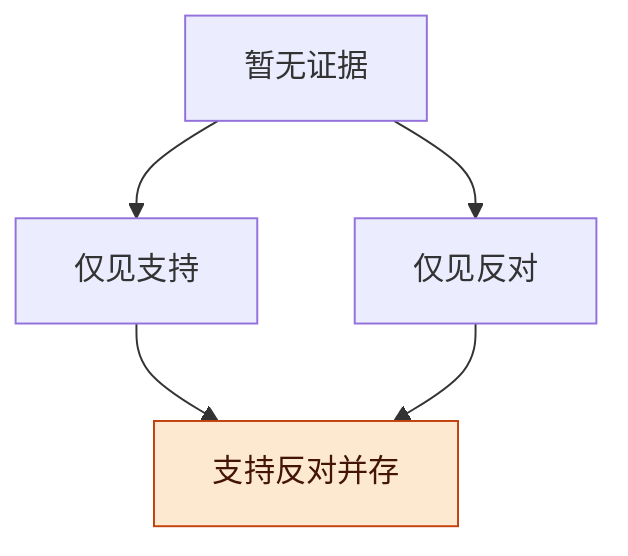
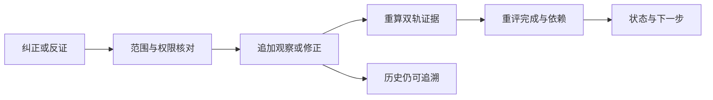

# Record 证据争议与修正讨论稿 v0.1.0

2026-11-08 · Codex（west 研究线）

## 版本与范围

建议先保留支持与反对两条证据轨道，用四态显示它们是否存在，再由有版本的评估政策决定完成、依赖和行动；四态不是真实世界的真值判决。

- 版本：v0.1.0 首次提出争议、来源撤回与纠正的最小合同，并运行独立有界研究检查；后续修改按补丁号递增。
- 主线：工程命题 → 来源与范围 → 双轨证据 → 修正与裁决 → P3/P5 衔接。
- 状态标记：文献为定向正文核读；合同与操作政策为提案；小模型为已运行的合成检查；产品集成、真实认证、来源独立性与效果验证未执行。不扩展 I01。

## 工程反例与判断边界

来源身份真实只回答“谁提交了这个观察”，不能保证解析、范围绑定或观察内容正确；先确认是不是同一个问题，再判断是否矛盾。

| 工程情景（构造反例，非真实事故记录） | 应如何理解 | 不能直接推出 |
| --- | --- | --- |
| 同一 CI run、工件摘要、环境和判据版本，API 观察器说终结退出码为 0，日志观察器说为 1 | 若两条均被接纳为该命题的候选证据，保留冲突，核对原始结果及解析器 | 两个来源已认证，所以二者都正确；或最后到达者正确 |
| 当前部署代际 v2 的检查失败，稍后收到 v1 的成功回执 | v1 回执归旧命题；可解释历史，不能覆盖 v2 | 晚到成功自动恢复当前绿色状态 |
| 两次健康检查针对同一 build，但观察时刻不同 | build 相同不足以构成同一命题；健康状态还绑定有效时点/窗口 | 一次成功、一次失败必是矛盾；或旧健康证明当前健康 |
| 来源撤回“这份日志属于本次执行”的归属声明 | 该证据不再支持原命题；并未新增“执行失败”的观察 | 没了成功证据，就证明失败 |
| 面板摘要、模型总结都来自同一份 CI 原始输出 | 两条传播/解释路径，共同来源根 | 两个工具名称等于两份独立证据 |
| A 失去下载权限，B 仍可读同一工件 | 命题的 consumer/operation/purpose 不同 | 工件全局不存在，或 B 的独立验收必失效 |

**图 1　证据到决定 · 三种责任分开**

从左到右每一步都保留输入引用；证据成立与动作被允许不是同一个出口。

## 最小表示与四态投影

最小实现可以只是两个集合和一个四态投影，不必引入通用逻辑引擎、概率分数或自动本体。

**命题键**：`k=(history, subject, predicate, object/spec version, evaluation regime, validity time/window, q-if-applicable)`。q 对消费问题绑定 consumer、operation、recipients、purpose；无关字段可以由目标类型固定或省略，但必须说明。receipt sequence 只表示接纳顺序，不替代对象版本或观察时刻。命题分类与版本对应由适配合同定义，不能只用自然语言相似度合并。

**观察与修正**：Observation 至少含带命名空间的 observationId、issuer、k、polarity、原件摘要/受控引用、observedAt、接纳序号、解析器/判据版本、来源根及其解析状态。来源认证、输入接纳和内容正确性分开。撤回与纠正另记目标 observationId、授权依据、原因和政策版本；不改写原断言。

固定前缀 n 与评估政策 π 后，取仍适用、未撤回且按 π 接纳的证据集合 `E⁺(k,n,π)`、`E⁻(k,n,π)`。`S⁺=存在合格支持见证`，`S⁻=存在合格反对见证`；最小原子命题中即集合非空。反对是对同一 k 的明确反断言，**不是** `¬S⁺`。

| S⁺ | S⁻ | 界面文字 | 含义边界 |
| --- | --- | --- | --- |
| 0 | 0 | 暂无适用证据 | 不知道；可能未观察、已撤回、超范围或材料不完整 |
| 1 | 0 | 已有支持，未见适用反对 | 不等于真理、完整检索或执行许可 |
| 0 | 1 | 已有反对，未见适用支持 | 反对同样可能错误；不自动撤销已发生效果 |
| 1 | 1 | 证据冲突，待评估 | 两边材料都保留；不能从矛盾推出任意其他结论 |

**图 2　四态的信息次序 · 不是可信度排名**

箭头仅表示增加一类报告；最下方没有更高置信度，撤回也可能沿反方向改变当前投影。

**来源与可见性**：按可核来源根合并重复，不把重复到达、镜像、摘要或模型转述计为新根；无法还原根时标 `lineage=unknown/partial`。不同根也可能相关，独立性默认未判定。评估的 coverage 单列为 complete/partial/unknown；读者看不到反证不等于反证不存在，不能因权限过滤而展示“争议已消失”。可显示的争议摘要和材料索引仍受受众范围约束。

## 纠正、撤回与裁决

撤回证据、提交反证、撤回整个完成判断和批准继续工作，是四种不同事件，不能共用一个“否定”按钮。

| 事件 | 最小变化 | 必须保留的区别 |
| --- | --- | --- |
| Assert | 新增指定 k 的正/反观察；相同 observationId 不得改含义 | 重复接收不增加独立根；同根解释相反仍可形成争议 |
| WithdrawObservation | 使指定观察不再参与后续评估，保留原记录 | 不增加反对证据，不顺带撤回其他来源或整个结论 |
| CorrectObservation | 显式关联旧观察与新观察；验证通过后一起接纳替代关系 | 新观察可修正范围或内容；不是通用 latest-wins |
| Challenge | 登记质疑、待核问题或可核反证引用 | 只有满足明确反断言规则才进入 E⁻；一句“我怀疑”不自动等于反证 |
| Hold/WithdrawAssessment | 暂停使用或撤回指定完成/验收评估版本 | 作用于判断，不删除基础观察；RF03 的 S1 命令属于这一层 |
| Adjudicate | 有权评估者按固定政策给出处置、依据和适用范围 | 人决定继续不让原矛盾变成客观一致；来源优先级须预先声明或记录政策修订 |

**次序与原子性**：纠正应先验证替代项与目标关系，再接纳一个带双向引用的纠正事件，避免只撤旧、未写新的半状态。撤回先于原观察到达时，保留其受范围约束的引用，后到原观察不得复活；未证明撤回权限时先待核。来源可撤回自身声明，不意味着可删另一来源的观察。权限撤回影响当前使用范围，不能不分主体地当作全局内容反证。

**图 3　修正路径 · 重算受影响判断**

重算只改变有依据的当前判断；已经发生的外部效果另做对账，不随图状态自动回滚。

## 相关工作

四态与保留推导来源已有成熟研究，本稿的工作是限定它们在 Harness 中能表达什么，不能称为新逻辑发明。

| 类别 | 代表（年份） | 核实到的内容 | 缺口 |
| --- | --- | --- | --- |
| 四值与容纳矛盾 | [Making Belnap’s “Useful Four-Valued Logic” Useful](https://cdn.aaai.org/ocs/17599/17599-77711-1-PB.pdf)，Sutcliffe、Pelletier、Hazen（2018），§1–2 选读 | 区分四值和两种次序；本稿据此另行限定：逻辑指定值不能直接理解为产品许可 | 本稿只借鉴原子证据投影，不采用其条件联结词或证明器。没有声称读过 Belnap 1977 原章 |
| 数据推导来源 | [Provenance Semirings](https://web.cs.ucdavis.edu/~green/papers/pods07.pdf)，Green、Karvounarakis、Tannen（2007），§3–4 选读 | 用不同运算保留替代推导和联合使用，比单一来源集合更能解释依赖 | 本稿不把路径/系数当独立样本数量；这些正查询章节未替本合同定义认证、撤回或时态 |

这里不声称 provenance 领域没有研究否定；只说明本轮读到的正查询结果不能直接包办当前合同。没有引用商业博客数字，也没有复现两篇论文的实验。

## 已运行的独立有界检查

小模型检查了双轨投影在特定输入中的行为，支持合同评审，不验证真实来源、世界事实或 Record 产品实现。

脚本 [bounded_check.py](bounded_check.py) 只用 Python 标准库，保留独立观察和撤回标记；查询按完整模型键过滤，来源根集合按极性分别去重。完整输入与限制见 [state-definition.json](state-definition.json)，实际回执见 [check-results.json](check-results.json)。

| 检查范围 | 实际运行 | 允许的结论 |
| --- | --- | --- |
| 定向短轨迹 | 14 项检查通过 | 冲突保留、晚到旧版隔离、撤回不造反证、纠正留历史、同根去重及无关命题隔离符合此模型 |
| 4 个观察的 absent/active/withdrawn 组合 | 81 种赋值 | 在该有限域内，事件折叠与直接集合规格一致 |
| 4 个观察到达顺序 | 24 种排列 | 没有撤回/纠正的这些观察，当前投影不依赖到达顺序 |
| 2 命题×2 版本×2 消费者×2 用途 | 16 个键，240 个有序异键对 | 对一个键产生冲突不改变另一个键；不是一般作用域证明 |
| 候选操作政策 | 18 项通过：12 个四态×操作格及 6 个绑定/覆盖检查 | 此示例区分查看、搜证、发布，拒用错操作/版本/水位评估；不计算实际执行许可 |

本轮任务书已执行：

1. 固定命题键、观察及修正的有限合同，写入 `state-definition.json`。
2. 用独立脚本实现集合投影及示例操作政策，运行上述有限输入。
3. 保存实际回执、错误策略反例和输入 SHA，供独立复核。

| 对照组 | 做法及已生成的反例 |
| --- | --- |
| 单值覆盖 | 最后到达覆盖；或忽略版本后覆盖，均丢失应保留的范围/争议 |
| 缺失当否定 | 撤回后没有支持就造出反证 |
| 重复当独立 | 将原件及转述三行算作三个独立来源 |
| 仅看正支持释放发布 | 同版本 w⁺、w⁻ 同时存在，却因 S⁺=1 放行；示例政策返回 UNKNOWN |

共 5 个刻意构造的反例记录，不声称现有产品采用这些错误策略。

**停止判据**：若评估者不能确定命题相等、来源根或修正授权，停止自动裁决并显示缺口；若独立审查发现模型把四态映射成世界真值或动作许可，应退回修订合同。脚本没有任意支持公式、递归、ACL、时间窗口解析、统计独立性或行动引擎；这些均未运行。

## 对 P3、P5 与实施路线的最小修订建议

P3/P5 可保留原结论，但需要在“证据仍支持”与“当前可以采用该完成判断”之间增加明确的争议政策。

对 [FORMAL_MODEL](../../FORMAL_MODEL.md) 建议新增 `EvidenceState(k,n,π)` 和 `Assessment(policyVersion, inputWatermark, supportRefs, counterRefs, coverage, disposition)`；`S⁺` 不直接替换现有 `Supported`。若后者继续用作依赖输入，应绑定评估版本及争议处置规则。一个保守候选门槛是：相关义务满足、已有合格正见证、没有未解决的实质反见证，再检查可用性与验收；这是应用政策，不是四值逻辑定理，也不代替行动授权。

**从证据到具体操作的候选政策**：同版本 w⁺ 支持“通过”，w⁻ 明确反驳时，S⁺ 仍为 1；若 readiness 只看 S⁺，发布会被释放。因此这里把 `Supported` 与 `ReadyFor(operation)` 拆开。以下是可审查的应用政策示例，四值本身没有附带这张表。

| 操作 | 示例证据门槛 | 四态如何参与 | 仍须另查 |
| --- | --- | --- | --- |
| 查看争议与原件 | 可以进入查看资格检查 | 四态均不因内容不一致而禁止查看；受限材料不自动可见 | 当前主体、受众与资料访问政策 |
| 继续搜证 | 可以提出范围内的核验请求 | BOTH/NEITHER 可触发补证；不把争议解释为研究禁止 | 工具、预算、目标范围及外部效果许可 |
| 发布指定版本 | 仅见支持且覆盖满足声明时，才通过本示例的证据门槛 | BOTH、NEITHER 和未裁决的 OPPOSE_ONLY 均为 UNKNOWN，暂不自动释放 | 验收、其他发布义务、当前授权和执行前版本检查 |

模型返回的 `READY_FOR_AUTH_CHECK` 只表示通过这一候选证据门槛，不证明所有业务义务完成，更不执行动作。`UNKNOWN` 不是事实为假，也不是已证明永远不得发布。评估绑定 `(命题键, operation, policyVersion, inputWatermark)`；实际适配还须绑定覆盖、裁决、判据等全部读取输入。反证到达、目标/政策版本或操作变更后，旧评估必须重新检查。保留版本的授权例外或人工裁决可另行决定继续，但不能静默抹去矛盾；该流程尚未实现。脚本仅用合成的完整覆盖标记，未实现受限证据的可见性政策。

P5 的正支持公式仍可解释“撤回一个来源，替代路径为何留下”。若需要组合反证，应另写 `φ⁻` 的明确规则与来源，不能把 `¬φ⁺` 当反证，也不能把命题含冲突自动传播成所有后代失败。两条轨道各自保留如何支持/反对的推导；跨轨如何影响完成评估由政策声明。现有局部重算证明依赖有限无环、确定求值和完整输入；新争议/政策/水位都须作为输入，其产品映射尚未证明。

[RF03 修正版](../../china/record-refinement/REPORT-v0.1.1.md)及[独立审查](../../proof-review/record-mapping-audit/REVIEW.md)已确认 S1 没有独立支持项和来源撤回合同。新提案不把它改判为 OR 算法错误或已证产品漏洞。先独立评审证据服务，再决定 I04/I05 的一个具体适配实验；I01 的 history 可信入口与正确状态展示保持原范围。

## 风险与开放问题

最大的风险是用漂亮的四态标签掩盖命题范围、根来源或评估覆盖仍不清楚。

- **错误合并**：同 build 的不同时间、主体或用途可能是不同问题；无法证明等价时保持分开。
- **假独立**：根去重只去掉已知重复，不解决共同故障、共享数据和模型相关性；不据此填概率。
- **权限造成假一致**：不可见材料不能静默变成不存在；允许展示的汇总及评估者范围须明确。
- **政策伪装事实**：批准继续或选择权威来源必须保留裁决依据，不能删除反方材料来制造一致。

开放问题：

- [ ] 首个业务命题采用 CI 终结结果、合并事实还是消费可用性；完整命题键由谁冻结？
- [ ] 哪些 Challenge 仅触发复核，哪些有资格成为反见证；谁可撤回或暂停评估？
- [ ] 受限证据存在争议时，哪些摘要可向当前读者发布；覆盖缺口如何呈现？

## 待证命题与下一步

当前可交付的是可复核的状态合同和反例；真实收益与适配正确性仍需另行实施验证。

| 编号 | 命题 / 猜想 | 已有依据 | 缺口 |
| --- | --- | --- | --- |
| E1 | 双轨投影比单值覆盖更能保留指定争议与修正原因 | 本轮有界检查与构造反例 | 命题提取、真实来源、生产事件顺序未验证 |
| E2 | 显式来源根能避免已知重复被伪装为独立证据 | 合成同根短轨迹 | 根解析、部分 lineage 与相关性未解决 |
| E3 | 有版本争议评估可减少错误完成和不必要重做 | 本轮提案 | 没有任务收益、人工负担或性能实验；不能承诺收益 |

下一步：

- [x] 定向核读两篇原始研究论文，记录节选范围与输入 SHA。
- [x] 运行独立有限模型，保留错误策略反例和边界。
- [ ] 由独立审查者复核命题键、修正原子性与策略/事实分界。
- [ ] 在后续适配范围获准后冻结一个命题与评价标准；不提前扩建完整逻辑引擎或 I01。
