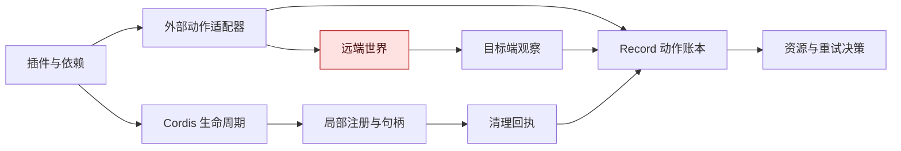
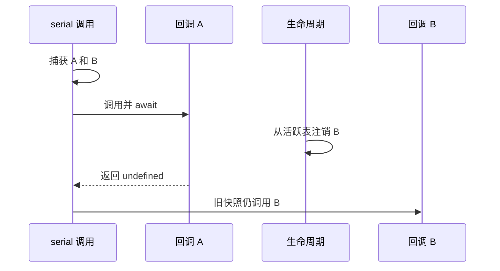
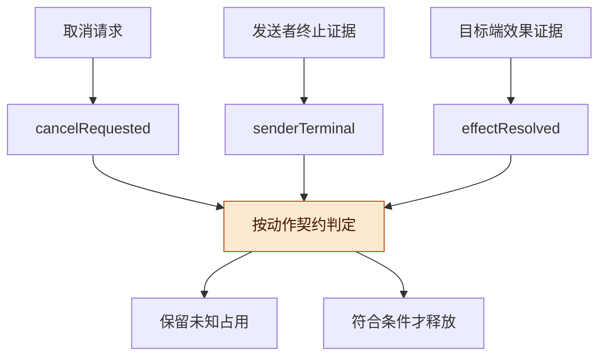

# Cordis 组合与外部效果边界讨论稿 v0.1.0

2026-11-07 · Codex / mechanisms 研究线

## 版本与范围

Cordis 可作为统一 Harness 的局部组件生命周期基础；远端动作是否发生、发送者是否停止、结果是否仍有效，需要额外的动作证据契约，不能由插件卸载状态推导。

- 版本：v0.1.0，定向阅读 Cordis 原论文相关定义与证明，并核对 DSH 固定源码；首次整理。后续修改按补丁号递增。
- 主线：论文前提 → 固定实现 → 正例与反例 → Record 适配契约。
- 状态标记：**原文核实**、**固定源码静态核实**、**本文推导**、**待验证提案**分别标注。没有运行 DSH、第三方测试或真实远端动作。

研究对象是 [Cordis 论文 v1](https://arxiv.org/abs/2608.25512v1)（Yifan Shi、Wei Zhang、Tianyi Cui，2026-08-26）与 [DSH 固定提交 fcc0ad4](https://github.com/deepseek-ai/deepseek-harness/commit/fcc0ad462172522aaf5c93a7b2e01f6b9f0b0159)（2026-11-04）。后者 vendored Cordis 的 package version 是 4.1.0。版本固定不意味着论文与代码已经完成精化证明。

阅读覆盖见 [READING_COVERAGE.md](READING_COVERAGE.md)，逐来源信息见 [sources.json](sources.json)。本稿不是 92 页全篇证明审计，也不声称发现了对论文主要定理的反例。

## 总体架构

统一 Harness 可以复用 Cordis 的所有权、依赖绑定与清理机制，再为越过组件边界的动作建立独立账本。

**原文核实**：§6.1 明确区分可独占恢复的位置与外部 emission；§5.1.1 明确 inverse 和 commutativity witnesses 不由运行时验证；§6.3 明确语言代理不构成恶意代码沙箱。[论文，第 59、70–73 页](https://arxiv.org/pdf/2608.25512v1#page=59)

**图 1　职责边界 · 本文建议的组合**

从左向右读：局部清理回执只是账本的一种输入；远端是否改变必须沿目标端观察这条线取得证据。

**本文判断**：无需把 Cordis 改造成通用分布式事务系统。更合适的接点是为工具和资源适配器声明“能撤销什么、怎样证明结束、哪些后果仍未知”，由 Record 保存这些证据的适用范围。补偿机制已有 [Sagas 原论文，第 250、254–255 页](https://www.cs.cornell.edu/andru/cs711/2002fa/reading/sagas.pdf#page=2) 等先例；补偿可能失败、需要修复，也不会抹去其他观察者已经看过的中间结果。

## 证明前提检查

本次逐段检查了恢复与依赖顺序的关键证明，但保留了未审阅依赖引理和实现精化的缺口。

下表是复核入口与本文适用性检查，不复写原证明。页码均为 PDF 显示页码，从 1 起算。

| 核查点 | 原文定位 | 本文检查后的适用条件 |
| --- | --- | --- |
| 单次恢复与 LIFO | Def. 8、Thm. 7/15/16；pp. 10–16 | 必须有实际效果对应的逆；回调函数类型本身不是证据 |
| coeffect 与通知 | Def. 19–22、29–30；pp. 17–22 | 操作及其观察都需经过指定接口；依赖满足不等于远端业务目标已满足 |
| 交错恢复 | Def. 42/44/46、Thm. 43/47；pp. 27–30 | 要检查 forward/ inverse 交叉对、返回值及后续分支，不能只检查两次写入 |
| 全局恢复 | Lemma 57/59/66/67、Thm. 68、Cor. 69；pp. 38–47 | 对照的是所选表及观察等价；控制状态、外部历史不可偷渡为被恢复对象 |
| 依赖卸载顺序 | Thm. 70；p. 47 | 依赖绑定及已提交视图是排序依据；普通闭包引用不会自动成为依赖边 |
| 迟到加载 | Thm. 71、§4.4；pp. 48、55–56 | 在途一步可先落地，再清理；不能推成“撤回时刻之后无执行” |
| 进展 | Thm. 73；pp. 49–50 | 有限名字、有限迭代、无环前提是必要检查项；抽象步数不提供外部 promise 的墙钟上界 |

定位链接：[恢复定义](https://arxiv.org/pdf/2608.25512v1#page=10)、[独立性](https://arxiv.org/pdf/2608.25512v1#page=27)、[恢复证明](https://arxiv.org/pdf/2608.25512v1#page=46)、[顺序与一致性](https://arxiv.org/pdf/2608.25512v1#page=47)、[进展](https://arxiv.org/pdf/2608.25512v1#page=49)。

**本文核查重点**：Thm. 68 归纳中的自身步骤使用 inverse witness，其他 fiber 步骤使用交换条件或依赖顺序。故把任意网络请求塞入 callback，再返回一个清理函数，不会凭空满足这个推理。将等价关系改为“业务上已经补救”，也需要重新论证相应交换条件。

Thm. 68 保留其他 fiber 的实际步骤；把它解释成该组件从未开始，还需要其创建的 fiber 在该区间未采取步骤。不能据此删去整条因果后代历史。[论文第 46 页](https://arxiv.org/pdf/2608.25512v1#page=46)

**仍未核实**：没有做全部定义的形式化类型检查，没有完整审计 Thm. 80 的合流证明，也没有证明 DSH 的每个公开 API 都实现了论文全部前提。下文对实现的判断均限于列出的路径与调用链。

**持久性边界**：§7.3 把 reload 描述为清理后重建；组件自己的内存状态需移到寿命更长的依赖才可跨 reload，DSU 式迁移仍是后续工作。§8 也将自进化 agent harness 场景列为未来验证。因此本稿不把热替换写成 durable workflow/replay，也不把该场景写成论文已完成的验收。[论文第 80、83 页](https://arxiv.org/pdf/2608.25512v1#page=80)

## 固定 DSH 实现映射

固定代码确实实现了多项有用的生命周期防线，同时也清楚显示“已收束”与“所有后果已消除”不是同一个断言。

所有代码链接均固定到 fcc0ad462172522aaf5c93a7b2e01f6b9f0b0159。

| 机制 | 实际代码与位置 | 可复用的保证 | 不能扩大成的保证 |
| --- | --- | --- | --- |
| effect 所有权 | [fiber.ts:424–566](https://github.com/deepseek-ai/deepseek-harness/blob/fcc0ad462172522aaf5c93a7b2e01f6b9f0b0159/vendor/cordis/src/fiber.ts#L424) | setup 前登记 wrapper；已开始清理可由结构所有者等待；单个 effect 组逆序串联清理 | 未登记的原始外部写入也会被撤销 |
| 迭代失效处理 | [fiber.ts:362–405](https://github.com/deepseek-ai/deepseek-harness/blob/fcc0ad462172522aaf5c93a7b2e01f6b9f0b0159/vendor/cordis/src/fiber.ts#L362) | async iterator 在下一次迭代前比较 epoch；已经 await 的 next 返回后仍收集 disposer | 能抢占正在执行的一次迭代或网络请求 |
| 固定依赖与退场顺序 | [fiber.ts:681–746](https://github.com/deepseek-ai/deepseek-harness/blob/fcc0ad462172522aaf5c93a7b2e01f6b9f0b0159/vendor/cordis/src/fiber.ts#L681)、[reflect.ts:291–326](https://github.com/deepseek-ai/deepseek-harness/blob/fcc0ad462172522aaf5c93a7b2e01f6b9f0b0159/vendor/cordis/src/reflect.ts#L291) | committed 绑定保留到消费者清理之后；provider 等待 dependents | 对未声明引用、外部客户端、远端任务也自动完成排空 |
| 清理调度与失败 | [fiber.ts:712–745](https://github.com/deepseek-ai/deepseek-harness/blob/fcc0ad462172522aaf5c93a7b2e01f6b9f0b0159/vendor/cordis/src/fiber.ts#L712)、[utils.ts:27–30](https://github.com/deepseek-ai/deepseek-harness/blob/fcc0ad462172522aaf5c93a7b2e01f6b9f0b0159/vendor/cordis/src/utils.ts#L27) | 顶层 disposers 逆注册顺序启动，异步者可并行；逐项错误记录后继续收束 | await fiber.dispose 成功返回即每项清理均成功 |
| 注销事件 | [events.ts:162–170、214–219、263–306](https://github.com/deepseek-ai/deepseek-harness/blob/fcc0ad462172522aaf5c93a7b2e01f6b9f0b0159/vendor/cordis/src/events.ts#L162)、[reflect.ts:426–434](https://github.com/deepseek-ai/deepseek-harness/blob/fcc0ad462172522aaf5c93a7b2e01f6b9f0b0159/vendor/cordis/src/reflect.ts#L426) | 移除活跃 hook 表条目；bind 负责上下文追踪 | 取消已经捕获到局部数组的回调 |
| 工具阶段取消 | [pipeline.ts:190–285](https://github.com/deepseek-ai/deepseek-harness/blob/fcc0ad462172522aaf5c93a7b2e01f6b9f0b0159/packages/core/tools/src/pipeline.ts#L190)、[contracts.ts:63–67、263–267](https://github.com/deepseek-ai/deepseek-harness/blob/fcc0ad462172522aaf5c93a7b2e01f6b9f0b0159/packages/core/tools/src/contracts.ts#L63) | 区分 body 未调用与已调用；融合 signal；等待已启动 tool.execute 结算；timeout 声明包含协作收束义务 | ABORTED 意味着动作从未发生；函数返回意味着后台远端任务停止 |
| 工具选择失效 | [index.ts:264–296](https://github.com/deepseek-ai/deepseek-harness/blob/fcc0ad462172522aaf5c93a7b2e01f6b9f0b0159/packages/core/tools/src/index.ts#L264) | 使用旧 admission 时仍核对当前定义及 registration 身份，已移除条目不会被迟到选择恢复 | 曾获得的权限持续有效；已派发动作能被定义注销倒转 |

源码中存在消费者先清理、provider 后清理的 [测试用例，74–100 行](https://github.com/deepseek-ai/deepseek-harness/blob/fcc0ad462172522aaf5c93a7b2e01f6b9f0b0159/scripts/cordis-core-lifecycle.spec.ts#L74)。本轮只阅读其断言，没有运行，因此不报告测试通过。

**并行清理的准确读法**：论文 §5.1.3 本身也提到 fiber 级清理可并发；这不是本次发现的文档与实现冲突。需要严格顺序的清理应放在同一个显式 await 链或依赖关系中，不能凭顶层注册顺序推导全部完成顺序。DSH [生命周期教程第 94 行](https://github.com/deepseek-ai/deepseek-harness/blob/fcc0ad462172522aaf5c93a7b2e01f6b9f0b0159/docs/cordis-tutorial/02-lifecycle-and-effects.md#L94) 也给出了这一限定。

**工具 drain 的准确读法**：上表等待 body 的结论属于内层 dispatchToolBody 路径。外层 dispatch 等待 waterfall 的返回；[tools/events.ts:20–24](https://github.com/deepseek-ai/deepseek-harness/blob/fcc0ad462172522aaf5c93a7b2e01f6b9f0b0159/packages/core/tools/src/events.ts#L20) 明确要求包装器自己恢复 signal 并达到 quiescence。不能把这项作者义务改写为运行时对任意错误包装器的强制保证。

## 正例与最短反例

这些短轨迹用于检查工程承诺的边界；除局部算术核对外，它们是静态推导，没有被包装成真实运行故障。

| 编号 | 最短轨迹或正例 | 精确结论与归属 |
| --- | --- | --- |
| P1 正例 | 两个所有者在互不重叠的槽位注册；清理只删除各自槽位，返回值和分支不观察另一槽位 | 在这些显式假设下，两个正向和逆向操作可交换。可用作局部注册适配器的证明模板；不覆盖整张有序列表 |
| P2 正例 | provider 退出 ACTIVE → consumer 开始 teardown，仍读取其 committed service → consumer 完成 → provider 清理 | 固定 fiber.ts 的依赖排空链可复用；仅声明过且被跟踪的依赖进入此链 |
| P3 正例 | tool body 尚未开始时 signal 已 abort | pipeline.ts 派发前检查可以阻止这一 body；证明范围是该调用点，不是调用前的其他 hooks 都无副作用 |
| C1 远端未知 | POST 被目标端执行 → 回包丢失 → 本地卸载完成 | 远端可能已改变；清空注册表不能判 not_applied。需要目标端查询、幂等键或目标端终止协议 |
| C2 取消后迟到 | serial 捕获 [A,B] → A await → 注销 B → A 返回 undefined → 调用旧数组中的 B | events.ts 与 bind 路径没有逐回调活跃状态复查。只影响注销后的既有 dispatch；不能推为所有 DSH 工具入口都允许旧定义 |
| C3 先改后抛 | 声称需恢复的 x 绕开受控接口被改写 → callback 抛异常，未返回/登记 inverse | 若 x 属声明恢复域则 witness 不成立；若在域外则定理本来不覆盖。已登记的其他 effects 仍可清理 |
| C4 清理失败 | disposer 抛错或拒绝 → _unload 记录错误 → committed/dependents 释放 | 通常 logger 正常返回时，生命周期可完成而资源仍未释放。某个 effect 组的逆链一旦拒绝，其后续 .then 清理也可能不执行 |
| C5 有序接口 | 同事件先注册 A 再 B，二者分别返回 A/B → bail 返回 A；交换注册次序后返回 B | 若返回值属于观察，完整有序事件接口不可直接视为可交换。局部注销仍成立；不是对已满足前提定理的反例 |
| C6 不终止 | 一次异步 next 或 disposer 永不 settle | 生命周期等待可永久悬挂；有限“迭代次数”不等于这次异步操作会完成。需要适配器超时、隔离和终止证据，不能强行把超时记为已释放 |
| C7 补偿未消除历史 | 发出通知/扣款 → 撤销登记 → 另发纠正通知/退款 | 收件人已读、费用和时间等观察仍可能不同；补偿本身也是可能失败的动作，不是无条件逆 |
| C8 撤权到动作间隔 | 检查权限 → await 阻塞 → 权限撤回 → 原动作继续 | 单次 permission check 只覆盖其线性化点。执行方需绑定授权版本并在可控派发点重检；已不可撤回的请求进入未知或待对账状态 |
| C9 包装器违约 | tools/execute wrapper 调 next 启动 body → 未等待就抛错 → 外层 dispatch catch 返回错误 | 内层 body 仍可继续。wrapper 不满足已声明的 quiescence 义务；是契约反例，未证明任何内置 wrapper 实际违约 |

C1、C3、C6、C7、C8 是本文构造的适配边界反例；C2、C4、C5、C9 是依据上述固定源码得出的静态轨迹。C8 不声称 DSH 所有专用策略都缺少重检。

**图 2　注销与在途快照 · C2 的静态轨迹**

从上往下读：注销影响后续查表，旧快照保留的函数引用需要另外的执行许可检查。

## 统一 Harness 应补充的契约

Record 应把“生命周期事件”“发送者状态”“目标端效果证据”分开接入，再决定资源释放、结果适用性和是否可重试。

这是设计提案。现有 [Record S1 README](https://github.com/TaiShuo150622/dsh-project-workbench/blob/7264be10387963f4d575d8688ed8573f4c16c8c4/record/README.md) 只实现同步确定性模型：没有 DSH 拦截、真实认证、持久存储、跨进程锁或远端终止验证。不得用本稿将 S1 合成输入升级为宿主集成事实。

| 适配契约 | 最少记录内容 | 可用的现成机制 | 仍需补充 |
| --- | --- | --- | --- |
| 生命周期归属 | plugin/fiber 实例、provider binding、工具 registration、版本 | Cordis owner/effect/committed | 不把临时 fiber id 当跨重启动作 id |
| 派发身份 | actionId、稳定目标、参数摘要、授权版本、attempt、派发阶段 | DSH token、bodyInvoked、定义身份核对 | 持久关联、发送窗口证据、目标端幂等键 |
| 取消与终止 | cancelRequested、senderTerminal，分别记录证明主体和作用域 | signal、协作 drain | 发送者能否再派发；已发请求还能否落地；远端 job 是否终止 |
| 效果认定 | effectResolved、applied/not_applied/unknown、目标对象版本 | 工具输出与结果观察 hooks | 可查询效果、可信观察、证据撤回；历史成功与当前可用性分开 |
| 清理回执 | 每个 cleanup 的 attempt/result/error，仍占用的资源 | disposer 和 effect metadata | 汇总完成不吞掉局部失败；未知负债继续占用相应预算 |
| 补偿 | 独立 compensation action，关联原动作与业务等价判据 | LIFO 清理思想可参考 | 补偿自己的授权、幂等性、失败、审计与人工修复 |

**图 3　三种谓词 · 不合并终态**

三路证据先分开保存，再按具体动作的判据合并；取消消息或插件退场不能直接走到释放分支。

**不重复造已有机制**：依赖排空、局部逆操作组合、协作取消和补偿思想都有现成实现或原文。本项目的待验证工作是把它们接到同一份动作与结果证据协议上，明确跨宿主状态投影和失败边界；此处没有主张这种组合具备未见于前人的一般性新颖性。

## Algorithm 1 的局部记号疑点

第 59 页伪代码存在一处可复核的组合方向不一致；固定 DSH 同一 effect 组的实现并未照着这个顺序写。

**核实方法**：网页截图接口不可用后，使用原始 PDF 内存渲染该页局部并目视确认，未保存论文副本或图片。Algorithm 1 的第 6 行是 `inverse ← value ∘ inverse`；相邻文字将 `f ∘ g` 定义为先执行 g 再执行 f。按此约定，先得到 g1 后得到 g2 会得到 g2∘g1。[原页](https://arxiv.org/pdf/2608.25512v1#page=59)

**本文独立算术检查**：令状态为实数，从 0 开始先 +1 再 ×2，最终为 2；对应逆为 −1 和 ÷2。LIFO 给出 (2÷2)−1=0，上述更新方向给出 (2−1)÷2=0.5。（数字是说明用假设。）Def. 18 及 L-Iter 的 g∘h 则按正确 LIFO 方向组成。

**限定**：这是一般局部 effect 构造的转写/记号问题，尚未向作者求证；若只考察完全可交换的逆，该差异不会显现。它不是 Thm. 68 的反例，也不是 DSH 的已复现 bug。固定 [fiber.ts:433–447](https://github.com/deepseek-ai/deepseek-harness/blob/fcc0ad462172522aaf5c93a7b2e01f6b9f0b0159/vendor/cordis/src/fiber.ts#L433) 使用 reverse，并在同组遇到异步清理后用 promise 链串联。总稿宜将此项放入待核对附注，不用它承载架构结论。

## 风险与开放问题

主要风险是把有条件的组合语义、固定代码的控制流和真实世界效果误写成同一层保证。

- **证明范围**：关键证明已读，不等于依赖闭包和全篇证明已经审计。
- **接口假设**：提供 disposer 只是语法；独占性、逆成立、返回值不受交错影响都要逐接口论证。
- **回执含义**：本地函数或清理链 settled 不能直接作为全局 senderTerminal 或 not_applied 证据。
- **失败传播**：需要识别清理日志中的失败与未完成项，不能只读取 fiber 最终状态。
- **权限范围**：注入约束与上下文 interception 应配合宿主隔离及执行点检查，不能充当恶意插件沙箱。

开放问题：

- [ ] 哪些资源适配器能给出可靠的终止证明，哪些只能给“已请求停止”？
- [ ] 目标端不支持幂等键或效果查询时，保留未知占用后的人工解锁条件是什么？
- [ ] cleanup 失败是否需成为独立结构化事件，如何防止日志遗漏被误当成功？
- [ ] 有序 hooks 哪些允许热卸载，哪些必须等待旧 dispatch 排空或检查 epoch？

## 待证命题与下一步

优先验证适配契约和短反例，不必先重写组件框架或宣称通用 exactly-once。

| 编号 | 命题 / 猜想 | 已有依据 | 缺口 |
| --- | --- | --- | --- |
| H-C1 | 稳定 action 身份与逐点授权重检可拒绝旧授权下尚未发送的动作 | Record S1、DSH admission 与 signal 机制 | 真实宿主拦截和持久化线性化点 |
| H-C2 | cleanup 失败事件与未知资源负债分开后，不会因 fiber 退场过早释放对应占用 | C4 控制流、三谓词契约 | 真实资源适配器及故障注入验证 |
| H-C3 | 热卸载后的旧 dispatch 可以按接口选择“排空”或“拒绝迟到执行”并给出精确定义 | C2、现有 callback 快照机制 | 兼容性、死锁和重入分析 |
| H-C4 | 目标端效果查询与发送者终止证据能收窄未知状态 | C1 与现有 S1 输入语义 | 目标端协议保证；不能用未查到结果代替终止证明 |

下一步：

- [x] 核读相关定义与证明，固定 DSH commit、文件和行范围。
- [x] 区分源码事实、论文前提、本文反例与适配提案。
- [ ] root 重新打开关键源页和代码，确认可进入总稿的主张。
- [ ] 后续获工程授权后，围绕 C2/C4/C8 写最小适配验收；本轮未实施产品代码。
- [ ] 将 Algorithm 1 方向疑点保留为待作者核对事项；本轮不发送外部消息。

