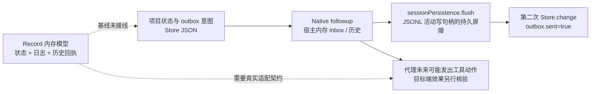
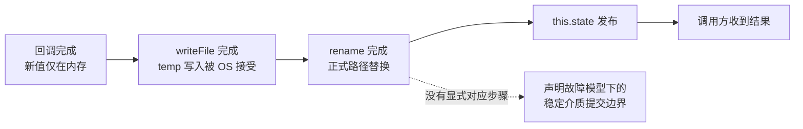
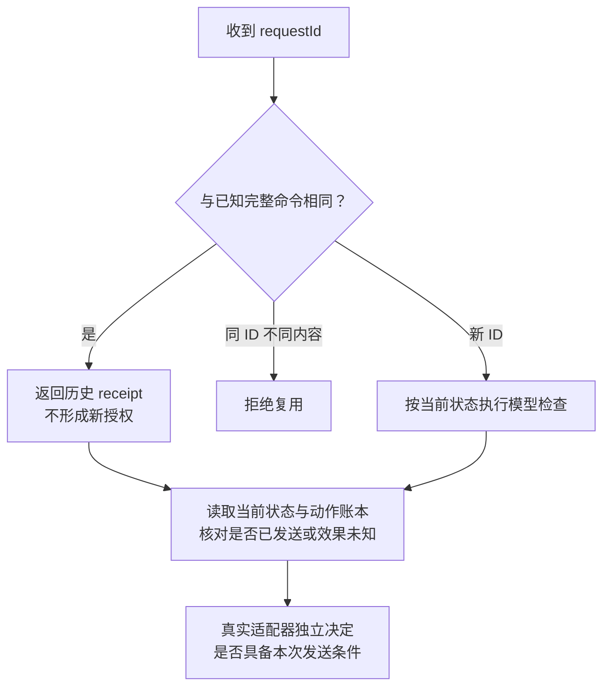

# 持久状态、发送意图与效果边界讨论稿 v0.1.0

2026-11-08 · Harness 研究 mechanisms 线

## 版本与范围

冻结基线为 `7264be10387963f4d575d8688ed8573f4c16c8c4`。本稿只读 workbench 的 Store、outbox、Native 及 Record 内核，给出供有限模型使用的崩溃切点和精化义务。静态路径存在不等于已发生故障；本轮未运行产品、故障注入、文件系统破坏或业务数据写入。

- 版本：v0.1.0；后续修改按补丁号递增。
- 主线：区分内存发布、文件可见、故障后可恢复、消息接收和真实效果。
- 状态标记：源码事实 / 条件反例 / 未运行协议。
- 来源：workbench 与固定 DSH 宿主调用链合为代码证据 1 组，Node 文档、Linux man-pages、AWS outbox 说明各 1 组，共 4 组；见 [sources.json](sources.json)。
- 边界：不重写 TTL 模型或 C01–C16。详细切点与观察条件在 [crash-cuts.json](crash-cuts.json)。

## 总体架构：四层事实没有合并提交点

项目状态与 outbox 意图可在同一次 Store 文件替换中出现；宿主消息存储属于另一层；Record S1 是独立内存模型。基线没有把这三者接成同一个持久事务，更没有把它们与目标端业务效果绑定为一个提交。

**图 1　四层证据 · 箭头表示调用次序，不表示原子性**

`sent` 在两个模块中还不是同一个谓词：outbox 的 `sent` 表示 `Native.deliver` 返回后本地标记；Record 的 `sent` 是模型准入转换。二者都不是目标端“效果已发生且只发生一次”的证据。

## Store：单实例串行与掉电持久性分开

`server/store.js:15–27` 把同一个 Store 实例的 change 回调依次执行：克隆当前状态、运行回调、写同目录随机临时文件、rename、发布内存状态、返回结果。这避免同一实例这些写操作互相穿插，并把 projects 与 outbox 放在同一个 JSON 版本中；队列失败后仍可继续接受后续操作。

| 边界 | 源码事实 | 还需要的前提或证据 |
|---|---|---|
| 单实例 / 多写者 | queue 是实例字段；open 只初始读一次文件；没有文件版本 CAS 或跨实例锁。 | 两个 Store 即使在同一进程也各有队列。共同从 S0 读出，依次写 S0+a、S0+b，可以覆盖 a；这是逻辑丢更新反例，不是“JSON 必然损坏”。 |
| 临界区范围 | change 回调内部按队列读最新 state。 | 外层检查不自动进入事务。例如 `projects.js:72–110` 的 dispatchKeys 检查在 change 前；并发同键调用可都越过检查。现有同键测试是顺序调用。 |
| 路径可见性 | 临时文件完整写完后才请求 rename；成功后才换 this.state。 | rename 原子替换路径不等于全部数据及目录项已达到掉电恢复边界。首次写入与已有文件替换也需分别建模。 |
| 进程崩溃 / 主机故障 | 代码没有显式文件 sync 或目录同步步骤。 | 杀进程不等于清空 OS 缓存；本机进程重启能读回新文件，不证明掉电持久性。未设置 sync 也不证明已经丢数据。 |
| 恢复入口 | open 只读正式路径；格式不支持或 JSON 解析错误会抛出；仅 ENOENT 采用初始空状态。 | 临时文件不是自动恢复日志。需定义首次创建未提交、残留 temp、正式文件不可读各自如何报告，不把未知写入结果笼统当成“从未提交”。 |

Node v24.10.0 文档说明 `writeFile` 的 `flush` 默认 false；true 会调用 `filehandle.sync()`，而 sync 的具体实现依赖 OS 与设备。本轮没有核当前运行的 Node 版本。[Node writeFile](https://nodejs.org/download/release/v24.10.0/docs/api/fs.html#fspromiseswritefilefile-data-options)，[FileHandle.sync](https://nodejs.org/download/release/v24.10.0/docs/api/fs.html#filehandlesync)。

Linux 手册分别规定 rename 的路径原子替换和 fsync 的文件/目录区别；文件 fsync 不自动保证目录项到盘。因此可讨论“写临时文件、同步文件、替换、同步父目录”的 Linux 持久提交候选，但不能把它未经验证地当作 macOS、网络盘或所有存储设备的统一保证。手册还明确 NFS 上 rename 报错不必然表示未发生。[rename(2)](https://man7.org/linux/man-pages/man2/rename.2.html)，[fsync(2)](https://man7.org/linux/man-pages/man2/fsync.2.html)。

**图 2　文件替换的切点 · 提交应声明针对哪种故障**

B、C、D、E 之间都可以成为进程崩溃切点；主机断电必须另用已固定的存储契约描述允许恢复结果，不能把“没有同步”硬编码为每次都恢复旧值。

## Outbox 与 Native：接收、保存和本地标记仍有间隙

`projects.js:121–125, 249–256` 在更新线程状态时同时追加 relay 意图，这是有用的本地耦合；`267–289` 则先 deliver，再另一次 change 标 sent。AWS 的 outbox 说明同样把业务状态与发送意图放在一个提交中，并明确中继可能重复，消费者需要处理重复；这不等于数据库自动包办另一服务的真实效果。[AWS transactional outbox](https://docs.aws.amazon.com/prescriptive-guidance/latest/cloud-design-patterns/transactional-outbox.html)。

`native.js:40–47` 的顺序是：resolveAgent → 检查历史或当前 inbox 的 ID → followup → await sessionPersistence.flush。这里有四项精确限制：

1. `accepted()` 识别已出现的 user/message 或尚存的 inbox 项；它核的是消息 ID，而非业务任务完成，也不比较同 ID 的内容指纹。
2. 已在历史或当前 inbox 中找到 ID 就直接返回，跳过本次 flush。固定 DSH 的 JSONL 后端明确允许 live event 先进入缓冲；写失败保留批次，内存 session log 不回滚。因此早退并未自动补齐屏障。若目标写入未提交、没有后续成功 drain，而 outbox 标记先落盘，随后进程崩溃，就存在“标 sent 但恢复后目标没有消息”的条件反例；不能从一次 flush 异常独自推出这些条件全成立。DC04 选 worker→lead 汇报 relay：lead 没有对应 thread，失败后可由 retry_delivery 重试同 ID；给 worker 的失败消息通常受 phase 门禁，不能直接套用此路径。
3. Projects.flush 的同一个 try 同时包含 deliver 和 sent 标记写入。若宿主已接收，但后面的 Store.change 失败，catch 仍可能把线程写成 failed 并显示“消息尚未投递”。这条文字不是未投递的证明；若 catch 的写入也失败，甚至没有该错误状态落盘。
4. 宿主的 service-wide flush 会聚合多个 active writer 的失败。目标消息可能已耐久，而别的 session 保存失败导致整体拒绝；这个异常同样不能解释成目标未接收。

已核宿主为 `deepseek-ai/deepseek-harness@fcc0ad462172522aaf5c93a7b2e01f6b9f0b0159`。调用链为 agent-loop 的 followup/send → inbox.splice → Session.append/commit → JSONL enqueueLive；service flush → tracker.flushAll → drainLive + handle.flush。失败批次在 `storage.ts:294–312` 放回队首并暂停定时 drain，随后显式 drain 或 flush 可以重试。`index.ts:1264–1323,1361–1369,1396–1449` 对 JSONL 写入执行文件同步、目录同步，并在追加失败时尝试回滚；回滚本身也可能失败。不能把 workbench Store 的无显式 sync 扩大为“DSH 宿主也没有持久屏障”。[宿主 flush 聚合与路由](https://github.com/deepseek-ai/deepseek-harness/blob/fcc0ad462172522aaf5c93a7b2e01f6b9f0b0159/packages/session/session-persistence-jsonl/src/storage.ts#L503-L560)，[写失败保留缓冲](https://github.com/deepseek-ai/deepseek-harness/blob/fcc0ad462172522aaf5c93a7b2e01f6b9f0b0159/packages/session/session-persistence-jsonl/src/storage.ts#L294-L312)。

恢复时，`projects.js:189–205, 275–277` 会保留 inactive worker 的 interrupted 状态，并避免直接重投工作消息。它是有意的安全等待，不可描述成 outbox 永远自动送达。retry 会取消旧未标 sent 意图并进入新 generation，随后可能创建新 relay ID；新投递不能自动证明旧尝试没有执行过。

另一个较早的缝隙在 `projects.js:57–59, 243–245`：先创建 native session，再写本地关联。崩溃可能留下已创建但未记录关联的会话；本稿仅列为交接义务，未扩展会话孤儿治理方案。

## Record：历史回执不是重新授权，也不是磁盘日志

`record/kernel.mjs:116–135` 在同步函数内先克隆状态、执行命令，然后发布 state、journal 和 requestId→receipt。它提供的是受控同步模型的逻辑发布，不是稳定存储事务。`record/README.md` 已明确没有文件写入、网络、跨进程锁或真实宿主拦截，当前项目 outbox 也没有导入该内核。

相同 requestId 且完整命令指纹相同，返回原回执；内容不同则报 REQUEST_REUSED。该分支在当前任务修订和授权检查之前，符合“历史收据”语义：曾经 authorize 或 dispatch 成功，不代表当前仍获授权，也不意味着应再次发请求。新命令依然需要当前状态检查；旧命令重送不产生新日志事件。

**图 3　回执重送与新执行许可 · 必须分开消费**

完整 journal 的 replay 会重建请求去重映射；这要求调用方确实保存并可信恢复 journal。`snapshot()` 是读模型，未含完整请求去重索引，`installSnapshot()` 也只是安装读缓存，不能当作内核持久恢复器。日志摘要不认证来源；重复身份不能靠重建一个空内核并沿用原 streamId 来假装保留。

`dispatchAction` 在模型中把状态改成 sent；基线没有真实 send。在后续精化中，必须说明这个模型点对应“发送意图已提交”“发送准入”还是“请求已交给传输”。崩溃后返回旧 sent 回执，不能单凭它重发；实际发送与当前授权/目标端效果之间的时隙仍需既有执行点契约约束，本轮不重做 TTL 论证。

## 供有限模型使用的六项精化义务与切点

建议先让模型显式区分应用内存、OS 可见文件和声明故障模型下的稳定数据，再接上消息/效果变量；否则把 Store.change 或 Record.apply 画成同一个“durable commit”会预先假定掉最重要的间隙。

| 义务 | 模型不能省略的条件 | 对应切点 |
|---|---|---|
| DR01 写者与串行化 | 单一写者必须有可执行约束；若多实例，需冲突检测/锁与在同一提交内的去重判断。 | DC02：两个实例读 S0 后各自覆盖；同实例外层同键检查并发。 |
| DR02 提交级别 | state、意图、请求身份与回执的原子持久关系必须由适配器实现；基线只共同写 projects/outbox。 | DC01：temp 完成、rename、内存发布、回执返回之间。 |
| DR03 出站责任 | 提交意图与网络发送没有天然原子点；同一动作的重试身份、消息代际、当前准入和未决效果要保留。 | DC03：意图已提交、deliver 尚未开始；恢复不承诺自动重投。 |
| DR04 接收去重 | 查到内存 ID 与查到耐久接收不同；去重记录需有 scope、寿命与内容身份契约。 | DC04：followup 后 flush 失败，再由 ID 早退。 |
| DR05 回执分层 | host accepted / host persisted / outbox marked / business effect verified 分别记；保存本地标记失败不能倒推未投递。 | DC05：host flush 返回后、sent 标记提交前。 |
| DR06 历史与当前 | 完整日志恢复去重身份；历史 receipt 不刷新 grant、不触发额外发送，不伪装当前状态。 | DC06：撤权后重送旧 authorize/dispatch，或只恢复 snapshot。 |

模型可使用 `appState`、`osVisibleFile`、`stableFile`、`hostInboxMemory`、`hostReceiptDurable`、`outboxMarked`、`remoteEffect` 与 `historicalReceipt` 等分别命名的变量。它们是建模建议，不是已存在的产品字段。进程崩溃只删除声明的易失层；掉电转换根据平台 profile 决定哪些非稳定写可能消失。业务效果变量只允许由隔离目标的观察更新，不能由本地 success 字段替代。

[crash-cuts.json](crash-cuts.json) 中所有场景均为 PROPOSED_NOT_RUN / actual_execution=false。观察只依赖声明的调用边界、文件恢复结果、消息/目标查询和回执；没有探针时标 UNSUPPORTED，有能力但证据缺失时标 UNKNOWN，不捏造宿主内部状态。

## 风险与开放问题

本轮给出的是固定源码的条件路径，不是数据损失事故报告。没有 fsync 的负面证据不足以推出已丢数据；配置事务数据库也不足以自动证明跨服务效果一次性、正确去重、当前授权或崩溃后可恢复。

- [ ] 已核固定 JSONL 路径；仍须验证实际加载后端、目标 active writer 路由、是否有其他成功 drain，以及 OS/设备持久契约。没有运行宿主。
- [ ] 未固定实际 OS、文件系统、挂载、设备与 Node 组合；Linux 手册只作为明确标注的平台契约参考。
- [ ] 已读相关测试源码，未运行；mock native 和成功空 flush 不能代表真实宿主故障验收。
- [ ] 多写者与幂等键检查属于可构造的静态交错，尚未做产品复现。

## 待证命题与下一步

下一步应先检验模型对断层的表达是否足够，再选隔离环境；本稿不启动任何破坏或真实持久性试验。

| 编号 | 命题 | 已有依据 | 缺口 |
|---|---|---|---|
| DH1 | 单实例队列不足以提供跨实例或外层判重的串行化。 | Store 实例字段与 dispatch 检查位置。 | 有限交错枚举尚未运行。 |
| DH2 | 内存 ID 早退不能单独证明耐久接收。 | Native 的早退在 flush 之前。 | 需固定宿主实际保存契约。 |
| DH3 | 历史回执重放安全依赖“回执不重新驱动外部动作”的适配器约束。 | Record known-request 分支与纯内存边界。 | 持久适配器尚未实现或验证。 |

- [ ] root 可优先将 DC02、DC04、DC06 加入小规模有限模型；分别标出单写者、宿主接收持久性和回执消费假设。
- [ ] 若进入实证阶段，另冻结故障 profile、合成目录、观察探针与运行预算；进程崩溃测试和断电持久性测试分别批准与报告。

