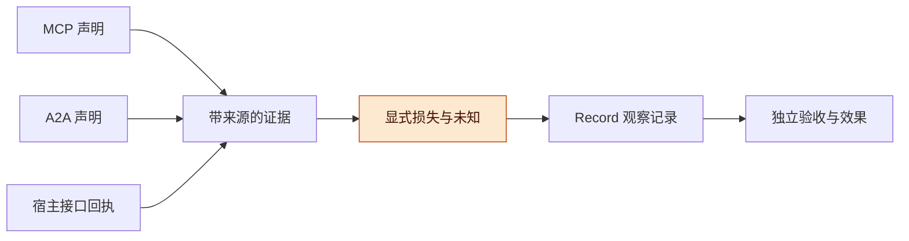
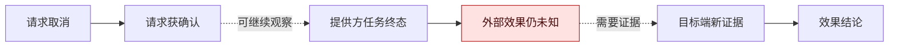
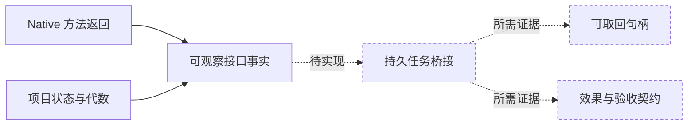

# 跨宿主协议与有损适配契约讨论稿 v0.1.0

2026-11-08 · Codex（mechanisms 研究线）

## 版本与范围

跨宿主可以共享带来源的身份、任务声明、产物和控制回执；不能仅凭同名字段共享业务验收、完整历史或外部效果已经解决的承诺。

- 版本：v0.1.0，固定 MCP 2026-07-28、同版 Tasks 扩展、A2A v1.0.1 与工作台 7264be1；后续按补丁号递增。
- 主线：固定版本 → 分离语义 → 保留损失 → 对照实际接口 → 六个未运行见证。
- 状态标记：规范与代码为**已核原始来源、静态阅读**；映射与验收为 **PROPOSED_NOT_RUN**，`actual_execution=false`。没有实现互操作，没有连接真实服务，也未运行模型/API 实验。

本稿只讨论个人通用 Harness。来源、读取范围与限制见 [sources.json](sources.json)，机器可读提案见 [mapping.json](mapping.json) 与 [acceptance.json](acceptance.json)。此前 [Native 条件代码探针](../relay-code-probes/README.md) 是独立的受控 fake 执行，不能计作本稿互操作验收。

## 总体架构

统一层应保存“哪个提供方在什么协议版本下声明了什么”，再由独立验收与动作证据判断是否足够继续工作；这是本稿提案，不是协议现成提供的统一运行时。

**图 1　共享证据层 · 三种输入保留原义**

三路输入共享证据结构；高亮层保留不能互译的部分，右侧验收需要自己的标准和新观察。

建议最小字段是 `origin`、分种类的 `identity`、`raw_status`、`terminal_claim`、`method_outcome`、`business_acceptance`、取消回执、`effect_resolution`、产物观察及 `losses`。时间戳只标识观察或来源声明，不充当全局世界时钟。

损失分为 `EXACT_SCOPED`（范围内原样事实）、`COARSENED`（声明了规则的压缩）、`UNKNOWN`（缺少证据）、`UNSUPPORTED`（要求的能力没有契约）。纯翻译不能使未知变成已证实；后来取得新证据可以缩小未知，但必须保留新的来源。消费者要求的强保证无法满足时，返回不支持，不能静默降级。

## 版本必须成为适配输入

当前正式版本已与常见旧示例不同，版本和扩展支持必须显式选择，不能把方法名相近当作兼容。

| 类别 | 代表（年份） | 核实到的内容 | 缺口 |
| --- | --- | --- | --- |
| MCP 核心 | [2026-07-28 Streamable HTTP](https://github.com/modelcontextprotocol/modelcontextprotocol/blob/94f4ebc8ecb3764584bc30d5139d57c03692b734/docs/specification/2026-07-28/basic/transports/streamable-http.mdx#L14-L42) | 移除协议级 session 与 GET stream；每请求独立 POST；不支持 Last-Event-ID 续流 | 不能照搬 2025 连接恢复行为 |
| MCP Tasks | [官方 2026-07-28 扩展](https://github.com/modelcontextprotocol/ext-tasks/blob/cc9aaac1047a9440b07486e38f37060bbebeef4c/specification/2026-07-28/tasks.md#L7-L89) | 每请求声明支持，服务端决定是否返回 task；当前仅 tools/call；get/update/cancel | 它是版本化扩展，不是核心，也不证明目标 SDK 已支持 |
| 历史 MCP | [2025-11-25 Tasks](https://github.com/modelcontextprotocol/modelcontextprotocol/blob/94f4ebc8ecb3764584bc30d5139d57c03692b734/docs/specification/2025-11-25/basic/utilities/tasks.mdx#L7-L28) | 此旧版明确标 experimental，且是 requestor-directed | 只读导言作版本对照，不沿用其全套行为 |
| A2A | [已发布 v1.0.1](https://github.com/a2aproject/A2A/releases/tag/v1.0.1)，固定 3303592 | wire 版本是 1.0；操作为 SubscribeToTask；空版本按 0.3 解释 | 不能把旧 tasks/resubscribe 名称套到 1.0；未核各 SDK 支持率 |

A2A 的 patch 是规范修订号，协商使用 Major.Minor。要求新版特性的客户端不应静默回退；见[固定规范 §3.6](https://github.com/a2aproject/A2A/blob/3303592588e388e62e0f69f701af531d2f4e3991/docs/specification.md#L706-L745)。本稿没有将当前移动 main 当作 v1.0.1 发布内容。

**固定发布内的待澄清处**：v1.0.1 的规范表格给 SubscribeToTask 的 REST verb 为 POST，proto 的 HTTP 注解却给 GET；Send Message 总述说立即返回，而配置节又定义默认阻塞。故本稿只共享抽象操作语义，实际 profile 必须记录采用的 binding 来源与配置，不能自行宣称二者一致。可对照[规范方法表](https://github.com/a2aproject/A2A/blob/3303592588e388e62e0f69f701af531d2f4e3991/docs/specification.md#L1169)、[proto 注解](https://github.com/a2aproject/A2A/blob/3303592588e388e62e0f69f701af531d2f4e3991/specification/a2a.proto#L74-L81)、[Send Message 总述](https://github.com/a2aproject/A2A/blob/3303592588e388e62e0f69f701af531d2f4e3991/docs/specification.md#L180)与[执行配置](https://github.com/a2aproject/A2A/blob/3303592588e388e62e0f69f701af531d2f4e3991/docs/specification.md#L442-L448)。本轮不选定某个 SDK 行为替它们裁决。

**核实中的口径修正**：官方 Go SDK 文档出现断线后新请求 ID 重发的说明；本稿查到的 MCP 核心条文直接规定的是“不支持 Last-Event-ID 续流”。本稿不把 SDK 说明写成核心规范的通用 MUST，更不从新请求 ID 推出副作用可安全重试。

## 完成、取消和恢复不能按名字互译

任务终态、控制请求获确认和外部效果解决属于不同判断，协议提供的证据强度也不同。

| 输入事实 | 可保留的判断 | 不可自动推出 |
| --- | --- | --- |
| MCP task completed，tools/call 的 CallToolResult.isError=true | 请求返回了普通工具结果，但工具层报错 | A2A 意义的任务成功、业务验收通过 |
| A2A TASK_STATE_COMPLETED | 提供方声明任务成功结束 | 我方验收标准通过、产物仍有效 |
| MCP tasks/cancel 成功回复 | 取消请求获确认；空业务结果仍有 resultType=complete | 工作已经停止、最终一定 cancelled |
| A2A CancelTask 返回 updated Task | 以返回的状态记录取消结果 | 任意副作用已撤销或资源可安全复用 |
| MCP CreateTaskResult | 已满足协议定义的 task 可取回约束 | 外部动作已完成、任何掉电模型均安全 |
| A2A SubscribeToTask 首 Task | 订阅时当前状态 | 全部漏收消息或所有历史事件重放 |

MCP 明确要求工具层 `isError` 仍用 completed，failed 用于 JSON-RPC 错误；见[错误规则 L837–892](https://github.com/modelcontextprotocol/ext-tasks/blob/cc9aaac1047a9440b07486e38f37060bbebeef4c/specification/2026-07-28/tasks.md#L837-L892)。A2A 的 COMPLETED 类型注释是任务成功结束；见[TaskState](https://github.com/a2aproject/A2A/blob/3303592588e388e62e0f69f701af531d2f4e3991/specification/a2a.proto#L187-L207)。若包装任务定义“工具错误即包装失败”，可以按声明的策略映射为 A2A FAILED；这是一项应用策略，不是无损别名。

**图 2　取消分层 · 确认不是效果证明**

上路只能记录协议与宿主声明；效果结论需要下路的范围明确的证据，不能沿状态名字直接跳过。

MCP Tasks 成功 **MUST** ack，服务端只被要求确认取消请求，可能不停止，也不保证最终 cancelled；客户端 **MAY** 发送后删除本地 task 状态。统一 Harness 因此必须把未解决动作义务放在独立 Record，不能把协议允许遗忘当作资源释放证明。[取消规则 L383–410](https://github.com/modelcontextprotocol/ext-tasks/blob/cc9aaac1047a9440b07486e38f37060bbebeef4c/specification/2026-07-28/tasks.md#L383-L410)

普通请求取消另有边界：HTTP 断开响应流 **MUST** 被视为取消该请求；停止处理是 **SHOULD**。stdio 使用 notifications/cancelled；Tasks 则 **MUST NOT** 用该通知代替 tasks/cancel。取消 tasks/get 的请求流不等于取消底层 task。[核心取消](https://github.com/modelcontextprotocol/modelcontextprotocol/blob/94f4ebc8ecb3764584bc30d5139d57c03692b734/docs/specification/2026-07-28/basic/patterns/cancellation.mdx#L34-L84)

恢复还必须区分“已有可取回 handle”与“创建请求发出后回复丢失”。MCP 要求返回 CreateTaskResult 前 tasks/get 可解析该 handle；A2A Send Message 的幂等只有 **MAY**，messageId 去重也非普遍保证。没有目标端幂等、效果查询或明确风险决策时，回复丢失不能自动触发效果性重试。[MCP 创建规则](https://github.com/modelcontextprotocol/ext-tasks/blob/cc9aaac1047a9440b07486e38f37060bbebeef4c/specification/2026-07-28/tasks.md#L298-L310)、[A2A 幂等规则](https://github.com/a2aproject/A2A/blob/3303592588e388e62e0f69f701af531d2f4e3991/docs/specification.md#L490-L496)

A2A Send Message 也可以直接返回 Message，不创建 Task；适配器必须保留这种无任务句柄的结果，不能自动承诺后续 GetTask/SubscribeToTask。[返回类型](https://github.com/a2aproject/A2A/blob/3303592588e388e62e0f69f701af531d2f4e3991/docs/specification.md#L159-L170)

## 身份、产物与授权必须保留作用域

共同 JSON 结构不能消除身份归属、消息缺口和授权来源；这些信息一旦压平，后续适配器无法凭空恢复。

| 对象 | 已核范围 | 建议契约 |
| --- | --- | --- |
| 身份 | A2A taskId 由服务端建；contextId 分组；messageId 由消息创建者给；artifactId 只在任务内唯一 | 保留 provider、授权分区、ID 类型及已知 generation；不同端相同字符串不合并 |
| 历史 | A2A 订阅首事件 MUST 是当前 Task；history 可遗漏；断线可丢 status messages | 记录 coverage gap；禁止把部分观察当完整审计日志 |
| 产物 | Artifact 可有 URL/bytes/data；更新有 append 与 lastChunk | final chunk 不证明前块已收齐；验收绑定实际内容版本/摘要与标准 |
| 消息角色 | A2A ROLE_USER 是 client→server；Native relay 也可用 role=user | 角色不升级为人类作者或人的授权 |
| 授权 | MCP 资源受众约束；A2A AUTH_REQUIRED 支持请求凭据或人的批准 | 保留请求/授予区别；动作参数变化需要重新检查绑定 |

A2A 明说 Messages **MUST NOT** 作为关键消息的可靠投递机制，未另行约定时不能依赖完整持久历史。当前快照缩小 GetTask 与订阅之间的状态竞态，却不恢复漏收历史。[§3.1.6](https://github.com/a2aproject/A2A/blob/3303592588e388e62e0f69f701af531d2f4e3991/docs/specification.md#L285-L311)、[§3.7](https://github.com/a2aproject/A2A/blob/3303592588e388e62e0f69f701af531d2f4e3991/docs/specification.md#L747-L764)、[数据模型](https://github.com/a2aproject/A2A/blob/3303592588e388e62e0f69f701af531d2f4e3991/specification/a2a.proto#L221-L319)

MCP task ID 可以是 bearer token，必须避免在公开日志和示例泄露；每次 task 请求仍 **MUST** 做认证授权。MCP OAuth 约束资源受众，服务器 **MUST NOT** 接受或转送其他 token。A2A AUTH_REQUIRED 可经带外获授权后立即继续，不要求客户端再发跟进消息；因此“没收到新用户消息”也不能推断它仍冻结。[MCP task 安全](https://github.com/modelcontextprotocol/ext-tasks/blob/cc9aaac1047a9440b07486e38f37060bbebeef4c/specification/2026-07-28/tasks.md#L900-L905)、[MCP token 约束](https://github.com/modelcontextprotocol/modelcontextprotocol/blob/94f4ebc8ecb3764584bc30d5139d57c03692b734/docs/specification/2026-07-28/basic/authorization/index.mdx#L260-L297)、[A2A §7.6](https://github.com/a2aproject/A2A/blob/3303592588e388e62e0f69f701af531d2f4e3991/docs/specification.md#L1908-L1962)

上述规范支持身份验证与授权交互，但这不自动给出我们所需的“确切动作、参数、对象版本、期限”的统一批准凭证；该绑定是适配契约待实现部分。MCP input_required 与 A2A AUTH_REQUIRED 也不能只压成同一个等待态而丢弃请求类型。

## 实际 Native 接口还缺持久 task 桥接承诺

工作台已有真实 DSH 适配层，但它的消息投递与项目状态接口没有自动满足 MCP/A2A 的全部任务语义；本稿没有实现这层桥。

[Native.deliver](https://github.com/TaiShuo150622/dsh-project-workbench/blob/7264be10387963f4d575d8688ed8573f4c16c8c4/server/native.js#L39-L46) 同 ID 命中历史或 live inbox 时直接返回，新投递才调用 flush；调用者拿到的 void Promise 不区分这两条路径。它保留 agent-message 来源，不能因 role=user 就当人的授权。stop 只调用 agent.cancel，未提供目标端效果终止证明。

[Projects.report/action](https://github.com/TaiShuo150622/dsh-project-workbench/blob/7264be10387963f4d575d8688ed8573f4c16c8c4/server/projects.js#L114-L177) 将工作汇报 review 与本地 accept→completed 分开；retry 增加 generation。本地 accept 检查 review 与 agent 非 running，但单看该处理器不能断言验收者签名、外部正确性或产物版本绑定已经实现。

**图 3　实际接口与待补桥接 · 虚线为提案**

左侧是已核代码接口，右侧虚线部分才是承诺 durable task、恢复与验收时需要另补的机制。

因此桥接至少需要持久的 task↔session/thread/generation 关联、明确的回执类别、能力与损失声明，以及独立动作效果证据。不能只生成随机 taskId 就对外返回 CreateTaskResult。详细持久性条件继续使用 [M06](../durability-boundary/README.md)，这里不重复建立崩溃模型。

## 六个见证只验证映射诚实性

六个案例是有限的未运行验收协议，用来检查提案是否保留差异；它们尚未验证任何实现，更不测业务恢复成功率。

| 编号 | 扰动或对照 | 必须保留的结论 |
| --- | --- | --- |
| IW01 | MCP completed+isError 与 A2A COMPLETED | 工具错误、提供方成功声明、业务验收分开 |
| IW02 | cancel ack 后仍 working；另一输入为 A2A CANCELED | 确认、终态、未知效果分开 |
| IW03 | 创建回复丢失；正对照已有 handle | 不凭新请求编号假定安全重试 |
| IW04 | 断线漏块后收到 lastChunk；终态再订阅 | 快照不补历史，末块不补前块 |
| IW05 | 两 endpoint 同 ID、转发角色、批准后改参数 | namespace、来源、批准绑定不升级 |
| IW06 | Native 返回，review/accept/stop | 不伪造持久 task、业务验收或效果终止 |

每条在 [acceptance.json](acceptance.json) 给出能力、初态、扰动、观察、oracle 与四类结果。SUCCESS 只表示映射诚实且满足该适配条件；正确保留 effect UNKNOWN 可以通过映射检查，但业务恢复仍未完成。要求能力不存在应为 UNSUPPORTED，证据尚缺应为 UNKNOWN，两者不能混作一般失败。

未来实际执行前必须冻结具体协议/transport/extension、提供方范围、目标端效果契约、观察期限、handle 保留期和授权刷新规则。本轮仅检查文件引用与 JSON 结构，不搭假 runner，也不声称合成 claim 已通过完整 wire schema。

## 风险与开放问题

最大的风险是把可读的统一状态变成比原始证据更强的承诺，尤其在取消、恢复与人工批准三处。

- **规范与部署漂移**：版本页面可继续修订，故保留固定源码提交；部署支持需要另验。
- **授权误提升**：client/user 角色与授权交互不等于 exact-action 批准，转发不得默认携带原 token。
- **未知被隐藏**：状态翻译不能消除效果未知；也不能无限等待，要在明确期限内交接未解决义务。
- **产物错配**：后来 URL 内容可能变化；只有新读取，不能倒推早先验收对象。

开放问题：

- [ ] 哪些目标提供方能给动作幂等作用域、效果查询与终止证据？未选定前不承诺安全自动重试。
- [ ] 哪些完整历史/产物恢复保证需要额外扩展？现有协议快照不足时应明确不支持。
- [ ] A2A v1.0.1 的 REST verb 与立即返回表述差异，由具体 binding profile 和上游澄清如何处理？本稿不覆盖这个未决项。
- [ ] 我们是否需要持久 task 桥，还是先暴露弱一些但诚实的消息接口？应由调用方实际义务决定。

## 待证命题与下一步

下一步应先验证两段适配组合是否保留损失，再选一个真实宿主做有限集成；本稿没有预授权后续连接或执行。

| 编号 | 命题 / 猜想 | 已有依据 | 缺口 |
| --- | --- | --- | --- |
| IP01 | 带来源及损失的组合可避免同名终态误判 | 两协议 completion/cancel 明确不同 | 未实现转换与组合检查 |
| IP02 | 独立 Record 可以保留协议允许遗忘后的动作义务 | MCP cancel 可丢 task 状态 | 实际持久性、查询与交接策略未验 |
| IP03 | 先区分回执类别再建 task 桥可减少假恢复 | Native 真实方法分支与返回面不同 | 桥接存储和真实宿主验收未做 |

- [x] 固定规范与工作台源码，记录读取覆盖和限制。
- [x] 整理九条映射规则与六个未运行见证。
- [ ] 由独立审阅者重开关键来源，核对 MUST/SHOULD、版本与结论。
- [ ] 实现获明确授权后，再冻结实验环境、时限和效果 oracle；将映射通过与业务完成分别计数。

