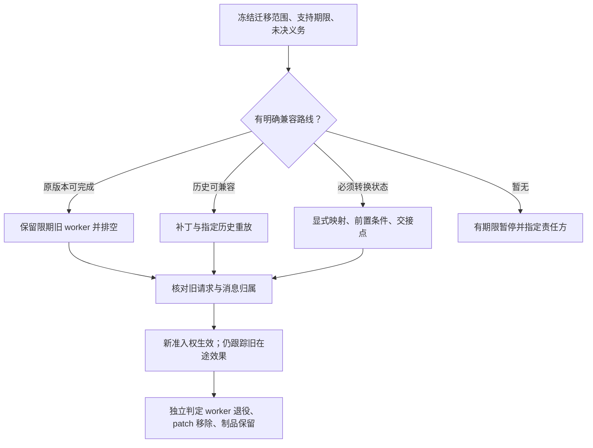
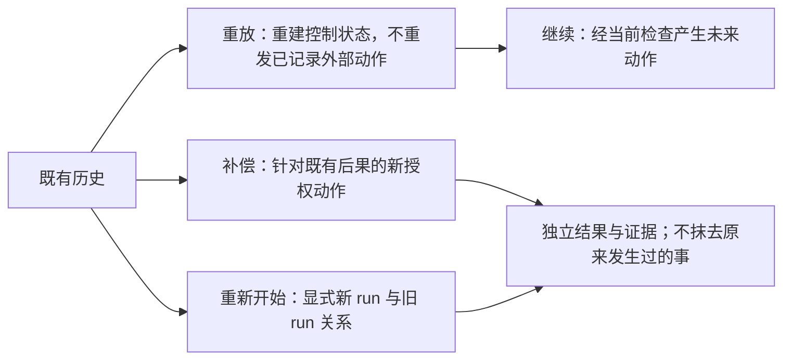

# 长期任务跨版本续接讨论稿 v0.1.0

2026-11-08 · Harness 研究 mechanisms 线

日期按 UTC；本轮研究开始时本地日期为 2026-11-07。  
状态：研究与候选验收协议，PROPOSED_NOT_RUN；未执行模型、宿主、迁移或远端服务试验。

## 版本与范围

这是 M-05 独立增量，只讨论长期任务跨 Harness、插件、工作流与解释器升级的续接。核查 6 组官方来源：Temporal 2 组、DBOS 2 组、Cordis 原论文与固定 DSH 实现各 1 组。Python 与 TypeScript 的 DBOS 升级文档作为同一机制的配对核对，不能外推所有 SDK。

“已核”表示阅读指定文档或源码；“建议”表示本研究提出的统一 Harness 契约；没有运行迁移器，也没有证明现有 Record S1 已实现这些能力。论文及源码阅读覆盖列在 [sources.json](sources.json)，机器可读契约与未运行场景分别在 [contracts.json](contracts.json)、[fault-scenarios.json](fault-scenarios.json)。

- 版本：v0.1.0；后续修改按补丁号递增。
- 主线：有限版本支持期内，兼容续接与旧效果责任交接。
- 状态标记：已核官方来源 / 候选契约 / 未运行协议，三者分开。

## 总体架构：六种兼容关系分别验收

长期任务可以恢复会话，不代表新代码能解释旧事件；可以重放旧事件，不代表未来工具请求仍有授权；新 worker 接到任务，也不代表旧请求已经停止。应保存可核验的执行版本组合、原始事件与动作身份，分别判断读取、重放、续行动作和旧版本退役。

旧代码不能无限保留。可行路线是给旧版本设支持期限，并提前选择排空、兼容补丁、显式状态迁移或有条件的重新开始。到期仍无兼容路线时，进入有责任人和复核期限的暂停状态，继续保留用户目标与既有义务；不要强制换新并宣称“已恢复”。旧 worker 的退出可以早于外部未知效果的解决，但后者必须交给仍有查询能力和责任归属的接收方。

**图 1　续接证据链 · 旧效果独立于新版本控制流**

沿上路检查新版本是否能续接；沿下路追踪旧请求，不能从新代码已启动推导旧效果已解决。

## 六层问题及其边界

续接判定应逐层记录结果；任一层通过，都不能替代另一层的证据。

| 层次 | 要回答的问题 | 不能据此推出 |
|---|---|---|
| Session resume | 能否恢复对话、任务定位与可读上下文？ | 原进程、工作流控制点或外部请求已恢复。 |
| 事件模式 upcast | 旧记录怎样映射为新读模型？ | 转换后的字段在过去真实发生过；不得把 UNKNOWN 补成成功或失败。 |
| 确定重放兼容 | 新执行组合能否消费指定历史并作出兼容控制决策？ | 所有未采样历史、未来分支或业务含义都正确。 |
| Workflow / worker 迁移 | 哪个版本接收后续工作，旧控制点如何延续？ | 路由覆盖即完成迁移；回退新流量即回退所有存量任务。 |
| 工具与副作用身份 | 旧请求、重试、迟到结果、新请求是不是同一个业务动作？ | 新适配器版本允许换幂等键盲重试；旧 worker 终止表示目标端未执行。 |
| 知识索引重建 | 哪个来源、水位、权限与投影版本产生当前检索结果？ | 索引是原始事实，重建可重发外部动作，或读模型的升级等于事件升级。 |

这里的 upcast、索引代际切换和完整执行组合是我们的候选设计，并非声称 Temporal、DBOS 或 Cordis 已提供统一实现。执行组合至少记录 Harness、插件、工作流代码、SDK、解释器、依赖、序列化器和工具语义；模型或提示词影响持久决策时也应纳入来源。重放读取已归档的模型决策；重新调用模型属于新尝试，需要新的来源与预算记录。

## 官方机制可以复用什么

这些项目提供了具体的版本路由、补丁与组件生命周期机制；统一 Harness 仍需给它们之间的状态和效果交接补契约。

| 来源与固定范围 | 已核机制 | 统一 Harness 仍须补的边界 |
|---|---|---|
| T1：Temporal safe deployments，固定 [文档 L9–52](https://github.com/temporalio/documentation/blob/3fcf3f34596030d06979e9e3c68ab4964900b4a9/docs/develop/safe-deployments.mdx#L9-L52) | 在部署前用新代码重放历史；验证与真正 worker 应使用相同代码。 | 明确历史集合与执行组合。有限重放通过只覆盖这些输入；该版本文档还指出 eager start 不遵守 worker versioning，若使用它必须单独核对路由。 |
| T2：Temporal pinned recovery，[L99–124](https://github.com/temporalio/documentation/blob/3fcf3f34596030d06979e9e3c68ab4964900b4a9/docs/production-deployment/worker-deployments/recover-pinned-workflows.mdx#L99-L124)、[L199–242](https://github.com/temporalio/documentation/blob/3fcf3f34596030d06979e9e3c68ab4964900b4a9/docs/production-deployment/worker-deployments/recover-pinned-workflows.mdx#L199-L242) | 按状态完整性、是否可从头再执行，选择覆盖路由或 reset；目标代码须 replay-safe。 | 可重启是工作流设计属性。关闭执行的 reset 非幂等；Visibility 最终一致，单次空查询不能证明排空。信号和更新是否重应用须逐类约定。 |
| D1：DBOS Python / TypeScript 升级文档，[Python L76–110](https://github.com/dbos-inc/dbos-docs/blob/d280ec8f513ecfd39f68784ce598d28832d4557e/docs/python/tutorials/upgrading-workflows.md#L76-L110)、[L112–174](https://github.com/dbos-inc/dbos-docs/blob/d280ec8f513ecfd39f68784ce598d28832d4557e/docs/python/tutorials/upgrading-workflows.md#L112-L174) | 历史位置的 patch marker 选择分支；兼容补丁、废弃标记、移除补丁分阶段。默认版本由工作流源码计算，也可显式配置。 | 升级前启动、但尚未到达补丁位置的任务可以进入新分支。固定 application version 不是兼容证明。auto-upgrade 属 Enterprise，且要求破坏性变化均已 patch。 |
| D2：DBOS Kubernetes，[L31–57](https://github.com/dbos-inc/dbos-docs/blob/d280ec8f513ecfd39f68784ce598d28832d4557e/docs/production/hosting-with-kubernetes.md#L31-L57) | 每个活动版本独立 Deployment 排空，或用补丁维持一个 Deployment；系统库迁移有独立管理流程。 | 数据库 schema 迁移、工作流历史兼容与新请求路由要分别验收。未操作 Kubernetes。 |
| C1：Cordis v1，[§7.3 PDF 79–80](https://arxiv.org/pdf/2608.25512v1#page=79) | 组件替换清理旧效果后重建；自有内存需放入长寿命依赖才能跨 reload 保留。 | 有状态前向迁移在该论文中仍是未来工作。这里的组件重建不是持久工作流历史重放。 |
| C2：DSH 固定实现，[fiber.ts L681–746](https://github.com/deepseek-ai/deepseek-harness/blob/fcc0ad462172522aaf5c93a7b2e01f6b9f0b0159/vendor/cordis/src/fiber.ts#L681-L746) | reload 检查局部 epoch；unload 等依赖结束并等待 disposer，捕获清理异常并记日志；日志正常返回时继续释放依赖。 | 静态代码未给出远端动作终止证明。局部 epoch 不自动成为目标端 fencing token；清理 Promise 完成也不等于所有业务资源已收回。 |

DBOS 文档还明确允许自动升级时旧进程仍在运行，保证的是并发结果记录的协调；不能据此宣称旧外部动作不会落地。Python 的宽限参数单位为秒，TypeScript 为毫秒，应固定 SDK 与参数单位，不能直接复制数值。[Python L145–150](https://github.com/dbos-inc/dbos-docs/blob/d280ec8f513ecfd39f68784ce598d28832d4557e/docs/python/tutorials/upgrading-workflows.md#L145-L150)，[TypeScript L151–157](https://github.com/dbos-inc/dbos-docs/blob/d280ec8f513ecfd39f68784ce598d28832d4557e/docs/typescript/tutorials/upgrading-workflows.md#L151-L157)。

## 迁移前后必须守住的八项契约

这些是拟议验收条件，不是已实现承诺。具体字段与各条观察方式见 [contracts.json](contracts.json)。

| ID | 迁移前冻结什么 | 迁移后检查什么 |
|---|---|---|
| MC01 身份与来源 | 原始历史摘要、run/action 身份、迁移操作 ID、来源版本与目标版本。 | 追加迁移关系，保留原件；重试同一迁移请求不能静默产生多个 reset / successor。服务本身若不支持，调用方必须显式记账或标 UNKNOWN。 |
| MC02 表示转换 | 模式版本、转换器版本、适用输入及不支持情况。 | 允许只读 upcast；有损转换留明细，不编造历史事实，不覆盖原证据。 |
| MC03 重放与执行组合 | 真实覆盖范围、补丁标记族、SDK / 解释器 / codec 等组合。 | 对这组历史核兼容；失败时停止接管。未覆盖分支保留未验证状态，模型重调用不得伪装成重放。 |
| MC04 接管与期限 | 路由、接管点、调度责任、支持期限、未交接消息清单。 | 执行准入点拒绝旧调度权；不把它升级为“世界中永远只有一个执行者”。保留可能在途的旧请求。 |
| MC05 旧效果与身份 | 目标 namespace、业务动作、参数摘要、幂等键及有效期、效果查询能力。 | 同一动作兼容重试保留身份；语义变化需新动作与适当授权。迟到结果归旧动作，并更新共享资源冲突证据，不能覆写新动作结果。 |
| MC06 权限与审批 | 目标、参数、范围、期限及审批所依赖的语义。 | 新动作执行点重检；参数 / 目标 / 关键语义变化不能沿用旧审批。恢复历史不自动恢复已撤销授权。 |
| MC07 派生索引 | 原始来源、权限范围、水位、投影版本与代际。 | 新旧代际不混读；读时仍受当前权限约束；索引重建不写业务动作或改变动作结论。 |
| MC08 退役与交接 | 排空证据、保留窗口、patch 清理阶段、未决义务与接收责任人。 | 区分运行 worker 退役与制品归档到期；效果 UNKNOWN 可转交，不能无责任方消失。不可行期限冲突显式处理。 |

“版本一致”也不足以锁住工具语义：配置、目标账号、参数标准化和幂等键保留窗口都可能改变。审批是否绑定某个具体实现版本，应按审批的语义决定；不能仅因实现 hash 变化要求一律重新审批，也不能因显示名称相同默认授权仍适用。

## 有期限的续接与退役流程

先盘点尚存的历史、信号、队列项和外部动作，再选择路线。接管前做指定历史兼容检查；接管后观测路由、任务和旧效果的证据；最后按各自保留期限退出旧 worker、移除 patch、归档或淘汰制品。

**图 2　有限支持期内的迁移路线 · 无证据时显式暂停**

不能把等待旧代码排空当作无限等待方案。支持期限到来时必须显式选兼容接管、可接受的停止、另行补偿或人工处理；缺少目标端效果证据时，保持 UNKNOWN 并说明阻塞范围。保留待研究方向和义务不意味着承诺这些义务在冲突预算下全部满足。

重放、继续执行、补偿和重新开始有不同的效果边界：

**图 3　四种操作的区别 · 不用补偿抹去历史**

补偿成功也不等于所有观察者从未见过原效果。reset、续接和新 run 应逐一决定消息重应用、旧请求归属与再次执行的业务条件，不能只凭接口名称决定。

## 六个未运行故障场景

统一状态是 PROPOSED_NOT_RUN，actual_execution=false。拟议环境仅为隔离的合成任务与可观察的模拟目标；没有迁移真实任务。详细参数、期限、观察与 oracle 见 [fault-scenarios.json](fault-scenarios.json)。

| ID | 扰动 | 必须区分的结果 |
|---|---|---|
| LM01 | 历史可解码，但解释器 / codec / 依赖变化使新控制分支不同。 | 能读与能重放不同；不兼容应拒绝接管。 |
| LM02 | 旧任务分别处于补丁点之前、之后、已有 marker；过早移除补丁。 | 三类历史不能只按启动时间分流；提前移除必须被识别或显式不支持。 |
| LM03 | 新路由回退后存量任务仍 pinned；可见性查询漏项；关闭执行的 reset 回执丢失后重试。 | 单次空查询不是排空；没有稳定迁移请求身份时不可盲目重复非幂等 reset。 |
| LM04 | 接管时旧请求效果 UNKNOWN，新适配器改变 namespace，旧效果迟到；审批参数同时变化。 | 阻止无依据重试与过期审批；按原身份接收迟到证据，继续处理资源冲突。 |
| LM05 | 插件 reload 丢失组件内存；disposer 报错或晚返回，外部请求仍在途。 | 插件生命周期结束、任务状态恢复、效果已解决三个谓词分别报告。 |
| LM06 | upcast 填造缺失结果；索引重建混入旧权限与不同水位。 | 不得制造成功或重新授权；索引整体切代且读时复核权限。 |

SUCCESS 表示协议的目标行为有证据，包括应拒绝时正确拒绝；不等于业务迁移完成。UNSUPPORTED 表示缺少声明能力或必要探针，UNKNOWN 表示能力声称存在但证据到期不足；二者都不能计入“迁移成功率”的分子。FAILURE 需要可观察的契约违反，不能仅因宿主内部不可见就断言违规。

## 风险与开放问题

已读 Temporal safe deployments 全文与 pinned recovery 全文；DBOS Python / TypeScript upgrading workflows 全文，以及 Kubernetes 部署文档前 62 行的概念段；本轮重读 Cordis §7.3 的 PDF 79–80 页与固定 DSH fiber.ts 681–746 行。论文其余内容沿用上一轮的 [阅读覆盖说明](../cordis-boundary/READING_COVERAGE.md)，不声称本轮重新证明论文或验证实现精化。

DBOS 的并发协调实现、Temporal 全部 SDK patch/replay 实现、Kubernetes 实操、任意模型决策的确定重放，以及升级时数据库恢复行为均未运行验证。来源固定的是文档提交和 DSH 提交；文档特性不能自动映射为某个已安装 SDK 版本。真正执行前应另固定 SDK、服务、解释器、codec 和场景参数，不以此稿直接下发迁移。

- [ ] 选定实际适配器后核查版本、权限、历史采样与效果查询能力；缺项保持未验证。
- [ ] 对无限任务的支持期限与旧效果责任转交制定资源可行的政策，不能只等自然排空。

## 待证命题与下一步

需要验证的核心命题是：在有限旧版本支持窗口内，显式历史兼容检查与旧效果交接能减少错误续接，同时不把任务永久冻结；本稿没有结果证明这一点。

| 编号 | 命题 | 已有依据 | 缺口 |
|---|---|---|---|
| MH1 | 固定执行组合并检查历史，比只比较应用版本更能识别不兼容续接。 | T1 的部署前重放、D1 的历史分支机制。 | LM01 / LM02 未运行；未知误报与覆盖成本。 |
| MH2 | 独立保留旧动作身份和责任归属，可以避免用 reload / 接管掩盖未知效果。 | D1 并发旧进程边界与 C1 / C2 局部生命周期边界。 | LM04 / LM05 未运行；不承诺必然消除 UNKNOWN。 |
| MH3 | 有期限支持与责任转交能控制旧版本成本，同时保留未决义务。 | T2 / D2 的排空路线。 | 尚无成本、人工负担或长期可行性结果。 |

最小下一步是从 LM01、LM04、LM05 各选一个明确声称支持的适配环境，先审核能力与探针，再批准隔离验证；本轮没有获得也没有消耗这些试验预算。六个场景可作为后续迁移能力 profile 的验收目录，不能伪装成现成 runner。

- [ ] 先固定一个隔离环境的能力 profile、观察窗口与成本上限。
- [ ] 将正确拒绝续接、成功继续业务、效果 UNKNOWN 分开统计，不合并为单一成功率。

