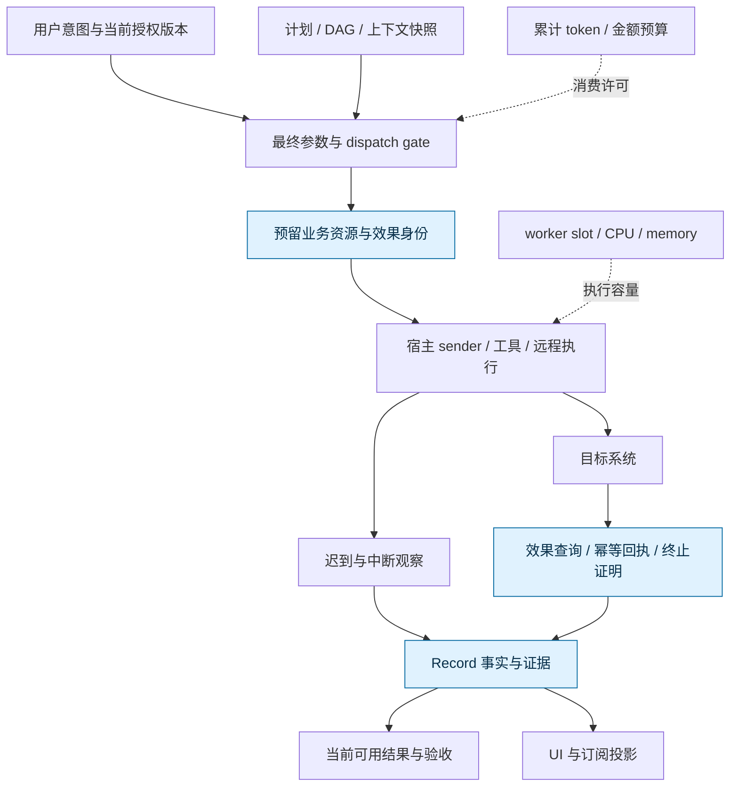
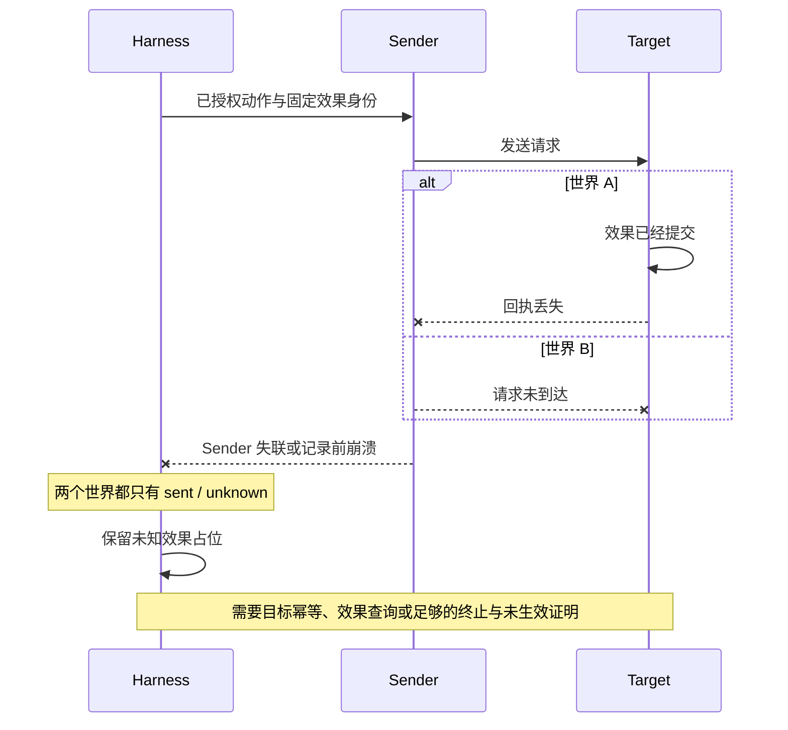

# 统一 Harness 开源机制研究讨论稿 v0.1.0

2026-11-07 · Codex mechanisms 研究线

## 版本与范围

这 8 个样本提供了互补的机制，但没有一个样本的局部持久化、取消或审批能力，能直接替代统一 Harness 对外部效果的证明。最值得吸收的是**明确的效果边界、恢复身份、迟到证据保留、请求快照和分层资源预算**，而非把某个框架整体选作事实来源。

- 版本：v0.1.0 为首轮源码核查稿；后续修改按补丁号递增。
- 主线：S1 基线 → 分层机制 → 8 个互补样本 → 反例 → 待证命题。
- 状态标记：**源码事实**表示固定提交正文可见；**文档承诺**表示官方接口说明；**推断**表示本稿给统一 Harness 的设计含义；**未验证**表示没有运行上游或真实宿主。
- 检索日期：2026-11-08 UTC；作者日期按工作区洛杉矶日期。固定提交、文件、行段、作者归属、限制见 [sources.json](sources.json)。
- 范围：公开资料；未复制公司、量化或个人原始会话。仅静态阅读，未跑上游测试、真实 DSH、远程执行或生产任务。
- 本地基线：`7264be10387963f4d575d8688ed8573f4c16c8c4`。Record S1 是确定性纯状态核；其 synthetic verifier、actor 输入和测试不能变成宿主集成证据。

**图 1　讨论主线 · 从局部机制到效果证据**

从左到右先确认已经证明的范围，再借源码寻找条件；高亮部分决定哪些局部机制可以安全组合。

## 动机

我们需要补的是纯状态核与真实执行世界之间的证据链，不能用“支持恢复”或“任务已取消”填补它。

[Record S1](https://github.com/TaiShuo150622/dsh-project-workbench/blob/7264be10387963f4d575d8688ed8573f4c16c8c4/record/README.md) 和 [S1 对抗核查说明](https://github.com/TaiShuo150622/dsh-project-workbench/blob/7264be10387963f4d575d8688ed8573f4c16c8c4/docs/record/record-s1-and-adversarial-ci-v0.1.1.md) 已把动作保留为 `reserved → sent → succeeded / not_applied / unknown`，并让未知效果继续占位。取消或撤权只能直接阻止尚未发送的动作；负面释放证据要求发送者确已终止并确认未生效。这些是内核规则，实际身份认证、发送端截获、事务存储、跨进程互斥和目标端核验还在核外。

本研究因此优先找能回答以下问题的实现：取消后还有谁能写？恢复时什么身份继续有效？记录拒绝旧结果后，旧工具是否仍会生效？消息历史能否带回预算？一个结果曾经存在，是否足以支持现在的依赖验收？

## 总体架构

统一 Harness 应把调度、对外效果、事实记录和展示拆成可独立核验的边界，再明确哪种证据允许越过每一道边界。

**图 2　机制分层 · 四种不同的容量或权利**

worker slot、业务资源占位、消费预算与授权是四套不同的账。执行协程退出可以释放某类本地容量，却不足以释放未知外部效果占位。

三个谓词应显式区分：`cancelRequested` 是意图，`senderTerminal` 是发送者生命周期观察，`effectResolved` 是目标效果结论。前两者都不能单独代替第三者；`senderTerminal` 还必须明确是否包括工具创建的子进程、后台任务和远程代理。

## 相关工作

已核查 8 个样本的适用机制；下面的选择依据是机制互补性，非热度或产品排名。

| 类别 | 代表（2026，官方维护者） | 核实到的内容 | 缺口 |
| --- | --- | --- | --- |
| 轻量 Agent 与持久会话 | [Pi][PI-01] · earendil-works | 同仓经典 Agent 与 durable package；工具 replay 标记、提交回执、恢复阶段 | 不能沿用“Pi 只有最小循环”的旧印象；多主机 writer fence 未完整核实 |
| 交互式执行协调 | [OpenCode][OC-01] · anomalyco | 进程内 run coordinator、interrupt 与 idle 分离、权限与上下文快照 | coordinator 不构成跨主机唯一执行 |
| 图状态与 checkpoint | [LangGraph][LG-01] · langchain-ai | durability 模式、节点从头恢复、并发 channel reducer、超时写入围栏 | 图内部状态一致不等于外部工具事务 |
| 类型化工具与引擎适配 | [PydanticAI][PA-01] · pydantic | durability 与快照分开、deferred approval、历史与 usage 连续性 | 最终授权、可信历史、费用硬上限仍需应用契约 |
| 记忆与交互恢复 | [Letta Code][LT-01] · letta-ai | Git 记忆、取消 grace、lineage/revision、迟到结果 sidecar | 本机文件锁覆盖范围有限；结果仍由工具链报告 |
| 多代理运行与队列 | [Agno][AG-03] · agno-agi | per-loop 并发、Redis 取消、Postgres attempt fence、tool-batch checkpoint | backend 覆盖不一致；取消通道有意 fail-open |
| 工作流持久执行 | [Temporal TS][TM-01] · temporalio | 活动取消选项、心跳通知、协作取消、worker slot 生命周期 | TS SDK 范围内核查；没有重验完整 Core/server |
| 数据库驱动恢复 | [DBOS Python][DB-01] · dbos-inc | workflow claim、owner fence、step journal、取消 waiter 快照 | 外部 step 效果与 journal 非同一事务 |

**核实后的修正**：旧 `badlogic/pi-mono` 入口已指向 `earendil-works/pi`；本轮使用固定提交而非旧名称推断能力。原 [letta-ai/letta README][LT-00] 明确说明 V1 API 退役并转向 letta-code，因此本稿未把旧 MemGPT 服务端当作当前实现。访问时默认分支提交不等于稳定 release。

**仍未核实**：license 适配、生产规模性能、全部数据库适配器、跨区灾备、实际费用和当前发布质量；这些不进入选型评分。

## 可直接借鉴的机制与隐含条件

源码里最有价值的共性是“将相似外观拆成不同状态”，同时把这些状态的作用域写清楚。

| 样本 | 可借鉴机制 | 隐含假设与我们要补的契约 |
| --- | --- | --- |
| Pi | 初次调用跑 hook、重验参数、持久化 execute 意图后才执行；重启要求已存策略与当前工具均为 replay-safe。[PI-02] | replay-safe 是工具作者承诺；若授权只放在 beforeTool，恢复直接 run 的路径需要另设 dispatch 授权复核。当前工具可用性检查本身仍可拒绝已移除工具，不应把这个条件性反例说成漏洞。 |
| Pi | batch 原子、可接收已提交前缀；耐久回执与发布分离。deferred progress 可先内存可见。[PI-03][PI-04] | UI 要标出暂态进度；不能因订阅看见进度就声称 crash 后还在。Session 序列化也不自动授予分布式 writer 所有权。 |
| OpenCode | interrupt 接受与 awaitIdle 分开；pendingWake 为取消清理期间的新意图保留入口。[OC-01] | 确保一个 session 的进程内协调，不证明远端 sender 停止。新意图应获得新身份，不能复用旧取消边界。 |
| OpenCode | select 固定 session/agent/工具/指令，load 组装该选择的历史和模型；权限收窄发现面。[OC-03] | 这是请求快照；有效权限仍应在实际副作用入口重评。保存 allow、配置 deny、pending response 的作用域要明确。[OC-02] |
| LangGraph | 同步、异步、退出时才持久化是显式模式；任务 pending writes 与 superstep checkpoint 分离。[LG-01][LG-04] | “可恢复”必须附 durability/backend 条件；interrupt 恢复从节点开头，前置效果应放入可重放边界。 |
| LangGraph | close 与 guarded writes 使用同一锁；过期尝试不能再沿该路径落状态；LastValue 同步多写直接拒绝。[LG-02][LG-03] | 围栏覆盖图内部写入；stream callback 有更弱保证，外部 I/O 更不受此锁保护。reducer 是业务合并规则，不是全局资源锁。 |
| PydanticAI | 工具审批与身份授权分开；历史、usage、deferred calls 是不同恢复对象。[PA-02][PA-03][PA-04] | 审批展示参数可能在恢复 hook 中改变；授权应绑定最终参数。仅回填消息历史会重置累计预算，提示词里的 provenance 不构成证明。 |
| Letta Code | 保留已完成 partials；取消 grace 结束允许调用者先退出；lineage 的迟到结果与 successor 当前快照分离。[LT-02][LT-05][LT-06] | UI 结束不意味着工具结束。sidecar 精确保存“哪个调用返回了什么”，仍不能由输出文本推断独立目标事实。 |
| Agno | worker-owned 持久化带 attempt；Postgres 行锁同时保护 run 与 session metadata，拒绝旧 attempt 后不绕回无围栏覆盖。[AG-04][AG-05] | 需要支持该原子 primitive 的 backend；写入 fencing 保护记录，目标系统必须有自己的 fencing/幂等能力。 |
| Temporal | ABANDON、TRY_CANCEL、WAIT_CANCELLATION_COMPLETED 分别表达不传播、发请求后返回、等待活动结束。[TM-01] | 普通 activity 接收取消依赖 heartbeat；实际 worker 只发 signal，仍 await 执行结果，signal 被忽略时可以成功完成。[TM-02][TM-03][TM-04] |
| DBOS | 重新排队再原子 claim；terminal update 以 owner_xid 拒绝旧 owner；取消监测先快照旧 waiters。[DB-01][DB-02][DB-03] | owner_xid 必须传入且只保护数据库结果。异步取消要等 step 清理；无 step 结果的重放仍可能重复外部效果。 |

经典 [Pi Agent][PI-05] 的 context transform、并行工具执行与 hooks 适合做宿主扩展点；其事件顺序和 hook 并不自动获得同仓 durable package 的持久性。框架、子包、宿主和部署必须分别命名。

## 反例与证据失效

有用的反例要指出“哪条证据无法推出哪项结论”，而不是把所有框架的问题概括成不可靠。

**图 3　未知效果窗口 · 两个控制端不可区分的世界**

读图时固定 Harness 的观察历史：若目标既无幂等键也无法查询效果，恢复侧不能仅凭相同观察同时保证“永不重复”和“总能继续”。这是本稿的条件性不可区分反例，不把它命名为 FLP 的泛化结论。

| 编号 | 最短轨迹 | 不能推出的结论 | 已有证据或条件 |
| --- | --- | --- | --- |
| C1 取消与迟到 | 工具发请求 → 取消返回 → 工具忽略 signal → 远端成功 | cancelRequested 不推出 senderTerminal，更不推出 not_applied | Temporal worker 成功路径仍可返回；Letta grace 后有 detached straggler。[TM-03][LT-02] |
| C2 结果落库前崩溃 | step 外部效果成功 → 本地结果未写入 → 恢复重跑 | journal 中无结果不推出此前未执行 | DBOS 先执行函数再记 outcome；Pi 文档明确外部幂等仍由工具提供。[DB-01][PI-01] |
| C3 恢复前撤权 | 初次 hook 授权 → durable execute 意图 → 撤权 → safe replay | 初次批准不自动授权恢复时 dispatch | Pi recovery run 路径与初次 hook 路径不同；条件是应用只在前者 hook 检查权限。[PI-02] |
| C4 有效参数变化 | UI 显示模型 args → 人批准 → resume hook 改 args → 执行 | 批准展示参数不等于批准最终操作 | Pydantic 官方明确两者可能不同；应绑定 canonical effective args 与 policy revision。[PA-02] |
| C5 旧取消污染新尝试 | 读到旧 CANCELLED → 新 resume 注册 waiter → 将旧结果应用全部 waiters | 最新容器里的 waiter 不一定属于那次读观察 | DBOS 在读数据库前捕获 waiters，避免这个窗口。[DB-01] |
| C6 预算恢复丢失 | 历史恢复成功 → usage 未恢复 → 新 run 从零计费 | 对话连续不等于累计预算连续 | Pydantic 明确 history-only 丢失 usage；缺失 provider usage 时已知值只是下界。[PA-04][PA-05] |
| C7 结果引用失效 | 完成并保存外部 payload URL → 对象过期 → 依赖或 replay 读取失败 | 过去完成不推出当前结果可用 | Pydantic Temporal 文档要求 payload 保留期覆盖历史 replay 期。[PA-06] |
| C8 旧 writer 拒绝后仍生效 | 新 attempt 接管 → 旧 attempt DB 写被 fence 拒绝 → 旧 HTTP 已到目标 | 状态写入围栏不推出目标效果围栏 | Agno/DBOS fence 条件只围住数据库更新；外部 I/O 是本稿条件性推断。[AG-05][DB-02] |
| C9 并发快照与迟到结果 | successor 写新工作 → predecessor 迟到结果 → 全快照覆盖 | 迟到真实结果不授权覆盖当前工作 | Letta 将 predecessor exact results 归到匹配 lineage 的 sidecar。[LT-06] |
| C10 软取消通道故障 | Redis 无法查询 → 继续 run → 敏感工具调用 | “未观察到取消”不等于当前授权仍有效 | Agno 取消故障有意 fail-open；权限 gate 不能直接复用其语义。[AG-01] |

对 C7，Record S1 已区分历史验收与当前结果可用性；研究补的是实际对象保留、摘要校验、权限失效和目标证据获取方式。不能把上游的 payload 生命周期建议改写为我们已经接通了存储。

## 资源与上下文的计量边界

每种资源机制都应标注它限制的是排队、执行、消费、占位还是可用结果，避免同一个“并发数”掩盖不同风险。

| 对象 | 已核实机制 | 对统一 Harness 的推断 |
| --- | --- | --- |
| worker 执行槽 | Temporal reserve → used → release；预取可已 reserve 但尚未执行。[TM-05] | 本地执行槽释放与业务效果占位释放使用不同事件。 |
| background 并发 | Agno 默认 cap 在 event loop 范围，接受/PENDING backlog 仍无界；排队取消轮询与 backlog 成正比。[AG-03] | admission、排队内存、running 上限都要单列；多进程部署需共享额度或明确拆分。 |
| 队列份额 | DBOS 接口区分 global、worker、partition concurrency 与启动 rate。[DB-04] | 先明确租户、主机、资源池和目标服务的预算域；本轮没有验证全部队列算法。 |
| token/费用 | Pydantic 可在后续 request/tool call 前检查，缺失 usage 标为不完全计量。[PA-05] | 未知消耗不能填零；预留额度、结算和外部账单对账应分开。 |
| 请求上下文 | OpenCode select/load 分阶段保留一次请求的工具与指令选择；Pi context transform 可裁剪/变换上下文。[OC-03][PI-05] | 投影可以变化，证据来源、权限版本、输入身份不能跟着不可逆地丢掉。 |
| 记忆写入 | Letta 文件锁只序列化 harness-owned memory 操作，主 agent 编辑另有约束。[LT-04] | “记忆在 Git”是可追溯性；需另外规定多 writer 冲突、授权与语义验收。 |
| 结果载荷 | replay 所需 payload 一旦无法读取，历史可能无法恢复。[PA-06] | resultAvailable 是可撤销事实；验收 token 要绑定结果身份/可用性版本与完整性。 |

## 风险与开放问题

目前结论足以约束后续原型，却不足以做生产选型或宣称端到端安全。

- **固定版本的范围**：本轮 pin 是访问时默认分支，不等同正式 release；近期大重构可能改变结论。
- **文档与源码层级**：源码注释能说明接口契约，测试源码能说明防回归意图；两者都不是本机已运行结果。
- **本地锁与多主机**：Pi Session、OpenCode Map、Letta 文件锁覆盖不同作用域，不能统一标成 distributed lock。
- **终止对象不完整**：协程结束后，子进程、远程任务、后台工具和目标队列可能继续；senderTerminal 的适配器定义尚待落地。
- **授权与恢复的时间关系**：最终参数、tool version、policy revision 与恢复身份的绑定，是我们设计推断而非已实现能力。
- **未知效果的运营成本**：保留占位可能长期阻塞；要有核验、补偿和人工裁决路径，不能用固定超时自动“证明”未生效。

开放问题：

- [ ] Pi 当前 durable Storage 是否规定或实现跨进程 session ownership；现有原子提交检查能解决哪些多写者冲突？
- [ ] Letta recovery lineage 的证据保留是否覆盖所有工具与外部工具回调路径？
- [ ] Agno 不同数据库 adapter 的 fencing 支持清单，以及队列接管时存储状态与外部 sender 的关系。
- [ ] Temporal server/Core 对等待取消、worker 丢失和 heartbeat timeout 的完整协议，哪些结论超出 TS SDK 已核范围？
- [ ] 最终 dispatch 中的权限撤回如何与目标端接收竞争；哪些工具支持原子撤回，哪些只能记录未知？

## 待证命题与下一步

下一步应先验证真实适配器边界，而不是给纯状态核再加同构 synthetic 用例来扩大成果表述。

| 编号 | 命题 / 猜想 | 已有依据 | 缺口 |
| --- | --- | --- | --- |
| P1 | 把取消意图、sender 终止、effect 结论拆开，可防止错误释放业务资源 | S1 规则；Temporal/Letta 源码对照 | 一个受控真实子进程或本地 HTTP 目标适配器；分别注入迟到与回执丢失 |
| P2 | 对每次实际 dispatch 校验有效参数和当前授权版本，可限制恢复继承过期批准 | Pi 两阶段恢复、Pydantic 参数改写说明 | 授权写入与发送竞态协议；无法原子封住目标入口时明确剩余窗口 |
| P3 | 迟到真实结果按 lineage/attempt 归档，不覆盖 successor，可同时保留证据与新工作 | Letta sidecar 与 DBOS/Agno attempt fence | 跨进程/数据库事务与投影一致性；独立目标核验归属 |
| P4 | 结果可用性和消费预算作为持久独立记录，可避免“历史恢复成功”掩盖失效或超支 | Pydantic history/usage/payload 条件；S1 result availability | 外部对象实际删除、权限撤回、未计量响应、重连结算的实证 |
| P5 | 安全与活性取舍应按目标能力分类，不统一承诺 exactly-once | C2 两世界反例；安全重放文档 | 建立 target 能力表：幂等键、效果查询、fencing token、终止证明、补偿 |

下一步：

- [ ] root 独立重开关键来源：PI-02、LT-02/LT-06、TM-01/TM-03、DB-01、PA-02、AG-05。
- [ ] 对每个拟接入工具声明 sender 范围、效果身份、可用证明、负面证明和迟到归属；没有能力时显式保留 unknown。
- [ ] 首个受控验证先使用合成目标服务或本地子进程，清楚标为 adapter 实验；待授权后再接真实宿主。
- [ ] 深挖未核实作用域，在独立补丁版追加证据；不修改本地 S1 产品代码或历史稿。

[PI-01]: https://github.com/earendil-works/pi/blob/6e2222a8dda06e3d69fad46d630f152f5873567a/packages/durable/README.md#L269-L333
[PI-02]: https://github.com/earendil-works/pi/blob/6e2222a8dda06e3d69fad46d630f152f5873567a/packages/durable/src/harness/tool.ts#L130-L246
[PI-03]: https://github.com/earendil-works/pi/blob/6e2222a8dda06e3d69fad46d630f152f5873567a/packages/durable/src/types.ts#L1175-L1190
[PI-04]: https://github.com/earendil-works/pi/blob/6e2222a8dda06e3d69fad46d630f152f5873567a/packages/durable/src/session/session.ts#L193-L217
[PI-05]: https://github.com/earendil-works/pi/blob/6e2222a8dda06e3d69fad46d630f152f5873567a/packages/agent/README.md#L1-L400
[OC-01]: https://github.com/anomalyco/opencode/blob/9c7212c99a69b9d1c644fc30ad79068124aab1a7/packages/core/src/session/run-coordinator.ts#L1-L170
[OC-02]: https://github.com/anomalyco/opencode/blob/9c7212c99a69b9d1c644fc30ad79068124aab1a7/packages/core/src/permission.ts#L94-L101
[OC-03]: https://github.com/anomalyco/opencode/blob/9c7212c99a69b9d1c644fc30ad79068124aab1a7/packages/core/src/session/context.ts#L44-L54
[LG-01]: https://github.com/langchain-ai/langgraph/blob/e5e37b5d70dbfd93c7006bd90a658c6179a95946/libs/langgraph/langgraph/types.py#L99-L104
[LG-02]: https://github.com/langchain-ai/langgraph/blob/e5e37b5d70dbfd93c7006bd90a658c6179a95946/libs/langgraph/langgraph/pregel/_retry.py#L131-L143
[LG-03]: https://github.com/langchain-ai/langgraph/blob/e5e37b5d70dbfd93c7006bd90a658c6179a95946/libs/langgraph/langgraph/channels/last_value.py#L46-L71
[LG-04]: https://github.com/langchain-ai/langgraph/blob/e5e37b5d70dbfd93c7006bd90a658c6179a95946/libs/langgraph/langgraph/pregel/_loop.py#L463-L559
[PA-01]: https://github.com/pydantic/pydantic-ai/blob/0f7648a1b0685389ea368ea4f7b754b393cea8c7/docs/durable_execution/overview.md#L1-L44
[PA-02]: https://github.com/pydantic/pydantic-ai/blob/0f7648a1b0685389ea368ea4f7b754b393cea8c7/docs/deferred-tools.md#L95-L137
[PA-03]: https://github.com/pydantic/pydantic-ai/blob/0f7648a1b0685389ea368ea4f7b754b393cea8c7/pydantic_ai_slim/pydantic_ai/toolsets/approval_required.py#L1-L33
[PA-04]: https://github.com/pydantic/pydantic-ai/blob/0f7648a1b0685389ea368ea4f7b754b393cea8c7/docs/message-history.md#L681-L729
[PA-05]: https://github.com/pydantic/pydantic-ai/blob/0f7648a1b0685389ea368ea4f7b754b393cea8c7/pydantic_ai_slim/pydantic_ai/usage.py#L548-L605
[PA-06]: https://github.com/pydantic/pydantic-ai/blob/0f7648a1b0685389ea368ea4f7b754b393cea8c7/docs/durable_execution/temporal.md#L267-L274
[LT-00]: https://github.com/letta-ai/letta/blob/8816d3a8516893bfdc0fa14bfb1235226012e295/README.md#L1-L39
[LT-01]: https://github.com/letta-ai/letta-code/blob/9176d8c0b16f408e9240422a98379a423e2176c3/README.md#L1-L82
[LT-02]: https://github.com/letta-ai/letta-code/blob/9176d8c0b16f408e9240422a98379a423e2176c3/src/agent/approval-execution.ts#L446-L533
[LT-03]: https://github.com/letta-ai/letta-code/blob/9176d8c0b16f408e9240422a98379a423e2176c3/src/agent/approval-execution-abort-race.test.ts#L39-L70
[LT-04]: https://github.com/letta-ai/letta-code/blob/9176d8c0b16f408e9240422a98379a423e2176c3/src/agent/memory-operation.ts#L1-L60
[LT-05]: https://github.com/letta-ai/letta-code/blob/9176d8c0b16f408e9240422a98379a423e2176c3/src/websocket/listener/recovery-authority-guard.ts#L8-L74
[LT-06]: https://github.com/letta-ai/letta-code/blob/9176d8c0b16f408e9240422a98379a423e2176c3/src/websocket/listener/interrupted-turn-record.ts#L435-L518
[AG-01]: https://github.com/agno-agi/agno/blob/f45ccee83dcd332c6a2cf46b0a0add3e7f7d3e68/libs/agno/agno/run/cancellation_management/redis_cancellation_manager.py#L198-L227
[AG-02]: https://github.com/agno-agi/agno/blob/f45ccee83dcd332c6a2cf46b0a0add3e7f7d3e68/cookbook/02_agents/18_checkpointing/README.md#L1-L48
[AG-03]: https://github.com/agno-agi/agno/blob/f45ccee83dcd332c6a2cf46b0a0add3e7f7d3e68/libs/agno/agno/run/concurrency.py#L1-L17
[AG-04]: https://github.com/agno-agi/agno/blob/f45ccee83dcd332c6a2cf46b0a0add3e7f7d3e68/libs/agno/agno/run/status_persist.py#L254-L335
[AG-05]: https://github.com/agno-agi/agno/blob/f45ccee83dcd332c6a2cf46b0a0add3e7f7d3e68/libs/agno/agno/db/postgres/async_postgres.py#L4892-L4990
[AG-06]: https://github.com/agno-agi/agno/blob/f45ccee83dcd332c6a2cf46b0a0add3e7f7d3e68/libs/agno/tests/integration/agents/test_external_session_fencing.py#L1-L155
[TM-01]: https://github.com/temporalio/sdk-typescript/blob/615a684ac41a22c881df11157775e326843f7b04/packages/common/src/activity-options.ts#L13-L60
[TM-02]: https://github.com/temporalio/sdk-typescript/blob/615a684ac41a22c881df11157775e326843f7b04/packages/workflow/src/workflow.ts#L215-L277
[TM-03]: https://github.com/temporalio/sdk-typescript/blob/615a684ac41a22c881df11157775e326843f7b04/packages/worker/src/activity.ts#L86-L110
[TM-04]: https://github.com/temporalio/sdk-typescript/blob/615a684ac41a22c881df11157775e326843f7b04/packages/activity/src/index.ts#L16-L54
[TM-05]: https://github.com/temporalio/sdk-typescript/blob/615a684ac41a22c881df11157775e326843f7b04/packages/worker/src/worker-tuner.ts#L155-L210
[DB-01]: https://github.com/dbos-inc/dbos-transact-py/blob/236142bd7a99ff77d04becf5f405a60d6f330591/dbos/_core.py#L2309-L2326
[DB-02]: https://github.com/dbos-inc/dbos-transact-py/blob/236142bd7a99ff77d04becf5f405a60d6f330591/dbos/_sys_db.py#L1521-L1595
[DB-03]: https://github.com/dbos-inc/dbos-transact-py/blob/236142bd7a99ff77d04becf5f405a60d6f330591/dbos/_recovery.py#L1-L77
[DB-04]: https://github.com/dbos-inc/dbos-transact-py/blob/236142bd7a99ff77d04becf5f405a60d6f330591/dbos/_queue.py#L70-L131

