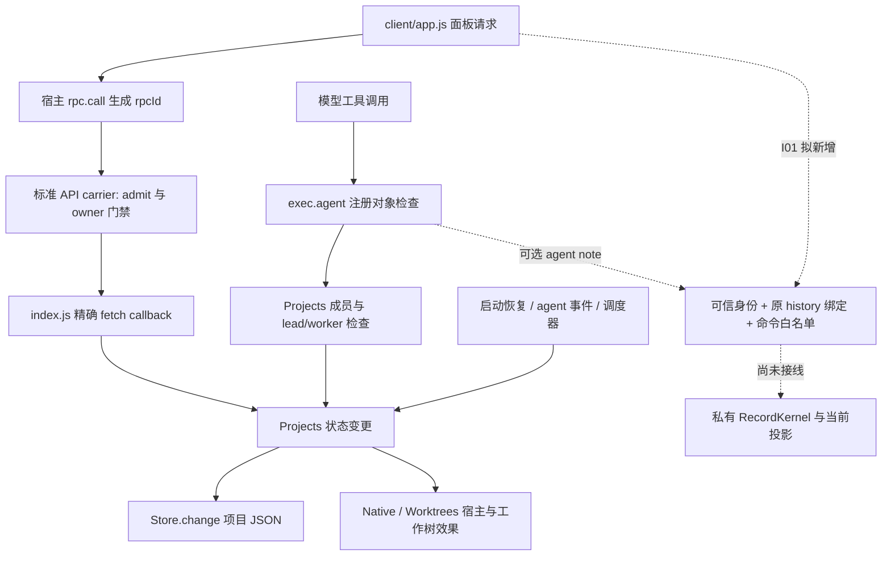

# W10 · 可信入口与身份边界决策材料

2026-11-08 · 静态源码映射；D01 未决；没有产品改造或宿主验收。

**I01 应新增一个 history 绑定的私有 Record 入口和独立状态投影，不能把现有 Projects 的所有 phase 写入直接改名为 Record 命令。** 工作台 `7264be1` 的运行入口没有导入 RecordKernel；S1 仍是单独的同步模型。现有 HTTP 操作有上游 owner 门禁依据，但缺少 Record 所需的历史路由、当前角色和命令身份映射。[工作台入口](https://github.com/TaiShuo150622/dsh-project-workbench/blob/7264be10387963f4d575d8688ed8573f4c16c8c4/index.js#L9-L84)；[S1 边界](https://github.com/TaiShuo150622/dsh-project-workbench/blob/7264be10387963f4d575d8688ed8573f4c16c8c4/record/README.md#L3-L9)

## 1. 已追到的调用链

固定 DSH `fcc0ad4` 的 `connection/index.ts:146–157` 先 `admit`，再向 HTTP bridge 传入 Peer；`rpc-host.ts:129–136` 检查请求来源条件及已认证 browser/API Peer，`:215–222` 对精确 fetch 路由只放行 `owner`，之后 callback 只收到 `Request`。这是**标准接入链的代码保证**，不是本机运行回执。Host/Origin 检查自身不建立身份；BrowserAuth 另核签名、请求 audience 与有效期。owner 表示宿主权限域，不识别每位自然人，也不证明某次操作由人亲手确认。[宿主入口](https://github.com/deepseek-ai/deepseek-harness/blob/fcc0ad462172522aaf5c93a7b2e01f6b9f0b0159/packages/client/connection/src/index.ts#L146-L160)；[owner 门禁](https://github.com/deepseek-ai/deepseek-harness/blob/fcc0ad462172522aaf5c93a7b2e01f6b9f0b0159/packages/client/connection/src/rpc-host.ts#L129-L136)；[精确路由](https://github.com/deepseek-ai/deepseek-harness/blob/fcc0ad462172522aaf5c93a7b2e01f6b9f0b0159/packages/client/connection/src/rpc-host.ts#L215-L222)

## 2. 写入口与可取得的身份

下表按可达入口归并；JSON 逐项列出分支和源码行。所谓“所有”限定为固定工作台的已列入口与内部状态写点，不包含整个 DSH 的全部插件。

| 入口 | 实际变更/调用 | 已有身份依据 | I01 必须区分 |
| --- | --- | --- | --- |
| `project_dispatch` | 新线程、续接、followups、generation、outbox；随后调度 | `exec.agent` 必须等于 `ctx.agents.get(id)`；由成员表取项目且只允许 lead | agent 会话身份不是用户；`callId/id` 是分派键，不是 Record 精确命令指纹 |
| `project_report` | worker 自身 summary/phase、汇报 outbox | 同一工具对象检查；成员表必须 worker | 汇报不能变为 verifier 证据或用户验收 |
| HTTP `create` | 创建 workspace/session 和项目记录 | 标准宿主链 owner；插件参数只含项目资料 | 原生创建不是 Record `createTask`；首片不自动创建新会话 |
| HTTP `join` | 绑定现有 session 为 attached thread | owner 通道；服务端 inspect 并排除子代理/已加入会话 | `sessionId` 是所选目标，不是请求者；保留历史不等于 Record incarnation |
| HTTP `action` 的 `pause/resume_project` | 项目 paused；kick | owner 通道 + 项目存在 | 调度暂停不等于 Record pause；也不停止已运行线程 |
| `retry_delivery` | 清 outbox error，再投递 | 同上 | 运输重试不能产生新的业务授权 |
| `stop` | 先写 stopped、清 followups/待发消息，再 `Native.stop` | owner 通道；项目内 thread 查找 | `agent.cancel({kind:user})` 的参数不是认证证据；stopped 不证明进程/效果终止 |
| `accept` | review 且 native 非 running 时改 completed | owner 通道；无 Record token | 旧线程 phase 验收，不能显示为 Record 当前结果已接受 |
| `retry` | failed/interrupted/stopped→queued，generation++，kick | owner 通道 | 不直接重放旧 Record 命令或自动续授已撤回权限 |
| `agent/status`、`agent/error` | onIdle 补 waiting_user 汇报；错误补 failed | 宿主事件给 agent/sessionId，随后查成员 | 事件观察来源单列，不能合成为 user/verifier |
| 启动 `recover` | 补 workspace membership；活动线程可能改 interrupted；kick | 已保存项目/会话 ID 与宿主状态 | 启动恢复不是新的人工命令；本地旧 JSON 不是可认证 Record 日志 |
| `drive/start/flush` | followup 出队、会话/worktree 创建、running/failed、outbox sent/error | 从 Store 记录派生的目标/发送者 | 新入口若要管这些效果，必须覆盖内部路径；I01 暂不纳入真实执行 |

源码：工具与事件在 `index.js:17–56`；HTTP 在 `:59–82`；完整变更点在 [Projects](https://github.com/TaiShuo150622/dsh-project-workbench/blob/7264be10387963f4d575d8688ed8573f4c16c8c4/server/projects.js#L47-L290)。`list/diff/health` 和 `project_threads/project_read_thread` 为相邻读入口；读权限同样不能由目标 ID 自证。`Store.change` 的串行复制—临时文件—rename 不做 actor/history 验证，也不是 Record 的同步接纳或跨进程事务。

Native 还暴露 `create/ensureWorkspace/deliver/user/stop`。其中 `deliver` 虽用 `role:user`，保留 `source.kind=agent-message` 与 senderSessionId；不得抹掉来源再赋用户权限。`accepted()` 只判消息是否进入会话/收件箱。`user()` 是直接 prompt helper，本仓库未找到调用，不能用其名字证明真人来源。内嵌会话通过宿主 `SessionProvider`/`conversation.content` 执行原生交谈，绕开本插件 `api('action')`，应作为独立宿主边界。[Native](https://github.com/TaiShuo150622/dsh-project-workbench/blob/7264be10387963f4d575d8688ed8573f4c16c8c4/server/native.js#L5-L54)；[嵌入路径](https://github.com/TaiShuo150622/dsh-project-workbench/blob/7264be10387963f4d575d8688ed8573f4c16c8c4/client/app.js#L76-L94)

## 3. 不可混用的身份和版本

- **主体**：工具可取得注册 agent 对象；HTTP 精确路由可依固定宿主合同取得 owner 类别保证，但没有逐人 ID。未来映射应以 `(identityAuthority, subject)` 为域，再赋当前命令角色；正文中的 `actor/role`、sessionId、项目说明或模型声明都不是身份来源。
- **目标**：项目 UUID、线程 UUID、原生 sessionId 和线程 `generation` 分别服务项目成员/续接；没有一个现成字段可直接宣称是 Record 独立历史代际。将某人选中的 session 当其身份、将当前 UI 项目当旧请求归属，都会混淆作用域。
- **请求**：宿主 `rpc.call` 每次生成 rpcId，仅关联请求/响应；项目 dispatchKeys 仅按键返回旧线程。Record 则把 actor、payload、revision 等整体指纹纳入 requestId 去重。I01 要独立保留原命令 requestId，重试不能重取新 revision 或用新 UI 选择重包历史。[RPC](https://github.com/deepseek-ai/deepseek-harness/blob/fcc0ad462172522aaf5c93a7b2e01f6b9f0b0159/packages/client/connection/src/client/rpc.ts#L34-L69)
- **普通命令与验收**：S1 普通 envelope **不含 streamId**，必须在 `apply` 前由外层 HistoryBinding 选择并核对私有实例；不能仅靠内核 taskId/revision 去重。验收 token 含 streamId、任务/规格/完成/结果及可用性/验收版本，它是结果绑定数据，**不是 bearer 身份凭据**。创建命令无 expectedRevision，验收用 token，其他命令用 expectedRevision；两类均需可信 actor。[内核](https://github.com/TaiShuo150622/dsh-project-workbench/blob/7264be10387963f4d575d8688ed8573f4c16c8c4/record/kernel.mjs#L116-L179)

现有测试 USER/AGENT/VERIFIER 是固定常量；`beginAttempt.payload.sessionId` 在模型内只是经过格式校验的输入，真实会话归属仍归适配器。S1 的 `replay`、快照及 token 也不认证导入者。D01 不应把测试演员或历史 `user/message` 直接变成现在的授权；已核上游变更说明甚至保留“旧记录缺 principal 视作 owner”的兼容规则，这只是历史解释规则。

## 4. I01 需要改哪里、覆盖什么

建议新增 `server/record-entry.js` 与投影模块（文件名待实施冻结），私有保存 kernel 句柄及 history/宿主实例映射；顺序为**可信通道→当前角色/读取范围→原历史与目标实例一致→命令白名单→原 requestId/revision/token→apply→分别返回历史收据与当前投影**。普通命令必须在内核去重/查 task 前完成历史检查。

`index.js` 仅把选定通道接入该入口；可选 agent note 复用注册对象检查，不开放 agent 自报 user/verifier。`client/app.js` 新增独立状态块，意图创建时固定 history、对象和水位；生成的 `client.js` 后续应随正常构建更新。旧 Projects 的 accept、stop、report 与内部恢复继续明确标记旧语义；若选择将任一路径纳入 Record，必须同时处理上表的 HTTP、工具、事件、定时调度和原生会话回流，不能只有按钮走门禁。

首片建议白名单沿用 W07 的只读及 `note/pause/cancel/acceptResult`，具体角色仍待 D01 冻结；verifier 写入、真实 reserve/dispatch/效果发送关闭。演示所需初始化数据走明确合成夹具，不能展示成真实完成。持久 ACK、多进程互斥和实际外部对账留 I03/I04。

## 5. D01 备选与进入编码的前提

| 备选 | 可借用的依据 | 仍需决定/证明 |
| --- | --- | --- |
| A. 固定标准 DSH owner 通道 + agent 工具通道 | 上游认证与 exact-route owner gate；现有 exec.agent 对象检查 | 冻结实际支持的宿主版本/carrier；声明单 owner 域及其稳定 authority ID；确定 user/agent 角色映射、可执行命令和 history 生命周期；不能把 owner 认证等同每次人工验收 |
| B. 专用本机命令入口 | 目前没有该入口代码；是替代设计 | 明确实际对端识别/权限边界、实例寿命与调用方；不能只凭 localhost、body.actor 或函数名；agent 与 verifier 不因此获得 owner 权限 |
| 两者均未满足 | 只可继续确定性夹具 | 状态必须是模拟；不标“认证接入完成”，不暗中选择底座或扩建多用户认证系统 |

编码前最少冻结 D01 的 authority/subject/角色政策与 history 生命周期、D02 的状态视图位置、I01 白名单。后续验收至少覆盖：标准通道拒绝未认证及非 owner；假 agent 对象拒绝；正文伪装 user/verifier 无效；两个 history 都有 `task:1/revision=1`、同 actor 且 requestId 未出现时，旧 cancel 错投新实例在 apply 前拒绝；精确重送与变更参数重用 requestId 分开；旧 token/快照不串历史；内部旧路径不伪造 Record 状态；换页/断连/重启不改命令归属。测试需覆盖实际选定宿主通道，直接调用 callback 的现有 stub 测试不能替代它。

全部为**未来验收前提，未在 W10 运行**。未读取实际凭据或个人历史；未证明当前安装版本、其他 carrier、逐人身份、完整宿主会话命令权限或同进程恶意插件隔离。静态映射及每个未知项见 [entry-map.json](entry-map.json)，读取范围见 [sources.json](sources.json)。
