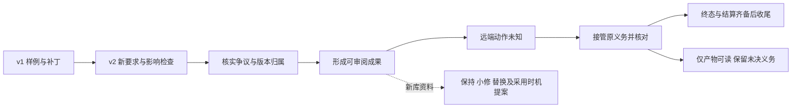

# 一次链接检查器交付，怎样连起整个 Harness

**ILLUSTRATIVE_NOT_RUN · 假想例子，未运行。** 下文所有仓库、产物、角色、权限、适配能力和批准均是假设；没有实现程序、调用 API 或取得真实用户批准。它用于解释路径，不是实施任务书或运行证明。

假设个人演示仓库要交付一个 Markdown 链接检查器：能发现约定类型的坏链接，给出可审阅补丁与检查结果，并完成约定的远端动作核对和费用收尾。工作台帮助人看懂交付；Record 保存依据；DAG 找受影响的部分；执行器完成实际工作。只有遇到对应情形，才需要下表的分支。

| 阶段 | 用户能看到什么 | 下一步依据 |
| --- | --- | --- |
| 1．先交付 v1 | 工作台显示“检查本地相对文件链接”的规格 v1、补丁 s1，以及运行 r1 在判据 c1 下通过的样例清单。 | 看得见的产物先形成进展。样例通过只覆盖这些检查，不证明全部业务规范为真；本故事约定后续还有阶段，不能在这里提前结案。 |
| 2．要求变成 v2 | 假设需求新增“检查标题锚点，忽略代码块内链接”。用户选中文件与失败样例，稳定引用进入讨论；影响图列出需改的解析接口与需重做的检查。 | 形成新规格 v2、补丁 s2 和判据 c2。r1 留在 v1/s1 历史里；复用某项旧证据须另核输入、判据及适用条件，不能直接把 s2 标绿。Record 在下一次调用前补入新要求，即使后台整理未追上。 |
| 3．同一命题出现争议 | CI API 观察说 r2 成功，日志观察说 r2 失败；两条均被接纳为候选观察，声称针对同一历史、s2/v2、c2、环境代际和运行窗口。界面显示“证据冲突”，两份原件都可定位。 | 暂不据此自动发布，但有权的查看与查证可以继续。来源身份真实不保证内容正确；重复收到同一条成功回执不增加独立证据。不同版本或判据的结果本来就属于不同问题，不能归成这种冲突。 |
| 4．纠正错误归属 | 假设核对原始运行索引后发现：失败日志其实来自更早的 r0/s0/v1/c1。界面显示更正理由与前后引用，旧记录仍在。 | 经授权并核验的纠正只撤回它对 r2 的错误声明，另记旧运行的失败；r0 不覆盖 r2。撤回不凭空产生反证。若归属仍无法确认，争议继续保留。重新评估覆盖范围与 c2 检查，不能因“只剩正支持”就跳过其他交付条件。 |
| 5．远端创建 PR 超时 | 假设在明确授权范围内，远端执行器提交创建演示 PR 的动作 a1，随后超时；取消请求只返回“已接收”。状态是“取消请求已接收，效果仍未知”。 | 保留 a1、目标、s2 与执行代际 g1。先查询原动作，不能盲目再建 PR；取消 ACK 不证明进程停止、无迟到写入、效果撤销或计费结束。 |
| 6．有人接续处理 | 假设新控制器明确接纳原义务 o1 的核查责任。工作台显示新的责任者、最后证据水位、下一核查时间；a1 的 unknown 仍在。 | 接管保留 o1/a1/g1、原预算占位和待结算负担，不把未知费用记零。查询与结算仍分别检查当前权限；若只有保管能力，就显示能力缺口。换责任者不会停止原发送者，也不证明费用已结清。 |
| 7．新库带来改进机会 | 独立分析发现一个新解析库。工作台并列“保持”“小修”“替换模块”，并列出立即或下一模块采用的差别。当前可审阅补丁仍保留。 | 在共同未来期限内比较质量、验证、迁移、运行和人工成本；无可比尺度时保留多指标。可以先提出“下一模块再试”的候选，不因当前任务成功就自动发布工具，也不为试新库中断健康任务。采用与迁移需要另行决定。 |

**结尾 A：取得足够证据，完成约定交付。** 假设目标适配器给出绑定 a1/g1/s2 的权威效果终态，明确最终产生哪个 PR；另有可核契约及证据排除旧执行代际继续写入，并确认相关计费终止、费用结清及约定资源释放；若约定要求进程退出，还要核对相应实例的终止证据。v2/s2 的约定检查、对应版本的审阅验收与其他阶段也全部完成时，才可在这个任务契约下收尾。界面列出具体成果和收尾依据；这仍不保证程序对所有未来输入都正确。

**结尾 B：只能读到产物，继续审阅但尚未收尾。** 假设当前只确认指定审阅者在时刻 t 能读到 s2 对应的 PR/产物。界面可以写“内容可审阅；远端收尾未完成”，在当前权限和范围内推进审阅。单次存在性观察不能证明原发送者终止、没有迟到写入或费用结清，也不保证以后一直可读。原未决义务、责任者、费用负担与下一核查安排继续保留；不能把整个任务标成完成。

这个例子刻意集中多种边界。普通本地小编辑只使用实际需要的记录、检查与交付步骤，不必每次都启动完整图服务、争议流程或远端接管。
