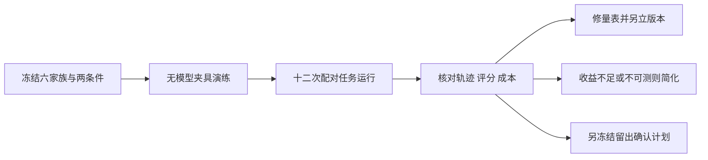
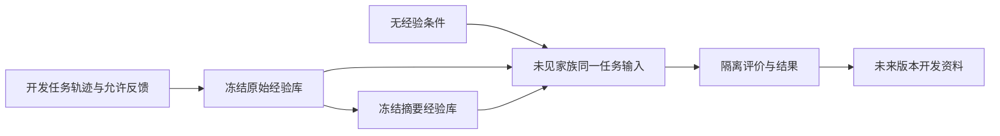

# 最小评估与可证伪价值讨论稿 v0.1.1

2026-11-08 · Codex west W-05（UTC）

## 版本与范围

本稿审查现有提案能否区分“契约正确”和“工作更有价值”，给后续实施准备最小实验，不报告实验效果。

- 版本：v0.1.1 修正 Coding 场景的阶段终点，明确必需扰动与交接不能被早期验收跳过；v0.1.0 建立三场景、十二次运行的最小校准设计。后续修改递增补丁号。
- 范围：已有 context-evaluation 协议、机制 conformance 目录、ARCHITECTURE 与 DESIGN_RECONCILIATION；输入摘要见 design-v0.1.1.json。
- 主线：价值主张 → 能推翻它的对照 → 分开的结果量 → 有限结论。
- 状态标记：设计与静态审查；未建夹具或 runner，未运行任务、模型或外部产品。
- 本稿不修改此前 72 episode 提案，只建议先以 12 次任务运行的探索 pilot 决定是否值得扩展。没有功效保证。

## 一、先给结论

现有设计已经能限制不少过强结论，但尚不能据此证明完整 Harness 提高生产效率。conformance 的 C01–C16 负责识别契约违反；上下文协议负责比较材料策略；真实任务完成、人工负担、连续性与恢复速度仍需要各自的观察。把它们加成一个“总成功率”会掩盖取舍。

建议先做三条场景、每条两个独立任务家族、每家族一组基础流程/候选流程配对，共 6 对、12 次 episode。只用一个固定模型版本和一档输入预算，先找量表失真、夹具问题、成本大头与明显负迁移。这个规模不能证明普遍收益、非劣或罕见故障率。

最重要的否证条件是：候选在同等质量约束下没有节省人工、完成机会或总成本，反而增加等待和维护。正确拒绝错误动作可能有价值，但不能把“不做事”奖励成长期任务成功；更复杂的图、记忆和多代理都必须允许被移除。

## 二、总体架构：三层评价不互相代替

机制正确性是选择候选的必要输入之一，不能承担任务收益和长期成长的结论。

**图 1　评价层次 · 通过下层不自动通过上层**

箭头表示前一层提供约束和诊断，不表示结论蕴含。有限状态模型、静态源码和 conformance 都不能直接推出真实用户平均省时。

| 结果量 | 操作化定义 | 不算该量 |
| --- | --- | --- |
| Task success | 在当前规格、固定必需项与约束下交付可用结果；盲化验收与功能检查共同判定 | 契约检查通过、完成声明、生成了更多内容 |
| Human burden | 日常使用所需的主动审阅、查证、纠错、恢复操作分钟，分别记录；最终人工决定是否可用 | 把等待时间全算人工，或把研究用双评审成本混作用户负担 |
| Continuity | 换会话/需求修订后保住必需约束、有效证据和剩余工作；遗漏、错误沿用、不必要重做及到下一有用进展的时间 | 会话能打开、摘要更短、模型复述“我记得” |
| Recovery | 故障后按可获得证据恢复正确状态并推进剩余目标；记录到安全状态、到可执行状态、到完成的不同时间 | cancel ACK、一直保持 unknown、控制器重连 |
| Context cost | 写入、更新、检索、选择、模型读入、缓存、重试及构建成本；连同工具资源与等待报告 | 只算最后一次输入 token 或只算 warm 命中 |

主结果保持一个向量：质量、人工、完成/进展、成本。不能以少量 token 抵消必需功能失败，也不自动认定较贵但确实提高完成机会的方案无价值；取舍阈值须在扩大确认试验前冻结。

“不必要重做”只指没有新依据、也不服务当前/后续决定或明确验证、审计、监测义务的重复执行。到期复核确认未变、实际使用前读回和按规则重复验证可以有价值，不能因为没有产生新文本或状态变化就记成浪费。

## 三、原 72 episode 提案的成本含义

72 是 24 家族 × 3 时间变体，既不是 72 个独立用户，也不是完整运行数。其 12 开发/12 确认家族仍分别含 36 episode；家族划分方向正确，但从同一模板变换的近重复也应放在同一 split。

| 展开方式 | 任务运行数 | 解释 |
| --- | ---: | --- |
| 72 × 8 条件 × 3 重复 × 2 预算 | 3,456 | 未考虑全历史仅需一档的合并 |
| B2 全历史只跑一次预算，其余 7 条件各两档 | 3,240 | 72 × 3 × 15；必须记录为何合并，不能事后选最好一档 |
| 第一阶段 5 条件，B2 单档 | 1,944 | 72 × 3 × 9，尚未包括第二阶段 |
| 只保留 B5/B3 主对比、两档预算、三次重复 | 864 | 仍然远大于首个量表 pilot |

这些数还不包括 B6 演化开/关、dense 检索敏感性、压缩消融、selector 同费用对照或固定前缀 probe 与完整任务同时运行的扩展。writer/updater/selector/judge 调用和人工检查也不等于一次 task run。原 40 步限制是任务轨迹上限，不能把每步额外选择器调用隐藏起来。

不以未经核价的单价给金额估计。先由 pilot 记录每类任务的完整调用及资源分布，再按计划运行数计算总账；冷构建、增量运行、研究评分和维护人时分列，最后仍给总额。摊销按实际复用次数和有效期展示敏感性，不能默认无限复用。

成本主表保留全部已分配/已尝试任务及失败、超时的总成本。若报告“每个已验收交付成本”，分子仍是整组总成本，分母才是验收数；零验收时记未定义并保留总支出。只在成功运行中求平均成本属于条件统计，须单列，不能用它抹去失败代价。历史讨论中的样本数、收益百分点或归因一致率门槛均不继承为已验证阈值，本计划的确认门槛仍待冻结。

## 四、三条贯穿场景的最小对照

三个场景使用相同的当前权限与目标能力，所有资源公开或合成。基础流程必须是能完成工作的合理实现；不能用无日志、盲目重试或故意不给历史的弱基线制造优势。

| 场景 | 基础流程与候选的唯一主要差异 | 配对/随机单位 | 可否证的核心主张 |
| --- | --- | --- | --- |
| A：Coding 修订到交付 | 基础：Git、普通任务清单、工具日志、当前要求；候选：同材料加版本绑定的 Record/证据视图与明确续接包。模型、工具、目标门禁相同 | 一家族是同一功能目标和修订轨迹的独立工作区双份；区组内随机臂顺序。两个 pilot 家族分别含相关修订、无关备注 | 结构化状态让人更快验收/续接，同时不损害当前功能。若维护视图成本抵消收益或无关备注触发返工，主张受反驳 |
| B：长期任务断连与恢复 | 基础：持久 checkpoint、普通日志和目标查询；候选：增加动作/效果分离、unknown 负担及对账工作流。相同幂等/围栏/查询能力 | 一家族固定任务和故障逻辑屏障；两个 pilot 家族分别在已提交丢回包、确证未应用后恢复。每臂克隆同世界与调度 | 候选减少人工调查和错误重做，并在可恢复时继续推进。永远等在 unknown 不能证明恢复收益 |
| C：证据更新到研究决定 | 基础 B3：固定词法检索原文；候选 B5：同原文与检索器，加按可观察字段生成的规则时间线。都在三个资料释放时点完成同一研究判断 | 一家族是主题、资料时间流和问题；两个 pilot 家族分别含最新纠错、延迟到达/不确定冲突；整条时间流配对，不把时点当独立样本 | 时间线能改善当前正确动作与证据使用，且总成本和人工可接受。检索召回提高但最终决定未改善，不支持该价值主张 |

### A：当前版本质量与人机负担

固定必需功能、规格变化前后的输入和测试，不奖励候选自行加功能。每次测试绑定 artifact/source 版本；在当前规格下盲化检查功能和必要证据。记录错绑旧测试、重复已有效工作、约束遗漏，以及换接后到首次有用产物的时间。

记录操作者实际干预和最终首审时间；第二位研究评审的复核计入研究成本。不能让同一评审先看 A 臂答案再评 B 臂同题；以评审者区组分配不同家族/臂，遮蔽臂标签、费用和自评。界面形态可能透露条件，故不声称完全双盲。

正常终点须同时满足 `required_stages_completed` 与 `final_stage_accepted`。冻结三段：初始规格与证据、A1 相关修订或 A2 无关备注及交接、最终适用规格下的续接与验收。第一阶段即使已经验收，也只是中间观察，不能跳过预定扰动。运行上限或关键约束违反可以提前结束，但按未完成/失败保留完整轨迹；没有到达扰动的臂也保留在分母中。A2 的最终检查允许复用仍适用的证据，不要求为了经历阶段而重跑无变化的测试。若新需求本来就使旧证据无效，其重验是必要工作，不能计成无效重做。此对比识别的是整组版本视图/交接机制，不分别归因给 DAG、Record schema 或 UI。

### B：合约可以通过，任务仍未完成

用逻辑屏障定位故障，例如目标提交后、回执送达前，不能在每臂相同墙钟秒数断线而打到不同阶段。保存独立目标 audit、完整受控出站和屏障回执；若方法未到达屏障，记录故障前任务失败，不悄悄剔除。

同时报告：是否违反动作契约、错误重发次数、已完成工作保留量、主动调查分钟、从恢复请求到判定/完成的时间。另报告从“所需权威证据可取得”到推进的时间，避免把外部故意延迟当算法慢。

在明确可恢复的两个 pilot 家族内，停止于剩余工作完成或运行上限；完成不到上限记为未完成/截尾，不据此宣布违反不存在的有界活性保证。另有“目标证据一直不可得”的诊断变体，只检查正确保留未知与可操作说明，**不纳入可恢复完成率**，也不据此宣称提速。该变体不是本轮 12 次 pilot 的隐藏额外任务。

正确保持产品 unknown 可以得到 C06/C09 的 conformance SUCCESS；业务 `task_completed_by_horizon` 仍为 false。测试 verdict UNKNOWN 则是观察/扰动不足，两者必须分字段。

### C：信息选择必须落到动作，且不能泄漏未来

资料用 `available_at` 截断；所有索引、摘要和时间线只能由当时可见前缀生成。问题要求区分“当时可知”和“当前修正”，必要来源可有多套充分组合。不能把隐藏金标准、题型标签、将来纠错或人工评分反馈写进检索 metadata。

终点是最后时点的研究结论及明确下一动作建议，验收覆盖适用性、约束、引用、可做/不可做边界，而不是只答历史问答。追踪各次纠错成本、冲突保留和无依据断言。停止于固定终点或预算上限，不因候选“看上去赢了”提前结束。此实验比较 B5/B3，不证明自主 ontology、独立模型 selector 或长期学习必要。

## 五、先验 pilot 与扩展门槛

先用小样本检查实验装置是否值得扩大，不将探索结果包装成确认结果。

**图 2　先验 pilot · 先允许发现量表无效**

pilot 家族全部属于开发资料；若用它们改提示、量表或组件，不能再把同题计为确认集。选择进入确认集的任务不能以“对候选容易”作为条件。

建议初值为一档 **8,000 输入 token、每次输出最多 4,000、每 episode 最多 40 次工具动作与 40 次模型调用、墙钟 20 分钟**；任务内 writer、updater、selector、执行者及所有内部重试计入同一调用上限，不能用外层迭代数代替实际调用数。离线构建与独立评分另设调用上限和总账，仍受项目总预算约束。这些是待冻结的工程上限，不是合适模型或任务难度的实证结论。若系统/工具定义等必带输入已超预算，显式标不可行；不静默截掉权限或必需约束。

执行前必须冻结具体模型/参数、价格及总费用限额、人工投入限额、fixture 版本、checker 和随机顺序。当前设计无实际预算授权，因此 design-v0.1.1.json 的 execution_ready=false。到 12 次即停止 pilot，不边看结果边增加样本直至显著。

若发现观察链不完整、夹具污染、错用主体或未覆盖外部效果，停止受影响配置检查；保留已发生费用/结果。方法自己的超预算、解析失败、追踪缺失不能被删作“基础设施问题”。只有事先定义的、与臂无关的共同故障可整体补跑配对单元，原记录仍保留。

pilot 展示每家族的配对差、胜负/不确定和所有成本；每场景仅两个家族，不用 bootstrap 区间或 p 值声称总体提升。扩展前再按最小有意义收益、人工负担界限、可接受质量差异与预算做设计，当前不编这些效果阈值。

## 六、成长与经验复用必须另立对照

独立 episode 重置只测试记忆策略在给定材料上工作，不测试“用得越久越好”。冻结经验的留出迁移也只证明一个库在一个新任务分布上可能有用，不证明持续在线自我改进。

**图 3　经验反馈隔离 · 留出结果不能回流同轮候选**

图中没有从本轮评价返回本轮经验库的箭头。允许的日常执行反馈和隐藏评分器结果要分别登记。

可选后续小试验：从两个专门开发家族取得相同原始轨迹，生成冻结经验库；在六个从未用于建库/调参的家族比较“无经验、原始轨迹检索、摘要经验检索”，共 18 次目标运行，另有至少 2 次开发轨迹生产和建库调用。六家族覆盖相似可迁移、表面相似但约束变化、工具版本失效三类，各两个。这个扩展仍是 pilot，不自动具有功效。

三臂使用相同当前资料、检索/输出预算与权限。原始轨迹和摘要来自相同开发事实；对比原始/摘要识别表示价值，对比无经验/有经验识别额外经验的整体价值。规则库、轨迹库、索引和缓存均冻结，不能只隔离摘要却让检索看到留出题结果。记录正确复用、错误沿用、负迁移、人工纠正、撤回成本和建库成本，不能只选相似的成功题；同题修复、同域新题迁移和跨域迁移分别报告。

若以后评估在线成长，应以独立任务序列为随机化单位，各臂只能使用自己的过去轨迹及同定义的日常反馈；隐藏终局评分在块结束后才揭示。比较完整序列的学习曲线及累计成本，不能把连续任务当独立样本，不能以第一题难、后面题易制造成长。

**核实后的修正**：v0.1.0 的 A 场景写成“当前版本交付通过”即可停止，存在在初始验收后截断后续修订/备注的规格歧义。本版按 [R-06 独立审查](../../proof-review/work-policy-audit/REVIEW.md)明确阶段屏障；没有新增任务运行、改变预算或声称实验已执行。

## 风险与开放问题

最大的风险是以候选的内部结构定义金标准，从而证明它符合自己，而没有证明用户更省力。

- [ ] 功能与语义验收是否由独立需求定义，是否包含候选检查器漏掉的必需项和负对照？
- [ ] 基线是否拥有同样工具、当前权限、目标幂等和原始信息；差异究竟是能力还是表示？
- [ ] 人工审阅、构建、维护、模型等待和评估者成本能否分别测量，是否存在用户没做但研究者替其做了的隐性劳动？
- [ ] 第二宿主是否改变模型、网络、权限或工具能力？若改变，不能把差异全部归给统一内核。
- [ ] 模型升级后哪些组件收益消失？需以相同任务和固定验收重新做删减对照，不能沿用旧版本排名。

## 待证命题与下一步

先证明测量过程可靠，再判断候选是否值得更多工程投入；没有明显收益也应允许选择更简单的实现。

| 编号 | 命题 | 已有依据 | 缺口 |
| --- | --- | --- | --- |
| E1 | 版本化状态帮助当前交付和续接，降低人处理旧证据的成本 | ARCHITECTURE A、C01/C02/C14 的机制反例 | 配对任务与实际人工计时，未运行 |
| E2 | 显式效果状态在可恢复故障后减少错误重做及人工调查 | C06/C08/C09/C15/C16 的协议 | 目标独立 oracle、完整出站与业务终点，未运行 |
| E3 | B5 的时间线比 B3 原始检索提供净任务收益 | 已有 context-evaluation 的主对比提案 | 原始资料与冻结规则、成本和任务结果，未运行 |
| E4 | 经验库可在新任务中带来正迁移而不产生不可接受负迁移 | 已有 evaluation-contract §6 的方向 | 隔离建库/留出任务/评分反馈，未运行 |

- [ ] 先按 review.md 处理评价口径缺口；不更改原研究状态为已验证。
- [ ] 后续实施先完成无模型夹具与计量演练，再申请或确认实际运行资源；本轮不执行。
- [ ] 试跑后允许停止复杂组件、缩小主张或记录不确定，不以文档完整度换取上线结论。
