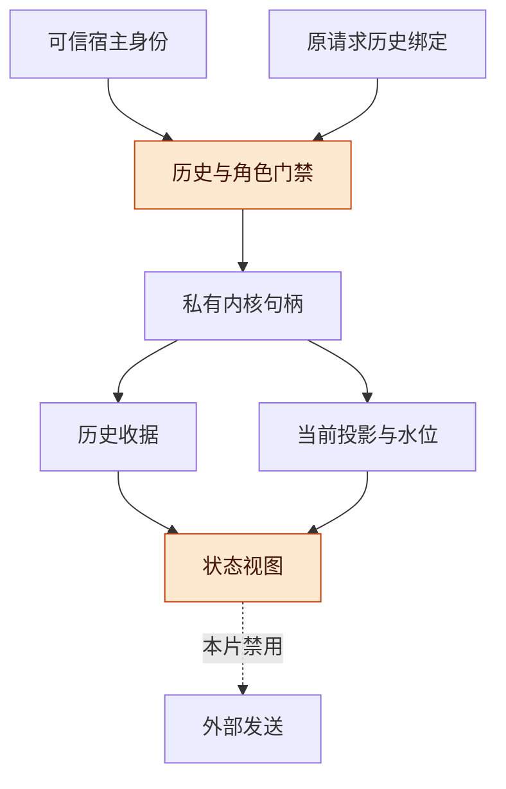
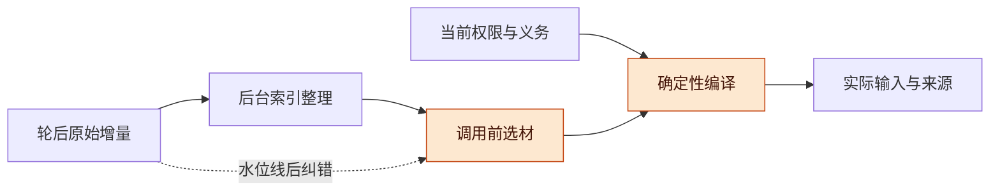

# 可信入口与 Coding 交付实施任务书讨论稿 v0.1.0

2026-11-08 · 个人 Harness 工程，Codex 设计与源码核对

## 版本与范围

先让一个真实宿主中的命令可靠地属于原来的历史和主体，并如实显示状态；再逐片接通选择引用、影响分析、执行与验收。首片不发送外部动作，不把整套 Harness 的后续能力塞进一个入口改造。

- 版本：v0.1.0，基于统一主稿 v0.1.1、Record 精化报告和独立映射审查提出实施任务书。后续修改按补丁号递增。
- 主线：一个 Coding 交付故事 → 已有代码与新契约 → 可信入口 → 递进切片 → 实施前选择与验收。
- 状态标记：**固定代码已读**不等于当前宿主运行通过；**历史设计**不等于已实现；本稿全部切片为 **PROPOSED_NOT_RUN**。本轮没有产品修改、目标连接、提交或发布。

## 一个贯穿的用户故事

用户要在个人演示仓库交付一个 Markdown 相对链接检查器，能报告失效链接，并按明确规则忽略生成目录；这个虚构演示任务用于说明路径，仓库、规则和验收夹具尚未建立。

用户先选中一条样例或需求，在讨论中引用该对象，查看改变忽略规则会影响哪些代码和检查，再让 Coding 工作线程实现。代码和验证产物可审阅后，交付批次可单独走一个普通 PR merge；核实目标结果后，由用户对指定版本给出验收。中途纠正“忽略目录”的规则时，旧资料与检查保留，界面说明哪些依据仍适用。

**图 1　用户路径 · 七片逐步解锁**

从左到右是一条用户路径；首片只支持可信入口和已有状态的真实呈现，完整路径需要后续切片。

**任务域边界**：现有工作台线程可承载 Coding 目标，Record S1 只接受普通 PR merge 规格。线程 ID 与 Record task ID 必须显式关联；代码完成、测试通过、PR 合并、用户验收分别表示。不能把一般 Coding 目标伪装成 `pull_request_merge`，也不能用合成 GitHub evidence 冒充代码测试证据。前半段先保留为工作台目标和带来源产物；通用任务协议若需要，另作后续契约选择。

**场景终点**：实施验收先冻结阶段表：初始工作 → 初始证据 → 规定的需求纠正/备注/交接 → 按新状态继续并核实 → 最终阶段验收。是否出现纠正、何时交接由场景驱动器预定，不能由模型临时省略。旧阶段第一次完成或接受不是整段场景的终点；只有所有规定扰动和交接已走完、最终定义的证据与验收适用、未决效果按场景规则结清，才判成功停机。必要的安全/预算提前停止另记为阻断或截断，不伪装为最终成功；本条也适用于 I01 的受限状态轨迹测试。

## 可复用代码与新增责任

冻结源码提供了可用的局部语义和界面入口，新增能力主要位于适配层、投影层与持久化边界；先按事实复用，再补契约。

| 材料与固定位置 | 可以复用 | 仍需新增或核实 |
| --- | --- | --- |
| [Record 内核](../../../../../record/kernel.mjs)，提交 `7264be1`，116–135、335–368 行 | 精确请求重送、内存原子接纳、当前查询与确定性重放 | 普通命令的 history 绑定、身份来源、持久 ACK 与崩溃恢复 |
| 同文件 62–71、269–280、342–348 行 | token 绑定的 S1 验收、旧按钮拒绝、当前窄域依赖投影 | 消费者/操作/接收范围 q、当前访问观察；不得用计数增加错误撤回刚存入的验收 |
| 同文件 90–101、282–304 行 | 新动作预检查、资源占位与已有预留最终准入 | `checkAction` 不是已有预留的发送 guard；`sent` 只是模型中的发送意图 |
| [工作台工具入口](../../../../../index.js)，38–47 行；[原生会话适配](../../../../../server/native.js)，27–50 行 | 工具入口检查真实会话对象；原生线程与消息来源标记 | 用户/verifier 的可信身份映射未由这些代码证明；HTTP 注册存在不等于身份边界已核实 |
| [现有界面](../../../../../client/app.js)，95–135 行；[线程业务](../../../../../server/projects.js)，165–167 行 | 线程选择、差异预览、打开既有图入口、现有接受操作 | 现有 accept 只改线程 phase；不是 Record token 验收，也没有通用实体引用契约 |
| [项目存储](../../../../../server/store.js)，17–29 行 | 单实例串行变更与临时文件替换模式可参考 | 不能据此继承 Record 事务、跨进程锁或断电耐久承诺；须另定存储 ACK 级别 |
| [Record 精化](../../china/record-refinement/REPORT.md)、[独立映射审查](../../proof-review/record-mapping-audit/REVIEW.md) | 已核映射义务和短轨迹可作为未来回归输入 | 五项映射差异不是五个产品漏洞；其中 OR 是表达能力缺口，不是已实现算法失败 |

源码身份由 [inputs.json](inputs.json) 的完整提交与文件 SHA 固定。本稿没有重跑此前 20 条选定测试或 8 条探针；此前回执不是本任务书验收通过。

## 首切片 I01：入口架构与正确投影

I01 的交付是一个受信入口和一个不误导的状态视图；通过后只能宣称命令归属与窄域呈现已验证。

**图 2　首片边界 · 先验证归属再进入内核**

先核对原请求的历史归属与可信身份，再做去重和命令接纳；当前选中的界面不会重写旧请求的历史。

| 项目 | I01 具体任务 |
| --- | --- |
| 目标 | 一个宿主、一个选定 history incarnation、一个私有 S1 实例；支持受限的记录/控制命令与状态查询，无外部发送 |
| 拟影响模块 | 新建适配入口与投影模块，接入 `index.js` 的选定可信通道及 `client/app.js` 的独立状态块；具体文件名由实施计划冻结。`record/kernel.mjs` 首片可保持不变 |
| 数据/契约 | 外层请求绑定 `historyId`（含独立历史代际）、原 `requestId`、命令及原 expectedRevision/token；可信通道派生 `(identityAuthority, subject)` 与当前角色，再无碰撞映射为内核 actor；`HistoryBinding` 绑定历史、宿主实例和私有内核句柄 |
| 约束 | 原历史与路由不匹配先拒绝；不从 body 的 actor/role 或模型文字取得身份；不按当前 UI 选择重绑旧请求；不把旧重试改成新 revision；受控入口中没有旁路 `apply`；首片不宣称同进程任意恶意插件也已隔离 |
| 命令边界 | 冻结白名单，建议先只读及 `note/pause/cancel/acceptResult`，按真实角色授权；verifier 写入和真实动作入口关闭。测试可在私有夹具中覆盖 reservation/dispatch 阶段语义，但不得暴露为外部发送能力 |
| 状态视图 | 分开显示历史收据及其 cursor、最新查询水位、当前证据是否仍支持、S1 验收是否适用；缺少 q 观察时显示“当前访问未核实”。旧线程“已验收”单列来源，不转成 Record 接受；`sent` 显示“发送意图已接纳，尚无外部效果证据” |
| 验收 | 两历史同 `task:1/revision=1`、相同 actor、未用 requestId，旧 cancel 错投新历史须在 `apply` 前拒绝且两边不变；伪造 user/verifier 无效；精确重送只有旧收据且无新事件；变更 payload 重用 requestId 失败；旧快照不能盖新状态；新验收计数递增后仍可适用，而新请求重用旧 token 被拒；当前结果无独立消费观察时不显示“可下载” |
| 阻断 | 可信身份来源/当前角色政策未定；请求原历史绑定不可验证；任何受控客户端/工具入口能绕过门禁；模拟演员被当真人；旧线程接受与 Record 接受混写 |

**重启与重送**：I01 只有同步内存承诺，不自动迁移个人历史。空内核不得复用旧历史代际冒充连续历史；重启只能从明确可信的完整日志恢复，或创建并显式标识新历史。没有持久接纳证据时不显示“已可靠保存”。历史收据读取也受当前读取权限约束；它不授权重新发送或恢复已撤回权限。

**精确状态映射**：S1 的 `historical-completion` 实际查询当前有效 completion，不能直接译为“历史上曾完成”。“曾记录完成”应检查保留的 completion 历史；“当前证据支持”采用当前有效判断；“当前验收适用”沿用 S1 的 completion/result/availability 匹配。撤回后历史仍在、当前支持和验收可同时为 false。一般消费 q 的可用性继续标为未实现/未观察，不从字段名称猜测。

**界面规则**：看过、选中、引用都是材料操作，不是接受、执行或授权。选择变化只改变当前视图；已发请求和引用胶囊保留原历史、对象版本与来源。真实桌面行为和入口契约测试分别记回执，纯测试夹具通过不能替代宿主验收。

## 递进切片与门槛

后续切片逐步把用户路径接通，每片单独验收；七片不是一个自动获准的实施批次，也不替换 H01–H08 或原面板产品排期。

| 切片 / 目标 | 影响数据与契约 | 不可破坏的约束 | 可观察验收 | 阻断 |
| --- | --- | --- | --- | --- |
| I02 选择→引用→改动前影响 | 有版本对象引用（history、对象、资料版本、来源范围、视图水位）；明确类型的需求/文件/检查关系与影响集合；引用进入现有草稿的协议 | 选中不授权；不覆盖草稿；旧引用不静默转最新对象；未完整提取依赖时显示覆盖缺口；图可达不等于全部失效 | 选中样例后讨论看到同一对象版本；切换项目不串引用；规则变化只列明确路径和需复核检查；相同对象版本在面板/讨论中能相互定位 | 通用面板选择契约未冻结；没有稳定实体身份；把已有打开图按钮算作完整引用能力。可先用有界显式关系验证，不宣称原生 AND/OR 支持 |
| I03 尝试绑定与持久接纳 | 新 attempt 绑定创建时规格/执行身份/环境代际；明确续用或退休政策；history、命令收据、attempt sidecar、占位和 intent 的一致性与恢复规则 | 不默认新 attempt 自动退休旧 attempt；无论退休政策如何，保留旧动作迟到效果观察；持久 ACK 后才能宣称可恢复；共享资源占位不能只用 task CAS | 在日志/状态/回执边界崩溃后重复请求无重复接纳；旧规格尝试按冻结政策被拒或显式重新绑定；恢复能重建占位，已发未知效果不消失 | 存储故障模型、ACK 级别、唯一写者/共享权威未冻结；sidecar 与 kernel 可半更新 |
| I04 接通实际交付与验收 | 一个明确目标适配器；固定 repository/PR/ref/source SHA；最终有效调用与授权绑定；权威观察、结果和 acceptance token；Coding 检查产物另存来源 | 没有真实读回不造 verifier；历史 dispatch 收据不触发新发送；取消 ACK 不证明停止；单主体拒绝访问不调用全局 markUnavailable；原生 S1 仅普通 merge | 在隔离演示目标发送前后、效果后回执前故障，核对唯一实际效果或保留 unknown；用户能从选中对象追到检查和交付批次；错误/旧 token 不能接受新结果；完成后新要求用显式 successor；冻结扰动/交接走完后才作最终阶段验收 | 目标、允许写入与验证身份未选定；不能认证观察；未覆盖实际发送通路；新规格超出普通 merge 却仍冒用 S1；驱动器在首次验收提前终止 |
| I05 Record 三时序与调用前组装 | 轮后原始增量、后台可重建索引、调用前来源选择与 ContextManifest；水位线后纠错覆盖；当前权限单独输入 | 原证据不被摘要替换；后台未完成不遗漏最新纠错；历史授权不变成当前权限；独立模型选材/自主本体是可替换候选 | 实际执行模型输入含最新限制和可追溯来源；预算不足报告缺口；无记忆/简单检索先作基线，后加复杂策略；成本含写回、索引、组装、失败与人工 | 无法观察实际最终输入；无固定任务及纠错/权限夹具；只有问答命中率，不能说明动作改进 |
| I06 一个远程模式与长任务接续 | 先选 A 本地 Agent 远端工具或 B 远端 Agent；会话/环境/进程代际与通道归属；能力声明、在途工作与资源用量 | UI 断线不等于任务停止；不为重连杀任务或重跑；文件、终端、审批来自绑定环境；没有硬上界不承诺精确费用停止；保留结算/读取结果能力 | 同一任务断线重连后引用、环境、日志和未决效果保持归属；无重发旧 prompt/动作；最后观察时间可见；该模式的终止/恢复边界与真实行为一致 | 宿主版本、目标能力和凭据归属未冻结；I03/I04 恢复证据未闭合；两模式同时铺开掩盖归因 |
| I07 有边界的经验复用 | 从本故事产生带适用范围的候选规则/轨迹；冻结经验、检索索引、反馈；预先定义质量、人工负担与全分母成本 | 修好本任务不等于跨任务增长；反馈泄漏不得进入留出；候选不能改自己的评价标准；模型升级重做消融 | 先使用已有 12-run 校准；后续有独立训练/开发/留出来源、失败和超时留在分母；能选择不采纳无收益组件 | 量表、成本与来源切分未定；拿同一任务重复改善当泛化；只报成功任务成本或模型自评 |

机器清单逐条列出 proposed 验收 ID、依赖和证据需求，见 [slice-checklist.json](slice-checklist.json)。I02 的完整引用、I05 的自主组装、I06 的远程组合与 I07 的成长均是新提案；不能凭已有按钮、日志或探针提前打勾。

用户路径沿用[通用面板](../../../../harness/05-panels/docs/design/overall-discussion.md#journeys)、[DAG 改动前影响](../../../../harness/06-dag/current/docs/design/dag-detailed/07-第一屏收口计划-2026-10-17.md)、[Record 三时序](../../../../harness/04-memory/Record智能记忆与自主上下文组装-源v0.1.2-公开整理版.md)和[远程 A/B](../../../../harness/07-remote/DSH-远程工作区与双运行模式讨论稿-v0.1.1.md)的公开讨论。它们与[统一主稿](../../统一Harness工程与形式化基础讨论稿-v0.1.1.md)、[衔接稿](../../DESIGN_RECONCILIATION.md)共同提供设计依据；原稿的历史实现状态不因被引用而更新。

**图 3　Record 三时序 · 调用前不等待本体重建**

上路的索引可慢慢整理，最新纠错直接补入调用前路径；独立模型选材是否优于简单检索，由既有评估方案判断。

## 实施前要决定的三个选项

现在不绑定服务器、Codespace 或远程运行模式，因为 I01 尚不具备持久意图、进程代际和真实效果观察；提前绑定目标会把入口归属、网络、凭据和恢复混成同一次验收。

| 决定 | 可选方向与代价 | 何时必须冻结 |
| --- | --- | --- |
| D01 可信身份从哪里来 | 现有 DSH 宿主提供可核验的用户/agent/verifier 通道，或本机专用入口以明确的本机身份与有限角色映射起步。当前 `exec.agent` 检查只支持一部分依据，不能自动证明用户 HTTP 请求可信 | I01 编码之前；若两者都无法证明，仅可做模拟，不标认证完成 |
| D02 首片状态视图放在哪里 | 在现有工作台增加独立 Record 状态区，或待通用面板契约完成后承接。前者更易单独验证，但不代表将原 P-01–P-15 产品顺序永久改写 | I01 UI 任务冻结前；I02 仍必须遵守最终选择/引用契约 |
| D03 真实效果与远程如何取样 | I04 先锁定个人隔离演示仓库中的一个普通 merge 目标与授权范围；I06 再从 A/B 中选一个模式及一个隔离环境。若用户选择纯本地交付，则另定通用结果契约，不伪造 GitHub 规格 | 分别在 I04、I06 开工前；本任务书不选择具体仓库/服务器，也不授权写入它们 |

这些是实施任务书中的待定点，不是要求本轮研究停下来等待。当前可以完成契约、测试设计和可复用代码核对；实际写产品代码之前仍应与用户确认具体范围。

## 风险与开放问题

首要风险是把相邻层的“已有”误当成本层的“已验证”；每片都必须保留来源与缺口。

- **身份漂移**：当前 UI 选择替换旧请求历史，会绕过本地 ID 与 revision 的表面一致性检查；绑定必须早于路由及去重。
- **验收偷换**：旧线程 phase、Record S1 token、一般 Coding 验收、消费 q 是不同判断；不通过统一绿灯隐藏差异。
- **过量建设**：不能为首片先开发通用图数据库、新调度器或完整本体；后续切片以可观察缺口解锁。
- **证明外推**：AND/OR 重算与预算证明尚未精化到这些新模块；旁挂一个图/费用字段不继承证明。

开放问题：

- [ ] D01 的可信身份入口与所有受控调用路径是否能列全？
- [ ] D02 的 UI 安排是否获用户接受，如何与面板既有计划衔接？
- [ ] I03 的存储故障模型及 I04/I06 的实际目标是否已分别冻结？

## 待证命题与下一步

先证明一个窄入口可用，再验证完整用户路径的收益；七片全部尚未执行，不以文档检查通过替代产品验收。

| 编号 | 命题 / 猜想 | 已有依据 | 缺口 |
| --- | --- | --- | --- |
| T01 | 外层绑定足以阻止受控入口的错历史命令，而无须先改 S1 | RF02、独立映射审查及现有私有句柄可设计 | 真实身份、完整入口覆盖和 I01 回执 |
| T02 | 稳定对象引用与有类型影响视图能减少用户解释/返工 | 面板与 DAG 的历史用户路径 | 实际协作测试与人工负担测量 |
| T03 | 三时序上下文或经验复用值得额外复杂度 | 已有上下文/改进评估协议 | 固定任务对照、全部成本与留出结果；尚无收益证明 |

下一步：

- [x] 固定输入、核对可复用代码并写出切片与 proposed 验收清单；此项仅文档工作。
- [ ] 冻结 D01/D02 和 I01 命令白名单；列明修改文件、真实身份依据及不可绕过入口。
- [ ] 仅在实施获明确授权后完成 I01，并分别记录契约测试与真实 UI 回执。
- [ ] I01 通过后逐片决定是否继续，不自动扩展目标或提升既有证据等级。
