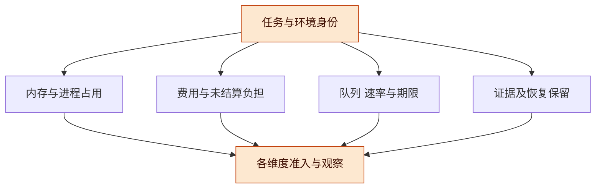
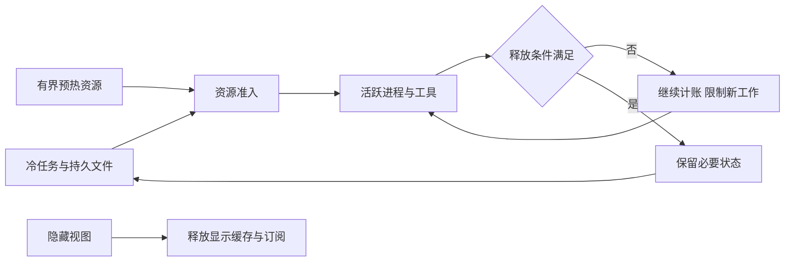

# 资源归属与环境生命周期讨论稿 v0.1.1

2026-11-08 · Codex（统一工程整合线）

## 版本与范围

长期任务可以保留身份、文件与未决责任，而执行资源按需分配。要做到这一点，先区分累计费用、当前占用、处理速率、持久保留和交互期限，再为每种资源明确归属、准入与释放条件。

- 版本：v0.1.1，按 R14 复核明确并发瞬态总上界、未用预留转记及引用 token/代际；v0.1.0 补齐既有共享基础、冷工作区与面板资源设计的统一边界，后续按补丁号修订。
- 主线：资源分类 → 归属与共享 → 环境生命周期 → 队列和视图 → 条件推导 → 验证路线。
- 状态标记：旧稿是历史设计输入；官方文档仅选读；本稿为研究提案与纸面条件推导，R14 已完成不同研究线的条件审查和极小合成枚举。没有执行内存基准、部署容器、改变系统限额或停止任何现有进程；没有新增 Lean/TLC 证明。

本稿不恢复用户已排除的工作区活跃度面板。资源信息只服务准入、响应、长期任务和可恢复性，也不据此替换原面板平台与工作台的实施顺序。

## 总体架构：一张资源账不能只有一个总数字

不同资源的单位和释放方式不同，统一应发生在身份、归属与决策接口上，不能把 MB、费用、进程数和等待时间直接相加。

| 类别 | 例子 | 约束对象 | 何时可解除 |
| --- | --- | --- | --- |
| 累计消费与未结算负担 | 模型/API 费用、已发请求的潜在账单 | 已结算、在途与必要收尾的总费用 | 依据结算或排除未来消费的证据；关闭界面不改变它 |
| 当前占用 | 私有内存、文件句柄、浏览器页、活跃构建进程 | 当前存活分配及其峰值上界 | 对应资源确实退出/释放，且没有遗漏仍依赖它的使用者 |
| 速率与竞争 | CPU 时间、磁盘/网络吞吐、模型并发 | 时间窗口中的供给、排队与需求 | 下个时间窗口可重新分配；平均利用率不能保证尾延迟 |
| 持久保留 | 原始证据、工作区基础、未提交改动、去重凭据 | 保留义务与存储容量 | 按既定保留/删除政策处理；释放缓存不等于删除原件 |
| 期限与响应 | 人的输入、到期检查、收尾交接 | 联合可调度的工作及时间余量 | 义务履行或明确处置；“还有一个槽”不保证按时响应 |

现有 [预算一般证明](../china/budget-proof/README.md)针对累计费用及保守负担。不能将其数值直接改名为 RAM，便宣称得到了内存、CPU 或期限的一般保证。

**图 1　统一归属，分别计量 · 没有单一万能资源分数**

任务身份连到几份不同账目；准入同时检查相关维度，失败时说明是容量、权限、期限还是保留条件不足。

## 共享基础与任务私有状态

保留旧稿的“不可变基础＋私有修改＋完整版本视图”。共享是否成立，以实际对象和部署方式判断，不以目录名字或相同代码比例判断。

一个视图至少绑定仓库/基础快照、私有修改版本、依赖与环境版本。读、搜、改、构建和执行都使用这个视图；结果归属启动时的视图，即使用户随后编辑，也不能把旧测试涂成新版本通过。当前 [DAG 一般证明](../dag-proof/README.md)同样要求完整读取依赖，不能替索引和缓存证明不会漏边。

| 对象 | 可共享的条件 | 必须保留的私有或版本差异 |
| --- | --- | --- |
| 基础源码、工具链与依赖内容 | 不可变身份及兼容平台匹配，有权读取 | 可写安装目录、覆盖/删除、构建输出与凭据 |
| 搜索和分析结果 | 输入、配置、工具版本及使用范围匹配 | 修改/删除遮蔽基础命中，依赖变化使相关结果重算 |
| MCP/LSP/浏览器等服务 | 服务支持独立请求身份、工作区、权限和状态隔离 | 不能用全局“当前项目”处理并发，不能共用未隔离的登录态 |
| 进程与运行模板 | 另有经验证的快照/复制机制及信任范围 | 私有堆、随机状态、连接与外部效果不能由文件共享推定安全 |

Docker 的经典 `overlay2` 文档说明同一底层文件可以共享页缓存，首次写入可能触发 copy-up。它不是所有部署共享内存的承诺，也不把两份进程堆合并。镜像大小下降不能直接换算成整机 RAM 收益。[官方机制及适用范围](https://docs.docker.com/engine/storage/drivers/overlayfs-driver/)

计量上另设 `allocationId` 与 `logicalObjectId`：同一内容可能有多份物理分配，一个物理服务也可能承载多个逻辑请求。按物理对象去重后计占用；按任务记录使用关系和分摊政策。PSS/RSS、容器记账和应用逻辑大小有不同口径，不能混加为一个精确总量。未获得可靠映射时，保留估计及未归属部分。

## 生命周期：界面、任务与环境分别变化

关闭面板只应解除相应显示和读取需求；任务、执行进程、收尾通道和证据保留有各自的结束条件。

**图 2　环境生命周期 · 正常长任务保留运行**

下方界面路径不自动通向上方的进程结束。正常进行的下载、训练或计算不因“换方案更省”被打断；本稿只提出先限制新工作、释放确已空闲的可重建资源。

建议的资源记录包含资源身份、代际、管理 owner、受益任务、使用引用、当前状态、可重建依据、释放证据及费用归属。owner 表示协调责任，不因此取得操作权限；共享资源不能在第一个使用者退出时被当成无人使用。

Node v24.6.0 的子进程文档区分父进程等待引用与子进程存活，非 Windows 子进程也可能在父退出后继续运行。因而 wrapper 结束、`unref()` 或会话退出都不能作为完整进程树已清理的证据。[固定版本文档](https://github.com/nodejs/node/blob/v24.6.0/doc/api/child_process.md#optionsdetached)

Linux cgroup 提供分层进程归属与资源控制，但进程迁移不会自动迁移已经存在的后代。`memory.high` 主要触发节流/回收，`memory.max` 可能引发 OOM 且允许特定临时超出；冻结也不等于释放内存。本稿只借这些边界说明“配置了限制”与“工作无损且按期完成”不同，不建议在本机执行配置变更。[官方控制语义](https://docs.kernel.org/admin-guide/cgroup-v2.html)

释放采用独立状态：`active → retiring → released`。进入 retiring 后停止接收新的使用引用，核对旧使用已结束或按合同迁移，再取得实际释放观察；若请求失败或仅收到信号，保留 `release_pending/unknown`。真实并发下，需要同一权威序列或等价协议来排序引用增加与 retiring，不能只在界面读到计数为零后删除资源。

每项使用应持有唯一 token，释放绑定 `(allocationGeneration, useToken)` 并具有幂等性；旧代迟到回调不扣减当前代的引用。引用计数是协议投影，必须与真实使用对应，普通 `refs=0` 本身不是所有使用已结束的证据。

## 队列、投影与保留义务

有界内存与无损语义可以通过背压、持久缓冲和按需读取组合；无法同时满足时，必须明确不足，不能静默丢掉验收和恢复事件。

| 数据 | 可合并或淘汰什么 | 必须保留什么 |
| --- | --- | --- |
| 文本流的显示更新 | 同一视图内的中间绘制帧、可重建解析缓存 | 最终正文及必要语义事件；显示合并不改变源记录 |
| 当前状态投影 | 已被更晚完整状态覆盖的显示通知 | 当前版本与来源水位；断档后用有界快照重新建立状态 |
| 控制/效果事件 | 按明确协议去重精确重送 | 动作身份、关键观察、取消/接纳/验收及未决负担 |
| 原件与恢复材料 | 可重建缓存及到期且允许删除的副本 | 当前合同要求保留的原件/摘要/去重证据与必要基础版本 |

**图 3　源记录与显示分开 · 背压不能伪装成完整消费**

缓存可重建仍有条件：源版本可取得、重建方法与权限可用、成本和等待可接受。仅有一个内容 hash，不证明原件仍存在；仅有原件，不证明当前接收者有权读取。若保留义务长期增长而存储有限，需要保留期限、归档/转交或新的容量安排；不能用无限保留承诺掩盖不可行性。

## 条件推导与构造反例

下面的推导只说明准入账目在列明假设下足够保守，不声称能够精确预测真实程序的内存峰值或任意调度。

**RL1，共享占用的条件上界。** 对一种资源，令 S 是所管理的不同物理分配集合，每项实际占用 `a_s` 满足可信界 `0≤a_s≤b_s`；H 覆盖该管理域其他固定/未归属开销，T 覆盖未计入任何 b 的所有并发准入、重建、复制等瞬态的合计峰值，J 是尚未使用的交互及收尾预留。H、b、T 覆盖同一时间/管理域且无重复漏项；实际占用不大于 `H + Σb_s + T`。若原子准入维持 `H + Σ(s∈S)b_s + T + J ≤ C`，则该域的对应实际总占用不超过 C。证明是逐项求和及代入；它依赖分配清单完整、上界真实、瞬态不漏项和并发准入排序。未知的宿主外部负载、内核超额或错误上界不由此得到约束。

使用 J 时，先将相应容量原子转记进分配上界或瞬态上界，再减少未用预留；实际用量不能同时游离于 H、b、T 之外。若之后需恢复交互余量，须在新准入前重新建立足够的 J。单操作峰值不能充当全局 T，除非协议保证这些瞬态不重叠；上界与容量若变化也要重新检查，不能永久沿用一次准入观测。

每种资源分别应用这一判断。成本、内存和进程三个维度都满足各自容量，可以给出该候选的容量可行性；仍不推出 CPU/I/O 的联合排队期限、结果正确性或用户体验达标。为用户交互预留 J 是有实际容量含义的提案，J 取值尚未测量。

**RL2，共享释放与引用连续性。** 若新引用只能在 active 状态原子取得，retiring 转移与取得引用互斥，且只有全部旧使用已结束/迁移后才释放，那么释放时不存在仍依据该协议有效的使用者。逐步检查这三类转移即可保持该性质。没有纳入协议的进程、迟到回调、外部句柄或错误终止观察仍可破坏现实映射；模型中的 owner 字段不能替它们作证。

**三个构造反例**：A 与 B 共用一个索引服务，A 关闭页面就杀掉服务，会破坏 B 的执行；只按 agent 槽计量，两个槽各启动多个浏览器/构建后代，可越过假设的进程/内存预算；两个准入者分别读到同一剩余量并各自批准，单次判断均通过而合计超限。这些是设计反例，没有在当前插件或机器上制造故障。

[R14 独立审查](../proof-review/resource-audit/REVIEW.md)在 7803 个满足准入条件的合成资源快照中核对算术界，并检查两个用户、两代资源的小引用模型：正确 token 方案 180 状态、304 边无指定不变量违例；普通重复扣数变体七步即可误释放仍被另一用户使用的资源。错误变体违反 RL2 的真实使用结束前提，定位的是实现映射义务，不是原条件命题的反例。上述计数不并入 TLC、Lean 或产品性能验证。

## 验证路线与风险

优先验证完整归属与释放语义，然后测收益。没有基线前不承诺节省百分比，也不把本轮读文档当成性能验收。

1. 固定一个宿主、操作系统、工具链、相同工作负载与可重复事件源，列出任务—环境—进程/服务—资源的归属图。
2. 对照原宿主、加载插件但视图关闭、正常使用三组；分别测冷启动、预热和持续工作。报告总量与增量、峰值和尾延迟，记录缓存与外部负载条件。
3. 在隔离夹具中验证六类场景：重复开关视图；共享服务一方退出；子进程仍在；冷任务数量增长；队列断档/背压；retiring 与新引用并发。全部当前为 **PROPOSED_NOT_RUN**。
4. 验证不同视图版本的读取、索引、构建与产物绑定；只有身份与结果正确，再比较共享或预热方案的资源收益。

| 对照组 | 主要用途 | 停止判据 |
| --- | --- | --- |
| 原宿主与空插件 | 识别固定成本及测量噪声 | 版本、缓存、负载不可比时先修试验 |
| 按需服务与独立服务 | 看重复开销及尾延迟 | 串工作区、串权限或影响正常任务时停止新增试验工作 |
| 有界投影与长历史 | 看占用随活跃窗口还是历史增长 | 语义事件缺失、游标错误或恢复材料丢失时先修契约 |

## 风险与开放问题

主要风险是账目看似受控，却没有覆盖真实分配、正常工作和恢复义务；解决这些问题需要具体目标与实际观察，本稿未替用户选择部署平台或运行模式。

- 以相同字节误认物理共享，或把 CPU 节流当作性能改进。
- 只测父 PID 漏掉后代，或用删除唯一证据换取低内存。
- 预热池挤掉交互余量，或资源上界不随实际工作变化重新准入。

开放问题：

- [ ] 首个资源管理域是个人宿主、一个远端执行器，还是受控容器？
- [ ] 哪些对象可以可靠重建，哪些原件与恢复记录必须按合同保留？
- [ ] 交互与收尾需要多少可实测容量，哪些任务无法给可信峰值上界？

## 待证命题与下一步

先验证归属与释放不会改变任务和证据语义，再依据同配置测量决定共享、预热及压缩的投入。

| 编号 | 命题 / 猜想 | 已有依据 | 缺口 |
| --- | --- | --- | --- |
| RL-H1 | 冷任务增加不必导致重工具常驻数量同步增长 | 原架构分层与本稿归属契约 | 真实宿主激活/释放路径及增长斜率未测 |
| RL-H2 | 完整视图与安全共享可降低重复资源而保持结果身份 | 旧共享基础设计、官方文件机制 | 实际工具绕行、缓存失效、总资源与尾延迟 |
| RL-H3 | 明确资源代际与 retiring 协议可减少误释放 | 本稿条件推导与构造反例 | 真实后代/句柄追踪、并发协议与退出证据 |

下一步：

- [x] 定向复读旧共享基础/工作台资源要求及官方机制，提出分种类资源账与释放边界。
- [ ] 独立审读 RL1/RL2 的假设和计量重叠；未作一般机器证明或有限状态程序检查。
- [ ] 未来经实施范围确认后，在隔离环境运行六类场景；沿用原面板/工作台路线与本轮 I 切片的关系另作决定。
