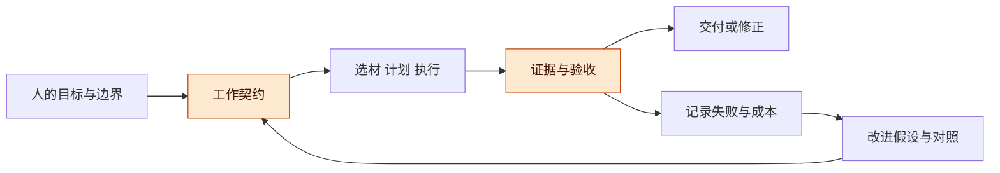
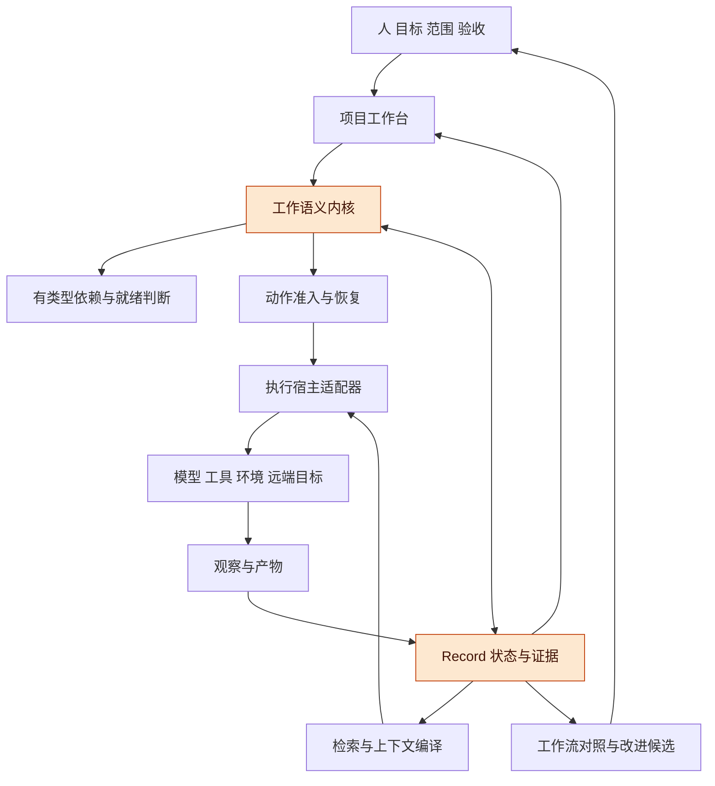
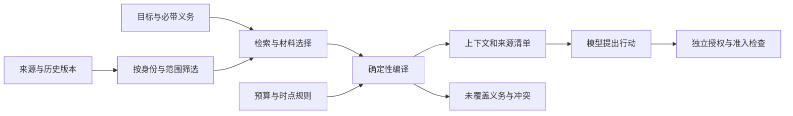
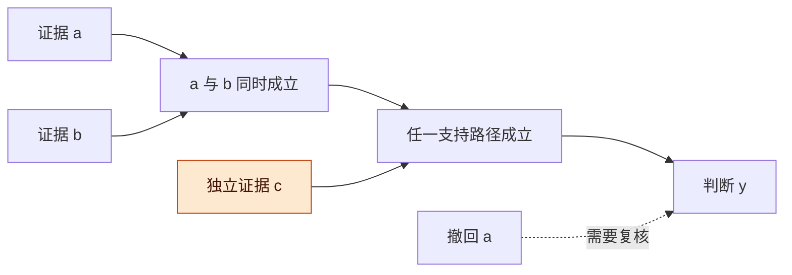
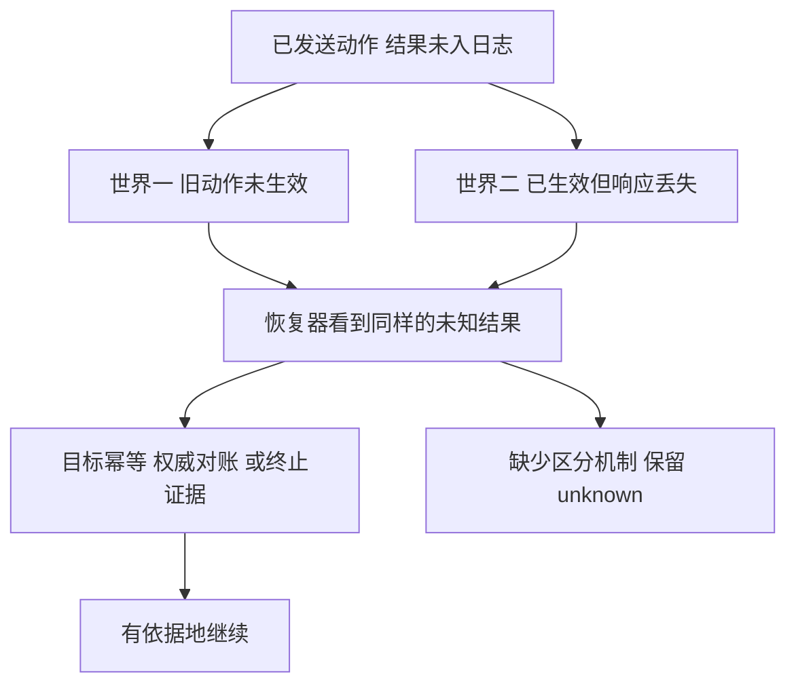

# 统一 Harness 工程与形式化基础讨论稿 v0.1.6

2026-11-08 · 个人 Harness 研究，Codex 整理与核查

## 版本与范围

建议将项目工作台、Coding 方法、Record、DAG 和远程执行组织成一套统一的工作语义：围绕目标保存依据，按明确权限执行，用可追溯证据判断结果，并持续验证工作方式是否值得改进。工程可以分成多个可独立使用的插件，共同遵守任务、效果、证据和验收契约。

- 版本：v0.1.6 补强工作流改变及采用时机、领域作用域、人的决定来源和历史 H0 承接；v0.1.5 接入争议证据、协议适配、责任接管与资源生命周期，并明确 P/B 产品顺序；v0.1.4 澄清读回时效、可信入口及长期推进条件；v0.1.3 纳入持久接纳模型和任务书；v0.1.2 补齐用户路径；v0.1.1 整合一般证明与工作策略；v0.1.0 建立统一对象及架构。七小时研究仍在进行，后续按补丁号递增。
- 主线：已有方向 → 统一对象 → 记录与工具 → 图与执行 → 工作决策与改进 → 形式化边界 → 相关工作 → 验证及实施路线。
- 状态标记：**基线事实**来自固定代码和已公开稿件；**来源已核**指读到原始材料，未必运行；**条件推导**只在列明假设下成立；**形式核验**须看具体模型/定理与回执；**本轮提案**尚未实现；**待验证**保留为下一步。
- 范围：个人通用 Harness 工程；公司及量化内部实现、数据、凭据和原始会话不进入本稿。
- 实现基线：工作台公开讨论归档 `b9d4484`；Record 研究输入为 `7264be1`，来自仍未合并的 [Draft PR #1](https://github.com/TaiShuo150622/dsh-project-workbench/pull/1)。本轮不把讨论能力写成产品完成。

**图 1　讨论主线 · 工作与改进相互反馈**

从左到右是当前任务的工作循环，下方反馈用于改进下一次工作。高亮处决定我们究竟做了什么、凭什么认为做到了。

## 动机

已有各条讨论的共同问题，是如何让跨轮次、跨工具、跨机器的工作始终能对上人的目标和真实结果。

现在已经具备若干零件与设计：工作台组织项目、线程和工作树；Record S1 提供确定性任务状态与结果/验收绑定；DAG 讨论关联计划、代码和证据；远程稿区分本地交互与远端运行；Coding 方法提出预测、检查、诊断与经验升级。把它们只并列成插件清单，还没有回答它们之间的语义：一个宿主说 completed，工作台能否放行后续任务？一条记忆被纠正，哪些计划和验收要重看？断线以后换执行者，会不会重复旧操作？

可以用一项小的 Coding 交付理解这套工程：在公开演示仓库里，为一个命令增加明确的新行为。用户先在工作台选中需求、相关文件或一次失败检查，把稳定对象引用带入讨论；模型读取当前规格和依据，提出近期计划；改动前查看受影响的接口与检查；随后在选定环境实现、验证并交付可审阅补丁和对应检查结果。若中途改变要求，旧结果保留版本，新要求重新判断；若提交外部动作后断线，先查明效果，再决定如何继续。最后保留一条有适用范围的经验候选，用后续对照判断是否值得复用。这是本轮建议的演示路径，具体任务及验收样例仍需在实施前冻结。

| 材料层 | 目前可确认的状态 | 不能据此声称 |
| --- | --- | --- |
| 既有公开讨论 | 工作台、面板、Record、DAG、远程和 Coding 方向已有可追溯归档 | 所有讨论功能均已实现或完成集成 |
| 固定代码输入 | 工作台与 Record S1 以 `7264be1` 为研究快照；Record 来自未合并 Draft PR | 合并、发布、真实外部效果或完整认证已完成 |
| 历史有限验证 | 远程兼容、上下文截短等旧稿保留原测试范围 | 本轮重新测过或当前所有组合都通过 |
| 本轮实际研究 | 一般条件证明、有限模型、来源核查与 Record 映射已有可复核文件 | 整个产品正确或真实长期任务质量改善 |
| 下一轮闭环 | 可信入口、真实效果适配、工作台连接及测量校准已设计 | 真实适配的 43 个变体和 12 次校准已经运行 |

统一工程需要回答这些连接问题，同时保留任务执行与探索的灵活性。模型循环、记忆策略和多代理组织方式可以随任务及模型改变；身份、来源、版本和效果边界要保持可解释。

浏览器与实时输入也应沿用同一套身份和证据边界：操作日志记录调用观察，租约协调资源使用，页面及能力引用绑定提供者和代际；这些机制各自都不等于目标端效果确认或旧执行者围栏。语音/实时问题的来源、文本版本和当前问题绑定也要保留，迟到检索不能悄悄回答已经更换的问题。旧档中各模块版本不同，部分接口说明互相冲突，因此这里只提取设计需求，不把它们写成当前统一实现。[旧主题覆盖与四条衔接](west/historical-coverage/COVERAGE.md)

旧稿中“信息推动工作流演化”和“先预测、再验证、用意外改善方法”仍是主线。本轮收窄几处过强表述：模板首次审查不能永远覆盖后续环境；假设撤回不能粗暴作废所有后代；日志先后不能证明作者从未见过结果；历史框架对比不能当当前能力结论。详见 [既有讨论衔接](DESIGN_RECONCILIATION.md)。

## 总体架构

优先采用一个职责清楚的工作语义内核，连接可替换的执行宿主、信息服务与工作台视图，并用一个真实闭环检验抽象。

**图 2　总体架构 · 共享语义与可替换执行**

图中箭头表示责任交接，不要求每个框单独部署服务。Record 与内核共享身份和引用；全文检索、图布局及模型推理可以独立替换。

| 组成 | 核心责任 | 第一版应保持的边界 |
| --- | --- | --- |
| 工作契约 | 目标、输入、范围、验收、授权、预算和期限 | 规格变更留版本；探索任务允许未解决问题 |
| 协调内核 | 尝试、就绪、准入、效果占位、证据接纳和结算 | 小的权威写入面，不能由模型任意改状态 |
| Record | 事件、原始观察、派生知识、来源与上下文材料 | 原始证据、总结和授权分开 |
| 有类型的图 | 依赖、影响、替代证明、因果与资源冲突 | 边有明确语义，支持公式与普通关系图分开 |
| 执行适配器 | 对接 DSH 等宿主、工具、远程环境和目标系统 | 如实声明可恢复、可取消、可隔离的具体对象 |
| 工作台 | 组织项目、交互产物、进展、依据、待决问题与恢复动作 | 选中稳定对象后带入讨论；简洁状态可展开到证据，不以活跃度替代进展 |
| 改进模块 | 从失败与成本提出方法变更，安排对照与采纳 | 候选不能自行改写保护自己的权限和评价标准 |

具体接口与 H01–H08 切片见 [架构工作稿](ARCHITECTURE.md)。当前尚未决定更换 DSH 底座，也未决定从零开发整个平台。

## 核心对象与完成语义

任务、一次尝试、外部动作、结果与验收必须拥有可关联但不同的身份。

各领域仍独立管理目标、预算和评价标准。共享工作契约、工具和物理资源治理，不自动引入跨领域价值总分或预算转移授权；一个领域的成功经验需要明确适用范围，才能成为另一领域的候选。

任务定义（TaskDefinition）是要做什么；一次尝试（Attempt）是一次具体推进；会话（Session）是可续接历史；执行宿主（Host）是控制器实例；环境（Environment）是文件、依赖和进程所在位置。一个会话可以经历多个宿主实例，一次任务可以重试多次，环境重建也不自动完成旧动作。

对任务需要至少保留四种判断：

| 判断 | 问的是什么 | 变化例子 |
| --- | --- | --- |
| 曾记录完成声明 | 历史中有没有这个事件 | 追加日志后仍可追溯，但不保证声明正确 |
| 当前证据支持完成 | 依据现在接纳的证据，这个规格是否完成 | 错误 source SHA 被发现后撤回 |
| 本次消费有可用依据 | 对指定消费者、操作和接收范围，结果是否有符合规则的存在/访问/适用性观察 | 单成员撤权与唯一副本删除影响不同；不使用全局 available 概括 |
| 当前验收适用 | 谁对哪个定义、内容、规则版本做的判断仍有效 | 规格、产物内容、有效期或规则变化后重判 |

这些是账本截至某个水位的判断。外部世界可以在最后观察之后改变，因此界面要显示来源、核实时间及未确定项。再次读回只能更新观察，读后到动作提交之间仍可能变化。要求条件在生效时成立，应由目标端原子条件操作，或覆盖这一时间区间的明确稳定性契约保障；单独多读一次不能消除该间隙。

统一模型使用 `Usable_L(t,q,n)`，q 绑定消费者、操作和接收范围。产物本体、存储副本、消费权及能否重新核验证据分别表示。有权流程发布的汇总可以供没有原文读取权的人使用，发布依据与接收范围必须明确；撤回某个人的独立授权不自动撤回其他人的使用权。当前 Record S1 还没有完整实现这组作用域，不能把它的 current-result 直接等同于统一可用性判定。

精确动作、工程功能、探索研究和持续服务的验收也不同。一个研究轮次可以完成约定问题的分析，却仍留下开放问题；持续监测可以完成一个观察窗口，却不能因此宣称长期稳定。用户接受、评分器通过、程序结束和产物可取应分别记账。

同一命题还可能同时存在支持和反对证据。Record 应在相同对象、版本、判据、时间与消费范围内，分别保存正、负证据根，得到无证据、仅支持、仅反对、两者都有四种状态。它们描述当前证据，不是世界真假的最终裁决；同根去重也不证明不同根统计独立。撤回一条观察只退役该观察，不能凭空产生反证。纠正应保留旧记录并验证替代项，早到撤回不能让迟到旧观察复活。

在此基础上，独立评估记录 `Assessment` 绑定操作、政策版本、证据水位与覆盖依据，再决定是否满足该操作的证据门槛。查看争议、继续查证与发布成果可以有不同规则；“有正支持”不自动等于 `Supported` 完成谓词，更不等于获准发布。部分可见资料中没有反证，也不能由调用者自报 complete 冒充完整覆盖。四态和派生来源借鉴既有逻辑与 provenance 研究；本轮增量是面向工作契约的连接提案及反例，尚未形成一般争议裁决器。[证据争议提案](west/evidence-disputes/Record证据争议与修正讨论稿-v0.1.0.md)、[独立集合检查与覆盖界限](proof-review/evidence-dispute-audit/REVIEW.md)

水位要携带 history/incarnation；跨日志只比较明确关联的切点，相同数字不代表相同输入。协议流结束、任务快照和某个产物已取回，各自都不补齐判据所需的来源域。组合审查据此补上 Observation → EvidenceState → Assessment → 验收/消费判断，以及独立当前授权的关系；接管决定另连原义务，不能沿包装任务的成功状态改变原效果。[三条跨层构造反例与映射边界](mechanisms/composition-review/REVIEW.md)

## Record 与上下文

Record 的价值是让过去的工作能被正确使用和纠正，而不只是让模型记得更多文字。

既有 Record 方向保留三条时间路径：每轮结束后摄入来源并增量提取；在后台按需整理索引和知识关系；下一次执行模型调用前，根据当前目标独立选材并编译上下文。它们是三个阶段，不要求常驻三个进程。整理尚未追上的部分，要用知识水位后的原始增量补齐，尤其不能遗漏最新纠正和约束。

独立模型选材仍是待验证策略。只有能控制实际传入执行模型的上下文，才可以检验减少首轮 prefill 的设想；若只是往完整历史后追加记忆，不能称为缩短历史。选材与整理本身的调用、缓存、延迟和维护费用也计入总成本。详见[原 Record 方向](../../harness/04-memory/Record智能记忆与自主上下文组装-源v0.1.2-公开整理版.md)与[当前评价协议](west/context-evaluation/protocol.json)。

建议分别保存：经过认证的工作/控制事件；带来源身份的原始观察和产物引用；可修订的总结与经验；可重建的看板、图和上下文投影。总结可以帮助检索，但不能覆盖唯一原始证据。公共内容、项目私有材料和凭据也不能因为进入同一个索引而自动共享。

用户决定须能定位到相应用户事件；助手建议、模型推断与实际批准分别记录，未写出的理由保留未知。文件发生变化只能先记为观察，不能据此猜测操作者是人或补造人的意图。会话外编辑器、终端或 notebook 的捕获保留为后续按明确渠道接入的问题，首轮不默认部署全域监听。[旧记录意图与暂缓范围](west/intent-coverage/MEMO.md)

**图 3　上下文编译 · 义务、来源与缺口可见**

左侧选材可以使用模型，编译器核对实际带入的来源、版本和强制义务。右侧执行权限来自授权状态，不能从记忆内容推导出来。

ContextManifest 应记录实际来源版本、处理方式、知识水位、消费者/接收范围、策略依据、必须覆盖的限制、删减原因、冲突和缺口。它能说明“这次调用看到了什么”，不能证明语义上没有遗漏。必带材料无法放进预算时，系统需要拆任务、分阶段查询或明确不可行，不能默默删掉最新限制。

已有产品提供文件记忆、渐进检索、版本与并发更新机制。本轮不把这些列为独有能力。例如 Claude 自托管记忆的本地写成功可能随后被服务端冲突覆盖，这要求我们区分本地操作返回与权威版本已确认。[官方同步契约](https://platform.claude.com/docs/en/managed-agents/self-hosted-sandboxes-memory)

自主本体整理是否值得成为必备模块，仍需要对照。基线应包含无长期记忆、原始证据加简单检索、规则时间线和完整历史；再比较复杂抽取与关联。回答旧事的准确率之外，还要测近期纠错、证据撤回、权限变化后，后续动作是否正确。

## 工具发现、接口与授权

完整能力目录和本次模型可见的工具集应分开维护，并保留搜索、描述与无法找到合适能力时的退出通道。工具投影可以降低上下文负担，但不能成为隐藏缺失能力的理由。

| 对象 | 负责的问题 | 与统一语义的连接 |
| --- | --- | --- |
| 能力注册 | 有什么工具，哪个提供者/版本，当前是否可用 | 固定注册身份与契约；卸载或替换后旧引用不能悄悄指向新实现 |
| 发现与描述 | 这项任务可能用什么、何时不能用 | 目录和描述是材料，来源可追溯；不因描述写“安全”就获得权限 |
| 本次工具投影 | 模型当前看到哪些 schema、示例和文档 | 记录工具视图版本；未找到时可扩大搜索或报告能力缺口 |
| 最终调用 | 实际资源、有效参数、执行身份与允许效果是什么 | 完成规范化和改写后核对批准绑定、当前策略与目标能力 |
| 返回与产物 | 获得什么结果、错误、用量和可复核引用 | 中间大数据可留执行环境，关键证据和结果身份仍可追溯 |

类型化工具适合稳定边界；代码执行适合组合和过滤；可复用 workflow 适合重复结构；文档与资源支持发现。这些形态可以混用，选择取决于任务、错误判定成本和维护投入。旧稿的“每任务族 3–8 个工具”仅是待测起点，不是通用最优数；会话间也可以借持久资料与经验迁移，不能一概说每次从零学习。

Anthropic 官方资料已描述按需发现、程序化调用与调用示例；当前 SDK 文档也明确搜索增加往返，较小工具集可能直接加载更合算。相关节省数字来自特定案例和作者测试，不作为本工程收益承诺。[工具机制](https://www.anthropic.com/research/advanced-tool-use)、[代码执行](https://www.anthropic.com/research/code-execution-with-mcp)、[SDK 搜索契约](https://code.claude.com/docs/en/agent-sdk/tool-search)

可信入口已有可借用的宿主契约。固定 DSH 标准 API 链先认证 Peer，再对精确插件 fetch 路由执行 owner 门禁；插件 callback 没有显式 principal 参数，不等于上游没有认证。owner 表示一个宿主权限域，不能自动解释为逐个自然人或每次人工验收。agent 工具另有注册对象与项目成员检查。I01 要把这些依据映射到稳定主体、原历史和具体命令，并覆盖选择纳入的内部写入路径；实际支持的宿主版本和 carrier 仍需冻结。[入口与 26 项静态映射](west/trusted-entry-map/MAP.md)

工具可见性、数据可读性与操作授权是不同集合。子代理可以通过明确配置获得父会话未加载的连接，授权仍须来自有效可委派范围或新的显式 Grant。OpenAI SDK 已把语义参数纳入调用指纹，并拒绝同调用 ID 改语义；真实适配器还要绑定资源解析和执行身份。详见[权限作用域研究](west/authority-scope/amendments.md)。

批准对象也要分清。既有 custom 面板采用“信任此工作区该渲染器路径”的持续模式，普通内容变化不默认重问；读取或网络能力扩大、撤销与真实路径范围另有要求。固定内容哈希批准是更严格候选，某次具体动作批准又是另一对象。新版本绑定研究不能静默把三种模式合并，或改成每次编辑都重新批准。[既有批准决定 DC08](west/design-continuity/旧设计决定与统一Harness衔接讨论稿-v0.1.0.md)

## DAG 与变化传播

工作台需要一组有类型关系；其中某些关系可以要求 DAG，其他关系允许循环。

任务准备关系说明执行需要哪些前提；证据支持关系说明一个判断为什么成立；实际事件图说明哪次动作导致哪条观察；产物依赖图说明某版本用了哪些输入；资源冲突关系说明哪些动作不能同时准入。本体、相似和工作流反馈关系可以有环。

**图 4　影响不等于失效 · 保留替代证据**

若 `y = (a ∧ b) ∨ c`，撤回 a 会影响 y，但 c 仍可能独立支持 y。图服务应先找影响范围，再按支持公式重算。

第一版验收支持采用有限无环公式，按拓扑顺序重算。完整输入已知、旧值一致、新图合法、变更进入后继闭包时，局部重算与全量重算等价的命题已用 Lean 证明；定理允许两轮之间更新读取集合，但不允许一次计算中规则悄悄变化，也不证明依赖提取器不会漏边。递归支持另设语义：`y=a∨z, z=y` 在撤回唯一根 a 后，若从旧 true 值迭代，会错误地相互支持。正递归可研究最小不动点或有根证明；含否定的递归不能直接沿用同一规则。这项限制只作用于验收支持，不禁止工作流重试和知识关系有环。

在工作台上，这些关系先服务一个具体动作：改之前看影响。用户选中需求、文件或检查，可查看哪些输出依赖它、哪些检查需要重做、哪些只是相关材料，再把该版本的选择带入讨论。影响分析提出复核范围，不能仅凭图上相邻就自动修改所有对象；通用面板负责选择和引用，领域服务负责边的语义与计算。现有面板交互仍按其公开设计状态理解。[面板讨论与交互契约](../../harness/05-panels/docs/design/overall-discussion.md)

数据库 provenance 已经有来源组合、递归与否定研究，可借其问题定义和方法；本轮的工作是把具体任务版本、证据撤回和验收义务连接起来，而不是重新命名已有数学。[作者回顾演讲](https://www.cis.upenn.edu/~val/15MayPODS.pdf)、[一阶逻辑 provenance 研究](https://arxiv.org/html/2412.07986v1)

## 执行、恢复与资源

恢复必须保留未知效果；取消、进程退出、环境可重用和外部效果已解决是不同事实。

用户入口延续既有远程工作区设想：每个会话明确选择本地执行、A 模式的本地 Agent 操作远端文件与命令，或 B 模式的远端 Agent 执行。文件、终端、审批和任务状态要对应同一环境与会话绑定；切换页面不自动迁移执行。A 模式不能因远端进程仍在就声称本地 Agent 也在继续，B 模式也只在远端执行器与依赖健康时谈持续推进。收益是能选择合适环境、保存并重新查看进展，具体断连行为由模式契约说明。[远程双运行模式](../../harness/07-remote/DSH-远程工作区与双运行模式讨论稿-v0.1.1.md)

**图 5　断连后的两种世界 · 相同日志不能决定安全重试**

如果没有目标端幂等、权威对账或能排除迟到写入的证据，自动重试可能重复世界二的效果，永不重试又不能完成世界一。这是在明确观测条件下的不可区分反例，不是对所有恢复系统的普遍不可能定理。

现有来源已直接说明这些责任：OpenAI Agents SDK 将审批恢复与效果去重分开；Qwen 工作区恢复明确不完成、不重试原 Shell；Temporal 不同取消模式也区分请求取消与等待活动结束。[OpenAI HITL](https://github.com/openai/openai-agents-python/blob/27c75c5f9c5fd957d28c04fb7e9eeacaad4630a9/docs/human_in_the_loop.md)、[Qwen 恢复](https://github.com/QwenLM/qwen-code/blob/cbc6164c267db226b8227da0cf96b0e186026ef9/docs/users/hosted-workspace-recovery.md)、[Temporal 取消契约](https://github.com/temporalio/sdk-typescript/blob/615a684ac41a22c881df11157775e326843f7b04/packages/common/src/activity-options.ts)

动作预留和最终发送意图分别检查当前条件。授权来自其他服务时，还要声明撤回何时生效；本地原子检查不能消除授权缓存延迟。幂等、fencing、事务和 OS 隔离应按目标/操作分别声明，不能压成一个安全等级。

预算同时包含已结算消费、在途未结算负担和必要收尾预留。已发生但尚未收到费用的消费仍属于负担。仅在新请求前检查消费阈值，无法保证最终费用精确停在该阈值；若需要硬上限，还必须有可执行的成本上界和原子预留规则。预算耗尽后应保留结果收集与安全结算的通道。[Claude 预算语义](https://platform.claude.com/docs/en/managed-agents/budgets)

消息接纳也需要区分内存可见、目标持久确认和工作台的 sent 标记。固定工作台/DSH 源码存在同 ID 命中内存后跳过持久屏障的切点；在目标首次写入未提交、worker→lead 同 ID 重试、崩溃前未成功补救及 sent 可恢复的有限模型中，9 步即可到达“已标 sent、重启后却没有接纳记录”的状态。要求持久确认后再标记，在 52 个不同状态的有限图上通过安全检查。另有 4 步反例说明全局 flush 出错时，目标本身仍可能已保存；异常不能直接解释为未投递。这是有源码依据的条件抽象，不是实际宿主故障复现，也不保证掉电耐久或最终送达。[静态切点](mechanisms/durability-boundary/持久状态与发送效果边界讨论稿-v0.1.0.md)、[模型与边界](formal-spec/RELAY_README.md)、[独立复跑](proof-review/relay-durability-audit/REVIEW.md)

长期任务还要跨越代码与插件版本。会话可恢复、历史可解码、指定历史可重放、新执行器可接管、未来动作有授权、旧外部效果已解决，需要六类不同证据。旧版本应有支持期限，退役时明确谁接收未决效果的查询与处置责任；不能用升级把 unknown 改成成功。补偿是新动作，续接产生新的后续动作；重放已记录计算时不应擅自重发对应外部动作。Temporal、DBOS 与 Cordis 分别给出了固定执行版本、历史补丁分支及组件清理的具体机制，不能彼此替代。[跨版本续接与来源](mechanisms/lifecycle-migration/长期任务跨版本续接讨论稿-v0.1.0.md)

跨宿主协议同样需要保留原义。当前 MCP Tasks 2026-07-28 的 completed 可以带工具级 `isError=true`；A2A v1.0.1 的 COMPLETED 是提供方声明成功；工作台 completed 又可能来自本地 accept 转移。取消 ACK、提供方终态和外部效果解决分别记录。A2A 当前状态订阅不补齐全部漏收历史，MCP 可取回 task 句柄也不等于任何掉电模型都安全。适配器应保留协议/提供方身份、原状态、声明范围、损失与未知；纯翻译不能升级证据，后来取得的观察要带新来源。固定 A2A 发布内还有 REST verb 和立即返回描述的待澄清差异，实际 binding 必须另行选择及验证。[协议版本、九条映射与六个未运行见证](mechanisms/interop-contracts/跨宿主协议与有损适配契约讨论稿-v0.1.0.md)

资源也不宜归成一个预算数：

| 要管理的量 | 需要的契约 | 不宜混用的依据 |
| --- | --- | --- |
| 累计费用与未结算负担 | 成本上界、预留、结算和收尾 | 进程退出不说明远端费用已结清 |
| 当前物理占用 | 按真实 allocation/代际去重，记录 owner 与使用者 | 相同内容 ID 不说明共用同一内存分配 |
| CPU/IO/请求队列 | 速率、并发、背压及服务能力 | 单看 Agent 数量不能约束子进程与在途字节 |
| 持久资料与可重建缓存 | 保留期限、来源版本、读取权限和重建成本 | “可重建”不等于随时有原料和预算 |
| 截止与收尾容量 | 最迟启动、处理上界、接收确认与专用余量 | 公平调度不提供实际时间上界 |

环境、任务和面板视图应有各自生命周期。隐藏面板可停止绘制与主动读取，同时保留健康运行的后台任务；共享服务也不能随第一个视图退出而销毁。释放过程先禁止新增使用，再等待已知使用结束或迁移，最后确认实际释放；释放请求已发出仍可能占用资源。引用 token 及资源代际要防止重复、迟到回调误释放。共享基础、私有变化和冷工作区沿用旧设计方向，具体容器/文件系统底座尚未选定。占用上界的条件推导需要完整分配清单、真实上界、共享去重、并发瞬态合计与原子准入；不能把费用 Lean 证明改名当成内存或无 OOM 证明。[资源归属与生命周期 v0.1.1](resource-lifecycle/资源归属与环境生命周期讨论稿-v0.1.1.md)、[条件审查](proof-review/resource-audit/REVIEW.md)

## 工作决策与持续改进

自主推进需要形成有限、可检查的下一步；工作方式改进需要证明某个变化在指定任务域值得采用。两条循环共用记录与证据，采用不同的判断规则。

**图 6　从意外到改进 · 先定位改变的对象**

上半部分推进当前目标，下半部分检验方法是否值得复用。偏差可能来自实现、计划、环境、检查器或预测本身，不能全部归为代码错误。

工作选择先核对权限、资源、既有义务及其冲突，再比较少量候选。查证卡写清它会影响哪项当前或后续决定，或履行哪项验证、审计、覆盖和监测义务；用途不明时不默认增加查询。义务冲突或资源不足时显示缺口，不承诺全部按时满足。保留用户已采纳方向的复核责任，不用频繁重写计划代替实际推进。

改进也可以由新能力或新机会触发，无须等当前任务先失败。改变对象包括参数、小修、模块替换和流程重构；采用时机包括现在、试验后、下一模块和下一项目。比较须使用同一未来期限，计入新增验证、状态迁移、双版本运行及人的切换成本，输出有依据的变更提案和复核安排。旧净价值公式只是讨论框架，不能当成已经校准的自动决策器。[既有总体方向及本轮补漏](west/intent-coverage/MEMO.md)

| 决策 | 最小记录 | 复核触发 |
| --- | --- | --- |
| 推进当前里程碑 | 任务版本、输入、预期产物、检查与停止条件 | 关键假设/接口改变，检查显示无法到达目标 |
| 查证一个问题 | 决策或验证义务、可能结果、观察渠道、预算 | 结果不能区分候选，重复查询没有新信息，达到上限 |
| 修复或重规划 | 反例、候选原因、保留部分、改变部分、受影响检查 | 同类失败重复，局部修复预算耗尽，依赖证据撤回 |
| 采用一条经验 | 来源、适用域、反例、基线、候选版本与独立评价 | 模型/环境/检查器变化，真实成本或质量退化 |

事前预测绑定检查派发前的可信事件顺序；不要求公开模型隐藏思维，也不把时间戳当作作者从未见过答案的证明。预测错但产物符合目标时，应更新预测依据。人工提问同样按用途安排：先查已有约束；只有无法确定且会改变交付、范围或验收的边界才需要进一步澄清，已授权事项不反复索取相同确认。

六项研究为课程选择、反馈取证、计划修订、同任务反思、跨任务经验与工作流搜索提供了具体先例。Reflexion 和 ExpeL 的消融也显示某些反思设置会退化；AFlow 的有限外层轮数不限制内部候选生成的总调用数。这些结果支持受限比较与完整成本记录，不能推出多写反思就会持续进步。[机制、原文与限定](mechanisms/work-improvement/自主推进与工作方式改进讨论稿-v0.1.0.md)

巨大工程采用稳定里程碑与逐步细化的近期任务，不要求一开始生成整张固定 DAG。进展用可用产物、解除的实际阻塞和已验收里程碑表达；经验采用则比较交付质量、人的活动时间、全部自动化费用与维护成本。更少消息、更多工具调用或更长运行时间都不能单独代表改进。

长期任务还要先选定终点，不能只定义“继续运行”：

| 终点 | 什么证据足够 | 仍保留什么 |
| --- | --- | --- |
| 控制轮有限停止 | 在冻结的有限阶段和辅助额度内返回成功、受阻、拒绝或超时等处置 | 远端进程、未知效果及未决责任可能继续存在 |
| 最终验收成功 | 预定阶段全部完成，最终规格/产物/规则的验收适用，约定消费条件满足 | 后续纠错仍可改变当前判断 |
| 服务窗口完成 | 当期准入的监测与响应义务按规定时间履行 | 下一窗口需要新的权限、资源和责任安排 |
| 交接获责任接纳 | 接收方核对绑定版本、水位、未决效果及负担，并接纳明确责任 | 接管不解除 unknown，也不等于消息 ACK 或简单文件上传 |

交接继续区分保管、转派与可执行解决责任。换 owner 不应改变原义务、动作代际、效果未知与预算负担；可以优先采用同一预算只换责任者的较小方案。跨预算时，只有在费用允许重归属、目标持久占位持续有效、归属提交与释放有权威顺序时，才能先覆盖再释放。已有五配置有限模型及不同研究线复核支持该小域的连续覆盖；其收尾预留明确取零，授权检查只覆盖终态观察，提交/结算主体与 Grant 未表示，也没有组合进原预算 Lean。因而它不是跨服务交接或完整预算安全的现成证明。[接管研究 v0.1.1](proof-review/handoff-composition/责任接管与负担连续性讨论稿-v0.1.1.md)、[C10 复核](china/handoff-audit/REVIEW.md)

冻结有限阶段、限制辅助回路且每步会返回，可以用递减秩说明控制轮不会无限自转；若还要求最终就绪，则需真实有效的推进动作持续可用、受到适当调度，且版本和依据最终稳定。只公平地“尝试”仍可能一直失败，人的验收也不是调度器可强制的动作。期限另需时间上界及足够收尾余量；公平性允许任意长的有限延迟。对于持续观察，“仍无变化”可以履行一个新的到期检查，不能一概归为无效查询。

这些区别已有 21 个小图配置与独立 SCC 算法核查：共 162 状态、239 显式边、11 个公平反例和 6 个错误前缀；另以 1,200 个固定种子随机小图和复合闭走/变异检查交叉验证搜索器。一般 L1–L4 仍是条件推导，没有新增 Lean 证明，也不加入下表原 14 项 TLC 计数。它们用于约束后续任务契约，不扩张首片 I01 的实施范围。[推进与终止条件](china/progress-conditions/自主推进与终止条件讨论稿-v0.1.0.md)、[独立核查](proof-review/progress-audit/REVIEW.md)

## 条件推导与可验证命题

本轮形式化工作的首要成果是明确保证的对象与假设，完整推导和反例放在附录，避免让符号替代工程条件。

| 命题组 | 条件下能说明什么 | 仍不能说明什么 |
| --- | --- | --- |
| 确定性重放 P1–P2 | 固定初态、日志与解释器产生同一状态；无认证 hash 不证明来源 | 存储耐久、日志真实、外部效果仅一次 |
| 完成与验收 P3–P4 | 审计历史可追加，当前支持可撤回；完整适用性输入不变才保持验收 | 产物永远可用，版本绑定相同就不会过期 |
| 图语义 P5–P6 | 替代证据可保留支持；循环定义可展开成发生实例 DAG | 任意知识图必须无环，递归重算从旧值就正确 |
| 准入与效果 P7–P9 | 同一权威原子准入可检查冲突；取消不证明未生效 | 入口准入等同目标事务，未知效果可以随意重放 |
| 上下文 P10–P11 | 可核查来源与已声明义务；硬义务超容量时不可兼得 | 语义充分、模型不会遗漏、贪心选择普适最优 |
| 预算 P12–P13 | 完整负担上界与守恒更新可给预算界 | 预测均值就是上界，任何外部服务都可严格限费 |
| 组合与评价 P14–P15 | 整体目标需要接口/组合义务；未覆盖域不能仅凭有限样本外推 | 所有子测试通过等于产品验收，未来任务普遍变好 |

详见 [形式模型工作稿](FORMAL_MODEL.md)。截至本版已得到以下实际证据；不同模型审查仍可能有共同盲区，不称为人工审核。

| 验证层 | 实际完成 | 保留边界 |
| --- | --- | --- |
| 一般规格证明 | DAG 局部/全量重算等价、保守预算的任意有限合法轨迹界；Lean 编译与不同模型独立编译、非平凡实例通过 | 完整依赖、真实费用上界与原子转移等前提仍要在实现中兑现 |
| 有限状态核查 | Python 的动作、支持、验收与预算模型已重放；TLA+ 14 配置中 5 个穷尽所声明有限可达域且未发现指定安全不变量违例、9 个找到预期反例 | 固定域；这里的完整仅指该有限搜索结束，不指业务完整交付；没有任意并发或真实外部系统保证 |
| 固定 Record 代码映射 | 20 条选定既有测试通过；8 个派生探针核实 5 项映射差异和 3 个控制；另有不同模型源码审查 | 合成角色与观察不证明真实认证/效果；RF03 是缺少独立支持项的表达能力，不是 OR 撤回算法反例 |
| 语义检查器交叉核查 | 独立布尔解释与不动点检查通过；共享解释器的变异揭示同源 oracle 的盲区 | 两种算法共享同一错误解释器时，互相一致仍不足以证明语义 |
| 长期推进条件 | 21 个有限事件图及独立 SCC/最短见证核查通过；辅助 1,200 个随机小图一致 | 不是实现活性、真实时间界或最终成功证明；一般条件未作新 Lean 证明 |
| 证据争议与责任接管 | 四态模型由独立事件集 oracle 核查；接管五配置、5076 状态由另一研究线复现并检查费用历史 | 覆盖测量、真实授权和效果仍未实现；接管模型 R=0、部分操作授权未表示，不增加一般证明数 |
| 真实适配器协议 | 16 组行为场景及 43 个细化变体已形成、审查 | 全部尚未运行；任务包、观测通道和故障注入需要实际构建 |

当前 Record 的五项差异是：尝试尚未不可变绑定创建时规格；普通命令需由入口绑定历史；同结果观察没有原生独立 OR 支持项；新动作预检查与已预留动作派发语义不同；当前结果标志没有独立的消费者/时点可用性证据。它们不全是缺陷，有的可由适配层承担，有的需要扩展契约。另一个容易误解的地方是 `acceptanceRevision`：它用于新写入的并发比较，不能拿它的自动递增来判定刚存的验收失效。详见[代码映射报告修正版](china/record-refinement/REPORT-v0.1.1.md)和[独立审查](proof-review/record-mapping-audit/REVIEW.md)。

原始入口：[DAG 证明](dag-proof/README.md)、[预算证明](china/budget-proof/README.md)、[TLA+ 与期限反例](formal-spec/README.md)、[独立审查](proof-review/general-proof-audit/REVIEW.md)、[适配契约](适配契约与贯穿场景讨论稿-v0.1.1.md)。

## 相关工作

公开产品已经覆盖许多重要机制；对照的目的，是识别可复用部分和跨边界仍需说明的责任。

| 类别 | 代表与本轮核实 | 对本工程的启发 | 证据边界 |
| --- | --- | --- | --- |
| 插件化 Harness | DeepSeek Harness 的会话投影、工具流水线、任务 DAG/CAS | 复用当前宿主与插件组合；任务 completed 另接产物验收 | 开发预览、固定源码；SuperAgent 单列研究原型 |
| 开源与托管执行 | OpenAI Codex、Agents SDK/Agents API | 会话、环境、应用权限、工具效果分层，恢复保留不确定性 | SDK/协议与托管产品分别核查，未运行付费服务 |
| 工作流与结果评分 | Claude Code、Agent SDK/Managed Agents | 版本记忆、动态工作流、grader 和预算已有对应机制 | 完成、评分和产物可取仍是不同事实 |
| 编码与目标证据 | Qwen Code、Qwen-Agent | 原始工具记录与聚合模型输出分型；恢复严格绑定环境身份 | stamp 证明记录来源，不证明工具内容必真 |
| 团队与图框架 | Tencent CodeBuddy、tRPC-Agent-Go | 委派权限、恢复范围、checkpoint 失败策略需逐条解释 | 文档/代码分开；有 saver 不推出每步提交耐久 |
| 持久工作与记忆机制 | Pi、OpenCode、PydanticAI、Letta、Agno、Temporal、DBOS 等 | 工具重放条件、晚到结果、取消、存储围栏和预算计量 | 固定版本源码观察，未跑上游端到端验证 |

详细机制与原始来源：[西方产品对照](west/西方Harness机制核查讨论稿-v0.1.1.md)、[中国产品对照](china/中国Harness机制核查讨论稿-v0.1.0.md)、[开源机制与反例](mechanisms/机制对照与反例讨论稿-v0.1.0.md)。

员工公开讨论提供设计动机，不能替代产品契约。已核内容包括：Michael Bolin 对工具与模型训练分布的解释；Prithvi Rajasekaran 对长任务编排组件随模型升级变化的署名报告；Tianyi Cui 的插件迁移讨论；阿里员工 wenshao 的历史长期任务使用反馈；腾讯汪晟杰的原始访谈。每项都保留公开身份依据与时间，个人观点、团队报告及当前实现分列。另核了 Ryan Lopopolo 与 Justin Young 的署名实践；Cordis 按三位作者联合论文引用。林俊旸的个人文章有内容价值，但发文同期公司归属未确认，不写成 Qwen 在职员工表态。分别见[西方署名工程讨论与身份依据](west/practitioner-views/工程作者观点归属与设计取舍讨论稿-v0.1.0.md)及[中国作者原始观点与归属](china/中国Harness机制核查讨论稿-v0.1.0.md)。

本轮已经修正几个历史判断：当前 Pi 与 Letta 的仓库/活跃代码边界变化；托管产品并非只有一个模型循环；版本记忆、审批、恢复、图和评分均非本工程独有。候选增量是**跨宿主的工作语义契约、证据变化的影响计算、可检查的工作决策，以及可复用的反例与评价方法**，是否有实际价值还要由适配实验验证。

## 验证与实施路线

研究验证可围绕一个公开演示任务接通目标、尝试、外部效果和验收；产品交付继续保留已采纳的完整面板 P01–P15，再接工作台 B01–B12 的顺序。H/I 编号描述研究与验收切片，不自动替换产品排期。

阶段 A 还要把设计、契约、卡片依赖、允许文件和验证入口同步冻结。旧总体稿已指出若干待同步项，本轮没有运行这些任务卡。若将某个独立 Record 状态视图提前，需要明确它的例外范围和与 P/B 的衔接，不能只因研究材料较新便默改路线。旧时间线 `end=null` 也不能作为进程存活证据，应结合宿主观察呈现未知或中断。[十条设计沿革与八问导览](west/design-continuity/旧设计决定与统一Harness衔接讨论稿-v0.1.0.md)

历史 H0 还保留一个 DSH-first 的记录/技能试点计划；其中方法模块可映射到 I05/I07，继续、合并还是调整仍需明确衔接。本轮没有把旧数量阈值、排期或能力观察恢复为当前承诺，也不把新编号解释为旧计划已完成或已放弃。DAG 工作单元合并、节点订阅及后台呈现员在原稿中仍是待定提案，不补作默认功能。[H0 与暂缓提案的来源](west/intent-coverage/MEMO.md)

建议的最小示例是：一个 Coding 任务在中途改变规格，旧证据保留但按版本重新判断；一次外部动作在发送后断连，保持 unknown 并通过目标读回恢复；工作台最终能显示实际产物、完成依据和验收适用范围。这个例子同时检验多条模块边界，比单独展示更多功能按钮更有说明力。

建议先用三个场景、六个任务家族、两个条件，共 12 次任务运行做量表与观察链校准；单一模型、单一预算，不作收益或统计功效保证。原完整上下文设计展开可达 3,456 次任务运行，因此不作为默认起跑方案。成长评价与工作流搜索另列后续可选阶段，冻结经验库、轨迹、索引和留出反馈，不混用各协议预算。[最小评估设计](west/evaluation-design-review/README.md)

校准任务的正常结束点必须包含全部预先约定阶段，并以最终阶段验收为准。例如先交付基础行为，再改变规格，最后执行续接核对；第一次基础验收不能提前吞掉后续干预。预算或安全边界触发的提前终止另列，仍保留在规定分母。上下文、工具、索引和经验库在比较前冻结，留出任务反馈不能反向写入当轮候选。[阶段协议与勘误](west/evaluation-design-review/最小评估与可证伪价值讨论稿-v0.1.1.md)

实验任务书：

1. 固定基线代码、源材料和验收版本；当前产品测试成功只作为对应提交的证据。
2. 以本轮已经完成的有限模型与反例为基线，按新增契约定向增补；保留界限和未建模部分，避免把重复运行当新成果。
3. 对真实效果适配器再做故障注入，核对目标身份、真实效果与重复行为；模型检查不能替代这一步。
4. 对上下文、规划、分段、预测和评审策略做同任务配对对照，保留人工时间与成本；模型升级后重新评价。

| 对照组 | 做法 | 要回答的问题 |
| --- | --- | --- |
| 最小流程 | 当前模型、基本工具、明确目标 | 复杂编排的基线是什么 |
| 来源与简单检索 | 原始证据、版本索引和强制义务 | 是否已能覆盖多数上下文问题 |
| 自主记忆/复杂编排 | 加抽取、本体、规划器、多个评审等 | 增益是否超过维护、等待和费用 |
| 故障与反例组 | 断连、迟到结果、旧验收、撤回、预算耗尽 | 声称的语义是否真的保持 |

停止判据：出现未被约束的重复效果、旧授权误用或关键证据丢失时，先修正契约/适配器；记忆或编排增加成本却未改善预先定义的质量时，暂停扩大该组件；无法核实原始来源的比较结论不进入能力判断。这里的停止指实验或新动作，不擅自放弃用户已采纳的长期方向。表中的“复核触发”也不等于自动取消查询；有明确审计、覆盖或监测义务时，结果不能改变当前方案仍可能值得保留。

第一步可进一步缩小为一个宿主中的可信命令入口：每次请求绑定原始历史实例和已认证主体，角色不由请求正文自报；当前状态查询与历史回执分开展示，既有工作台的线程完成按钮也不能改名冒充 Record 验收。该步可以保留现有内核，先验证入口覆盖和呈现语义，暂不发送真实外部动作。随后再加持久意图与一个目标端读回机制，逐层获得新证据。[最小桥接的范围与验收](proof-review/record-mapping-audit/REVIEW.md)

这条最小路径已经展开为 I01–I07 共七个实施切片、29 项拟议行为检查：可信入口 → 稳定选择与引用 → 尝试及持久效果 → 一次实际 Coding 交付 → Record 三条时间路径 → 一种远程模式 → 经验评价。任务书以个人演示仓库的 Markdown 相对链接检查器作为假想样例；这些切片和检查尚未实现或执行。可信主体来自哪个通道、状态视图放在哪里、首个真实目标和远程模式，仍需实施前选择。[具体任务书](west/implementation-taskbook/可信入口与Coding交付实施任务书讨论稿-v0.1.1.md)

研究验收按 H01–H08 展开：名称与投影 → 持久化权威内核 → 一个真实效果适配器 → 有类型依赖 → 上下文编译 → 第二宿主/远程恢复 → 成本与长期义务 → 工作流改进闭环。旧 P/B 产品路线继续有效；实际实现时，将需要的 H/I 性质映射进获准范围与冻结任务卡，再逐项取得证据。

## 风险与开放问题

当前最大的风险是抽象范围过大却没有实际闭环，因此每个新增概念都应能解释一个已有失败情形或服务一个可验收动作。

- **观察被误当世界事实**：保留来源、水位和适用时点，执行点的强保证单独实现。
- **记录层过度集中**：权威事件保持小而明确，全文、产物和派生索引分开；访问范围不能因索引合并而扩大。
- **跨宿主语义被抹平**：声明独立能力与限制；未核实不标为支持或不支持。
- **复杂记忆收益不明**：先比较简单检索、时间线与完整历史，再决定是否需要自主本体。
- **评价闭环自证**：候选、检查规则和留出任务有版本，故障、漏检及未执行检查保留在分母中。
- **长任务只有活跃没有进展**：报告最近有效证据、下一项可操作工作与阻断条件，而不靠心跳次数证明推进。

开放问题：

- [ ] 第一条真实适配器选择哪个目标、哪种效果，能否提供可信读回或幂等？
- [ ] 规格、结果内容、可用性、验收规则和权限分别变化时，复用证据的最小正确绑定是什么？
- [ ] 跨服务撤回授权和跨宿主接管采用什么一致性语义？
- [ ] 什么任务确实从自主上下文选择或多代理协作受益，什么任务应保持最小流程？
- [ ] 首版支持公式限于 DAG 后，何时有充分需求引入递归、否定与时态逻辑？
- [ ] 形式模型到当前 Record 以及未来持久适配器的精化关系如何逐步验证？

**核实后的修正**：v0.1.1 把已经完成的有限模型写在“先做”步骤中，v0.1.2 改为已有基线并补中国作者观点入口；Record 探针中的整结论撤回不能解释为独立来源撤回，修正版明确 RF03 的表达能力边界。v0.1.3 修正两次 Record 形式稿捕获的说明：二者都是同一 q 版内容，不是先 p,κ 后 q；原探针与来源不变。评估正常终点改为完成约定阶段且最终验收，原 12 次校准仍未执行。v0.1.4 又明确读回不消除读后变化，有限安全搜索结束不等于业务交付，并将可信入口与长期推进分别关联到其实际证据。所有变化保留旧稿与实际输入哈希，未追改历史记录。

## 待证命题与下一步

最值得继续验证的候选贡献，是把统一语义变成别人可以接入和检验的契约，而不是预先宣称一种通用最优 Harness。

| 编号 | 命题 / 猜想 | 已有依据 | 缺口 |
| --- | --- | --- | --- |
| H-P1 | 同一行为反例集可定位不同宿主的语义差异，并减少集成误判 | 已有多个官方恢复、取消、预算反例 | 需要至少两个真实适配器运行同一契约样例 |
| H-P2 | 带版本的证据依赖能减少无关重做，同时保留纠错能力 | AND/OR 支持与撤回模型、Record 局部实现 | 需要真实修改任务测量遗漏失效与过度失效 |
| H-P3 | 强制义务 + 简单来源检索可成为可靠低成本上下文基线 | 既有上下文稿与产品渐进读取机制 | 需要近期纠错、权限变化与完整任务的配对评价 |
| H-P4 | 事前预测与偏差记录能帮助选择更有效的检查或方法改进 | 既有 Coding 方法和可版本化记录结构 | 预测质量、诊断稳定性及人工收益尚未实测 |
| H-P5 | 小语义内核可跨宿主复用，同时让认知策略随模型变化 | 外部产品已有职责分离和组件消融经验 | 需要适配成本、行为一致性与维护负担证据 |

下一步：

- [x] 完成当前有限模型和两项一般证明的核查，修订已发现的定义问题。
- [x] 完成固定 Record 的窄域映射及独立审查，整理跨版本续接契约；真实适配实现仍未验证。
- [ ] 收敛来源矩阵、阅读顺序和证据状态，不让多份工作稿相互矛盾。
- [x] 审查自主推进与评价策略，修正正常终点，明确探索价值、成本分母和留出信息边界；收益实验尚未运行。
- [x] 将最小例子写成七个实施切片及 29 项拟议行为检查；实施前仍需冻结具体入口和目标。
- [ ] 形成 Markdown 正本、可独立阅读的 HTML 和带版本的来源索引，再讨论产品实施与公开发布。
