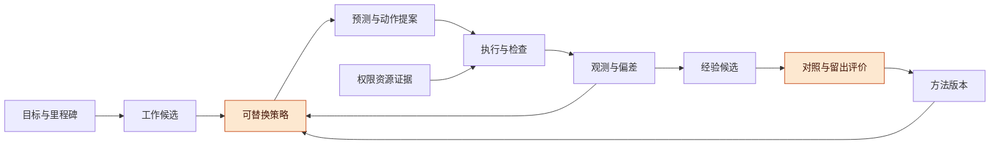
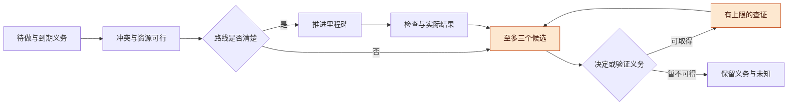

# 自主推进与工作方式改进讨论稿 v0.1.0

2026-11-07 · Codex（机制研究线）

## 版本与范围

统一 Harness 需要两种可替换策略：把当前工作向前推进，以及用有限实验改善以后怎样工作。状态、权限和效果证据决定动作是否可执行；策略负责提出值得尝试的下一步，效果由冻结的检查和后续使用结果评价。

- 版本：v0.1.0 为首次整理，核查六项原始研究与相关官方实现切片，并给出三个未运行实验；后续修改按补丁号递增。
- 主线：双循环 → 六种互补机制 → 下一工作选择与重规划 → 经验复用 → 人工负担 → 最小实验。
- 状态标记：文献数字为作者报告，源码为静态核查；本文控制策略与实验均为提案。协议状态为 PROPOSED_NOT_RUN，actual_execution 为 false。没有调用模型 API、运行第三方算法或实现产品。

本稿承接公开的[总体愿景 v0.3](../../../../harness/01-vision/harness-discussion-v0.3.md)和[早期编码主干设计](../../../../harness/03-runtime/history/AI编码Harness主干设计-源文件v0.1.2-公开整理版.md)，并按本轮 DESIGN_RECONCILIATION.md 收窄历史过强表述。输入 SHA、文献版本、阅读覆盖见 [sources.json](sources.json)。本稿不把旧稿的合成测量、分类试验或底座决定当成本轮验证。

## 总体架构：策略提出工作，证据推动改进

自主性首先表现为持续产生可完成、可解释、可检查的下一项工作；经验层再根据多个任务的结果改变策略。两层都可以留在同一进程，不要求新建一套微服务。

**图 1　当前任务与方法改进 · 两条闭环共用证据**

上路解决当前任务，下路改变方法；策略输出仍经过已有执行边界，不能直接把判断写成完成事实。

**三个职责**：工作候选表保存里程碑、已就绪任务、受阻任务、待查证问题和改进提案；策略选择有限下一步；Record 保存版本、预测、观察、决定与结果之间的引用。DAG 呈现依赖与影响范围，不替代选择策略。开放探索允许循环与重新拆分，不必先生成覆盖整个巨大项目的固定计划。

**最小策略接口（提案）**：输入是目标/任务版本、可见证据水位、当前能力、已有承诺、预算与待复核义务；输出是一份 WorkDecision，含候选、所选动作、简短依据、预期观察、停止条件、下次复核触发。不要求暴露模型隐藏思维过程。接口还需记录策略版本、模型快照、检索经验 IDs、历史结果可见范围，以及本次已花费的生成/诊断成本。

改策略不会改变任务目标、检查规范或权限。调整这些对象应走各自已约定的变更契约。若预算不够，可以停止新动作并保留到期复核义务；不能悄悄放弃用户已经采纳的方向。

## 六项原始机制：借部件，不照搬整套成绩

六项研究分别支持不同环节，没有一项证明自主 Harness 能在任意项目中持续变好。模型、任务、反馈和预算变化后，需要重做受限比较。

| 类别 | 代表与固定版本 | 核实到的模型、任务、预算与结果 | 可借鉴机制与主要缺口 |
| --- | --- | --- | --- |
| 选择下一工作 | [Voyager v2](https://arxiv.org/abs/2305.16291v2)，Wang 等，2023；§2–4、附录 A.1 | gpt-4-0314 / gpt-3.5-turbo-0301；Minecraft 高层 API；每任务最多 4 轮代码生成，探索 160 提示迭代、3 次试验；报告 63 种物品 | 用现有状态、已成/失败任务提出难度递进的目标；“新物品”是明确代理目标，不能替代用户价值；critic 也会误判 |
| 按需取证 | [ReAct v3](https://arxiv.org/abs/2210.03629v3)，Yao 等，2023；§3、表1–2 | PaLM-540B；HotpotQA/FEVER；结合策略在 7/5 步后切换；HotpotQA EM：ReAct 27.4、CoT 29.4、组合 35.1 | 让查询结果影响下一动作；取证不是无条件增益，空搜索、重复动作、推理受约束都是实际失败方式 |
| 预测触发重规划 | [AdaPlanner v1](https://arxiv.org/abs/2305.16653v1)，Sun 等，2023；§3、表2、附录8.1 | text-davinci-002 / gpt-3.5-turbo；ALFWorld 134 任务、50 动作失败上限、6 个示例；GPT-3 版本 91.79%，GPT-3.5 80.60%；图4比较至 5 次纠正 | 子目标末尾 assertion、计划内取信息、计划外 refine-then-resume；成功方案先做有/无示例对照再入库；保存局部变量不证明现实外部效果可重放 |
| 同任务失败修复 | [Reflexion v4](https://arxiv.org/abs/2303.11366v4)，Shinn 等，2023；§4.3、表3 | GPT-4；HumanEval Rust 难题50；基线60%，有反思无测试52%，有测试无反思60%，完整68%；官方完整组记录最多4条 reflection | 把反馈变成下一尝试的诊断提示；自生成测试也会错；多次内部试验后的最终 pass@1 不等于一次模型调用 |
| 跨任务经验复用 | [ExpeL v3](https://arxiv.org/abs/2308.10144v3)，Zhao 等，2024；§5.6、表3、附录D–E | gpt-3.5-turbo-0613 执行/反思，gpt-4-0613 提炼；最多3次重试，任务步数7/20/15；HotpotQA 28.0±1.4→39.0±1.7，加入 reflections 提炼后29.0±0.4 | 从成功失败轨迹提炼规则并检索成功例；作者 ± 为跨折标准误。文字规则和自省未必可靠；轨迹库、规则库都要做任务隔离 |
| 工作流候选比较 | [AFlow v4](https://arxiv.org/abs/2410.10762v4)，Zhang 等，2025；§4–5、表1、附录D | Claude-3.5-sonnet 优化，表1用 GPT-4o-mini 执行；六基准；20轮、候选验证5次、测试3次；最佳手工均分76.0→80.3，即+4.3百分点/约5.7%相对 | 记录父候选、单步修改、失败与收益，允许回到旧候选；测试推理成本不含搜索、迁移和人工；模型更换后最佳工作流也可能变化 |

**源码收窄**：Voyager 的 [learn 调度与成功后入库](https://github.com/MineDojo/Voyager/blob/55e45a880755d0c8c66ca7fb5fe7962ac8974f89/voyager/voyager.py#L315-L356)对应“当前状态→新任务→尝试→经验”。该历史实现有模拟器 hard reset，不能照搬为真实工程的崩溃恢复。AFlow 的 [优化入口](https://github.com/FoundationAgents/AFlow/blob/289d5544cfb5698799b207b931a392aadc9e9c1a/scripts/optimizer.py#L32-L46)默认关闭提前收敛停止，其[候选生成内循环](https://github.com/FoundationAgents/AFlow/blob/289d5544cfb5698799b207b931a392aadc9e9c1a/scripts/optimizer.py#L130-L181)遇不合格输出会继续；外层“20轮”不是总模型调用硬上限。

**核实后的修正**：自省、计划修订、经验和工作流搜索已有明确先例，不应把组合成闭环本身称为新颖性。我们需要验证的是：这些可替换策略接入统一证据/作用域/预算后，是否降低实际交付和人工成本。

**仍未核实**：六项机制在我们的宿主、现代模型和巨大项目上是否有效；没有复现论文总费用。没有用它们的模拟器、短任务或公开基准结果推断长期自主成功。

## 如何选择下一工作，以及何时重规划

首版适合采用有期限义务、有限候选和用途明确的查证，而不是让模型给每件事编一个不可校准的效用分数。查证可以影响当前或后续决定，也可以履行必要审计、覆盖与监测义务；不要求它立即改变下一动作。下面四种策略共享接口，可以按任务类型替换，并用对照实验决定是否值得保留。

| 策略 | 何时用 | 怎样选下一步 | 可观察的失败信号 |
| --- | --- | --- | --- |
| S0 里程碑推进 | 路线清楚、依赖已满足 | 先核对到期义务、冲突与资源可行性，按已授权优先级处理可行义务及里程碑 | 长期在辅助工作打转；完成数增加但端到端目标不前进 |
| S1 有明确用途的查证 | 关键未知影响决定，或存在验证/监测义务 | 至多提出3个行动候选，写明查询会影响哪项当前/后续决定、履行哪项义务和期限；都说不清则不默认追加 | 无用途重复取证；超过约定查证预算；用获取信息冒充完成验证义务 |
| S2 局部修复后重规划 | 子目标预期失败或关键假设被反驳 | 先定位反例，检查剩余计划是否仍成立；保留有支持的前缀，换受影响后缀 | 相同失败重复且无新信息；只补当前动作却无法到达目标 |
| S3 有限方法试验 | 重复痛点或新能力可能改善多个后续任务 | 比较保持、小改、替换；每次只改变一个可解释因素；验证后才安排采用时机 | 只改善开发集；总成本或人工负担上升；每次都推翻前一版 |

S0 并非自动认定“最早到期”永远最好：义务冲突或最低投入超出资源时，要显式报告不可行及可选调整，不能承诺全部先满足，也不能自行放弃已采纳方向。S1 的问题卡绑定当前/后续决定或验证义务、评价期限和必要的最小监测投入，不是假装知道查询的期望信息价值。S3 的探索预算应事先划定；不从正在健康运行的任务中抢停进程来制造试验机会。

**图 2　下一工作选择 · 先可行，再做有限比较**

图中的回路都消费已分配预算；必要监测可以确认未变，查证没有结果时也可保留未知和复核义务，不靠无限计划重写制造进展。

**可触发重规划的信号**：前置假设被反例击穿、接口/环境版本变化、检查暴露计划无法达到目标，或局部修复预算耗尽。**只触发复核的信号**：预测落在范围外、同类失败重复、审查时间偏离、候选方法带来新能力、约定复核到期。预测错但产物符合目标时，更新预测依据；不为了符合旧预测改坏正确产物。

**诊断输出**：最多保留几个可竞争原因，逐条写支持/反驳证据、能区分原因的下一检查、拟改变的对象。原因、修复位置、最早可发现位置分开；允许多因和未知。正常探索中的新发现不自动记成错误。检查器疑似漏验时，旧“通过”记录保留，但不再足以支持对应结论。

**巨型项目的工作节奏**：保留稳定里程碑和端到端可运行骨架，只把近期边界细化成可独立验收的任务。每次重规划输出受影响假设、保留前缀、替换后缀和新增检查。进度以验收的里程碑、解除的实际阻塞和可用产物计，不以计划字数、任务数或工具调用数计。

## 怎样复用经验而不过拟合

经验先作为有适用条件的候选数据，再由未参与提炼的任务验证；不能凭“成功过两次”或模型多次赞同自动升级为通用规则。适用范围扩张本身就是一个需要新证据的改变。

**图 3　经验从候选到采用 · 留出任务禁止回流**

一旦查看留出任务并据此修改规则，该任务只能进入下一版开发资料，不能继续充当同一轮的独立成绩。

| 经验字段 | 作用 |
| --- | --- |
| task_family / environment / versions / assumptions | 检索先过滤适用域，再按相似度；相似句子不等于相同前提 |
| supporting_runs / counterexamples / feedback_origin | 保留原始观察和反例，区分目标端状态、测试结果、人工判断及模型自评 |
| proposed_change / baseline / expected_gain | 一条经验指向具体工作方式变化，包含保持现状 |
| known_failure_modes / expires_or_review_on | 环境、模型、检查器、依赖变化后重审；不把知识库变成永久指令堆 |
| retrieval_ids / use_decision / outcome | 记录被检索、实际采用、效果三件事；出现于上下文不等于带来收益 |

先做项目或任务族内的复用；跨环境、跨任务族分别保留成绩。只储存成功方案会看不见失败边界，因此要同时检索相关反例。每次限制经验数量和字数，记录被排除条目的理由；检索预算与诊断预算都计入自动化成本。

ExpeL 的 [update_rules](https://github.com/LeapLabTHU/ExpeL/blob/e41ec9a24823e7b560c561ab191441b56d9bcefc/agent/expel.py#L696)通过模型提出 ADD/EDIT/AGREE/REMOVE 调整计数。此计数不是独立验证次数。它提示我们：规则的整理信号和规则有效性的证据应分开。

**采用边界**：预先授权的低影响范围内，可以在达到既定采纳规则后自动替换策略版本，并保留撤销和复核安排；改变目标、权限、检查规范或跨越原适用域时，进入对应变更流程。本文不规定每条经验都要人工审批，也不授予学习层改写所有规则的权力。

## 如何衡量人工负担与真实改进

主结果应是达到相同交付质量所需的人工投入，而不是让人少收到几条消息。自动化把检查、诊断或返工转移给人时，必须计入同一账本。

| 指标组 | 记录方式 | 防止误读 |
| --- | --- | --- |
| 交付质量 | 独立验收成功、严重逃逸、错报成功、正确结果被改坏 | 自生成测试通过不能替代冻结验收；失败和超时都留在分母 |
| 人工活动时间 | 理解需求、读产物、额外查证、纠正/解释、最终接受分别计时 | 排除纯等待，但同时报告墙钟时长；不可只测最后一次点击 |
| 中断与沟通 | 需要人作决定的次数、每次上下文重建时间、可避免重复问题 | 安静但停滞不是负担降低；必要授权不能伪装成无谓打扰 |
| 自动化成本 | 所有候选、重试、诊断、检索、验证的 token/调用/工具/等待 | 报告探索总成本和采用后的边际成本；不只计最终成功路径 |
| 经验迁移 | 任务族内、跨环境、反适用变体分别报告收益和退化 | 不把测试集任务混入规则库或轨迹库；新模型是新评价条件 |
| 预测质量 | 预注册区间的覆盖率及宽度、方向错误、成本低估 | 宽区间不可免费得分；主观概率未经校准不能直接支配调度 |

早期先记录原始分钟数、缺陷数和费用，不急于合成一个总分。需要权衡时，在同一领域给出质量/人工/机器成本的并列表；只有用户明确了取舍与期限，才讨论哪种候选更好。

人工评估尽量隐藏策略标签、打乱呈现顺序，避免一个人先看了某任务答案再评另一个条件。若必须由同一个人评相同任务，先完成首份独立评定再看配对，记录顺序与学习效应。小样本只做探索，不因“没有看到严重错误”宣称安全等价。

## 最小实验：分三步验证，不同时改所有环节

第一步只检验“有限取证与重规划”能否推进任务；第二步检验经验迁移；第三步才搜索工作流。具体协议见 [minimal-experiments.json](minimal-experiments.json)，全部未运行，任务包和评估者尚待构建与冻结。

**任务书**：

1. 固定模型快照、同一工具视图、检查规范、时间与总调用预算；建立只含公开或合成内容的任务包、可见观察、隐藏验收和来源清单。每个包先审“目标是否可以在给定能力内完成”。
2. 形成事前预测和决策卡，保留全部运行轨迹与候选成本；不得在获得隐藏验收后回写预测或修改本轮方法。
3. 独立评价质量和人工成本，分清任务失败、协议违规、环境不可用和证据不足；后两者单列，不悄悄剔除。
4. 完成本轮后才决定是否进入下一步；真实宿主长期任务另做验收，本实验不代替前三轮适配契约。

| 组/实验 | 做法 | 规模与目的（数字均为拟议上限） |
| --- | --- | --- |
| W01 下一工作与重规划 | B0 有限 ReAct 基线；B1 加预测检查点、至多3候选与区分性查证 | 12任务包×2组×2重复=48回合；覆盖直接推进、信息不足、假设失效、检查器缺口；识别何时额外计划只是开销 |
| W02 经验迁移 | B0 无经验；B1 只检索原始成功轨迹；B2 检索有范围的教训与反例 | 12留出任务×3组×2重复=72回合；另有训练/开发资料，费用单列；检查同域收益、跨域失效和错误套用 |
| W03 工作流候选消融 | 保持基线＋至多3个单因素候选；开发集选一次，再冻结进留出评价 | 开发6任务×4候选×2重复≤48；留出12任务×2组×2重复=48；共≤96回合；搜索成本单列 |

**停止判据**：候选越权修改检查器/留出数据、经验库检索到留出任务、硬预算不可执行、记录缺失或出现严重逃逸时，停止该评价条件并保留失败证据。普通质量失败不重置为一次“新试验”；策略到达调用/时间/重规划上限时交付已知结果与未知项。这里的停止是实验停止，不是放弃用户的研究方向。

**采纳判据**：先要求质量底线满足，再比较人工与总成本；样本不足时记为“不足以决定”。前三个实验是小样本机制筛查。它们可以否定明显无效候选，却不能证明巨大项目中的长期收益、罕见错误率或一般最优性。不得反复查看留出集后直到结果好看才宣布通过。

## 风险与开放问题

最大风险是把可读的反思误当因果解释，把更多候选误当更有价值的自主性。应保持基线可用、改动有限、负例可见，并把采纳后的真实负担纳入复核。

- **评价目标错位**：里程碑数、找到的信息数、生成规则数都容易被优化；它们只能解释结果，不能替代交付价值。
- **共同盲区**：独立进程执行模型生成的测试，仍可能验证同一个错误规格；需要外部需求依据与负对照。
- **经验污染**：同源转述、重复任务、近似模板和查看过的留出答案会夸大迁移；规则库和轨迹库都要审分割。
- **无界改进成本**：外层有限轮数不限制内部生成、格式修复或工具重试；所有子步骤须有同一上限。
- **计划震荡**：换一种说法不构成新证据；采用窗口、任务边界和复核条件减少反复切换。
- **效果与恢复**：模拟器重置或代码回滚不能撤销现实副作用；改进策略仍须遵守已有动作证据契约。

开放问题：

- [ ] 首个真实任务族的主要目标是交付时间、严重错误、人工负担，还是探索覆盖？
- [ ] 哪些检查可独立可信，哪些必须保留人工判断？其维护成本如何测量？
- [ ] 多少预测/检查点是合算的，能否用任务分层代替全局强制流程？
- [ ] 经验复用应何时自动采用、何时仅提示、何时过期？由哪个已授权策略决定？
- [ ] 小样本筛查后，哪个真实长期任务足以验证方法不会只适用于短题？

## 待证命题与下一步

下一步优先完成 W01 的任务包与量表，再决定是否值得建立经验和工作流搜索层；不因为架构完整就默认每个环节都应上线。

| 编号 | 命题/猜想 | 已有依据 | 缺口 |
| --- | --- | --- | --- |
| H-W1 | 区分性查证减少无效动作，足以覆盖它自己的生成成本 | ReAct 的取证机制及失败分析 | 我们的任务族、预算、模型尚未测试 |
| H-W2 | 预测触发的局部重规划优于持续补丁 | AdaPlanner 的 checkpoint/refine/resume | 真实效果、并发环境与巨大项目边界 |
| H-W3 | 带范围与反例的经验比原始成功检索更少误用 | ExpeL/AdaPlanner 的复用与消融启发 | 三组等预算留出比较，不能从论文直接推出 |
| H-W4 | 保持基线的单因素候选比较可降低工作方式切换成本 | AFlow 的候选谱系与负探索记录 | 维护、迁移和人工投入均未复现 |
| H-W5 | 模板化决策卡降低人工上下文重建时间而不增逃逸 | 公开旧稿的目标，本稿可测量化 | 需要盲评、持续抽查和足够观察量 |

下一步：

- [x] 固定原始来源并核查模型、任务、预算、结果和局限。
- [x] 写出可替换策略、触发条件、经验晋升和成本口径。
- [x] 提供未运行实验协议并做格式/引用检查。
- [ ] root 重新打开关键原文，核对来源与提案边界。
- [ ] 在另行安排的实验中构建并冻结 W01 任务包，先检验闭环是否值得。

