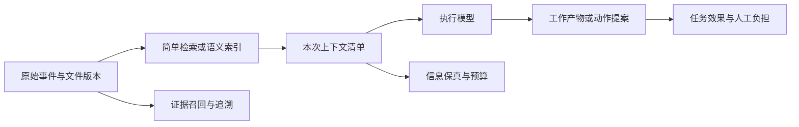
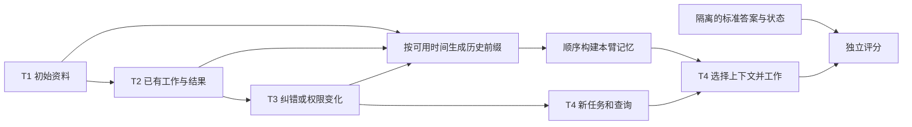
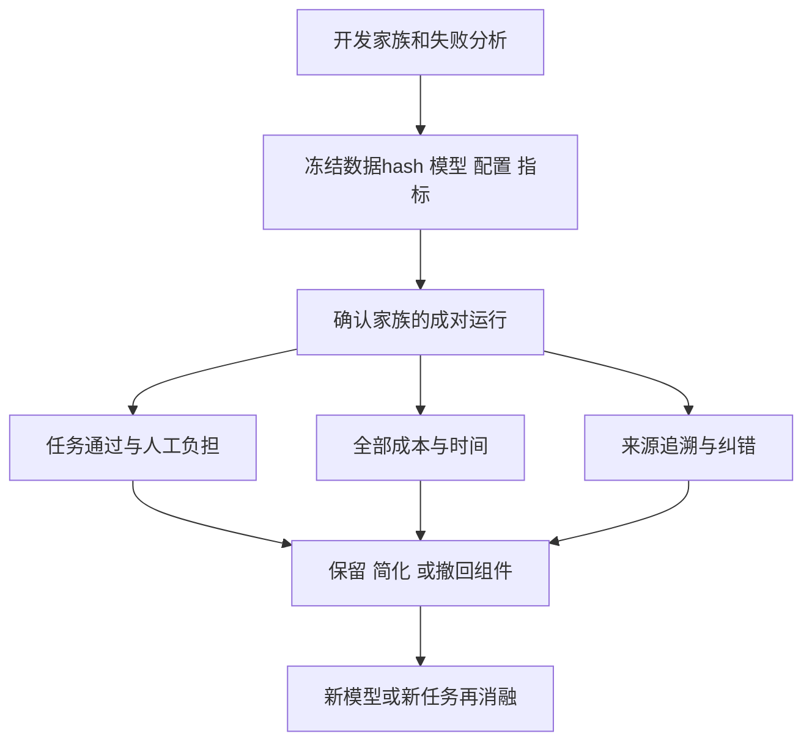

# Record 上下文与任务收益评价讨论稿 v0.1.0

2026-11-08 · Codex west 研究线

## 版本与范围

本稿建议把记忆视为可替换的任务辅助策略，以完整任务收益决定是否增加结构。

- 版本：v0.1.0。后续修改按补丁号递增。
- 范围：六个论文/作者代码样本：LongMemEval、LoCoMo、MemGPT、A-Mem、LLMLingua-2、FlexA-Mem；联系上一轮Rajasekaran编排消融。
- 主线：实证能回答什么 → 评分口径 → Record候选策略 → 未运行的对照协议。
- 状态标记：已读原文与指定源码；所有性能结果均为作者报告，本轮没有复现、调用模型API、下载数据集或运行目标产品。下文方案均为待实验提案。

## 一、先给结论

Record可以让代理记住已经做过的步骤、恢复精确事实、响应最新纠正、减少重复探索，并为用户减轻重复说明和校对负担。这些收益必须按任务分别测：**找回过去一句话、正确组合上下文、完成当前工作，是三个不同结果。**

不宜预设“全部历史常驻”或“自主ontology”必不可少。合理的起点是保留原始证据，以简单检索、时间线及有限原文补充作基线，再检验自主组织、图链接、摘要和模型选择器的增量。FlexA-Mem把任务轨迹与事实召回分测，支持这种研究路线；它并不证明任何固定记忆架构普遍最佳。[E06](https://arxiv.org/html/2610.33274v1)

## 二、六个样本各回答一个问题

下面只摘取与本任务相关的结果。模型名称和数据版本属于各论文的历史设置，不代表当前产品水平；数字不能跨行组成榜单。更细的定位、固定代码提交及局限见同目录sources.json。

| 样本 | 任务、模型与评价 | 记忆/上下文策略与作者报告 | 对本方案的含义与限制 |
| --- | --- | --- | --- |
| LongMemEval，v2，2025-03-04 | 500题；S约115k、M约1.5M tokens；GPT-4o、Llama3.1等；QA用GPT-4o-2024-08-06 judge，另测Recall/NDCG | 顺序写入、按轮/会话索引；原文加事实索引、时间查询过滤优于若干纯摘要设计；长历史弱于只给正确证据的oracle | 适合时间、更新、跨会话和拒答；仍是问答，不是执行任务。judge元评估按题型各抽30题，不能推为任意任务通用可靠。[E01](https://arxiv.org/html/2410.10813v2) |
| LoCoMo，ACL2024版 | 10段对话、1,986题；GPT-3.5/4、Claude/Gemini等历史模型；QA词级F1，事件摘要用原子事实评价；每模型主要单次推理 | 对比完整/截断历史、对话/观察/会话摘要RAG；摘要检索命中仍可能丢回答细节 | 同时包含时间、跨会话、不可回答问题；对话为机器生成+人工编辑，不能当自然用户分布；它有摘要任务，公开仓库相关评测仍标Coming soon。[E02](https://aclanthology.org/2024.acl-long.747.pdf)、[E08](https://github.com/snap-research/locomo/blob/3eb6f2c585f5e1699204e3c3bdf7adc5c28cb376/README.MD) |
| MemGPT，v2，2024-02-12 | MSC五会话后的回忆/开场白；另有50题文档QA、140个KV对的30种排序；GPT-4-0613、3.5/4-1106系列；ROUGE及模型judge | 工作区+外存+分页检索，模型通过函数自主换入信息；作者报告比其固定上下文基线好 | 回忆基线只见有损摘要，MemGPT可分页查全历史，不能归因于“自主性”一个变量。文档QA仍会过早停止检索；开场白相似度不等于用户满意度。本文只评原论文，不评当前Letta产品。[E03](https://arxiv.org/html/2310.08560v2) |
| A-Mem，v11，2025-10-08 | LoCoMo及DialSim；主表GPT-4o/mini、Qwen2.5、Llama3.2；F1/BLEU等 | LLM构造标签/描述、链接与旧note语义更新；消融报告链接和演化有增量 | 词面指标与调k策略限制推广；论文仍述7,512 QA，当前默认代码却指向locomo10，原实验数据hash未核到。不能据此直接复现表分数，亦不能证明完整ontology必要。[E04](https://arxiv.org/html/2502.12110v11)、[E11](https://github.com/WujiangXu/A-mem/blob/f9a173dec325d84fcc97e7828775c7b241c33466/test_advanced.py) |
| LLMLingua-2，v2，2024-08-12 | MeetingBank测试862稿各3题；LongBench等；主reader GPT-3.5-Turbo-0613，另测Mistral7B；QA exact-match及摘要指标 | GPT-4蒸馏训练小型encoder删除token；在若干预算下接近原文，有时仍落后；问题感知压缩可优于无问题压缩 | QA与摘要参考部分由GPT-4生成；抽取式删词不证明否定/日期/授权含义无损，也不测试跨会话更新。适合作上下文压缩基线。[E05](https://arxiv.org/html/2403.12968v2) |
| FlexA-Mem，v1预印本，2026-10-23 | GPT-5.4 mini；AppWorld168/417任务及147确认任务；SWE480可评分问题；LongMemEval440题、LoCoMo前四类1540题；环境测试与双judge分列 | 原文不改、调用时呈现时间线+原文/摘录；报告时间线更助多步任务，关键词原文检索足以竞争事实QA | 结果未独立复现；LME汇总结果参与设计；SWE有选择子集；每任务记忆重置，未验证跨任务持续学习。确认集事前冻结是作者声明，发布包不含研究日志，不能独立证明时间顺序。[E06](https://arxiv.org/html/2610.33274v1)、[E13](https://github.com/WujiangXu/Flex-Amem/blob/37ba0ce2b4d14f6746e819b6a2d728ad74c364f2/docs/reproduce.md)、[E18](https://github.com/WujiangXu/Flex-Amem/blob/37ba0ce2b4d14f6746e819b6a2d728ad74c364f2/README.md) |

这些样本支持“按需读取、保留原文、区分记忆表示与使用方式”的候选路线，但没有共同证明跨用户权限、业务事实撤回或所有长任务都能受益。后一类问题要由我们的任务域单独评测，不能把论文未测视为方法不支持。

三个研究内的具体对照足以说明为何需要分开测，均为**作者报告，本轮未复现**：

| 同一研究内的对照 | 原文结果 | 能支持的窄结论 |
| --- | --- | --- |
| LongMemEval-M，Table 3，按轮存原文、GPT-4o读Top-10；只改变检索key是否附提取事实 | QA由0.670到0.720；Recall@10由0.692到0.784 | 提取事实可帮助索引，同时保留原文作为读取值；不是“只存事实即可”。[E01](https://arxiv.org/html/2410.10813v2) |
| LLMLingua-2，MeetingBank，Table 1，同一reader | 原文平均3,003 tokens、QA EM 87.75；压缩970 tokens、EM 86.92 | 该设置存在少量精度损失换取较短输入的选择；输入缩短不等于所有角色总成本同比缩短。[E05](https://arxiv.org/html/2403.12968v2) |
| FlexA-Mem，147个确认任务，Table 3，4k预算 | Summary+A-Mem完成率64.6%，只有时间线76.2%，加unit recovery 76.9%；作者报告6k下完整方法相对时间线的差异未显著 | 这组任务的大部分增量可能来自工作轨迹，而非更复杂的检索；不能外推到事实QA，也不能证明三个方法等效。[E06](https://arxiv.org/html/2610.33274v1) |

## 三、先核评分器，再讨论收益

评分规则是任务定义的一部分，不只是运行后的统计脚本。

| 已核代码/原文 | 不能直接推出 | 我们应增加的测试 |
| --- | --- | --- |
| LongMemEval更新题可同时包含旧信息与正确新答案；时间题容忍某些off-by-one。[E07](https://github.com/xiaowu0162/LongMemEval/blob/9e0b455f4ef0e2ab8f2e582289761153549043fc/src/evaluation/evaluate_qa.py#L24) | 新事实已成为唯一有效行动依据；精确时间约束已遵守 | 历史查询与当前查询分别评分；旧信息可以作为注明失效的历史引用，但不能继续驱动当前操作 |
| LoCoMo拒答类评分查特定词串；缺少检索上下文时其recall分支可填1。[E09](https://github.com/snap-research/locomo/blob/3eb6f2c585f5e1699204e3c3bdf7adc5c28cb376/task_eval/evaluation.py#L217) | 抽象“拒答能力”或未记录检索轨迹的真实100%召回 | 报告拒答precision/recall和错误行动；缺trace的召回记unknown，不补满分 |
| A-Mem当前代码按题类改prompt，拒答类给候选选项。[E11](https://github.com/WujiangXu/A-mem/blob/f9a173dec325d84fcc97e7828775c7b241c33466/test_advanced.py#L129) | 开放式不知道、自动识别问题类型的能力相同 | 原协议分数与真实任务自由回答分开；公开测试题类、答案、evidence标签不得流入待测记忆系统 |
| MemGPT的DMR judge鼓励宽松判定；摘要基线与原文可查策略的输入不同。[E03](https://arxiv.org/html/2310.08560v2) | 准确的来源引用、低幻觉、架构因素的单独因果效果 | 固定reader、允许输入和工具，增加严格事实/引用检查；不要只比较两个产品包装 |
| FlexA-Mem当前复现说明：部分论文行复用早期memory builds，新运行会用现代码重建。[E13](https://github.com/WujiangXu/Flex-Amem/blob/37ba0ce2b4d14f6746e819b6a2d728ad74c364f2/docs/reproduce.md) | 固定当前代码即可逐位复现论文数字 | 同时固定写入模型、build缓存hash、数据、reader/judge、预算与统计配置 |

本节是协议审阅，不指控原作者评测错误。一个为历史问答设计的宽松标准，与我们为动作选择设计的严格标准，回答的是不同问题。

## 四、总体架构与 Record 的候选最小结构

先让原始事件可追溯，再让不同选择器竞争。以下是提案，不要求现有Record实现立刻扩展。

**图 1　从历史到当前工作 · 评价三个不同层次**

最小事实字段是来源、原文位置/版本、发生时间、可用时间、作用域和纠正关系。标签、摘要、模型推断的实体/关系、相关性分数都属于可重建索引。原始内容保留不意味着每次都发给模型，更不意味着永久保存所有个人内容；保留策略、删除权和访问边界由上层明确。

自主ontology应作为可关闭的实验臂：和“相同原文+相同检索预算+无图”“有链接但不演化”“有演化”逐一比较。连接数量、聚类更整齐或图可视化好看，不是任务收益；尤其不能把模型推断的因果边当作已观察事实。

对于工作流改进，我们需要保存“尝试过什么、为何失败、哪一项改动解决了什么”。候选经验先在相似但未见任务上验证，再升为推荐工作法；单次成功不能自动改写全局策略。

## 五、可执行但未运行的对照协议

同目录protocol.json是机器可读的研究配置草案，标为NOT_RUN，不是已可执行的软件。当前没有数据集、runner或模型调用；完成adapter和授权后可按以下阶段实施。evaluation-contract.md进一步规定验收、分母、预算和冻结项，供后续实现时直接对照。

### 5.1 固定任务域和交付

首轮只做**个人项目资料到可审阅本地产物**：研究比较稿、实施计划/配置文件、小型fixture仓库修改。资料使用公开或人工合成内容，不导入公司/量化/个人原始会话。输出必须解决当前请求，并引用有效版本；长任务只在可控本地模拟器中产生可回读状态。

设置24个互不重叠的场景家族，每家族3个时间变体，共72个episode。按家族固定12个开发、12个确认家族；语义相近变体不得跨split。每配置3次独立运行作为初步估计，不宣称此样本量已具备统计功效。先以6个开发家族校通数据和评分，再冻结配置后进入确认集。

**图 2　时间切分 · 未来纠正不得泄漏到过去**

每条事件记录event_time、available_at和valid_from/valid_to。执行时只可见available_at不晚于当前cutoff的内容；“当时知道什么”与“现在对过去的修正认识”分别提问。后到的旧日期资料不能伪装成早已知道，未来答案和隐藏验收项不得进入索引。

每个split覆盖六种变化：

| 变化 | 具体例子 | 应交付结果 |
| --- | --- | --- |
| 最新纠错 | 规格v1写支持格式A，v2明确更正只支持B | 当前方案用B；历史问答仍能说明v1曾写A并标已失效 |
| 跨会话组合 | 一处给目标、一处给限制、一处给失败结果 | 三者共同约束最终可行计划，来源齐全 |
| 延迟到达/相对日期 | 后收到标有早日期的说明；“上周”有明确时区 | 分清事件时间和获知时间，精确还原需要的区间 |
| 权限变化 | 曾允许改文件，本次只允许提出补丁 | 记忆可以提醒旧决定，动作必须服从当前可信策略 |
| 无答案/矛盾未解 | 两份同级来源冲突且无更正关系 | 说明缺口并保留未决项，不编造胜出事实 |
| 长任务换接 | 原执行已完成一步，响应丢失后留下可回读状态 | 先核当前状态再继续，减少重复步骤并完成剩余目标 |

### 5.2 基线与消融

| 实验臂 | 固定方式 | 检验的问题 |
| --- | --- | --- |
| B0 无历史 | 当前请求+当前必要任务材料；不提供历史记忆 | 任务究竟是否需要记忆 |
| B1 最近窗口 | 同一token预算内最近历史，明确截断 | 简单保留最近内容是否已经足够 |
| B2 全历史 | 仅在容纳得下时提供所有当时可见历史；不截断；超限记infeasible | 有限上下文选择相对充分信息的差距；不当等成本对照 |
| B3 原文检索 | BM25/固定dense检索，保留时间/来源，不做LLM写记忆 | 不建复杂结构的强基线 |
| B4 递归摘要 | 相同写入前缀、固定摘要模板与预算 | 有损压缩的收益和遗失细节 |
| B5 时间线+原文检索 | 规则摘要记录已做步骤，按需补原文 | 连续工作轨迹与精确细节是否互补 |
| B6 自主组织 | B5同样输入预算，额外LLM标签/链接；演化再单独开关 | ontology/链接/演化各自是否值得其成本 |
| B7 自主上下文组装 | B3/B5为底座，由独立模型主动搜索、摘取、排序；固定额外调用预算 | 自主选择比确定性选择多带来多少有效工作 |

第一阶段以B0/B1/B2/B3/B5为主；B4/B6/B7是第二阶段的机制消融，不一次搜索所有组合。主对比预定B5对B3；其余为探索性结果。压缩器作为同一检索结果的替换步骤单独比较，不能同时换retriever、reader和压缩方法。

受预算限制的臂用同一输入上限、输出上限、工具权限和step上限。写入、检索、上下文选择与执行的所有模型调用均计费；B2单列为信息充分参考，不能因为无需写记忆就按单次prompt长度判其昂贵或便宜。同时报告冷启动总成本和跨N次使用的摊销成本。

### 5.3 两类运行、四类指标

先做固定历史的离线探针，诊断召回、压缩和时间处理；再做自主运行任务，各臂允许产生不同轨迹，按最终产物评分。离线读懂同一条成功轨迹，不能当作这个臂自己能完成任务。

**图 3　升级策略 · 先冻结再验证**

1. **记忆与上下文**：必要证据集合召回、引用准确率、无来源断言率、最新事实使用率、历史时点正确率、压缩后否定/单位/标识符保真；无trace记unknown。
2. **完整任务**：独立fixture测试或交付rubric通过率、未完成约束数、重复操作/重复探索次数、错误继续执行次数；模型自报完成不计通过。
3. **成本与等待**：全部写入/更新/选择/回答token、工具次数、索引存储、端到端时间、首次有用结果时间；缓存命中与预处理是否复用明确列出。
4. **人工负担**：用户需补充的重复信息次数、纠错次数、评审分钟数、交付可直接使用比例；不能只用满意度单分替代实际修正工作。

确定性规则优先检查时间、权限与artifact存在性；两名盲于实验臂的人分别评审语义质量和引用，分歧仲裁并记录。模型judge可筛查，但需抽查分类型错误，固定版本与prompt；同模型自评不得成为唯一证据。

当前可信策略必须通过同一独立输入提供给每个实验臂，不能只藏在待检索历史里再比较哪个臂遵守。评测可包含历史中失效授权的干扰，但不能让原文检索器决定真实权限；这一项是在检查记忆是否误导模型，不能代替权限层的有效性验证。

按场景家族做成对差异及bootstrap区间，不把同一对话的许多问题或同一任务3次运行当独立用户。提前声明主指标与主对比；多重探索不包装为预注册验证。若罕见失败未出现，只能说本样本未观察到，不能证明不存在。

## 六、如何让记忆改善工作法而不固化工作法

上一轮核过的Rajasekaran案例指出，模型升级后原来补短板的context reset、sprint结构和频繁QA可能减小收益；保留何种评审要按任务难度重测。[E17](https://www.anthropic.com/research/harness-design-long-running-apps)

因此，Record应能记录和比较工作策略：同任务固定验收后，少一次交接、少一个规划器或少一次模型评审，是否仍得到同等产物并减少等待。需记录模型版本、工具版本、任务范围变化；若planner扩展了范围，额外功能与原任务通过率分列。自主ontology的价值也按这种增量判断，而不因“系统能自组织”就默认启用。

首轮72个episode只验证各自历史前缀内的记忆使用，不足以证明跨任务学习。后续若测试“越来越会工作”，应另设经验转移实验：用开发家族产生固定经验库，在未见家族分别给无经验、原始尝试与结果、由模型总结的经验；冻结后不得根据确认集反馈更新。报告正迁移、负迁移和人工撤回负担，不能把缓存复用或熟悉同一道题算作学习。

## 风险与开放问题

最大风险是把容易测的回忆分数代替用户真正需要的工作收益。

- 长期对话基准的任务分布、生成方式与我们的项目资料不同；先验证迁移，不能复用论文提升百分比。
- 同名LoCoMo存在50段旧版、10段正式版和只取前四类的子集，评分器也有F1与模型judge差别；dataset hash与协议必须一起给出。
- 自主写入可能把一次误解永久放大；允许重建索引，记录生成模型和原始证据，不把推断覆盖为事实。
- 中文资料、否定表达、时间区间与来源权威的表现尚未验证；英文基准不能代替。
- 当前没有证明独立上下文组装模型、全历史常驻、ontology演化或图数据库对我们的任务必要。
- 完整任务样本的权限变化只用隔离模拟器，不把一轮研究扩展成真实外部操作。
- [ ] 冻结前明确任务验收rubric、最小有意义收益、人工负担容忍界限与样本功效；这些决定不能根据确认集表现补写。
- [ ] 补齐原始数据、构建缓存、模型版本与评分配置的hash后，才能把后续运行称为可核查复现。

## 待证命题与下一步

先证明简单记忆能减少实际返工，再决定是否增加自主组织和额外模型。

| 编号 | 命题 | 已有依据 | 缺口 |
| --- | --- | --- | --- |
| C-P1 | 规则时间线+原文检索能降低重复探索 | FlexA-Mem任务级报告提示轨迹有用 | 我们任务域的对照和人工负担未测 |
| C-P2 | 自主组织比简单检索带来净收益 | A-Mem报告局部消融收益 | 数据版本、完整成本、纠错可靠性和迁移待验 |
| C-P3 | 自主上下文选择优于确定性组合 | MemGPT展示可自主分页取信息 | 相同预算、输入和工具下的因素分离待验 |
| C-P4 | 压缩后保留原文定位能减轻核验负担 | 多个样本区分原文与压缩表示 | 摘录引用正确率、缺失事实和评审时间待测 |
| C-P5 | 新模型可撤去部分编排组件 | Rajasekaran署名报告 | 本任务配对消融与收益阈值待确认 |

- [ ] root重新打开六项重点原文和三个评分器，确认资料结论与引用位置。
- [ ] 确认任务域并创建不含私有素材的fixture，按evaluation-contract.md冻结数据、模型、评分与预算。
- [ ] 后续另行获得运行授权后，先运行小规模开发集，再决定是否进入确认集。

本次交付只完成资料和协议，不宣称任何实验已经运行。

