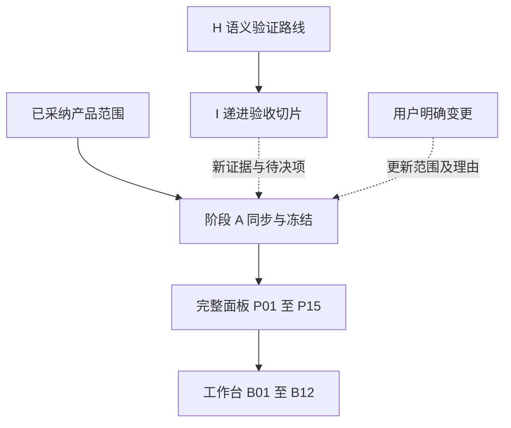
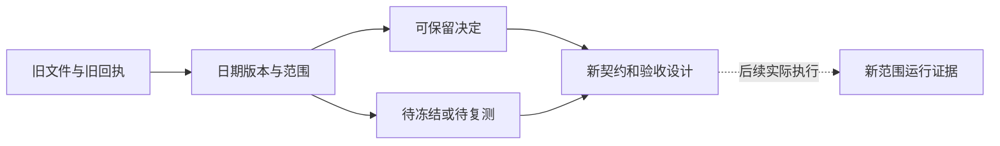

# 旧设计决定与统一 Harness 衔接讨论稿 v0.1.0

2026-11-08 · Codex（west 研究线）

## 版本与范围

原路线仍是先完整交付通用面板 P01–P15，再继续工作台 B01–B12；新 H/I 切片用于核实工程语义，未替代这一产品决定。旧主稿中尚未进入契约的修订仍须先冻结。

- 版本：v0.1.0，首次集中整理十条决定沿革、任务卡真实入口与八问决策导览；后续修改按补丁号递增。
- 主线：既有决定 → 当前契约差异 → 新研究承接 → 实施前冻结。
- 状态标记：保留决定指旧公开文明确采纳的范围；需重决/冻结指尚未完成的合同或新的实质取舍；历史事实不继承指本轮未复测的测试、性能、进度和估算。所有建议均是文档审查，不是产品开工或路线授权。

## 路线与材料优先级

产品计划、研究验证和交付证据应并列管理，不能用更新的编号静默替换旧范围。

**图 1　两条路线 · 研究结果进入冻结，不替换产品承诺**

上路保留产品先后，下路验证语义；某个 I 切片先行只有在范围与入口另行确定后才成立。

| 材料 | 负责什么 | 不能冒充什么 |
| --- | --- | --- |
| 旧 overall v0.1.2 / 后端第四版 | 已有产品范围、理由、待同步提案 | 已冻结代码合同或本轮运行结果 |
| CONTRACT / 当前任务卡 / 冻结单 | 采用版本的数据、允许文件、依赖和 verify | 主稿提案自动生效 |
| H01–H08 / I01–I07 | 统一语义与递进验收设计 | 新获准产品排期或所有切片已开工 |
| 运行回执及真实环境验收 | 对指定版本/环境实际观察到的结果 | 所有版本、所有部署及以后持续有效 |

既有协作文档要求维护者最新明确决定优先；涉及接口的决定要先同步契约与卡片。没有新裁定时采用冻结材料，冲突只阻断受影响部分。[PN-S L77–108](<https://github.com/TaiShuo150622/dsh-project-workbench/blob/b9d44847d72883bf5116c72f445c31618d7cc020/docs/harness/05-panels/docs/handoff/panels/COLLABORATION.md>)

## 十条决定沿革映射

十条映射保留原决定，也明确区分旧稿已登记的缺口与本轮新增的修订建议。

**DC01 · 保留决定**：完整面板平台 P01–P15 先行，之后 B01–B12 工作台扩展；H01–H08 与 I01–I07 是研究/验收切片。

旧依据：[WB-P L6–8](<https://github.com/TaiShuo150622/dsh-project-workbench/blob/7264be10387963f4d575d8688ed8573f4c16c8c4/docs/handoff/ui-backend/BACKEND-PLAN-DRAFT.md>)、[WB-P L197–205](<https://github.com/TaiShuo150622/dsh-project-workbench/blob/7264be10387963f4d575d8688ed8573f4c16c8c4/docs/handoff/ui-backend/BACKEND-PLAN-DRAFT.md>)、[PN-O L69–82](<https://github.com/TaiShuo150622/dsh-project-workbench/blob/b9d44847d72883bf5116c72f445c31618d7cc020/docs/harness/05-panels/docs/design/overall-discussion.md>)。后续承接：[N-R L20](<../../DESIGN_RECONCILIATION.md>)、[N-I L94–107](<../implementation-taskbook/可信入口与Coding交付实施任务书讨论稿-v0.1.1.md>)、[N-I L127–137](<../implementation-taskbook/可信入口与Coding交付实施任务书讨论稿-v0.1.1.md>)、[N-M L356–358](<../../统一Harness工程与形式化基础讨论稿-v0.1.4.md>)。

冲突或误读：新稿的“首切片”容易被读成新的产品第一项；现行衔接稿只说历史关系，未完整复述 P/B 范围。

处理建议：总入口并列显示产品交付顺序和研究验证顺序。D02 如选择先做独立状态视图，必须单独记录其例外范围、产物和不替代的 P/B 工作；本轮不替用户批准。

**DC02 · 保留决定＋需重决/冻结**：先完成阶段 A；设计、契约、任务卡、允许文件和验证入口成组同步，再按单写者推进。

旧依据：[PN-S L77–108](<https://github.com/TaiShuo150622/dsh-project-workbench/blob/b9d44847d72883bf5116c72f445c31618d7cc020/docs/harness/05-panels/docs/handoff/panels/COLLABORATION.md>)、[PN-S L161–166](<https://github.com/TaiShuo150622/dsh-project-workbench/blob/b9d44847d72883bf5116c72f445c31618d7cc020/docs/harness/05-panels/docs/handoff/panels/COLLABORATION.md>)、[PN-O L700–725](<https://github.com/TaiShuo150622/dsh-project-workbench/blob/b9d44847d72883bf5116c72f445c31618d7cc020/docs/harness/05-panels/docs/design/overall-discussion.md>)、[PN-B L48–54](<https://github.com/TaiShuo150622/dsh-project-workbench/blob/b9d44847d72883bf5116c72f445c31618d7cc020/docs/harness/05-panels/docs/handoff/panels/BOARD.md>)、[P-09 L41–44](<https://github.com/TaiShuo150622/dsh-project-workbench/blob/b9d44847d72883bf5116c72f445c31618d7cc020/docs/harness/05-panels/docs/handoff/panels/tasks/P-09-sandbox.md>)、[P-11 L1](<https://github.com/TaiShuo150622/dsh-project-workbench/blob/b9d44847d72883bf5116c72f445c31618d7cc020/docs/harness/05-panels/docs/handoff/panels/tasks/P-11-model.md>)、[P-13 L1](<https://github.com/TaiShuo150622/dsh-project-workbench/blob/b9d44847d72883bf5116c72f445c31618d7cc020/docs/harness/05-panels/docs/handoff/panels/tasks/P-13-types.md>)。后续承接：[N-I L79–86](<../implementation-taskbook/可信入口与Coding交付实施任务书讨论稿-v0.1.1.md>)、[N-I L133–137](<../implementation-taskbook/可信入口与Coding交付实施任务书讨论稿-v0.1.1.md>)。

冲突或误读：6369a62 是交接输入，不是正式冻结提交；P11/P13 尚未显式依赖 P10，M2 原在 P09 后；主稿已提出修正但未改执行卡。

处理建议：冻结单登记采用完整提交和待决阻断范围，先同步批准链、公共 Canvas、选择依赖和 M2，再开受影响卡。研究材料存在不替代阶段 A，既有独立工作不必全部推倒。

**DC03 · 保留决定**：dsh-panels 持有只读展示和交互状态；工作台持有项目、线程、目标、工作树与实时发布生命周期；会话正文与执行归宿主。

旧依据：[PN-O L71–78](<https://github.com/TaiShuo150622/dsh-project-workbench/blob/b9d44847d72883bf5116c72f445c31618d7cc020/docs/harness/05-panels/docs/design/overall-discussion.md>)、[PN-O L271–320](<https://github.com/TaiShuo150622/dsh-project-workbench/blob/b9d44847d72883bf5116c72f445c31618d7cc020/docs/harness/05-panels/docs/design/overall-discussion.md>)、[WB-P L32–56](<https://github.com/TaiShuo150622/dsh-project-workbench/blob/7264be10387963f4d575d8688ed8573f4c16c8c4/docs/handoff/ui-backend/BACKEND-PLAN-DRAFT.md>)、[WB-P L201–205](<https://github.com/TaiShuo150622/dsh-project-workbench/blob/7264be10387963f4d575d8688ed8573f4c16c8c4/docs/handoff/ui-backend/BACKEND-PLAN-DRAFT.md>)、[WB-C L133–147](<https://github.com/TaiShuo150622/dsh-project-workbench/blob/7264be10387963f4d575d8688ed8573f4c16c8c4/docs/handoff/ui-backend/CONTRACT.md>)。后续承接：[N-M L192](<../../统一Harness工程与形式化基础讨论稿-v0.1.4.md>)、[N-I L39–51](<../implementation-taskbook/可信入口与Coding交付实施任务书讨论稿-v0.1.1.md>)、[N-I L100–104](<../implementation-taskbook/可信入口与Coding交付实施任务书讨论稿-v0.1.1.md>)。

冲突或误读：统一 Record 或公共面板容易被误当成替换全部业务存储/原生会话的总平台；有 timeline 也不等于 B08 运行条已接线。

处理建议：保留独立插件与同一业务权威，向面板交付版本化视图。实时正文与索引分开；B09 的幂等、更新/结束和审计边界沿 WB-P 115/123 行补冻结；独立服务只在新部署需求证明必要时讨论。

**DC04 · 保留原则＋需重决映射**：状态由后端同一事实来源计算；运行阶段、当前证据支持、产物可用与用户验收分别呈现。

旧依据：[WB-C L18–35](<https://github.com/TaiShuo150622/dsh-project-workbench/blob/7264be10387963f4d575d8688ed8573f4c16c8c4/docs/handoff/ui-backend/CONTRACT.md>)、[B-02 L26–43](<https://github.com/TaiShuo150622/dsh-project-workbench/blob/7264be10387963f4d575d8688ed8573f4c16c8c4/docs/handoff/ui-backend/tasks/B-02-display-status.md>)、[WB-C L120–131](<https://github.com/TaiShuo150622/dsh-project-workbench/blob/7264be10387963f4d575d8688ed8573f4c16c8c4/docs/handoff/ui-backend/CONTRACT.md>)、[B-08 L26–29](<https://github.com/TaiShuo150622/dsh-project-workbench/blob/7264be10387963f4d575d8688ed8573f4c16c8c4/docs/handoff/ui-backend/tasks/B-08-timeline.md>)、[WB-P L110–118](<https://github.com/TaiShuo150622/dsh-project-workbench/blob/7264be10387963f4d575d8688ed8573f4c16c8c4/docs/handoff/ui-backend/BACKEND-PLAN-DRAFT.md>)。后续承接：[N-I L79–92](<../implementation-taskbook/可信入口与Coding交付实施任务书讨论稿-v0.1.1.md>)、[N-A L144–157](<../../ARCHITECTURE.md>)。

冲突或误读：旧 display.done 来自 phase.completed；旧 timeline 规定 end=null 前端画进行中，而 B08 对崩溃缺结束事件写 interrupted。二者不能直接提升为 Record 完成/活性事实。

处理建议：先冻结状态映射、等待配对和存活观察；未核实则明确未知/待恢复。保留业务 display 名称和来源，新增 Record 状态区可并列，不能借统一绿灯消除区别。

**DC05 · 保留决定＋需冻结边界**：项目目标独立于 DSH 单会话 /goal；线程报证据，项目目标完成由用户确认。

旧依据：[WB-C L80–90](<https://github.com/TaiShuo150622/dsh-project-workbench/blob/7264be10387963f4d575d8688ed8573f4c16c8c4/docs/handoff/ui-backend/CONTRACT.md>)、[B-05 L25–42](<https://github.com/TaiShuo150622/dsh-project-workbench/blob/7264be10387963f4d575d8688ed8573f4c16c8c4/docs/handoff/ui-backend/tasks/B-05-project-goal.md>)、[WB-P L114](<https://github.com/TaiShuo150622/dsh-project-workbench/blob/7264be10387963f4d575d8688ed8573f4c16c8c4/docs/handoff/ui-backend/BACKEND-PLAN-DRAFT.md>)。后续承接：[N-I L35](<../implementation-taskbook/可信入口与Coding交付实施任务书讨论稿-v0.1.1.md>)、[N-I L81–86](<../implementation-taskbook/可信入口与Coding交付实施任务书讨论稿-v0.1.1.md>)、[N-M L164](<../../统一Harness工程与形式化基础讨论稿-v0.1.4.md>)。

冲突或误读：旧 B05 允许总对话改文字和标准，但未完整防止用 criteria.done、删除标准或整体替换绕过完成权；S1 普通 merge 不覆盖一般 Coding 目标。

处理建议：把目标及标准修订、证据提交、完成确认拆成有版本命令，来源由可信入口派生。新 Record 验收不能自动把普通 Coding 目标改成 PR merge，也不授予模型用户完成权。

**DC06 · 保留决定**：地图边携带类型与证据，推断边不驱动动作；终端框图只做简单图画法，整屏运行条留给后续工作台。

旧依据：[WB-C L92–110](<https://github.com/TaiShuo150622/dsh-project-workbench/blob/7264be10387963f4d575d8688ed8573f4c16c8c4/docs/handoff/ui-backend/CONTRACT.md>)、[B-06 L27–45](<https://github.com/TaiShuo150622/dsh-project-workbench/blob/7264be10387963f4d575d8688ed8573f4c16c8c4/docs/handoff/ui-backend/tasks/B-06-session-map.md>)、[WB-P L56](<https://github.com/TaiShuo150622/dsh-project-workbench/blob/7264be10387963f4d575d8688ed8573f4c16c8c4/docs/handoff/ui-backend/BACKEND-PLAN-DRAFT.md>)、[PN-O L556–585](<https://github.com/TaiShuo150622/dsh-project-workbench/blob/b9d44847d72883bf5116c72f445c31618d7cc020/docs/harness/05-panels/docs/design/overall-discussion.md>)、[P-12 L34–57](<https://github.com/TaiShuo150622/dsh-project-workbench/blob/b9d44847d72883bf5116c72f445c31618d7cc020/docs/harness/05-panels/docs/handoff/panels/tasks/P-12-tui.md>)。后续承接：[N-R L13–18](<../../DESIGN_RECONCILIATION.md>)、[N-R L43–55](<../../DESIGN_RECONCILIATION.md>)、[N-I L100](<../implementation-taskbook/可信入口与Coding交付实施任务书讨论稿-v0.1.1.md>)、[N-M L190–192](<../../统一Harness工程与形式化基础讨论稿-v0.1.4.md>)。

冲突或误读：“统一 DAG”可能误将关系图、支持图和工作流视为同一种可执行图；新增全屏或放开 workflow/subagent 不在旧平台范围。

处理建议：保留 fact/inferred 和稳定实体；布局不决定依赖真值。新有限无环支持只约束验收公式，不禁止工作流循环；P12 框图与 B08 真实运行数据分别验收。

**DC07 · 保留决定＋待冻结协议**：UI 选择→检查→引用已有明确路径，面板不写回用户数据、不覆盖草稿；对象身份与资料版本必须稳定。

旧依据：[PN-C L260–282](<https://github.com/TaiShuo150622/dsh-project-workbench/blob/b9d44847d72883bf5116c72f445c31618d7cc020/docs/harness/05-panels/docs/handoff/panels/CONTRACT.md>)、[P-11 L34–58](<https://github.com/TaiShuo150622/dsh-project-workbench/blob/b9d44847d72883bf5116c72f445c31618d7cc020/docs/harness/05-panels/docs/handoff/panels/tasks/P-11-model.md>)、[PN-O L299–318](<https://github.com/TaiShuo150622/dsh-project-workbench/blob/b9d44847d72883bf5116c72f445c31618d7cc020/docs/harness/05-panels/docs/design/overall-discussion.md>)、[PN-O L387–400](<https://github.com/TaiShuo150622/dsh-project-workbench/blob/b9d44847d72883bf5116c72f445c31618d7cc020/docs/harness/05-panels/docs/design/overall-discussion.md>)。后续承接：[N-I L17](<../implementation-taskbook/可信入口与Coding交付实施任务书讨论稿-v0.1.1.md>)、[N-I L75–92](<../implementation-taskbook/可信入口与Coding交付实施任务书讨论稿-v0.1.1.md>)、[N-I L100](<../implementation-taskbook/可信入口与Coding交付实施任务书讨论稿-v0.1.1.md>)。

冲突或误读：旧引用文本只有标题/id/路径，不足以绑定跨版本对象；行号仅在同快照稳定，mtime-size 不证明业务快照；当前 UI 选择也不能重绑旧命令历史。

处理建议：在 I02 和 P02/P03/P11/P13 共同冻结引用身份与快照/失效规则。UI 选中、引用不等于执行授权；来源不可保证快照时显示支持边界，不静默宣称一致。

**DC08 · 需重决/冻结，不能默改默认**：custom 的人工批准与模型工具分开；路径持续信任是旧默认，内容哈希模式是更严格候选。

旧依据：[PN-C L209–227](<https://github.com/TaiShuo150622/dsh-project-workbench/blob/b9d44847d72883bf5116c72f445c31618d7cc020/docs/harness/05-panels/docs/handoff/panels/CONTRACT.md>)、[P-10 L32–49](<https://github.com/TaiShuo150622/dsh-project-workbench/blob/b9d44847d72883bf5116c72f445c31618d7cc020/docs/harness/05-panels/docs/handoff/panels/tasks/P-10-trust.md>)、[PN-O L318](<https://github.com/TaiShuo150622/dsh-project-workbench/blob/b9d44847d72883bf5116c72f445c31618d7cc020/docs/harness/05-panels/docs/design/overall-discussion.md>)、[PN-O L339–352](<https://github.com/TaiShuo150622/dsh-project-workbench/blob/b9d44847d72883bf5116c72f445c31618d7cc020/docs/harness/05-panels/docs/design/overall-discussion.md>)、[PN-O L811–824](<https://github.com/TaiShuo150622/dsh-project-workbench/blob/b9d44847d72883bf5116c72f445c31618d7cc020/docs/harness/05-panels/docs/design/overall-discussion.md>)。后续承接：[N-I L81–92](<../implementation-taskbook/可信入口与Coding交付实施任务书讨论稿-v0.1.1.md>)、[N-I L133](<../implementation-taskbook/可信入口与Coding交付实施任务书讨论稿-v0.1.1.md>)、[N-M L164](<../../统一Harness工程与形式化基础讨论稿-v0.1.4.md>)。

冲突或误读：新操作参数/版本绑定不能被读成“每次渲染器内容变化都必须重批”；旧路径信任也不能变成忽略 profile、读取范围扩大或撤销的永久全局授权。

处理建议：先命名清楚批准对象：路径信任、固定内容还是某次具体动作。按选定模式绑定主体/profile/范围；read/network 扩大和撤销语义先冻结。历史批准与每次动作准入分别判断，本轮不选模式。

**DC09 · 保留研究方向，具体底座需重决**：任务、会话、进程、工作树与环境分开；读、搜、改、测绑定同一完整工作区版本，长任务与其恢复义务保留。

旧依据：[RT L17–31](<https://github.com/TaiShuo150622/dsh-project-workbench/blob/b9d44847d72883bf5116c72f445c31618d7cc020/docs/harness/03-runtime/Harness%20%E5%BA%95%E5%BA%A7%E6%9E%B6%E6%9E%84%E9%87%8D%E8%AF%84%E8%AE%A8%E8%AE%BA%E7%A8%BF%20v0.1.6.md>)、[RT L65–95](<https://github.com/TaiShuo150622/dsh-project-workbench/blob/b9d44847d72883bf5116c72f445c31618d7cc020/docs/harness/03-runtime/Harness%20%E5%BA%95%E5%BA%A7%E6%9E%B6%E6%9E%84%E9%87%8D%E8%AF%84%E8%AE%A8%E8%AE%BA%E7%A8%BF%20v0.1.6.md>)、[RT L718–734](<https://github.com/TaiShuo150622/dsh-project-workbench/blob/b9d44847d72883bf5116c72f445c31618d7cc020/docs/harness/03-runtime/Harness%20%E5%BA%95%E5%BA%A7%E6%9E%B6%E6%9E%84%E9%87%8D%E8%AF%84%E8%AE%A8%E8%AE%BA%E7%A8%BF%20v0.1.6.md>)、[RT L758–812](<https://github.com/TaiShuo150622/dsh-project-workbench/blob/b9d44847d72883bf5116c72f445c31618d7cc020/docs/harness/03-runtime/Harness%20%E5%BA%95%E5%BA%A7%E6%9E%B6%E6%9E%84%E9%87%8D%E8%AF%84%E8%AE%A8%E8%AE%BA%E7%A8%BF%20v0.1.6.md>)、[RT L831–855](<https://github.com/TaiShuo150622/dsh-project-workbench/blob/b9d44847d72883bf5116c72f445c31618d7cc020/docs/harness/03-runtime/Harness%20%E5%BA%95%E5%BA%A7%E6%9E%B6%E6%9E%84%E9%87%8D%E8%AF%84%E8%AE%A8%E8%AE%BA%E7%A8%BF%20v0.1.6.md>)、[RT L898–906](<https://github.com/TaiShuo150622/dsh-project-workbench/blob/b9d44847d72883bf5116c72f445c31618d7cc020/docs/harness/03-runtime/Harness%20%E5%BA%95%E5%BA%A7%E6%9E%B6%E6%9E%84%E9%87%8D%E8%AF%84%E8%AE%A8%E8%AE%BA%E7%A8%BF%20v0.1.6.md>)。后续承接：[N-R L19–21](<../../DESIGN_RECONCILIATION.md>)、[N-I L101–104](<../implementation-taskbook/可信入口与Coding交付实施任务书讨论稿-v0.1.1.md>)、[N-I L127–137](<../implementation-taskbook/可信入口与Coding交付实施任务书讨论稿-v0.1.1.md>)、[N-M L92](<../../统一Harness工程与形式化基础讨论稿-v0.1.4.md>)。

冲突或误读：共享基础/私有变化是环境提案，不等于已采用 OverlayFS、COW、云宿主或特定远程 A/B；恢复环境不回滚外部效果，工作树也不提供进程隔离。

处理建议：保留版本视图与不打断正常任务的条件，后续适配明确环境代际和来源。底座、具体共享实现与远程模式以固定场景证据决定；资源主线由总稿补充，本专题不再定义资源模型或收益数字。

**DC10 · 历史事实不继承**：交接包核对、旧探针、旧测试、任务卡计划、条件估时与新软件交付是不同证据。

旧依据：[WB-R L44–64](<https://github.com/TaiShuo150622/dsh-project-workbench/blob/7264be10387963f4d575d8688ed8573f4c16c8c4/docs/handoff/ui-backend/README.md>)、[WB-P L18–26](<https://github.com/TaiShuo150622/dsh-project-workbench/blob/7264be10387963f4d575d8688ed8573f4c16c8c4/docs/handoff/ui-backend/BACKEND-PLAN-DRAFT.md>)、[WB-P L157–171](<https://github.com/TaiShuo150622/dsh-project-workbench/blob/7264be10387963f4d575d8688ed8573f4c16c8c4/docs/handoff/ui-backend/BACKEND-PLAN-DRAFT.md>)、[PN-R L64–83](<https://github.com/TaiShuo150622/dsh-project-workbench/blob/b9d44847d72883bf5116c72f445c31618d7cc020/docs/harness/05-panels/docs/handoff/panels/README.md>)、[PN-O L608–644](<https://github.com/TaiShuo150622/dsh-project-workbench/blob/b9d44847d72883bf5116c72f445c31618d7cc020/docs/harness/05-panels/docs/design/overall-discussion.md>)、[PN-O L729–746](<https://github.com/TaiShuo150622/dsh-project-workbench/blob/b9d44847d72883bf5116c72f445c31618d7cc020/docs/harness/05-panels/docs/design/overall-discussion.md>)、[PN-O L784–799](<https://github.com/TaiShuo150622/dsh-project-workbench/blob/b9d44847d72883bf5116c72f445c31618d7cc020/docs/harness/05-panels/docs/design/overall-discussion.md>)、[PN-S L161–218](<https://github.com/TaiShuo150622/dsh-project-workbench/blob/b9d44847d72883bf5116c72f445c31618d7cc020/docs/harness/05-panels/docs/handoff/panels/COLLABORATION.md>)、[P-15 L32–54](<https://github.com/TaiShuo150622/dsh-project-workbench/blob/b9d44847d72883bf5116c72f445c31618d7cc020/docs/harness/05-panels/docs/handoff/panels/tasks/P-15-integration.md>)、[B-12 L27–46](<https://github.com/TaiShuo150622/dsh-project-workbench/blob/7264be10387963f4d575d8688ed8573f4c16c8c4/docs/handoff/ui-backend/tasks/B-12-integration.md>)。后续承接：[N-I L9–11](<../implementation-taskbook/可信入口与Coding交付实施任务书讨论稿-v0.1.1.md>)、[N-I L53](<../implementation-taskbook/可信入口与Coding交付实施任务书讨论稿-v0.1.1.md>)、[N-IR L7–13](<../implementation-taskbook/README.md>)。

冲突或误读：17 项旧测试、54 文件一致、60 帧/512 MiB 探针、35–48 日估时都不能作为本轮产品或资源通过；公开归档没有 run-card/count-tests 等执行附件。

处理建议：每卡验证、审查、真实宿主、集成与发布分别留证。从真实源码仓和新冻结版本恢复执行入口；旧数量与估时只作历史，不据此自动设上线日、稳定版或实施状态。

## 实施卡真实入口

执行入口存在于原任务包及对应源码仓；公开归档可供审阅，不能直接当成包含全部脚本的可运行工程。

**图 2　开工入口 · 每一步都落到明确文件**

先确定使用的材料和真实源码，再运行验证；归档中的 verify 字符串不表示它已执行或可在此目录直接运行。

| 关注点 | 真实入口 | 已核读取范围 |
| --- | --- | --- |
| 面板实施总入口 | [PN-R 阅读顺序](<https://github.com/TaiShuo150622/dsh-project-workbench/blob/b9d44847d72883bf5116c72f445c31618d7cc020/docs/harness/05-panels/docs/handoff/panels/README.md>) L26–34；[PN-S 阶段 A](<https://github.com/TaiShuo150622/dsh-project-workbench/blob/b9d44847d72883bf5116c72f445c31618d7cc020/docs/harness/05-panels/docs/handoff/panels/COLLABORATION.md>) L94–108；[PN-B](<https://github.com/TaiShuo150622/dsh-project-workbench/blob/b9d44847d72883bf5116c72f445c31618d7cc020/docs/harness/05-panels/docs/handoff/panels/BOARD.md>) | 三份正文完整核读 |
| 面板具体卡 | [P01](<https://github.com/TaiShuo150622/dsh-project-workbench/blob/b9d44847d72883bf5116c72f445c31618d7cc020/docs/harness/05-panels/docs/handoff/panels/tasks/P-01-skeleton.md>)、[P09](<https://github.com/TaiShuo150622/dsh-project-workbench/blob/b9d44847d72883bf5116c72f445c31618d7cc020/docs/harness/05-panels/docs/handoff/panels/tasks/P-09-sandbox.md>)、[P10](<https://github.com/TaiShuo150622/dsh-project-workbench/blob/b9d44847d72883bf5116c72f445c31618d7cc020/docs/harness/05-panels/docs/handoff/panels/tasks/P-10-trust.md>)、[P11](<https://github.com/TaiShuo150622/dsh-project-workbench/blob/b9d44847d72883bf5116c72f445c31618d7cc020/docs/harness/05-panels/docs/handoff/panels/tasks/P-11-model.md>)、[P12](<https://github.com/TaiShuo150622/dsh-project-workbench/blob/b9d44847d72883bf5116c72f445c31618d7cc020/docs/harness/05-panels/docs/handoff/panels/tasks/P-12-tui.md>)、[P15](<https://github.com/TaiShuo150622/dsh-project-workbench/blob/b9d44847d72883bf5116c72f445c31618d7cc020/docs/harness/05-panels/docs/handoff/panels/tasks/P-15-integration.md>) | 六张全文；其余九张只核目标、depends、verify |
| 工作台实施总入口 | [WB-R](<https://github.com/TaiShuo150622/dsh-project-workbench/blob/7264be10387963f4d575d8688ed8573f4c16c8c4/docs/handoff/ui-backend/README.md>) L17–22；[WB-C](<https://github.com/TaiShuo150622/dsh-project-workbench/blob/7264be10387963f4d575d8688ed8573f4c16c8c4/docs/handoff/ui-backend/CONTRACT.md>)；[WB-B](<https://github.com/TaiShuo150622/dsh-project-workbench/blob/7264be10387963f4d575d8688ed8573f4c16c8c4/docs/handoff/ui-backend/BOARD.md>) | 三份正文完整核读 |
| 工作台具体卡 | [B02](<https://github.com/TaiShuo150622/dsh-project-workbench/blob/7264be10387963f4d575d8688ed8573f4c16c8c4/docs/handoff/ui-backend/tasks/B-02-display-status.md>)、[B05](<https://github.com/TaiShuo150622/dsh-project-workbench/blob/7264be10387963f4d575d8688ed8573f4c16c8c4/docs/handoff/ui-backend/tasks/B-05-project-goal.md>)、[B06](<https://github.com/TaiShuo150622/dsh-project-workbench/blob/7264be10387963f4d575d8688ed8573f4c16c8c4/docs/handoff/ui-backend/tasks/B-06-session-map.md>)、[B08](<https://github.com/TaiShuo150622/dsh-project-workbench/blob/7264be10387963f4d575d8688ed8573f4c16c8c4/docs/handoff/ui-backend/tasks/B-08-timeline.md>)、[B09](<https://github.com/TaiShuo150622/dsh-project-workbench/blob/7264be10387963f4d575d8688ed8573f4c16c8c4/docs/handoff/ui-backend/tasks/B-09-live-feed.md>)、[B12](<https://github.com/TaiShuo150622/dsh-project-workbench/blob/7264be10387963f4d575d8688ed8573f4c16c8c4/docs/handoff/ui-backend/tasks/B-12-integration.md>) | 六张全文；其余六张只核目标、depends、verify |
| 新语义实施入口 | [I 任务书 v0.1.1](<../implementation-taskbook/可信入口与Coding交付实施任务书讨论稿-v0.1.1.md>) L55–107、127–137 | 完整核读；七片仍全部为 proposed |

27 张卡的路径、目标、依赖、verify 原文与读取深度见 [task-entries.json](task-entries.json)。只做了文件存在检查：两包的 `run-card.sh`、面板 `count-tests.mjs` 与面板产品 `package.json` 未随该公开归档收录；旧 README 已明确其调度附件省略。这不是产品缺陷，也不是缺失脚本可由模型猜出的许可。

## 八问决策导览

推荐起点用于准备下一次范围讨论；替代方案只有满足相应证据条件后才值得改变原选择，本轮没有替用户决定入口、底座或远程模式。

| 问题 | 推荐起点 | 替代 | 什么证据会改变选择 |
| --- | --- | --- | --- |
| Q1 产品交付顺序与 I01 的先行验证怎么并存？ | 保留 P→B 产品顺序；先冻结阶段 A，并把 I01 的语义验证单列。 | 经明确范围裁定，先在现有工作台放独立 Record 状态区。 | 真实身份入口可验证，独立视图不会造成两套状态/引用契约，且有明确可验证收益。 |
| Q2 业务事实与跨端写入由谁持有？ | 沿原单数据目录单写者，工作台管业务、宿主管会话，面板读版本视图。 | 出现跨宿主共享需求后，由统一服务持有存储，或明确独立数据目录。 | 实际部署要求多个进程同时写同一项目；原单实例队列无法覆盖所需一致性。 |
| Q3 项目目标和标准由谁确认完成？ | 沿用用户确认目标完成，模型提交建议与证据；先补 criteria 修订与来源边界。 | 为明确子类结果制定有范围的委托验收政策，另留用户项目级接受。 | 某类标准具备独立可核的判据、可信执行证据及用户认可的委托范围。 |
| Q4 图和面板什么时候可以触发修改？ | 继续只读显示、稳定选择、引用和影响提示；操作另走可信命令入口。 | 为少数明确动作增设操作控件，独立冻结参数、批准与反馈。 | 只读引用路径反复造成可观测负担，而新控件能保留相同对象/版本并通过负向边界验收。 |
| Q5 custom 批准的是路径、内容还是具体动作？ | 先把旧路径持续信任的准确含义、profile、权限扩大和撤销写清，不默改选择。 | 固定内容哈希批准；或对具体敏感动作单独审批。 | 内容变化的实际风险和人工确认负担有场景证据，能说明哪一粒度合适。 |
| Q6 何时重新选择 DSH、Pi 或另一底座？ | 以当前 DSH 工作台为适配对照，先验证所需语义；原候选不当既定替换决定。 | 薄内核、自有服务或其他宿主作为同任务对照。 | 关键身份/历史/状态/效果路径在已冻结 DSH 接入无法满足，替代方案在同任务证据与全成本上更合适。 |
| Q7 首个远程模式和环境怎么选？ | I01 不绑定远程目标；I06 再按任务和已核能力选择单一 A/B 样例。 | A 本地 Agent＋远端工具；B 远端 Agent；或保持本地交付。 | 所需文件/终端/审批/网络归属、断连恢复与未知效果处理能在某一模式形成完整回执。 |
| Q8 何时可以说平台交付，而不仅是研究材料完成？ | 按新冻结卡与 M1–M3 取真实证据，功能、体验、资源和安装分别报告。 | 先交付范围更窄且明确标为模拟/接口试验的成果，保留未验收项。 | 独立安装、真实桌面/TUI、组合路径与恢复达到已冻结判据；旧数字和文档检查不足以改变状态。 |

## 本轮读取与证据边界

本轮按具体决定核读正文并登记行号与 SHA；读取覆盖单独统计，不倒改 W09，也不声称读完全部 192 附件。

| 类别 | 全文 | 选段正文 | 元数据/索引 |
| --- | --- | --- | --- |
| 公开旧档案 38 份 | 20 份（含 12 张卡） | 2 份：overall、底座 v0.1.6 | 15 张卡的目标/依赖/verify；1 份索引导航 |
| 本轮研究输入 5 份 | 3 份 | 1 份 ARCHITECTURE | 1 份主稿 v0.1.4 定向匹配 |

所有源文件的完整路径、版本、准确读取行和完整 SHA 见 [reading-list.json](reading-list.json)，便读清单见 [READING.md](READING.md)。旧档案读取围绕工作台、面板与通用环境，未读取内部源或原始个人会话；不重开被排除的活跃度方向，不扩展资源模型。

**图 3　证据沿革 · 历史记录不自动升级**

文件一致与阅读完成只到中间层；最右侧真实产品结果仍须后续取得。

## 风险与开放问题

最主要的风险是把“已采纳方向”“已冻结合同”“研究提案”和“已运行成果”压成一个完成标签。

- **路线替换**：首片编号比旧计划新，不代表用户已经同意改变 P/B 产品顺序。
- **材料漂移**：主稿已纠正、旧任务卡尚未同步时，不能各挑一半拼成隐式合同。
- **体验与事实混淆**：面板 ready、线程 done、Record 验收与外部效果是不同状态。
- **历史继承**：旧测试数量、探针指标、源码版本与有效推进日不直接决定当前完成或投入。

开放问题：

- [ ] D02 的先行状态视图是否单独获准，怎样保持与 P/B 产品范围一致？
- [ ] 阶段 A 哪些修订已被正式采纳，哪份完整提交可作为执行冻结版本？
- [ ] 项目目标标准、渲染器批准粒度、真实宿主和远程样例如何分别决定？

## 待证命题与下一步

当前交付是一份有来源的决定映射；它能发现材料冲突，但尚未证明能减少实施返工或改善用户体验。

| 编号 | 命题 / 猜想 | 已有依据 | 缺口 |
| --- | --- | --- | --- |
| C1 | 分列产品顺序和语义验证路线可避免误改已采纳范围 | 十条映射与旧文明确边界 | 下一轮冻结和实施是否实际沿用 |
| C2 | 先同步契约、卡依赖和验收入口可减少在途返工 | 旧稿已列具体冲突 | 没有本轮实施成本或返工实测 |

下一步：

- [x] 核读旧任务包、关键面板正文与底座相关段落，记录输入 SHA。
- [x] 形成十条映射、27 张卡入口与八问导览。
- [ ] 主线独立核对关键行后，将原产品顺序和未冻结条件写入最终阅读入口。
- [ ] 实施前逐项决定确有新边界的部分，形成同步修订；保留已有有效决定。
- [ ] 按获准范围运行真实验收；本轮不执行卡片、不改产品、不提交或发布。
