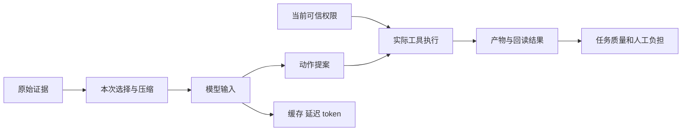

# 工程作者观点归属与设计取舍讨论稿 v0.1.0

2026-11-08 · Codex west 第三轮（UTC）

## 版本与范围

本稿把公开观点转换成可检验的设计取舍，作者身份只按证据能够支持的时间和精度表述。

- 版本：v0.1.0；后续修改递增补丁号。
- 范围：五项有明确原始署名的核心样本；另列一项Qwen相关个人文章，因同期任职证据不足，不计作Qwen在职员工观点。
- 主线：原始署名与身份 → 机制观点及边界 → 我们的决策与待证条件。
- 状态标记：已读原文相应章节；未进行产品运行、模型API调用或实验复现。官方署名工程经验、本人采访、联合论文、个人预测分别标注。
- 不采用二手转载中的技术结论；搜索命中仅作发现入口。读过的原始材料与身份依据见sources.json。

## 一、先给结论

这些作者共同提供了三个可用方向：让模型获得可操作的反馈；把历史交接与本次上下文分开设计；在模型变化后重新检验编排的必要性。它们不能合并成“自治越多越好”或“控制越严越好”的公司共识。

对工作台的直接建议是：保留可观察状态、原始证据与当前权限，允许记忆选择器和编排策略竞争；规划、子代理、QA、compaction与插件热替换都需要明确的适用条件。以下“采纳”均是我们的设计推断，不是原作者对本项目的背书。

## 二、总体架构：先分清谁在说什么

观点的出处决定它能承担多强的结论。

**图 1　观点到决策 · 中间必须经过证据分类**

原始材料经过分类后才能进入设计讨论；作者身份本身不代替主张的证据。

| 类别 | 可以使用 | 不能自动升级成 |
| --- | --- | --- |
| 本人原访谈 | 受访者当时的解释、判断与经验 | API契约或公司未来承诺 |
| 官方署名工程文章 | 某团队在特定环境的实践和取舍 | 无条件适用于所有用户的产品效果 |
| 联合署名论文 | 全体作者共同提出的模型、论证和实验 | 某个共同作者单独说过的话 |
| 个人文章 | 作者的机制判断和预测 | 其过往雇主的立场 |
| 产品公告 | 公布的功能与定位 | 未署名员工的个人观点 |

## 三、五项核心样本

以下日期是原材料发布日期；本次访问日期均为2026-11-08。职务不外推到当前。

| 编号 | 作者、日期与身份依据 | 材料归属 | 关键机制与对应决策 |
| --- | --- | --- | --- |
| V1 | Michael Bolin；采访2026-03-14。OpenAI于2026-01-23官方作者栏标Member of Technical Staff；原采访方称开源Codex负责人 | 本人采访；另有本人官方工程文章 | 工具设计应与模型训练分布匹配；宿主限制和模型判断有不同职责。关联D1权限、D2上下文 |
| V2 | Ryan Lopopolo；2026-02-11。同期OpenAI官方作者栏标Member of the Technical Staff | 官方署名团队经验 | 小知识入口、版本化资料和运行反馈优于塞满大指令；自治依赖仓库投入。关联D2、D3反馈 |
| V3 | Justin Young；2025-11-26。同期Anthropic工程文章署名并注明团队工作；官方webinar另列Applied AI，但页面无日期，不能据此精确回填当时职位 | 官方署名团队经验；职位时间精度受限 | 压缩之外仍需增量工作、交接产物和端到端测试。关联D3、D4交接 |
| V4 | Prithvi Rajasekaran；2026-03-24。同期正文明确Anthropic Labs团队成员 | 官方署名工程实验报告 | 逐组件消融；模型升级后某些reset/sprint/QA频率不再划算。关联D5复杂度 |
| V5 | Yifan Shi、Wei Zhang、Tianyi Cui；2026-08-26 v1。原论文首页注明Shi属PKU与DeepSeek-AI、Zhang属PKU、Cui属DeepSeek-AI | 联合署名设计论证；不写成Cui个人采访 | 可替换组件需要副作用与依赖生命周期管理；组件重载不自动保住自有内存。关联D6热替换 |

### V1　Bolin：让模型能力和宿主约束各司其职

原采访中，Bolin把模型提出工具调用与OS/宿主限定可读写范围区分开；他同时强调工具要在训练中使用，减少发布时的分布变化。这里引用的是回答段，不采用采访方开头的概括作为Bolin原话。[P01](https://www.turingpost.com/p/bolincodex)

其官方文章另记录一个具体取舍：工具排序、模型/权限配置等变化可能破坏prompt前缀缓存；团队尽量追加变化，而不是改写较早内容；compaction则生成新的较短输入。[P02](https://openai.com/index/unrolling-the-codex-agent-loop/)

**可采纳：** 当前权限由可信宿主执行；模型拥有可理解的工具接口。Record区分持久历史与本次输入，缓存收益纳入预算。**不可推出：** 更换模型后仍有相同安全行为；权限变化可为缓存命中延迟生效；不透明压缩内容可替代原始证据。文章是2026年1月实现说明，不用于断言11月默认行为。

### V2　Lopopolo：环境可观察性决定自治能做什么

作者报告团队把UI、日志和指标开放给代理，并用短入口导航到仓库内有版本的资料；完整自治依赖该仓库特定结构和工具。他还承认代理会复制不良模式，需要持续维护。[P03](https://openai.com/index/harness-engineering/)

**可采纳：** 工作台先提供运行、回读、复现和验收能力；将反复出现的可靠经验放到有来源、可维护的资料中。**不可推出：** 全历史常驻是必要条件；人工评审普遍可取消；单团队估计的速度可成为我们的收益承诺。其“系统记录”是该团队的仓库知识组织方式，不等于完整的跨系统业务账本。

### V3　Young：跨窗口交接要携带可继续工作的状态

文章通过初始化、功能清单、进度文件和git历史让下一段工作找到起点，并指出仅凭代码/单测不一定发现端到端失败。原文脚注明确：这里的两个“agent”只是初始用户提示不同，system prompt、工具和整体harness相同；未来是否需要多代理仍未定。[P04](https://www.anthropic.com/research/effective-harnesses-for-long-running-agents)

**可采纳：** 把未完成目标、已做步骤、当前环境与验收入口放进交接包。**不可推出：** 必须分成两个进程/模型；提示词要求只改passes字段构成不可篡改控制；这一web app演示已证明任意领域长任务可靠。官方webinar支持Applied AI归属，但无日期，只作补充身份材料。[P05](https://claude.com/ko/resources/webinars/outtake-built-cyber-investigator-claude)

### V4　Rajasekaran：编排复杂度需要随模型重新定价

作者先把生成与评价分离，再从一次大幅简化失败转为逐项移除组件。Sonnet4.5所需的context reset、Opus4.5的sprint结构，在后续模型中出现不同收益；Opus4.6版保留planner/evaluator，取消逐sprint检查。DAW案例仍经历三轮build/QA，不能解释为全程只验一次。[P06](https://www.anthropic.com/research/harness-design-long-running-apps)

**可采纳：** 固定目标与验收后，测删掉某组件能否保持结果并降低等待。**不可推出：** 模型越强所有harness都会消失；多代理普遍优于单代理；一次演示形成统计显著收益。作者用自己的判断校准QA，仍有漏检；planner扩大范围也混入了产物差异。

### V5　Shi、Zhang、Cui：动态组合的恢复边界

联合论文把效果跟踪与反向操作、依赖变化与激活/撤销联系起来。其论证要求共享交互落入context模型；§3.4末尾明确不能表示的共享位置在定理外。§6.1把资源取得与对外发送区分，补偿需要另证相应等价关系下的性质。§7.3说明Cordis重载会撤去旧组件效果后重新应用，新组件不自动继承旧组件自有内存；更长寿命依赖可以承载状态。§8仍把自进化harness列为未来验证方向。[P07](https://arxiv.org/pdf/2608.25512v1)

**可采纳：** 先识别需要跨版本活下来的状态，再确定插件边界及依赖重连。**不可推出：** 任意外部副作用可回滚；插件热替换自动恢复长任务；自进化已获实证验证。这里只核原文相关段落，未完成92页全部证明的独立审计。不能由共同署名推出Cui独自提出全部观点，也未据此绑定任何GitHub昵称。

## 四、Qwen相关补充：原文有价值，归属不能借用

林俊旸的个人文章《From 'Reasoning' Thinking to 'Agentic' Thinking》发布于2026-03-26。它将工具反馈、失败后修订、思考预算与环境质量联系起来，也警告评价漏洞会让工具代理学到无效捷径；后文对多代理和agentic thinking的前景属于个人预测。[P09](https://justinlin610.github.io/blog/from-reasoning-to-agentic-thinking/)

可以确认的过往归属是：Qwen官方托管的2025-01-26技术报告列其为Qwen Team、Alibaba Group共同作者。[P12](https://qianwen-res.oss-cn-beijing.aliyuncs.com/Qwen2.5-1M/Qwen2_5_1M_Technical_Report.pdf?file=Qwen2_5_1M_Technical_Report.pdf) 当前个人主页写Independent researcher；它没有提供一个足以回填2026-03-26任职状态的官方时间线。[P10](https://justinlin610.github.io/)

因此本稿将其列为**署名个人观点补充，发文同期公司归属未确认**，不纳入“Qwen在职员工表态”。Qwen团队2025-04-29公告讨论从模型训练走向agent训练，也不能反向变成林个人文章的公司背书。[P11](https://qwenlm.github.io/blog/qwen3/)

**可采纳的提案：** 评价真实反馈后的任务进展，而非推理篇幅；隔离隐藏验收资料和未来信息。**不可推出：** 多代理必然成为最优架构，或该文章代表Qwen当前路线。官方身份链不完整时，保留内容和降低归属强度可以同时做到。

## 五、把争议转换成我们的决策

争议可通过适用条件和对照实验处理，不必选择一种永久的harness哲学。

| 决策 | 候选做法 | 失败条件或反证 | 对应来源 |
| --- | --- | --- | --- |
| D1 自治边界 | 模型选择动作，可信宿主执行当前授权；工具契约尽量稳定清晰 | 指令认为“可以”却越过真实策略；换模型后工具使用退化 | V1 |
| D2 上下文 | 保留原始来源，短入口按需选择；压缩是可替换投影 | 省token却丢纠错/否定/来源，或缓存优化延迟权限更新 | V1、V2 |
| D3 反馈与验收 | UI、日志、产物、测试和人工反馈形成可回读证据 | 代理说通过但实际用户路径失败；评审成本未下降 | V2、V3 |
| D4 长任务交接 | 目标、进度、失败尝试、当前环境引用、下一步与验收入口 | 只会复述历史，仍重复已完成动作或无法继续 | V3 |
| D5 编排复杂度 | 按模型/任务域逐项消融planner、sprint、子代理、QA频率 | 只增成本；或移除后任务质量显著退化 | V4 |
| D6 插件演化 | 将可跨版本存活状态与组件局部状态区分；验证清理和重连 | 原组件仍持资源、新组件误认旧任务完成、外部效果未知 | V5 |

**图 2　上下文取舍 · 缓存与任务质量分别衡量**

缓存和token指标反映成本，产物与回读才进入质量判断；当前权限始终通过可信输入执行。

**图 3　复杂度回路 · 允许删除已失去收益的组件**

这些选择可与第二轮context-evaluation协议衔接；本轮不改变该协议或产品实现。员工/作者观点的用途是提出机制和失效假设，验证仍要由我们自己的任务域承担。

## 风险与开放问题

最大风险是把“有知名作者”误当成已经验证，或把同名作者和过往职位拼成当前公司承诺。

- [ ] root重开原文与身份依据，尤其核采访回答与编辑概括的区别。
- [ ] Qwen个人补充不作为在职归属样本；如后续找到同期官方材料，再更新标注。
- [ ] Justin Young当时精确职务未由有日期官方页面单独核定；只使用同期官方工程署名，webinar职位作无日期补充。
- [ ] DeepSeek论文属于联合作者设计论证；完整形式证明与当前实现一致性另由专线审阅。
- [ ] 所有性能、自治成功和成本陈述保持原任务/模型/范围；不引用报道中的大百分比作为本设计收益。
- [ ] 产品公告、维护者身份、公开组织成员和雇佣关系不互相替代；没有为覆盖公司数量降低证据标准。

## 待证命题与下一步

下一步应把观点变成少量可失败的实验，而不是增加更多架构部件。

| 编号 | 命题 | 已有依据 | 缺口 |
| --- | --- | --- | --- |
| PV-P1 | 短入口+原文按需读取足以支持项目工作 | V1/V2提供工程动机 | 全历史与简单检索对照，遗漏约束、引用和返工未测 |
| PV-P2 | 当前模型可撤掉部分编排 | V4展示逐项简化经验 | 本任务相同范围与费用控制下的消融未运行 |
| PV-P3 | 交接资料减少恢复时的重复工作 | V3提供交接机制 | 中断/换接fixture的轨迹与产物未比较 |
| PV-P4 | 插件热替换可不丢关键项目状态 | V5解释局部与较长寿命状态的区别 | 清理/重连和外部回读未验证 |

- [ ] root按review-packet.md完成来源复核。
- [ ] 合并时把V1–V5归属类别写进引用，不统一改称“员工个人观点”。
- [ ] 先使用已提出的对照协议，后续另行授权运行；本次只交付研究材料。

