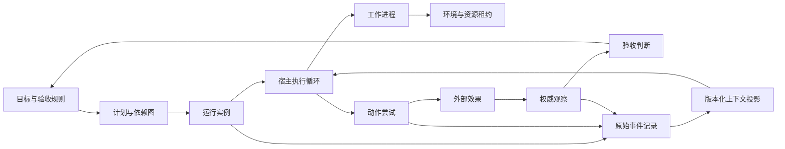
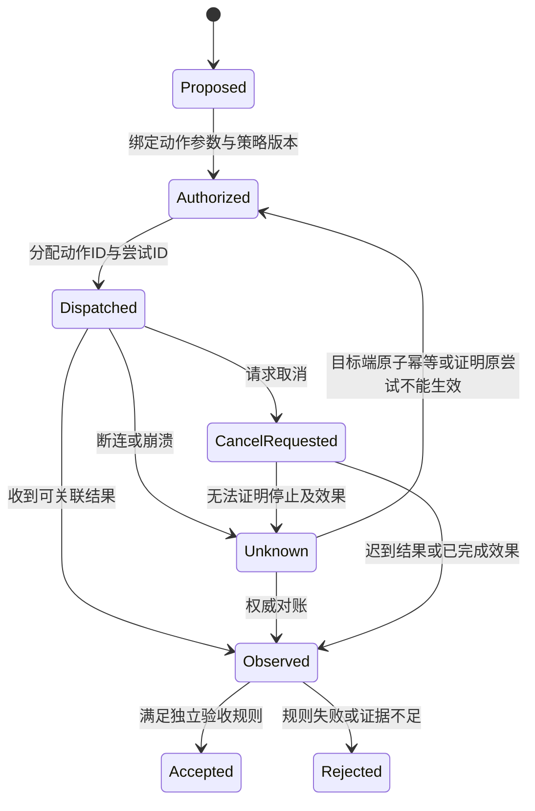
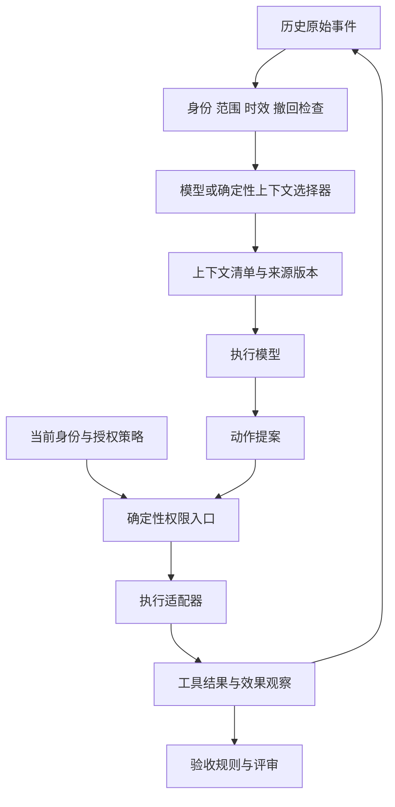

# 西方 Harness 机制核查讨论稿 v0.1.1

2026-11-08 · Codex west 研究线

## 版本与范围

本稿核查两家公司 Harness 的机制与边界，建议把运行、效果和验收分开建模。

- 版本：v0.1.1 补核托管记忆、自动审批、镜像失败和模型升级后的消融；v0.1.0 保留为历史初稿。后续修改按补丁号递增。
- 范围：OpenAI Codex、Agents SDK/Agents API；Anthropic Claude Code、Agent SDK/Managed Agents。
- 主线：结论 → 证据分类 → 两家公司机制矩阵 → 统一架构 → 工程取舍 → 风险和下一步。
- 状态标记：第一轮原始来源核查完成，等待总稿作者交叉复核。已知结果有公开来源；本文提案尚未验证。没有运行付费服务、读取本机凭据或内部项目材料。

## 一、先给结论

统一 Harness 应把**会话历史、模型上下文、运行实例、工作进程、环境、动作、外部效果、观察和验收**分开。两家公司已有可复用的循环、持久会话、工具治理、环境恢复和多代理机制；这些机制并未自动组成跨业务的事实与验收体系。OpenAI 直接把应用的业务事实层留给应用，Anthropic 进一步提供 rubric grader，但评分器的 `satisfied` 仍应作为一项评价观察。见 [O03](https://developers.openai.com/blog/codex-as-a-platform)、[A09](https://platform.claude.com/docs/en/managed-agents/define-outcomes)。

本轮最重要的五个反例是：

1. **恢复审批快照后重试，可能重复已完成的外部动作。** 应用需要目标端幂等或权威对账；不确定则保留 unknown。[O08](https://github.com/openai/openai-agents-python/blob/27c75c5f9c5fd957d28c04fb7e9eeacaad4630a9/docs/human_in_the_loop.md)
2. **工作流 completed，内部线程仍可能失败。** 运行终止不能直接提升为目标完成。[A08](https://platform.claude.com/docs/en/managed-agents/workflow-runs)
3. **idle 到达，仍不一定可以关闭工作环境。** 新输入与连接请求存在竞态。[O07](https://developers.openai.com/api/docs/guides/agents-api/environments/lifecycle)
4. **预算触顶，已准入的请求及其工具仍可继续消耗资源。** 需要区分准入预算、在途责任和结算用量。[A11](https://platform.claude.com/docs/en/managed-agents/budgets)

5. **自托管记忆工具报告写入成功，变更仍可能被同步冲突覆盖。** 需要对权威版本另行确认。[A20](https://platform.claude.com/docs/en/managed-agents/self-hosted-sandboxes-memory)

这些情形可进入状态机、资源和证据完整性的反例集。这里的模型与协议建议均为我们的推断，未转成产品代码。

## 二、证据怎么读

本稿把产品契约、固定代码、署名经验和我们的推断分开。

| 标记 | 含义 | 不代表什么 |
| --- | --- | --- |
| 已核官方文档 | 访问时的产品契约表述 | 本账号开通、端到端运行通过 |
| 已核固定源码 | 在固定提交中读到机制 | 所有版本、平台及配置都相同 |
| 官方署名报告 | 员工在公司渠道报告经验 | 普适因果效果或稳定API |
| 个人公开观点 | 原始访谈中的个人解释 | 公司产品承诺 |
| 本文推断 | 由证据启发的设计建议 | 既有实现事实或已证明性质 |

完整来源、作者、日期、局限、源码路径见 [sources.json](sources.json)。重点复核顺序见 [review-packet.md](review-packet.md)。网站未列发布日期的条目保留 `null`；访问日期不冒充发布日期。源码采用访问时默认分支的固定提交，不冒充稳定发行版。

| 代码对象 | 固定提交 | 提交时间/版本 |
| --- | --- | --- |
| openai/codex | `748ab55ca7de0b647d9a7a9d9a8e70e00f28666d` | 2026-11-08 05:59:11 UTC |
| openai/openai-agents-python | `27c75c5f9c5fd957d28c04fb7e9eeacaad4630a9` | 2026-11-06 16:21:40 UTC |
| anthropics/claude-agent-sdk-python | `2209f2c134fee914c0f75733b631a5fc238ca846` | 2026-11-06 17:57:27 UTC，v0.2.179 |

## 三、OpenAI 机制矩阵

OpenAI 提供多种可组合执行层，业务事实与恢复责任仍需明确分工。

| 维度 | 已核机制 | 限制与对我们的启发 |
| --- | --- | --- |
| 宿主/任务 | Codex App Server 用线程历史与双向事件协议服务多种宿主。[O02](https://openai.com/index/unlocking-the-codex-harness/) | 插件可以复用执行层；业务Task与Codex thread仍需独立映射 |
| 状态/上下文 | SDK Session保存历史；输入callback改变模型所见投影而不重复保存旧项。[O09](https://github.com/openai/openai-agents-python/blob/27c75c5f9c5fd957d28c04fb7e9eeacaad4630a9/docs/sessions/index.md) | Record 的存储和执行前上下文选择宜分接口；选择结果须可追溯到原记录 |
| 长期记忆 | sandbox memory以摘要、索引、rollout渐进读取，抽取与整合分阶段。[O11](https://github.com/openai/openai-agents-python/blob/27c75c5f9c5fd957d28c04fb7e9eeacaad4630a9/docs/sandbox/memory.md) | 记忆建议会过时；布局隔离不等于访问控制；记忆不能自动升级成授权 |
| 恢复 | RunState保存待办审批等运行状态；sandbox session/snapshot另有生命周期。[O08](https://github.com/openai/openai-agents-python/blob/27c75c5f9c5fd957d28c04fb7e9eeacaad4630a9/docs/human_in_the_loop.md)、[O10](https://github.com/openai/openai-agents-python/blob/27c75c5f9c5fd957d28c04fb7e9eeacaad4630a9/docs/sandbox/guide.md) | 恢复模型/工具循环不意味着恢复外部效果；记录agent定义、工具和SDK版本 |
| 历史压缩 | Codex重建代码区分存活片段、最新完整compaction及对应suffix。[O13](https://github.com/openai/codex/blob/748ab55ca7de0b647d9a7a9d9a8e70e00f28666d/codex-rs/core/src/session/rollout_reconstruction.rs) | 用压缩视图替代原始事实时须保留版本/覆盖范围；不能任意套旧摘要 |
| 权限 | 审批快照需可信服务端持有并绑定有权审核的人；schema检查不认证所有权。[O08](https://github.com/openai/openai-agents-python/blob/27c75c5f9c5fd957d28c04fb7e9eeacaad4630a9/docs/human_in_the_loop.md) | 我们的控制平面要负责身份、授权、决策消费；模型上下文不承担这些职责 |
| 托管控制面 | 应用key与只连接环境的executor key分离；自动review覆盖root与子代理。[O16](https://developers.openai.com/api/docs/guides/agents-api/sessions/approvals)、[O17](https://developers.openai.com/api/docs/guides/agents-api/environments/security) | 已有认证服务与动作检查，不能称只有runtime；应用仍负责业务对象授权。`review:none`默认多数动作直行，不是人工审批 |
| 资源/环境 | 托管harness可搭配自建执行环境；单一环境控制器须核验事件、重读状态、协调关闭。[O05](https://developers.openai.com/api/docs/guides/agents-api/architecture)、[O07](https://developers.openai.com/api/docs/guides/agents-api/environments/lifecycle) | 资源占用图与任务依赖图分开；租约/关闭条件需要额外工程实现 |
| 技能/工具发现 | 技能元数据渐进披露；安装集可能大于模型可见集，源码有预算与省略计数。[O14](https://github.com/openai/codex/blob/748ab55ca7de0b647d9a7a9d9a8e70e00f28666d/codex-rs/ext/skills/src/render.rs)、[O15](https://learn.chatgpt.com/docs/build-skills) | 工具“已安装/可发现/可用/已授权”应分别显示；技能是工作方法，不是成功证据 |
| 验证 | 官方团队把应用UI、日志和指标暴露给代理，缩短反馈闭环。[O04](https://openai.com/index/harness-engineering/) | 借鉴可观察环境；单团队效率数字不作为我们的收益估计 |

review模式变更要求root任务idle且输入提交已稳定；提前读到idle后仍可能因新输入得到409，且本次更新全部不生效。这个具体竞态提示我们把策略更新与新动作准入协调，而不是依赖界面状态。[O16](https://developers.openai.com/api/docs/guides/agents-api/sessions/approvals)

OpenAI 的托管 API 文档已经明确要求检查失败turn之前发生过的作用，断流不能当作失败终态。文档未给出我们的业务验收、证据撤回或跨历史授权语义；本轮也没有证明这些能力不存在，只是不能从已读证据推出。[O06](https://developers.openai.com/api/docs/guides/agents-api/errors)

## 四、Anthropic/Claude 机制矩阵

Claude 已覆盖动态工作流和独立评分，但其状态、镜像和隔离边界仍需逐层解释。

| 维度 | 已核机制 | 限制与对我们的启发 |
| --- | --- | --- |
| 架构 | Managed Agents分离持久session、harness与sandbox。[A01](https://www.anthropic.com/research/managed-agents) | 可以替换环境与循环；session日志仍不自动成为已核业务事实 |
| 会话/SDK | Python SDK捆绑CLI；远程SessionStore恢复会先物化本地transcript供CLI读取。[A15](https://github.com/anthropics/claude-agent-sdk-python/blob/2209f2c134fee914c0f75733b631a5fc238ca846/README.md)、[A17](https://github.com/anthropics/claude-agent-sdk-python/blob/2209f2c134fee914c0f75733b631a5fc238ca846/src/claude_agent_sdk/_internal/session_resume.py) | SDK开源不等于整个引擎开放；transcript恢复不恢复进程/工作区 |
| 记忆 | CLAUDE.md、auto memory属于上下文；索引限量加载、主题按需读取。[A13](https://code.claude.com/docs/en/memory) | Record应区分指令、观察、偏好与推断；文件被写入不代表内容已验证 |
| 托管记忆版本 | memory store已有版本、内容哈希并发条件与历史脱敏；删除当前记忆不自动删除历史。[A19](https://platform.claude.com/docs/en/managed-agents/memory) | 不能把版本/CAS/审计称为我们的独有机制；历史保留期与redact限制须进能力表 |
| 自托管记忆 | worker周期同步本地副本；冲突保留服务端版本，工具成功仍可能丢失本地修改。[A20](https://platform.claude.com/docs/en/managed-agents/self-hosted-sandboxes-memory) | 必须区分本地写成功、服务端版本确认与其他会话可见；不要套用cloud live mount语义 |
| 存储完整性 | 参考SessionStore非生产维护；mirror一般错误有限重试，超时因在途IO可能落库而不重试；最终失败不阻断对话。[A16](https://github.com/anthropics/claude-agent-sdk-python/blob/2209f2c134fee914c0f75733b631a5fc238ca846/examples/session_stores/README.md)、[A21](https://github.com/anthropics/claude-agent-sdk-python/blob/2209f2c134fee914c0f75733b631a5fc238ca846/src/claude_agent_sdk/_internal/transcript_mirror_batcher.py) | 接收前检测远端记录缺口；不能把未抛异常等同镜像完整，也不能把timeout当未写入 |
| 工作流/图 | 动态workflow由代理写程序，支持并行、传递结果、循环和失败处理。[A08](https://platform.claude.com/docs/en/managed-agents/workflow-runs) | 实际执行图包含重试/循环；不能只用静态DAG节点done表示所有状态 |
| 子代理权限 | 子代理有上下文和工具配置；代理间消息不能授予用户审批。[A14](https://code.claude.com/docs/en/sub-agents) | 转交任务可携带上下文，不能携带伪造的授权升级 |
| 工具治理 | `auto`可让调用直接执行，custom tool由应用负责；SDK `allowed_tools`是预批准而非移除工具。[A07](https://platform.claude.com/docs/en/managed-agents/permission-policies)、[A15](https://github.com/anthropics/claude-agent-sdk-python/blob/2209f2c134fee914c0f75733b631a5fc238ca846/README.md) | 适配层不要按字段英文名猜语义；明确可见、允许、需人审三层 |
| 隔离/身份 | 托管服务有workspace身份机制，但业务对象权限仍由应用检查；同session代理共享sandbox/files/vault。[A10](https://platform.claude.com/docs/en/managed-agents/secure-deployment) | 多代理不是安全隔离；真正隔离需独立环境、凭据范围与受控数据通道 |
| 检查点 | Claude Code支持分开恢复代码或对话；跟踪范围、并发改动、链接文件存在限制。[A12](https://code.claude.com/docs/en/checkpointing) | 需要恢复能力描述，而非通用rollback按钮；恢复前给出覆盖集合 |
| 验收/交付 | grader按rubric评分并有限迭代；产物可取时间与idle不同。[A09](https://platform.claude.com/docs/en/managed-agents/define-outcomes) | 将运行结束、评分通过、产物取得、业务接受分列 |
| 资源 | 共享session预算在新请求前检查，允许既有请求及工具结算。[A11](https://platform.claude.com/docs/en/managed-agents/budgets) | 配额模型须纳入并发在途消耗；暂停原因与恢复条件不能压成单一paused |

记忆版本、审计与业务证据撤回是不同问题。已读文档没有说明一条记忆被redact后，会自动让所有依赖它的上下文、结论和验收失效；这只是**尚未核到对应契约**，不是能力不存在的证明。我们的候选增量应放在这种依赖语义及跨宿主映射上。

## 五、总体架构

以下为**本文提案**，不是任何厂商已经完整提供的契约。

**图 1　统一对象关系 · 执行层与证据层分开**

Record 不只保存聊天，也不直接代替所有执行控制。它可以提供：不可混用的历史身份、带来源和撤回状态的观察、上下文选择清单、动作与效果关联、验收所引用的证据版本。DAG 分成目标依赖、实际运行、证据因果和资源占用；重试产生新的attempt，循环用版本化展开，不覆盖原事件。此处需与总稿的现有 Record S1 逐项对照，不能当作已实现。

**图 2　动作与未知结果 · 取消意图不代替效果观察**

Codex在固定提交 `748ab55...` 的 `user_verification.rs:166–167` 写明：

> Acknowledges the cancellation signal; native work may still be finishing.
> Unknown or finished requests are a no-op, and completed effects are not rolled back.

该短摘录只描述实验性的native verification取消接口。它直接区分取消ACK、执行停止和效果回滚；普遍状态原则是本文推断。[固定源码](https://github.com/openai/codex/blob/748ab55ca7de0b647d9a7a9d9a8e70e00f28666d/codex-rs/app-server-protocol/src/protocol/v2/user_verification.rs#L166)

此图不是可执行状态机：例如部分成功、并行动作、撤销验收还须细化。它仅强制留下 Unknown 和 CancelRequested，防止把停止意图映射成效果未发生。Codex实验性原生验证RPC提供一个非常明确的取消反例，但只在其作用域内成立。[O12](https://github.com/openai/codex/blob/748ab55ca7de0b647d9a7a9d9a8e70e00f28666d/codex-rs/app-server-protocol/src/protocol/v2/user_verification.rs)

**图 3　Record 上下文组装 · 选择信息与授予权限分开**

上下文选择器可自主查资料、编排摘要、判断相关性；授权入口仍从当前身份与策略获得权限。记忆中的“用户以前允许过”只是待验证线索。历史权限快照可以解释当时行为，不能默认授权今天的动作。

## 六、员工公开取舍如何使用

Michael Bolin 在 2026-03-14 的原始访谈中解释：模型能力主导体验，但模型使用的工具应与训练分布协同；宿主工具约束与模型行为判断是不同层。OpenAI 1月官方文章作者栏确认其当时的员工身份。这支持“跨模型适配必须重测工具行为”的提案，不证明任意统一工具面在所有模型上等效。[P01](https://www.turingpost.com/p/bolincodex)、[身份依据](https://openai.com/index/unrolling-the-codex-agent-loop/)

Prithvi Rajasekaran 于2026-03-24在官方文章中标为Labs成员。他的案例显示，补足模型弱点的编排可能随升级失去收益。[A03](https://www.anthropic.com/research/harness-design-long-running-apps)

| 要素 | 报告内容与证据边界 |
| --- | --- |
| 任务/样例 | 前端设计、游戏制作器与浏览器DAW；未公布完整样本量、随机种子或统计区间 |
| 模型/结构 | Sonnet4.5需要context reset；Opus4.5可取消；Opus4.6又撤去sprint分段 |
| 评价者 | 模型QA用Playwright检查，作者按日志校准；仍漏问题，且作者有时偏好中间迭代 |
| QA位置 | 从每sprint改到build末尾；DAW仍展示三轮build/QA，不是全任务只评一次 |
| 因果限制 | 展示案例任务范围与预算不同，结构、提示和模型也改变，不能推出普适净收益 |

**我们的消融提案**：工作台同时保留可靠的事实/授权接口和可替换的认知策略；后者包括上下文选择、规划器、分段、重置、并行代理及模型评审，默认不固化成必经流程。这样既能保护外部动作，也能让模型自由探索、构建和改进方法。

1. 锁定任务输入、必需功能与验收规则，先测当前模型最小循环；记录可核产物、失败类型、成本、时间和人的介入。
2. 在同模型同工具下逐次只移除一个组件，重复配对任务；分别测固定预算下质量和达到固定质量的成本。范围扩张收益单独记账。
3. 升级模型后重复该矩阵，加入组件交互对照；让评价者对配置尽量盲化，并用确定性检查及人类抽检校准。模型评分不能自己证明模块有收益。
4. 若收益小于预设阈值或只增加等待，把该组件变成按任务启用；若模型开始处理更难任务，再测是否需要恢复。移除模型QA不等于移除法定、用户指定或业务强制的验收规则。

这是尚未运行的实验方案；它不把有意义的自主规划缩减为控制状态机，也不把任何特定架构当作永远必要。

历史多代理Research报告也说明并行适合可独立展开的方向，收益伴随token和协调成本；不能把其内部指标直接套给强依赖编码任务。[A05](https://www.anthropic.com/research/multi-agent-research-system)

## 风险与开放问题

当前最大的风险是把厂商运行状态误当业务事实，或把历史机制误当当前默认。

- **证据层混淆**：对每个结论记录来源类别与版本，公开文档不代替运行验证。
- **恢复范围混淆**：逐宿主声明可恢复的历史、文件、进程与外部效果，不提供无条件rollback承诺。
- **身份和权限混淆**：业务对象授权留在可信应用端，代理转述不产生审批。
- **评价失真**：分别比较单代理、规划器、记忆与评审的增量作用，同时记录成本和任务范围。

开放问题：

- [x] OpenAI跨代理review、模式变更竞态和默认值已核文档；未做账号实测。
- [x] Claude托管memory版本/CAS/redact及自托管同步冲突已核文档。
- [x] SDK镜像超时与一般失败的不同策略已核固定代码；未做故障注入。
- [ ] 业务授权撤回对在途调用的跨宿主一致语义，以及证据失效传播，仍需我们定义并验证。
- [ ] 远端镜像缺口的可靠回补协议和完整性水位，未由所读实现给出充分保证。

## 待证命题与下一步

先建立状态映射和反例，再对明确失败模型中的性质作条件论证。

| 编号 | 命题 | 已有依据 | 缺口 |
| --- | --- | --- | --- |
| W-P1 | 同一逻辑动作不会重复产生效果 | O08说明目标端原子幂等必要性 | 需假设key/参数原子校验与有效期；本地审批不够 |
| W-P2 | 旧事件不关闭在用环境 | O07反驳只看idle事件 | 关闭入口与当前租约/准入原子协调，待设计 |
| W-P3 | 预算有绝对上限 | A11只支持阻止新请求 | 在途请求/工具最大费用可预留，才可能论证 |
| W-P4 | completed可提升为accepted | A08/A09显示运行、评分、可取产物不同 | 必需证据与规则版本匹配后才可判断 |
| W-P5 | transcript远端镜像完整 | A21允许失败后会话继续 | 追加确认、序列完整性与回补需另验 |
| W-P6 | 记忆工具成功意味着权威版本已更新 | A20提供直接反例 | 以服务端版本回读/同步确认补足观察 |

上述不是形式证明。总稿应对状态域、原子操作、失败模型和外部可信假设展开，并用迟到结果、断流、重复审批、代理换模型、预算并发、文件上传延迟等反例检查。

建议先做三个研究切片：

1. **宿主语义映射表**：统一状态名之前，逐项标出上游event/字段含义、终止条件、能力缺口和降级方式。通过标准是不能把 `completed/idle/cancel ack` 混用。
2. **Record证据与上下文清单**：保存谁、何时、从哪个历史和版本选了哪些材料；效果观察与模型摘要分开。通过标准是证据撤回后旧验收不会继续被当作当前有效。
3. **未知效果恢复实验**：用可控假接口模拟执行成功后丢失响应、取消后迟到、镜像写入失败及资源事件乱序。通过标准是不会因缺少结果而自动重复不可幂等动作。

下一步：

- [ ] root 重新打开review-packet中的重点原文，并记录支持/修正/未通过。
- [ ] 将三个切片映射到现有Record S1，只把实际代码覆盖的部分标为已实现。
- [ ] 用可控故障建立反例回归集，不直接重跑已有产品或远程任务。

现有材料足够否定若干强保证，但不足以宣布这些厂商不存在更强机制。
