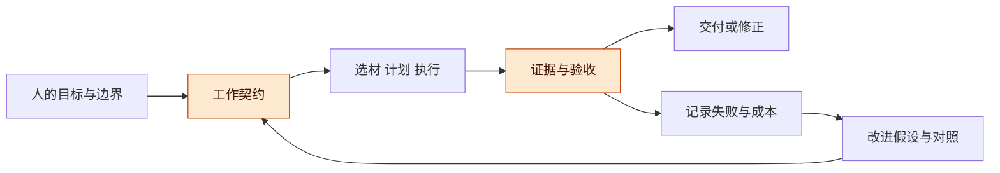
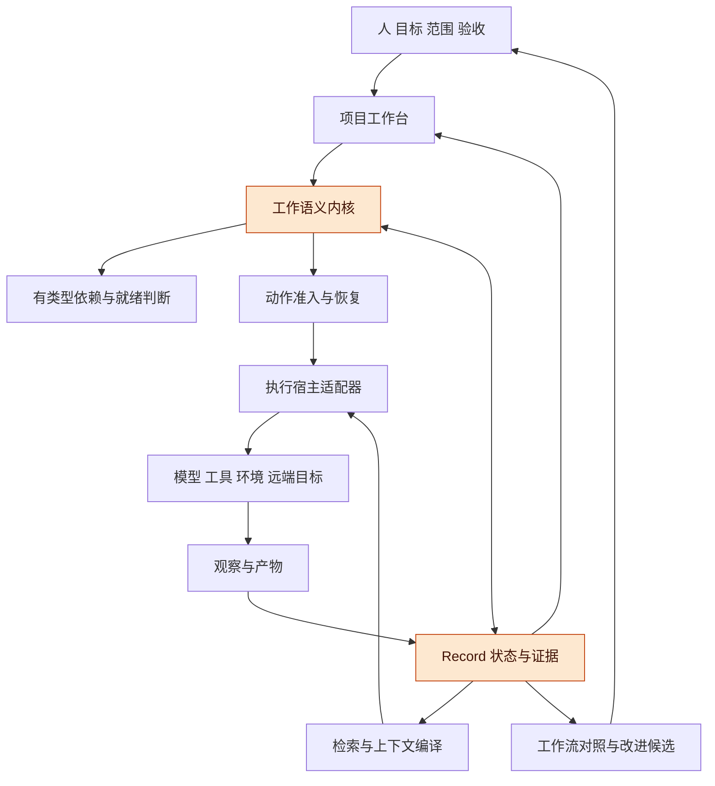
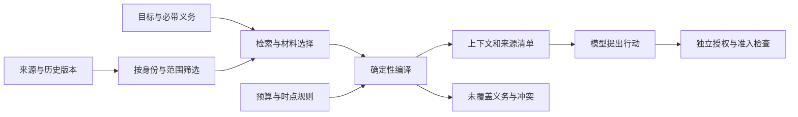
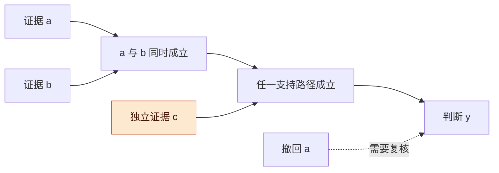
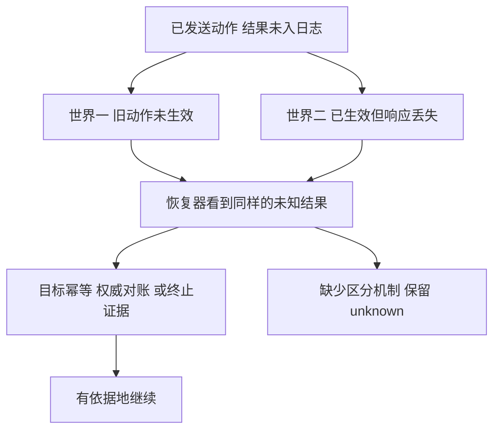

# 统一 Harness 工程与形式化基础讨论稿 v0.1.0

2026-11-07 · 个人 Harness 研究，Codex 整理与核查

## 版本与范围

建议将项目工作台、Coding 方法、Record、DAG 和远程执行组织成一套统一的工作语义：围绕目标保存依据，按明确权限执行，用可追溯证据判断结果，并持续验证工作方式是否值得改进。工程可以分成多个可独立使用的插件，共同遵守任务、效果、证据和验收契约。

- 版本：v0.1.0 为七小时研究的整合初稿，尚在核查与反例验证中。后续修改按补丁号递增。
- 主线：已有方向 → 统一对象与架构 → Record 和上下文 → 有类型的图 → 执行与恢复 → 形式化边界 → 相关工作 → 验证及实施路线。
- 状态标记：**基线事实**来自固定代码和已公开稿件；**来源已核**指读到原始材料，未必运行；**条件推导**只在列明假设下成立；**本轮提案**尚未实现；**待验证**保留为下一步。
- 范围：个人通用 Harness 工程；公司及量化内部实现、数据、凭据和原始会话不进入本稿。
- 实现基线：工作台公开讨论归档 `b9d4484`；Record 研究输入为 `7264be1`，来自仍未合并的 [Draft PR #1](https://github.com/TaiShuo150622/dsh-project-workbench/pull/1)。本轮不把讨论能力写成产品完成。

**图 1　讨论主线 · 工作与改进相互反馈**

从左到右是当前任务的工作循环，下方反馈用于改进下一次工作。高亮处决定我们究竟做了什么、凭什么认为做到了。

## 动机

已有各条讨论的共同问题，是如何让跨轮次、跨工具、跨机器的工作始终能对上人的目标和真实结果。

现在已经具备若干零件与设计：工作台组织项目、线程和工作树；Record S1 提供确定性任务状态与结果/验收绑定；DAG 讨论关联计划、代码和证据；远程稿区分本地交互与远端运行；Coding 方法提出预测、检查、诊断与经验升级。把它们只并列成插件清单，还没有回答它们之间的语义：一个宿主说 completed，工作台能否放行后续任务？一条记忆被纠正，哪些计划和验收要重看？断线以后换执行者，会不会重复旧操作？

统一工程需要回答这些连接问题，同时保留任务执行与探索的灵活性。模型循环、记忆策略和多代理组织方式可以随任务及模型改变；身份、来源、版本和效果边界要保持可解释。

旧稿中“信息推动工作流演化”和“先预测、再验证、用意外改善方法”仍是主线。本轮收窄几处过强表述：模板首次审查不能永远覆盖后续环境；假设撤回不能粗暴作废所有后代；日志先后不能证明作者从未见过结果；历史框架对比不能当当前能力结论。详见 [既有讨论衔接](DESIGN_RECONCILIATION.md)。

## 总体架构

优先采用一个职责清楚的工作语义内核，连接可替换的执行宿主、信息服务与工作台视图，并用一个真实闭环检验抽象。

**图 2　总体架构 · 共享语义与可替换执行**

图中箭头表示责任交接，不要求每个框单独部署服务。Record 与内核共享身份和引用；全文检索、图布局及模型推理可以独立替换。

| 组成 | 核心责任 | 第一版应保持的边界 |
| --- | --- | --- |
| 工作契约 | 目标、输入、范围、验收、授权、预算和期限 | 规格变更留版本；探索任务允许未解决问题 |
| 协调内核 | 尝试、就绪、准入、效果占位、证据接纳和结算 | 小的权威写入面，不能由模型任意改状态 |
| Record | 事件、原始观察、派生知识、来源与上下文材料 | 原始证据、总结和授权分开 |
| 有类型的图 | 依赖、影响、替代证明、因果与资源冲突 | 边有明确语义，支持公式与普通关系图分开 |
| 执行适配器 | 对接 DSH 等宿主、工具、远程环境和目标系统 | 如实声明可恢复、可取消、可隔离的具体对象 |
| 工作台 | 呈现进展、依据、待决问题与恢复动作 | 简洁状态可展开到证据，不以活跃度替代进展 |
| 改进模块 | 从失败与成本提出方法变更，安排对照与采纳 | 候选不能自行改写保护自己的权限和评价标准 |

具体接口与 H01–H08 切片见 [架构工作稿](ARCHITECTURE.md)。当前尚未决定更换 DSH 底座，也未决定从零开发整个平台。

## 核心对象与完成语义

任务、一次尝试、外部动作、结果与验收必须拥有可关联但不同的身份。

TaskDefinition 是要做什么；Attempt 是某次尝试；Session 是可续接历史；Host 是控制器实例；Environment 是文件、依赖和进程所在环境。一个会话可以经历多个宿主实例，一次任务可以重试多次，环境重建也不自动完成旧动作。

对任务需要至少保留四种判断：

| 判断 | 问的是什么 | 变化例子 |
| --- | --- | --- |
| 曾记录完成声明 | 历史中有没有这个事件 | 追加日志后仍可追溯，但不保证声明正确 |
| 当前证据支持完成 | 依据现在接纳的证据，这个规格是否完成 | 错误 source SHA 被发现后撤回 |
| 最后核实结果可用 | 指定版本的产物是否有符合规则的可用性观察 | 文件删除、访问权限改变后需要更新 |
| 当前验收适用 | 谁对哪个定义、内容、规则版本做的判断仍有效 | 规格、产物内容、有效期或规则变化后重判 |

这些是账本截至某个水位的判断。外部世界可以在最后观察之后改变，因此界面要显示来源、核实时间及未确定项。需要执行时仍成立的条件，应由目标端条件操作、再次读回或明确稳定性假设保障。

精确动作、工程功能、探索研究和持续服务的验收也不同。一个研究轮次可以完成约定问题的分析，却仍留下开放问题；持续监测可以完成一个观察窗口，却不能因此宣称长期稳定。用户接受、评分器通过、程序结束和产物可取应分别记账。

## Record 与上下文

Record 的价值是让过去的工作能被正确使用和纠正，而不只是让模型记得更多文字。

建议分别保存：经过认证的工作/控制事件；带来源身份的原始观察和产物引用；可修订的总结与经验；可重建的看板、图和上下文投影。总结可以帮助检索，但不能覆盖唯一原始证据。公共内容、项目私有材料和凭据也不能因为进入同一个索引而自动共享。

**图 3　上下文编译 · 义务、来源与缺口可见**

左侧选材可以使用模型，编译器核对实际带入的来源、版本和强制义务。右侧执行权限来自授权状态，不能从记忆内容推导出来。

ContextManifest 应记录实际来源版本、处理方式、知识水位、必须覆盖的限制、删减原因、冲突和缺口。它能说明“这次调用看到了什么”，不能证明语义上没有遗漏。必带材料无法放进预算时，系统需要拆任务、分阶段查询或明确不可行，不能默默删掉最新限制。

已有产品提供文件记忆、渐进检索、版本与并发更新机制。本轮不把这些列为独有能力。例如 Claude 自托管记忆的本地写成功可能随后被服务端冲突覆盖，这要求我们区分本地操作返回与权威版本已确认。[官方同步契约](https://platform.claude.com/docs/en/managed-agents/self-hosted-sandboxes-memory)

自主本体整理是否值得成为必备模块，仍需要对照。基线应包含无长期记忆、原始证据加简单检索、规则时间线和完整历史；再比较复杂抽取与关联。回答旧事的准确率之外，还要测近期纠错、证据撤回、权限变化后，后续动作是否正确。

## DAG 与变化传播

工作台需要一组有类型关系；其中某些关系可以要求 DAG，其他关系允许循环。

任务准备关系说明执行需要哪些前提；证据支持关系说明一个判断为什么成立；实际事件图说明哪次动作导致哪条观察；产物依赖图说明某版本用了哪些输入；资源冲突关系说明哪些动作不能同时准入。本体、相似和工作流反馈关系可以有环。

**图 4　影响不等于失效 · 保留替代证据**

若 `y = (a ∧ b) ∨ c`，撤回 a 会影响 y，但 c 仍可能独立支持 y。图服务应先找影响范围，再按支持公式重算。

第一版验收支持采用有限无环公式，按拓扑顺序重算。递归支持另设语义：`y=a∨z, z=y` 在撤回唯一根 a 后，若从旧 true 值迭代，会错误地相互支持。正递归可研究最小不动点或有根证明；含否定的递归不能直接沿用同一规则。这项限制只作用于验收支持，不禁止工作流重试和知识关系有环。

数据库 provenance 已经有来源组合、递归与否定研究，可借其问题定义和方法；本轮的工作是把具体任务版本、证据撤回和验收义务连接起来，而不是重新命名已有数学。[作者回顾演讲](https://www.cis.upenn.edu/~val/15MayPODS.pdf)、[一阶逻辑 provenance 研究](https://arxiv.org/html/2412.07986v1)

## 执行、恢复与资源

恢复必须保留未知效果；取消、进程退出、环境可重用和外部效果已解决是不同事实。

**图 5　断连后的两种世界 · 相同日志不能决定安全重试**

如果没有目标端幂等、权威对账或能排除迟到写入的证据，自动重试可能重复世界二的效果，永不重试又不能完成世界一。这是在明确观测条件下的不可区分反例，不是对所有恢复系统的普遍不可能定理。

现有来源已直接说明这些责任：OpenAI Agents SDK 将审批恢复与效果去重分开；Qwen 工作区恢复明确不完成、不重试原 Shell；Temporal 不同取消模式也区分请求取消与等待活动结束。[OpenAI HITL](https://github.com/openai/openai-agents-python/blob/27c75c5f9c5fd957d28c04fb7e9eeacaad4630a9/docs/human_in_the_loop.md)、[Qwen 恢复](https://github.com/QwenLM/qwen-code/blob/cbc6164c267db226b8227da0cf96b0e186026ef9/docs/users/hosted-workspace-recovery.md)、[Temporal 取消契约](https://github.com/temporalio/sdk-typescript/blob/615a684ac41a22c881df11157775e326843f7b04/packages/common/src/activity-options.ts)

动作预留和最终发送意图分别检查当前条件。授权来自其他服务时，还要声明撤回何时生效；本地原子检查不能消除授权缓存延迟。幂等、fencing、事务和 OS 隔离应按目标/操作分别声明，不能压成一个安全等级。

预算同时包含已结算消费、在途未结算负担和必要收尾预留。已发生但尚未收到费用的消费仍属于负担。仅在新请求前检查消费阈值，无法保证最终费用精确停在该阈值；若需要硬上限，还必须有可执行的成本上界和原子预留规则。预算耗尽后应保留结果收集与安全结算的通道。[Claude 预算语义](https://platform.claude.com/docs/en/managed-agents/budgets)

## 条件推导与可验证命题

本轮形式化工作的首要成果是明确保证的对象与假设，完整推导和反例放在附录，避免让符号替代工程条件。

| 命题组 | 条件下能说明什么 | 仍不能说明什么 |
| --- | --- | --- |
| 确定性重放 P1–P2 | 固定初态、日志与解释器产生同一状态；无认证 hash 不证明来源 | 存储耐久、日志真实、外部效果仅一次 |
| 完成与验收 P3–P4 | 审计历史可追加，当前支持可撤回；完整适用性输入不变才保持验收 | 产物永远可用，版本绑定相同就不会过期 |
| 图语义 P5–P6 | 替代证据可保留支持；循环定义可展开成发生实例 DAG | 任意知识图必须无环，递归重算从旧值就正确 |
| 准入与效果 P7–P9 | 同一权威原子准入可检查冲突；取消不证明未生效 | 入口准入等同目标事务，未知效果可以随意重放 |
| 上下文 P10–P11 | 可核查来源与已声明义务；硬义务超容量时不可兼得 | 语义充分、模型不会遗漏、贪心选择普适最优 |
| 预算 P12–P13 | 完整负担上界与守恒更新可给预算界 | 预测均值就是上界，任何外部服务都可严格限费 |
| 组合与评价 P14–P15 | 整体目标需要接口/组合义务；未覆盖域不能仅凭有限样本外推 | 所有子测试通过等于产品验收，未来任务普遍变好 |

详见 [形式模型工作稿](FORMAL_MODEL.md)。目前完成了不同上下文和不同模型的逻辑审查，已修正时钟输入、产物版本、递归支持、授权权威及预算负担定义。模型审查不是人类审核或机械证明。有限状态检查正在进行，结果出来前不记作“验证通过”。

## 相关工作

公开产品已经覆盖许多重要机制；对照的目的，是识别可复用部分和跨边界仍需说明的责任。

| 类别 | 代表与本轮核实 | 对本工程的启发 | 证据边界 |
| --- | --- | --- | --- |
| 插件化 Harness | DeepSeek Harness 的会话投影、工具流水线、任务 DAG/CAS | 复用当前宿主与插件组合；任务 completed 另接产物验收 | 开发预览、固定源码；SuperAgent 单列研究原型 |
| 开源与托管执行 | OpenAI Codex、Agents SDK/Agents API | 会话、环境、应用权限、工具效果分层，恢复保留不确定性 | SDK/协议与托管产品分别核查，未运行付费服务 |
| 工作流与结果评分 | Claude Code、Agent SDK/Managed Agents | 版本记忆、动态工作流、grader 和预算已有对应机制 | 完成、评分和产物可取仍是不同事实 |
| 编码与目标证据 | Qwen Code、Qwen-Agent | 原始工具记录与聚合模型输出分型；恢复严格绑定环境身份 | stamp 证明记录来源，不证明工具内容必真 |
| 团队与图框架 | Tencent CodeBuddy、tRPC-Agent-Go | 委派权限、恢复范围、checkpoint 失败策略需逐条解释 | 文档/代码分开；有 saver 不推出每步提交耐久 |
| 持久工作与记忆机制 | Pi、OpenCode、PydanticAI、Letta、Agno、Temporal、DBOS 等 | 工具重放条件、晚到结果、取消、存储围栏和预算计量 | 固定版本源码观察，未跑上游端到端验证 |

详细机制与原始来源：[西方产品对照](west/西方Harness机制核查讨论稿-v0.1.1.md)、[中国产品对照](china/中国Harness机制核查讨论稿-v0.1.0.md)、[开源机制与反例](mechanisms/机制对照与反例讨论稿-v0.1.0.md)。

员工公开讨论提供设计动机，不能替代产品契约。已核内容包括：Michael Bolin 对工具与模型训练分布的解释；Prithvi Rajasekaran 对长任务编排组件随模型升级变化的署名报告；Tianyi Cui 的插件迁移讨论；阿里员工 wenshao 的历史长期任务使用反馈；腾讯汪晟杰的原始访谈。每项都保留公开身份依据与时间，个人观点、团队报告及当前实现分列。具体入口在各来源册中。

本轮已经修正几个历史判断：当前 Pi 与 Letta 的仓库/活跃代码边界变化；托管产品并非只有一个模型循环；版本记忆、审批、恢复、图和评分均非本工程独有。候选增量是**跨宿主的语义契约、证据变化的影响计算、上下文义务清单，以及可复用的行为反例**，是否有实际价值还要由适配实验验证。

## 验证与实施路线

先把一个公开演示任务的目标、尝试、外部效果和验收真正接通，再扩展记忆策略与多宿主能力。

建议的最小示例是：一个 Coding 任务在中途改变规格，旧证据保留但按版本重新判断；一次外部动作在发送后断连，保持 unknown 并通过目标读回恢复；工作台最终能显示实际产物、完成依据和验收适用范围。这个例子同时检验多条模块边界，比单独展示更多功能按钮更有说明力。

实验任务书：

1. 固定基线代码、源材料和验收版本；当前产品测试成功只作为对应提交的证据。
2. 先做有限状态模型，主动找出取消、撤回、预算与图更新的最短反例；把界限和未建模部分一并输出。
3. 对真实效果适配器再做故障注入，核对目标身份、真实效果与重复行为；模型检查不能替代这一步。
4. 对上下文、规划、分段、预测和评审策略做同任务配对对照，保留人工时间与成本；模型升级后重新评价。

| 对照组 | 做法 | 要回答的问题 |
| --- | --- | --- |
| 最小流程 | 当前模型、基本工具、明确目标 | 复杂编排的基线是什么 |
| 来源与简单检索 | 原始证据、版本索引和强制义务 | 是否已能覆盖多数上下文问题 |
| 自主记忆/复杂编排 | 加抽取、本体、规划器、多个评审等 | 增益是否超过维护、等待和费用 |
| 故障与反例组 | 断连、迟到结果、旧验收、撤回、预算耗尽 | 声称的语义是否真的保持 |

停止判据：出现未被约束的重复效果、旧授权误用或关键证据丢失时，先修正契约/适配器；记忆或编排增加成本却未改善预先定义的质量时，暂停扩大该组件；无法核实原始来源的比较结论不进入能力判断。这里的停止指实验或新动作，不擅自放弃用户已采纳的长期方向。

实施按 H01–H08 展开：名称与投影 → 持久化权威内核 → 一个真实效果适配器 → 有类型依赖 → 上下文编译 → 第二宿主/远程恢复 → 成本与长期义务 → 工作流改进闭环。该顺序是验证路线，是否改变现有面板开发计划仍待具体实施讨论。

## 风险与开放问题

当前最大的风险是抽象范围过大却没有实际闭环，因此每个新增概念都应能解释一个已有失败情形或服务一个可验收动作。

- **观察被误当世界事实**：保留来源、水位和适用时点，执行点的强保证单独实现。
- **记录层过度集中**：权威事件保持小而明确，全文、产物和派生索引分开；访问范围不能因索引合并而扩大。
- **跨宿主语义被抹平**：声明独立能力与限制；未核实不标为支持或不支持。
- **复杂记忆收益不明**：先比较简单检索、时间线与完整历史，再决定是否需要自主本体。
- **评价闭环自证**：候选、检查规则和留出任务有版本，故障、漏检及未执行检查保留在分母中。
- **长任务只有活跃没有进展**：报告最近有效证据、下一项可操作工作与阻断条件，而不靠心跳次数证明推进。

开放问题：

- [ ] 第一条真实适配器选择哪个目标、哪种效果，能否提供可信读回或幂等？
- [ ] 规格、结果内容、可用性、验收规则和权限分别变化时，复用证据的最小正确绑定是什么？
- [ ] 跨服务撤回授权和跨宿主接管采用什么一致性语义？
- [ ] 什么任务确实从自主上下文选择或多代理协作受益，什么任务应保持最小流程？
- [ ] 首版支持公式限于 DAG 后，何时有充分需求引入递归、否定与时态逻辑？
- [ ] 形式模型到当前 Record 以及未来持久适配器的精化关系如何逐步验证？

## 待证命题与下一步

最值得继续验证的候选贡献，是把统一语义变成别人可以接入和检验的契约，而不是预先宣称一种通用最优 Harness。

| 编号 | 命题 / 猜想 | 已有依据 | 缺口 |
| --- | --- | --- | --- |
| H-P1 | 同一行为反例集可定位不同宿主的语义差异，并减少集成误判 | 已有多个官方恢复、取消、预算反例 | 需要至少两个真实适配器运行同一契约样例 |
| H-P2 | 带版本的证据依赖能减少无关重做，同时保留纠错能力 | AND/OR 支持与撤回模型、Record 局部实现 | 需要真实修改任务测量遗漏失效与过度失效 |
| H-P3 | 强制义务 + 简单来源检索可成为可靠低成本上下文基线 | 既有上下文稿与产品渐进读取机制 | 需要近期纠错、权限变化与完整任务的配对评价 |
| H-P4 | 事前预测与偏差记录能帮助选择更有效的检查或方法改进 | 既有 Coding 方法和可版本化记录结构 | 预测质量、诊断稳定性及人工收益尚未实测 |
| H-P5 | 小语义内核可跨宿主复用，同时让认知策略随模型变化 | 外部产品已有职责分离和组件消融经验 | 需要适配成本、行为一致性与维护负担证据 |

下一步：

- [ ] 完成有限模型检查与反例审查，修订命题和接口。
- [ ] 收敛来源矩阵、阅读顺序和证据状态，不让多份工作稿相互矛盾。
- [ ] 将上述最小例子写成具体实施任务书与行为验收样例。
- [ ] 形成 Markdown 正本、可独立阅读的 HTML 和带版本的来源索引，再讨论产品实施与公开发布。
