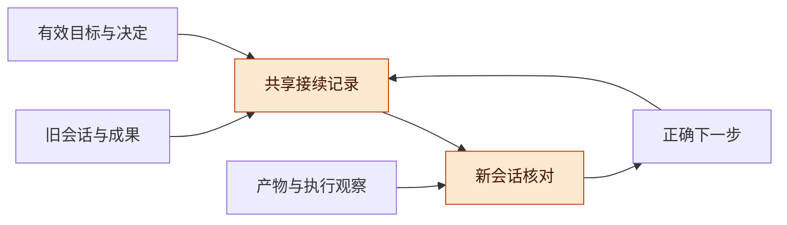
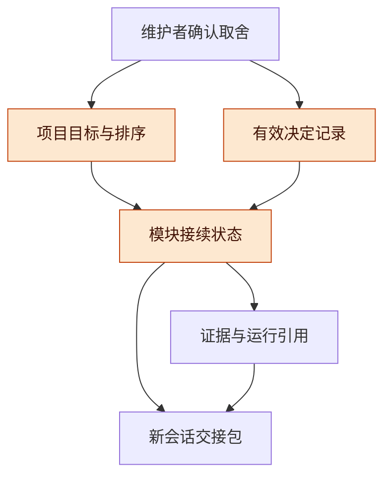
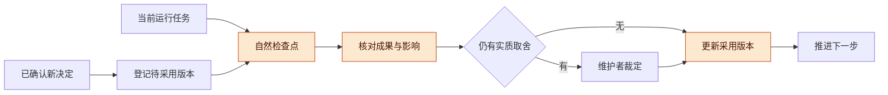
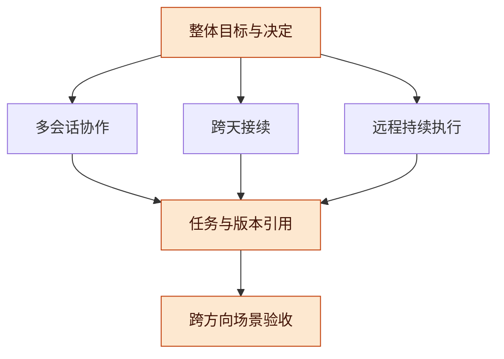
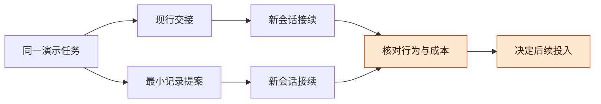
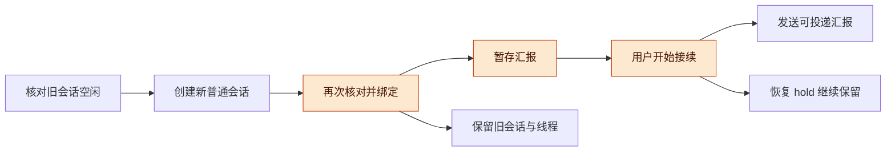

# Harness 跨天与换会话接续讨论稿 v0.1.1

2026-11-13 · 个人 Harness 研究，Codex 整理

## 版本与范围

建议先用可靠的当前状态与有效决定支持接续，让新会话能够确定目标、保留成果并选择正确下一步，再依据实测问题增加自动检索和记忆能力。

- 版本：v0.1.1 记录已确认的最小实现范围、显式接手及汇报放行边界、有界读取和待验证状态；v0.1.0 为首次公开讨论稿，整理最小共享记录、决定采用、接续职责、三方向依赖与试验方案。后续修改按补丁号递增。
- 主线：整体目标 → 当前依据 → 共享记录 → 变更采用 → 三方向衔接 → 最小试验 → 待证命题。
- 状态标记：**来源已核**指本轮读取原始页面或项目文档；**现有描述**指仓库对产品或历史研究的说明；**本轮提案**指研究主张；**代码已写**仅指工作树中已有实现；**待验证**指仍缺实际证据。代码状态不替代测试、真实模型调用或整体验收。

**授权与实现边界**：用户已确认三个新分支分别完成最小功能后组合试验；本方向使用 `codex/harness-continuity`，保留现有分支不动。已确认范围为有效决定及替代关系、可追溯接续包、空闲旧总会话的显式接手，以及单独开始接收暂存汇报。实现与发布分别记录，整体验收仍须三方向组合试验；完整智能记忆、跨宿主迁移、自动采纳所有历史结论不在本轮范围。

**公开范围**：只包含个人通用 Harness 方法、公开资料及演示试验方案。后续环境统一称为独立 Linux ARM64 测试环境，其安装、登录及试验结果以单列记录为准；本稿不预设这些工作已经成功，也不包含服务器地址、登录身份、凭据、私人会话或原始运行日志。

## 整体目标与接续架构

三个方向应共同支持一个项目在多个会话和执行环境中持续推进，接续方向负责让已确认目标、有效决定及可核验成果延续到下一次工作。

本方向的最小问题是：旧会话留下了部分成果，整体优先级随后发生变化，新会话能否识别当前要求、核对已有状态并选出正确的下一步。它不需要先导入全部历史，也不需要以完整语义检索平台作为前置。

**图 1　总体架构 · 当前记录连接前后会话**

从左向右读取交接材料并核对真实状态；高亮处保证新会话采用当前依据，执行结果再更新记录。

**方法依据**：Anthropic 的长期代理案例采用进度文件、功能清单和 Git 历史帮助新会话进入状态，并指出上下文压缩仍可能留下含糊交接。这支持增量产物与开始时核对的做法；案例面向 Web 应用，不证明本项目的效率收益，也不改变本项目提交权限。[长期代理案例](https://www.anthropic.com/research/effective-harnesses-for-long-running-agents)

## 当前依据与未验证边界

仓库已有接续原则和相关设计，完整跨会话链路的实际效果仍需在明确环境与版本下验证。

| 材料 | 来源已核的描述 | 本轮适用边界 |
| --- | --- | --- |
| [工作台 README](https://github.com/TaiShuo150622/dsh-project-workbench/blob/codex/dsh-project-workbench/README.md) | 当前插件范围是同一个 DSH 桌面实例；宿主断开后保留会话与工作树，任务显示待恢复 | 不据此声称外部会话或跨机恢复已接通 |
| [统一研究导读](https://github.com/TaiShuo150622/dsh-project-workbench/blob/codex/dsh-project-workbench/docs/harness/10-unified-engineering/2026-11-08-v0.1.9/START_HERE.md) | Record S1 来自草稿 PR 的研究输入，统一运行链路仍待接通 | 研究快照的能力与当前产品验收分开 |
| [Record 主稿](https://github.com/TaiShuo150622/dsh-project-workbench/blob/codex/dsh-project-workbench/docs/harness/04-memory/Record智能记忆与自主上下文组装-源v0.1.2-公开整理版.md) | 当前指令、状态、有效决定、冲突和出处分开；最新纠正应覆盖未完成的历史整理 | 可先采用其管理原则，自动组装与成本收益另验 |

**本轮判断**：上述原则可以先落实为简短记录与交接规则，再决定是否引入更复杂的自动化。这是提案，不是已证实的产品结果。本轮读取日期为 2026-11-13，仓库链接可能继续演进；后续试验须另记实际代码、配置和文档版本。

## 最小共享记录与维护职责

项目层维护共同取舍，模块层维护接续细节，两者通过稳定引用及明确版本相连。

| 记录 | 最少内容 | 维护职责 |
| --- | --- | --- |
| 项目当前状态 | 本阶段结果、完成标准、当前排序、版本 | 维护者确认目标与实质取舍，协调者维护已确认记录 |
| 有效决定 | 内容、理由、范围、来源、状态、替代关系 | 决定责任人确认；模块可提案，不自行把提案升级为全局决定 |
| 模块接续状态 | 本轮承诺、采用版本、已完成与剩余、阻塞、下一步 | 模块负责人或执行会话更新 |
| 证据与执行引用 | 产物版本、验证范围与时间、任务和运行引用、未提交差异 | 执行方报告，验收方判断证据支持范围 |

**图 2　共同信息与模块记录 · 分层维护**

自上而下区分共同取舍和模块事实；新会话通过引用取材，避免复制全部聊天后重新推断当前要求。

**有效性规则**：摘要帮助寻找材料，明确决定及原始证据用于判断。时间较新的记录不自动拥有更高决定权。已替代决定保留其历史用途，同时指向当前决定；旧验收保留原版本，新版本是否适用另行判断。

Nygard 的架构决定记录方法用短文保存背景、决定、状态及后果，决定被替代后保留旧记录并指向替代项。此方法可借用于重要项目决定；普通小调整可更新已有状态记录，不要求每次另写长文。[原始 ADR 方法](https://www.cognitect.com/blog/2011/11/15/documenting-architecture-decisions)

## 目标变更与恢复前核对

已确认的新决定应在明确检查点进入执行线，运行状态和决定采用状态分别记录。

1. 协调者登记新目标或排序版本、改变原因、受影响模块，以及旧决定的替代关系。
2. 正常运行中的任务继续；受影响任务另记“有待采用的决定”，不把实际运行状态改写成已停止或已按新要求执行。
3. 在子任务交回、验证结束、领取下一项任务等自然检查点，比较当前采用版本与项目有效版本。
4. 有差异时说明仍可保留的成果、需调整的剩余步骤及尚待取舍的问题；已明确的决定直接采用。
5. 更新采用版本与下一步后，开始受影响的新工作。无关模块继续推进，旧成果保留版本和适用范围。

**图 3　新决定进入执行线 · 自然检查点确认采用**

上路登记新决定，下路保留正在执行的工作；两路在检查点汇合，再确定下一步采用的版本。

**恢复语义**：LangGraph 的文档区分新输入、继续未完成执行、回答中断和历史重放；复用同一线程身份并不自动等于恢复。由此提出，接续入口应先明确继续对象并核对产物及运行状态，再决定下一步，不能仅凭旧摘要重发动作。[恢复规则](https://docs.langchain.com/oss/python/langgraph/checkpointers)

**即时生效约束**：低风险排序变化可以在领取新任务时采用；权限撤销等必须立即生效的约束，需要由实际控制机制落实，不能等待下一次聊天交接。

**未知效果**：远程回执缺失时，应由远程方向提供当前操作查询依据。本地没有记录不能证明动作未发生；LangGraph 的容错文档也要求把此类结果保留为未知并核对目标端状态。[未知结果与重试边界](https://docs.langchain.com/oss/python/langgraph/fault-tolerance)

## 三方向依赖与独立分支安排

三条线共享目标、任务身份及有效决定，接续方向无需发展成其他方向开始工作的完整前置平台。

| 关系 | 必要衔接 | 可独立推进的部分 |
| --- | --- | --- |
| 协作方向到接续方向 | 当前整体目标、排序与决定责任 | 接续可先用现有任务记录验证一次交接 |
| 接续方向到协作方向 | 成果证据、未闭合工作、实际采用版本 | 协作可先维护共同目标，无须等待智能记忆 |
| 接续与远程方向 | 稳定任务引用、要求版本、运行引用、观察时间和未知效果 | 远程无需等完整记忆；首个接续样例可采用独立会话 |

**图 4　三方向共同依据 · 共享约定与独立推进**

自上而下共享目标和引用，再通过完整场景检查组合结果；图中的关系不要求三个方向同时发布产品功能。

**路线关系**：既有研究明确 I05 不是 I06 的隐含前置，P01–P15 后接 B01–B12 的产品顺序继续有效。新建方向分支用于独立整理与后续验证，不自动改写排期。本轮采用范围由 [B-01 任务卡](tasks/B-01-continuity.md) 记录，原路线与本轮试验的对应关系、合入时点由统筹者维护。[现有路线衔接](https://github.com/TaiShuo150622/dsh-project-workbench/blob/codex/dsh-project-workbench/docs/harness/10-unified-engineering/2026-11-08-v0.1.9/ROADMAP_CLOSURE.md)

## 最小试验与评价方案

首轮试验应检查新会话能否从当前有效目标、决定、证据、在途任务和下一步继续工作，先取得观察数据，再确定自动化投入。

**试验任务书**：以下为已授权最小实现的验证方案。本稿尚不记录本分支在真实宿主上的验证结果，也不构成完整产品验收。

1. 在独立 Linux ARM64 测试环境准备一个演示项目，记录实际宿主版本、演示产物和允许操作范围。
2. 为同一演示任务准备现行交接材料与最小共享记录，由维护者预先确认目标、有效决定及正确下一步的判断依据。
3. 用新会话完成普通接续，观察其是否识别已完成成果、未闭合事项及下一步。
4. 分别加入“旧决定被替代”“产物版本变化”“仍有在途任务”的情境，观察它是否核对影响范围并保留仍有效成果。
5. 保存必要的脱敏证据和缺口，比较交接维护成本；测试时另记实际模型、宿主及构建版本，整体验收由组合场景判断。

| 组 | 做法 |
| --- | --- |
| 现行方式 | 使用当前实际交接入口，记录需要维护者补充的内容 |
| 最小记录提案 | 提供版本化目标、有效决定、成果引用、在途状态和下一步，再核对现场 |

**图 5　接续试验 · 从同一任务观察行为**

从同一任务分别进入两种交接方式，比较正确行为与维护成本；首轮用于发现问题，不据少量观察宣称普遍效率提升。

**观察指标**：首次正确下一步所需时间、维护者补充解释次数、关键状态遗漏、已替代决定误用、无必要重复工作，以及交接记录维护耗时。改进阈值和重复次数在取得现行方式基线后确定，材料长度和检索数量仅作辅助观察。

**停止判据**：无法确定当前目标或正确下一步的判断依据时，停止新增试验步骤并补齐口径；发现重复外部动作、采用已撤销决定等错误时，保留证据并判该情境未通过。已有正常运行任务与已完成成果保留，不因试验未通过擅自重跑。

## 相关工作

本轮核实的资料分别支持增量交接、有效决定维护和持久状态语义，尚未证明这些方法组合后能改善本项目。

| 类别 | 代表（年份） | 核实到的内容 | 缺口 |
| --- | --- | --- | --- |
| 长期代理交接 | [Anthropic 长期代理案例](https://www.anthropic.com/research/effective-harnesses-for-long-running-agents)（2025） | 进度材料与增量工作帮助新会话进入状态 | Web 应用案例，不能直接推导 Harness 的收益 |
| 决定维护 | [Nygard ADR 方法](https://www.cognitect.com/blog/2011/11/15/documenting-architecture-decisions)（2011） | 重要决定短记录，保留状态与替代关系 | 不提供自动同步所有执行线的机制 |
| 持久信息分工 | [LangGraph Persistence](https://docs.langchain.com/oss/python/langgraph/persistence)（2026 年读取） | 区分单线程检查点和跨线程持久资料 | 持久化不自动维护项目优先级与有效决定 |
| 恢复与副作用 | [Checkpointers](https://docs.langchain.com/oss/python/langgraph/checkpointers)及[Fault tolerance](https://docs.langchain.com/oss/python/langgraph/fault-tolerance)（2026 年读取） | 区分继续与重放，保留缺回执的未知状态 | 本轮未运行框架试验，也未决定引入该框架 |

**仍未核实**：独立测试环境中的 DSH 接续行为、实际输入能否按预期组装、模型成本变化、跨宿主恢复及真实长期任务收益。原始页面读取日期为 2026-11-13。

## 本轮最小实现与交接边界

本轮代码把有效决定、接续包和总会话接手做成独立可用的入口，但这些实现仍需独立 Linux ARM64 测试环境中的行为验证。

| 能力 | 代码中的处理 | 仍需取得的证据 |
| --- | --- | --- |
| 决定维护 | 事务内核对版本；旧决定保留并指向替代项；版本达安全整数上限即拒绝修改 | 并发提交、替代关系与重启后记录一致 |
| 接续包 | 保存项目、可选整体目标版本、有效决定、线程状态、汇报出处和下一步 | 证据引用正确，旧快照未被误作当前决定 |
| 上下文与阅读 | 总会话只注入有上限的摘要；完整记录按页读取，来源变化拒绝续页 | 大量长任务仍满足预算，完整决定没有静默丢失 |
| 新总会话接手 | 只在已加载、空闲且两个收件箱均可检查并为空时允许；创建后再次核对 | 忙碌、未知、并发变化时拒绝；新建失败保留原关联 |
| 汇报接续 | 未发送汇报保留身份重定向；已接纳汇报不重复；新总会话先暂存汇报 | 接手本身无模型唤醒；显式开始后按原身份投递 |
| 三方向组合 | 整体目标字段可缺省；保留恢复方向的 hold 标记 | 接续放行不解除远程恢复 hold；旧总会话不再分派 |

**图 6　显式接手与汇报放行 · 两个分开的操作**

从左到右先完成关联交接，再由用户明确允许汇报唤醒；恢复 hold 和已有成果贯穿保留。

**实现入口**：[接续服务](../../../server/continuity.js)、[项目面板](../../../client/continuity.js)、[行为用例](../../../tests/continuity.test.mjs)及[实现与验证说明](continuity-implementation.md)。测试用例已编写不表示已通过；生成的客户端和构建标识须在测试环境重新构建。

**仍未实现的研究主张**：运行线程在自然检查点自动登记采用版本、自动发现冲突、自动抽取证据和完整记忆检索不属于本轮功能。当前由协调者与维护者核对；代码提供当前有效记录和出处，不宣称已保证模型会正确采用。

## 风险与开放问题

主要风险是把历史摘要当作当前决定、把记录持久化当作恢复正确，以及让接续材料维护成本超过其收益。

- **决定漂移**：材料较新并不代表已获确认，应明确责任人、采用状态和替代关系。
- **版本错配**：旧验收可能只覆盖旧产物；证据需绑定版本，受影响部分重新判断。
- **重复工作**：新会话若忽略在途任务，可能重发操作；先核对当前状态和执行引用。
- **过度建设**：先增加复杂记忆平台可能推迟最小交接验证，应根据真实遗漏和维护成本决定投入。
- **观察不足**：首轮试验只能发现有限场景问题，不能据此宣布完整长期任务能力已验收。

开放问题：

- [x] 本轮共同记录采用项目持久状态，决定和接续包由项目面板维护。
- [ ] 谁确认有效决定，模块执行者在哪些检查点登记采用版本？
- [ ] 产物和要求变化时，哪些证据需要重新核对？
- [x] 首轮限定单宿主、合成演示项目、显式接手及恢复；实际宿主、构建和模型版本随验证另记。
- [ ] 哪些真实失败足以支持增加自动抽取或检索能力？

## 待证命题与下一步

最先需要验证的是轻量共享记录能否减少接续错误和人工解释，并且其维护成本可接受。

| 编号 | 命题 / 猜想 | 已有依据 | 缺口 |
| --- | --- | --- | --- |
| B1 | 最小共享记录能帮助新会话选出符合当前目标的下一步 | 长期代理交接案例及现有 Record 设计原则 | 同一演示任务的实际接续观察 |
| B2 | 明确决定替代关系可减少旧要求被继续执行 | ADR 方法与项目版本化设计 | 目标变更情境下的采用记录和错误统计 |
| B3 | 自然检查点确认版本能保留成果并降低同步负担 | 本轮责任与变更过程提案 | 不同任务长度下的等待、返工和维护成本 |
| B4 | 接续管理可以先于完整智能记忆产生价值 | 当前信息需求较小，既有路线未设完整记忆为前置 | 现行方式基线及首轮对照结果 |

下一步：

- [x] 核对项目文档与原始公开来源，形成首版讨论稿。
- [x] 记录独立分支授权和现有分支保持不动的边界。
- [x] 明确独立方向分支和 B-01 最小功能边界；提交与发布由统筹者另记。
- [x] 冻结首个最小场景：有效决定、接续包、新协调会话接手，保留在途线程和成果。
- [ ] 在独立 Linux ARM64 测试环境核对实际版本，开展最小接续观察。
- [ ] 依据观察修订实现与记录内容，完成三方向组合验收，另行判断后续产品范围。
