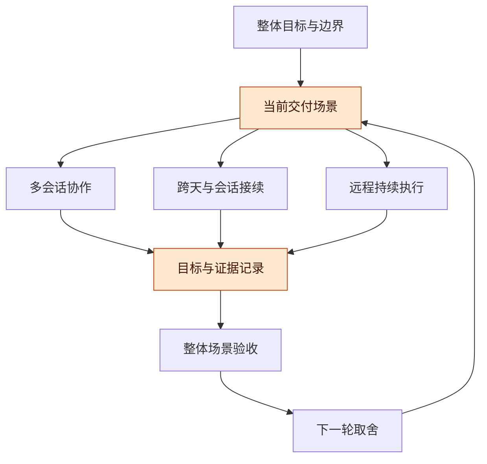
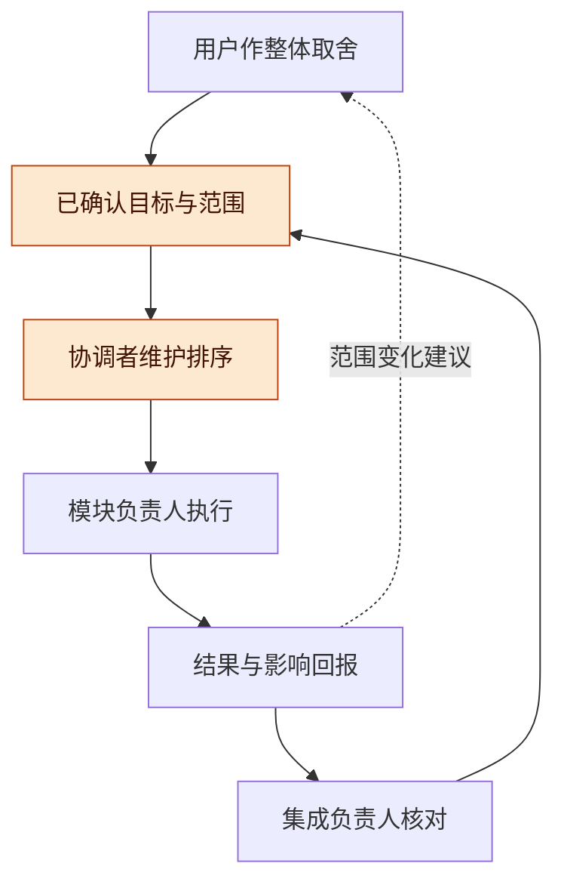
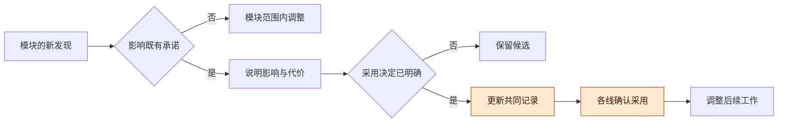

# Harness 多会话协作与整体目标管理讨论稿 v0.1.1

2026-11-13 · 个人 Harness 研究，Codex 整理

## 版本与范围

建议让多会话协作、跨天接续和远程持续执行共同服务一项完整交付，以共同目标、统一排序和模块承诺维持整体方向。各模块保留实现自主权，跨模块范围变化通过明确的采用决定进入当前工作。

- 版本：v0.1.1 纳入已确认的最小实现范围及其证据边界；v0.1.0 为首次研究整理，包含整体目标、职责、变更采用、最小管理试验和本线最小功能的实现状态；后续修改按补丁号递增。
- 主线：整体目标 → 共同记录与职责 → 优先级与变更 → 最小试验 → 证据与下一步。
- 状态标记：【已确认】为本轮明确决定；【文档核实】为已读取的项目或原始资料；【已实现待验证】为本线已有代码但尚无新增运行结论；【提案】为尚待采用的管理方式；【待验证】为尚无本项目试验结果的判断。

**分支与实现决定**：【已确认】三个方向分别新建独立分支，先实现各自最小功能，再做组合试验，保留现有分支。本线为 `codex/harness-coordination`；已确认范围为整体目标、验收条件、线程优先顺序及工作线程本轮采用版本。实际提交、发布与测试状态由仓库记录另行确认；组合演示任务及整体验收仍需冻结。

**研究范围**：本稿关注多会话和多模块怎样共同维护目标与优先级，讨论最少需要哪些记录和决定。远程试验如需验证，仅在独立 Linux ARM64 环境进行；环境准备、身份接入和具体试验结果由相应记录单列。本稿不包含安装与账号资料，也不将环境可用写成产品通过验收。

## 总体架构

三个方向可以共享一个完整工作场景，分别承担协作、接续和执行责任，并通过同一组交付条件判断整体进展。

【提案】共同目标可以表述为：多个会话围绕同一项目协作，隔天换会话仍按当前有效目标继续，远程任务的状态、成果与责任能够接回，最后按同一需求版本验收。这是用于讨论的目标候选，具体任务与完成标准仍待冻结。

**图 1　总体架构 · 三条研究线共同服务交付**

从上方共同目标进入三个方向，再回到相同的记录和验收；重点是让每条线的成果能说明对当前场景的贡献。

| 方向 | 本阶段需要明确的承诺 | 可作为后续候选的能力 |
| --- | --- | --- |
| 多会话协作 | 当前目标、模块责任、依赖、优先级和整体验收人 | 全自动调度、复杂资源优化 |
| 跨天与会话接续 | 新会话能够取得有效决定、状态、证据位置和下一步 | 自动知识提炼、复杂语义检索 |
| 远程持续执行 | 能识别原任务及实际状态，明确恢复责任、产物和结果 | 多云和多模式全覆盖 |

**范围关系**：研究、场景设计和独立验证可以并行。进入当前交付的工作需有共同排序，写入共享权威状态及组合验收需有明确责任。研究方向均保留，但投入无需平均分配；当前交付与有明确问题和检查点的探索可以同时存在。

**现有路线**：【文档核实】公开路线仍保留 P01–P15 后 B01–B12；H/I 为研究验收切片，不自动改写产品排期。I06 直接依赖 I03、I04，I05 不构成其隐含前置。独立分支用于承载研究与后续选定工作，具体实施顺序仍需显式衔接。[路线说明](https://github.com/TaiShuo150622/dsh-project-workbench/blob/codex/dsh-project-workbench/docs/harness/10-unified-engineering/2026-11-08-v0.1.9/ROADMAP_CLOSURE.md)

## 共同记录与职责

先用简短记录表达共同目标、排序和模块承诺，就能试验管理方法；完整记忆平台、图平台和新调度系统无需自动成为前提。

【提案】复用现有文档和任务卡，设一个共同入口。以下记录名称只是拟议用途，尚未创建或接入产品；允许合并为一份短文档，避免为了管理增加维护负担。

| 记录 | 最少内容 | 维护责任 |
| --- | --- | --- |
| 当前目标 | 用户场景、范围边界、完成条件、有效版本及其决定来源 | 用户作重要取舍，协调者维护 |
| 整体承诺与排序 | 对应目标、交付物、负责人、依赖、采用版本、下一检查点及证据 | 协调者汇总，模块负责人回报 |
| 决定与变更 | 提案、已采用或已替代状态，原因、影响范围、采用时点 | 决策者确认，协调者同步 |

模块详细任务仍放在原位置，用链接关联共同入口。共同记录不要求所有信息进入同一数据库，但同一个目标或决定需要有可识别的权威版本。

**图 2　职责关系 · 统一取舍与局部自主相互衔接**

上方负责目标和承诺，下方负责实施与证据；模块发现变化时回报影响，已经确认的范围内决定可继续自主推进。

| 责任 | 可以决定什么 | 需要交回什么 |
| --- | --- | --- |
| 用户 | 重要目标、范围取舍、投入边界和最终接受标准 | 明确决定及适用范围 |
| 协调者 | 按已确认顺序选择就绪工作，处理已有规则覆盖的依赖 | 当前排序、阻塞、待取舍事项 |
| 模块负责人 | 在承诺和接口范围内选择内部实现及局部执行计划 | 实际成果、证据、偏差和新发现 |
| 整体集成负责人 | 核对版本组合与跨模块场景是否满足已定要求 | 通过范围、失败原因和未测部分 |

这些是职责，可由同一人或会话承担不同部分。职责和记录需要独立于聊天寿命；协调者没有自动扩大用户目标的权力，也无需把每项范围内的小决定重新交给用户批准。

## 优先级与变更采用

整体业务优先级、依赖允许的执行顺序和运行中任务的生命周期应分别管理，才能在方向一致的同时保留并行推进空间。

【提案】整体排序先判断当前场景被什么阻塞，再判断哪些关键未知可能造成返工，以及哪些维护是当前交付所必需的。高价值任务前提未齐时保持其业务优先级，其他已就绪工作可以继续。模块发现额外工作时，应说明它对当前验收的必要性及新增代价。

**图 3　变更采用 · 新发现进入当前计划的路径**

从左侧新发现判断影响，已采用的变化再进入各线；运行中任务的处置仍需按实际状态和既有约定决定。

| 情形 | 管理动作 |
| --- | --- |
| 内部改进，不改变对外承诺 | 模块自行调整，回执记录影响 |
| 接口、共同状态含义或依赖变化 | 相关方确认采用版本、影响和验证范围 |
| 整体目标或投入边界变化 | 明确改变哪些承诺，再同步受影响执行线 |
| 新研究有价值，但当前场景不需要 | 留作候选，记录适用条件和重看时点 |
| 到达阶段检查点但尚未完成 | 评估剩余必要范围及后续投入，不默认无限追加 |

**在途工作**：已经正常运行的长任务不因排序变化而被无故打断。保留既有成果，先核实实际状态；崩溃优先补救和断点继续，已完成工作不自动重跑。阶段检查点是讨论后续投入的时点，不构成停止进程或重置工作区的命令。

**独立开发条件**：【文档核实】P/B 任务包因公共文件高重叠保留单写者约定。研究分支独立，并不自动证明功能写入已经可安全并行；后续实施需核实允许文件、共享状态和集成顺序。[面板协作约定](https://github.com/TaiShuo150622/dsh-project-workbench/blob/codex/dsh-project-workbench/docs/harness/05-panels/docs/handoff/panels/COLLABORATION.md)、[后端看板](https://github.com/TaiShuo150622/dsh-project-workbench/blob/codex/dsh-project-workbench/docs/handoff/ui-backend/BOARD.md)

## 本线最小实现与验证状态

本线已写入目标、验收条件和线程顺序的最小实现，并保持只读模型上下文；实际行为、桌面体验和组合场景仍待隔离环境验证。

【已实现待验证】界面可从项目卡片的“管理项目”进入，也保留线程总览中的入口。目标和验收条件是文本，尚未提供自动整体验收判定；目标编辑也不改变工具权限。实现入口见 [实现说明](coordination-implementation.md)。

| 行为 | 当前代码处理 | 验证边界 |
| --- | --- | --- |
| 维护目标和验收条件 | 与项目一起持久化，以 `expectedRevision` 在同一存储事务中判断保存冲突 | 已新增合成数据回归用例，尚未执行新增产品测试 |
| 调整线程顺序 | 在依赖已满足的排队线程中优先选取，已在跑的任务继续 | 沿用既有依赖就绪判定，未实现复杂调度或资源优化 |
| 版本采用 | 每轮正式启动时保存目标版本、目标和验收快照，与任务消息同一事务写入 | 当前运行轮次保留原快照，下一次自然启动采用新版本 |
| 冲突与草稿 | 界面显示冲突并保留草稿，轮询不会覆盖未保存内容 | 尚未完成真实桌面交互验收 |
| 旧项目兼容 | 缺少协调字段时提供默认视图，保存后增加字段，保留原项目与线程 | 尚未对真实存量项目执行迁移试验 |

本线仅执行静态语法及差异检查，不把这些检查写成行为测试通过。环境安装、登录或真实模型调用均不由本线代码完成情况推断；后续实际结果另行记录。

## 最小管理试验

先验证短记录能否让新会话正确继续并维护整体排序，再根据实际问题决定是否需要新增系统能力。

【待验证】拟选一个演示仓库中的小改动，由多个工作会话完成可独立部分，其中一个验证步骤在独立 Linux ARM64 环境运行。随后更换协调会话，读取共同记录后继续，并交付对应当前需求版本的结果与证据。具体任务、环境能力、权限和通过条件均需在执行前冻结，本稿未运行此场景。

**图 4　试验路径 · 从当前方式到可比较观察**

沿左至右取得基线、使用短记录并观察接续，末端比较尚待执行，不能据此预先声称减少返工。

**任务书**：

1. 确认一个能同时体现协作、接续和远程结果回收的演示任务，登记当前用户做法与验收条件。
2. 写明目标、各线贡献、依赖和共同决定；具体记录载体可以沿用仓库文档，先避免新增平台开发。
3. 执行线按承诺回报结果；新增想法分别标为候选或已采用，后者记录对既有工作的影响。
4. 新协调会话仅按约定入口取得上下文，核实原任务状态、当前优先级和下一步；不默认重建环境或重跑工作。
5. 集成负责人核对有效需求、实际产物、版本组合及验证证据，登记人工补充信息和返工原因。

**对照组**：

| 组 | 做法 | 观察目的 |
| --- | --- | --- |
| 当前方式 | 记录现有协作中解释目标、定位决定、交接与结果核对的过程 | 取得基线，不擅自重跑已完成任务 |
| 短记录试用 | 在可比较的新任务中使用共同目标、排序和模块承诺 | 观察接续正确性、协调成本和范围变化 |

任务不完全等价时，记录复杂度、参与会话、远端步骤和需求变化等差异；单次观察只用于发现问题，不作为因果效果证明。

**观察口径**：新会话能否正确说明当前目标、自己的承诺及下一步；未采用的想法是否改变当前计划；已采用变更是否传达到受影响执行线；远程状态不明时是否保留未知并避免误报完成。另记录重新解释的次数和用时、旧决定引发的返工、跨模块验收失败原因以及从局部完成到整体可用的等待。先取基线，再讨论目标值。

**停止判据**：发现记录无法区分候选与有效决定、目标版本冲突或远端效果未知却将触发重复动作时，暂停相应的新动作并保留证据；其余独立工作继续。达到约定投入边界时复核是否缩小剩余范围或另立后续任务，不降低已冻结的必要质量标准。

## 相关工作与项目依据

官方方法资料支持共同目标、清晰责任和范围取舍，项目文档提供衔接边界；它们均不能替代本项目的管理试验。

| 类别 | 代表（年份） | 核实到的内容 | 缺口 |
| --- | --- | --- | --- |
| 产品目标与自主执行 | [Scrum Guide](https://scrumguides.org/scrum-guide.html)（2020） | 同产品多团队共享产品目标、产品待办和产品负责人；执行者决定实现方式 | 人类团队框架，未证明适用于本项目 AI 会话的效果 |
| 跨团队整体交付 | [Nexus Guide](https://www.scrum.org/resources/online-nexus-guide)（2021） | 共享产品待办，保留各团队计划；依赖透明，整体成果需集成后有用、可用 | 本项目尚未完成对应的管理试验与整体产品验收 |
| 投入与范围 | [Shape Up：Set Boundaries](https://basecamp.com/shapeup/1.2-chapter-03)（2019） | 先明确愿投入的时间与注意力，再收窄问题及方案 | 具体周期不能直接套用到个人加 AI 的工作方式 |
| 承诺与采用 | [Shape Up：The Betting Table](https://basecamp.com/shapeup/2.2-chapter-08)（2019） | 保护已安排的投入，对后续投入重新作取舍 | 不据此引入自动取消正常长任务的规则 |
| 项目现状说明 | [工作台 README](https://github.com/TaiShuo150622/dsh-project-workbench/blob/codex/dsh-project-workbench/README.md)（2026，本轮核对） | 描述同一 DSH 实例的持久线程、待验收结果和断开后保留状态 | 本轮未复测；外部 Claude/Codex 会话尚未按该说明接入 |
| 研究与产品路线 | [路线衔接](https://github.com/TaiShuo150622/dsh-project-workbench/blob/codex/dsh-project-workbench/docs/harness/10-unified-engineering/2026-11-08-v0.1.9/ROADMAP_CLOSURE.md)（2026） | P/B 顺序及 I 切片依赖明确，I05 不是 I06 的隐含前置 | 本次获准的最小实现已单列，组合试验仍需与既有路线衔接 |

**方法取舍**：Scrum 保持产品待办；Shape Up 使用少量成形提案，并反对不断维护巨大的候选待办。本稿借用前者的共同目标和排序责任、后者的投入边界与范围取舍，形成轻量提案，不声称实施完整 Scrum、Nexus 或 Shape Up。

**证据身份**：项目文档读取日期为 2026-11-13；协作稿、看板中的历史状态不等同于整个项目当日实测进展。研究与静态复核属于同模型、不同上下文；新增代码尚无本线产品运行验收结论。

## 风险与开放问题

主要风险是共同记录再次膨胀成维护负担，或新的讨论和分支被误认为已经改变当前产品承诺。

- **记录负担**：优先链接现有任务卡和证据，重复字段只保留权威入口；以解释成本和错误变化判断新增记录是否值得。
- **目标漂移**：候选、已采用和已替代决定明确区分，执行线记录实际采用版本。
- **协调者成为瓶颈**：模块内部决定保留自主权，仅将跨线影响和整体取舍提交共同处理。
- **分支形成孤岛**：每条线都需说明对共同场景的贡献、依赖及返回条件；创建分支本身不证明可集成。
- **局部通过被扩大**：分别登记模块验证、组合场景和整体验收，证据绑定当前范围与版本。
- **试验外推**：小规模观察只能发现当前方式的问题；任务差异和维护开销需进入比较。

开放问题：

- [ ] 首个共同演示任务及整体验收条件如何冻结？
- [ ] 共同记录由谁维护，哪些范围内决定可由协调者直接执行？
- [ ] 各线愿投入多少时间与注意力，何时检查是否继续？
- [ ] 三条分支中的试点怎样映射回既有 P/B 任务及其单写者约定？
- [ ] 哪些独立 Linux ARM64 环境观察足以支持首个场景，哪些仍需其他实际宿主验证？

## 待证命题与下一步

下一步应先冻结一个最小管理试验，检验短记录是否减少接续错误和人工协调，再决定是否扩大功能范围。

| 编号 | 命题 / 猜想 | 已有依据 | 缺口 |
| --- | --- | --- | --- |
| A1 | 共同目标、排序和模块承诺足以维持小规模多会话方向一致 | 原始方法和现有交接字段提供设计依据 | 本项目真实接续与协调成本观察 |
| A2 | 显式采用决定能减少新增研究引起的范围漂移 | 已有协作稿要求采用版本；本稿将其延伸到整体排序 | 一次候选保留、一次有效变更传播的实际验证 |
| A3 | 三方向可以通过一个小场景形成整体价值，且无需先完成全部平台能力 | 已有 I 切片依赖允许按必要条件展开 | 功能范围、真实环境及组合验收未冻结 |
| A4 | 管理上的共享排序可以与模块自主和并行探索兼容 | Nexus 与 Scrum 区分整体承诺和执行计划 | 当前项目的阻塞、等待与维护负担比较 |

下一步：

- [x] 核对项目文档和官方方法资料，区分方法描述与产品运行证据。
- [x] 整理本线讨论稿，明确独立分支及最小功能授权，区分代码与待验证状态。
- [x] 写入本线最小实现和对应行为测试用例，完成静态语法与差异检查。
- [ ] 由仓库发布流程登记本线实际分支、提交与文档入口，保留现有分支。
- [ ] 明确演示任务、共同记录维护者、投入边界和整体验收条件。
- [ ] 在隔离 Linux ARM64 环境运行新增产品测试并记录实际结果。
- [ ] 先用共同目标、排序和模块承诺短记录开展最小管理试验。
- [ ] 将实际环境、产物和观察结果单列记录；根据结果决定后续实现范围。
