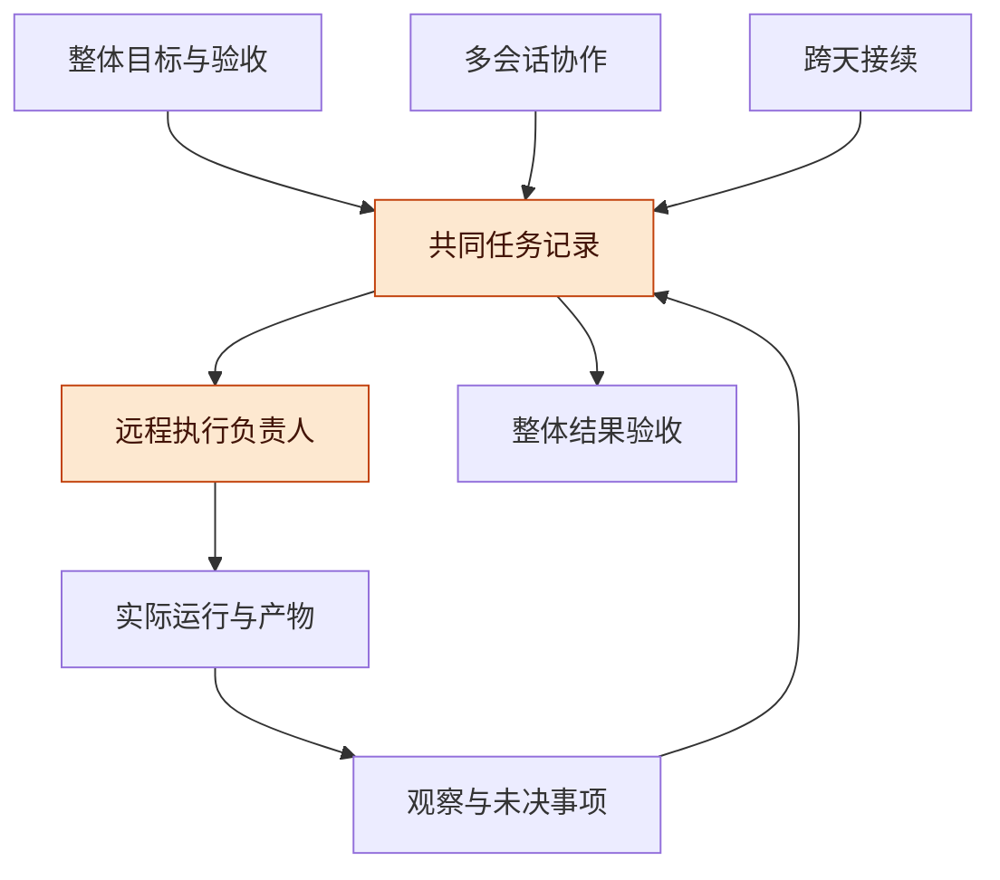
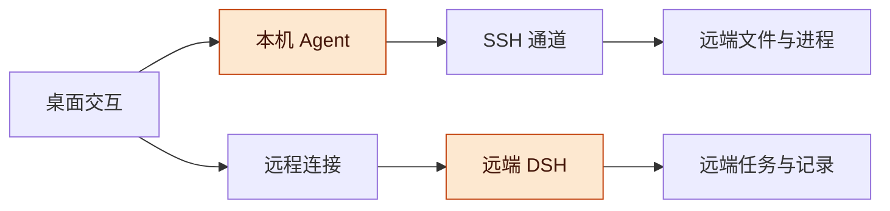
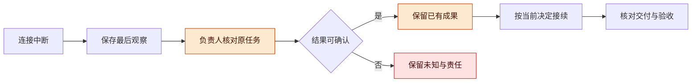
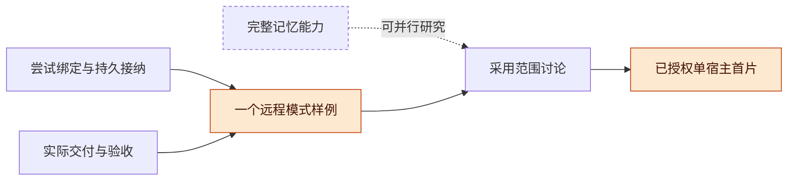

# Harness 远程持续执行与恢复管理讨论稿 v0.1.1

2026-11-13 · TaiShuo / Codex 协作整理

## 版本与范围

建议让远程执行始终归属于同一个整体目标、任务记录和责任人；断连或换会话后先核对原任务，再决定如何接续。远程能力应以可观察、可接续、可交付的完整场景验收。

- 版本：v0.1.1，纳入用户确认的单宿主最小范围、原任务核对与显式继续契约，记录分支实现、测试和待实测边界；v0.1.0 首次将远程研究整理为公开讨论稿，明确模式差异、恢复责任及当时待冻结的试验条件。后续修改按补丁号递增。
- 主线：整体目标 → 模式与状态 → 恢复责任 → 独立分支 → 来源与证据 → 首个试验 → 待证命题。
- 状态标记：**已核读**指本轮读取的公开文档；**已授权**指用户已确认的最小范围；**已实现**指分支中已形成源码；**已测试**指主线在独立环境实际运行的指定检查；**提案**指范围外的管理和验证方案；**待实测**指尚无本轮真实产品场景证据。

**授权与状态**：用户已确认三个新独立分支分别完成最小实现，再组合试验；现有分支保持原状。本稿对应 `codex/harness-remote-recovery`。首轮采用单宿主模式 B：DSH 与 Agent 位于独立 Linux ARM64 测试环境，产品提供原会话状态核对与重新连接后的观察入口，默认不重新执行。首轮 32 条检查通过后，源码复核发现遗漏场景；主线先实测新增 10 条反例全部失败，再进行补充修复及宿主兼容适配。修复后全套 45 条测试通过、0 失败、0 跳过，构建成功，11 个变异全部被检出。这些属于自动行为验证，本稿不声明真实模型调用、断连接续或组合恢复验收已经通过。详见 [C 任务卡](tasks/C-01-recovery.md)与[实现及验证边界](recovery-implementation.md)。

**公开范围**：试验目标仅表述为“独立 Linux ARM64 测试环境”。主机地址、用户名、账号、凭据、本地绝对路径、安装运行原始日志和公司信息不进入本稿。

## 总体架构

远程线应为同一项目提供持续执行与恢复能力，并与多会话协作、跨天接续共同维护整体目标和优先级。

**图 1　总体架构 · 三个方向共用任务记录**

从整体目标向下读，远程执行的事实回到共同记录，后续取舍和验收继续使用同一组依据。

**整体目标候选**：多个执行者围绕同一个项目工作时，目标、决定、在途任务和成果能跨会话、跨天及远程环境持续衔接。远程线承担任务状态与效果的核实，不另行形成脱离整体目标的功能排序。

| 方向 | 对整体的贡献 | 需要共同维护的内容 |
| --- | --- | --- |
| 多会话协作 | 任务分工、范围、优先级及整体取舍 | 目标版本、承诺、依赖和验收条件 |
| 跨天接续 | 换会话后取得当前决定、成果与下一步 | 有效决定、已有成果、在途任务和恢复入口 |
| 远程执行 | 观察实际运行、核实效果并负责恢复收尾 | 原任务身份、运行位置、最后观察和未决效果 |

**排序提案**：先讨论能够解除当前场景阻塞的工作，再讨论消除关键未知的验证；新增环境、高级自动化和体验扩展应说明对整体目标的贡献及会替代哪项当前投入。

## 运行模式与状态边界

两种远程模式分别决定谁持有 Agent 和会话，断网与本机关机时的持续执行承诺必须分别说明。

**图 2　运行归属 · 本机操作远端与远端托管**

上路的 Agent 由本机持有，下路的 Agent 由远端持有；连接状态与实际执行状态需要分别核实。

【已授权】首轮最小实现采用模式 B 的单宿主边界，不实现多宿主或 SSH 管理。运行实例仅显示随机标识、启动时间、平台和架构。实例存在只说明当前 DSH 进程的身份；Agent 空闲、外部命令完成、外部效果成功与产物验收分别需要证据。核对接口不保证外部作用恰好一次。

【既有决定】项目保留模式 A“本机 Agent 操作远端”和模式 B“远端 DSH 托管 Agent”，按会话选择环境，先研究 SSH 接入。选择一个首个验证样例不取消另一模式。[远程双模式 v0.1.1](https://github.com/TaiShuo150622/dsh-project-workbench/blob/codex/dsh-project-workbench/docs/harness/07-remote/DSH-远程工作区与双运行模式讨论稿-v0.1.1.md)

| 场景 | 模式 A | 模式 B |
| --- | --- | --- |
| 本地与远端断网 | 本机无法继续可靠观察或发出远程动作；受管资源可能进入清理 | 远端服务正常且具备所需能力时可能继续；桌面只显示最后观察 |
| 本机关机 | 不承诺 Agent 或受管命令继续 | 持续执行是设计目标，依赖远端服务、权限等待与实际能力 |
| 重新连接 | 核对原动作和进程，不自动重发 | 读取原会话与原任务，不重新创建一个任务冒充恢复 |

【已核读】官方 SSH 文档说明，helper 在 SSH EOF、终止信号或心跳租约到期时管理清理；断连客户端不能确认远端结果，操作不会自动重连或重放。本轮读取的文档 blob 为 `106974c3bbdfd5d88886a33dda742d0749cd775d`。该文档不能证明特定安装版本的行为，实际试验仍需固定版本。[DSH SSH 生命周期](https://github.com/deepseek-ai/deepseek-harness/blob/master/packages/ssh/ssh/README.md)

**状态提案**：每个远程任务分别保留连接可观察性、执行者最后观察状态、外部动作结果和产物验收结论。取消请求的回执、进程退出和整体完成属于不同判断；未知项要附最后观察时间及负责跟进的人。

## 任务记录与恢复责任

恢复的第一步是核对原任务的真实状态与已完成成果，负责者在断连和换会话后仍须明确。

**图 3　恢复流程 · 观察在前，接续在后**

从断连向右读，可确认的结果进入接续和验收，仍未知的效果留在待核对项中，不能用重发动作代替查明结果。

【提案】最少任务记录包括：整体目标及版本、本阶段承诺与排序理由、任务/尝试/请求身份、运行模式和环境、最后观察、阶段产物或检查点、未决效果与用量、当前负责人和下一次核对条件。可以先复用现有看板和短记录。

| 角色 | 责任 |
| --- | --- |
| 产品维护者 | 决定目标、重要取舍和成本范围；必要时决定是否整体重跑 |
| 整体协调者 | 维护任务对整体的贡献、依赖与变更采用时点 |
| 远程任务负责人 | 核实执行与效果、保存进度、处理失败和收尾；断连不解除责任 |
| 接手者 | 读取记录并核对实际环境，明确接手后再继续控制任务 |

**在途变更**：远程任务按已确认范围运行；新目标和新优先级先形成变更记录，说明何时采用、哪些工作保留及哪些部分受影响。目标文字更新不能隐式把原请求变成另一项动作。

**恢复约束**：正常运行任务不因另一种方案可能更快而中断；程序崩溃先修复并尝试从检查点继续，已经完成的工作保留。只有确认无法补救且取得明确授权时，才讨论整体重跑。后续长任务沿用 `screen -dmS` 运行约定，但该约定本身不证明应用能够从崩溃恢复。

## 独立分支与阶段边界

三个新分支分别承载确认后的最小实现，组合试验使用同一目标和验收口径；研究路线中的更广能力继续保留其原证据状态。

**图 4　依赖关系 · 远程首片保留真实前置**

实线表示已有研究路线列出的远程前置，虚线能力可以分别研究，其完整实现不自动成为远程首片的前提。

【已核读】I06 直接依赖 I03 的尝试绑定与持久接纳、I04 的交付与验收；I05 完整记忆不是隐含前置。P01–P15、B01–B12 的原产品顺序继续保留，研究切片不会自行替换它。[路线衔接](https://github.com/TaiShuo150622/dsh-project-workbench/blob/codex/dsh-project-workbench/docs/harness/10-unified-engineering/2026-11-08-v0.1.9/ROADMAP_CLOSURE.md)

| 项目 | 本轮边界 | 当前结论 |
| --- | --- | --- |
| 新独立分支 | `codex/harness-remote-recovery`，由项目协调方审核和发布 | 已创建；本稿不声明已提交或发布 |
| 现有分支 | 保持原状 | 不以新讨论替换既有实现或验收结论 |
| 试验环境 | 独立 Linux ARM64 测试环境 | 主线负责准备及真实验证，环境准备与功能通过分别记录 |
| 功能开发 | 只观察原任务、保留成果、未知不重投、显式继续另行操作 | 已授权、已实现；补充反例已复现，修复后的完整自动检查通过 |
| 真实试验 | 三分支分别验证后组合；仅使用合成示例和约定任务 | 最小验收已明确，真实产品结果待记录 |

**已实现的契约**：项目保存最新核对时间、匿名运行实例、总对话与各线程的 `running / idle / missing / unknown` 观察及固定原因。未加载 Agent 或不可检查的收件箱归为 `unknown`；有会话记录不证明空闲。核对只存档观察，不创建会话、不投递、不停止、不重试，也不解除历史消息或线程的 `recoveryHold`。断连通过单独连接状态和陈旧标记表达，不覆盖原任务阶段。

**显式继续**：用户先核对，再选择“继续原任务（可能接着执行）”；服务端重新确认原会话确实空闲，并复核运行实例、会话及任务代次。历史排队项仅在没有会话、工作树或启动记录时允许显式放行；冷启动活动线程在原会话加载并确认空闲后也有继续入口。运行中、未知、已验收和待验收成果不进入通用恢复重跑。已有会话、成果和工作树保留。

**补充恢复边界**：保留的后续队列使用独立“继续已排队后续任务”操作，原成果不重跑，新交代不会被旧队列覆盖。创建失败须区分明确尚未创建与创建结果未知；已返回的会话身份持久保留，权限修复并核对后才继续。当前总对话的汇报可以单独确认重试，未知 worker 输入继续保留。以上补充通过反例驱动形成，并通过完整自动检查，真实产品与组合行为仍待验证。

**与 A/B 的关系**：A 的整体目标与验收记录为必需的管理输入；B 的接手决定旧总会话何时失去派发权。C 的 hold 标记必须在 B 重定向消息时保留，接手与投递需要共享互斥，避免重定向解除待确认状态。组合实现和组合验证由主线负责。完整记忆、多宿主和自动故障补救不作为首轮前置。

## 相关工作与证据边界

一手资料支持保留执行身份、效果核对和持久进度，但这些机制的存在不能直接证明本项目的远程恢复已经可靠。

| 类别 | 代表（年份） | 核实到的内容 | 缺口 |
| --- | --- | --- | --- |
| SSH 生命周期 | [DSH SSH 文档](https://github.com/deepseek-ai/deepseek-harness/blob/master/packages/ssh/ssh/README.md)（2026 年核读） | 本机持有 Harness 与会话，远端 helper 负责连接结束后的清理；不自动重放 | 试验安装版与实际行为待验证 |
| 重试与效果 | [AWS 幂等重试](https://aws.amazon.com/builders-library/making-retries-safe-with-idempotent-APIs/)（2026 年核读） | 超时可能发生在执行之后；请求身份和参数一致性用于区分重复调用及不同意图 | 目标动作是否具备幂等和读回能力需逐项确认 |
| 持久执行 | [Temporal 概念](https://docs.temporal.io/temporal)与[重试策略](https://docs.temporal.io/encyclopedia/retry-policies)（2026 年核读） | 持久历史保留进度；编排恢复与有副作用活动的重试分开，完整 Workflow 不默认整体重试 | 本稿仅借用管理原则，未选定或集成 Temporal |
| 项目兼容 | [rc.5 兼容记录](https://github.com/TaiShuo150622/dsh-project-workbench/blob/codex/dsh-project-workbench/docs/harness/07-remote/DSH-rc.5-插件兼容测试记录-2026-11-04.md)（2026） | 历史记录包含隔离宿主的插件兼容检查 | 未覆盖完整真实模型任务、远程 Git 和多 Host 前端 |
| 项目验收设计 | [I06 检查清单](https://github.com/TaiShuo150622/dsh-project-workbench/blob/codex/dsh-project-workbench/docs/harness/10-unified-engineering/2026-11-08-v0.1.9/west/implementation-taskbook/slice-checklist.json)（2026） | 拟议检查包含环境归属、重连不重发和未知用量 | 状态为 `PROPOSED_NOT_RUN` |

**核实后的修正**：远程 v0.1.1 所述子代理 rc.3 不兼容是升级前快照；同目录兼容记录说明随后已升级 rc.5 并通过隔离检查。这个修正仅对应当时记录，不代表本轮安装状态，也不代表跨机恢复验收。

**仍未核实**：新增分支在实际宿主中的核对结果、浏览器断连期间 Agent 的连续运行、外部命令实际效果、进程崩溃后的检查点恢复和总成本。主线的环境准备、分支测试或旧版本兼容记录不能代替这些验证。GNU Screen 官方手册本轮访问超时，未用该网页证明恢复能力。

## 首个试验场景与验收讨论

首个试验采用已确认的单宿主最小范围，先验证三个分支，再核实同一任务在断连、换会话及重新观察后的连续性。

**图 5　试验主线 · 贯穿一个任务和一次交接**

从左到右始终跟踪同一任务；阶段产物出现后仍需完成约定的断连、交接和最终验收，才能判断整个场景通过。

【已授权】在独立 Linux ARM64 测试环境运行 DSH，由产品核对原会话和任务，默认不重跑。三个分支先各自验证，再组合试验；正常任务持续运行时只做观察。受控断连只改变测试观察连接，不中断正常执行。真实模型任务与具体故障注入仍须按已约定的试验任务进行，不能用纯合成测试冒充真实恢复。

**任务书**：

1. 由主线固定本次源码版本、宿主版本、合成示例和允许的观察连接变化。
2. 分支回归检查观察不触发执行、未知不误判、历史消息不自动重投、显式继续有可达入口且保留原身份。
3. 组合 A/B/C：在同一整体目标下核对原任务、接手总会话，验证 held 消息重定向后仍待明确处理。
4. 记录真实产品的核对时间、运行实例、原任务状态和保留产物；将单元测试、产品操作、真实模型执行和最终验收分开判断。

**对照组表**：

| 组 | 做法 |
| --- | --- |
| 连续连接参考 | 同一任务在连接正常时推进，记录成果和人工介入 |
| 断连接续候选 | 在冻结的时点中断观察连接，恢复后核对原任务再接续 |
| 换会话接续候选 | 由新会话读取共同记录并核实真实环境，保留原任务与成果 |

这些对照用于后续组合试验；本稿尚无这些场景已运行的证据，也不据此作性能结论。

| 检查项 | 应取得的观察 |
| --- | --- |
| 身份与范围 | 目标版本、任务、环境和产物始终可对应，旧响应不覆盖新状态 |
| 效果核对 | 无回执时保留未知，目标端观察能支持已执行、未执行或仍未知的判断 |
| 重复工作 | 重连和换会话不重复创建任务、重发原动作或重做已完成阶段 |
| 状态含义 | 等待审批、失败待补救、取消待确认和已验收能明确区分 |
| 接手质量 | 接手者能解释下一步及依据，记录人工说明、恢复耗时与丢失进度 |
| 成本记录 | 保留最后用量观察和未结算项，失联不被记为费用归零 |

**停止判据**：试验样例出现未受控副作用、无法核对的关键身份，或触及预先冻结的资源界限时，停止新增动作并保留已有成果、未知项和观察记录，按约定收尾。观察连接停止不能证明远端进程已经终止。故障注入仅用于已约定的试验任务，不打断正常运行任务。

## 风险与开放问题

主要风险是未知状态被误写为失败或完成，以及目标改变后旧任务被重复执行；模式声明、恢复责任和版本记录需要共同约束这些情况。

- **观察缺口**：断连时缺少新证据，持续显示最后观察与未知项，指定核对责任人。
- **重复副作用**：原请求可能已经执行，恢复前核对效果，按目标动作的实际能力决定后续步骤。
- **责任空缺或重叠**：换会话时明确接手状态，避免无人收尾或多个控制者同时发出动作。
- **目标漂移**：新优先级进入变更记录，说明采用时点及在途影响，保留已有成果。
- **证据越界**：文档、历史兼容检查和本轮环境准备分别记录，不据此宣称产品恢复完成。
- **复杂度增长**：完整记忆、自动经验学习及更多环境需说明收益，不能未经讨论成为首片前置。

开放问题：

- [x] 首轮范围已选定为模式 B 单宿主 DSH，提供原任务核对，默认不重跑；外部命令效果与关机持续能力另行实测。
- [ ] 谁负责远程任务核对、失败补救、接手确认和最终收尾？
- [ ] 首个任务具备哪些检查点、效果读回和幂等能力？
- [ ] 采用哪些具体版本与能力组合，如何记录兼容证据？
- [ ] 如何冻结资源范围、未结算用量和停止后的收尾方式？
- [ ] 三条独立分支的共同决定由哪个入口维护，何时采用到各分支？

## 待证命题与下一步

下一步由主线核实分支的真实产品行为，再进行三方向组合试验，用实际观察决定整体管理约定是否成立。

| 编号 | 命题 / 猜想 | 已有依据 | 缺口 |
| --- | --- | --- | --- |
| R1 | 共同任务记录与明确负责人足以支持首个远程接续场景 | 项目双模式设计、恢复责任提案和 I06 拟议检查 | 一次真实换会话接续与效果核对 |
| R2 | 先核对原任务可降低断连后的重复执行 | AWS 幂等案例与项目不重发约定 | 目标动作的实际读回能力及故障场景观察 |
| R3 | 明确运行模式可防止把连接变化误认为任务变化 | DSH SSH 生命周期和 A/B 归属差异 | 固定安装版本的断网及本机关机验证 |
| R4 | 最少记录可以先支撑管理，不必等待完整记忆能力 | I06 真实依赖不包含 I05 完整能力 | 真实任务的记录充分性及人工维护成本 |

下一步：

- [x] 核读项目双模式、历史兼容记录、I06 依赖及一手来源，保留证据边界。
- [x] 将远程管理研究整理为公开讨论稿，明确新分支及试验环境准备的授权范围。
- [x] 创建新的独立分支，保留既有分支；提交和发布另记实际结果。
- [x] 用户确认单宿主核对、默认不重跑及三个分支分别实现后组合试验的最小范围。
- [x] 形成核对接口、恢复 hold、显式继续入口及行为回归用例。
- [x] 主线在独立 Linux ARM64 环境完成本分支 32 条测试、构建及 11 个变异检查；这些证据限于所执行的检查。
- [x] 源码复核后补充 10 条反例，先实际复现失败，再形成修复和 3 条只读宿主兼容测试。
- [x] 主线复验补充修复后的完整源码快照：45 条测试、构建和 11 个变异检查通过。
- [ ] 在明确范围内开展真实产品和组合试验，区分通过、失败、未知与未执行。
- [ ] 将试验结论回到整体目标和优先级，决定保留、缩小或继续扩展的范围。
