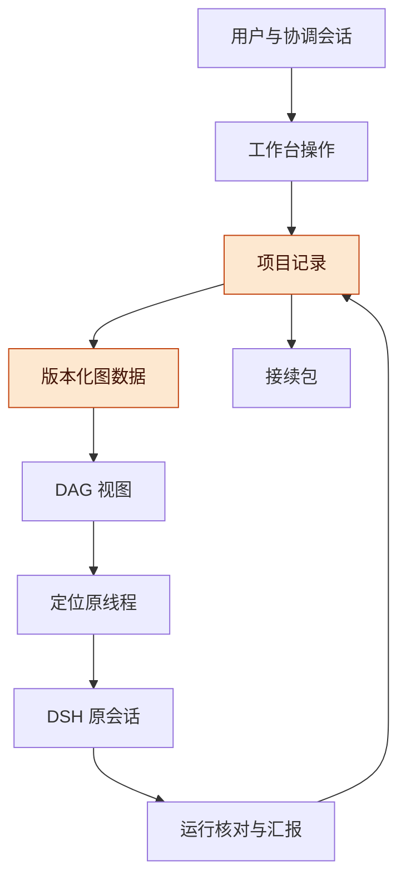
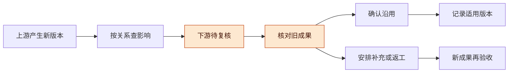

# Harness 工作台与 DAG 整体实施讨论稿 v0.1.1

2026-11-13 · Codex，与用户讨论整理

## 版本与范围

首轮已实现“验收条件 → 模块约定 → 原线程 → 成果 → 人工验收”，由工作台内的项目 DAG 展示关联、缺口和变更影响。已有目标、接续和远程恢复继续作为基础；真实界面与接口验证的范围分别记录。

- 版本：v0.1.1，记录用户确认范围、完成的实现、真实界面与宿主接口验证及剩余边界；v0.1.0，首次整理整体方案、现有实现差距、数据责任、首轮实现边界与验收任务书。后续修改按补丁号递增（0.1.1、0.1.2…）。
- 主线：整体目标 → 模块输入输出约定 → 工作线程 → 成果与证据 → 人工验收 → 变更复核与接续。
- 状态标记：**已实现**指本分支源代码；**自动验证**、**实际界面验证**和**宿主接口验证**分别注明证据范围；**后续方向**表示不在首轮内。下文保留的总体设计要求，以本版实施记录和契约为实际交付边界。

**确认范围**：用户已确认完整流程，包括项目图、节点与原线程双向跳转、缺口、变更待复核及接续，沿用现有任务启动规则，在单宿主试验。真实业务验收仍由用户作判断。首轮未要求联通既有独立 DAG 面板，也未开放模型修改交付记录或代替人工验收。

**基线与实现**：保留组合分支 `codex/harness-management-trial` 的 `210779cb15386f8dda3d7e020a1ac86493aab6ca`。新增分支 `codex/harness-delivery-dag`，产品实现提交 `09e29ff`，构建 `b8bafddb38df`。部署采用独立版本目录热加载，宿主进程保持原 PID。

## 整体要解决的问题

每个模块都应能解释自己服务于哪项整体要求、需要什么输入、向谁交付什么，以及用什么证据判断完成。

**图 1　整体管理流程 · 六个环节**

从左向右追踪每项工作为什么要做、交付什么和如何验收；高亮部分是这次需要补齐的管理记录。

| 管理问题 | 产品需要给出的答案 | 判断依据 |
| --- | --- | --- |
| 模块很多，方向逐渐散开 | 哪些工作支撑当前阶段，哪些尚未关联目标 | 验收条件与模块工作的明确关联 |
| 各模块都有进展，整体迟迟不能交付 | 还缺哪些输入、成果、口径决定或验收 | 交付依赖和证据覆盖情况 |
| 目标改变后，不知道哪些成果还能用 | 哪些结果依据旧版本，哪些已复核沿用 | 对象版本、采用版本及复核记录 |
| 换协调会话后需要重新讲一遍 | 当前目标、有效决定、未满足条件和下一步 | 保存的接续包及可解析的版本引用 |
| 远程连接恢复后担心重复工作 | 原任务是谁、是否仍在运行、已有结果是什么 | 原线程身份与运行状态核对 |

**优先级原则**：继续使用已有线程优先顺序。DAG 展示当前验收的阻塞与缺口，协调者据此调整顺序；图中连接数量不直接决定优先级。运行中任务仍遵循本轮采用版本。

## 现有能力与需要补齐的部分

已有三线作为执行基础，本轮已补齐模块约定、成果验收和项目图之间的关联。下面按开工基线和本轮增量对照。

| 层面 | 开工基线 | 本轮已实现 |
| --- | --- | --- |
| 目标与优先顺序 | 目标、验收文本、线程排序、并发版本检查、线程采用版本 | 验收条件的稳定身份与历史版本；关联模块和成果 |
| 模块工作 | 项目内有持久线程，可并行研究或开发 | 模块工作包：负责条件、输入、输出、完成要求、关联线程 |
| 依赖 | 线程 `dependsOn` 已参与启动判断 | 模块交付依赖及解释；与线程启动依赖分别呈现 |
| 成果与验收 | 有线程汇报及“待验收／已验收”状态 | 可逐项核对的成果引用、证据、人工验收记录 |
| DAG 接点 | 线程可保存 `nodes`，已有打开 `cfl-dag` 的按钮 | 项目范围和版本明确的图载荷、双向导航、缺口和影响视图 |
| 接续 | 有效决定、替代关系、接续包、新协调会话接手 | 保存模块约定、成果、验收、待复核项及图引用 |
| 远程恢复 | 原任务核对、恢复 hold、显式继续 | 将原线程状态投影到节点；显示未知和最后核对时间 |

**实现变化**：基线中的验收条件是字符串数组；本版在显式启用交付管理时生成稳定身份，并保留旧文本接口兼容。接续包已补入交付记录和线程 `nodes`。既有独立 DAG 面板绑定其他图源，本轮交付的是工作台项目图。

**既有调度口径**：前置线程进入 `review` 或 `completed` 后即可放行后续线程。这适合先基于待复核结果开展工作；整体交付仍需独立核对成果与验收状态。本轮保留该启动规则。

**依据**：基线中的 `server/coordination.js`、`server/projects.js`、`server/continuity.js`、`client/app.js` 与 `index.js`；既有自动验证见 [VALIDATION.md](https://github.com/TaiShuo150622/dsh-project-workbench/blob/210779cb15386f8dda3d7e020a1ac86493aab6ca/docs/harness/11-project-management/VALIDATION.md)，真实模型试验及其限制见 [LIVE_TRIAL.md](https://github.com/TaiShuo150622/dsh-project-workbench/blob/210779cb15386f8dda3d7e020a1ac86493aab6ca/docs/harness/11-project-management/LIVE_TRIAL.md)。本轮回归共 96 项通过，13 个定向变异被检出；新增界面与宿主接口验证见 [验证记录](VALIDATION.md)。旧 A/B/C 模型试验没有重复运行。

## 总体架构与数据责任

工作台保存项目事实，DAG 消费版本化的关系视图，DSH 保存和执行原会话；所有修改通过工作台同一套写入规则完成。

**图 2　数据与界面分工 · 图数据来自项目记录**

上半部是管理记录与图展示，下半部连接原会话和接续；这张图表示系统数据流，允许反馈，不是需要强制无环的任务依赖图。

| 组件 | 负责 | 写入边界 |
| --- | --- | --- |
| 工作台 | 目标、模块约定、关系、成果、验收和复核记录 | 项目范围校验、版本冲突检查、持久写入 |
| DAG | 关系布局、焦点、上下游影响与缺口展示 | 图中操作转为工作台命令；不另存一份业务状态 |
| DSH | 会话、模型执行、消息历史和原任务身份 | 继续使用现有启动、审批、暂停、恢复规则 |
| 接续与恢复 | 保存接手依据、重新核对原任务 | 原任务状态未知时如实显示，不自动创建替代任务 |

**本轮 DAG 的实现方式**：工作台内新增项目图，直接投影同一项目记录。既有独立 DAG 面板留作后续适配；没有复制私有图实现，没有验证其接入。后续若要联通，需要重新明确适配契约并取得实际加载和导航证据。

**Record 的位置**：沿用此前关于“证据、适用性、验收版本分开”的设计原则。首轮使用工作台内的轻量成果与验收记录，后续可对接 Record；完整 Record 平台不作为首轮前置条件。

## 管理对象与模块约定

模块工作包应独立于聊天线程存在，使一个模块可以更换执行者或关联多条线程，同时保留输入输出约定。

| 对象 | 首轮必需信息 | 用途 |
| --- | --- | --- |
| 阶段目标 | 项目、目标文字、当前版本 | 统一当前交付方向 |
| 验收条件 | 稳定 ID、文字、版本、状态 | 保持改名、排序后的身份可追踪 |
| 模块工作包 | 名称、负责条件、输入约定、输出约定、完成要求、负责人说明、关联线程 | 明确模块贡献与交接责任 |
| 交付依赖 | 提供方、使用方、所需输入或成果、来源说明 | 解释上游交付怎样影响下游 |
| 成果记录 | 关联模块与线程、摘要、文件或原会话引用、采用版本、证据说明 | 区分研究汇报、实际文件与验证结果 |
| 验收记录 | 对应条件、成果版本、结论、理由、界面操作来源、时间 | 保存人工判断，支持查看当时依据 |
| 复核记录 | 变更来源版本、受影响对象、沿用／补充／返工决定及依据 | 保留旧成果并明确当前适用性 |

**模块约定示例**：输入约束模块提供一份“已确认规则与待决定项”；验收步骤模块使用这份规则制定核对步骤。研究可以并行，整体汇总前需要确认双方使用同一规则版本。

**关系类别**：目标归属、模块交付依赖、线程执行依赖、成果证明、决定影响分别保存和展示。交付依赖与执行依赖分别检查环；归属、证据和历史替代关系不参与任务启动判断。

**版本引用**：引用至少包含项目、对象类型、对象 ID 和对象版本；影响结果还应携带所用图版本。旧版本无法解析时明确提示，不自动替换为最新版。删除或替代对象保留历史引用。

**兼容方式**：已有项目能够直接打开，新增数据在明确的初始化或编辑操作中建立。原线程、会话 ID、结果轮次和当前状态保留。旧验收文本需要生成稳定身份；排序只改变顺序，修改内容产生新版本，删除后再添加默认视为新条件。

## 界面与日常操作

项目页应围绕“当前整体目标、下一步关键工作、交付缺口”组织信息，并提供从图到具体成果和会话的直接入口。

| 界面 | 主要内容 | 用户可以做什么 |
| --- | --- | --- |
| 项目总览 | 当前目标、验收条件、未关联工作、缺少成果、待复核项 | 识别本阶段缺口，进入具体项 |
| 模块工作包 | 输入输出约定、关联条件、上游依赖、原线程 | 编辑约定，关联已有线程，明确交接责任 |
| 交付 DAG | 目标、模块、线程、成果及类型明确的边 | 定位节点，查看上下游，切换依赖和证据视图 |
| 成果与验收 | 成果来源、采用版本、证据、人工结论 | 登记成果，核对依据，接受或退回 |
| 决定与接续 | 有效决定、影响对象、未满足条件、下一步 | 保存接续包，按已有流程由新协调会话接手 |

**节点侧栏**：显示为什么需要该节点、当前输入输出、原线程、成果、验收与待复核原因。具体会话内容继续进入原 DSH 会话查看，避免再复制一套聊天记录。

**协调会话的使用方式**：提供受项目范围约束的读取接口，将当前目标、关键缺口和待复核摘要送入协调上下文。协调会话可建议模块拆分和依赖；首轮正式修改及验收通过界面完成。模型汇报不会直接升级为人工通过。

**优先顺序**：总览沿用既有排序；显示阻塞当前验收的依赖链。没有负责人或线程的工作包明确标为未安排，不能仅因图上已有节点就显示“正在推进”。

## 变化、复核与接续

上游变化应让受影响成果进入待复核，并保留完成历史；是否沿用、补充或返工由明确判断决定。

**图 3　变更处理流程 · 原成果继续保留**

从上游变化开始，只传播复核提示；进入补充或返工路径需要明确决定，查看图不会重新启动任务。

| 变化 | 建议行为 | 保留的历史 |
| --- | --- | --- |
| 仅调整优先顺序 | 更新展示与现有排队顺序，不让内容证据失效 | 原目标内容与成果版本 |
| 修改验收条件或模块输入输出 | 更新该对象版本，对明确相关的下游标记待复核 | 原条件、约定与验收依据 |
| 替代一项决定 | 当前视图展示新决定，检查已关联对象的适用性 | 旧决定及替代关系 |
| 新成果替代旧成果 | 保存新成果版本，待人工核对 | 旧成果与旧验收结论 |
| 新协调会话接手 | 包含当时图版本、有效决定、缺口和原线程引用 | 原接续包与原线程 |
| 失联后恢复 | 核对原任务，更新运行观察 | 已完成结果、验收和复核记录 |

**状态分开**：运行状态表示线程正在做什么；成果适用性表示是否仍符合当前依据；验收结论表示人接受了哪个版本。历史验收通过和当前待复核可以同时成立。

**自动影响的限度**：只沿明确登记的关系检查适用性，图上高亮关联下游。首轮没有逐字段变化的最短因果路径说明；未登记依赖也可能形成盲区。内容语义是否一致仍需核对。

## 实施顺序与代码边界

已从组合基线新增实现分支，完成数据、界面与接续，执行自动验证和真实项目试验。原三条独立分支和组合基线保留。

**图 4　实施路线 · 每步有可核对产出**

从左向右推进，最后以实际项目中的操作与持久结果验收，前面的代码和测试通过分别记录。

| 步骤 | 主要改动 | 可核对产出 |
| --- | --- | --- |
| S0 基线与契约 | 冻结已有提交、记录原项目身份、明确新数据和接口 | 新增范围、接口及验收场景一致 |
| S1 交付记录 | 新模块维护工作包、成果、验收、版本与影响；接入现有持久队列 | 可保存、读取、冲突拒绝、跨项目拒绝，旧项目可读 |
| S2 操作与图 | 模块表单、成果验收表单、项目图、节点侧栏、双向跳转 | 用户能在界面完成完整管理流程 |
| S3 接续关联 | 将新增记录与版本引用纳入接续；节点读原任务观察 | 新协调会话读到缺口，核对不创建新工作 |
| S4 组合验收 | 远端回归、版本化发布、原试验项目中操作、刷新回读 | 实际界面记录、持久状态证据、剩余限制 |

**实际代码位置**：新增 `server/delivery.js` 维护交付记录与变更，`server/graph.js` 生成图与影响结果；新增 `client/delivery.js`、`client/graph.js` 提供操作界面。通过 `index.js` 注册接口，通过现有协调与接续模块接入。已按 [接口与数据契约](CONTRACT.md) 实施。

**共用写入点**：所有修改经过现有 `Store.change`，避免两套存储覆盖。目标编辑、交付记录与验收写入共同检查对应版本。图读取不创建记录、不派发任务。

**构建与验证**：新增文件进入构建哈希列表；有行为风险的变更增加针对性回归。产品测试在隔离 Linux ARM64 宿主验证环境执行，再核对发布构建与真实界面。已有正常运行任务不因测试而被结束或重跑。

**分支安排**：已使用 `codex/harness-delivery-dag` 新分支从组合基线开始。无需为了沿用旧三线形式而再次让三位执行者同时改共享文件；若后续并行，应先固定接口和各自写入目录。

## 验收任务书

首轮成功必须体现为用户能在已有项目完成管理操作、看到正确缺口并保留原任务身份。

1. 读取“Harness 三线接口试验”的原目标、两个工作线程及有效决定，保存操作前基线。
2. 创建“输入约束”和“验收步骤”工作包，关联原线程；为整体汇总建立待安排的交付工作。该步骤只登记管理对象。
3. 登记两份已有汇报作为待人工核对的成果，明确研究汇报和最终说明文件的区别。只有采用依据发生变化时才标记为“待复核”。
4. 图中展示目标、条件、模块、原线程及成果；点击可往返定位，整体仍显示最终说明缺失或待验收。
5. 用明确标记的试验条件执行一次版本变化：相关下游出现待复核，无关成果不改变；记录沿用或补充决定。保留变化历史，不悄悄恢复旧内容来抹去测试痕迹。
6. 在试验验收项上核对指定成果版本，确认人工结论持久化。实际业务内容仍由用户决定是否接受，不由测试代替。
7. 刷新和重新读取后检查记录一致；保存接续包并检查包含完整引用。若需要再次创建协调会话，作为明确试验动作执行，不能由读图隐式触发。
8. 核对原线程 ID、会话 ID、generation、原结果以及运行状态；图操作不造成重复分派。

| 对照 | 操作 | 预期结果 |
| --- | --- | --- |
| 正常路径 | 登记模块、成果并人工验收 | 保存与刷新一致，图和表单指向同一事实 |
| 旧版本 | 使用过期编辑或验收请求 | 拒绝或提示冲突，不覆盖新记录 |
| 错误归属 | 引用另一项目的线程或成果 | 拒绝关联，当前项目原样保留 |
| 上游变化 | 修改一项输入约定 | 关联下游待复核，原成果可查，无自动重启 |
| 关系变化 | 尝试创建交付依赖环 | 明确拒绝并指出环，不保存不完整关系 |
| 页面竞态 | 切换项目后旧请求晚到 | 旧响应不覆盖新项目视图 |
| 恢复路径 | 只读取图与核对原任务 | 原任务身份和结果轮次不变 |

**本版实际结果**：96/96 自动回归通过，13/13 定向变异被检出，构建 `b8bafddb38df` 已在试验宿主热加载并从界面核对。原项目 3 个业务工作包和 2 份原研究成果由宿主接口登记；新增测试条件、测试工作包、成果登记、人工验收、约定变更、复核沿用、再次验收及图与原线程双向导航通过真实界面执行。最终为 1/2 条件通过，3 个实际缺口保留；通过的是明确标记的测试条件。

**接续与剩余界面步骤**：准备保存接续包时浏览器控制连接中断。此后通过宿主接口保存并完整分页回读，包含交付 revision 13、4 个工作包、3 份成果、2 条验收记录和 2 条原线程。接续保存按钮与最后一次界面截图尚待连接恢复；既有截图记录了变更后的待复核状态。

**当前实现的精度**：交付依赖保存上游工作包 ID，输入约定写在使用方工作包内；首轮没有独立的逐边输入说明编辑器。图节点详情可查看历史与原线程；历史验收保存成果版本，当前图主要展示现状。成果引用由用户登记，不自动打开或验证引用内容。

**停止判据**：发现数据丢失、跨项目串联、旧验收被错误沿用、重复启动或与实际构建不符时，停止后续写入验证，保存证据，先修复并保留现有结果。自动测试、宿主接口、图展示和人工内容验收分别报告。

## 风险与开放问题

首轮功能边界已确认，当前限制集中在外部 DAG 适配、内容核对及未完成的浏览器步骤。

- **旧图源绑定**：现有 DAG 面板连接另一项目。需要数据适配和实测，不能将按钮存在视为已接入。
- **身份与版本**：本轮已生成稳定身份和版本。旧文本编辑的无法匹配替换会归档旧条件并生成新身份，不猜测验收应转移到哪里。
- **两种完成口径**：线程完成与条件验收不同。必须分别显示，避免所有线程结束后自动宣布整体交付。
- **内容一致性**：上一轮试验存在原文约束与附加建议的差异。关系图可定位受影响成果，语义判断仍需证据与人工裁定。

开放问题：

- [x] 用户已确认模块输入输出约定、成果登记和人工验收的完整流程。
- [x] 首轮交付工作台内项目图，既有独立 DAG 面板作为后续适配。
- [x] 首轮模型只读交付摘要，正式修改和人工验收通过界面完成。
- [ ] 浏览器连接恢复后，补验接续包保存按钮和最终界面截图。接口保存及完整分页回读已通过。
- [ ] 后续是否需要更大规模图布局、逐条依赖说明和独立 DAG 面板适配，另行讨论。

## 待证命题与下一步

本轮已证明合成场景中的交付缺口、关联复核、原身份保留和接续快照读取；这不证明实际业务内容已经通过验收。

| 编号 | 命题 / 猜想 | 已有依据 | 缺口 |
| --- | --- | --- | --- |
| P1 | 两个线程都有汇报时，图仍显示最终交付缺失 | 实际项目保持原业务条件待验收，显示最终说明缺失 | 业务说明内容尚未补齐和验收 |
| P2 | 修改约定提示相关成果复核，保留原结果 | 自动测试覆盖多级依赖；实际界面变化后 1 份成果待复核，另 2 份不变 | 未登记依赖与语义冲突仍需人判断 |
| P3 | 接手者能找到当前缺口及依据 | 接续包通过宿主接口保存，2 页完整读取并核对版本指纹 | 本轮未新建协调会话，也未新增模型读取演示；保存按钮待补验 |
| P4 | 图导航不重复执行原任务 | 实际双向导航后原线程完整记录、轮次、会话和发件箱与基线一致 | 本轮未人为断开宿主重做恢复试验 |

下一步：

- [x] 读取现有组合基线、目标、接续和 DAG 接点，完成差距核对。
- [x] 整理整体方案、首轮建议与具体验收任务书。
- [x] 收到用户的新增范围确认，并将已选范围写入实施契约。
- [x] 建立新增分支，完成产品实现、自动验证、核心界面试验与宿主接口核对。
- [x] 整理已通过范围与未完成步骤；公开包保留脱敏结论，原始状态和截图私下留存。
- [ ] 恢复浏览器后补完剩余界面验证；业务项目继续补齐最终说明。
