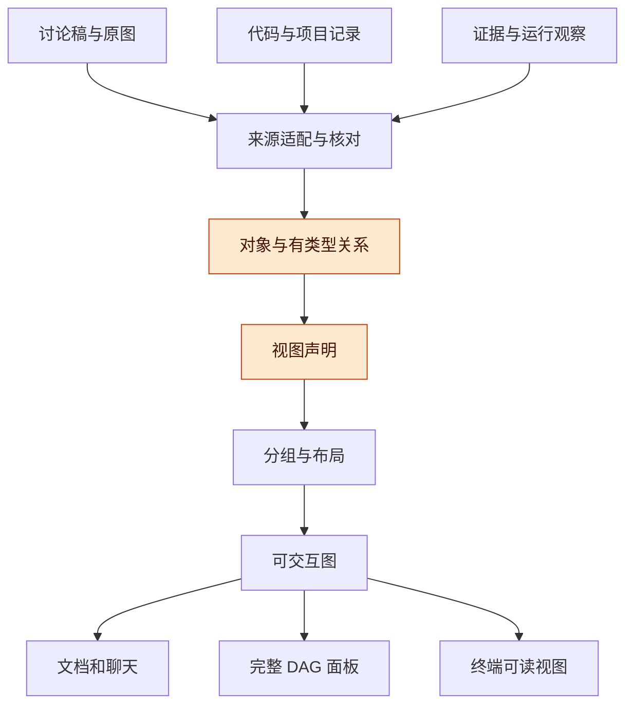
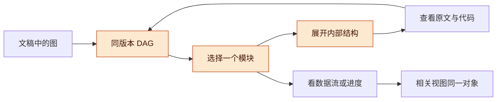
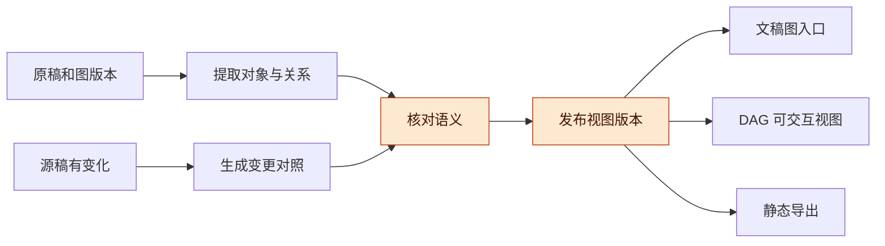

# DAG 统一图形表达与场景映射讨论稿 v0.1.0

2026-11-13 · Codex，与用户讨论整理

## 版本与范围

DAG 的产品目标是用可交互的图帮助人理解系统、过程、依据、选择和当前工作。讨论稿里为帮助理解而画出的架构图，都应成为 DAG 可呈现的场景；现有交付关系图属于其中一类。

- 版本：v0.1.0，回查历史图形诉求、盘点讨论稿图块，形成场景映射、统一视图方案及待定的实施顺序。后续按补丁号递增。
- 主线：想看清的问题 → 图中的对象与关系 → 适合的视图 → 展开、追溯和对照 → 理解与判断。
- 状态标记：**已核读**表示读到原稿或现有源码；**机械清单**表示扫描所得；**本轮提案**尚未实现；**历史验证**沿用已写明范围的旧结果，本轮未复测。

**本轮边界**：用户选择先整理整体方案和图的对应关系。本轮只新增文档与来源清单，不修改产品代码、远端服务或项目记录。三张代表图是后续验证候选，不限制全部场景，也未获本轮实施授权。

**材料口径**：公开方案引用仓库已有公开整理稿。历史原始需求与目标截图已在私有材料中回查，原始会话、私有项目数据和截图不随本包发布。各第三方框架的旧比较只作为图形需求样本，本轮不更新它们的产品能力结论。

## 产品定位与既有工作的关系

用户需要的是在看图时逐步理解一件事，并能沿着关系找到细节、依据和下一步；图形表达应成为讨论与工作的日常入口。

**图 1　DAG 的使用主线 · 从问题到理解**

从左向右看一次理解过程；返回问题的边表示继续追问，图本身不会因此启动任务。

**本轮修正**：前一轮工作台实现聚焦“目标、模块、线程、成果、验收”，提供了真实可操作的交付图。把这张图的固定对象和六列布局当作 DAG 的全部形态，会缩小既有需求。后续应让交付图进入统一视图体系，同时保留系统架构、数据流、方案比较、时序、状态和证据等画法。

**既有定位已有依据**：[DAG 总则](../06-dag/current/docs/design/dag-detailed/00-总则.md)与[前端结构需求](../06-dag/current/docs/design/dag-detailed/03-前端结构需求.md)已包含改动影响、待决事项、架构进度和对话证据；[统一 Harness 总体稿](../10-unified-engineering/2026-11-08-v0.1.9/统一Harness工程与形式化基础讨论稿-v0.1.9.md)把有类型的依赖、影响、证明和普通关系图分开。此方向承接已有需求。

## 历史场景与讨论稿覆盖

应按人想解决的问题组织场景，再把每张图挂到相应场景；文档目录、图形语法和实施模块分别维护。

| 需求组 | 典型问题 | 需要保留的能力 |
| --- | --- | --- |
| 看清结构 | 系统怎么分层；一个模块里面是什么 | 全貌、层级、分组、展开与返回 |
| 看清过程 | 数据怎样流；谁先调用谁；循环如何结束 | 路径、分支、反馈、消息顺序与状态转换 |
| 看清选择 | A/B 会改变哪里；什么尚未决定 | 同一基线对照、共同部分、差异与未定项 |
| 看清影响 | 改一个点会涉及谁；两点之间怎样连接 | 相关上下游、完整链路、关系解释与来源 |
| 看清工作 | 做到哪里；谁在做；还缺什么 | 架构上关联任务、进度观察、成果与验收 |
| 看清依据 | 为什么这样设计；结论依赖什么 | 原文、决定、代码、证据与版本追溯 |
| 在讨论中看 | 讲到哪里就显示哪里；自己继续深入 | 文档、聊天和完整面板之间延续焦点 |

具体映射见 [15 类场景表](SCENE_MAP.md)。场景可以组合：同一张系统架构图可叠加进度，沿某条数据流切换到时序，再回到架构定位原对象。

**机械盘点**：在基线 `90343dba2e012a58dec759ae8496cf764dc4339c` 的 `docs/harness` 中，共找到 95 个含 Mermaid 的 Markdown 文件、433 处图块。其中 flowchart 423 处、sequenceDiagram 9 处、stateDiagram-v2 1 处；按去除首尾空白后的图块正文去重有 193 组。这里包含旧版本与研究输入副本，不能称为 433 张独立架构图。详见 [清单与口径](DIAGRAM_INVENTORY.md)。

**未覆盖的材料**：以上数字不包含 SVG、PNG、仅存在于 HTML 的图和全部历史对话。本轮回查了原需求追溯材料与代表图，但没有逐句重审所有历史会话，也没有逐张验证全部图的转换。旧目录名 `current` 不保证每份文件都是最新裁定。

## 图的语义与表达方式

DAG 可以保留现有产品名称，同时支持多种图形语义；是否允许环、箭头表示什么、怎样推导影响，应由关系和视图类型决定。

| 视图 | 基本表达 | 环与方向 | 不能从画面直接推导什么 |
| --- | --- | --- | --- |
| 分层架构 | 层、模块框、包含与接口 | 包含关系应保持合理层级；模块间可双向交互 | 一个框必定对应一个已部署服务 |
| 数据流与反馈 | 输入、转换、存储、输出、反馈 | 允许回流；箭头说明传递的内容 | 数据边就是任务启动前置 |
| 部署图 | 环境、实例、会话、资源 | 允许双向连接；跨环境关系明确 | 逻辑组件名字就是实际进程身份 |
| 时序图 | 参与者、消息、顺序、条件分支 | 用参与者与时间顺序表达 | 消息已发送就是效果已完成 |
| 状态图 | 状态、触发条件、转换 | 允许回到前态；历史轨迹另外展开 | 设计允许的转换已经实际发生 |
| 依赖与交付图 | 前置、产出、消费、验收 | 明确用于调度的依赖需无环校验 | 所有可达对象都应重启或作废 |
| 证据与方案图 | 主张、依据、反对、选择 | 支持与反对、假设与事实分别标识 | 一条关联边就是充分证明 |

**实际例子**：Record 图 2 含“执行模型 → 补取反馈 → 组装器”的循环；统一 Harness 图 2 含内核与 Record 双向关系；适配契约图 2 是消息时序。把它们全部铺进交付图六列，会丢失原本要解释的内容。

**模型与布局分开**：关系含义来自源材料与明确登记，坐标只用于展示。渲染时即使内部需要临时反转边来排列，用户仍应看到原始方向。仅有截图的旧图先登记为来源，再核对节点、分组、箭头和标签；不能依据框在左边就推断它是前置依赖。

**视图可以组合**：结构、数据流和进度可以在同一图中切换强调，但应有明确图例。状态、时序、表格、数值曲线可作为相互链接的视图，不强迫它们套用同一个节点排布。

## 总体架构与数据责任

建议让 DAG 统一管理图形表达的规则和交互，来源系统继续持有业务事实，各场景通过可追溯引用连接。

**图 2　统一视图方案 · 来源、语义、视图与出口**

从上向下看同一语义如何进入不同出口；图中是职责，不要求新增同样数量的服务。

| 层 | 保存或负责 | 首先解决的事 |
| --- | --- | --- |
| 来源引用 | 文稿版本、章节、图号、代码或记录版本 | 每个节点和关系能说明从哪里来 |
| 对象与关系 | 命名空间、对象身份、类别、关系含义与版本 | 跨图复用同一实体，同名对象不误合并 |
| 视图声明 | 要回答的问题、选取对象、分组、顺序、强调、图例 | 同一组对象可生成不同用途的图 |
| 布局与交互 | 卡片尺寸、层级、泳道、走线、展开、返回 | 在不同宽度保持可读与上下文连续 |
| 宿主出口 | 文档、聊天、小图、完整面板、终端 | 同一个视图引用在不同入口仍指向相同内容 |

**实体和图上的一次出现分开**：例如 Record 在全貌图中是一个框，在内部图中是多个子模块。需要区分“实际关联的实体”和“它在本图里的节点”。一个实体在两张图中出现，可以共用来源；设计稿中的抽象角色和运行时的某个实例则应通过映射联系。

**工作台的关系**：现有交付管理继续维护工作包、原线程、成果和人工验收。DAG 读取或引用这些对象，作为交付与进度视图。图中的架构编辑不能悄悄写成任务分派，图中显示的关联也不改变已有任务启动规则。

**复用的落点**：优先在既有 DAG 前端和图数据接口中核查可复用的布局、卡片、聊天及面板协议；工作台提供项目来源适配。当前新交付图与独立 DAG 面板尚未联通，本轮不把“统一方案”写成已经整合，也不复制另一项目的私有实现到公开仓库。

## 读图体验与日常用法

好的默认画面应先回答当前问题，再允许展开细节；用户不必先学习一大套图编辑器才能看懂系统。

**图 3　从全貌到依据 · 保留返回路径**

从文稿打开后保留原图身份和版本；展开与切换视图延续选中的对象，并提供回到全貌的路径。

1. **直接看到结构**：保留原图有意义的层、阶段、分组和泳道。模块框默认显示名称与关键职责，边上写传递什么或为何相连。
2. **按需深入**：点模块展开内部结构，点数据或接口看字段和约定，点证据看原文；展开后调整局部布局，不让全部内容只剩省略号。
3. **同对象换视角**：选择 Record 后，可在总体架构、内部数据流、部署和工作进度之间定位它。不同视图保留自己的分组和方向说明。
4. **从文字带入图**：讨论某个变化时打开对应局部，强调正在讲的路径；完整面板继续保留用户自己的焦点。不能仅因模型产生新图就覆盖用户正在看的内容。
5. **需要比较时再叠加信息**：设计版本差异、当前实现映射、进度与执行者信息可按问题启用。未关联的节点显示未关联，不猜测实际状态。
6. **优先保证可读**：空间不足时折叠、分层、改变排布或滚动，并说明未展开的范围。固定六列适用于当前交付图，不成为全部图的版式约束。

## 来源、版本与文档的衔接

图应成为文稿中架构说明的另一种可操作表达，原文与历史版本仍可追溯。

**图 4　文稿与 DAG 的衔接 · 转换也需要核对**

从原稿到视图保留出处，变化通过对照形成新版；旧文稿链接继续解析到原来的视图版本。

**过渡方式**：既有 Mermaid 是来源之一，先按支持的子集提取并核对。遇到不能保留的嵌套、并行、反馈或特殊节点时明确列出，保留原图供对照。图片图先人工登记；本轮不承诺所有语法自动转换。

**长期写作方式**：每张架构图可拥有稳定图 ID、版本、所属文稿、要回答的问题、对象与关系、布局意图以及原文位置。Markdown 保留标题、读图说明和静态导出；DAG 提供展开、选择、追溯与对照。结构化图与文稿图如何共同编辑，仍需另定写入责任，避免两份内容悄悄分叉。

**设计与实际分开显示**：建议架构、当前实现、一次运行观察、人工验收是不同信息层。只有明确的映射与来源才叠加实际状态。旧文稿的“已验证”只适用于它记录的版本和环境；本轮扫描不会刷新那些结论。

**同名不等于同一对象**：跨图定位需要可确认的实体引用或映射，不能仅按名称拼接。解析失败、原版本不可得或关系尚未确认时给出明确状态，不用最新版冒充原图。

## 实施顺序与验收设计

先形成完整场景地图，再用不同类型的图检验公共能力；验证候选应覆盖结构、反馈和部署边界，而不是决定产品仅支持这几张图。

| 阶段 | 产出 | 当前状态 |
| --- | --- | --- |
| P0 场景与来源 | 历史需求归纳、15 类场景、机械图清单及材料边界 | 本轮已整理 |
| P1 公共表达契约 | 身份、来源、关系、分组、视图、版本、展开与回退约定；对照既有 DAG 接口 | 待讨论并冻结 |
| P2 代表图验证 | 总体架构、Record 三路径与反馈、远程双模式三张候选；再以时序与状态图检查扩展能力 | 候选，未批准实现 |
| P3 多入口衔接 | 文稿、聊天、完整 DAG 面板与现有交付图共享引用和焦点 | 待实现范围确认 |
| P4 持续覆盖 | 按场景接入其他讨论稿；保留版本、未支持项和人工核对记录 | 长期方向 |

**任务书**：后续开始代码前，需给每张候选图列出必须保留的节点、关系、分组、回路和文字说明；给每项交互列明入口、返回位置、对象版本与可见结果；明确主实现落在既有 DAG 的哪一层，工作台只提供哪些适配。三张样板之外的场景继续保留在全局映射表中。

| 对照场景 | 应检验的结果 | 不能省略的部分 |
| --- | --- | --- |
| 原静态图与 DAG 并看 | 用户能回答同样的结构问题，并进一步展开 | 原有模块、方向、分组与说明 |
| 含反馈的 Record 图 | 回路完整，在线与后台路径可区分 | 反馈语义不能被无环校验删掉 |
| 本机与远程部署对照 | Agent、文件、会话位置清楚 | 同名实例与环境不能混为一处 |
| 文稿到图再返回 | 同一版本和同一对象，回到对应段落 | 不跳到最新版本替代历史内容 |
| 同对象跨图 | 保留实体引用，各图自己的层级不被覆盖 | 名称匹配只能做候选 |
| 叠加进度 | 明确哪些有实际线程或成果，哪些未关联 | 不能把设计节点自动标为完成 |
| 语法暂不支持 | 显示转换缺项并可打开原图 | 不静默丢边、不编造关系 |

**停止判据**：如果图比原稿更难理解，或者出现关系丢失、箭头含义改变、来源版本串联，就不能把“页面能打开”算作样板完成。首先修正表达与映射，再扩大导入范围。

**本轮实施差距**：源码中的 `client/graph.js` 目前使用交付专用类别和六列布局，`server/graph.js` 投影项目交付记录。它们尚不具备通用文稿导入、任意分组、时序或状态布局、跨文稿实体映射。前轮 96 项测试和真实交付试验不证明这些新能力存在；本轮未新增产品测试或运行试验。

## 风险与开放问题

主要风险是丢失原图想解释的内容，或在统一入口时把不同关系和版本混在一起；应以读图问题和来源核对约束实现。

- **图形被单一化**：所有内容塞进同一种排布会损失层次、时序和反馈。按场景选择画法，共用身份和交互基础。
- **实体误合并**：不同稿件的同名模块可能指不同设计或实例。保留来源范围和明确映射。
- **现状被设计覆盖**：规划中的模块和真实已完成工作需要分别表示，再按明确关系叠加。
- **历史范围误用**：旧一期的排期、默认值和原项目参数不是本轮新的实现授权；当前以“先整理方案”为准。
- **导入覆盖高估**：机械清单只覆盖指定 Markdown 图块，正文哈希去重也不等于语义去重。图片、私有材料和外部会话另有范围。

开放问题：

- [x] 将 DAG 定位为统一图形表达入口，纳入以前要求画架构图以帮助理解的场景。
- [x] 本轮先整理整体方案、历史场景和原稿对应关系。
- [ ] 原稿、结构化图与人工编辑的写入责任怎样安排；先导入只读还是同步支持编辑？
- [ ] 既有 DAG 渲染和卡片能力的实际可复用范围如何；哪些需要扩展，如何接入工作台？
- [ ] 文档与聊天首先在哪个宿主接入；三张代表图、时序和状态能力分几轮验证？
- [ ] SVG、图片和其他项目的图怎样纳入后续核读与授权范围？

## 待证命题与下一步

下一步先评审这套场景映射和公共表达契约，之后再明确代码范围；产品效果要通过用户读图和操作验证。

| 编号 | 命题 / 猜想 | 已有依据 | 缺口 |
| --- | --- | --- | --- |
| H1 | 同一实体与多视图分开后，可以同时保留全貌和细节 | 已有稿件多次从整体到模块、从结构到进度解释同一系统 | 实体映射与跨图定位的真实操作 |
| H2 | 分类型保留关系和布局，比交付专用六列更适合架构图 | 已核读分组、反馈、部署、时序与状态样本 | 各类样板和读图对照 |
| H3 | 文稿与 DAG 共享版本引用，能减少重复解释 | 原 DAG 设计已有同语义多出口原则 | 文稿入口、焦点延续及版本变化试验 |
| H4 | 架构上叠加现有交付信息，能帮助判断下一步 | 当前交付管理已能保存模块、线程、成果与验收关系 | 架构实体到工作包的明确映射和实际使用 |

下一步：

- [x] 回查历史原需求追溯材料与目标架构图。
- [x] 核读代表讨论稿中的结构、流程、反馈、部署、时序和状态图。
- [x] 形成有覆盖边界的图块目录和 15 类场景映射。
- [x] 记录当前交付图能力与整体 DAG 目标之间的差距。
- [ ] 评审场景表与来源映射，补充遗漏问题。
- [ ] 核查既有 DAG 可复用代码和宿主接口，冻结首轮具体契约。
- [ ] 在用户确认新增代码范围后实施，再以真实图和读图问题验收。
