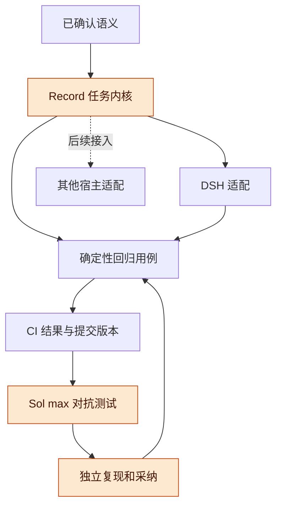
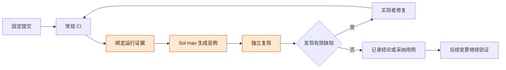
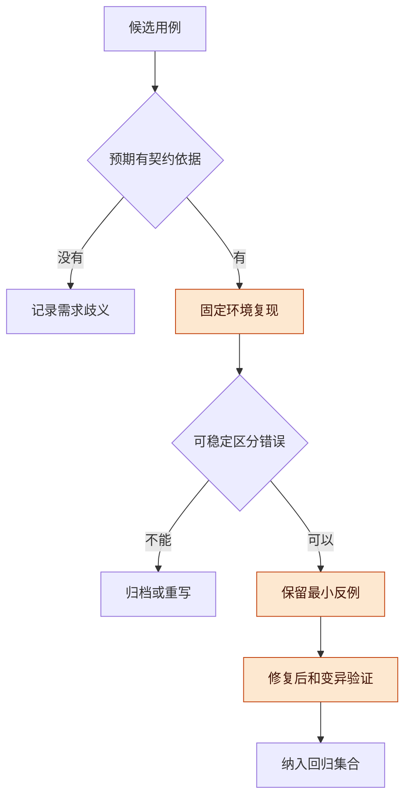

# Record 任务内核与持续对抗测试实施讨论稿 v0.1.1

2026-11-07 · Codex 整理，依据用户已确认的生命周期约定

## 版本与范围

Record 的共享任务语义已经确认；建议复用现有 DSH 项目工作台仓库，在独立分支建立任务内核和持续验证流程，并在每轮 CI 后使用 GPT-6.1-Sol、max 推理强度设计对抗性测试。本稿确定公开实施入口与验证要求，用户已确认先实施 S1 内核与 CI，由 GitHub 执行 CI、当前 Codex 会话随后调度模型。

- 版本：v0.1.1 记录用户确认的首轮范围和模型执行位置，增加可运行 S1 契约及 CI 入口；v0.1.0 首次公开整理任务生命周期的已确认决定、S1 候选范围、CI 后对抗测试流程、用例采纳与停止条件。本稿是生命周期讨论的实施衔接稿，不替代 Record 主稿或宣称功能已经上线；后续按补丁号递增。
- 主线：公开仓库与分工 → 已确认语义 → S1 候选范围 → CI 与模型循环 → 对抗场景 → 验证和未决项。
- 状态标记：“已确认”来自本轮用户决定；“已核查”是指定时间的仓库或官方文档观测；“建议”尚待选定；“待验证”没有运行证据。本稿不包含私人会话、机器路径、凭据或项目运行数据。

**当前进展**：已实现可本地验证的 S1 状态内核、行为测试和 CI 证据脚本。实际运行状态统一登记在 [Record 入口](README.md) 和 [逐轮审查记录](reviews/README.md)，本版本不提前宣称远端或模型审查通过。

**本地基线证据**：2026-11-07，在上述代码基线、Node.js v24.6.0 上，现有 17 项测试全部通过，构建成功，11 个既有变异全部被测试检出。初次依赖安装因默认缓存写入权限失败，改用工作区缓存后安装和检查通过；这是本地基线，不是 GitHub CI 或新功能验证，也尚未运行 Sol max 测试生成。

## 总体架构与仓库选择

建议复用 [TaiShuo150622/dsh-project-workbench](https://github.com/TaiShuo150622/dsh-project-workbench)，将宿主无关的 Record 内核与 DSH 适配分开，并让 CI 和对抗用例都围绕确定的提交版本运行。

**图 1　实现与验证分工 · 内核、适配和测试分离**

从上往下看，任务语义由内核统一承担，宿主独立接入；测试生成和测试采纳分开，新增用例经过复现后进入回归集合。

| 项目 | 当前核查 / 推荐安排 |
| --- | --- |
| 仓库 | 用户个人公开仓库，有写入权限；不是 DeepSeek 官方维护仓库 |
| 基线 | `codex/dsh-project-workbench`，核查提交 `b9d44847d72883bf5116c72f445c31618d7cc020` |
| 工作分支 | `codex/record-task-lifecycle`；独立提交和审查，不直接改变默认分支 |
| 当前自动化 | 2026-11-07 核查时 GitHub Actions 工作流数量为 0；已有 `npm test`、构建与变异测试脚本 |
| 代码组织建议 | 通用内核放独立模块，DSH 只通过明确入口读写；避免将宿主线程状态直接当作业务状态 |
| 后续公开贡献 | 先在个人仓库形成可复现实现与证据；向 DeepSeek 官方或其他上游投稿时再确认目标与接口，不把本分支发布称为上游接收 |

**开发仓库与真实试点对象分别选择**：本仓库可公开开发代码与合成测试。后续真实合并试点仍按已确认条件挑选固定源提交的文档 PR，可使用个人私有验证仓库；公开开发分支不自动成为真实合并实验对象。

## 已确认的任务语义

任务身份、完成证据和验收必须表达不同事实；完成、取消或纠正都应传播到其他会话，旧摘要不能重新产生待执行工作。

| 编号 | 已确认约定 | 首轮应证明的行为 |
| --- | --- | --- |
| A1 | Record 维护共享业务状态，宿主维护执行状态 | 宿主 running、failed 或 completed 不直接生成业务完成 |
| A2 | 已核实完成退出待执行，验收单独记录 | 客观完成后，即使待验收也不重复执行 |
| A3 | 完成后来被撤回，保留原完成历史，登记新问题，需要恢复时建关联任务 | 历史里程碑与当前结果适用性分别判断 |
| A4 | Record 不可用时暂停共享修改，只读检查和本地草稿继续 | 失联不绕过动作检查；恢复同步后才能重新考虑写入 |
| A5 | 取消后重新明确交办建立关联新任务；暂停和失败重试沿用原任务 | 原交办重放不复活取消；新任务先检查旧在途动作和既有结果 |
| A6 | 错误完成撤回后保留验收历史，只暂停受影响适用性 | 同一结果可明确确认沿用；结果变化重新验收；无关元数据纠正不重验 |
| A7 | 验收按钮绑定具体结果并提交 Record，会话关闭另列 | 看 A 的点击不能验收 B；首轮不新增离线验收队列，已发请求按原身份对账 |
| A8 | 固定源提交的文档 PR、普通 merge、双 DSH 会话，分阶段试点 | 同时证明阻止已完成工作和允许合法新工作，不能全拦截后宣称成功 |

**范围不自动扩大**：用户确认上述语义，不等于每种持久化实现、全部宿主适配或真实合并对象已经选定。模型可提出测试与修复，不能为了通过测试自行放宽已确认条件。

## 首轮 S1 实施范围

用户已确认先做可独立测试的状态内核与 CI 闭环，再接 DSH 的真实请求和工具边界；实现契约见 [Record S1](../../record/README.md)。

| 模块 | S1 建议实现 | 留到后续验证 |
| --- | --- | --- |
| 任务身份 | 任务、定义版本、交办来源、执行尝试、取消与重新交办关系 | 模糊历史文本自动匹配、批量实体归并 |
| 完成与证据 | 固定 PR 范围的结构化证据判定、争议与纠正、逐项投影 | 对任意自然语言任务自动判定完成 |
| 结果与验收 | 结果绑定、验收适用性、旧结果拒绝、同一请求去重 | 工作台按钮与真实身份入口 |
| 更新模型 | 有序事件回放、版本检查、快照与游标一致性 | 真实宿主预取、请求观测、跨进程投递恢复 |
| 动作模型 | 已完成跳过、失联等待、在途未知禁止接管的状态演练 | 真实外部发送闸门、宿主可拦截范围与外部竞态 |
| 测试 | 合成事件、固定时钟、确定性调度、可复现失败轨迹 | 两个真实 DSH 会话及真实 GitHub 合并 |

**持久化边界**：S1 可先以纯状态变换和事件回放验证语义；这不证明文件、数据库、跨进程事务、断电恢复或 outbox 的实现成立。若首轮加入持久化，需先补充相应失败模型与验证范围，不能直接把现有工作台 Store 当作跨宿主事务保证。

**分阶段任务书建议**：

1. 固化任务、结果、证据、验收和来源身份的契约，定义非法与未知输入的处理。
2. 实现最小状态变换和回放；每种转换直接对应已确认约定。
3. 建立确定性行为测试及正向对照，并接入已有测试、构建和变异测试。
4. 为 CI 结果保存提交版本、运行身份、日志与回执，建立模型测试生成入口。
5. 完成首次对抗测试采纳循环后，再评估 S2 的 DSH 接入任务书。

## CI 后的对抗测试循环

每轮 CI 结束后固定待审提交和运行身份，再由 GPT-6.1-Sol max 设计反例；只有验证了预期行为和复现价值的用例才进入长期回归集合。

**图 2　一次验证循环 · 生成、复现与修复分工**

从左到右看，模型收到的是一个确定版本的 CI 证据，测试需要由调度者复现；修复会产生新提交并回到 CI，模型不独自宣布自己的测试通过。

| 环节 | 输入 | 输出与约束 |
| --- | --- | --- |
| 常规 CI | 明确提交、锁定依赖、已有回归集合 | 测试与构建结果；失败、取消、超时分别标注，不能当成功 |
| 对抗任务 | 提交、差异、已确认契约、CI 日志、已存在的反例索引 | 最小复现用例、预期与实际、违反的约定、执行方法；无缺陷也允许如实报告 |
| 生成者 | 固定 `gpt-6.1-sol`，推理强度 `max` | 仅新增候选测试与报告；不改生产实现、原断言、CI 门槛或授权规则 |
| 复现者 | 固定快照和候选用例 | 判断是真缺陷、需求歧义、环境问题、重复覆盖还是错误测试；保留理由 |
| 修复者 | 已确认的反例和原始失败证据 | 修复实现，不能通过删断言、放宽条件或把失败移入 skip 来消除缺陷 |
| 采纳者 | 复现与修复后的 CI 结果 | 接受有用用例、归档无效候选，记录来源和适用范围；不自动合并默认分支 |

**按运行身份去重**：记录仓库、PR、提交 SHA、workflow run ID、run attempt、提示词版本、模型、推理强度和用例指纹。同一完成事件重复送达不再付费生成一轮；同一提交的重跑记录新的 attempt，已有测试去重，仍检查新增失败信息。旧提交的结果可归档，但不能覆盖新提交的当前通过状态。

**每轮 CI 包括失败结果**：业务测试失败时优先最小化反例；依赖安装或 runner 故障应归类为基础设施问题，不能宣称产品测试已通过。记录中区分“生成任务待执行”“模型执行失败”“没有发现新问题”和“新用例已复现”。

**防止无穷循环**：不要求每轮必须创造一个新测试；没有新增有效覆盖时允许结束本轮。建议每次人工交办的自主修复最多两轮，超过后保留失败与分支交回讨论；这一上限为候选运行参数，尚未启用。持续增加是后续变更持续积累用例，不是无上限重复修改同一提交。

**首轮不依赖自动提交递归**：模型先产出候选，主会话验证后提交新版本；新版本产生下一轮 CI。将来如果自动提交，必须验证实际采用的 GitHub 身份能触发预期工作流，并处理触发循环与并发，不能把“push 已成功”当作“下一轮 CI 已启动”。

## 模型执行位置与凭据边界

用户已确认由 GitHub 跑确定性 CI，当前 Codex 会话随后调度 Sol max；完全无人值守模式不属于本轮。

| 方式 | 能做到什么 | 前提和当前状态 |
| --- | --- | --- |
| GitHub CI + 当前 Codex 会话调度（推荐首轮） | CI 后读取日志，派发 Sol max 测试生成，验证并提交采纳用例 | 当前会话可调用指定模型；会话结束后不会天然持续监听，不能宣称已部署全天自动化 |
| 全部在 GitHub Actions 执行 | 由工作流串联 CI、模型任务及候选产物 | 需要为仓库配置模型凭据和运行额度；2026-11-07 核查时仓库未配置 Secret，尚未启动模型作业 |

**官方能力核实**：OpenAI 官方模型页列出 `gpt-6.1-sol` 支持 `reasoning.effort: max`。[GPT-6.1 Sol](https://developers.openai.com/api/docs/models/gpt-6.1-sol) 官方 Codex GitHub Action 支持设置 `model`、`effort`、沙箱和结果文件，并要求配置相应 API 凭据。[Codex GitHub Action](https://learn.chatgpt.com/docs/github-action) 文档能力不代表本仓库已配置成功，首轮必须保存实际调用配置和结果。

**不得静默替换**：指定模型或 max 不可用时，该任务记为未完成或失败，不改用默认模型，不把空报告记作通过。实际调用字段和可观测模型信息应保存；只写提示词“请使用 max”不构成配置证明。

**运行隔离**：常规测试和候选测试在无模型凭据、无仓库写权限的环境执行；模型生成阶段输出补丁或受限测试目录。公开 PR 内容、日志和生成代码都作为待检查材料，不让它们扩大写入范围或改变验证标准。首轮模型没有发布、部署、自动合并权限。

## 对抗场景与测试采纳标准

优先积累能复现状态错误和并发边界的用例，同时保留合法工作的正向对照；测试数量和模型意见不能替代行为证据。

**图 3　用例采纳 · 先证明预期，再证明测试有效**

从上往下看，预期先对应已确认约定，再检查反例是否稳定；需求歧义和测试错误不会自动转化为实现缺陷。

| 场景组 | 重点反例 | 必须保留的正向对照 |
| --- | --- | --- |
| 交办身份 | 原交办重放、取消后再交办、标题相似但目标不同 | 同一任务继续时不重复创建；新合法任务能够执行 |
| 完成证据 | 错仓库、错目标、源提交变化、证据属于另一结果 | 匹配条件的有效证据能够完成任务 |
| 验收 | 页面 A 提交时结果为 B、双击、响应丢失、完成被撤回 | 同一结果和有效完成能够验收；无关备注不阻止验收 |
| 事件与输入 | 重复、乱序、漏通知、旧快照晚到、重建索引 | 补取后采用新状态，旧响应不能覆盖新快照 |
| 并发动作 | 两会话同时申请、取消跨越发送边界、旧操作结果未知 | 无冲突且已授权的新工作不被无限等待 |
| 历史与当前 | revert 后历史完成仍在、当前结果却已无效 | 历史查询仍能证明当时完成；当前依赖不会误判 |
| 故障恢复 | 提交成功回执丢失、状态与通知中断、进程重启 | 同一请求可靠对账，不重复执行外部动作 |

**对照组**：基线为已有固定回归测试；第一对照增加人工按契约设计的边界用例；第二对照增加 Sol max 候选中被复现采纳的用例。分别记录新增独特缺陷、有效变异检出、重复用例比例、误报和额外运行时间，不只比较用例总数。

**采纳要求**：真实缺陷用例应在修复前失败、修复后通过，并指向外部可观察行为；无已知缺陷但覆盖关键约定的防回归用例，可通过受控变异证明其检测能力。不能仅断言某个内部函数被调用，也不能以随机等待碰运气制造并发失败。时间、随机种子和调度点固定，保留最小失败轨迹。

**停止判据**：测试要求改变已确认语义、无法稳定复现、依赖未配置、模型配置不符、写入超范围、候选通过删除原断言才能成立，均停止该候选的采纳并记录原因。出现真实缺陷时可继续限定范围的修复；本轮通过不等于全产品验收。

## 风险与开放问题

主要风险是把“模型生成了测试”当成“测试有用”，以及把“本轮有人调度”当成“CI 后已永久自动运行”；需要分别记录验证结果和自动化覆盖范围。

- **测试自证**：实现和测试可能共同误解需求；测试预期必须追溯已确认约定，必要时由不同模型或人工复核。多个 Sol 上下文属于同模型不同上下文，不宣传为不同模型审查。
- **版本错配**：CI 检查的提交、模型读取的提交与采纳目标不同；全部绑定 SHA 与运行身份，变更后重新验证。
- **成本与循环**：每次生成自动推送可能形成无界循环；去重、限制自主修复轮数，不强制凑新用例。
- **凭据与测试执行**：生成代码不能在带模型凭据或仓库写权限的作业中随意执行；候选验证隔离，失败不能标通过。
- **过早宣称接入**：S1 状态演练不能证明 DSH 请求刷新、实际动作拦截或三宿主兼容。

开放问题：

- [x] 已确认：生命周期约定 A1–A8
- [x] 已确认：采用仓库分支与持续 CI、GPT-6.1-Sol max 对抗测试方向
- [x] 已核查：可复用公开仓库、现有基线和测试入口
- [x] 用户已确认首轮 S1 内核与 CI，DSH 接入后续再做
- [x] 用户已确认 GitHub 跑 CI，当前 Codex 会话随后调用 Sol max
- [x] 冻结 S1 可信输入与内存模型边界，增加可运行契约和任务书
- [ ] 自动化部署前确定额度、触发主体、候选采纳方式及失败接管入口

## 待证命题与下一步

下一步验证真实 GitHub CI 和后置 Sol max 测试生成闭环；持续测试的价值通过独特缺陷和可重复行为证据衡量。

| 编号 | 命题 / 猜想 | 已有依据 | 缺口 |
| --- | --- | --- | --- |
| P1 | 跨会话任务状态内核可以阻止旧待办重新执行 | 已确认语义与审查反例 | S1 与真实动作边界尚未实现 |
| P2 | CI 后对抗生成能补足固定回归遗漏 | 已有测试与变异测试可作为基线 | 尚无本项目 Sol max 生成后采纳的对照数据 |
| P3 | 独立复现、版本绑定与用例去重能保持测试集合可维护 | 流程可逐项审计 | 尚未运行自动循环，成本和误报未知 |

下一步：

- [x] 记录用户已确认的任务生命周期决定
- [x] 核查个人公开仓库、分支、测试脚本和 CI 配置
- [x] 核查指定模型 max 与官方 CI 调用接口的文档能力
- [x] 初始公开稿已提交到独立分支，PR #1，提交 1a82bac
- [x] 确定首轮编码范围与模型执行位置
- [x] 运行现有本地基线：17 项测试通过、构建通过、11 个变异全部检出
- [x] 实施确定性 CI 脚本与 S1 契约；远端及对抗验证另记
- [ ] CI 后运行首次 Sol max 对抗生成，复现并采纳有效用例
- [ ] 保存修复前失败、修复后通过和变异检出的完整证据
- [ ] 依据 S1 结果编写 DSH 接入任务书，分别验证 S2 / S3
